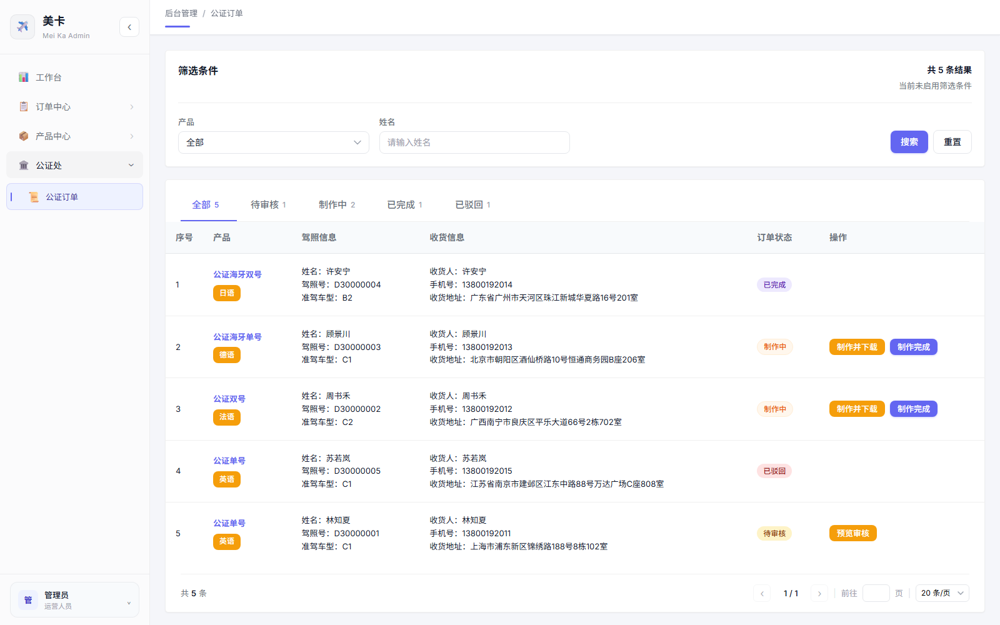
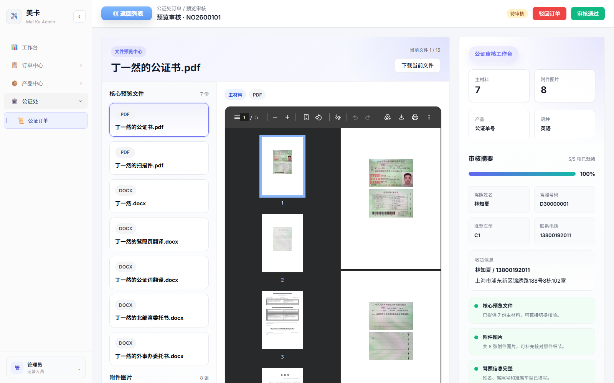
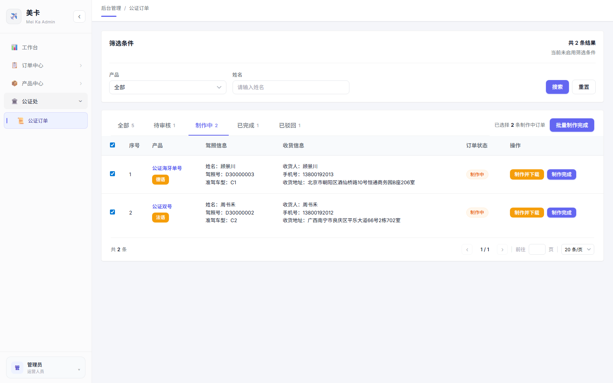
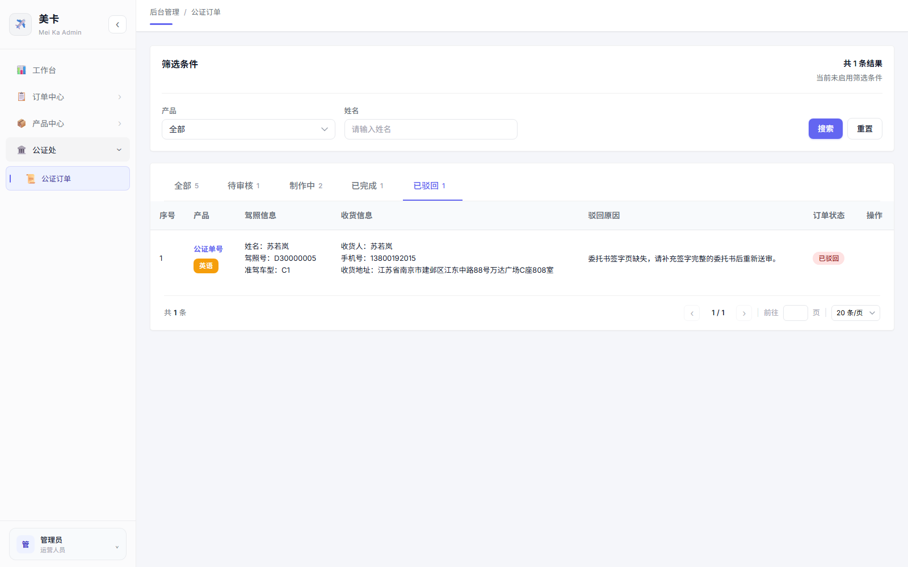

# 公证端-产品使用手册

> 适用对象：公证处公证人员

---

## 1. 手册目的

本手册用于培训公证人员使用“公证处 ”页面完成公证订单的审核、驳回、制作下载、制作完成等日常操作。

培训结束后，使用人员应能够：

1. 看懂订单列表中的状态、字段和操作按钮。
2. 按照标准流程审核待审核订单。
3. 正确填写驳回原因，并理解驳回后的回流规则。
4. 对制作中订单下载制作文件并标记制作完成。
5. 使用筛选、状态页签、分页和批量完成提升处理效率。

---

## 2. 页面定位

公证工作台，主要处理已经从管理端送审到公证处的公证订单。

页面承担以下工作：

- 查看待审核、制作中、已完成、已驳回订单。
- 对待审核订单进入“预览审核”页面。
- 审核通过后将订单推进到“制作中”。
- 审核驳回后填写驳回原因，并同步给管理端处理。
- 对制作中订单下载制作文件。
- 单条或批量将订单标记为制作完成。

注意：物流发货不在公证处页面操作。公证处标记制作完成后，物流发货由管理端继续处理。

---

## 3. 业务流程总览

标准流程：

1. 管理端将公证订单送审至公证处。
2. 公证处订单进入“待审核”。
3. 公证人员进入“预览审核”查看材料。
4. 材料无问题时点击“审核通过”，订单进入“制作中”。
5. 公证人员在“制作中”点击“制作并下载”，获取制作文件。
6. 制作完成后点击“制作完成”。
7. 订单进入“已完成”，管理端继续进行物流发货。

驳回流程：

1. 公证人员进入“预览审核”查看材料。
2. 发现材料缺失、不清晰或信息不一致时点击“驳回订单”。
3. 填写明确的驳回原因并确认。
4. 公证处订单进入“已驳回”。
5. 管理端订单回到可再次送审状态，相关同事补充材料后可重新送审。

---

## 4. 页面区域说明

### 4.1 筛选条件区

可按以下条件筛选订单：

| 筛选项 | 用途                 | 说明                                               |
| ------ | -------------------- | -------------------------------------------------- |
| 产品   | 按公证产品筛选       | 支持公证单号、公证双号、公证海牙单号、公证海牙双号 |
| 姓名   | 按客户或驾照姓名筛选 | 输入姓名后点击“搜索”                             |

按钮说明：

| 按钮 | 作用                              |
| ---- | --------------------------------- |
| 搜索 | 按当前筛选条件刷新列表            |
| 重置 | 清空产品和姓名筛选，并回到第 1 页 |

提示：重置不会清空当前选择的状态页签。例如当前在“制作中”，点击重置后仍停留在“制作中”页签。

### 4.2 状态页签区

页面提供 5 个状态页签：

| 页签   | 含义                                 | 可执行操作                                   |
| ------ | ------------------------------------ | -------------------------------------------- |
| 全部   | 展示所有公证处侧订单                 | 根据订单状态显示对应操作                     |
| 待审核 | 等待公证处审核的订单                 | 可点击“预览审核”                           |
| 制作中 | 已审核通过，等待制作完成的订单       | 可“制作并下载”“制作完成”“批量制作完成” |
| 已完成 | 公证处已完成制作，或后续已发货的订单 | 仅查看                                       |
| 已驳回 | 公证处审核驳回的订单                 | 仅查看驳回原因                               |

每个页签旁边会显示该状态下的订单数量。

### 4.3订单表格区

列表字段说明：

| 字段     | 说明                       |
| -------- | -------------------------- |
| 序号     | 当前筛选和分页下的顺序号   |
| 产品     | 公证产品名称，下方显示语种 |
| 驾照信息 | 姓名、驾照号、准驾车型     |
| 收货信息 | 收货人、手机号、收货地址   |
| 驳回原因 | 仅在“已驳回”页签显示     |
| 订单状态 | 当前订单状态               |
| 操作     | 根据订单状态显示可用按钮   |

分页位于列表底部，默认每页 20 条，可切换页码和每页数量。

截图示例：公证订单列表总览

---

## 5. 待审核订单操作

### 5.1 进入预览审核

操作路径：

1. 进入 `公证处 / 公证订单`。
2. 点击“待审核”页签。
3. 找到目标订单。
4. 点击操作列中的“预览审核”。

### 5.2 预览审核页面结构

预览审核页面包括：

| 区域         | 作用                                       |
| ------------ | ------------------------------------------ |
| 顶部工具栏   | 返回列表、查看状态、执行驳回或审核通过     |
| 左侧文件导航 | 切换核心预览文件和附件图片                 |
| 中央预览区   | 查看 PDF、图片、DOCX 文件                  |
| 右侧审核摘要 | 查看材料数量、证件摘要、收货信息、检查清单 |

可预览的文件类型：

| 文件类型 | 页面表现                                       |
| -------- | ---------------------------------------------- |
| PDF      | 页面内直接预览                                 |
| 图片     | 页面内直接预览                                 |
| DOCX     | 优先在页面内预览；若加载失败，可下载原文件复核 |

常用按钮：

| 按钮         | 作用                   |
| ------------ | ---------------------- |
| 返回列表     | 返回公证订单待审核列表 |
| 下载当前文件 | 下载当前正在查看的文件 |
| 驳回订单     | 打开驳回原因弹窗       |
| 审核通过     | 将订单推进到制作中     |

截图示例：预览审核页

### 5.3 审核检查重点

审核人员应至少检查以下内容：

1. 核心预览文件是否齐全。
2. 附件图片是否能辅助核对原件细节。
3. 驾照姓名、驾照号、准驾车型是否完整。
4. 收货人、联系电话、收货地址是否完整。
5. 委托书、扫描件、翻译件等材料是否能正常打开或下载复核。

如材料内容无法确认，应优先下载原文件复核。

### 5.4 审核通过

适用条件：

- 订单状态为“待审核”。
- 材料完整、清晰，信息一致。

操作步骤：

1. 在预览审核页完成材料核对。
2. 点击右上角“审核通过”。
3. 页面提示“审核通过，订单已进入制作中状态”。
4. 系统自动返回“制作中”列表。

结果：

- 公证处订单状态变为“制作中”。
- 管理端同一订单同步为制作中状态。
- 该订单后续可在公证处页面执行“制作并下载”和“制作完成”。

### 5.5 驳回订单

适用条件：

- 材料缺失。
- 扫描件或图片不清晰。
- 姓名、证件号、准驾车型、联系方式等关键信息不一致。
- 委托书签字、盖章或必要页面缺失。

操作步骤：

1. 在预览审核页点击“驳回订单”。
2. 在弹窗中填写“驳回原因”。
3. 点击“确认驳回”。
4. 页面提示“订单已驳回，并返回列表”。
5. 系统自动返回待审核列表。

结果：

- 公证处订单状态变为“已驳回”。
- 管理端订单回到待制作/可再次送审状态。
- 驳回原因会展示在“已驳回”页签中，供后续跟进。

驳回原因填写要求：

- 写清楚具体问题，不只写“资料不全”。
- 写明需要补充或重传的材料。
- 如涉及图片或文件问题，说明是哪一类材料。
- 保持业务口径清晰，便于管理端同事直接处理。

推荐示例：

- `委托书签字页缺失，请补充签字完整的委托书后重新送审。`
- `扫描件不清晰，驾照号无法核对，请重新上传清晰扫描件。`
- `收货手机号缺失，请补充收货联系方式。`
- `驾照姓名与委托书姓名不一致，请核对后重新提交。`

---

## 6. 制作中订单操作

### 6.1 制作并下载

适用条件：

- 订单状态为“制作中”。

操作步骤：

1. 点击“制作中”页签。
2. 找到目标订单。
3. 点击操作列中的“制作并下载”。
4. 浏览器自动下载制作文件压缩包。

说明：

- 点击“制作并下载”后，订单仍保持“制作中”状态。
- 下载动作会写入订单日志，便于后续追踪。
- 如果下载失败，系统提示“压缩包模板下载失败，请稍后重试”。

### 6.2 单条制作完成

适用条件：

- 订单已经完成公证材料制作。
- 制作文件已按要求整理完毕。

操作步骤：

1. 在“制作中”页签找到目标订单。
2. 点击“制作完成”。
3. 订单从“制作中”进入“已完成”。

结果：

- 公证处订单状态变为“已完成”。
- 管理端同一订单出现后续物流发货入口。
- 系统记录“公证处制作完成”日志。

注意：点击“制作完成”前，应确认材料已经实际制作完毕。此操作会影响管理端后续发货流程。

### 6.3 批量制作完成

在“制作中”页签中，可勾选当前页的多条订单后点击“批量制作完成”。

截图示例：制作中批量操作

---

## 7. 已完成与已驳回订单查看

### 7.1 已完成

“已完成”页签展示公证处已完成制作的订单，也会包含后续已发货但在公证处侧折叠展示为已完成的订单。

该状态下：

- 不提供继续操作按钮。
- 可查看产品、语种、驾照信息、收货信息和状态。
- 后续物流发货由管理端完成。

### 7.2 已驳回

“已驳回”页签展示被公证处审核驳回的订单。

该状态下：

- 不提供继续操作按钮。
- 会额外显示“驳回原因”列。
- 管理端补充材料后，可重新送审生成新的待审核订单。

截图示例：已驳回订单与驳回原因

---

## 8. 日常操作 SOP

### 8.1 每日待审核处理

1. 进入“公证订单”页面。
2. 查看“待审核”数量。
3. 按订单逐条进入“预览审核”。
4. 核对核心文件、附件图片、驾照信息和收货信息。
5. 材料合格则审核通过。
6. 材料不合格则填写明确原因并驳回。

### 8.2 每日制作处理

1. 查看“制作中”数量。
2. 按订单点击“制作并下载”。
3. 完成线下或外部制作流程。
4. 制作完成后点击“制作完成”。
5. 多条订单确认完成时，可使用“批量制作完成”。

### 8.3 交接检查

交班或培训检查时，建议核对：

- 是否仍有长时间停留在“待审核”的订单。
- “已驳回”订单是否填写了清晰原因。
- “制作中”订单是否已下载制作文件。
- “制作完成”是否只对真实完成的订单执行。
- 是否存在误把未完成订单批量完成的情况。

---

## 9. 常见问题

### Q1：为什么我看不到“预览审核”按钮？

只有“待审核”状态的订单显示“预览审核”。制作中、已完成、已驳回订单不会显示该按钮。

### Q2：为什么“驳回订单”和“审核通过”按钮是禁用的？

预览审核页只有待审核订单可以执行审核动作。如果订单不是待审核状态，页面可以查看材料，但不能通过或驳回。

### Q3：为什么“批量制作完成”不能点击？

需要先进入“制作中”页签，并勾选至少 1 条制作中订单。

### Q4：全选会选择所有页面的订单吗？

不会。全选只对当前页的订单生效，不会跨页选择。

### Q5：点击“制作并下载”后订单为什么仍然是制作中？

下载制作文件只是领取制作材料，不代表制作完成。只有点击“制作完成”后，订单才会进入已完成。

### Q6：制作文件下载失败怎么办？

系统会提示“压缩包模板下载失败，请稍后重试”。可刷新页面后重试；如仍失败，请联系系统维护人员检查模板文件。

### Q7：Word 文件预览失败怎么办？

页面会尝试展示回退预览图；如仍无法确认内容，请点击“下载当前文件”或“下载原始文件”后在本地打开复核。

### Q8：已驳回订单能在公证处页面重新审核吗？

不能。已驳回订单需由管理端补充或调整材料后再次送审，重新生成待审核订单后再处理。

### Q9：物流信息在哪里填写？

公证处页面不填写物流。公证处点击“制作完成”后，管理端继续完成物流发货。

---

## 10. 培训演练建议

### 演练 1：待审核订单审核通过

目标：掌握材料预览和审核通过。

步骤：

1. 进入“待审核”页签。
2. 打开一条订单的“预览审核”。
3. 依次切换核心预览文件和附件图片。
4. 查看右侧审核摘要。
5. 点击“审核通过”。
6. 确认订单进入“制作中”。

### 演练 2：待审核订单驳回

目标：掌握驳回原因填写。

步骤：

1. 打开一条待审核订单。
2. 点击“驳回订单”。
3. 输入明确驳回原因。
4. 点击“确认驳回”。
5. 到“已驳回”页签查看驳回原因。

### 演练 3：制作并下载后完成制作

目标：掌握制作中订单处理。

步骤：

1. 进入“制作中”页签。
2. 点击一条订单的“制作并下载”。
3. 确认下载文件名符合规则。
4. 点击“制作完成”。
5. 到“已完成”页签确认订单状态。

### 演练 4：批量制作完成

目标：掌握批量操作边界。

步骤：

1. 进入“制作中”页签。
2. 勾选当前页多条订单。
3. 点击“批量制作完成”。
4. 确认所选订单进入“已完成”。
5. 说明全选只作用于当前页，不跨页。

---

## 11. 操作风险提醒

- 不要在未核对材料时直接审核通过。
- 不要使用含糊驳回原因，例如“资料错了”“不行”“重新传”。
- 不要把“制作并下载”理解为“制作完成”。
- 不要在多条订单未逐一确认完成时执行批量制作完成。
- 不要在公证处页面寻找物流填写入口；物流由管理端处理。

---

## 12. 培训验收清单

培训对象能独立完成以下动作即可通过：

| 检查项                           | 是否通过 |
| -------------------------------- | -------- |
| 能找到“公证处 / 公证订单”页面  |          |
| 能说明 5 个状态页签的含义        |          |
| 能按产品和姓名筛选订单           |          |
| 能进入待审核订单的预览审核页     |          |
| 能切换核心文件和附件图片         |          |
| 能说明审核通过后的状态变化       |          |
| 能填写合格的驳回原因             |          |
| 能下载制作文件压缩包             |          |
| 能单条标记制作完成               |          |
| 能批量标记制作完成并说明全选范围 |          |
| 能说明物流发货不在公证处页面操作 |          |

---

## 13. 术语说明

| 术语         | 说明                                         |
| ------------ | -------------------------------------------- |
| 待审核       | 管理端已送审，等待公证处审核                 |
| 制作中       | 公证处审核通过，等待制作完成                 |
| 已完成       | 公证处已完成制作，后续由管理端发货           |
| 已驳回       | 公证处审核不通过，需管理端补充后重新送审     |
| 核心预览文件 | 公证书、扫描件、委托书等主要审核材料         |
| 附件图片     | 用于辅助核对原件细节的图片材料               |
| 制作并下载   | 下载制作文件，不改变订单完成状态             |
| 制作完成     | 确认公证处制作工作已完成，并推进后续发货流程 |
