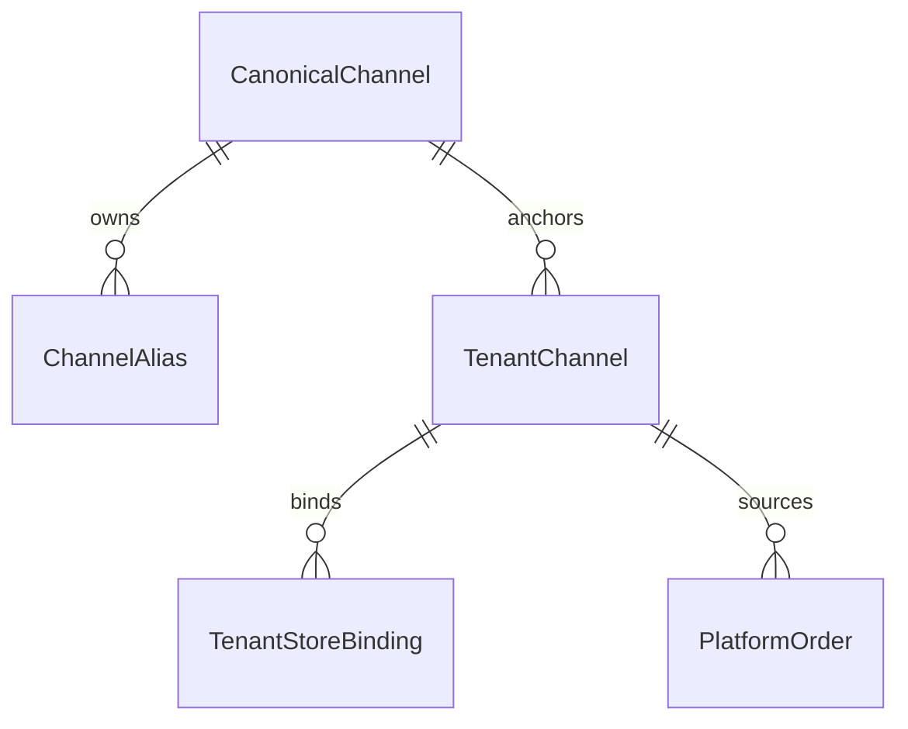

# 领域模型：Channel (渠道主数据)

> **schema_mode**: `mixed`  
> **source_of_truth**: `business-first`  
> **Role**: 定义系统内“渠道”的业务概念、核心关系、关键业务字典及与现网 Schema 的映射口径。  
> **AI Context Instruction**: 本文档定义渠道的业务语义与主数据边界。渠道申请流程、导入执行流程、订单状态裁决请参阅 `@specs/` 文档。

## 0. 核心概念 (Business Concept)
- **渠道实例 (Channel Instance)**：租户在某品牌下开展销售与履约归因的业务入口。
- **名称主数据 (Canonical/Alias)**：用于检索、归一与展示一致性，不直接承载业务归因真相。
- **生命周期触发（按模式分治）**：`ONLINE`（API 对接 OTA）渠道的接入主数据与连接配置由 SaaS 平台运营/DEV 维护，商户侧仅发起申请与查看状态；`OFFLINE` 渠道由商户侧创建并维护，`WALKIN` 由系统初始化。
- **维护责任边界**：平台侧维护线上渠道主数据与连接能力（`platform_channel` 口径）；商户侧维护线下渠道实例业务配置（`tenant_channel(channel_mode=OFFLINE)`）。

边界说明：
- 本文定义“渠道是什么”和“字段语义是什么”。
- 本文不定义订单状态机、预订政策裁决、导入任务执行编排。
- 本文聚焦租户渠道实例（`tenant_channel`）语义；平台级 OTA 接入协议、凭证托管与连接配置治理遵循 `sys_channel.md` 与平台渠道管理规范。

## 1. 核心关系 (Business Relationships)
1. 一个租户品牌可拥有多个渠道实例（Brand 1:N Channel）。
2. 一个渠道实例可关联多个门店（Channel 1:N Store Binding）。
3. 一个渠道名称 Canonical 可被多个实例引用（Canonical 1:N Channel）。
4. 一个订单在业务上归因于唯一渠道实例（Order N:1 Channel）。

## 2. 关键业务字段与字典 (Business Attributes & Enums)

### 2.1 关键业务字典
| 字典 | 值 | 业务含义 |
| --- | --- | --- |
| `ChannelMode` | `ONLINE`, `OFFLINE` | 渠道运行模式 |
| `ChannelStatusOnline` | `PENDING`, `REJECTED`, `ENABLED`, `DISABLED` | 线上渠道业务状态 |
| `ChannelStatusOffline` | `ENABLED`, `DISABLED` | 线下渠道业务状态 |
| `OnlineIntegrationMode` | `SAAS_OPENAPI`, `OTA_ISV` | 线上接入方式 |
| `ConnectManagedBy` | `PLATFORM`, `TENANT` | 线上连接管理方（API OTA 默认 `PLATFORM`） |
| `ConnectStatus` | `DISCONNECTED`, `CONNECTED`, `ERROR` | 线上连接健康状态 |
| `NameSource` | `CANONICAL`, `FREE_TEXT` | 渠道命名来源 |

### 2.2 关键业务字段（仅保留影响规则走向）
- 渠道身份：`tenant_id`, `brand_id`, `channel_mode`, `template_code`
- 展示与归一：`display_name`, `display_name_norm`, `canonical_channel_id`, `name_source`
- 运行状态：`status`, `integration_mode`, `connect_status`, `connect_managed_by`
- 线下导入能力：`order_import_enabled`, `allowed_import_templates`
- 系统保留渠道：`is_system`（Walk-in）

### 2.3 渠道身份规则（Channel Identity Rule）
- 订单归因主键应优先 `source_channel_id -> tenant_channel.id`。
- `source_channel`（名称文本）仅用于兼容展示，不可替代实例归因。

## 3. 业务不变量与边界 (Business Invariants & Boundaries)
1. **禁止按名称猜实例**：查询、统计、归因都不能用名称字符串反推渠道实例。
2. **跨模式同名允许**：同一品牌下 `ONLINE/OFFLINE` 可同名，但必须靠实例 ID 区分。
3. **同模式去重**：同租户同品牌同模式下，`display_name_norm` 不能重复。
4. **线上维护边界**：`channel_mode=ONLINE` 且通过 API 对接 OTA 的渠道，其接入主数据与连接配置由平台维护；商户侧仅申请与查看状态。
5. **线下维护边界**：`channel_mode=OFFLINE` 的渠道实例由商户侧维护，不回写为全局 Canonical 实例。
6. **Walk-in 固定约束**：系统创建、始终可用、不可删改模式，仅允许改展示名称。
7. **本文职责边界**：不负责状态机裁决，不负责导入流程执行。

## 4A. 已知 Schema 映射 (Known Schema Mapping)

### 4A.1 渠道主实体映射（ONLINE / OFFLINE）
| 业务字段/语义 | As-Is Schema | To-Be 目标口径 | 映射说明 |
| --- | --- | --- | --- |
| 线上渠道实例主记录 | `rental_channel` | `tenant_channel(channel_mode=ONLINE)` | 现网线上渠道承载于 `rental_channel`，目标统一到租户渠道实例。 |
| 线下渠道实例主记录 | `rental_offline_channel` | `tenant_channel(channel_mode=OFFLINE)` | 现网线下渠道独立表，目标统一抽象。 |
| 渠道展示名 | `rental_channel.title` / `rental_offline_channel.title` | `tenant_channel.display_name` | As-Is 双表字段统一为单一展示字段。 |
| 渠道归一名 | As-Is 未显式字段 | `tenant_channel.display_name_norm` | To-Be 新增归一字段，作为去重与检索标准字段。 |
| Canonical 主数据 | As-Is 未显式字段 | `tenant_channel.canonical_channel_id` | To-Be 引入标准化主数据字段。 |
| 名称来源 | As-Is 未显式字段 | `tenant_channel.name_source` | To-Be 标识来自 Canonical 还是自由录入。 |

### 4A.2 渠道门店绑定映射
| 业务字段/语义 | As-Is Schema | To-Be 目标口径 | 映射说明 |
| --- | --- | --- | --- |
| 渠道-门店绑定主键 | `rental_store_channel.id` | `channel_store_config.id`（概念） | 现网可直接用于绑定关系识别。 |
| 门店ID | `rental_store_channel.store_id` | `channel_store_config.store_id` | 语义一致。 |
| 渠道ID | `rental_store_channel.channel_id` | `channel_store_config.channel_id -> tenant_channel.id` | To-Be 明确 `channel_id` 必须指向渠道实例ID。 |
| 绑定状态 | `rental_store_channel.status` | `channel_store_config.status` | 维持合作/上下线语义。 |

### 4A.3 订单来源映射
| 业务字段/语义 | As-Is Schema | To-Be 目标口径 | 映射说明 |
| --- | --- | --- | --- |
| 订单来源名称 | `platform_order.source_channel` | `source_channel`（兼容展示） | 保留文本快照作为展示。 |
| 订单来源实例ID | As-Is 未落库 | `source_channel_id` | To-Be 主归因字段，优先用于查询/统计/审计。 |

## 4B. 演进留白 (Evolving Design Handoff)
> **@Dev / @AI TODO**: 基于上述业务定义与映射，补齐实现级 Schema 与迁移方案。

1. `source_channel_id` 落库方案：
- 新字段定义、写入时机、回填策略、兼容读取策略。

2. Canonical/Alias 治理落地：
- `canonical_channel_id` 与别名表的维护责任边界。
- 搜索归一规则与冲突处理（精确/前缀/模糊 + ABBR 降权）。

3. 历史数据回填：
- 现网 `rental_channel/rental_offline_channel` 到统一实例模型的映射脚本。
- 历史订单来源字段的读时归一与增量修正策略。

4. 索引与约束建议：
- `tenant_id + brand_id + channel_mode + display_name_norm` 唯一性。
- 绑定关系索引（`channel_id + store_id`）。

## 5. References
- `docs/schema/rental_channel.md`
- `docs/schema/rental_offline_channel.md`
- `docs/schema/rental_store_channel.md`
- `docs/schema/platform_order.md`
- `docs/sys_domain/sys_channel.md`
- `docs/assets/platform_channel_management_spec.md`
- `specs/channel/channel_management_spec.md`
- `specs/order/_index.md`
- `specs/order/feat_order_import_spec.md`
- `docs/sys_domain/tech_openapi.md`
