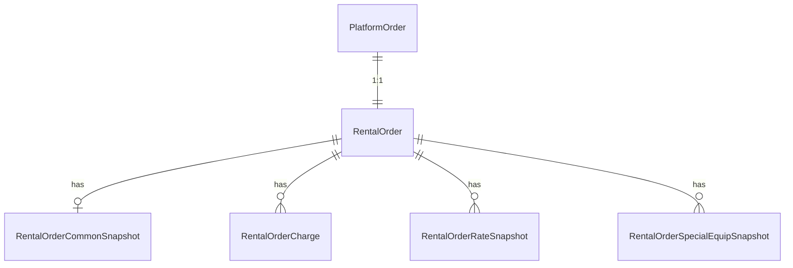

# 领域模型：Order (订单主数据)

> **schema_mode**: `mixed`  
> **source_of_truth**: `business-first`  
> **Role**: 定义系统内“订单”的业务概念、核心关系、关键业务字典与现网 Schema 映射口径。  
> **AI Context Instruction**: 本文档定义订单实体语义与业务主数据边界。状态机裁决、入站/出站路由、履约动作请参阅 `@specs/order/_index.md` 与相关 `feat_*.md`。

## 0. 核心概念 (Business Concept)
- **订单 (Order)**：客户租车请求在平台中的统一业务记录，覆盖预订到结单全过程。
- **业务边界**：订单主数据负责定义“字段语义与字典”；状态流转动作由订单域行为总控（specs）裁决。
- **生命周期触发**：由 API 创建、到店创建或导入创建触发，后续受库存、支付、人工决策、履约事件影响。

边界说明：
- 本文不定义状态机执行动作。
- 本文不定义渠道协议映射细节。

## 1. 核心关系 (Business Relationships)
1. 一个平台订单头（`platform_order`）对应一个租车业务订单（`rental_order`）。
2. 一个租车订单关联多个业务快照与费用快照（common/rate/charge/equip）。
3. 一个订单在业务上归因于一个来源渠道实例（To-Be 通过 `source_channel_id`）。

## 2. 关键业务字段与字典 (Business Attributes & Enums)

### 2.1 关键业务字典
| 字典 | 值 | 业务含义 |
| --- | --- | --- |
| `OrderStatus` | `CREATED`, `RESERVED`, `PENDING`, `CONFIRMED`, `PICKED_UP`, `RETURNED`, `COMPLETED`, `CANCELLED`, `REJECTED` | 订单 canonical 主状态 |
| `OrderSourceType` | `api`, `non_api` | 一级来源类型 |
| `OrderSourceSubtype` | `walk_in`, `offline_ota_import`, `api_ota` | 来源子类型 |
| `OrderConfirmType` | `instant_confirm`, `non_instant_confirm` | 预订确认策略 |
| `OrderCompletionType` | `NORMAL`, `NO_SHOW`, `EARLY_RETURN`, `AUTO_CLOSED` | 结单子类型 |
| `OrderCancelType` | `CUSTOMER_CANCEL`, `PAYMENT_TIMEOUT`, `PENDING_TIMEOUT`, `CHANNEL_REJECT`, `MANUAL_CANCEL` | 取消子类型 |

### 2.2 关键业务字段（仅保留规则关键字段）
- 订单身份：`id`, `platform_order_no`, `confirmation_code`
- 来源语义：`source_channel`（兼容展示）, `source_channel_id`（To-Be 主归因）, `source_type`, `source_subtype`
- 状态语义：`status`, `completion_type`, `cancel_type`
- 确认与支付：`confirm_type`, `payment_gate_mode`, `payment_status`, `pending_expires_at`
- 金额语义：`total_amount`, `prepaid_amount`, `pay_on_arrival_amount`, `currency`
- 快照语义：`pickup_store_info`, `return_store_info`, `vehicle_info`, `cancel_rule`, `time_rule`

## 3. 业务不变量与边界 (Business Invariants & Boundaries)
1. **主状态唯一真值**：`canonical status` 为订单域唯一主状态语义，不允许外部直接越权覆盖终态。
2. **来源字段分层**：`source_type/source_subtype` 决定业务分流；来源名称文本不等于来源实例身份。
3. **No-show 语义保持现状**：No-show 按结单语义建模，不在本轮跨文档修正规则体系。
4. **快照不可随意覆写**：订单快照字段用于保留下单时事实，不应被后续主数据变更覆盖。
5. **本文职责边界**：不承担流程裁决、队列编排、渠道契约映射实现。

## 4A. 已知 Schema 映射 (Known Schema Mapping)

### 4A.1 `platform_order` 映射
| 业务字段/语义 | As-Is Schema | To-Be 目标口径 | 映射说明 |
| --- | --- | --- | --- |
| 平台订单ID | `platform_order.id` | `OrderIdentity.id` | 主键语义一致。 |
| 平台订单号 | `platform_order.order_code` | `platform_order_no` | 业务编号语义一致。 |
| 来源渠道文本 | `platform_order.source_channel` | `source_channel`（兼容） | 现网为文本字段。 |
| 来源渠道实例ID | As-Is 未落库 | `source_channel_id` | To-Be 主归因字段。 |
| 来源订单号 | `platform_order.source_order_code` | `source_order_no` | 保持外部单号追踪语义。 |
| 下单时间 | `platform_order.order_time` | `order_time` | 业务事实时间。 |
| 本地时间冗余 | `platform_order.local_order_time` | `local_order_time`（可保留） | 展示冗余字段，需与时区策略一致。 |
| 状态码 | `platform_order.status`（tinyint） | `OrderStatus`（canonical） | As-Is 数值状态需经映射层归一。 |

### 4A.2 `rental_order` 映射
| 业务字段/语义 | As-Is Schema | To-Be 目标口径 | 映射说明 |
| --- | --- | --- | --- |
| 业务订单主键 | `rental_order.id` | `RentalOrder.id` | 主键语义一致。 |
| 订单关联ID | `rental_order.order_id` | `platform_order.id` FK | 与平台订单 1:1 关联锚点。 |
| 订单状态 | `rental_order.status`（tinyint） | `OrderStatus`（canonical） | As-Is 数值状态需统一映射。 |
| 确认策略 | `rental_order.instant_confirm`（bit） | `OrderConfirmType` | `true/false` 到策略枚举映射。 |
| 来源分流 | `rental_order.create_type` | `OrderSourceType/OrderSourceSubtype` | 由创建方式映射来源类型。 |
| 候补截止 | `rental_order.pending_expires_at` | `pending_expires_at` | 语义一致。 |
| 拒单原因 | `rental_order.reject_reason_code` | `reject_reason_code` | 语义一致，建议统一字典。 |
| 争议标记 | `rental_order.is_disputed` | `is_disputed`（flag） | 非主状态字段。 |
| 支付金额 | `prepaid_amount`, `pay_on_arrival_amount`, `currency` | 支付金额语义集合 | 金额字段语义一致。 |

### 4A.3 `rental_order_common_snapshot` 映射
| 业务字段/语义 | As-Is Schema | To-Be 目标口径 | 映射说明 |
| --- | --- | --- | --- |
| 商品参考ID | `reference_id` | `reference_id` | 语义一致。 |
| 取还车门店快照 | `pickup_store_info`, `return_store_info` | 取还车事实快照 | 下单事实保真，不随门店主数据变更回写。 |
| 车辆快照 | `vehicle_info` | 车型/品牌事实快照 | 用于事后追溯。 |
| 规则快照 | `cancel_rule`, `mileage_rule`, `time_rule`, `deposit_rule` | 规则事实快照 | 下单时规则快照，不可被后续策略覆盖。 |
| 币种快照 | `quote_currency`, `settlement_currency` | 币种事实快照 | 用于结算与对账。 |

### 4A.4 语义差异与兼容说明
1. As-Is 以数值状态码为主，To-Be 以 canonical 枚举语义为主。
2. As-Is 来源字段以 `source_channel` 文本为主，To-Be 增强为实例归因字段优先。
3. As-Is `create_type` 承担来源语义，To-Be 建议显式分层为 `source_type/source_subtype`。

## 4B. 演进留白 (Evolving Design Handoff)
> **@Dev / @AI TODO**: 请依据上述业务定义与字段映射，补齐实现级 schema/interface 与迁移方案。

1. 待标准化字段：
- `source_channel_id`（主归因）
- `OrderStatus` 统一映射表（As-Is tinyint -> canonical）
- `completion_type/cancel_type` 一致化落库策略

2. 兼容层治理：
- 旧状态码到 canonical 状态的映射器
- `create_type` 到 `source_type/source_subtype` 的映射器

3. 迁移与回填：
- 历史订单来源实例回填策略
- 快照字段与主数据字段冲突时的优先级规则

4. 索引与审计建议：
- 订单来源、状态、时间维度索引
- 状态映射审计字段（mapping_reason / source_status_raw）

## 5. References
- `docs/schema/platform_order.md`
- `docs/schema/rental_order.md`
- `docs/schema/rental_order_common_snapshot.md`
- `docs/schema/rental_order_charge.md`
- `docs/schema/rental_order_rate_snapshot.md`
- `docs/schema/rental_order_special_equip_snapshot.md`
- `specs/order/_index.md`
- `specs/order/feat_orderlist&detail_spec.md`
- `specs/order/feat_order_import_spec.md`
