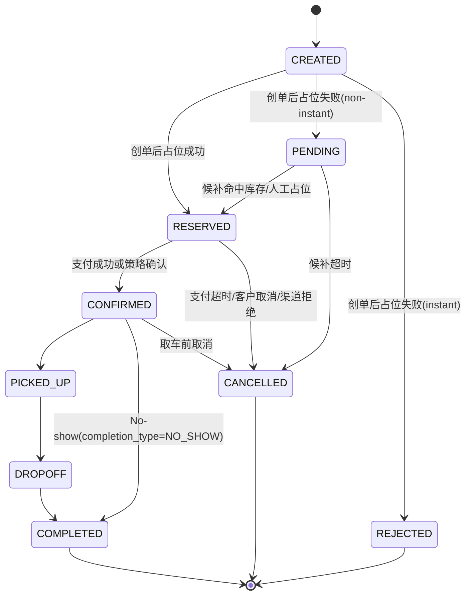

# FleetEdge OpenAPI 技术方案（v1.0）

> **版本**: v1.0 
> **最后更新**: 2026-03-06  
> **定位**: 明确“验”和“占”的边界，避免流程语义混淆

---

## 1. 回答你提的问题

### 1.1 问题 1：如果 Search接口 也实时，是否和 Detail详情接口实时查询的逻辑没区别？

结论：**不是没区别**。两者可以复用同一套 ATP/计价内核，但契约目标不同。

| 维度 | Search（列表） | Detail（详情校验） |
|---|---|---|
| 目标 | 快速召回与排序 | 可下单性校验 |
| 延迟要求 | 极低延迟，高吞吐 | 可接受稍高延迟，但要严格 |
| 结果语义 | 候选结果（可波动） | 下单前基准结果（要稳定） |
| 输出 | 简化价格、排序字段 | 价格明细、政策、校验结果 |
| 一致性 | 可容忍短时偏差 | 需与创单阶段强一致 |

所以即使都“实时”，**Search 是面向筛选，Detail 是面向成交**。

### 1.2 问题 3：租车是先支付后占位，还是先占位再支付？

结论：行业里不是单一路径。对 SaaS 最稳妥的是：**先创单并占位/候补，再进入支付或确认**。

推荐分流：
1. `pay_now`：先占位成功，再支付，再确认。
2. `pay_local` / 已预付：占位成功后可直接确认（系统/人工策略确认）。

不建议默认“先支付后占位”，因为会放大“已扣款但无货”的退款与客服成本。

---

## 2. 你纠偏后的 6 步流程（建议固化）

```
1) Search（ **询价** 可缓存）
2) QuoteCheck（ **验参验价** + ATP实时校验，不占位）
3) CreateOrder （ **创单** ）
4) Pending + Reserved（ **占位** /候补）
5) Confirm（**确认** / 策略确认）
6) Cancel / Complete（ **取消** / 履约完成）
```

关键定义：
- **第 2 步是“验”**：较严格校验
- **第 4 步是“占”**：创单后原子执行 ATP + 占位，失败进入 `PENDING` 候补（non-instant）。

### 2.1 术语统一（reference_id / token / 幂等键）

| 术语 | 作用 | 生命周期 | 是否库存锁 |
|---|---|---|---|
| `reference_id`（建议用 `search_ref`） | 串联 `Search -> Quote -> Create` 同一次业务上下文，做链路追踪与参数一致性校验 | 一次搜索会话内短期有效 | 否 |
| `quote_token` | 详情校验快照凭证（价格/规则/参数快照） | 短 TTL（如 3-10 分钟） | 否 |
| `hold_token` | 预占位凭证（兼容先付后创单） | 很短 TTL（如 2-5 分钟）+ 一次性消费 | 是（短时预占） |
| `idempotency_key` | 防重复创单，保证重试幂等 | 调用方自定义窗口内唯一 | 否 |

补充说明：
1. `reference_id` 的价值不止安全：还用于追踪、对账、归因、重试恢复、参数漂移校验。
2. `quote_token` 过期后，不能按旧价直接创单；应先重新 Quote。
3. `idempotency_key` 解决“重复提交”，不解决“价格过期”。

---

## 3. Public API 设计（按“验/创/占分离”）

### 3.1 `POST /api/v1/vehicles/search`

用途：列表搜索（可缓存）。

新增字段：
- `search_ref`（可作为 `reference_id` 使用）
- `snapshot_at`
- `freshness_ms`
- `atp_mode=light`

语义：
- 可命中缓存。
- 未命中则实时计算并回填缓存。

### 3.2 `GET /api/v1/vehicles/{vehicleId}/quote`

用途：详情校验（验参、验价、ATP 严格校验）。

请求：
- `search_ref`（可选，建议必传；即 `reference_id`）
- 取还车时间/地点、driver age、币种等

响应：
- `quote_token`
- `quote_expires_at`
- `price_check`
- `atp_check`
- `atp_mode=strict`

**副作用：无库存锁定**（`side_effect = none`）。

说明：
- `quote_token` 是“校验快照凭证”，不是库存占位锁。
- Create 阶段必须重新执行原子校验与真实占位。

### 3.3 `POST /api/v1/orders`

用途：创单 + 真正占位/候补。

必填：
- `idempotency_key`
- `quote_token`
- `reference_id`（建议传 `search_ref`，用于上下文一致性校验）
- `confirm_type`: `instant_confirm | non_instant_confirm`
- `pay_mode`: `pay_now | pay_local | part_pay`（可扩展）

处理：
1. 幂等检查。
2. 校验 `quote_token`（参数一致性、有效期）。
3. 原子执行：最终验价 + strict ATP + 占位尝试。
4. 返回订单状态。

返回分支：
- `RESERVED`：占位成功（可继续支付/确认）。
- `PENDING`：占位失败但允许候补（`non_instant_confirm`）。
- `REJECTED`：占位失败且即时拒单（`instant_confirm`）。

### 3.4 `POST /api/v1/orders/{orderId}/confirm`

用途：确认订单。

规则：
- `pay_now`：支付成功后 `RESERVED -> CONFIRMED`。
- `pay_local/已预付`：按策略可直接 `RESERVED -> CONFIRMED`。

### 3.5 `GET /api/v1/orders/{orderId}`

用途：轮询状态。

关键字段：
- `status`（canonical）
- `hold_status`（可选映射：`reserved|pending|none`）
- `payment_status`
- `pending_expires_at`
- `completion_type`
- `order_version`

### 3.6 `DELETE /api/v1/orders/{orderId}`

用途：取消订单，返回取消费与结果。

建议补充：
- `GET /api/v1/orders/{orderId}/cancellation-quote`（先询价再取消）。

### 3.7 `POST /api/v1/webhooks/order-status`

事件建议：
- `ORDER_ACCEPTED`
- `ORDER_RESERVED`
- `ORDER_PENDING`
- `ORDER_CONFIRMED`
- `ORDER_CANCELLED`
- `ORDER_COMPLETED`
- `ORDER_PENDING_TIMEOUT`

### 3.8 `POST /api/v1/holds`（可选：兼容 OTA 先支付后创单）

用途：在支付前进行短时预占位，返回 `hold_token`。

适用场景：
- OTA 坚持“先支付，后调用创单”。
- 需要在支付窗口内尽量降低“已支付但无库存”风险。

请求建议字段：
- `vehicle_id`
- `pickup/dropoff`
- `extras`
- `driver_age`
- `price_context`

响应建议字段：
- `hold_token`
- `hold_expires_at`
- `hold_ttl_sec`（建议 120-300 秒）
- `hold_status=active`

关键约束：
- `hold_token` 必须一次性消费（one-time use）。
- `POST /orders` 若走 pay-first 模式，必须携带 `hold_token`。
- token 过期或已消费，创单返回冲突错误并触发退款/补偿分支。

说明：
- `hold_token` 语义是“短时占位凭证”，不是搜索 token，也不是支付 token。
- 它本质上就是“短时占位，过期自动清位”。

### 3.9 详情停留超时后的处理策略（Quote Expiry UX）

场景：用户在详情页停留较久（例如 5 分钟）后才点击提交。

默认策略（推荐）：
1. 创单时若返回 `QUOTE_TOKEN_EXPIRED` / `PRICE_CHANGED`，OTA 不应按旧价强行创单。
2. OTA 先调用 Quote 刷新，展示“价格已更新/库存已变化”，再让用户确认是否继续。
3. 若刷新后无库存，停留在详情并提示改时段/改车型；必要时返回列表页重选。

标准动作矩阵（建议作为渠道对接契约）：

| Create 返回码 | OTA 页面动作 | 是否允许直接重试 Create |
|---|---|---|
| `QUOTE_TOKEN_EXPIRED` | 留在详情页，提示“报价已过期”，自动/手动触发 Re-Quote | 否（必须先 Re-Quote） |
| `REQUOTE_REQUIRED` | 留在详情页，提示“需刷新报价” | 否（必须先 Re-Quote） |
| `PRICE_CHANGED` | 留在详情页，展示新旧价格差异，用户二次确认 | 否（确认后用新 token） |
| `ATP_REJECTED_INSTANT` | 提示“当前无库存”，引导改时段/车型；可回列表 | 否（参数需变更） |
| `ATP_PENDING_NON_INSTANT` | 展示“候补中”，进入订单状态页或详情状态区 | 是（由系统重试/轮询） |

页面跳转建议：
1. 优先留在详情页处理 Re-Quote 与二次确认，减少用户上下文丢失。
2. 仅在“连续 Re-Quote 无库存”或“用户主动改选”时回列表。
3. 不建议超时后直接跳列表并丢弃当前选择，应至少提供“刷新后继续”入口。

强约束：
1. 未签署 `price_honor_window` 协议时，禁止按旧价硬创单。
2. 旧 `quote_token` 失效后必须重新 Quote，Create 不得“隐式续期”。
3. `idempotency_key` 仅保障重复提交幂等，不可替代 Re-Quote。

不推荐策略：
- 继续按旧价创单并强行成交（除非存在签约级价格保障策略）。

可选保障策略（需商业协议）：
- `price_honor_window`：在约定窗口内由供应商承担差价并按旧价履约（高成本，默认关闭）。
- `authorized_capture_only`：先授权不扣款，创单成功后再 capture，减少“已支付无货”。

支付协同建议：
1. `pay_now` 场景优先采用授权不扣款（Auth）再 Create，Create 成功后 Capture。
2. 若渠道已实扣款再 Create，失败时必须进入退款分支并返回可审计错误码（如 `PAID_BUT_CREATE_FAILED`）。

---

## 4. 状态机（与订单域 canonical 对齐）



---

## 5. “占位”模型（真正发生在 Create 后）

### 5.1 占位类型

| 类型 | 触发时机 | 语义 |
|---|---|---|
| `reserved` | Create 成功占位 | 已占到资源，等待确认/支付 |
| `pending` | non-instant 且暂时无资源 | 候补中，持续 ATP 重试 |
| `confirmed` | Confirm 后 | 履约锁定直到取消/完成 |

### 5.2 候补（持续占位）逻辑

- 仅 `non_instant_confirm` 开启。
- 进入 `PENDING` 后由后台重试 ATP。
- 命中库存：`PENDING -> RESERVED`。
- 超时：`PENDING -> CANCELLED + cancel_type=PENDING_TIMEOUT`。

### 5.3 锁时长建议

- `RESERVED` 支付窗口：默认 30 分钟（可按渠道配置）。
- `PENDING` 候补窗口：默认按 confirm SLA（如 2h/6h/24h）。
- `CONFIRMED`：直到取消或履约完成。

### 5.4 清位（释放库存）策略

核心结论：
- 无论是 `hold_token` 预占位，还是 `RESERVED` 待支付占位，**都必须有超时清位**。
- “先占位后支付”并不消除清位逻辑，只是把清位对象切换为订单占位。

推荐实现：状态事件 + 定时任务双保险
1. 事件驱动释放（主路径）：
   - `RESERVED -> CANCELLED`（`cancel_type=PAYMENT_TIMEOUT`）时立即释放库存。
   - `PENDING -> CANCELLED`（`cancel_type=PENDING_TIMEOUT`）时立即释放候补占用/队列资源。
   - `CANCELLED` 其他子类型（客户取消/渠道拒绝）同步释放。
2. 定时任务兜底（补偿路径）：
   - 周期扫描过期 `hold_token`、过期 `RESERVED`、过期 `PENDING`。
   - 自动关单并释放库存，修复事件漏发或事务中断。

### 5.5 状态与库存动作矩阵

| 订单状态变化 | 子类型/原因 | 库存动作 |
|---|---|---|
| `CREATED -> RESERVED` | 占位成功 | 创建 `reserved_hold` |
| `CREATED -> PENDING` | non-instant 无库存 | 进入候补队列（无实锁或弱锁，按策略） |
| `PENDING -> RESERVED` | 候补命中 | 创建/升级为 `reserved_hold` |
| `PENDING -> CANCELLED` | `PENDING_TIMEOUT` | 清理候补占用与相关中间锁 |
| `RESERVED -> CONFIRMED` | 支付成功/策略确认 | 升级为 `confirmed_hold` |
| `RESERVED -> CANCELLED` | `PAYMENT_TIMEOUT`/客户取消/渠道拒绝 | 释放 `reserved_hold` |
| `CONFIRMED -> CANCELLED` | 取车前取消 | 释放 `confirmed_hold` |
| `CONFIRMED -> COMPLETED` | `completion_type=NO_SHOW` | 释放履约锁（No-show 结单释放） |

---

## 6. 状态查询：主动还是被动（SaaS OpenAPI vs ISV）

结论：**都要有，但角色不同**。

1. 被动查询（Poll）是基线能力：
- 所有渠道都能接。
- 用于兜底与对账恢复。

2. 主动通知（Webhook）是增强能力：
- 降低状态延迟。
- 对 `PENDING -> RESERVED` 这类异步跃迁价值很高。

3. 对接模式差异：
- SaaS 作为 OpenAPI Provider：默认开放 Poll，Webhook 按渠道启用。
- SaaS 作为 ISV：遵循 OTA 契约；OTA 不支持 Webhook 时仅 Poll。

一致性约束：
- `event_id` 幂等
- `order_version` 单调
- 重复通知可重放，乱序不得回退状态

---

## 7. 幂等与错误码

### 7.1 幂等

- `POST /orders` 使用 `idempotency_key`。
- 同 key 同请求体：返回同单。
- 同 key 不同请求体：`409 IDEMPOTENCY_CONFLICT`。

### 7.2 建议错误码

| code | HTTP | 场景 |
|---|---|---|
| `QUOTE_TOKEN_EXPIRED` | 409 | quote 校验凭证过期 |
| `QUOTE_MISMATCH` | 409 | quote 与创单参数不一致 |
| `PRICE_CHANGED` | 409 | 创单最终验价与 quote 不一致 |
| `REQUOTE_REQUIRED` | 409 | 需刷新报价后重提 |
| `HOLD_TOKEN_EXPIRED` | 409 | 预占位 token 过期 |
| `HOLD_TOKEN_CONSUMED` | 409 | 预占位 token 已消费 |
| `PAID_BUT_CREATE_FAILED` | 409 | 先支付后创单失败，需退款/补偿 |
| `ATP_REJECTED_INSTANT` | 409 | instant 无库存拒单 |
| `ATP_PENDING_NON_INSTANT` | 202 | non-instant 进入候补 |
| `PAYMENT_TIMEOUT` | 409 | 支付超时关闭 |
| `IDEMPOTENCY_CONFLICT` | 409 | 幂等冲突 |

---

## 8. 验收场景（按“验/占分离”重排）

1. Search 缓存命中返回 `freshness_ms`。
2. Search 未命中后实时回填缓存。
3. Quote 成功返回 `quote_token`，且不产生库存锁。
4. 过期/不匹配的 `quote_token` 创单返回 409。
5. 同 `idempotency_key` 重试仅 1 单。
6. instant 创单无库存直接 `REJECTED`。
7. non-instant 创单无库存进入 `PENDING`。
8. `PENDING` 重试命中后转 `RESERVED`。
9. `PENDING` 超时转 `CANCELLED + PENDING_TIMEOUT`。
10. `pay_now`：`RESERVED -> CONFIRMED`，支付超时取消并释放占位。
11. `pay_local`：策略允许下 `RESERVED -> CONFIRMED`。
12. Webhook 重复/乱序不造成状态回退。
13. No-show 必须落 `COMPLETED + completion_type=NO_SHOW`。
14. 取消接口返回取消费与最终状态一致。
15. `RESERVED` 支付超时自动 `CANCELLED + PAYMENT_TIMEOUT`，并立即释放库存。
16. `PENDING` 候补超时自动取消并释放候补资源。
17. 事件漏发场景下，定时任务可补偿释放过期占位。
18. OTA pay-first 模式下，`hold_token` 过期后创单失败并进入退款/补偿分支。
19. 详情停留超时后提交创单，返回 `QUOTE_TOKEN_EXPIRED/REQUOTE_REQUIRED`，OTA 触发 Quote 刷新而非按旧价创单。
20. Quote 刷新后价格变化，需用户二次确认；若库存不足，引导改选（详情内提示或回列表重选）。
21. 旧 token 失效后直接重试 Create 必须失败，不得隐式续期。
22. 未签署 `price_honor_window` 时，旧价创单请求必须被拒绝。
23. `pay_now` 已实扣后创单失败，必须返回可审计错误码并触发退款补偿流程。

---

## 9. 与其他规范对齐项

1. 对齐 `specs/order/_index.md`：No-show 使用 `COMPLETED + completion_type=NO_SHOW`。
2. 对齐 `specs/order/feat_orderlist&detail_spec.md`：No-show 作为 completion 口径展示/筛选。
3. 对外 OpenAPI 文档中明确：
- `atp_mode=light`（Search）
- `atp_mode=strict`（Quote）
- 真正占位发生在 Create 后。

---

## 10. Assumptions / Defaults

1. 详情接口是“验”，不做库存占位。
2. 真正“占位/候补”在 Create 后触发。
3. 支付顺序默认采用“先占后付”，并按 `pay_mode` 分流。
4. 若渠道坚持先付后创单，启用 `hold_token` 预占位兼容模式（短 TTL + 一次性消费）。
5. 释放库存采用“状态事件即时释放 + 定时任务兜底”双保险。
6. 状态同步采用 `Webhook + Poll`。
7. 不新增 canonical 主状态。
8. `reference_id`（`search_ref`）建议全链路透传并入日志与审计字段。
