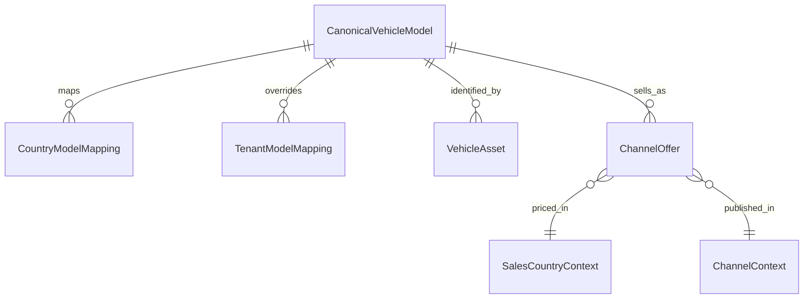

# 领域模型：VehicleModel / SIPP / Channel Offer Mapping

> **schema_mode**: `mixed`  
> **source_of_truth**: `business-first`  
> **Role**: 定义系统内“车型主数据 + SIPP 编码 + 渠道车型卡片（or similar）”的统一业务口径，明确身份、映射、展示与风险边界。  
> **AI Context Instruction**: 当需求涉及车型标准化、渠道车型展示、多国家/多语言命名、SIPP 映射优先级时，优先使用本文口径；实车履约状态机请参阅 `docs/sys_domain/vehicles.md` 与 `specs/vehicle/`。

## 0. 核心概念 (Business Concept)
- **唯一车款 (CanonicalModelID)**：车型身份主键，固定为 `vehicle_model.id`。
- **VehicleModel**：可售车型标准对象，来源 `vehicle_model` / `rental_car_model`。
- **TenantModelMapping**：租户维度车型与 SIPP 覆盖映射，来源 `vehicle_model_vendor_mapping`。
- **CountryModelMapping**：销售国家维度车型与 SIPP 覆盖映射，来源 `vehicle_model_country_mapping`。
- **ChannelOffer**：渠道侧可售车型卡片（通常为 `Make Model or similar` + ACRISS/SIPP）。
- **MappingRiskLevel**：映射风险等级，`ALLOWED` / `WARNING` / `FORBIDDEN`。
- **ModelFreshness / FleetFreshness / ChannelNewCarBadge**：车型代际新旧、车队可履约新旧、渠道营销“新车”标签三层语义。

边界说明：
- 本文回答“卖什么、按什么码卖、怎么展示”。
- 本文不定义实车状态机、取还车调度与维保流转。
- 本文不承诺运行时 API 已落库，仅定义主数据语义与映射原则。
- 术语统一：领域层统一使用 `make/make_id`；As-Is schema 中的 `brand/brand_id` 视为同义历史字段。

### 0.1 SaaS 分层前提（Platform vs Tenant vs OpenAPI）
| 分层 | 核心职责 | 可配置范围 | 禁止事项 |
| --- | --- | --- | --- |
| SaaS 平台端（基线层） | 定义 `CanonicalModelID`、基础车型库、基础 SIPP、Canonical Taxonomy、风险规则 | 平台治理主数据与全局规则 | 不将租户营销或渠道展示配置回写为车型身份真值 |
| SaaS 商户端（租户层） | 基于平台车型创建实车与售卖配置，维护租户覆盖 | `tenant override sipp`、渠道展示名、渠道规则范围内的映射 | 不改 `CanonicalModelID`、不越权修改平台基线枚举与风险硬规则 |
| OpenAPI/OTA（对外合同层） | 对外报价与资源销售，输出可追溯车型与编码语义 | 使用 `effective_sipp + 车型信息` 生成报价 payload | 不输出不可追溯的自由文本编码，不绕过映射风险分级 |

结论：
1. 车型身份真值由平台端统一维护；租户仅可在允许边界内覆盖售卖表达。
2. 当租户通过 API 对接 OTA 时，渠道报价优先使用 `effective_sipp`（可来自 `channel/tenant`），但必须可追溯到平台 `CanonicalModelID`。

## 1. 核心关系 (Business Relationships)
1. 一个 `CanonicalModelID` 可对应多个销售国家映射（Model 1:N Country Mapping）。
2. 一个 `CanonicalModelID` 可对应多个租户覆盖映射（Model 1:N Tenant Mapping）。
3. 一个 `CanonicalModelID` 可关联多台实车资产（Model 1:N Vehicle Asset）。
4. 一个 `CanonicalModelID` 可在多个渠道生成不同 `ChannelOffer` 卡片（Model 1:N Channel Offer）。
5. 渠道命名、语言、营销标签可变化，但不能反向改变车型身份主键。

## 2. 关键业务字段与字典 (Business Attributes & Enums)

### 2.1 关键业务字典
| 字典 | 值 | 业务含义 |
| --- | --- | --- |
| `MappingRiskLevel` | `ALLOWED`, `WARNING`, `FORBIDDEN` | 映射是否可保存及是否需要二次确认 |
| `MappingSource` | `channel`, `tenant`, `country`, `base` | 最终 SIPP 的解析来源 |
| `ModelFreshness` | 规则枚举（车型库） | 车型代际新旧语义，不等于可履约新旧 |
| `FleetFreshness` | 规则枚举（车队） | 基于实车首投放/车龄等统计的履约新旧语义 |
| `ChannelNewCarBadge` | 渠道展示标签 | 营销标签，仅用于展示，不是主数据身份 |

### 2.2 关键业务字段（仅保留影响规则走向）
- 车型身份：`canonical_model_id(model_id)`、`make_id`（As-Is schema: `brand_id`）
- 车型属性：`vehicle_grade`、`vehicle_category`、`fuel_type`、`transmission`、`drive_type`、`air_condition_ind`
- 覆盖上下文：`tenant_id(vendor_id)`、`sales_country_id(country_id)`、`channel`、`locale`
- 映射结果：`effective_sipp`、`mapping_source`、`mapping_risk_level`、`display_name`
- 新车语义：`model_freshness`、`fleet_freshness`、`channel_new_car_badge`

文档级概念接口（`MappingResolver`）：

| 接口字段 | 内容 |
| --- | --- |
| Input | `model_id`, `tenant_id(vendor_id)`, `sales_country_id(country_id)`, `channel`, `locale`, `service_context(optional)`, `channel_rule_context(optional)` |
| Output | `canonical_model_id`, `effective_sipp`, `display_name`, `mapping_source`, `mapping_risk_level`, `model_freshness`, `fleet_freshness`, `channel_new_car_badge` |

### 2.3 解析与命名核心规则
1. SIPP 解析顺序（高 -> 低）：`channel mapping -> tenant override -> sales-country sipp -> base model sipp`。
2. 多语言命名优先级：`sales-country channel name > model_name_en > model_name`。
3. `country_id` 在本文统一解释为 `sales_country_id`（POS 语义）。
4. `service_country` 仅用于运行时可用性/价格/政策计算，不参与车型身份与主键语义。
5. 同一 `model_id` 在不同国家/渠道可展示不同命名与 SIPP，但身份仍为同一 `CanonicalModelID`。

### 2.4 OTA 报价生效链路与 OpenAPI 关注字段
报价生效链路（租户 API 对接场景）：
1. 入参上下文至少包含：`tenant_id(vendor_id)`, `sales_country_id`, `channel`, `locale`, `model_id/canonical_model_id`。
2. 先确定车型身份：`canonical_model_id`（平台真值）。
3. 再按优先级解析 `effective_sipp`：`channel -> tenant -> country -> base`。
4. 使用 `effective_sipp + 展示名 + 车型属性` 组织 OTA 报价与资源销售信息。
5. 回传或落日志时必须保留 `mapping_source`、`mapping_risk_level` 与原始输入上下文，满足审计与回放。

OpenAPI 重点关注字段（To-Be 合同口径）：

| 字段 | 方向 | 说明 |
| --- | --- | --- |
| `canonical_model_id` | request/response | 车型身份锚点，保证跨渠道一致可追溯 |
| `make_id` | request/response | 主机厂品牌标识（领域口径）；与 As-Is `brand_id` 同义映射 |
| `effective_sipp` | response/outbound | 实际生效的售卖编码 |
| `mapping_source` | response/outbound | 生效编码来源：`channel/tenant/country/base` |
| `mapping_risk_level` | response/outbound | 生效映射风险等级，支撑审计与风控 |
| `display_name` | response/outbound | 渠道展示车型名（可本地化） |
| `model_freshness` / `fleet_freshness` / `channel_new_car_badge` | response/outbound | 新车语义三层输出，禁止混用为身份字段 |

## 3. 业务不变量与边界 (Business Invariants & Boundaries)
1. **主键不变性**：`CanonicalModelID = vehicle_model.id`，不得被国家、渠道、语言、营销标签反向改写。
2. **身份与展示分层**：`or similar` 文案、图片、卖点文案属于展示层，不参与车型身份判定。
3. **新车标签禁区**：`ChannelNewCarBadge` 不能修改 `model_id`、`vehicle_grade`、`vehicle_category`、`effective_sipp`。
4. **风险分级硬约束**：`FORBIDDEN` 禁止落库；`WARNING` 允许落库但必须二次确认 + 审计留痕；`ALLOWED` 直接通过。
5. **未知值兜底**：渠道自由文本映射失败时，主数据枚举统一落 `UNSPECIFIED`，并保留原值用于审计上下文。
6. **能源/空调拆分约束**：ACRISS 第 4 位必须拆为 `fuel_type + air_condition_ind`，不可混成单字段长期存储。
7. **职责边界**：本文不承担状态机裁决、库存编排、价格计算执行逻辑。
8. **平台治理权边界**：`CanonicalModelID`、基础 SIPP、Canonical Taxonomy、风险硬规则由平台端治理，租户端不可越权覆盖。
9. **租户使用权边界**：租户可维护覆盖配置并参与渠道报价，但必须在 `MappingRiskLevel` 约束内生效。
10. **OpenAPI 可追溯边界**：任一 OTA 报价结果必须可由 `canonical_model_id + effective_sipp + mapping_source` 反向解释。

## 4A. 已知 Schema 映射 (Known Schema Mapping)

### 4A.1 车型主实体映射（`vehicle_model` / `rental_car_model`）
| 业务字段/语义 | As-Is Schema | To-Be 目标口径 | 映射说明 |
| --- | --- | --- | --- |
| 车型身份主键 | `vehicle_model.id` / `rental_car_model.id` | `CanonicalModelID` | 统一车型身份锚点。 |
| 车型命名 | `model_name`, `model_name_en` | `display_name` 候选源 | 展示时结合国家/渠道覆盖。 |
| 基线 SIPP | `sipp_code` | `base model sipp` | 解析链路最低优先级兜底。 |
| 车型属性 | `fuel_type`, `transmission`, `air_condition_ind`, `vehicle_category`, `drive_type`, `vehicle_grade` | Canonical Taxonomy（附录 A） | As-Is 数值/枚举通过映射层归一。 |
| 年款区间 | `model_year_min`, `model_year_max` | `ModelFreshness` 输入 | 用于车型代际判断。 |

### 4A.2 租户与销售国家覆盖映射
| 业务字段/语义 | As-Is Schema | To-Be 目标口径 | 映射说明 |
| --- | --- | --- | --- |
| 租户覆盖主键 | `vehicle_model_vendor_mapping(model_id, vendor_id)` | `TenantModelMapping` | `vendor_*` 历史命名保留，业务语义按租户解释。 |
| 租户覆盖 SIPP | `vendor_sipp_code` | `tenant override sipp` | 高于国家与基础码。 |
| 基础参考码 | `model_sipp_code` | `base model sipp snapshot` | 作为覆盖审计与比对基线。 |
| 国家覆盖主键 | `vehicle_model_country_mapping(model_id, country_id)` | `CountryModelMapping` | `country_id` 按销售国家解释。 |
| 国家覆盖 SIPP | `vehicle_model_country_mapping.sipp_code` | `sales-country sipp` | 低于 tenant override，高于 base。 |

### 4A.3 实车资产与车型关联
| 业务字段/语义 | As-Is Schema | To-Be 目标口径 | 映射说明 |
| --- | --- | --- | --- |
| 实车车型锚点 | `rental_vehicle_info.model_id` | `canonical_model_id` | 资产与售卖车型关联主锚点。 |
| 实车落地编码 | `rental_vehicle_info.sipp_code` | `asset sipp snapshot` | 资产侧事实编码，不直接替代售卖映射结果。 |
| 车龄输入 | `first_use_date`, `model_year` | `FleetFreshness` 输入 | 支持“新车”履约视角判断。 |
| 租户语义字段 | `rental_vehicle_info.vendor_id` | `tenant_id` | 历史字段命名与业务语义做显式映射。 |

### 4A.4 语义差异与兼容说明
1. As-Is 中部分字段为数值或渠道文本，To-Be 统一为 canonical 枚举 + 映射层。
2. `vendor_*` 字段暂不改名，文档统一解释为租户语义。
3. `rental_vehicle_group` 当前承载租户车型组命名与运营分组，可作为批量策略锚点，但不替代 `CanonicalModelID`。
4. 渠道侧 `or similar` 文案与本地化命名差异，属于展示覆盖，不改变车型身份。

## 4B. 演进留白 (Evolving Design Handoff)
> **@Dev / @AI TODO**: 基于本文业务口径补齐实现层 schema/interface、治理流程与回填策略。

1. Canonical Taxonomy 落库与字典治理：
- `vehicle_grade`、`vehicle_category`、`fuel_type`、`transmission`、`drive_type` 的标准语义层与兼容映射层拆分。

2. MappingResolver 工程化：
- 固化输入上下文契约、输出字段契约和 `mapping_source` 审计字段。

3. 映射风险治理：
- `WARNING` 二次确认流程、`FORBIDDEN` 拒绝原因枚举、审计日志字段（操作者、时间、旧值、新值、原因）。

4. 新车标签双轨落地：
- 将 `ModelFreshness` 与 `FleetFreshness` 分离治理，渠道标签阈值配置化（例如“近 2 年”）。

5. 历史数据兼容与回填：
- 旧渠道自由文本到 canonical 枚举的归一策略。
- 历史 `vendor_*` 语义映射说明在数据血缘与接口文档中保持一致。

6. 规则边界澄清：
- 禁止把营销标签当主数据身份；禁止绕过 SIPP 风险分级做跨结构套利。

7. OpenAPI 合同治理：
- 在对外报价接口中固化 `canonical_model_id`、`effective_sipp`、`mapping_source`、`mapping_risk_level` 字段语义。
- 建立接口级审计与回放能力，确保报价争议可复盘到映射决策链路。

## 5. References
- `docs/schema/vehicle_model.md`
- `docs/schema/rental_car_model.md`
- `docs/schema/vehicle_model_vendor_mapping.md`
- `docs/schema/vehicle_model_country_mapping.md`
- `docs/schema/rental_vehicle_group.md`
- `docs/schema/rental_vehicle_info.md`
- `docs/sys_domain/vehicles.md`
- `docs/sys_domain/channels.md`
- `docs/sys_domain/orders.md`
- `docs/sys_domain/tech_openapi.md`
- `docs/api/booking_car_openapi.md`
- `docs/api/tripcom_car_openapi.md`
- `docs/api/expedia_car_openapi.md`
- `docs/api/avis_car_openapi.md`
- `docs/api/carmore_gotar_openapi.md`

## Appendix A. Canonical Taxonomy（精简版枚举与 ACRISS 对照）

### A.1 设计原则
1. 标准语义层（to-be）与落地存储层（as-is schema）分离。
2. `CanonicalModelID` 负责身份，枚举负责属性，营销标签不参与身份判定。
3. ACRISS/SIPP 对外编码需拆解为可治理字段，禁止长期直接依赖自由文本。
4. 未识别渠道值统一归 `UNSPECIFIED`。

### A.2 `vehicle_grade`（对齐 ACRISS Class）
| Canonical Enum | ACRISS Class | 说明 |
| --- | --- | --- |
| `MINI` | `M` | 迷你 |
| `MINI_ELITE` | `N` | 迷你高配 |
| `ECONOMY` | `E` | 经济型 |
| `ECONOMY_ELITE` | `H` | 经济型高配 |
| `COMPACT` | `C` | 紧凑型 |
| `COMPACT_ELITE` | `D` | 紧凑型高配 |
| `INTERMEDIATE` | `I` | 中级 |
| `INTERMEDIATE_ELITE` | `J` | 中级高配 |
| `STANDARD` | `S` | 标准型 |
| `STANDARD_ELITE` | `R` | 标准型高配 |
| `FULLSIZE` | `F` | 大型 |
| `FULLSIZE_ELITE` | `G` | 大型高配 |
| `PREMIUM` | `P` | 高端 |
| `PREMIUM_ELITE` | `U` | 高端高配 |
| `LUXURY` | `L` | 豪华 |
| `LUXURY_ELITE` | `W` | 豪华高配 |
| `SPECIAL` | `X` | 特殊车型 |
| `OVERSIZE` | `O` | 超大型 |

兼容约束：现有 schema `vehicle_grade=1..9` 仅作为 legacy 映射，不覆盖 `*_ELITE` 与 `OVERSIZE` to-be 语义。

### A.3 `vehicle_category`（对齐 ACRISS Type，常用枚举）
| Canonical Enum | ACRISS Type | 说明 |
| --- | --- | --- |
| `TWO_TO_FIVE_DOOR` | `B` | 2-5 门 |
| `FOUR_TO_FIVE_DOOR` | `D` | 4-5 门 |
| `WAGON_ESTATE` | `W` | 旅行车 |
| `PASSENGER_VAN` | `V` | 客运厢式车 |
| `SUV` | `F` | SUV |
| `CROSSOVER` | `G` | 跨界车 |
| `CONVERTIBLE` | `T` | 敞篷车 |
| `MOTORHOME` | `H` | 房车 |
| `TRUCK` | `K` | 货车 |
| `SPECIAL` | `X` | 特殊车型 |

说明：完整对照可在实现字典中扩展，本文保留规则高频集合。

### A.4 `transmission` / `drive_type`（对齐 ACRISS 第 2 位）
`transmission`（to-be）：`AUTOMATIC`, `MANUAL`, `AUTO_MANUAL`, `UNSPECIFIED`  
`drive_type`（to-be）：`UNSPECIFIED`, `FOUR_WHEEL_DRIVE`, `ALL_WHEEL_DRIVE`

| ACRISS 第 2 位 | 映射结果 |
| --- | --- |
| `M` | `MANUAL + UNSPECIFIED` |
| `N` | `MANUAL + FOUR_WHEEL_DRIVE` |
| `C` | `MANUAL + ALL_WHEEL_DRIVE` |
| `A` | `AUTOMATIC + UNSPECIFIED` |
| `B` | `AUTOMATIC + FOUR_WHEEL_DRIVE` |
| `D` | `AUTOMATIC + ALL_WHEEL_DRIVE` |

### A.5 `fuel_type` 与 `air_condition_ind`（对齐 ACRISS 第 4 位）
`fuel_type`（to-be）：`PETROL`, `DIESEL`, `ELECTRIC`, `HYBRID`, `PLUG_IN_HYBRID`, `LPG_CNG`, `HYDROGEN`, `MULTI_FUEL`, `ETHANOL`, `UNSPECIFIED`

| ACRISS 第 4 位 | 建议映射 |
| --- | --- |
| `R/N` | `UNSPECIFIED` + `air_condition_ind=true/false` |
| `D/Q` | `DIESEL` + `true/false` |
| `E/C` | `ELECTRIC` + `true/false` |
| `H/I` | `HYBRID` / `PLUG_IN_HYBRID` + `true` |
| `V/Z` | `PETROL` + `true/false` |
| `L/S` | `LPG_CNG` + `true/false` |
| `A/B` | `HYDROGEN` + `true/false` |
| `M/F` | `MULTI_FUEL` + `true/false` |
| `U/X` | `ETHANOL` + `true/false` |

### A.6 渠道值归一化示例
- Booking `data.specification.fuel` -> `fuel_type`
- Booking `data.specification.transmission` -> `transmission`
- Trip.com `transmissionType` -> `transmission`
- Avis `vehicle_transmission` -> `transmission`
- Expedia `acriss_code` -> 优先解析 4 位码，再落标准枚举

## Appendix B. Mapping Risk 默认矩阵

### B.1 风险等级与落库策略
| 等级 | 是否允许保存 | 附加动作 |
| --- | --- | --- |
| `ALLOWED` | 是 | 无 |
| `WARNING` | 是 | 二次确认 + 审计日志 |
| `FORBIDDEN` | 否 | 拒绝保存 |

### B.2 默认规则矩阵
| 场景 | 默认等级 | 说明 |
| --- | --- | --- |
| 同级同类映射 | `ALLOWED` | 基线可接受 |
| 跨 1 级映射 | `WARNING` | 可保存但有运营风险 |
| 跨 2 级及以上 | `FORBIDDEN` | 超过默认容忍阈值 |
| 轿车 -> SUV | `FORBIDDEN` | 结构差异过大 |
| 手动 -> 自动 | `FORBIDDEN` | 动力系统预期变化 |
| 油车 -> 电车 | `FORBIDDEN` | 能源形态硬冲突 |
| 电车 -> 油车 | `WARNING` | 体验与预期差异较大 |

## Appendix C. API 证据矩阵
| 渠道 | 证据字段 | 口径用途 |
| --- | --- | --- |
| Booking | `specification.code`(ACRISS), `make`, `model`, `languages` | 编码、文案、多语言 |
| Trip.com | `vehMakeModel.code/name`, `language`, `or similar` | 编码、语言参数、`or similar` |
| Expedia | `acriss_code`, `description (or similar)`, `language` | ACRISS 与目标语言文案 |
| Avis | `sipp_code`, `vehicle_class_code`, `vehicle_class_name`, `locale` | 车型组编码/名称与 locale |
| GOTAR/Carmore | `sippCode`, `brand(make)`, `model`, `isModelGuaranteed` | 车型定义与保障车型能力 |

## Appendix D. 验收场景与默认假设

### D.1 验收场景（Checklist）
1. “唯一车款”语义在全文均指向 `CanonicalModelID`。
2. `country_id` 与 `service_country` 语义明确区分。
3. SIPP 解析顺序可在正文直接定位并执行。
4. “新车”语义明确拆分为 `ModelFreshness` / `FleetFreshness` / `ChannelNewCarBadge`。
5. 渠道“新车”命中仅影响展示标签，不改变身份与主映射。
6. 同一 `model_id` 在不同国家/渠道命名可不同，但身份不变。
7. 未识别渠道 transmission/fuel 文本会落 `UNSPECIFIED`，并保留原值用于审计。
8. 风险分级策略与落库行为可直接定位到 Appendix B。
9. 能明确区分平台端治理能力与租户端配置能力，且不存在越权定义。
10. 租户 API 对接 OTA 的报价结果可通过 `canonical_model_id + effective_sipp + mapping_source` 回放。

### D.2 默认假设
1. 本轮仅重写领域文档，不修改数据库与代码实现。
2. 历史字段名 `vendor_*` 保留，业务语义统一解释为 `tenant`。
3. 渠道“新车”阈值（如近 2 年）后续由配置中心/BFF 实现。
4. 当前风险矩阵为全局默认，允许后续按渠道扩展。
5. 本文枚举为 to-be 语义层；现有 schema 取值视作兼容映射层。
