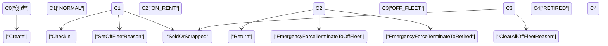
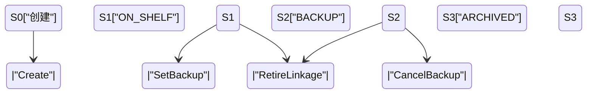

# 系统术语定义：VehicleAsset / 实车资产（Dual-Track）

> **AI Context Instruction**:
> 当代码或需求出现 `Vehicle`、`vehicle_condition`、`sale_status`、`ASSIGNED` 时，默认按本文解释为实车资产域。
> 本文采用双规制（Dual-Track）：`Vehicle Condition`（物理事实）+ `Sale Status`（运营策略）。

## 1. 领域边界与核心对象

### 1.1 VehicleAsset 定义
- `VehicleAsset` = 可被调度与履约的具体车辆实体（`rental_vehicle_info`）。
- 车辆域只提供三类事实：
  - 物理车况事实（Condition）。
  - 运营可销策略事实（Sale Status）。
  - 时间轴占用事实（Scheduling Timeline）。

### 1.2 本域与外域职责边界
- 本域负责：车辆状态裁决、可销状态裁决、供给事实输出。
- SKU 库存域负责：销售策略与停售策略裁决（最终 sale decision）。
- 订单域负责：订单主状态机、支付与平账流程。
- 排单域负责：`rental_vehicle_range` 时间轴占用、冲突检测、整备缓冲。

### 1.3 核心对象关系
1. `rental_vehicle_info`：车辆主数据 + 基础状态字段。
2. `rental_vehicle_range`：订单/预占/维保等时间轴约束。
3. `rental_vehicle_stop_sale`：历史停售数据（兼容只读，不再作为车辆域写模型）。
4. `rental_order_checkin` / `rental_order_checkout`：取还车事件源。

---

## 2. 双规制状态模型

### 2.1 Vehicle Condition（物理维度）
- `NORMAL`
- `ON_RENT`
- `OFF_FLEET`
- `RETIRED`

语义：
- 由取还车、维保、证照异常、售废等客观事件驱动。
- 不承载“渠道是否可卖”策略语义。

### 2.2 Sale Status（运营策略维度）
- `ON_SHELF`
- `BACKUP`
- `ARCHIVED`

语义：
- 由门店/运营策略驱动。
- 仅表达“是否默认参与销售/自动分配”，不承载停用语义。

权限语义：
- `ON_SHELF`：允许销售、参与自动 ATP、允许人工派单。
- `BACKUP`：不允许销售、不参与自动 ATP、不参与自动排单、允许人工强分配。
- `ARCHIVED`：生命周期终态，永久退出流通。

### 2.3 Scheduling Timeline（时间轴维度）
- 来源：`rental_vehicle_range`。
- 冲突窗口：`A=[start_time, delay_end_time)`。
- 历史缺失 `delay_end_time` 时，回退 `end_time + effective_prep_time`。
- `document_type in (3,4,5)`、`status in (6,8)`、`locked=1` 视为硬障碍约束。

---

## 3. 生命周期与联动

### 3.1 车况状态机（Vehicle Condition）

强约束：
- 常规流程下，`ON_RENT` 期间禁止直接登记停用或售废。
- 极端场景可走 `ForceTerminateRent` 特权链路并通知订单域平账，再进入 `OFF_FLEET` 或 `RETIRED`。
- `RETIRED` 为不可逆终态。

### 3.2 停用原因集合（Reason Set）
- 结构：`off_fleet_reasons = Set<String>`。
- `SetOffFleetReason(reason)`：加入后集合非空即 `OFF_FLEET`。
- `ClearOffFleetReason(reason)`：移除后仅集合清空才恢复 `NORMAL`。

### 3.3 可销状态机（Sale Status）

联动规则：
- `Condition=RETIRED` 时，`SaleStatus` 必须收敛到 `ARCHIVED`。
- `Condition=OFF_FLEET` 不再强制改写 `sale_status`，是否可售由 `Condition + Timeline + SKU sale decision` 联合裁决。

---

## 4. 技术映射（As-Is 到 Canonical）

### 4.1 `rental_vehicle_info.vehicle_condition`
| As-Is 值 | Canonical Condition | 备注 |
| --- | --- | --- |
| `1` | `NORMAL` | 正常可运营 |
| `4` | `ON_RENT` | 在租履约中 |
| `2`,`3` | `OFF_FLEET` | 分别对应保养/维修原因 |
| `5` | `RETIRED` | 售出/报废终态 |

### 4.2 `rental_vehicle_info.sale_status`
| As-Is 值 | Canonical Sale Status | 说明 |
| --- | --- | --- |
| `1` | `ON_SHELF` | 默认可销 |
| `2` | `BACKUP` | 安全库存 |
| `3` | `ARCHIVED` | 终态归档 |

兼容说明：
- 历史文案 `Standby` 等价映射为 `BACKUP`。
- `OFF_SHELF` 从车辆域主语义移除，不再新增写入。

### 4.3 `rental_vehicle_range`
- 调度占用与冲突检测来源于 `rental_vehicle_range`。
- `LOCKED` 是时间轴占用标记，不改写 `Vehicle Condition`。

---

## 5. ATP / 可用性口径（车辆域视角）

车辆可履约判定（车辆域）：
1. `Condition != RETIRED` 且满足履约场景准入。
2. 请求窗口与 `rental_vehicle_range` 无硬冲突。
3. 若 `SaleStatus = BACKUP`，仅允许人工强分配，不进入自动候选池。

销售可售判定（SKU 域）：
1. 销售策略由 SKU 库存域裁决。
2. 车辆域仅消费 SKU 返回的 `saleAllowed` 结果。

---

## 6. 关键不变量（Critical Invariants）
1. `Vehicle Condition` 与 `Sale Status` 独立裁决，不得互相越权。
2. `ON_RENT` 常规禁止停用/售废；紧急异常仅走 `ForceTerminateRent` 特权链路。
3. `OFF_FLEET` 恢复唯一判据是原因集合清空。
4. `BACKUP` 禁止自动销售与自动派单，仅允许人工强分配。
5. `RETIRED/ARCHIVED` 终态不可逆。
6. 可用性判定必须基于时间窗，不得用瞬时静态总量替代。

## 7. 验收场景（Acceptance Cases）
1. 新增车辆默认落位：`NORMAL + ON_SHELF`。
2. 设为备用后：不售卖、不进自动 ATP、人工可强分配。
3. 在租车辆尝试常规维保：被阻断。
4. 在租车辆紧急车损：允许 `ForceTerminateRent` 后进入 `OFF_FLEET`。
5. 停用原因集合未清空时：不得恢复 `NORMAL`。
6. 售出/报废后：`RETIRED + ARCHIVED` 且不可恢复。

## 8. 口径来源（References）
- `docs/schema/rental_vehicle_info.md`
- `docs/schema/rental_vehicle_range.md`
- `docs/schema/rental_vehicle_stock.md`
- `specs/vehicle/feat_vehicle_info_spec.md`

## 9. 默认假设（Assumptions）
1. 本轮是领域口径统一，不涉及数据库结构变更。
2. 订单主状态机由订单域文档维护。
3. SKU 库存域是销售策略真源。
