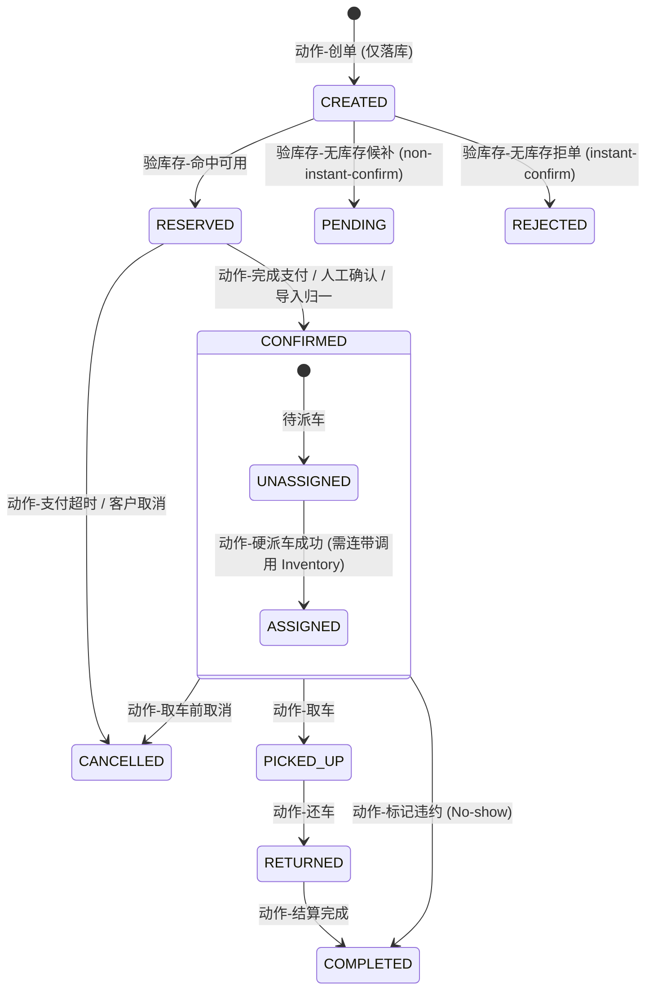

# 业务总控：Order Management (订单域状态机与行为路由)

> **Role**: 订单域状态流转的 Source of Truth，以及所有具体业务特征（Features）的导航入口。
> **AI Context Instruction**: 本文档定义全局状态机、防坑指南与跨域依赖。纯静态的数据结构请查阅 `@docs/sys_domain/order.md`；具体的 API 逻辑、页面交互请通过下方的 `Feature Map` 跳转至对应文件。

## 1. Feature Map (功能导航 / Sub-specs)
**AI 在处理以下具体业务需求时，请强制索引并遵循对应的 Spec 文件：**

- 📖 **订单列表与检索展示** ➡️ 查阅 `@specs/order/feat_orderlist&detail_spec.md`
- 📝 **订单详情与履约快照** ➡️ 查阅 `@specs/order/feat_orderlist&detail_spec.md`
- 📥 **订单新增与历史导入** ➡️ 查阅 `@specs/order/feat_order_import_spec.md`
- 🚗 **派车、车辆锁定与分配** ➡️ 查阅 `@specs/order/feat_order-vehicle-allocation_spec.md`
- 💰 **预订政策与定价校验边界** ➡️ 查阅 `@specs/order/feat_order_creation.md` (或相关文件)
- 🔄 **订单履约流转 (取/还车)** ➡️ *待实现 (TBD)*
- 📱 **自助取还订单 (Self-service)** ➡️ *待实现 (TBD)*

## 2. Cross-Module Dependencies (跨模块边界与依赖)
**本模块（Order）在执行状态流转时，强依赖以下外部领域服务，禁止在订单域内自己重复造轮子或直接修改对方的表：**

| 外部模块 / 领域 | 依赖的动作 (Actions / Interfaces) | 约束与说明 |
| :--- | :--- | :--- |
| **Inventory Service (库存域)** | - `checkAvailability(sipp, start, end)`<br>- `lockInventory(vehicle_id)` | 高并发下派车必须保证 `check + lock` 的原子性（事务包裹）。还车或取消时必须调用释放动作。 |
| **Pricing Engine (计价域)** | - `calculateQuote(params)` | 仅线上 API 订单 (`rate_plan`) 强依赖动态计价。Walk-in 和导入单跳过此引擎。 |
| **Channel Adapter (渠道适配层)**| - `normalizeInboundStatus(channel, raw)`<br>- `mapOutboundStatus(target, canonical)`| 负责“渠道原始字典”与“订单统一语义”的互译。隔离外部 OTA 脏数据。 |

## 3. 责任边界与处理流水线
**硬性约束：任何外部事件禁止绕过状态机直接 UPDATE 订单状态。必须遵循流水线：**
1. **Inbound Adapter**: 将原始报文（如 Trip 的 `unconfirmed`）翻译为统一语义。
2. **Domain FSM (本模块)**: 基于统一语义 + ATP(验库存) + 支付状态，裁决**内部主状态 (Canonical Status)**。
3. **Outbound Adapter**: 根据内部主状态，映射为目标契约并外发（如输出为 `Accepted`）。

## 4. 核心状态机 (Domain FSM)


## 5. 🚨 研发高危排雷 (Critical Invariants)
1. **No-Show 状态建模**：系统**没有独立的 `NO_SHOW` 主状态**。触发爽约时，订单流转至 `COMPLETED`，并打上标签 `completion_type=NO_SHOW`。
2. **死锁防范 (Inventory Release)**：
   - 监听/处理 `COMPLETED` 领域事件时，**必须**判断 `completion_type`。
   - 若为 `NORMAL`，说明库存已在 `RETURNED` 节点释放。
   - **若为 `NO_SHOW`，必须在业务层立刻触发【库存锁定释放】与【财务违约金结算】**。若漏调释放接口，车辆将永远卡在派单池形成死锁。
3. **状态越权**：外部接口（如 OTA 回调）传回 Cancelled 时，必须通过 FSM 判定能否取消（如：是否已经取车？），禁止直接执行 `UPDATE status='CANCELLED'`。
```