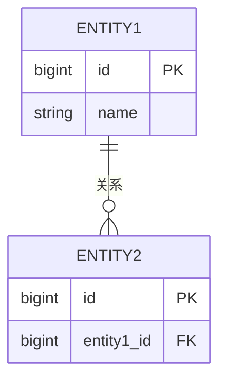
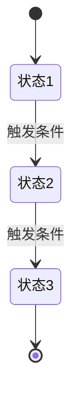
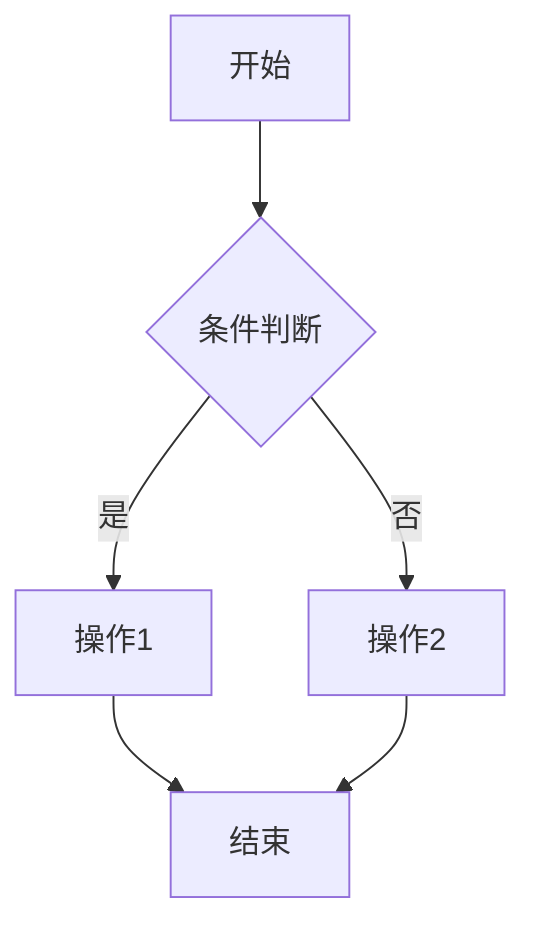

# [模块名称] Specification

> **模块**: [模块名称]
> **版本**: v1.2
> **最后更新**: 2026-02-28
> **作者**: [作者名]

---

## 更新日志

- **v1.2 (2026-02-28)**: 将 AI 执行细则外置到 rules；移除模板 6.3/6.4；附录顺序重排；新增 `Tracking Events` 与 `i18n 资源规范` 建议项
- **v1.1 (2026-02-28)**: 重构数据模型章节边界；底层存储结构下移至附录技术区；新增字段变更标识规范 `[ADD]/[MOD]/[DEL]`；数据验收改为数据契约验收
- **v1.0 (YYYY-MM-DD)**: 初始版本

---

## 1. 背景与目标

### 1.1 业务背景
[描述业务背景、行业惯例、系统定位]

### 1.2 问题陈述
[描述当前存在的核心问题或业务痛点]

---

## 2. 现状洞察（AS-IS）

[描述当前系统的现状和存在的问题]

| 痛点 | 描述 |
|-----|------|
| **痛点1** | 具体描述 |
| **痛点2** | 具体描述 |

---

## 3. 目标（TO-BE）与非目标

### 3.1 目标

| # | 目标 | 描述 |
|---|------|------|
| 1 | **目标1** | 具体描述 |
| 2 | **目标2** | 具体描述 |

### 3.2 非目标（本期不做）

- **非目标1**: 说明原因
- **非目标2**: 说明原因

### 3.3 User Stories

#### US-1: [用户故事标题]
> **作为** [角色]
> **我希望** [功能]
> **以便于** [价值]

**验收标准**:
- 标准1
- 标准2
- 标准3

---

## 4. 术语表（Terminology）

| 术语 | 英文 | 定义 |
|------|------|------|
| 术语1 | Term1 | 定义说明 |
| 术语2 | Term2 | 定义说明 |

---

## 5. 角色与权限

| 角色 | 权限范围 | 说明 |
|------|---------|------|
| 角色1 | 权限描述 | 补充说明 |
| 角色2 | 权限描述 | 补充说明 |

**权限规则**:
- 规则1
- 规则2

---

## 6. 数据模型（业务/交互视角）

### 6.1 实体关系图（ER Diagram）



### 6.2 Logical View（逻辑视图，UI 设计基准）

> [!IMPORTANT]
> **AI 执行约束**
> 1. 本章仅定义业务语义与页面交互模型，不直接等同于底层存储结构。
> 2. 如已按本节定义 `Logical View`，前端页面/组件必须基于 `Logical View` 设计。
> 3. 涉及聚合、计算、映射字段时，必须在 Spec 中明确字段来源与转换规则。
> 4. 底层存储结构如需补充，请写入附录 `13.2 技术附录（可选，工程维护）`。

**何时需要 Logical View？**
- 页面数据来自多表聚合。
- 存在派生字段或映射字段（Derived / Mapped）。
- 前端展示结构与存储结构不一致，或存在复杂交互。

#### 6.2.1 逻辑视图写法示例

**示例 — 交互式看板逻辑视图**：

```typescript

interface KanbanBoardView {
  // 核心数据结构：按列分组 (数据库里是平铺的 list，这里要求聚合)
  columns: {
    id: 'todo' | 'doing' | 'done';
    title: string;
    cards: TaskCard[];
  }[];

  // --- 交互权限逻辑 ---
  // 这个字段决定了用户能不能看见“拖拽手柄”
  currentUserPermission: {
    canDrag: boolean; 
    canEdit: boolean;
  };

  // --- 拖拽动作定义 (Action Definition) ---
  // PM 定义这个，AI 就知道要写拖拽事件处理函数
  actions: {
    // 逻辑：当卡片被 drop 到新列时，立即更新本地 columns 数据，
    // 然后在后台静默发送 API 请求。如果失败，回滚位置。
    onCardDrop(cardId: string, targetColumnId: string): void;
  };
}

interface TaskCard {
  id: string;
  title: string;
  // 逻辑字段：如果 overdue 为 true，卡片边框变红
  isOverdue: boolean; 
  // 逻辑字段：头像列表，只显示前3个，剩下的显示 "+2"
  assigneeAvatars: string[]; 
}
```


#### 6.2.2 计算字段与虚字段

逻辑视图可定义数据库中不存在的字段，用于明确 AI 的计算与展示行为。

| 数据库存储 | 逻辑视图字段 | Spec 写法 | AI 行为 |
|-----------|-------------|----------|--------|
| `birth_date` (1990-01-01) | `age` (34岁) | `age: number` *(Derived from birth_date)* | 自动生成计算代码，而非让用户填年龄 |
| `status` (0/1/2) | `statusLabel` ("待支付"/"已发货"/"已完成") | `statusLabel: string` *(Mapped from status enum)* | 自动生成枚举映射 |
| `status` (0/1/2) | `canRefund` (Boolean) | `canRefund: true if status === 1` | 自动控制"退款按钮"的显示/隐藏 |
| `pickup_time` + `dropoff_time` | `rentalDays` (3天) | `rentalDays: number` *(Derived: ceil(dropoff - pickup))* | 自动计算租期，而非要求用户填写 |

---

## 7. 业务规则与验证

### 7.1 核心业务规则

| 规则编号 | 规则名称 | 规则描述 |
|---------|---------|---------| 
| BR-001 | 规则1 | 详细描述 |
| BR-002 | 规则2 | 详细描述 |

### 7.2 数据验证规则

| 字段（含变更标识） | 验证规则 | 错误提示 |
|------|---------|---------| 
| [ADD] field1 | 规则描述 | 错误提示文案 |
| [MOD] field2 | 规则描述 | 错误提示文案 |
| [DEL] field3 | 已删除字段仅保留兼容读取 | 字段已废弃，请使用 `new_field3` |

### 7.3 状态机（如适用）



**状态转换规则**:

| 当前状态 | 目标状态 | 触发条件 | 操作权限 |
|---------|---------|---------|---------| 
| 状态1 | 状态2 | 条件描述 | 角色要求 |

---

## 8. 功能需求

### 8.1 功能模块1

#### 8.1.1 功能描述
[详细描述功能的业务逻辑和交互流程]

#### 8.1.2 筛选条件

> 📖 **字段标识约定**: 本模板在字段名前使用 `[ADD]` / `[MOD]` / `[DEL]` 标识新增、修改、删除字段；`[DEL]` 必须补充替代方案或废弃原因。

**筛选字段定义**:

| 筛选字段 | 类型 | 必填 | 默认值 | 取值来源 | 说明 |
|---------|------|------|--------|---------|------|
| [ADD] field1 | String | 否 | 无 | 用户输入 | 新增筛选字段说明 |
| [MOD] field2 | Enum | 否 | `default_value` | 枚举值（见下表） | 调整默认值与枚举口径 |
| [DEL] field3 | bigint | 否 | 无 | 关联表 `table.id` | 字段已删除，改用 `field4` |

**枚举值定义**（如适用）:

| 值 | 名称 | 说明 |
|----|------|------|
| `value1` | 名称1 | 说明 |
| `value2` | 名称2 | 说明 |

**验证规则**（如适用）:

| 字段（含变更标识） | 验证规则 | 错误提示 |
|------|---------|---------| 
| [MOD] field1 | 规则描述 | 错误提示文案 |

**筛选逻辑**:
- 多个筛选条件之间的关系：AND / OR
- 特殊筛选逻辑说明

**业务约束**（如适用）:
- 约束1：具体说明
- 约束2：具体说明

#### 8.1.3 列表字段定义

**列表展示字段**:

| 字段名（含变更标识） | 类型 | 数据来源 | 说明 | 示例 |
|--------|------|---------|------|------|
| [ADD] field1 | String | `table.field1` | 新增展示字段 | 示例值 |
| [MOD] field2 | Enum | `table.field2` | 枚举展示规则调整 | 示例值 |
| [DEL] field3 | Calculated | 计算公式 | 字段已删除，改用 `field4` | 示例值 |

**排序规则**:
- 默认排序：字段1 ASC, 字段2 DESC
- 支持用户自定义排序的字段：字段1, 字段2

**分页规则**:
- 默认每页显示：20 条
- 支持的分页大小：10, 20, 50, 100

#### 8.1.4 表单字段定义

**字段行为矩阵 (Field Behavior Matrix)**:

> 💡 **最佳实践**: 对于涉及多种状态（如新建/编辑/查看）的复杂表单，使用矩阵表来定义字段行为，比单纯的列表更清晰。

| 字段（含变更标识） | 创建模式 | 编辑模式 | 查看模式 | 依赖/逻辑说明 |
| :--- | :--- | :--- | :--- | :--- |
| **[ADD] 字段 1** | Input (必填) | Read-only (只读) | Text (文本) | 新增字段，创建后不可修改 |
| **[MOD] 字段 2** | Select (下拉选择) | Select* | Text | 编辑模式新增锁定条件：满足条件A时锁定 |
| **[DEL] 字段 3** | Hidden (隐藏) | Hidden (隐藏) | Hidden (隐藏) | 字段下线，保留历史展示于审计记录 |

**常规字段定义 (Legacy/Simple Forms)**:

| 字段名（含变更标识） | 类型 | 必填 | 默认值 | 取值来源 | 验证规则 | 说明 |
|--------|------|------|--------|---------|---------|------|
| [ADD] field1 | String | 是 | 无 | 用户输入 | 长度 ≤ 100 | 新增字段说明 |
| [MOD] field2 | Enum | 是 | `default` | 枚举值 | 必须为有效枚举值 | 字段规则更新说明 |
| [DEL] field3 | String | 否 | 无 | 系统历史字段 | 无 | 字段废弃，改用 `field2` |

#### 8.1.5 业务流程



**流程说明**:
1. 步骤1：详细描述
2. 步骤2：详细描述
3. 步骤3：详细描述

#### 8.1.6 边界场景处理

| 场景 | 处理方式 |
|------|---------| 
| 场景1 | 处理方式描述 |
| 场景2 | 处理方式描述 |

---

## 9. 非功能需求

### 9.1 性能要求

| 指标 | 要求 |
|------|------|
| 页面加载时间 | < 2s |
| API 响应时间 | < 500ms (P95) |
| 并发用户数 | ≥ 1000 |

### 9.2 安全要求

- 数据加密：传输层 TLS 1.2+
- 认证方式：JWT Token
- 权限控制：RBAC
- 敏感数据脱敏：[具体字段]

### 9.3 可用性要求

- 系统可用性：≥ 99.9%
- 数据备份：每日备份，保留 30 天
- 灾难恢复：RTO < 4h, RPO < 1h

---

## 10. 测试策略

### 10.1 测试范围

- 单元测试：核心业务逻辑
- 集成测试：API 接口
- E2E 测试：关键用户流程
- 性能测试：高并发场景

### 10.2 测试用例（关键场景）

| 用例编号 | 测试场景 | 前置条件 | 操作步骤 | 预期结果 |
|---------|---------|---------|---------|---------| 
| TC-001 | 场景1 | 前置条件 | 步骤描述 | 预期结果 |
| TC-002 | 场景2 | 前置条件 | 步骤描述 | 预期结果 |

---

## 11. 验收标准（Acceptance Criteria）

### 11.1 功能验收

**场景1: [场景描述]**

```gherkin
Given [前置条件]
When [操作步骤]
Then [预期结果]
And [额外验证]
```

**场景2: [场景描述]**

```gherkin
Given [前置条件]
When [操作步骤]
Then [预期结果]
```

### 11.2 数据契约验收

- [ ] 字段来源（Stored / Derived / Mapped）已标注完整且与业务描述一致
- [ ] 聚合/计算/映射规则已定义清晰并可追溯到业务规则
- [ ] 所有字段变更均已使用 `[ADD]` / `[MOD]` / `[DEL]` 标识
- [ ] 所有 `[DEL]` 字段均已说明替代字段或废弃原因

### 11.3 性能验收

- [ ] API 响应时间满足要求
- [ ] 页面加载时间满足要求
- [ ] 并发测试通过

---

## 12. 实施计划

### 12.1 依赖关系

- 依赖1：具体说明
- 依赖2：具体说明

### 12.2 风险与缓解措施

| 风险 | 影响 | 概率 | 缓解措施 |
|------|------|------|---------| 
| 风险1 | 高/中/低 | 高/中/低 | 具体措施 |
| 风险2 | 高/中/低 | 高/中/低 | 具体措施 |

---

## 13. 附录

### 13.1 字段文档术语对照表

| 中文 | 英文 | 说明 |
|------|------|------|
| 筛选字段 | Filter Field | 用于筛选数据的字段 |
| 必填 | Required | 字段必须提供值 |
| 可选 | Optional | 字段可以不提供值 |
| 条件必填 | Conditionally Required | 根据条件决定是否必填 |
| 默认值 | Default Value | 字段的默认值 |
| 取值来源 | Value Source | 字段值的来源类型 |
| 枚举值 | Enum | 固定的可选值列表 |
| 外键 | Foreign Key (FK) | 引用其他表的主键 |
| 验证规则 | Validation Rule | 字段值的验证逻辑 |
| 业务约束 | Business Constraint | 业务规则和限制条件 |
| 新增字段标识 | `[ADD]` | 标记本版本新增字段 |
| 修改字段标识 | `[MOD]` | 标记本版本规则或语义发生变化的字段 |
| 删除字段标识 | `[DEL]` | 标记本版本下线字段，需说明替代方案或废弃原因 |

### 13.2 技术附录：Storage Schema（可选，工程维护）

> *AI 注意：本节仅描述底层数据库结构，不直接作为页面或交互设计依据。*

#### 13.2.1 表名：`table_name`

**表说明**: [表的业务含义和用途]

**字段定义**:

| 字段名 | 类型 | 必填 | 默认值 | 说明 | 约束 |
|--------|------|------|--------|------|------|
| id | bigint | 是 | 自增 | 主键 | PK, AUTO_INCREMENT |
| name | varchar(100) | 是 | 无 | 名称 | UNIQUE |
| status | enum | 是 | `active` | 状态 | 枚举值见下表 |
| created_at | datetime | 是 | CURRENT_TIMESTAMP | 创建时间 | |
| updated_at | datetime | 是 | CURRENT_TIMESTAMP | 更新时间 | ON UPDATE CURRENT_TIMESTAMP |

**枚举值定义**:

| 字段 | 值 | 名称 | 说明 |
|------|----|----- |------|
| status | `active` | 启用 | 正常使用中 |
| status | `inactive` | 停用 | 已停止使用 |

**索引**:
- PRIMARY KEY: `id`
- UNIQUE KEY: `uk_name` (`name`)
- INDEX: `idx_status` (`status`)

**业务约束**:
- 约束1：具体说明
- 约束2：具体说明

### 13.3 Tracking Events（建议项）

> [!TIP]
> 本节为建议项，用于提升行为可观测性，不作为功能上线阻断条件。

| 事件名 | 触发时机 | 关键属性 |
|------|---------|---------|
| `module_page_view` | 用户进入模块页面 | `page_name`, `user_role`, `tenant_id` |
| `filter_apply` | 用户应用筛选条件 | `filter_fields`, `result_count`, `duration_ms` |
| `detail_view` | 用户打开详情页 | `entity_id`, `status`, `source_channel` |
| `action_submit` | 用户提交关键操作 | `action_type`, `entity_id`, `success` |

### 13.4 i18n 资源规范（建议项）

> [!TIP]
> 本节为建议项，用于保证国际化扩展一致性，不作为功能上线阻断条件。

#### 13.4.1 Type 1-5 分类（建议）

| 类型 | 数据类型 | 处理策略 | 示例 |
|------|---------|---------|------|
| Type 1 | 系统预设数据 | 资源表翻译 | 状态枚举、按钮文案 |
| Type 2 | 纯业务数据 | 不翻译 | 订单号、车牌号、备注 |
| Type 3 | 核心双语字段 | 双字段存储 | 门店名称、车型名称 |
| Type 4 | 法律/条款文本 | 法务版本管理 | 合同条款、政策声明 |
| Type 5 | 格式化数据 | 前端按 Locale 渲染 | 时间、货币、数字 |

#### 13.4.2 `resource_key` 命名建议

- 命名格式：`{domain}.{module}.{scope}.{name}`
- 全部小写，使用 `.` 分层，避免空格与中文键名
- 同一语义保持单一 key，避免别名重复
- 错误文案与提示文案分域管理（如 `error.*`、`hint.*`）

#### 13.4.3 资源键样例

| UI 文案 | resource_key |
|------|-------------|
| 新建订单 | `order.action.create` |
| 取消订单 | `order.action.cancel` |
| 筛选条件 | `order.filter.title` |
| 校验失败提示 | `order.error.validation_failed` |

### 13.5 参考文档

- [相关规格说明](./related_spec.md)

### 13.6 变更记录

| 日期 | 版本 | 变更内容 | 变更人 |
|------|------|---------|--------|
| 2026-02-28 | v1.2 | AI 规则外置到 rules；附录顺序重排；新增 Tracking/i18n 建议项 | [作者名] |
| 2026-02-28 | v1.1 | 重构数据模型章节边界与数据契约验收 | [作者名] |
| YYYY-MM-DD | v1.0 | 初始版本 | [作者名] |
