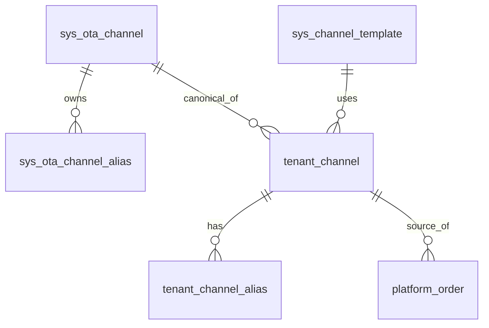

# 领域模型：Channel (渠道主数据)

> **Role**: 定义系统内“渠道”的主数据实体、对象级联关系与数据字典。
> **AI Context Instruction**: 本文档仅描述“什么是渠道”及“渠道的静态属性”。涉及渠道在订单生成时的验价、API 鉴权逻辑等动作，请参阅 `@specs/` 目录下相关文档。

## 0. 🚨 核心概念辨析 (Clarifications & Gotchas)
**AI 在生成代码与查询逻辑时，必须严格遵守以下共识，禁止混淆概念：**

| 误区 / 易混淆点 | 唯一真相 (Source of Truth) & 约束 |
| :--- | :--- |
| **渠道的身份主键是谁？** | 永远是 `tenant_channel.id` (即订单表中的 `source_channel_id`)，**禁止按名称字符串 (如 "Trip.com") 直接匹配或猜渠道**。 |
| **商户线下建的渠道存在哪？** | 存在 `tenant_channel` 中（且 `channel_mode = OFFLINE`）。**绝对不可复用全局的 `sys_ota_channel` 来直接存线下实例**。 |
| **Walk-in 渠道特殊在哪？** | 它也是 `tenant_channel` 的一条记录。但它是系统初始化创建的（`template_code = WALKIN`, `is_system = 1`），不可删除、不可改模式。 |
| **Klook / KLK / 客路 是同一个渠道吗？**| 在名称主数据字典中，它们指向同一个 `canonical_channel_id`；但在实际订单归因时，以具体的 `source_channel_id` 为准。 |
| **线上渠道与线下渠道能同名吗？** | **可以（如都有 "Trip.com"）**。系统靠实例 ID 区分，跨模式同名是被允许的，通过 `channel_mode` 隔离。 |

## 1. 核心实体定义 (Core Entities)
- **全局 OTA 主数据 (`sys_ota_channel`)**：平台维护的客观存在的 OTA 平台（Canonical），仅用作名称字典、推荐搜索和归一化锚点，不作为业务发生的直接载体。
- **租户渠道实例 (`tenant_channel`)**：商户在自己品牌下实际开展业务的渠道实例，是订单归因的核心实体。

### 1.1 对象级联关系 (ER Diagram)

## 2. 核心数据模型 (Data Schema)
> 完整 Schema 参考 `@docs/schema/rental_channel.md`。

**A. `tenant_channel` (主实体 - 必须关注)**
- `id` / `tenant_id` / `brand_id` (品牌强绑定，不可变)
- `channel_mode`: `ONLINE` | `OFFLINE`
- `status`: 线上支持申请、驳回、启用、停用；线下仅启用、停用。
- `display_name` (展示文案) / `display_name_norm` (应用层去重与检索标准名)
- `ota_channel_id` (仅线上) / `canonical_channel_id` (归一锚点)

**B. 算法规范 (Normalization)**
处理 `_norm` 字段时，应用层统一执行：Unicode NFKC -> trim -> collapse spaces -> lower(casefold) -> 去除常见分隔符。**不依赖 DB collation**。
