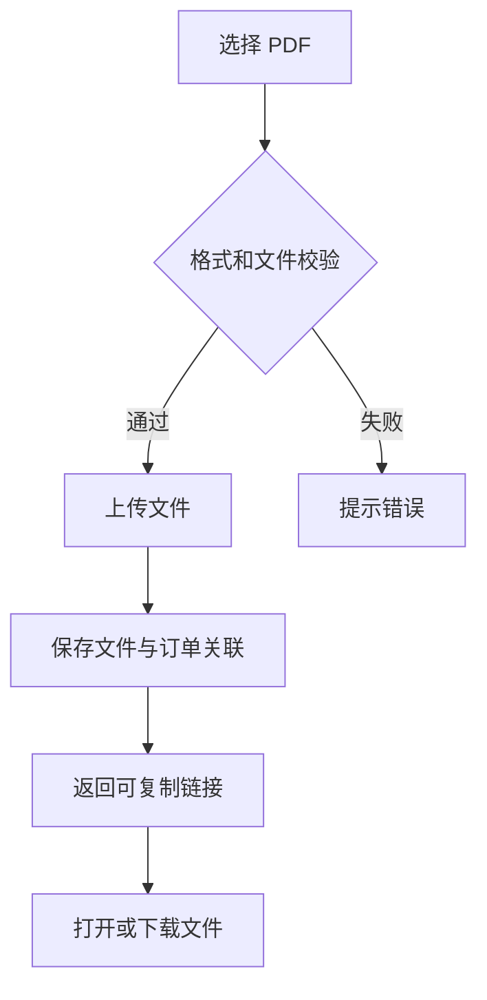
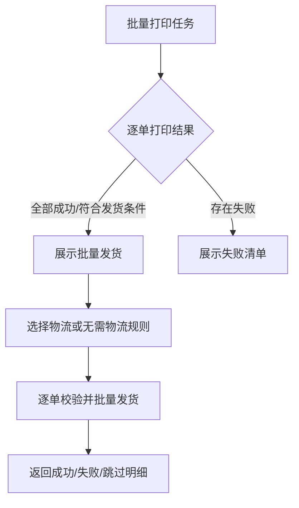

# 驾照官 3.0 核心需求 PRD

> **版本**：v0.1（待评审）  
> **更新时间**：2026-09-29  
> **需求范围**：仅包含用户截图中列出的 20 条需求  
> **优先级**：P0 为本期核心，P1 为重要优化，P2 为增强能力

## 1. 背景与目标

当前驾照官 3.0 在订单进入、制作、翻译、发货、打印和登录环节存在操作重复、状态不清、字段缺失和异常不可追踪的问题。本期只处理截图中确认的需求，目标是：

1. 让制作人员快速找到待制作和加急订单。
2. 减少发货、翻译和批量操作中的重复录入。
3. 统一订单展示、渠道订单号、送审公证处和面单信息。
4. 让翻译、打印、批量发货和登录异常可追踪、可恢复。

## 2. 需求范围总览

| 编号 | 需求 | 优先级 | 模块 |
| --- | --- | --- | --- |
| F01 | 进入订单页面默认进入“待制作”列表 | P0 | 订单工作台 |
| F02 | 左侧客户清单显示未翻译/未制作数量 | P0 | 订单工作台 |
| F03 | 发货界面增加中通（ZTO） | P0 | 发货 |
| F04 | 京东、顺丰快递面单字段调整 | P0 | 云打印 |
| F05 | 订单列表展示送审公证处名称 | P0 | 公证 |
| F06 | 密码设置及登录方式修改 | P0 | 账号与登录 |
| F07 | 长期有效订单支持直接翻译 | P0 | 翻译 |
| F08 | 带宣誓的小白本订单无需填写快递 | P1 | 发货 |
| F09 | 携程多本订单后续证本复用快递 | P1 | 发货 |
| F10 | 产品筛选区增加“是否加急” | P1 | 订单筛选 |
| F11 | 增加 PDF 链接转化功能 | P1 | 文件交付 |
| F12 | agent 录入副页记录并贯通审核、翻译 | P1 | 录单与翻译 |
| F13 | 登录域名修改 | P1 | 账号与登录 |
| F14 | 宣誓长期有效翻译增加德语固定译文 | P1 | 宣誓翻译 |
| F15 | 未制作列表支持全选和批量制作完成 | P1 | 批量制作 |
| F16 | 自动打印区分系统停止和机器卡住 | P2 | 自动打印 |
| F17 | 非中国国籍翻译、空值校验及导出同步 | P2 | 宣誓翻译 |
| F18 | 订单列表展示渠道订单号 | P2 | 订单列表 |
| F19 | 增加批量打印日志及卡住后的查询能力 | P2 | 批量打印 |
| F20 | 批量打印完成后支持批量发货 | P2 | 批量发货 |

## 3. 用户角色

| 角色 | 使用范围 |
| --- | --- |
| agent 录单人员 | 录入订单和副页记录 |
| 审核人员 | 审核订单并修改副页记录 |
| 翻译人员 | 处理自动翻译、长期有效和非中国国籍翻译 |
| 制作人员 | 处理未制作订单、批量制作和加急订单 |
| 发货人员 | 选择承运商、填写物流、批量发货 |
| 打印操作人员 | 发起打印、查看批量打印日志、处理异常 |
| 系统管理员 | 管理账号、密码和登录域名配置 |

## 4. 共用业务规则

### 4.1 订单状态

订单同时维护翻译、制作、发货三个维度：

- 翻译：未翻译、已翻译。
- 制作：未制作、已制作。
- 发货：未发货、已发货。
- 批量任务：待执行、执行中、部分成功、已完成、失败。

“已翻译”不代表“已制作”，“已制作”不代表“已发货”。列表、数量提醒、详情和操作按钮必须使用同一套状态判定。

### 4.2 幂等与权限

- agent 重复推送、用户重复点击、批量任务重试不得创建重复订单或重复操作记录。
- 服务端必须再次校验用户权限和订单当前状态，不能只依赖前端隐藏按钮。
- 批量操作返回逐单结果，允许部分成功；成功项不因失败项回滚。
- 所有关键操作记录订单号、操作人、操作时间、结果和失败原因。

## 5. 需求详细说明

### F01 进入订单页面默认进入待制作列表（P0）

**需求描述**：进入订单页面时，默认打开“待制作”列表。

**业务逻辑**：

1. 用户首次进入小白本订单页面，默认查询制作状态为“未制作”的订单。
2. 用户手动切换列表后，保留当前页面选择；重新进入页面时是否恢复上次选择由产品确认。
3. agent 推送订单后自动触发翻译：翻译成功进入“未制作”，翻译失败进入“未翻译”。
4. 自动翻译处理中不得进入“已翻译”或“已制作”。

**验收标准**：

- 页面首次打开默认展示待制作列表。
- 自动翻译成功订单可在待制作列表找到。
- 自动翻译失败订单只出现在未翻译列表。
- 重复推送不会生成重复订单。

**异常场景**：翻译接口超时、重复推送、订单已被其他人员制作、用户无权限查看订单。

### F02 左侧客户清单显示数量提醒（P0）

**需求描述**：在左侧客户清单或小白本二级菜单显示未翻译、未制作数量，例如 `110/100`。

**字段定义**：

| 字段 | 类型 | 说明 |
| --- | --- | --- |
| `untranslatedCount` | Integer | 当前权限范围内的未翻译订单数 |
| `unmadeCount` | Integer | 当前权限范围内的未制作订单数 |

**业务逻辑**：

- 展示顺序固定为：未翻译数 / 未制作数。
- 数量按当前客户、渠道和用户权限过滤。
- 计数不受列表临时搜索条件影响。
- 无数据时显示 `0/0`。
- 订单状态变化后刷新数量。

**验收标准**：数量与列表实际订单一致；成功翻译后未翻译数减少、未制作数增加；无权限订单不计入。

### F03 发货界面增加中通 ZTO（P0）

**需求描述**：在发货弹窗的承运商选项中增加“中通（ZTO）”。

**字段定义**：

| 字段 | 类型 | 必填 | 规则 |
| --- | --- | --- | --- |
| `carrier` | Enum | 是（物流发货时） | 新增 `ZTO`，保留现有承运商 |
| `trackingNumber` | String | 是（物流发货时） | 按现有快递单号规则校验 |
| `deliveryMode` | Enum | 是 | `物流` / `无需物流` |

**业务逻辑**：

- 选择 ZTO 并填写合法单号后可完成发货。
- ZTO 在详情、订单记录和后续查询中正确回显。
- “无需物流”不填承运商和单号，但必须记录交付方式。
- 原文中“用于取消订单的发货”语义不明确，取消订单和发货的关系需单独确认。

**验收标准**：ZTO 可选择、保存、回显、查询；其他承运商不受影响；不因新增 ZTO 绕过正常发货校验。

### F04 京东、顺丰快递面单字段调整（P0）

**需求描述**：修改云打印自定义面单模板。

**业务规则**：

- 京东面单：增加驾照号后三位作为备注。
- 京东面单：完整显示姓名和电话号码。
- 顺丰面单：完整显示姓名和电话号码。
- 驾照号为空或少于三位时提示数据异常，不生成伪造备注。
- 长姓名、国际电话格式不能出现裁切、重叠或乱码。

**验收标准**：京东后三位准确；顺丰不增加京东专属备注；姓名和电话完整显示；预览、打印请求和成品一致。

**依赖**：云打印服务是否返回完整姓名和电话号码需联调确认。

### F05 订单列表展示送审公证处名称（P0）

**需求描述**：在公证订单列表的订单信息中增加送审公证处名称。

**业务逻辑**：

- 从实际送审记录读取公证处名称，不从渠道名称推断。
- 已送审订单显示公证处名称。
- 未送审订单显示“未送审”。
- 公证处名称变更后，列表、详情和导出保持一致。

**验收标准**：已送审和未送审样本展示正确；不会串用其他订单的公证处名称。

### F06 密码设置及登录方式修改（P0）

**需求描述**：新增用户时增加密码校验；登录时增加图形验证码。

**密码规则**：原需求“字母+8位数字”存在歧义，需确认是“字母加恰好 8 位数字”还是“至少 8 位且包含字母和数字”。确认前不得写死生产规则。

**验证码逻辑**：

1. 登录页展示验证码图片、输入框和“换一张”。
2. 验证码为空、错误或过期时禁止登录。
3. 验证码错误提示“验证码错误，请重新输入”，并刷新验证码。
4. 验证码正确但账号密码错误时仍不能建立会话。
5. 验证码一次性使用，并绑定当前登录会话。

**验收标准**：密码非法输入被拦截；验证码错误后自动刷新；旧验证码不能复用；登录失败不会创建登录会话。

### F07 长期有效订单支持直接翻译（P0）

**需求描述**：翻译订单中标记为“长期有效”的证件时，支持直接生成对应译文，不要求填写具体结束日期。

**业务逻辑**：

- 识别证件有效期类型为长期有效。
- 长期有效订单使用配置的固定译文或固定占位规则。
- 长期有效时不校验结束日期必填。
- 普通有效期仍要求按原规则输出起止日期。
- 译文配置需按产品和目标语言维护，不由前端临时拼接。

**验收标准**：长期有效订单可以完成翻译和导出；普通有效期订单逻辑不受影响；缺少语言配置时阻止正式导出并提示原因。

### F08 带宣誓的小白本订单无需填写快递（P1）

**需求描述**：带宣誓的订单在不需要独立物流时，支持不填写快递直接完成发货。

**业务逻辑**：

- 未发货且符合产品规则的订单显示“无需物流完成发货”。
- 确认后不生成物流单号和面单。
- 记录 `deliveryMode=无需物流`、原因、操作人和时间。
- 不符合资格的订单继续要求承运商和快递单号。

**验收标准**：符合资格订单不填快递也能完成；不符合资格订单不能绕过物流校验；重复提交不会重复发货。

### F09 携程多本订单复用快递（P1）

**需求描述**：携程多本订单中，第二本及同包裹后续证本发货时无需再次填写快递单号。

**业务逻辑**：

1. 校验当前证本与首本属于同一主订单、同一包裹。
2. 后续证本引用首本有效物流记录。
3. 首本未发货、分包或关联失败时，后续证本仍要求填写物流。
4. 后续证本保留自身发货事件，并记录关联的首本订单和物流记录。

**验收标准**：同包裹第二本无需重复录入；分包场景不会误用首本物流；物流记录可追溯。

### F10 增加“是否加急”筛选（P1）

**需求描述**：在产品筛选区增加“是否加急”条件，优先处理加急订单。

**筛选字段**：

| 字段 | 类型 | 默认值 | 枚举 |
| --- | --- | --- | --- |
| `isUrgent` | Enum | 全部 | 全部、是、否 |

**业务逻辑**：

- 筛选值与订单办理类型或已确认加急字段映射。
- 不允许通过下单时间推断是否加急。
- 可与现有客户、状态、时间条件组合，条件之间为 AND。
- 切换筛选后回到第一页；无结果显示空状态。

**验收标准**：加急、非加急、全部三种结果正确；组合筛选不混入无关订单。

### F11 PDF 链接转化功能（P1）

**需求描述**：将本地上传的 PDF 转换为可访问、可下载的电子链接。

**业务流程**：

**字段定义**：`fileName`、`fileSize`、`fileId`、`orderId`、`fileLink`、`uploadedBy`、`uploadedAt`。

**验收标准**：合法 PDF 上传后链接可打开和下载；非 PDF、损坏文件和上传中断不给出成功链接；权限不足时拒绝访问。

**待确认**：链接有效期、外部分享权限、撤销方式、文件大小上限。

### F12 agent 副页记录贯通录单、审核和翻译（P1）

**需求描述**：agent 录单增加副页记录输入；审核时可修改；驾照官翻译页面展示最终记录。

**字段规则**：

| 产品场景 | 是否必填 | 空值处理 |
| --- | --- | --- |
| 宣誓换证电子版 | 是 | 按业务确认是否允许填写“无” |
| 宣誓原件 | 否 | 可留空 |
| 宣誓普通电子版 | 否 | 可留空 |
| 公证产品 | 否 | 可留空 |

**业务流程**：

1. agent 录单填写副页记录并提交审核。
2. 审核人员可修改，系统记录修改前后值、修改人和时间。
3. 审核提交后形成业务版本，推送到驾照官。
4. 翻译页面展示审核后的最新值。
5. 旧版本异步消息不得覆盖新版本。

**验收标准**：按产品子类型执行必填；纯空格不能绕过必填；长文本和换行完整传递；审核值与翻译页面一致。

### F13 登录域名修改（P1）

**需求描述**：登录域名修改为 `merchant.jiazhaoguan.com`。

**业务逻辑**：

- 新域名支持登录、刷新、退出和业务页面跳转。
- 配置 HTTPS 证书、Cookie 作用域、跨域策略和登录回调。
- 直接访问业务页面时，未登录用户跳转登录页。
- 旧域名是否重定向、过渡周期和旧登录态兼容策略需确认。

**验收标准**：新域名全链路可用；登录态、退出、接口请求和文件下载不失效；发布可回退。

### F14 宣誓长期有效德语翻译（P1）

**需求描述**：宣誓产品长期有效时，德语输出固定译文 `Unbefristet` 或业务确认的完整固定文案。

**业务逻辑**：

- 当产品为宣誓且有效期类型为长期有效、目标语言为德语时，使用固定译文。
- 固定译文由配置管理，支持后续修订和版本追踪。
- 缺少配置时阻止正式导出，不输出中文“长期”或空值。

**验收标准**：德语长期有效样本输出正确；普通日期样本不受影响；模板中无重叠、截断或错误语言。

### F15 未制作列表全选和批量制作完成（P1）

**需求描述**：在未制作列表增加全选和批量制作完成能力。

**交互逻辑**：

- 全选默认只选择当前页可操作订单，并显示已选数量。
- 切换筛选、翻页或刷新后清空选择。
- 提交前二次确认订单数量。
- 服务端逐单校验权限和当前状态。
- 返回成功、失败、跳过明细；部分成功不回滚。

**验收标准**：无选择时按钮禁用；全选数量准确；并发已制作、已取消或无权限订单被正确跳过；重复点击不重复制作。

### F16 自动打印区分系统停止和机器卡住（P2）

**需求描述**：自动打印停止时，提示是驾照官系统问题还是打印设备问题。

**异常分类**：

| 分类 | 展示 |
| --- | --- |
| 系统任务失败 | 打印任务失败及可重试操作 |
| 打印服务断连 | 打印服务连接异常 |
| 设备明确上报卡纸/缺纸 | 显示对应设备故障 |
| 无法判断 | 打印异常，原因待确认 |

**业务逻辑**：不能仅凭无响应判断为机器卡住。重试前提示核对设备实际输出，避免重复打印。

**验收标准**：系统失败不显示卡纸；设备有明确状态码时显示对应故障；未知异常可查询任务并人工恢复。

### F17 非中国国籍翻译、空值校验及导出同步（P2）

**需求描述**：完善非中国国籍的对应语言翻译和空值校验；修改国籍后，新导出文件同步更新。

**业务逻辑**：

- 国籍标准值和目标语言译文分开保存。
- 非中国国籍译文为空时，允许保存草稿，但不能完成正式翻译和导出。
- 国籍修改保存成功后，使旧导出缓存失效。
- 新导出读取最新国籍和译文；已下载旧文件不自动修改。

**验收标准**：缺译文时阻止正式导出；修改国籍后新文件取最新值；保存失败时不能提示导出成功。

### F18 订单列表展示渠道订单号（P2）

**需求描述**：订单列表增加渠道订单号展示。

**字段定义**：

| 字段 | 类型 | 说明 |
| --- | --- | --- |
| `platformOrderNo` | String | 美卡平台订单号 |
| `channelOrderNo` | String | 渠道订单号 |
| `createdAt` | Datetime | 下单时间 |

**业务逻辑**：

- 平台订单号和渠道订单号分开展示。
- 渠道订单号为空时显示“—”，不能用平台订单号替代。
- 支持详情页复制和按渠道订单号查询。

**验收标准**：列表、详情和搜索使用同一渠道订单号；长订单号不被截断或错误换行。

### F19 批量打印日志及卡住查询（P2）

**需求描述**：增加批量打印日志；批量打印中途卡住时，可以查询批量任务进度和具体订单。

**批量日志字段**：

| 字段 | 说明 |
| --- | --- |
| `batchPrintId` | 批量打印任务编号 |
| `totalCount` | 总打印数量 |
| `successCount` | 成功数量 |
| `failedCount` | 失败数量 |
| `pendingCount` | 待处理数量 |
| `currentOrderId` | 当前处理订单 |
| `errorMessage` | 最近失败原因 |
| `startedAt` / `finishedAt` | 开始和结束时间 |
| `operatorId` | 操作人 |

**业务逻辑**：

- 批量打印任务生成唯一任务编号。
- 日志按订单记录待打印、打印中、成功、失败状态。
- 中途停止时保留已完成和未完成明细，支持失败项重试。
- 重试不得重复打印已成功订单，除非用户明确选择重新打印。

**验收标准**：可以查询任务总进度和逐单状态；打印中途卡住后可定位当前订单；失败项可以单独重试；日志不可被新任务覆盖。

### F20 批量打印完成后批量发货（P2）

**需求描述**：批量打印全部完成或满足可发货条件后，支持批量发货。

**业务流程**：

**业务规则**：

- 只有打印成功且状态为未发货的订单可进入批量发货。
- 打印失败、已发货、已取消或无权限订单自动跳过并说明原因。
- 同一批次可以选择承运商和物流规则；不同包裹需支持逐单物流信息。
- 批量发货结果写入订单事件记录。

**验收标准**：打印完成后可进入批量发货；不满足条件订单被跳过；批量发货支持部分成功并可追溯每单结果。

## 6. 埋点与国际化

### 6.1 埋点事件

| 事件名 | 触发时机 | 关键属性 |
| --- | --- | --- |
| `order_workbench_view` | 进入订单页面 | `product_line`, `default_queue`, `user_role` |
| `order_filter_apply` | 使用加急筛选 | `is_urgent`, `result_count` |
| `order_batch_make_submit` | 提交批量制作 | `selected_count`, `success_count`, `failed_count` |
| `ship_without_logistics` | 无需物流发货 | `order_id`, `reason`, `user_role` |
| `batch_print_created` | 创建批量打印 | `batch_print_id`, `total_count` |
| `batch_print_stuck` | 批量打印卡住 | `batch_print_id`, `current_order_id`, `error_message` |
| `batch_ship_submit` | 提交批量发货 | `batch_print_id`, `selected_count`, `success_count` |
| `captcha_failed` | 验证码失败 | `failure_type`, `refresh_count` |

### 6.2 国际化资源键建议

| 文案 | `resource_key` |
| --- | --- |
| 待制作 | `order.status.unmade` |
| 未翻译 | `order.status.untranslated` |
| 是否加急 | `order.filter.is_urgent` |
| 无需物流完成发货 | `order.action.ship_without_logistics` |
| 打印异常，原因待确认 | `print.error.unknown` |
| 批量打印日志 | `print.batch.log` |
| 验证码错误，请重新输入 | `auth.error.captcha_invalid` |
| 长期有效 | `license.validity.permanent` |

## 7. 非功能要求

- **权限**：列表、详情、批量制作、发货、打印日志和文件链接均需服务端权限校验。
- **一致性**：订单列表、详情、数量提醒、日志和导出文件使用同一业务订单标识。
- **可追踪**：批量制作、批量打印、批量发货必须支持任务级和订单级查询。
- **安全**：验证码服务端校验；密码不写入日志；文件链接按权限访问。
- **性能**：列表分页、数量提醒和批量任务查询沿用现有系统性能基线；具体目标由研发评估后补充。

## 8. 关键测试场景

| 用例 | 场景 | 预期结果 |
| --- | --- | --- |
| TC-01 | agent 推送自动翻译成功和失败订单 | 分别进入未制作和未翻译，数量提醒同步变化 |
| TC-02 | 进入订单页面 | 默认打开待制作列表 |
| TC-03 | 选择 ZTO 发货 | 可保存、回显和查询承运商 |
| TC-04 | 京东、顺丰面单打印 | 字段完整，京东后三位正确，无重叠和裁切 |
| TC-05 | 登录验证码错误、过期、刷新 | 禁止登录并刷新验证码 |
| TC-06 | 长期有效德语订单 | 输出固定德语译文，不要求结束日期 |
| TC-07 | 带宣誓订单无需物流发货 | 符合资格时可完成，不生成虚假物流单号 |
| TC-08 | 携程多本同包裹发货 | 后续证本复用首本物流，分包时不能复用 |
| TC-09 | 加急筛选和批量制作 | 结果正确，逐单返回成功/失败/跳过 |
| TC-10 | PDF 上传生成链接 | 合法文件可打开下载，非法文件无成功链接 |
| TC-11 | 副页记录审核修改 | 翻译页展示最新审核版本 |
| TC-12 | 批量打印中途卡住 | 可查询任务进度、当前订单和失败原因 |
| TC-13 | 打印完成后批量发货 | 仅符合条件订单发货，其余逐单说明原因 |
| TC-14 | 修改非中国国籍后重新导出 | 新文件使用最新国籍和译文 |

## 9. 待确认事项

| 编号 | 问题 |
| --- | --- |
| D01 | ZTO 是否只用于正常物流，原文提到的“取消订单的发货”具体业务含义是什么？ |
| D02 | 密码规则是“字母 + 恰好 8 位数字”还是“至少 8 位且包含字母数字”？是否影响旧用户？ |
| D03 | 长期有效的各目标语言固定译文和适用产品范围是什么？德语固定文案最终采用哪一版？ |
| D04 | 免物流发货适用于所有带宣誓订单，还是仅不需要独立寄送的关联子单？ |
| D05 | 携程多本订单的主单、证本和包裹关联键是什么？是否适用于第三本及以后？ |
| D06 | “是否加急”是否扩展到所有产线？加急字段与办理类型如何映射？ |
| D07 | PDF 链接的有效期、分享对象、访问鉴权、撤销方式和文件大小上限是什么？ |
| D08 | 打印设备是否能提供卡纸、缺纸等状态码？批量打印卡住的判定时长是多少？ |
| D09 | 批量打印完成后，批量发货是共用一个物流单号，还是每单填写物流信息？ |
| D10 | 副页记录中“无记录填无”的规则是否仅适用于小白本，还是扩展到其他产品？ |

## 10. 交付与上线标准

- 截图中的 F01–F20 均完成需求评审，并明确对应 D01–D10 的决策结果。
- P0 需求通过核心流程验收后，才进入生产发布。
- 批量操作必须通过重复点击、并发状态变化、部分失败和重试测试。
- 打印和发货必须使用真实模板、真实接口和脱敏业务样本联调。
- 发布前完成数据备份、配置记录和可回退方案。
