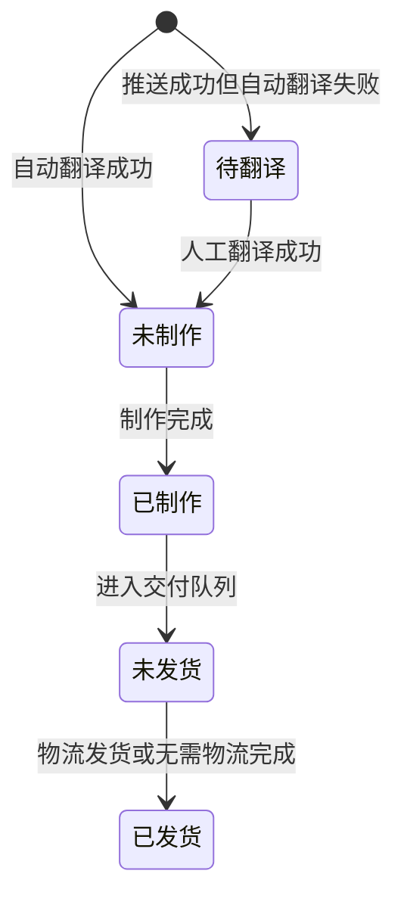

# 驾照官 3.0 迭代产品需求文档

> **模块**：驾照官 3.0
> **版本**：v0.1（待评审）
> **最后更新**：2026-09-28
> **作者**：产品团队
> **需求来源**：《驾照官 3.0 迭代需求整理.docx》

---

## 更新日志

- **v0.1（2026-09-28）**：根据原始需求整理 23 项迭代需求，补充流程、字段、异常、验收、埋点和待决策事项。

本次迭代围绕订单进入驾照官后的翻译、制作、发货与文件交付流程，统一各产线的订单信息展示，修复内容和同步问题，并完善批量操作、打印与登录能力。本文件用于需求评审、研发拆解和测试验收。

## 1 文档说明

| **项目** | **说明** |
| ------ | ---------------------------------- |
| 需求来源 | 《驾照官 3.0 迭代需求整理》中的需求 1 至需求 23 |
| 覆盖系统 | 驾照官 3.0、agent 录单与审核、自动翻译、云打印及文件存储相关接口 |
| 覆盖产线 | 小白本、宣誓、公证、香港公证及系统公共能力 |
| 版本目标 | 订单流转可追踪；操作入口和校验一致；模板与导出内容准确；异常可识别 |
| 评审结论 | 待产品、业务、研发和测试共同确认后冻结范围与排期 |

### 1.1 需求口径

“原文要求”表示来源文档已明确提出的需求，不代表已经审批上线。需求编号 R01 至 R23 与原文一一对应。各项下的细化规则、优先级、异常处理及验收场景属于评审建议；标记为“待确认”的内容须形成决策后才能作为对应功能的开发基线。

### 1.2 迭代目标

1. 减少人工切换与重复录入：默认进入制作队列，增加自动翻译、数量提醒、筛选和批量制作。
2. 提高交付准确性：修复模板重叠、国籍导出不同步、QR 识别和副页记录传递问题。
3. 补齐履约可见性：订单记录、送审公证处、打印异常、快递面单及截止时间。

### 1.3 范围边界

本次不定义收费、退款或支付账务规则；取消订单的权限与联动机制另行确认。正确账户归属、缺失同步订单及打印硬件能力先核实事实，再确定改动。业务截止时间不采用原文“7 个工作日”示例作为既定 SLA。

### 1.4 阅读导航

第 2 节为 23 项需求总览；第 3 节为共用流程与状态；第 4 至 11 节为功能规格；第 12 至 13 节为数据与验收；第 14 至 15 节为待决策事项及发布计划。

## 用户故事与问题场景

### US-01 让制作人员快速找到可制作订单

> 作为制作人员，我希望进入小白本后默认看到待制作订单，并看到未翻译、未制作数量，以便优先处理可制作和临近超时的订单。

**验收标准**：自动翻译成功订单进入未制作；失败订单进入未翻译；计数和列表状态一致；无权限订单不计数。

### US-02 让发货人员减少重复录入

> 作为发货人员，我希望符合业务规则的订单可以免填快递，携程多本订单可以复用同包裹物流，以便减少重复填写并保持发货记录可追溯。

**验收标准**：只有符合资格的订单出现免物流入口；首本物流与后续证本关联；免物流记录交付方式、原因、人员和时间。

### US-03 让审核和翻译使用同一份副页记录

> 作为审核人员，我希望可以修改 agent 录入的副页记录，翻译人员可以看到审核后的最终值，以便避免订单信息在系统间不一致。

**验收标准**：按产品子类型执行必填规则；修改记录可追溯；最新审核版本覆盖旧推送；长文本、多行文本完整传递。

### US-04 让运营准确判断交付异常

> 作为运营人员，我希望看到订单节点、面单字段和打印异常原因，以便区分系统问题、设备问题和业务数据问题。

**验收标准**：订单记录包含操作人和时间；京东、顺丰面单字段按规则生成；未知打印异常不被误判为卡纸。

## 逻辑视图与字段定义

### 订单工作台逻辑视图

```typescript
interface OrderWorkbenchView {
  orders: OrderRow[];
  counts: { untranslated: number; unmade: number };
  filters: { isUrgent?: boolean; status?: string; keyword?: string };
  permissions: { canMake: boolean; canShip: boolean; canBatchMake: boolean };
  actions: { make(ids: string[]): Promise<BatchResult>; ship(id: string, mode: "物流" | "无需物流"): Promise<void> };
}

interface OrderRow {
  orderId: string;
  productType: string;
  processType: string;
  sourceChannel: string;
  deliveryAddress: string;
  translationStatus: "未翻译" | "已翻译";
  makingStatus: "未制作" | "已制作";
  shippingStatus: "未发货" | "已发货";
  isUrgent?: boolean;
  makingDeadline?: string;
  eventHistory: OrderEvent[];
}
```

### 关键字段定义

| 字段（变更标识） | 类型 | 必填 | 取值来源 | 说明 |
| --- | --- | --- | --- | --- |
| [MOD] `orderId` | String | 是 | 平台/渠道订单 | 以业务唯一标识去重和关联历史记录 |
| [ADD] `translationStatus` | Enum | 是 | 翻译任务结果 | 自动翻译失败仍为 `未翻译` |
| [ADD] `makingStatus` | Enum | 是 | 制作任务结果 | 默认制作队列的判定字段 |
| [ADD] `isUrgent` | Boolean | 否 | 订单办理类型或加急字段 | 取值映射待 D09 确认 |
| [ADD] `makingDeadline` | Datetime | 否 | 下单时间 + 时效配置 | 无配置时显示待配置，不猜测日期 |
| [ADD] `deliveryMode` | Enum | 是（完成发货时） | 发货操作 | `物流` / `无需物流`，免物流不伪造单号 |
| [ADD] `sidePageRecord` | Text | 条件必填 | agent 录单及审核 | 按 R21 产品子类型执行 |
| [ADD] `notaryOfficeName` | String | 否 | 公证送审记录 | 未送审显示未送审 |
| [ADD] `fileLink` | URL | 否 | 文件存储服务 | 链接权限和有效期待 D10 确认 |

### 状态机与转换约束



状态只允许由服务端按权限和当前版本转换；并发请求、重复点击和旧消息不能覆盖新状态。取消相关转换等待 D01 决策。

## 埋点与国际化建议

### Tracking Events

| 事件名 | 触发时机 | 关键属性 |
| --- | --- | --- |
| `order_workbench_view` | 进入订单列表 | `product_line`, `user_role`, `default_queue` |
| `order_filter_apply` | 应用筛选 | `filter_fields`, `result_count` |
| `order_batch_make_submit` | 提交批量制作 | `selected_count`, `success_count`, `failed_count` |
| `order_no_logistics_ship` | 完成免物流发货 | `order_id`, `reason`, `user_role` |
| `print_error_shown` | 展示打印异常 | `error_category`, `device_id`, `task_id` |
| `side_page_record_update` | 审核修改副页记录 | `order_id`, `product_type`, `version` |
| `login_captcha_failed` | 验证码校验失败 | `failure_type`, `refresh_count` |

### i18n 资源规范

状态、按钮和错误提示使用资源键；订单号、驾照号、地址和副页记录属于业务数据，不做界面翻译。建议资源键：

| 文案 | `resource_key` |
| --- | --- |
| 未翻译 | `order.status.untranslated` |
| 未制作 | `order.status.unmade` |
| 无需物流完成发货 | `order.action.ship_without_logistics` |
| 验证码错误，请重新输入 | `auth.error.captcha_invalid` |
| 打印异常，原因待确认 | `print.error.unknown` |

## 异常场景与处理原则

| 异常场景 | 处理方式 |
| --- | --- |
| 自动翻译超时或失败 | 保留订单，进入未翻译；展示原因并允许重试 |
| 列表批量操作部分失败 | 返回逐单成功、失败、跳过结果；成功项不回滚 |
| 重复推送或重复提交 | 以业务唯一标识和版本校验幂等处理 |
| 物流信息为空但不符合免物流规则 | 阻止发货并提示补充物流信息 |
| 打印服务断连 | 提示连接异常，不显示卡纸；保留任务供核对和重试 |
| 国籍译文为空 | 阻止正式翻译/导出，定位缺失字段 |
| PDF 上传失败 | 不生成成功链接，保留明确错误原因 |
| 验证码错误或过期 | 提示错误并刷新验证码，旧验证码不可复用 |


## 2 需求总览

优先级为评审建议：P0 先排查数据归属与完整性；P1 本次核心流程与正确性需求；P2 增强项或依赖外部能力的需求。优先级不等同于已承诺排期。
| **编号** | **模块** | **需求主题** | **优先级** | **当前口径** |
| ------ | ------ | --------------- | ------- | -------- |
| R01 | 公共列表 | 各产线订单页面与订单记录统一 | P1 | 部分待确认 |
| R02 | 小白本 | 默认待制作与自动翻译分流 | P1 | 需求明确 |
| R03 | 小白本 | 未翻译及未制作数量提醒 | P1 | 需求明确 |
| R04 | 小白本 | 深空录单账户归属核对 | P0 | 先排查 |
| R05 | 小白本 | 缺失订单同步核对与补齐 | P0 | 先排查 |
| R06 | 小白本 | 制作截止时间展示 | P2 | 口径待确认 |
| R07 | 小白本 | 六证本第二页文本重叠修复 | P1 | 需求明确 |
| R08 | 小白本 | 发货增加中通 ZTO | P1 | 取消场景待定 |
| R09 | 小白本 | 带宣誓订单免填快递发货 | P1 | 资格待确认 |
| R10 | 小白本 | 携程多本第二本免重复快递 | P1 | 关联规则待定 |
| R11 | 云打印 | 京东与顺丰面单字段完善 | P1 | 模板联调 |
| R12 | 自动打印 | 区分系统停止与机器异常提示 | P2 | 硬件能力待定 |
| R13 | 宣誓 | 非中国国籍翻译及导出更新 | P1 | 需求明确 |
| R14 | 宣誓 | 是否加急筛选 | P1 | 范围待确认 |
| R15 | 宣誓 | 未制作全选与批量制作完成 | P1 | 需求明确 |
| R16 | 宣誓 | 订单状态及订单记录展示 | P1 | 状态词待确认 |
| R17 | 宣誓 | 本地 PDF 上传生成电子链接 | P2 | 交付策略待定 |
| R18 | 公证 | 订单列表展示送审公证处 | P1 | 需求明确 |
| R19 | 香港公证 | 部分订单 QR 识别修复 | P1 | 样本待核实 |
| R20 | 香港公证 | 法语模板新增有效期一行 | P1 | 字段映射待定 |
| R21 | 宣誓公证 | 副页记录录入审核与翻译展示 | P1 | 需求明确 |
| R22 | 系统 | 登录域名变更 | P1 | 迁移策略待定 |
| R23 | 系统 | 密码校验与图形验证码登录 | P1 | 密码规则待定 |
源文档共 23 项需求；本 PRD 保留全部编号，不将“待确认”项视为已完成或已排除。各项决策编号 D01 至 D14 见第 14 节。

## 3 用户角色与核心流程

| **角色** | **主要任务** | **权限建议** |
| ---------- | --------------- | -------------- |
| agent 录单人员 | 录单、填写副页记录并提交审核 | 仅处理授权渠道与客户的订单 |
| agent 审核人员 | 核对录单信息并修改副页记录 | 修改须记录人员、时间和变更值 |
| 翻译人员 | 处理自动翻译失败与国籍翻译 | 可保存翻译，不能越权修改归属 |
| 制作人员 | 制作、批量完成及查看截止时间 | 仅对可制作且授权的订单操作 |
| 发货人员 | 填写物流、免物流交付及打印面单 | 免物流交付按订单资格开放 |
| 系统管理员 | 账户、归属核对、配置及异常排查 | 权限范围需按现有角色模型核实 |

### 3.1 小白本订单流转

agent 推送 → 接收并校验订单 → 自动翻译 → 成功后进入未制作队列 → 制作完成 → 未发货 → 发货完成。自动翻译失败的订单进入未翻译队列，由人工处理后回到制作流程。
建议：接收成功不等同于翻译完成；自动翻译执行中显示处理标识。超时或失败后保留原因及人工重试入口。重复推送不得生成重复订单或覆盖已完成的人工结果。

### 3.2 宣誓与公证信息流

agent 录单填写副页记录 → 审核人员确认或修改 → 推送驾照官 → 翻译页面展示 → 翻译与制作 → 文件导出或实物发货。宣誓订单的国籍保存后，后续新导出文件使用最新内容。

### 3.3 状态和订单记录的共用口径

| **维度** | **页面表达** | **建议约束** |
| ------ | ------------------ | -------------------------- |
| 翻译 | 未翻译、已翻译 | 自动失败仍属未翻译，失败原因独立展示 |
| 制作 | 未制作、已制作 | “待制作”与“未制作”指同一队列，界面命名待统一 |
| 发货 | 未发货、已发货 | 免填快递须另记交付方式，不能伪造物流轨迹 |
| 审核与取消 | 待审核、取消相关状态 | 保持现有业务含义，取消终态和权限待 D01 决策 |
| 订单记录 | 已推送、已翻译、已制作、已发货等节点 | 记录事件、操作人及时间，不用一段状态文字替代事件历史 |
翻译、制作、发货是不同维度。例如已翻译但尚未制作的订单可同时具有“已翻译”和“未制作”属性，不能把这些条件当成完全互斥的单字段枚举。源文档中的“未取消”在 D09 确认前不改写为“已取消”。

### 3.4 通用交互规则

建议：所有变更以服务端结果为准；提交中禁止重复点击；批量操作返回成功、失败与跳过明细；异常保留用户已填写内容。订单列表、数量提醒、详情及导出文件应在操作完成后保持一致。

## 4 公共订单列表与小白本工作台

### R01 统一各产线订单页面

**原文要求**　统一订单页面的描述及列结构；付款方式、付款状态与实际制作无关。
1. 主列表采用下表字段顺序；支付信息是否移至详情由 D01 确认。不得仅凭展示调整变更支付、退款或取消逻辑。
2. 订单记录按节点展示对应人员与时间。“已制作”节点可同时保留翻译人员／时间及制作人员／时间；系统自动操作标记为系统。
3. 小白本“内容”保持现有业务信息，包含宣誓公证与副页记录。录单副页记录必填、无记录填“无”的要求在小白本场景确认后执行，不能覆盖 R21 的分产品规则。
**验收标准**　相同订单在各适用产线使用同一字段名称；“订单信息”改为“收货地址”后原地址内容不变；节点人员和时间可核对；制作操作不因付款展示字段产生新增限制。
**待确认**　D01 取消规则与付款字段位置；D13 小白本副页记录适用范围。
| **字段** | **展示规则** |
| ------- | -------------------- |
| 订单号 | 美卡平台订单号、渠道订单号、下单时间 |
| 产品及办理类型 | 产品名称、办理类型与配送类型 |
| 内容 | 沿用现有内容，补齐宣誓公证和副页记录展示 |
| 收货地址 | 仅统一列名，地址内容保持原有取值 |
| 订单来源 | 对应渠道商名称 |
| 订单记录 | 节点、对应人员、对应时间 |
| 操作 | 依角色权限及订单状态显示可执行动作 |

### R02 默认制作队列与自动翻译

**原文要求**　进入订单页默认“待制作”；agent 推送的小白本订单自动翻译，成功进入未制作，失败进入未翻译。
1. 首次进入小白本订单页默认打开制作队列；用户手动切换后按所选队列查询。
2. 翻译成功必须完成结果持久化，再更新队列；失败不标记已翻译或已制作，并显示可重试原因。
**验收标准**　新推送成功订单可在制作队列找到；失败订单可在未翻译队列找到；重复推送只保留同一业务订单。

### R03 二级菜单数量提醒

**原文要求**　小白本二级菜单显示“未翻译数／未制作数”，例如（110/100）。
1. 计数沿用当前客户、渠道及用户可见范围；两类数量均为订单数，不是证本数。
2. 建议计数不随列表临时搜索缩小；状态变更后刷新；零值显示（0/0）。页面与计数接口共用队列判定条件。
**验收标准**　显示顺序固定为未翻译在前、未制作在后；翻译成功后前项减一、后项加一；无权限订单不计入。

## 5 小白本数据核对与截止时间

### R04 深空录单账户归属核对

**原文要求**　核对深空录单账户出现在 SIDL 下的问题，正确归属待确认。
1. 先收集账户标识、当前归属、业务确认的目标归属及代表订单，核实是账号映射、展示还是历史数据问题。
2. 形成受影响账户与订单清单后再修复。不得依据名称直接推断深空的正确归属，也不得顺带修改无关账户。
3. 涉及历史订单归属变更时，建议保留修改前后归属、确认依据、执行人和时间，支持核对与恢复。
**验收标准**　按业务签字确认的清单核对账户归属；历史与新增订单在正确客户下可见；其他客户的订单范围和菜单计数不受影响。
**待确认**　D02 正确归属、确认人员、历史数据处理边界。

### R05 小白本订单同步完整性

**原文要求**　小白本订单未完全同步到 3.0，需确定问题范围并处理。
1. 确定应同步的渠道、时间区间、产品和状态集合；以订单唯一标识对账 agent 与驾照官。
2. 将差异区分为应同步但缺失、同步中、业务排除、重复及信息不一致，并保留失败日志。
3. 确认根因后按清单补偿；重复执行补偿不能新增重复订单，不能覆盖已修改的翻译或制作结果。补偿后的自动翻译触发规则需一并确认。
**验收标准**　冻结对账时点后，“应同步订单集合”中的缺失记录全部有处理结果；补偿后订单数、唯一标识及关键字段相符；新增订单继续稳定同步。
**待确认**　D03 对账区间、应同步条件、缺失清单及历史补偿方案。

### R06 制作截止时间展示

**原文要求**　希望展示截止时间，避免超时制作；原文提出按下单时间和办理类型计算的思路。
1. 建议在小白本列表和详情新增“制作截止时间”；计算输入为下单时间、办理类型、时效规则及工作日历。
2. 建议计算表达为“业务起算时点 + 对应办理类型的工作日时效”。起算日是否计入、截单时间、时区、周末和调休日均由配置口径决定。
3. 缺少时效配置或合法起算时间时显示“待配置”或“无法计算”，不显示猜测日期。明确规则变更是否重算存量订单。
4. 临期与超时标签属于评审建议；如采用，需先确定阈值和制作完成后停止计时的条件。
**验收标准**　按批准样例覆盖普通／加急、周末／节假日、截单前后及存量订单，页面结果与人工核算一致；制作完成后不再误报待制作超时。
**待确认**　D04 SLA 及日历口径。原文“7 个工作日”仅为示例，不是确定的普通办理时效。

### 交付要求

R04、R05 的开发输入应包含可复现样本和对账清单。R06 在时效规则确认前可先完成字段与配置设计，不将示例数值写成正式默认值。

## 6 小白本模板与发货规则

### R07 六证本第二页排版修复

**原文要求**　修复 Description of licence class/es 内容过长时与下一行重叠的问题。
1. 调整该字段的换行、段落高度或后续内容布局，保留完整驾照类别描述。
2. 使用短文本、长文本、连续字符及多行文本回归；若超出一页可容纳范围，按确认的模板规则处理，不静默截断。
**验收标准**　导出文件和实际打印中该字段均无重叠、裁切或遗漏，且其他字段和页序不变。

### R08 发货弹窗增加中通 ZTO

**原文要求**　在发货弹窗增加 ZTO 选项，原文同时提到“用于取消订单的发货”。
1. 承运商下拉框新增“中通（ZTO）”，前后端保存与回显统一的承运商标识。
2. 仅新增承运商不应绕开正常发货的快递单号校验。取消订单的特殊处理在业务确认前不开放。
**验收标准**　选择中通并填写合法单号后可保存、回显和查询；其他承运商不受影响；未确认的取消订单不得被自动置为已发货。
**待确认**　D05 “取消订单的发货”的真实场景，以及是否涉及退件或仅关闭业务单。

### R09 带宣誓的小白本订单免填快递

**原文要求**　未发货状态下，对符合场景的订单提供一键空订单发货，无需填写快递。
1. 建议将入口命名为“无需物流完成发货”，明确提示本次不会产生物流单或面单。仅对有权限、未发货且符合产品规则的订单开放。
2. 确认后记录交付方式、原因、操作人和时间；物流公司和单号可为空，不使用虚构单号。对外状态回传须与渠道确认。
**验收标准**　符合资格的带宣誓订单无快递信息也能完成；不符合资格的订单继续要求物流；重复提交不会新增发货事件。
**待确认**　D06 是所有带宣誓订单，还是仅无需独立寄送的关联子单；其余实物如何履约。

### R10 携程多本第二本免重复快递

**原文要求**　携程多本订单第二本发货不再填写快递单号，原文建议使用一键空订单发货。
1. 建议先验证同一主订单、同一包裹及首本有效物流的关联，再允许后续证本免重复录入。第二本保留首本发货记录引用。
2. 首本未发货、无法关联或实际分包时继续正常录入物流；首本物流修改后的关联更新策略需确认。
**验收标准**　同包裹第二本无需重填且可追溯首本物流；未关联或分包场景不会误用免物流；取消／失败的首本发货不构成有效前置条件。
**待确认**　D06 主单与证本的关联键、是否共用包裹、是否适用于第三本及以后。

### 公共约束

R09、R10 复用免填快递入口但采用不同资格规则。空快递字段不等于取消订单，也不表示承运商已揽收；订单记录须能区分实物寄送与无需独立物流的完成方式。

## 7 云打印与自动打印异常

### R11 京东与顺丰面单调整

**原文要求**　京东面单增加驾照号后三位备注，并完整显示姓名和电话号码；顺丰面单完整显示姓名和电话号码。
1. 修改对应云打印自定义模板，并逐项核对字段映射；“电话号码”是否取收件人电话须在模板联调时确认。
2. 京东备注由订单驾照号码提取最后三位；取值规则不得改变其原始字符。驾照号缺失或长度不足时提示数据异常，不填“000”等默认值。
3. 姓名与电话使用已确认的完整数据源；模板预览、面单成品和打印请求均需检查。完整展示仅用于授权的打印链路。
4. 若云打印服务只返回脱敏字段，需确认能否提供完整字段；仅改模板不足以完成验收。模板版本需可回退。
**验收标准**　京东成品含正确后三位，京东与顺丰均完整显示确认的姓名、电话；长姓名及较长电话不会裁切；其他模板字段保持正确。
**待确认**　D07 完整字段能力、姓名／电话取值对象、自定义模板权限及承运商联调安排。
| **场景** | **必验结果** |
| ---------- | ------------------- |
| 京东普通订单 | 姓名、电话完整；驾照号后三位准确 |
| 顺丰普通订单 | 姓名、电话完整；不误增京东专属备注 |
| 长姓名及国际格式电话 | 完整显示，不重叠，不丢失字符 |
| 空驾照号或短于三位 | 有明确提示，不出现伪造备注 |
| 服务端只返回脱敏数据 | 明确标记能力缺口，不以预览成功判定通过 |

### R12 自动打印停止原因提示

**原文要求**　系统导致打印停止时增加提示；机器卡住的提示需先确定是否能够实现。
1. 建议区分系统任务错误、与打印服务连接中断、设备上报故障及原因未知四类；提示最近任务与发生时间。
2. 系统已知错误展示可理解原因及恢复方式；设备只有在明确上报卡纸、缺纸等状态时才显示对应故障。无响应不能直接判为卡纸。
3. 打印结果不确定时先核对设备实际输出，再由人员决定重试，避免同一证本重复打印；保留原任务和重试记录。
4. 设备上报接口不可用时保留“打印异常，原因待确认”，提供检查设备与连接的指引，不承诺自动诊断机器卡纸。
**验收标准**　模拟系统任务失败可看到明确提示；模拟断连不显示“卡纸”；硬件支持时按真实信号显示故障；恢复或重试后状态及日志一致。
**待确认**　D08 设备型号、打印驱动或服务接口、可用状态码及检测周期。

## 8 宣誓翻译与批量制作

### R13 国籍翻译与导出一致性

**原文要求**　完善非中国国籍的对应语言翻译与空值校验；修改国籍后导出文件同步更新。
1. 建议国籍标准值与目标语言译文分别保存；对应语言暂按订单文书语言设计，具体映射由业务确认。
2. 非中国国籍译文为空时允许保留草稿，但阻止完成翻译及生成正式文件，并定位到字段；无词库匹配时允许有权限人员补录。
3. 国籍修改并保存成功后，使旧导出缓存失效；之后新生成文件读取最新国籍及译文。已经下载的文件不自动改变。
**验收标准**　非中国国籍缺译文不能完成翻译；修改后新导出的国籍一致，其他信息不丢失；保存失败不出现“页面新值、文件旧值”的成功提示。

### R14 是否加急筛选

**原文要求**　需求描述称各产品增加“是否加急”；具体方案要求宣誓产线各二级菜单增加该筛选。
1. 按明确方案先设计宣誓范围：选项为全部、是、否，默认全部；可与现有筛选组合使用。
2. 加急值读取订单办理类型或已确认加急字段；不能通过下单时间推测。切换条件后回到第一页，空结果正常展示。
**验收标准**　宣誓各二级菜单均可筛出加急与非加急订单；组合筛选结果正确，空结果不保留旧列表。
**待确认**　D09 是否扩展至其他产线，以及办理类型与加急值的映射。

### R15 全选与批量制作完成

**原文要求**　宣誓产线各二级菜单的未制作列表支持全选和批量制作完成。
1. 建议“全选”默认仅选当前页可操作订单，显示已选数量；切换筛选或翻页清空选中，避免隐藏订单被操作。
2. 提交前确认订单数，服务端再次校验权限及当前状态；成功项进入已制作，按原有后续规则进入未发货或文件交付流程。
3. 并发已完成、已取消或无权限的订单返回跳过／失败原因；部分成功不回滚已成功项，失败项可单独重试。
**验收标准**　未选中时按钮禁用；全选数量准确；批量操作逐单返回结果；重复点击、并发改状态和跨权限请求不会重复完成或越权。

### R16 宣誓订单记录与状态

**原文要求**　新增订单记录列，涉及待审核、未翻译、已翻译、已制作、未发货、已发货、未取消等描述。
1. 复用 R01 事件记录规范；“全部”订单视图可辨识当前审核、翻译、制作和发货情况，已完成节点显示人员与时间。
2. 待审核、未发货等是状态条件；推送、翻译完成等是历史事件。按第 3 节分层展示，避免一个标签覆盖全部维度。
**验收标准**　在各状态样本中，列表显示与详情、事件记录一致；翻译完成未制作的订单不会误标已制作。
**待确认**　D09 “未取消”的含义、订单记录展示形式及状态示意稿；未经确认不改成“已取消”。

## 9 文件链接 公证与香港公证

### R17 PDF 上传生成电子链接

**原文要求**　将本地上传的 PDF 生成电子链接，可通过链接打开及下载文件。
1. 建议流程为选择 PDF → 校验类型与文件 → 上传 → 保存文件信息 → 返回可复制链接；上传失败不给出虚假的成功链接。
2. 链接指向存储后的同一文件，不隐含文字提取或格式转换。建议保存文件名、大小、上传人、时间和订单关联。
3. 支持预览与下载；权限不足、文件删除或链接失效时给出明确反馈。外部分享、链接有效期、撤销能力、大小上限须先确认。
**验收标准**　合法 PDF 可上传，链接打开及下载内容一致；非 PDF、损坏文件或上传中断有明确错误；无权限访问遵循确定的分享策略。
**待确认**　D10 入口位置、是否关联订单、客户访问方式、有效期及存储限制。

### R18 送审公证处名称

**原文要求**　公证订单列表的订单信息列增加送审公证处名称。
1. 在统一列表布局中保留送审公证处子字段，取实际送审记录的公证处名称，不从渠道名称推断。
2. 尚未送审显示“未送审”；名称更新后列表与详情保持一致。多个送审记录时展示哪一条须与业务确认。
**验收标准**　已送审样本显示正确公证处；未送审订单不会显示其他订单数据；变更后列表及时更新。

### R19 香港公证 QR 识别修复

**原文要求**　原文以 OCR 优化为题，具体问题是部分订单的 QR 识别不可用。
1. 先收集失败样本，区分图像输入、QR 解码、链接获取及后续字段识别错误；按根因修复对应环节。
2. 保留原始文件；识别失败时显示原因或通用重试提示，并提供现有人工处理入口，不用空结果覆盖已录入数据。
**验收标准**　已确认的可识别故障样本修复后成功，原正常样本不回退；不可读二维码仍有明确失败反馈，不能把所有失败记作识别成功。
**待确认**　D11 问题样本、二维码类型及相关接口边界；不默认扩展为全产线 OCR 重构。

### R20 法语香港公证模板有效期

**原文要求**　补充一行 Date de commencement de validité: XX.0X.20XX-XX.0X.20XX。
1. 保持原文法语标签，建议以起止有效日期映射为 DD.MM.YYYY-DD.MM.YYYY，并避免与现有文字重叠。
2. 起始日期、结束日期须取已确认业务字段；长期有效、缺失日期及起止倒置的展示或阻断规则待确认，不编造日期。
**验收标准**　合法起止日期在法语模板准确输出；长字段和分页无重叠；其他语种模板不受影响。
**待确认**　D12 有效期指向的证件字段、日期格式和异常日期处理方式。

## 10 副页记录全流程

### R21 录单 审核及翻译展示

**原文要求**　agent 录单增加副页记录；宣誓换证电子版必填，宣誓原件及电子版非必填，公证非必填；审核可修改，驾照官翻译页展示已录内容。
1. 建议字段名称统一为“副页记录”，采用多行文本输入，保留换行与有意义字符；空白字符不视为已填写。
2. 按产品子类型控制校验；不能将所有电子版都判断为换证电子版。无记录填写“无”的规则按下表及 D13 执行。
3. 审核人员可编辑并记录变更；审核后的最新保存内容随订单传入驾照官。翻译页显示相同内容，修改后的同步不得被旧推送覆盖。
4. 产品类型变更时重新判断必填性。历史订单允许展示为空；是否需要补录后才能继续制作由业务确认，不自动补写“无”。
**验收标准**　按照下表逐产品验证；审核修改后驾照官可看到最终值；空格和空行不能绕过必填；换行内容传输后完整保留。
| **产品范围** | **录单规则** | **无记录场景** | **当前口径** |
| ------------- | -------- | ----------- | --------- |
| 宣誓换证电子版 | 必填 | “无”的填写规则待确认 | 原文明确必填 |
| 宣誓原件 | 非必填 | 允许留空 | 原文明确 |
| 宣誓电子版<br>不含换证电子版 | 非必填 | 允许留空 | 原文明确 |
| 公证产品 | 非必填 | 允许留空 | 原文明确 |
| 小白本关联内容 | 原文表格提出必填 | 原文要求填写“无” | 适用范围待 D13 |

### 10.1 字段流转与一致性

录单初值 → 审核修改值 → 推送版本 → 驾照官翻译页展示值。建议以审核提交后的业务版本作为传递依据，保留修改记录，避免异步旧消息覆盖新内容。

### 10.2 页面提示建议

1. 必填场景：提示“请填写副页记录”；无记录是否可填“无”按产品规则处理。
2. 非必填场景：提示“如有副页记录请填写，可留空”。不强迫用户录入无业务含义的占位字符。
3. 同步失败：保留已保存内容并提示同步状态，支持重试或交由运营核对。

### 10.3 边界与验收补充

验收覆盖审核前后修改、长文本、多行文本、产品切换、重复推送、历史空值及并发更新。字段最大长度和超限提示由接口与页面共同确认；本需求只明确录入、修改和展示，不默认新增文书中的打印位置。
**待确认**　D13：R01 表格的“必填、无记录填无”与 R21 的分产品规则须按产线区分，不能使用单一全局必填开关。

## 11 域名与登录

### R22 登录域名调整

**原文要求**　登录域名改为 merchant.jiazhaoguan.com。
1. 新域名覆盖登录页及登录后的必要跳转；同步核对接口地址、跨域策略、Cookie 作用域、回调及登出流程。
2. 发布前配置并验证域名解析与 HTTPS 证书；确认直达业务页面时的未登录跳转行为。
3. 旧域名是否保留、重定向方式、过渡周期及既有登录态处理须形成迁移方案，保留可回退的部署配置。
**验收标准**　使用新域名可登录、刷新、跳转业务页并退出；直接打开业务链接可按权限正常处理；接口与文件功能不因域名变更失效。
**待确认**　D14 旧域名迁移方式、切换窗口及登录态兼容策略。

### R23 密码规则与图形验证码

**原文要求**　添加用户时密码增加校验，原文写为“字母+8位数字构成”；登录增加图形验证码，错误时提示并刷新。
1. 密码规则存在“字母加恰好 8 位数字”与“至少 8 位且含字母和数字”等不同解释，须先确认长度、组合、大小写和符号规则，再实现校验与提示。
2. 新增用户的前后端执行同一校验。是否同步到修改密码、重置密码以及现有用户，另行确认；不擅自要求全员重置。
3. 登录页增加验证码图片、输入框和换一张入口。验证码正确仍需账号密码验证通过，不能仅凭验证码登录。
4. 验证码错误时提示“验证码错误，请重新输入”，更换图片并清空验证码输入；账号内容保留。过期、缺失及刷新后的旧验证码分别按失败处理。
5. 建议验证码由服务端验证并绑定一次登录会话；提交后按确定规则失效，防止同一验证码被反复使用。有效期及账号密码错误后的刷新策略需确认。
**验收标准**　按批准密码规则验证合法与非法边界；验证码为空、错误、过期和被替换均不能登录；错误后自动刷新，正确验证码配合错误密码仍不能登录。
**待确认**　D14 密码精确定义、旧用户策略、验证码有效期及重试规则。

### 11.1 验证码交互状态

| **状态** | **页面反馈** | **服务端要求建议** |
| ------------ | -------------- | -------------- |
| 首次进入或主动换图 | 显示新图片，可输入 | 生成与本次会话对应的校验对象 |
| 验证码为空 | 提示请输入验证码 | 缺少验证码不得通过登录 |
| 验证码错误或过期 | 提示错误，刷新并重新输入 | 旧验证码不可再次使用 |
| 验证码正确但账号密码错误 | 提示登录失败，按确认策略换图 | 不得建立登录会话 |
| 全部校验通过 | 进入已授权工作台 | 建立有效会话并按角色加载数据 |

## 12 数据约束 权限与观测

本节为支撑业务规则的逻辑数据要求和验收建议，字段名并非最终接口或数据库设计。研发应优先复用现有对象，避免产生互不一致的状态副本。

### 12.1 关键数据对象

| **对象** | **需要保存或读取的信息** | **关联需求** |
| ------- | --------------------------------- | --------------- |
| 订单与归属 | 美卡及渠道订单号、来源、客户、产品子类型、办理／配送类型、下单时间 | R01—R06 |
| 流程事件 | 事件类型、系统或人员标识、发生时间、处理结果、原因及关联任务 | R01 R02 R12 R16 |
| 交付记录 | 交付方式、承运商、单号、免物流原因、主单／证本／包裹关联 | R08—R10 |
| 翻译与文书版本 | 国籍标准值、目标语言、译文、保存版本、导出版本与生成时间 | R13 R20 |
| PDF 文件 | 文件标识、名称、大小、上传人、关联订单、链接及访问策略 | R17 |
| 公证送审 | 送审公证处标识与名称、送审状态、记录时间 | R18 |
| 副页记录 | 原始录入值、审核后的值、修改人和时间、同步版本 | R21 |
| 时效配置 | 办理类型、工作日数、日历、起算规则及配置版本 | R06 |

### 12.2 权限及操作保护

1. 列表、详情、计数、导出及批量操作执行同一客户／渠道权限边界；服务端再次校验，不能只隐藏按钮。
2. 归属调整、批量完成、免填快递、文件上传及重新导出记录操作人和时间；账号密码、验证码不写入业务日志。
3. 面单完整姓名和电话、PDF 文件链接仅在已确定的授权范围内可用；分享方式以 D10 为准。
4. 同步、翻译、制作和发货变更建议使用唯一业务标识及版本校验，防止重复提交和旧请求覆盖新值。

### 12.3 观测指标建议

| **指标** | **统计口径** | **用途** |
| --------- | ------------------------ | ----------- |
| 应同步订单缺失数 | 冻结条件下，应同步集合减去目标系统有效订单集合 | 验证 R05 补偿效果 |
| 自动翻译成功率 | 成功订单数 ÷ 已结束自动翻译订单数，处理中单列 | 定位分流质量 |
| 人工重复物流录入量 | 符合 R10 场景的后续证本重新填写次数 | 验证重复劳动减少 |
| 打印异常分类 | 按系统、连接、设备已知和未知错误分别计数 | 避免错误归因 |
| 国籍导出不一致数 | 同一保存版本的页面值与新导出值不符的订单数 | 监测内容一致性 |
指标采集方式及业务目标值由评审确定；不以未验证的成功率或耗时作为发布承诺。性能验收沿用现有系统基线，并增加大列表、批量操作及打印联调场景。

## 13 集成验收与回归范围

各 R 编号下的验收标准是逐项检查依据；下表补充跨系统、异常与回归场景。测试数据应包含真实结构的脱敏样本，并可按订单唯一标识追溯。
| **用例** | **场景与操作** | **通过标准** | **关联需求** |
| ------ | ---------------------- | ---------------------- | -------- |
| E01 | 推送小白本订单，分别构造自动翻译成功和失败 | 进入正确队列；菜单数量、详情与事件记录一致 | R01—R03 |
| E02 | 重复推送和重复执行历史补偿 | 不新增重复订单，不覆盖人工结果；差异清单闭环 | R02 R05 |
| E03 | 核对归属修复前后各角色可见范围 | 只修复批准清单；客户列表、订单与计数一致 | R04 |
| E04 | 用批准的普通／加急及节假日样例核算截止时间 | 展示与人工计算一致；无配置不猜测日期 | R06 |
| E05 | 六证本长类别文本导出并实际打印 | 无重叠、截断或遗漏，其他字段位置正确 | R07 |
| E06 | 中通正常发货、带宣誓免物流、携程同包与分包 | 承运商正确；免物流资格生效；记录可追溯 | R08—R10 |
| E07 | 京东顺丰面单及系统停止、断连、设备故障 | 字段完整；异常按可获取证据分类；重试可追踪 | R11 R12 |
| E08 | 非中国国籍缺译文、修改国籍后连续导出 | 缺值按规则阻断；新导出取最新保存值 | R13 |
| E09 | 加急筛选后全选，并构造并发已完成或取消订单 | 选择范围准确；成功／失败／跳过逐单返回 | R14—R16 |
| E10 | PDF 正常上传、错误文件、无权限和失效链接 | 预览下载一致；异常无成功链接且提示清楚 | R17 |
| E11 | 核对送审公证处、QR 故障样本与法语有效期 | 来源字段准确，修复样本通过，其他模板不回退 | R18—R20 |
| E12 | 所有产品子类型录入副页记录并在审核修改 | 必填差异正确；驾照官展示最终审核值 | R21 |
| E13 | 新域名全链路与各类密码／验证码输入 | 仅全部验证通过可登录，回调及业务功能正常 | R22 R23 |

### 13.1 必须覆盖的边界

空值与纯空白、长字段、多页列表、无数据、无权限、网络中断、接口超时、重复提交、并发操作、部分批量失败、旧版本消息、历史订单及模板回退。测试范围由适用的需求选取，不要求每项机械重复全部边界。

### 13.2 建议验收门槛

已纳入发布范围的需求逐项通过；阻断正常业务、导致数据错乱或越权的缺陷清零；关键流程通过真实接口联调与打印成品确认。待决策项不得以临时猜测值进入生产配置。验收结果按 R 编号登记并关联缺陷。

## 14 待决策事项

下表为评审议题，非对业务的既定结论。每项需要记录最终决策、确认角色、日期和受影响的 R 编号；只阻塞对应范围，不自动阻塞无关需求。
| **编号** | **待确认问题** | **建议确认角色** | **影响** |
| ------ | ---------------------------------- | ----------- | ------- |
| D01 | 订单进入驾照官后能否取消、谁可取消、哪些状态可取消；付款字段如何展示，取消如何回传 | 产品／业务／研发 | R01 R16 |
| D02 | 深空账户的正确客户归属，以及是否修复历史订单 | 业务／运营 | R04 |
| D03 | 小白本应同步的渠道、时间和状态范围；补偿是否触发自动翻译 | 业务／研发 | R05 R02 |
| D04 | 各办理类型时效、起算日、截单、工作日历、时区、临期阈值及存量重算 | 业务／产品 | R06 |
| D05 | 中通“用于取消订单发货”具体指什么业务，是否实物寄送或业务关闭 | 业务／产品 | R08 |
| D06 | 带宣誓订单的免物流资格；携程主单、证本及包裹关联，首本和多本处理 | 业务／渠道／研发 | R09 R10 |
| D07 | 面单完整字段可得性、姓名电话来源、驾照后三位规则及自定义模板能力 | 运营／研发／打印服务方 | R11 |
| D08 | 打印机型号、状态上报能力、故障码和检测周期；重试前如何核对成品 | 研发／设备支持 | R12 |
| D09 | 加急筛选是否跨产线；加急映射；“未取消”含义；状态展示稿及全选范围 | 产品／业务 | R14—R16 |
| D10 | PDF 链接入口、订单关联、访问对象、鉴权／有效期、撤销方式与大小上限 | 产品／业务／研发 | R17 |
| D11 | QR 识别失败样本、原因和成功判定；是否涉及 QR 外的 OCR 环节 | 业务／研发／测试 | R19 |
| D12 | 国籍对应的目标语言；法语有效期字段映射、格式及长期／缺失日期规则 | 业务／翻译／产品 | R13 R20 |
| D13 | 小白本副页记录的必填范围；无记录填“无”是否扩展；长度与历史补录 | 业务／产品／研发 | R01 R21 |
| D14 | 密码精确定义与旧用户策略；验证码有效期和重试；旧域名过渡及回退 | 产品／系统管理／研发 | R22 R23 |

### 14.1 建议先确认的阻塞项

先确认 D01、D05、D06，避免将取消与发货混用；确认 D04 后才计算正式截止时间；确认 D14 后再发布密码校验。D02、D03 需以数据清单闭环。其余事项可按需求依赖并行推进。

## 15 交付计划与上线检查

排期与责任人由评审后指定，本文件不预设开发天数或上线日期。建议按以下里程碑推进，并将每项交付结果关联到需求编号。
| **阶段** | **主要交付物** | **完成条件** |
| ---------- | ------------------------ | ------------------- |
| M1 需求冻结 | 决策记录、字段口径、适用产线与发布范围 | 影响本期功能的待决策项完成确认 |
| M2 数据与能力核实 | 归属／同步清单、QR 样本、云打印与设备能力结论 | 问题可复现，接口与外部能力边界明确 |
| M3 设计与实现 | 页面交互、接口约定、模板版本和数据修复方案 | 核心分支、权限与异常处理均有实现 |
| M4 联调与验收 | 逐项验收记录、回归结果、打印成品与导出文件 | 第 13 节门槛通过，业务确认关键样本 |
| M5 发布与观察 | 发布清单、配置记录、回退方案和异常观察结果 | 新旧链路可核对，问题有责任人和处理记录 |

### 15.1 发布顺序建议

1. 先完成数据归属和同步对账，避免把旧问题带入新队列与数量提醒。
2. 联合发布依赖同一字段的 agent 与驾照官改动，确保副页记录、办理类型及状态接口兼容。
3. 文书模板和云打印模板按产线与模板版本验证后切换；自动打印设备提示按实际能力开放。
4. 域名、密码校验及验证码变更独立核对登录回退方案，再在已确认窗口切换。

### 15.2 上线检查清单

• 范围：所有上线 R 编号均已通过验收，相关 D 编号已有记录。
• 数据：历史修复有清单、有备份或可恢复方案；无重复订单，关键版本一致。
• 外部依赖：云打印、承运商及文件链接按实际生产配置验证。
• 操作培训：全选作用范围、免物流资格、错误提示与人工恢复方法已告知使用人员。
• 域名：解析、证书、登录、退出、业务跳转及必要回调均通过检查。
• 观察：同步缺失、翻译失败、打印异常及导出不一致均能追溯订单和任务。

### 15.3 回退与数据处理原则

建议使用功能配置或版本切换恢复旧入口、模板和域名路由；回退应用不能直接删除已产生的订单、制作或发货记录。已发货、已导出等真实业务结果须保留，再按具体问题补偿或人工核对。归属与历史数据修复使用独立变更记录，避免随应用回退反向破坏数据。

### 15.4 评审输出

评审结束后更新版本号和变更记录，补充最终范围、角色责任及排期；如对原需求进行拆分、延期或变更，保留对应 R 编号及决策依据，确保研发、测试和运营使用同一版本。
