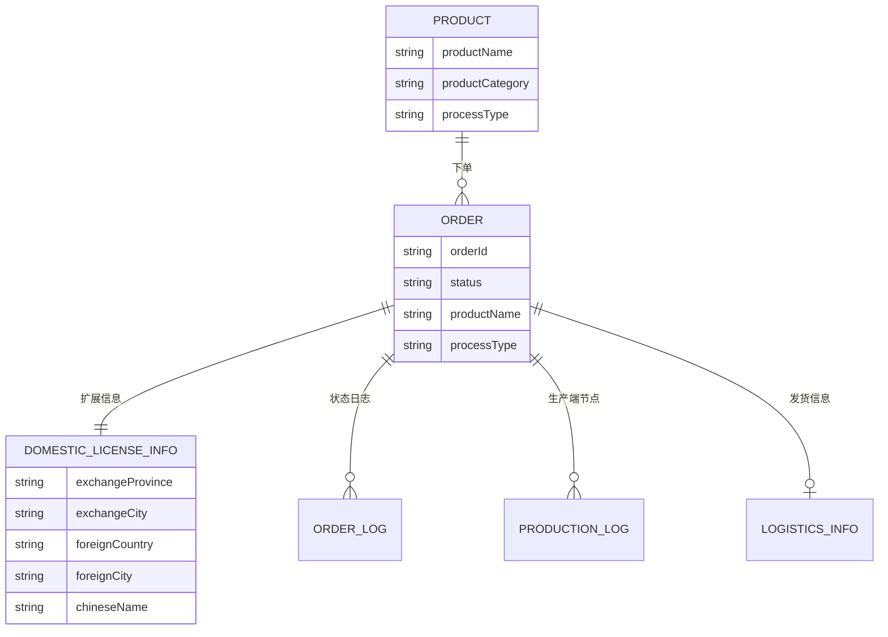
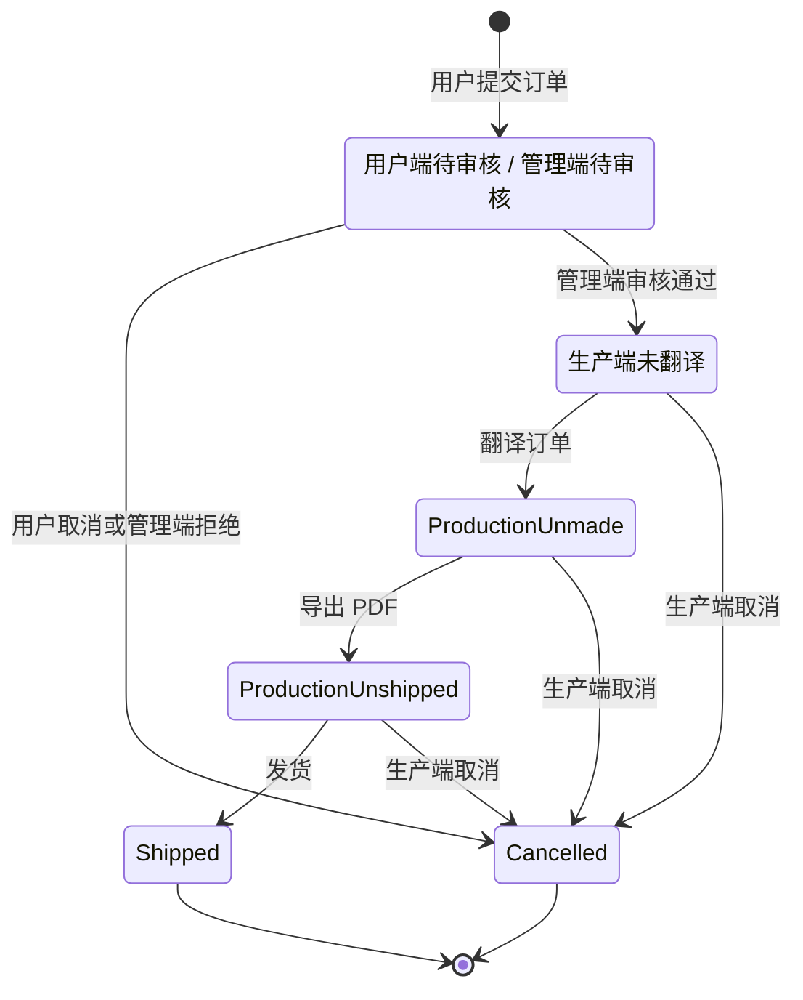
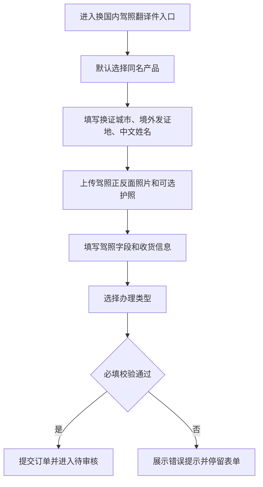
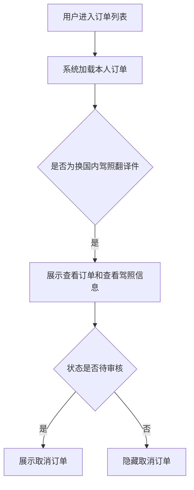
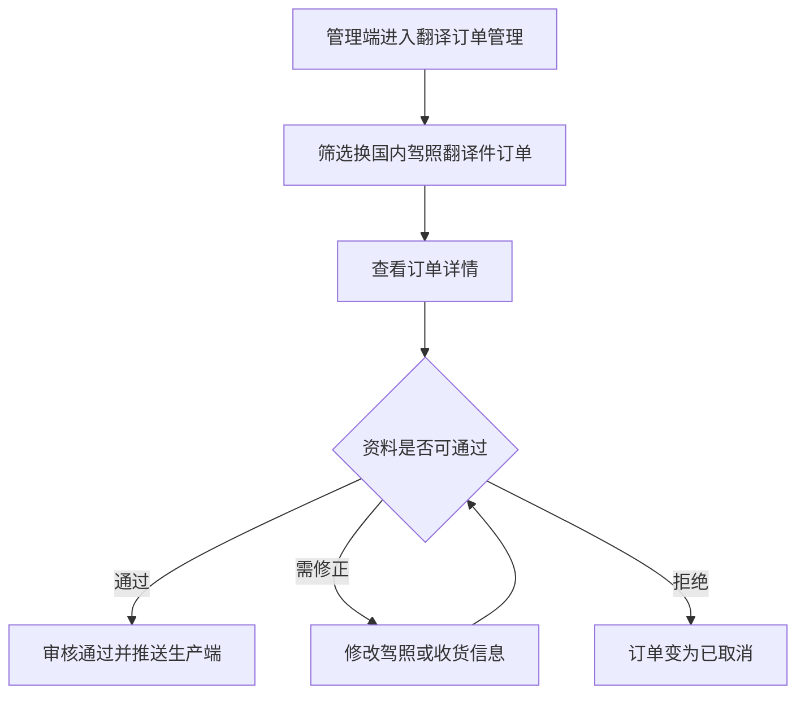
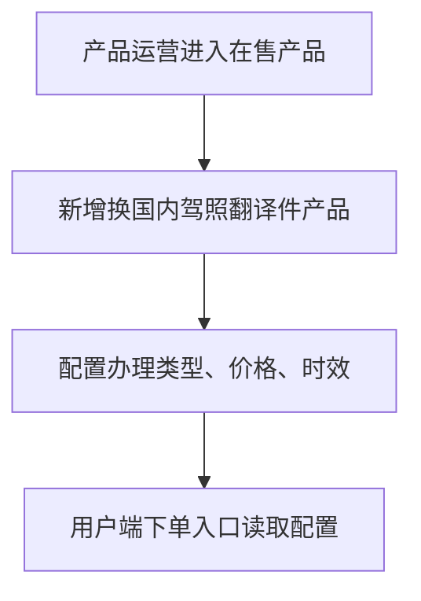
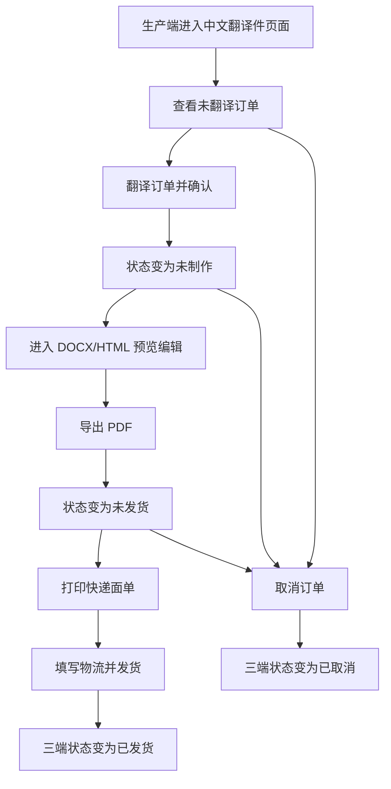

# 换国内驾照翻译件_终版

> **模块**: 换国内驾照翻译件
> **版本**: v1.0
> **最后更新**: 2026-05-21
> **作者**: Codex

---

## 更新日志

- **v1.0 (2026-05-19)**: 基于原始需求整理用户端、管理端、生产端完整 PRD。

---

## 1. 背景与目标

### 1.1 业务背景

平台当前已有翻译认证、公证、IDP 等订单能力，但“境外驾驶证换领国内驾照所需翻译件”存在独立的表单字段、附件材料、模板匹配和生产制作流程。

该类订单需要从用户端独立下单，经过管理端审核后进入生产端翻译制作，并最终生成可用于换证办理的中文翻译件文档。

### 1.2 问题陈述

当前换国内驾照翻译件依赖通用翻译认证能力承载，无法完整覆盖换证城市、境外发证地、驾照字段、附件预览、生产制作、物流发货与三端状态同步等业务要求。

---

## 2. 现状洞察（AS-IS）

| 痛点                       | 描述                                                                                                      |
| -------------------------- | --------------------------------------------------------------------------------------------------------- |
| **下单入口不独立**   | 用户需要在通用翻译认证入口中选择，无法准确收集换证城市、境外发证地、驾照字段等业务信息。                  |
| **审核信息分散**     | 管理端缺少针对换国内驾照翻译件的完整信息展示与修改口径。                                                  |
| **生产流程不明确**   | 生产端需要完成 OCR/人工复核、翻译制作、模板导出、PDF 生成、面单打印和发货，但当前状态与操作未被统一定义。 |
| **三端状态映射不清** | 用户端、管理端、生产端存在不同状态表达，需要明确映射关系。                                                |

---

## 3. 目标（TO-BE）与非目标

### 3.1 目标

| # | 目标                     | 描述                                                                                               |
| - | ------------------------ | -------------------------------------------------------------------------------------------------- |
| 1 | **独立下单入口**   | 用户端新增“换国内驾照翻译件”独立下单入口，默认关联对应产品。                                     |
| 2 | **完整采集信息**   | 支持换证城市、境外发证国家及城市、中文姓名、驾照字段、附件和收货信息采集。                         |
| 3 | **订单统一管理**   | 订单进入管理端翻译订单管理，支持筛选、查看、修改、审核通过、拒绝。                                 |
| 4 | **生产端闭环制作** | 驾照官生产端中文翻译件页面支持查看、翻译确认、DOCX/HTML 预览编辑、PDF 导出、打印面单、发货和取消。 |
| 5 | **状态映射一致**   | 三端状态按订单关系映射统一流转。                                                                   |

### 3.2 非目标（本期不做）

- **真实 OCR 服务商接入**: 本期不定义真实 OCR 服务商接入细节，仅要求生产端可基于 OCR 识别内容进行翻译和人工补全。
- **真实物流 API 对接**: 本期仅定义物流公司、物流单号与发货状态写入口径，不要求完成真实面单和物流 API 闭环。
- **全量产品体系重构**: 本期不重新设计全部翻译认证产品体系，仅新增并隔离“换国内驾照翻译件”产品类型。

### 3.3 User Stories

#### US-1: 用户提交换证翻译件订单

> **作为** 用户端用户
> **我希望** 通过独立入口填写换证城市、境外发证地、中文姓名、驾照资料和收货信息
> **以便于** 平台创建可审核、可制作的换国内驾照翻译件订单

**验收标准**:

- 必填字段完整时可成功提交订单。
- 驾照正面照片、反面照片必须上传并可预览。
- 提交后订单状态为 `待审核`，并进入用户端订单列表与管理端翻译订单管理。

#### US-2: 审核员审核并推送生产

> **作为** 管理端审核员
> **我希望** 查看、修改并审核换证翻译件订单
> **以便于** 资料准确的订单进入生产端制作流程

**验收标准**:

- 审核员可查看收货信息、商品信息和驾照信息。
- 审核通过后订单进入生产端中文翻译件列表，生产端初始状态为 `未翻译`。
- 拒绝后用户端和管理端均显示 `已取消`，生产端不展示该订单。

#### US-3: 生产人员制作并发货

> **作为** 生产端人员
> **我希望** 翻译、导出 PDF、打印面单并发货
> **以便于** 完成中文翻译件制作并同步用户可见状态

**验收标准**:

- 生产端可按 `未翻译 -> 未制作 -> 未发货 -> 已发货` 流转。
- 导出 PDF 后写入“已制作”日志并归一为 `未发货`。
- 发货必须填写物流公司和物流单号，并同步三端 `已发货`。

---

## 4. 术语表（Terminology）

| 术语             | 英文                                  | 定义                                                      |
| ---------------- | ------------------------------------- | --------------------------------------------------------- |
| 换国内驾照翻译件 | Domestic License Exchange Translation | 境外驾驶证用于换领中国国内驾照的中文翻译件。              |
| 换证城市         | Exchange City                         | 用户计划办理换证的中国省市，用于业务展示和后续办理匹配。  |
| 境外发证地       | Foreign Issuing Location              | 境外驾驶证发放国家及城市/州，用于模板匹配和翻译内容生成。 |
| 中文翻译件       | Chinese Translation Document          | 生产端翻译制作并导出的文档或 PDF。                        |

---

## 5. 角色与权限

| 角色         | 权限范围                                         | 说明                                         |
| ------------ | ------------------------------------------------ | -------------------------------------------- |
| 用户端用户   | 下单、查看订单、查看驾照信息、取消待审核订单     | 仅可操作自己提交的订单。                     |
| 管理端审核员 | 查看、筛选、修改、审核通过、拒绝                 | 审核通过后推送至生产端。                     |
| 产品运营     | 在售产品配置、办理类型配置                       | 负责维护“换国内驾照翻译件”产品和办理类型。 |
| 生产端人员   | 查看、翻译、导出、打印面单、发货、取消未发货订单 | 处理审核通过后的生产订单。                   |

**权限规则**:

- 用户端仅 `待审核` 订单可取消。
- 管理端仅 `待审核` 订单可审核通过或拒绝。
- 生产端仅可对未翻译、未制作、未发货订单进行取消订单。
- 生产端取消后订单状态变为 `已取消`，并同步映射用户端和管理端。

---

## 6. 数据模型（业务/交互视角）

### 6.1 实体关系图（ER Diagram）



### 6.2 Logical View（逻辑视图，UI 设计基准）

> [!IMPORTANT]
> **AI 执行约束**
>
> 1. 本章仅定义业务语义与页面交互模型，不直接等同于底层存储结构。
> 2. 前端页面与组件必须基于本节 `Logical View` 设计。
> 3. 涉及聚合、计算、映射字段时，必须按本节字段来源与转换规则实现。
> 4. 底层存储结构如需补充，请写入附录 `13.2 技术附录：Storage Schema`。

#### 6.2.1 用户端订单逻辑视图

```typescript
interface DomesticLicenseOrderView {
  order: {
    orderId: string;
    productName: '换国内驾照翻译件';
    processType: string;
    price: number;
    status: '待审核' | '制作中' | '已发货' | '已取消';
    createdAt: string;
  };
  recipient: {
    name: string;
    phone: string;
    address: string;
  };
  license: {
    licenseNumber: string;
    chineseName: string;
    classType: string;
    exchangeCity: string;
    foreignIssuingLocation: string;
  };
  productionTimeline: {
    translatedAt?: string;
    madeAt?: string;
    shippedAt?: string;
  };
  actions: {
    canViewOrder: true;
    canViewLicenseInfo: true;
    canCancel: boolean;
  };
}
```

#### 6.2.2 生产端订单逻辑视图

```typescript
interface DomesticLicenseProductionView {
  orderId: string;
  productionStatus: '未翻译' | '未制作' | '未发货' | '已发货' | '已取消';
  orderSummary: {
    productName: string;
    processType: string;
    foreignIssuingLocation: string;
    exchangeCity: string;
    chineseName: string;
    licenseNumber?: string;
    classType?: string;
  };
  recipient: {
    name: string;
    phone: string;
    address: string;
  };
  attachments: {
    frontPhoto: string;
    backPhoto: string;
    passportPhoto?: string;
  };
  logistics?: {
    company: string;
    trackingNumber: string;
    shippedAt: string;
  };
  actions: {
    canTranslate: boolean;
    canExport: boolean;
    canShip: boolean;
    canCancel: boolean;
  };
}
```

#### 6.2.3 计算字段与映射字段

| 存储/来源字段                           | 逻辑视图字段                     | 转换规则                                                                                                               | 类型    |
| --------------------------------------- | -------------------------------- | ---------------------------------------------------------------------------------------------------------------------- | ------- |
| `exchangeProvince` + `exchangeCity` | `exchangeCity`                 | 拼接为“省-市”或等价展示格式。                                                                                        | Derived |
| `foreignCountry` + `foreignCity`    | `foreignIssuingLocation`       | 拼接为“国家-城市/州”。                                                                                               | Derived |
| `status` + 生产端日志                 | `productionStatus`             | 按 7.5 当前实现状态归一规则计算。                                                                                      | Mapped  |
| 生产端日志                              | `productionTimeline`           | 按 `action` 识别“已翻译、已制作、已发货”等生产节点；“已翻译”“已制作”的 `operator` 记录当前系统登录账号名称。 | Derived |
| `status`                              | `actions.canCancel`            | 用户端：`status === pending_review`；生产端：未翻译、未制作、未发货为真。                                            | Derived |
| `shippedAt` + 生产端“已发货”日志    | `productionTimeline.shippedAt` | 优先取生产端日志时间；缺失时用 `shippedAt`、`updatedAt` 或 `createdAt` 兜底。                                    | Derived |

---

## 7. 业务规则与验证

### 7.1 核心业务规则

| 规则编号 | 规则名称     | 规则描述                                                                                                            |
| -------- | ------------ | ------------------------------------------------------------------------------------------------------------------- |
| BR-001   | 产品默认规则 | 用户进入“换国内驾照翻译件”下单入口时，产品默认选择同名产品。                                                      |
| BR-002   | 办理类型来源 | 办理类型来自管理端产品中心中标题为“换国内驾照翻译件”的产品配置。                                                  |
| BR-003   | 必填材料     | 驾照正面照片、驾照反面照片必传；护照非必传。                                                                        |
| BR-004   | 中文姓名覆盖 | 中文姓名为最终翻译件展示姓名，可覆盖 OCR 识别姓名。                                                                 |
| BR-005   | 待审核取消   | 用户端仅 `待审核` 订单展示取消按钮并允许取消。                                                                    |
| BR-006   | 审核通过推送 | 管理端审核通过后，订单进入生产端中文翻译件页面，生产端初始状态为 `未翻译`。                                       |
| BR-007   | 订单识别规则 | 换证订单可通过 `domestic_license` 产品分类、同名商品标题或 `domesticLicenseInfo` 扩展信息识别。                 |
| BR-008   | 生产日志幂等 | 生产端“已翻译”“已制作”“已发货”节点如果已有同名日志，则不重复追加。                                            |
| BR-009   | 导出状态回写 | 生产端导出 PDF 成功后，订单写入 `status = in_production`，追加生产端“已制作”日志，生产端归一展示为 `未发货`。 |
| BR-010   | 生产端可见性 | 生产端仅展示审核通过或已进入生产链路的订单；`pending_review`、`rejected` 不展示在生产端列表。                   |
| BR-011   | 发货必填     | 生产端发货必须选择物流公司并填写物流单号，确认后写入物流字段和生产端“已发货”日志。                                |
| BR-012   | 取消限制     | 生产端仅未翻译、未制作、未发货订单可取消；取消后主订单更新为 `cancelled` 并映射三端已取消。                       |

### 7.2 数据验证规则

| 字段（含变更标识）             | 验证规则                 | 错误提示                       |
| ------------------------------ | ------------------------ | ------------------------------ |
| [ADD] 换证城市                 | 省、市均需选择           | 请选择换证城市                 |
| [ADD] 境外驾驶证发放国家及城市 | 国家、城市均需选择       | 请选择境外驾驶证发放国家及城市 |
| [ADD] 中文姓名                 | 非空                     | 请填写中文姓名                 |
| [ADD] 驾照正面照片             | 必传且为图片格式         | 请上传驾照正面照片             |
| [ADD] 驾照反面照片             | 必传且为图片格式         | 请上传驾照反面照片             |
| [ADD] 收货人                   | 非空                     | 请填写收货人                   |
| [ADD] 手机号                   | 非空，建议校验手机号格式 | 请填写有效手机号               |
| [ADD] 收货地址                 | 非空                     | 请填写收货地址                 |
| [ADD] 办理类型                 | 必选                     | 请选择办理类型                 |
| [ADD] 物流公司                 | 发货时必填               | 请选择物流公司                 |
| [ADD] 物流单号                 | 发货时必填               | 请填写物流单号                 |

### 7.3 状态机（如适用）



**状态转换规则**:

| 当前状态             | 目标状态 | 触发条件             | 操作权限                  |
| -------------------- | -------- | -------------------- | ------------------------- |
| 待审核               | 已取消   | 用户取消或管理端拒绝 | 用户端用户 / 管理端审核员 |
| 待审核               | 未翻译   | 管理端审核通过       | 管理端审核员              |
| 未翻译               | 未制作   | 生产端确认翻译       | 生产端人员                |
| 未制作               | 未发货   | 生产端导出 PDF 成功  | 生产端人员                |
| 未发货               | 已发货   | 生产端填写物流并发货 | 生产端人员                |
| 未翻译/未制作/未发货 | 已取消   | 生产端取消订单       | 生产端人员                |

### 7.4 三端状态映射

| 触发场景             | 用户端 | 管理端 | 生产端 |
| -------------------- | ------ | ------ | ------ |
| 用户端提交待审核订单 | 待审核 | 待审核 | 无订单 |
| 管理端审核通过       | 制作中 | 待制作 | 未翻译 |
| 管理端审核拒绝       | 已取消 | 已取消 | 无订单 |
| 生产端翻译订单后     | 制作中 | 待制作 | 未制作 |
| 生产端导出 PDF 后    | 制作中 | 待制作 | 未发货 |
| 生产端发货后         | 已发货 | 已发货 | 已发货 |
| 生产端取消订单       | 已取消 | 已取消 | 已取消 |

### 7.5 当前实现状态归一规则

| 场景                 | 归一规则                                                                                                                                                                                                                                                                              |
| -------------------- | ------------------------------------------------------------------------------------------------------------------------------------------------------------------------------------------------------------------------------------------------------------------------------------- |
| 管理端翻译订单列表   | `translating`、`pending_review` 显示为待审核；`pending_production`、`in_production` 显示为待制作；`shipped`、`completed` 显示为已发货；`cancelled`、`rejected` 显示为已取消。                                                                                         |
| 生产端中文翻译件列表 | `pending_review`、`rejected` 不展示；`cancelled` 显示为已取消；`shipped`、`completed` 显示为已发货；`in_production` 或已有“已制作”日志显示为未发货；已有“已翻译”日志显示为未制作；`pending_production` 显示为未翻译；其他已进入生产链路的候选订单兜底显示为未翻译。 |
| 订单记录             | 生产端节点日志按 `action` 识别，关键节点为“已翻译”“已制作”“已发货”“取消订单”；“已翻译”“已制作”日志的 `operator` 记录当前系统登录账号名称，用户端/管理端订单记录默认展示前三个生产节点，按固定顺序展示。                                                               |

---

## 8. 功能需求

### 8.1 用户端-下单入口

#### 8.1.1 功能描述

用户端新增“换国内驾照翻译件”独立下单入口，用户填写产品信息、换证信息、驾照信息、附件、收货信息和办理类型后提交订单。

#### 8.1.2 筛选条件

本模块为创建表单，无列表筛选条件。

#### 8.1.3 列表字段定义

本模块不涉及列表。

#### 8.1.4 表单字段定义

**字段行为矩阵 (Field Behavior Matrix)**:

| 字段（含变更标识）                       | 创建模式                   | 编辑模式       | 查看模式      | 依赖/逻辑说明                      |
| :--------------------------------------- | :------------------------- | :------------- | :------------ | :--------------------------------- |
| **[ADD] 驾照翻译认证产品**         | Select/只读选择            | Read-only      | Text          | 默认选中“换国内驾照翻译件”。     |
| **[ADD] 换证城市**                 | 省市联动 Select (必填)     | Select         | Text          | 示例：广东-深圳、浙江-杭州。       |
| **[ADD] 境外驾驶证发放国家及城市** | 国家城市联动 Select (必填) | Select         | Text          | 用于模板匹配和翻译内容生成。       |
| **[ADD] 中文姓名**                 | Input (必填)               | Input          | Text          | 最终翻译件体现姓名。               |
| **[ADD] 驾照正面照片**             | Upload (必传)              | Upload         | Image Preview | 上传后展示图片预览。               |
| **[ADD] 驾照反面照片**             | Upload (必传)              | Upload         | Image Preview | 上传后展示图片预览。               |
| **[ADD] 护照**                     | Upload (可选)              | Upload         | Image Preview | 上传后展示图片预览。               |
| **[ADD] 收货人**                   | Input (必填)               | Input          | Text          | 收件人姓名。                       |
| **[ADD] 手机号**                   | Input (必填)               | Input          | Text          | 收件人手机号。                     |
| **[ADD] 收货地址**                 | Input/Textarea (必填)      | Input/Textarea | Text          | 完整收货地址。                     |
| **[ADD] 办理类型**                 | Select (必选)              | Select         | Text          | 来源于管理端产品中心同名产品配置。 |

**驾照信息填写字段（以加利福尼亚州为例）**:

| 字段名（含变更标识）            | 类型     | 必填 | 默认值 | 取值来源 | 验证规则 | 说明             |
| ------------------------------- | -------- | ---- | ------ | -------- | -------- | ---------------- |
| [ADD] DL/驾驶证编号             | String   | 否   | 无     | 用户输入 | 无       | 驾驶证编号。     |
| [ADD] EXP/有效期至              | Date     | 否   | 无     | 用户输入 | 日期格式 | 有效期截止日期。 |
| [ADD] LN/姓                     | String   | 否   | 无     | 用户输入 | 无       | 英文/原文姓。    |
| [ADD] FN/名                     | String   | 否   | 无     | 用户输入 | 无       | 英文/原文名。    |
| [ADD] DOB/出生日期              | Date     | 否   | 无     | 用户输入 | 日期格式 | 出生日期。       |
| [ADD] RSTR/限制条件             | String   | 否   | 无     | 用户输入 | 无       | 正面限制字段。   |
| [ADD] SEX/性别                  | Enum     | 否   | 无     | 用户选择 | 男/女    | 性别。           |
| [ADD] HAIR/头发颜色             | String   | 否   | 无     | 用户选择 | 无       | 头发颜色。       |
| [ADD] EYES/眼睛                 | String   | 否   | 无     | 用户选择 | 无       | 眼睛颜色。       |
| [ADD] HGT/身高                  | String   | 否   | 无     | 用户输入 | 无       | 原证件身高内容。 |
| [ADD] WGT/体重                  | String   | 否   | 无     | 用户输入 | 无       | 原证件体重内容。 |
| [ADD] ISS/签发日期              | Date     | 否   | 无     | 用户输入 | 日期格式 | 签发日期。       |
| [ADD] DD/文件识别号             | String   | 否   | 无     | 用户输入 | 无       | 文件识别号。     |
| [ADD] CLASS/准驾车型            | String   | 否   | 无     | 用户输入 | 无       | 准驾车型。       |
| [ADD] ENDORSEMENTS/额外准驾车型 | String   | 否   | 无     | 用户输入 | 无       | 额外准驾车型。   |
| [ADD] RESTRICTIONS/限制条件     | String   | 否   | 无     | 用户输入 | 无       | 背面限制字段。   |
| [ADD] 其他                      | Textarea | 否   | 无     | 用户输入 | 无       | 其他补充信息。   |

#### 8.1.5 业务流程



**流程说明**:

1. 用户进入独立下单入口后，系统默认关联“换国内驾照翻译件”产品。
2. 用户填写换证、发证、驾照、附件、收货、办理类型信息。
3. 提交时执行必填与格式校验，通过后创建 `待审核` 订单。

#### 8.1.6 边界场景处理

| 场景                     | 处理方式                                                           |
| ------------------------ | ------------------------------------------------------------------ |
| 未上传驾照正面或反面照片 | 阻止提交并提示对应必填材料。                                       |
| 办理类型配置为空         | 不允许提交，并提示需配置办理类型。                                 |
| 图片体积过大             | 前端压缩后保存到 `domesticLicenseInfo`；压缩失败时提示重新上传。 |
| 中文姓名为空             | 阻止提交并提示填写中文姓名。                                       |

### 8.2 用户端-订单列表

#### 8.2.1 功能描述

“换国内驾照翻译件”订单与其他订单逻辑一致进入用户端订单列表，支持搜索、查看订单、查看驾照信息和取消待审核订单。

#### 8.2.2 筛选条件

| 筛选字段       | 类型  | 必填 | 默认值 | 取值来源 | 说明                                                       |
| -------------- | ----- | ---- | ------ | -------- | ---------------------------------------------------------- |
| [ADD] 综合搜索 | Input | 否   | 无     | 用户输入 | 支持订单号、商品名称、姓名、手机号、收货地址、驾照编号等。 |

**筛选逻辑**:

- 多个关键字段之间为 OR 关系。
- 当前用户仅可检索自己提交的订单。

#### 8.2.3 列表字段定义

| 字段名（含变更标识） | 类型   | 数据来源              | 说明                               | 示例                    |
| -------------------- | ------ | --------------------- | ---------------------------------- | ----------------------- |
| [ADD] 订单号         | String | `order.orderId`     | 平台订单号。                       | DL202605200001          |
| [ADD] 商品名称       | String | `order.productName` | 固定为换国内驾照翻译件。           | 换国内驾照翻译件        |
| [ADD] 办理类型       | String | `order.processType` | 来源产品配置。                     | 优先办理                |
| [ADD] 订单状态       | Enum   | 状态映射              | 用户端展示状态。                   | 制作中                  |
| [ADD] 订单记录       | Array  | 生产端日志            | 按“已翻译、已制作、已发货”展示。 | 已制作 2026-05-20 10:00 |
| [ADD] 操作           | Action | 权限计算              | 查看订单、查看驾照信息、取消订单。 | 查看订单                |

**排序规则**:

- 默认排序：创建时间 DESC。

**分页规则**:

- 默认每页显示：20 条。
- 支持的分页大小：10、20、50、100。

#### 8.2.4 表单字段定义

本模块无新增编辑表单；查看订单弹窗展示收货信息、商品信息、驾照信息、订单状态和订单记录。

#### 8.2.5 业务流程



#### 8.2.6 边界场景处理

| 场景               | 处理方式                                                              |
| ------------------ | --------------------------------------------------------------------- |
| 待审核订单取消成功 | 状态更新为已取消，取消按钮不再展示。                                  |
| 生产端日志为空     | 订单记录展示为空或 `--`。                                           |
| 已发货缺少发货日志 | 使用 `shippedAt`、`updatedAt` 或 `createdAt` 兜底展示发货时间。 |

### 8.3 管理端-翻译订单管理

#### 8.3.1 功能描述

“换国内驾照翻译件”订单归入订单中心-翻译订单管理统一管理，管理端负责筛选、查看、修改、审核通过与拒绝。

#### 8.3.2 筛选条件

| 筛选字段                       | 类型                | 必填 | 默认值 | 取值来源     | 说明                                 |
| ------------------------------ | ------------------- | ---- | ------ | ------------ | ------------------------------------ |
| [ADD] 代理商                   | Input               | 否   | 无     | 用户输入     | 按代理商名称搜索。                   |
| [ADD] 产品                     | Select              | 否   | 无     | 产品中心     | 可选择“换国内驾照翻译件”。         |
| [ADD] 境外驾驶证发放国家及城市 | 国家城市联动 Select | 否   | 无     | 地区配置     | 当产品为“换国内驾照翻译件”时展示。 |
| [ADD] 订单状态                 | Select/Tab          | 否   | 全部   | 状态枚举     | 按翻译订单状态筛选。                 |
| [ADD] 综合搜索                 | Input               | 否   | 无     | 用户输入     | 姓名、驾照号、手机号等。             |
| [ADD] 办理类型                 | Select              | 否   | 无     | 产品办理类型 | 来源产品办理类型。                   |
| [ADD] 下单时间                 | Date Range          | 否   | 无     | 用户选择     | 按订单创建日期筛选。                 |

**筛选逻辑**:

- 多个筛选条件之间为 AND 关系。
- 综合搜索内部字段为 OR 关系。

#### 8.3.3 列表字段定义

| 字段名（含变更标识） | 类型   | 数据来源              | 说明                               | 示例             |
| -------------------- | ------ | --------------------- | ---------------------------------- | ---------------- |
| [ADD] 订单号         | String | `order.orderId`     | 平台订单号。                       | DL202605200001   |
| [ADD] 商品名称       | String | `order.productName` | 换国内驾照翻译件。                 | 换国内驾照翻译件 |
| [ADD] 办理类型       | String | `order.processType` | 来源产品配置。                     | 紧急办理         |
| [ADD] 订单状态       | Enum   | 状态映射              | 管理端状态。                       | 待制作           |
| [ADD] 订单记录       | Array  | 生产端日志            | 仅展示“已翻译、已制作、已发货”。 | 已翻译 10:00     |
| [ADD] 操作           | Action | 权限计算              | 查看、修改、审核、拒绝。           | 审核             |

#### 8.3.4 表单字段定义

| 字段（含变更标识）       | 创建模式 | 编辑模式  | 查看模式 | 依赖/逻辑说明                                                           |
| :----------------------- | :------- | :-------- | :------- | :---------------------------------------------------------------------- |
| **[ADD] 订单信息** | Hidden   | Read-only | Text     | 包含订单状态、下单时间、审核时间、审核人 ID、订单号、驾照官推送订单号。 |
| **[ADD] 驾照信息** | Hidden   | Editable  | Text     | 展示并允许修改用户端确认驾照信息模块填写与上传内容。                    |
| **[ADD] 收货信息** | Hidden   | Editable  | Text     | 收件人、联系电话、收货地址。                                            |
| **[ADD] 审核通过** | Hidden   | Button    | Hidden   | 审核通过后推送至生产端。                                                |
| **[ADD] 拒绝**     | Hidden   | Button    | Hidden   | 拒绝后订单进入已取消。                                                  |

#### 8.3.5 业务流程



#### 8.3.6 边界场景处理

| 场景                 | 处理方式                                                |
| -------------------- | ------------------------------------------------------- |
| 管理端拒绝订单       | 用户端与管理端均展示已取消，生产端无订单。              |
| 审核通过缺少推送单号 | 补全审核时间、审核人 ID，并以订单状态保障生产端可见性。 |
| 无生产端节点日志     | 订单记录展示 `--`。                                   |

### 8.4 管理端-在售产品

#### 8.4.1 功能描述

在售产品中新增“换国内驾照翻译件”产品，业务人员可维护办理类型、价格、时效等信息，用户端下单入口据此展示办理类型。

#### 8.4.2 筛选条件

沿用现有产品中心筛选能力，无本需求新增筛选字段。

#### 8.4.3 列表字段定义

| 字段名（含变更标识） | 类型   | 数据来源 | 说明                              | 示例             |
| -------------------- | ------ | -------- | --------------------------------- | ---------------- |
| [ADD] 产品名称       | String | 产品中心 | 固定新增“换国内驾照翻译件”。    | 换国内驾照翻译件 |
| [ADD] 产品分类       | String | 产品中心 | 独立于现有翻译认证类型。          | domestic_license |
| [ADD] 办理类型       | Array  | 产品配置 | 用户端下单与管理/生产筛选的来源。 | 正常办理         |

#### 8.4.4 表单字段定义

| 字段（含变更标识）       | 创建模式     | 编辑模式 | 查看模式 | 依赖/逻辑说明              |
| :----------------------- | :----------- | :------- | :------- | :------------------------- |
| **[ADD] 产品类型** | Select/Input | Editable | Text     | 新增“换国内驾照翻译件”。 |
| **[ADD] 办理类型** | Editable     | Editable | Text     | 可维护价格、时效等信息。   |

#### 8.4.5 业务流程



#### 8.4.6 边界场景处理

| 场景           | 处理方式                                   |
| -------------- | ------------------------------------------ |
| 办理类型未配置 | 用户端不可提交订单，并提示需选择办理类型。 |
| 产品被停用     | 用户端入口不展示或展示不可下单状态。       |

### 8.5 生产端-中文翻译件

#### 8.5.1 功能描述

在驾照官后台新增“非标宣誓公证件 / 中文翻译件”页面，支持订单筛选、查看、翻译确认、DOCX/HTML 预览编辑、PDF 导出、打印快递面单、发货与取消订单。

#### 8.5.2 筛选条件

| 筛选字段                       | 类型                | 必填 | 默认值   | 取值来源       | 说明                                               |
| ------------------------------ | ------------------- | ---- | -------- | -------------- | -------------------------------------------------- |
| [ADD] 订单状态                 | Tabs                | 否   | 全部订单 | 生产端状态枚举 | 全部订单、未翻译、未制作、未发货、已发货、已取消。 |
| [ADD] 订单号搜索               | Input               | 否   | 无       | 用户输入       | 支持订单号搜索。                                   |
| [ADD] 综合搜索                 | Input               | 否   | 无       | 用户输入       | 支持姓名、驾照号、手机号。                         |
| [ADD] 办理类型                 | Select              | 否   | 无       | 产品配置       | 选项来源于“换国内驾照翻译件”产品配置。           |
| [ADD] 境外驾驶证发放国家及城市 | 国家城市联动 Select | 否   | 无       | 地区配置       | 与管理端筛选样式一致。                             |

#### 8.5.3 列表字段定义

| 字段名（含变更标识） | 类型     | 数据来源                 | 说明                                                                                                                             | 示例             |
| -------------------- | -------- | ------------------------ | -------------------------------------------------------------------------------------------------------------------------------- | ---------------- |
| [ADD] 序号           | Number   | 列表计算                 | 当前列表序号。                                                                                                                   | 1                |
| [ADD] 订单号         | String   | `order.orderId`        | 平台订单号。                                                                                                                     | DL202605200001   |
| [ADD] 订单类型       | String   | 固定值                   | 固定展示中文翻译件。                                                                                                             | 中文翻译件       |
| [ADD] 订单状态       | Enum     | 状态归一                 | 未翻译状态仅展示状态标签；未制作、未发货、已发货、已取消状态在状态标签后展示问号图标；已发货时在状态列内展示物流公司和物流单号。 | 未发货           |
| [ADD] 发起时间       | Datetime | `createdAt` 或推送时间 | 订单创建/推送时间。                                                                                                              | 2026-05-20 10:00 |
| [ADD] 订单信息       | Object   | 订单与驾照信息聚合       | 产品名称、办理类型、境外发证地、换证城市、中文姓名、驾驶证编号、准驾车型等。                                                     | 换国内驾照翻译件 |
| [ADD] 收货信息       | Object   | 收货字段                 | 收货人、手机号、收货地址。                                                                                                       | 张三 138****     |
| [ADD] 操作           | Action   | 状态权限计算             | 根据状态展示操作按钮。                                                                                                           | 发货             |

**排序规则**:

- 默认排序：发起时间 DESC。

**分页规则**:

- 默认每页显示：20 条。
- 支持的分页大小：10、20、50、100。

**订单状态列生产记录浮层**:

- 订单状态标签本身不可点击；状态标签后的问号图标用于查看生产记录。
- 未翻译状态不展示问号图标。
- 点击问号图标后在状态列附近展示浅黄色小浮层，不使用页面蒙层弹窗。
- 未制作状态浮层展示“翻译人、翻译时间”；未发货状态浮层展示“翻译人、翻译时间、制作人、制作时间”。
- 翻译人、制作人取对应生产节点日志的 `operator`；确认翻译和导出 PDF 写入节点日志时，`operator` 取当前系统登录账号名称。

#### 8.5.4 表单字段定义

**操作项与状态**:

| 生产端状态 | 可用操作                               |
| ---------- | -------------------------------------- |
| 未翻译     | 查看订单、翻译订单、取消订单           |
| 未制作     | 查看订单、导出订单、取消订单           |
| 未发货     | 查看订单、打印快递面单、发货、取消订单 |
| 已发货     | 查看订单                               |
| 已取消     | 查看订单                               |

**发货字段定义**:

| 字段名（含变更标识） | 类型   | 必填 | 默认值 | 取值来源     | 验证规则   | 说明                              |
| -------------------- | ------ | ---- | ------ | ------------ | ---------- | --------------------------------- |
| [ADD] 物流公司       | Select | 是   | 无     | 物流公司枚举 | 发货时必填 | 发货后写入 `logisticsCompany`。 |
| [ADD] 物流单号       | String | 是   | 无     | 用户输入     | 发货时必填 | 发货后写入 `trackingNumber`。   |

#### 8.5.5 业务流程



**流程说明**:

1. “翻译订单”弹窗左侧展示驾照正反面图片，右侧展示 `识别原文` 和可编辑 `翻译文案`。
2. “导出订单”进入 DOCX/HTML 编辑页，页面加载后将 DOCX 转为 HTML 并通过 iframe 展示预览。
3. 点击 `修改信息` 后文档主体切换为可编辑状态，再次点击保存当前编辑内容，按钮文案为 `保存修改`。
4. PDF 导出成功后写入生产端“已制作”日志，并将主订单状态更新为 `in_production`。
5. 从未制作列表进入导出订单页时带入来源状态；PDF 导出成功后自动返回中文翻译件列表，并恢复到未制作页签。
6. 发货弹窗要求填写快递公司和物流单号，确认后写入 `status = shipped`、`logisticsCompany`、`trackingNumber`、`shippedAt` 和生产端“已发货”日志。

#### 8.5.6 边界场景处理

| 场景                     | 处理方式                                       |
| ------------------------ | ---------------------------------------------- |
| 待审核或已拒绝订单       | 不展示在生产端中文翻译件列表。                 |
| 重复点击翻译、导出、发货 | 按生产日志幂等规则避免重复追加同名节点。       |
| 中文姓名为空             | PDF 文件名回退为 `未命名中文翻译件.pdf`。    |
| 已发货订单               | 仅可查看订单，不可取消或再次发货。             |
| PDF 导出失败             | 不更新状态，不写入“已制作”日志，并提示重试。 |
| 发货信息缺失             | 阻止发货并提示填写物流公司和物流单号。         |

---

## 9. 非功能需求

### 9.1 性能要求

| 指标         | 要求                                                                           |
| ------------ | ------------------------------------------------------------------------------ |
| 页面加载时间 | 用户端、管理端、生产端关键页面首屏加载建议 < 2s。                              |
| 关键操作响应 | 提交、审核、翻译确认、导出后回写、发货等操作响应建议 < 1s，不含 PDF 生成耗时。 |
| 图片预览     | 上传图片应在压缩后可稳定预览，不阻塞表单主流程。                               |

### 9.2 安全要求

- 订单、附件、物流信息仅允许对应角色在授权范围内查看与操作。
- 管理端与生产端操作需记录操作者、时间与动作。
- 驾照照片、护照照片、手机号、地址等敏感信息在日志和列表中应避免不必要暴露。

### 9.3 可用性要求

- 用户端、管理端、生产端关键流程页面可正常加载并保存状态。
- 三端状态映射必须一致，取消、发货等关键操作需写入日志。
- 上传图片需可预览；详情页需能展示已上传图片。
- 新订单不影响现有翻译认证、公证、IDP 订单流程。

---

## 10. 测试策略

### 10.1 测试范围

- 用户端新下单入口。
- 用户端订单列表查看、查看驾照信息、取消订单。
- 管理端翻译订单管理筛选、查看、审核、修改、拒绝。
- 管理端在售产品配置与用户端办理类型联动。
- 生产端中文翻译件列表、状态流转、DOCX 预览编辑、PDF 导出、打印、发货、取消。
- 三端状态映射与生产端节点日志展示。

### 10.2 测试用例（关键场景）

| 用例编号 | 测试场景             | 前置条件                             | 操作步骤                                                                   | 预期结果                                                                                                       |
| -------- | -------------------- | ------------------------------------ | -------------------------------------------------------------------------- | -------------------------------------------------------------------------------------------------------------- |
| TC-001   | 用户端提交订单       | 已配置换国内驾照翻译件产品和办理类型 | 选择换证城市、境外发证地、填写中文姓名、上传正反面照片、填写收货信息并提交 | 订单创建成功，状态为待审核。                                                                                   |
| TC-002   | 必填校验             | 用户进入下单页                       | 不上传驾照正面或反面照片提交                                               | 阻止提交并提示必填材料。                                                                                       |
| TC-003   | 用户端查看订单       | 已存在换证订单                       | 在订单列表点击查看订单                                                     | 正确展示收货、商品、驾照、状态信息。                                                                           |
| TC-004   | 用户端查看驾照信息   | 已存在换证订单                       | 点击驾照信息                                                               | 展示确认驾照信息模块所有字段和附件。                                                                           |
| TC-005   | 用户端取消待审核订单 | 订单处于待审核                       | 点击取消订单                                                               | 订单变为已取消，按钮不再展示。                                                                                 |
| TC-006   | 管理端审核通过       | 订单处于待审核                       | 审核员点击通过                                                             | 管理端进入待制作，用户端显示制作中，生产端生成未翻译订单。                                                     |
| TC-007   | 管理端拒绝           | 订单处于待审核                       | 审核员点击拒绝                                                             | 用户端、管理端均显示已取消，生产端不展示。                                                                     |
| TC-008   | 生产端翻译订单       | 订单处于未翻译                       | 查看识别原文并修改翻译文案后确认                                           | 状态变为未制作，翻译文案支持人工编辑。                                                                         |
| TC-009   | 生产端导出 PDF       | 订单处于未制作                       | 进入 DOCX/HTML 预览编辑页并导出 PDF                                        | 写入“已制作”记录，状态变为未发货，PDF 文件名为“中文姓名中文翻译件.pdf”，页面返回中文翻译件未制作列表页签。 |
| TC-010   | 生产端发货           | 订单处于未发货                       | 录入物流并发货                                                             | 三端均映射为已发货，生产端写入物流信息和“已发货”日志。                                                       |
| TC-011   | 导出订单页布局       | 订单处于未制作                       | 打开导出订单页面                                                           | 页面铺满屏幕，底部无额外留白，按钮位于底部右侧且顺序正确。                                                     |
| TC-012   | PDF 框线规则         | PDF 可导出                           | 导出 PDF 并查看文件                                                        | 图片区、正文区、说明区各自仅保留最外层框线，内部框线隐藏。                                                     |
| TC-013   | 待审核生产端不可见   | 创建待审核订单                       | 打开生产端中文翻译件列表                                                   | 生产端列表不展示该订单。                                                                                       |
| TC-014   | 生产端取消订单       | 订单处于未翻译、未制作或未发货       | 点击取消订单                                                               | 主订单更新为已取消，用户端和管理端均映射为已取消。                                                             |

---

## 11. 验收标准（Acceptance Criteria）

### 11.1 功能验收

**场景1: 用户提交换证翻译件订单**

```gherkin
Given 用户进入“换国内驾照翻译件”下单入口
When 用户完成必填信息、上传驾照正反面照片并提交
Then 系统创建待审核订单
And 订单可在用户端订单列表、管理端翻译订单管理中查看
```

**场景2: 用户取消待审核订单**

```gherkin
Given 一笔换国内驾照翻译件订单处于待审核
When 用户端点击取消订单
Then 订单状态更新为已取消
And 用户端不再展示取消按钮
And 操作日志记录用户端取消订单
```

**场景3: 管理端审核通过并进入生产**

```gherkin
Given 管理端审核通过换国内驾照翻译件订单
When 生产端打开中文翻译件页面
Then 该订单以未翻译状态展示
And 可执行翻译订单操作
```

**场景4: 生产端导出 PDF**

```gherkin
Given 一笔换国内驾照翻译件订单处于生产端未制作状态
When 生产人员进入 DOCX 预览编辑页并导出 PDF
Then 系统生成“中文姓名中文翻译件.pdf”
And 订单写入生产端“已制作”日志
And 生产端状态变为未发货
And 用户端仍显示制作中
And 页面返回中文翻译件未制作列表页签
```

**场景5: 生产端取消订单**

```gherkin
Given 一笔换国内驾照翻译件订单处于生产端未翻译、未制作或未发货状态
When 生产端点击取消订单
Then 主订单状态更新为已取消
And 用户端和管理端均显示已取消
And 生产端写入“取消订单”日志
```

### 11.2 数据契约验收

- [ ] 字段来源（Stored / Derived / Mapped）已标注完整且与业务描述一致。
- [ ] 聚合、计算、映射规则已定义清晰并可追溯到业务规则。
- [ ] 所有字段变更均已使用 `[ADD]` / `[MOD]` / `[DEL]` 标识。
- [ ] 换证城市字段可追溯到用户端省市选择。
- [ ] 境外驾驶证发放国家及城市可追溯到用户端国家城市选择。
- [ ] 中文姓名以用户端填写值为准。
- [ ] 驾照附件在用户端、管理端、生产端均可展示。
- [ ] 三端状态映射符合 `order_status_mapping.md`。

### 11.3 性能验收

- [ ] 用户端、管理端、生产端关键页面首屏加载满足要求。
- [ ] 关键操作响应满足要求。
- [ ] 图片上传、预览和详情展示在常见图片尺寸下可用。
- [ ] PDF 导出失败时不会误更新订单状态。

---

## 12. 实施计划

### 12.1 依赖关系

- 产品中心：需新增“换国内驾照翻译件”产品和办理类型配置。
- 模板文件：生产端导出依赖指定 DOCX 模板，并在浏览器端转换为 HTML 预览。
- 状态映射：三端需共同遵循订单状态映射关系。
- OCR 能力：翻译订单能力依赖 OCR 或人工录入能力。
- 附件存储：当前 Demo 使用 Data URL 与前端压缩；真实后端需明确文件存储与访问权限。

### 12.2 风险与缓解措施

| 风险               | 影响                                | 概率 | 缓解措施                                         |
| ------------------ | ----------------------------------- | ---- | ------------------------------------------------ |
| 境外驾照模板差异大 | 翻译字段不完整                      | 中   | 以国家/城市为模板匹配条件，支持人工补充字段。    |
| OCR 识别错误       | 翻译件内容错误                      | 中   | 允许生产端复核并修改翻译内容。                   |
| 三端状态口径不一致 | 用户看到的订单状态与管理/生产不一致 | 中   | 以 7.4 与 7.5 为统一状态映射规则，新增测试覆盖。 |
| 附件体积过大       | 页面卡顿或保存失败                  | 中   | 上传时前端压缩，并在真实后端阶段迁移到对象存储。 |
| PDF 版式不稳定     | 翻译件不可用于办理                  | 中   | 增加导出订单页布局和 PDF 框线规则测试。          |

---

## 13. 附录

### 13.1 字段文档术语对照表

| 中文         | 英文                   | 说明                                           |
| ------------ | ---------------------- | ---------------------------------------------- |
| 筛选字段     | Filter Field           | 用于筛选数据的字段。                           |
| 必填         | Required               | 字段必须提供值。                               |
| 可选         | Optional               | 字段可以不提供值。                             |
| 条件必填     | Conditionally Required | 根据条件决定是否必填。                         |
| 默认值       | Default Value          | 字段的默认值。                                 |
| 取值来源     | Value Source           | 字段值的来源类型。                             |
| 枚举值       | Enum                   | 固定的可选值列表。                             |
| 验证规则     | Validation Rule        | 字段值的验证逻辑。                             |
| 业务约束     | Business Constraint    | 业务规则和限制条件。                           |
| 新增字段标识 | `[ADD]`              | 标记本版本新增字段。                           |
| 修改字段标识 | `[MOD]`              | 标记本版本规则或语义发生变化的字段。           |
| 删除字段标识 | `[DEL]`              | 标记本版本下线字段，需说明替代方案或废弃原因。 |

### 13.2 技术附录：Storage Schema（可选，工程维护）

> *AI 注意：本节仅描述底层数据结构口径，不直接作为页面或交互设计依据。*

#### 13.2.1 订单识别口径

- 订单通过 `productCategory = domestic_license`、`productName = 换国内驾照翻译件` 或存在 `domesticLicenseInfo` 识别为换国内驾照翻译件订单。
- 用户端提交后写入 `domesticLicenseInfo`，同时同步 `licenseName`、`licenseNo`、`licenseCategory`、`licenseGender`、`licenseBirthDate`、`licenseAddress`、`licenseFirstIssueDate`、`licenseValidUntilDate`、`licenseArchiveNumber`、`licenseIssuingRegion`、`useCountry` 等通用订单字段，供管理端和生产端列表复用。
- 驾照正面、反面和护照附件当前以图片 Data URL 存在 `domesticLicenseInfo` 中；上传时会进行前端压缩。
- 生产端不单独持久化生产状态，生产状态由主订单 `status` 与生产端日志共同归一计算。
- 生产端日志以 `operator = 生产端` 区分，关键节点包含 `已翻译`、`已制作`、`已发货`、`取消订单`。
- 当前 Demo 数据主要持久化在浏览器 `localStorage`，不代表真实后端数据契约。

#### 13.2.2 核心字段定义

| 字段名            | 类型           | 必填 | 默认值           | 说明                                     | 约束         |
| ----------------- | -------------- | ---- | ---------------- | ---------------------------------------- | ------------ |
| productName       | String         | 是   | 换国内驾照翻译件 | 产品名称。                               | 固定同名产品 |
| productCategory   | String         | 是   | domestic_license | 产品分类。                               | 用于订单识别 |
| processType       | String         | 是   | 无               | 办理类型。                               | 来源产品中心 |
| exchangeProvince  | String         | 是   | 无               | 换证省份。                               | 用户选择     |
| exchangeCity      | String         | 是   | 无               | 换证城市。                               | 用户选择     |
| foreignCountry    | String         | 是   | 无               | 境外驾驶证发放国家。                     | 用户选择     |
| foreignCity       | String         | 是   | 无               | 境外驾驶证发放城市/州。                  | 用户选择     |
| chineseName       | String         | 是   | 无               | 最终翻译件体现姓名。                     | 用户输入     |
| licenseNumber     | String         | 否   | 无               | 驾驶证编号。                             | 用户输入     |
| frontPhoto        | Image/Data URL | 是   | 无               | 驾照正面照片。                           | 必传         |
| backPhoto         | Image/Data URL | 是   | 无               | 驾照反面照片。                           | 必传         |
| passportPhoto     | Image/Data URL | 否   | 无               | 护照照片。                               | 可选         |
| deliveryName      | String         | 是   | 无               | 收货人。                                 | 必填         |
| deliveryPhone     | String         | 是   | 无               | 手机号。                                 | 必填         |
| deliveryAddress   | String         | 是   | 无               | 收货地址。                               | 必填         |
| managementOrderId | String         | 否   | 无               | 审核通过后补齐，用于生产端可见性兜底。   | 管理端写入   |
| logisticsCompany  | String         | 否   | 无               | 发货后写入物流公司。                     | 发货必填     |
| trackingNumber    | String         | 否   | 无               | 发货后写入物流单号。                     | 发货必填     |
| shippedAt         | Datetime       | 否   | 无               | 发货后写入发货时间。                     | 生产端写入   |
| logs              | Array          | 否   | 无               | 审核、翻译、制作、发货、取消等动作日志。 | 追加写入     |

### 13.3 Tracking Events（建议项）

> [!TIP]
> 本节为建议项，用于提升行为可观测性，不作为功能上线阻断条件。

| 事件名                                 | 触发时机               | 关键属性                                                                             |
| -------------------------------------- | ---------------------- | ------------------------------------------------------------------------------------ |
| `domestic_license_order_page_view`   | 用户进入下单入口       | `user_id`, `source`, `product_name`                                            |
| `domestic_license_order_submit`      | 用户提交订单           | `order_id`, `process_type`, `exchange_city`, `foreign_location`, `success` |
| `domestic_license_admin_review`      | 管理端审核通过或拒绝   | `order_id`, `review_result`, `reviewer_id`                                     |
| `domestic_license_translate_confirm` | 生产端确认翻译         | `order_id`, `operator_id`, `field_count`                                       |
| `domestic_license_pdf_export`        | 生产端导出 PDF         | `order_id`, `operator_id`, `success`, `duration_ms`                          |
| `domestic_license_ship`              | 生产端发货             | `order_id`, `logistics_company`, `operator_id`                                 |
| `domestic_license_cancel`            | 用户端或生产端取消订单 | `order_id`, `cancel_source`, `status_before`                                   |

### 13.4 i18n 资源规范（建议项）

> [!TIP]
> 本节为建议项，用于保证国际化扩展一致性，不作为功能上线阻断条件。

**支持语言范围**:

| Locale    | 语言     | 使用范围                                           |
| --------- | -------- | -------------------------------------------------- |
| `zh_cn` | 简体中文 | 默认语言，覆盖所有用户端、管理端、生产端 UI 文案。 |
| `en_us` | 英文     | 用于境外材料字段、后台国际化扩展和英文操作环境。   |
| `ja_jp` | 日文     | 用于后续日语用户和运营后台扩展。                   |
| `de_DE` | 德文     | 用于后续德语用户和运营后台扩展。                   |

#### 13.4.1 Type 1-5 分类（建议）

| 类型   | 数据类型      | 处理策略             | 示例                                   |
| ------ | ------------- | -------------------- | -------------------------------------- |
| Type 1 | 系统预设数据  | 资源表翻译           | 订单状态、操作按钮、错误提示。         |
| Type 2 | 纯业务数据    | 不翻译               | 订单号、物流单号、驾照编号、收货地址。 |
| Type 3 | 核心双语字段  | 双字段存储或保留原文 | 中文姓名、英文姓名、境外发证地。       |
| Type 4 | 法律/条款文本 | 法务版本管理         | 翻译件说明、办理声明。                 |
| Type 5 | 格式化数据    | 前端按 Locale 渲染   | 日期、时间、价格。                     |

#### 13.4.2 `resource_key` 命名建议

- 命名格式：`order.domestic_license.{scope}.{name}`。
- 全部小写，使用 `.` 分层，避免空格与中文键名。
- 同一语义保持单一 key，避免别名重复。
- 错误文案与提示文案分域管理（如 `error.*`、`hint.*`）。

#### 13.4.3 资源键样例

| UI 文案          | resource_key                                            | zh_cn            | en_us                                 | ja_jp                      | de_DE                                       |
| ---------------- | ------------------------------------------------------- | ---------------- | ------------------------------------- | -------------------------- | ------------------------------------------- |
| 换国内驾照翻译件 | `order.domestic_license.product.name`                 | 换国内驾照翻译件 | Domestic License Exchange Translation | 国内免許切替翻訳書         | Übersetzung für Führerscheinumschreibung |
| 请选择换证城市   | `order.domestic_license.error.exchange_city_required` | 请选择换证城市   | Please select an exchange city        | 切替都市を選択してください | Bitte wählen Sie eine Umschreibungsstadt   |
| 翻译订单         | `order.domestic_license.action.translate`             | 翻译订单         | Translate order                       | 注文を翻訳                 | Auftrag übersetzen                         |
| 导出订单         | `order.domestic_license.action.export`                | 导出订单         | Export order                          | 注文をエクスポート         | Auftrag exportieren                         |
| 发货             | `order.domestic_license.action.ship`                  | 发货             | Ship                                  | 発送                       | Versenden                                   |
| 未翻译           | `order.domestic_license.status.untranslated`          | 未翻译           | Untranslated                          | 未翻訳                     | Nicht übersetzt                            |

### 13.5 参考文档

- 原始需求：`specs/Requirements Management/换国内驾照翻译件.md`
- 原 PRD：`specs/Requirements Management/换国内驾照翻译件_PRD.md`
- PRD 模板：`docs/templates/prd_spec_template.md`
- 状态映射：`specs/Requirements Management/映射/order_status_mapping.md`

### 13.6 变更记录

| 日期       | 版本 | 变更内容                                            | 变更人 |
| ---------- | ---- | --------------------------------------------------- | ------ |
| 2026-05-21 | v1.2 | 根据 `agent/rules` 补齐非目标和 i18n 四语种口径。 | Codex  |
| 2026-05-19 | v1.0 | 基于原始需求整理用户端、管理端、生产端完整 PRD。    | Codex  |
