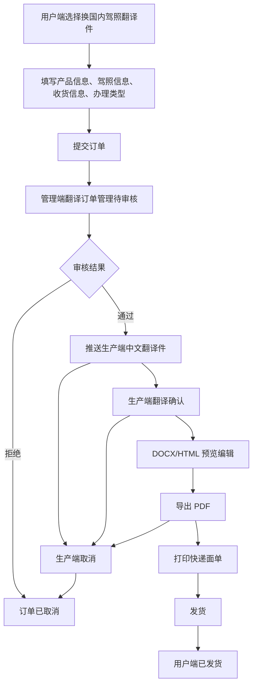
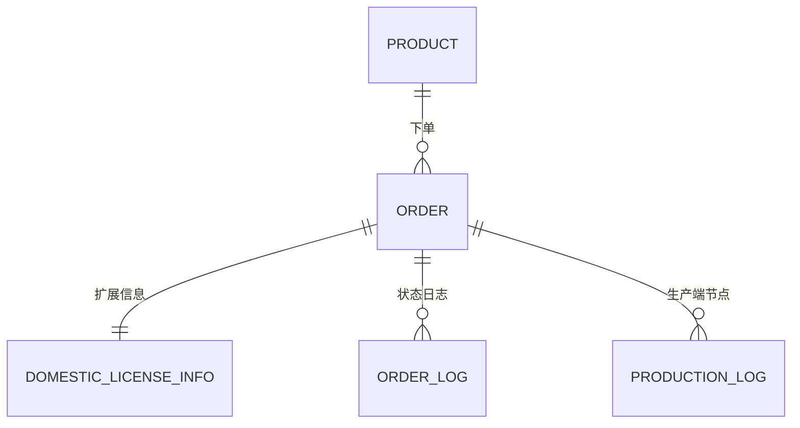
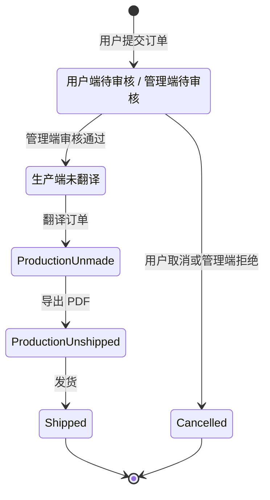

# 换国内驾照翻译件 PRD_初版

> **模块**: 换国内驾照翻译件
> **版本**: v1.0
> **最后更新**: 2026-05-21

---

## 更新日志

| 日期       | 版本 | 变更内容                                       | 变更人 |
| ---------- | ---- | ---------------------------------------------- | ------ |
| 2026-05-15 | v1.0 | 基于原始需求整理用户端、管理端、生产端完整 PRD | Codex  |

---

## 1. 背景与目标

### 1.1 业务背景

平台当前已有翻译认证、公证、IDP 等订单能力，但“境外驾驶证换领国内驾照所需翻译件”存在独立的表单字段、附件材料、模板匹配和生产制作流程。

该类订单需要从用户端独立下单，经过管理端审核后进入生产端翻译制作，并最终生成可用于换证办理的中文翻译件文档。

### 1.2 问题陈述

| 痛点             | 描述                                                                                                      |
| ---------------- | --------------------------------------------------------------------------------------------------------- |
| 下单入口不独立   | 用户需要在通用翻译认证入口中选择，无法准确收集换证城市、境外发证地、驾照字段等业务信息。                  |
| 审核信息分散     | 管理端缺少针对换国内驾照翻译件的完整信息展示与修改口径。                                                  |
| 生产流程不明确   | 生产端需要完成 OCR/人工复核、翻译制作、模板导出、PDF 生成、面单打印和发货，但当前状态与操作未被统一定义。 |
| 三端状态映射不清 | 用户端、管理端、生产端存在不同状态表达，需要明确映射关系。                                                |

---

## 2. 现状洞察（AS-IS）

| 痛点               | 描述                                                                        |
| ------------------ | --------------------------------------------------------------------------- |
| 单一入口承载多业务 | 换国内驾照翻译件仍挂在通用翻译认证路径下，导致表单字段和业务口径容易混淆。  |
| 资料采集不完整     | 换证城市、境外发证国家及城市、驾照细节字段和附件材料需要单独维护。          |
| 三端状态不统一     | 用户端、管理端、生产端对“待审核 / 制作中 / 已发货 / 已取消”存在不同表达。 |
| 生产动作缺少闭环   | 翻译、导出、发货、取消需要统一日志与状态回写，当前口径未完全收敛。          |

---

## 3. 目标与非目标

### 3.1 目标

| # | 目标           | 描述                                                                                               |
| - | -------------- | -------------------------------------------------------------------------------------------------- |
| 1 | 独立下单入口   | 用户端新增“换国内驾照翻译件”独立下单入口，默认关联对应产品。                                     |
| 2 | 完整采集信息   | 支持换证城市、境外发证国家及城市、中文姓名、驾照字段、附件和收货信息采集。                         |
| 3 | 订单统一管理   | 订单进入管理端翻译订单管理，支持筛选、查看、修改、审核通过、拒绝。                                 |
| 4 | 生产端闭环制作 | 驾照官生产端中文翻译件页面支持查看、翻译确认、DOCX/HTML 预览编辑、PDF 导出、打印面单、发货和取消。 |
| 5 | 状态映射一致   | 三端状态按订单关系映射统一流转。                                                                   |

### 3.2 非目标

- 本期不定义真实 OCR 服务商接入细节，仅要求生产端可基于 OCR 识别内容进行翻译和人工补全。
- 本期不重新设计全部翻译认证产品体系，仅新增并隔离“换国内驾照翻译件”产品类型。

### 3.3 User Stories

#### US-1: 用户独立下单

> **作为** 用户端用户
> **我希望** 在独立入口填写换证城市、境外发证地、驾照信息与收货信息
> **以便于** 创建可审核、可制作的换国内驾照翻译件订单

**验收标准**:

- 必填信息完整时可成功提交。
- 驾照正面和反面照片必须上传。
- 提交后订单进入 `待审核`，并出现在用户端和管理端。

#### US-2: 管理端审核

> **作为** 管理端审核员
> **我希望** 查看、修正并审核订单资料
> **以便于** 准确的订单进入生产端制作流程

**验收标准**:

- 可查看订单、驾照和收货信息。
- 审核通过后进入生产端，初始状态为 `未翻译`。
- 拒绝后订单在用户端和管理端均显示为 `已取消`。

#### US-3: 生产端制作与发货

> **作为** 生产端人员
> **我希望** 翻译、导出 PDF、打印面单并发货
> **以便于** 完成中文翻译件制作并同步订单状态

**验收标准**:

- 订单按 `未翻译 -> 未制作 -> 未发货 -> 已发货` 流转。
- 导出 PDF 后写入“已制作”日志。
- 发货必须填写物流公司和物流单号。

---

## 4. 角色与权限

| 角色         | 权限范围                                         | 说明                                         |
| ------------ | ------------------------------------------------ | -------------------------------------------- |
| 用户端用户   | 下单、查看订单、查看驾照信息、取消待审核订单     | 仅可操作自己提交的订单。                     |
| 管理端审核员 | 查看、筛选、修改、审核通过、拒绝                 | 审核通过后推送至生产端。                     |
| 产品运营     | 在售产品配置、办理类型配置                       | 负责维护“换国内驾照翻译件”产品和办理类型。 |
| 生产端人员   | 查看、翻译、导出、打印面单、发货、取消未发货订单 | 处理审核通过后的生产订单。                   |

**权限规则**:

- 用户端仅 `待审核` 订单可取消。
- 管理端仅 `待审核` 订单可审核通过或拒绝。
- 生产端仅可对未翻译、未制作、未发货订单进行取消订单，取消后状态变为 `已取消`，并同步映射用户端和管理端。

---

## 5. 术语表

| 术语             | 英文                                  | 定义                                                      |
| ---------------- | ------------------------------------- | --------------------------------------------------------- |
| 换国内驾照翻译件 | Domestic License Exchange Translation | 境外驾驶证用于换领中国国内驾照的中文翻译件。              |
| 换证城市         | Exchange City                         | 用户计划办理换证的中国省市，用于业务展示和后续办理匹配。  |
| 境外发证地       | Foreign Issuing Location              | 境外驾驶证发放国家及城市/州，用于模板匹配和翻译内容生成。 |
| 中文翻译件       | Chinese Translation Document          | 生产端翻译制作并导出的文档或 PDF。                        |

---

## 6. 业务流程



---

## 7. 数据模型与逻辑视图

### 7.1 逻辑实体



### 7.2 用户端订单逻辑视图

```typescript
interface DomesticLicenseOrderView {
  order: {
    orderId: string;
    productName: '换国内驾照翻译件';
    processType: string;
    price: number;
    status: '待审核' | '制作中' | '已发货' | '已取消';
    createdAt: string;
  };
  recipient: {
    name: string;
    phone: string;
    address: string;
  };
  license: {
    licenseNumber: string; // DL/驾驶证编号
    chineseName: string;
    classType: string;
    exchangeCity: string; // 省 + 市
    foreignIssuingLocation: string; // 国家 + 城市/州
  };
  actions: {
    canViewOrder: true;
    canViewLicenseInfo: true;
    canCancel: boolean; // true if status === '待审核'
  };
}
```

### 7.3 核心字段定义

| 字段              | 类型   | 必填 | 来源              | 说明                                               |
| ----------------- | ------ | ---- | ----------------- | -------------------------------------------------- |
| productName       | String | 是   | 产品中心          | 为“换国内驾照翻译件”。                           |
| productCategory   | String | 是   | 产品中心          | 当前项目使用 `domestic_license` 独立产品分类。   |
| processType       | String | 是   | 产品中心-办理类型 | 根据产品标题为“换国内驾照翻译件”的办理类型展示。 |
| exchangeProvince  | String | 是   | 用户选择          | 换证省份。                                         |
| exchangeCity      | String | 是   | 用户选择          | 换证城市。                                         |
| foreignCountry    | String | 是   | 用户选择          | 境外驾驶证发放国家。                               |
| foreignCity       | String | 是   | 用户选择          | 境外驾驶证发放城市/州。                            |
| chineseName       | String | 是   | 用户输入          | 最终翻译件体现姓名，可覆盖 OCR 识别结果。          |
| licenseNumber     | String | 否   | 用户输入          | 驾驶证编号。                                       |
| frontPhoto        | Image  | 是   | 用户上传          | 驾照正面照片。                                     |
| backPhoto         | Image  | 是   | 用户上传          | 驾照反面照片。                                     |
| passportPhoto     | Image  | 否   | 用户上传          | 护照照片。                                         |
| deliveryName      | String | 是   | 用户输入          | 收货人。                                           |
| deliveryPhone     | String | 是   | 用户输入          | 手机号。                                           |
| deliveryAddress   | String | 是   | 用户输入          | 收货地址。                                         |
| managementOrderId | String | 否   | 管理端审核        | 审核通过后补齐，用于生产端可见性兜底。             |
| logisticsCompany  | String | 否   | 生产端发货        | 发货后写入物流公司。                               |
| trackingNumber    | String | 否   | 生产端发货        | 发货后写入物流单号。                               |
| shippedAt         | String | 否   | 生产端发货        | 发货后写入发货时间。                               |
| logs              | Array  | 否   | 三端动作          | 审核、翻译、制作、发货、取消等动作日志。           |

**当前项目落库口径**:

- 订单通过 `productCategory = domestic_license`、`productName = 换国内驾照翻译件` 或存在 `domesticLicenseInfo` 识别为换国内驾照翻译件订单。
- 用户端提交后写入 `domesticLicenseInfo`，同时同步 `licenseName`、`licenseNo`、`licenseCategory`、`licenseGender`、`licenseBirthDate`、`licenseAddress`、`licenseFirstIssueDate`、`licenseValidUntilDate`、`licenseArchiveNumber`、`licenseIssuingRegion`、`useCountry` 等通用订单字段，供管理端和生产端列表复用。
- 驾照正面、反面和护照附件当前以图片 Data URL 存在 `domesticLicenseInfo` 中；上传时会进行前端压缩。
- 生产端不单独持久化生产状态，生产状态由主订单 `status` 与生产端日志共同归一计算。
- 生产端日志以 `operator = 生产端` 区分，关键节点包含 `已翻译`、`已制作`、`已发货`、`取消订单`。
- 当前 Demo 数据主要持久化在浏览器 `localStorage`，不代表真实后端数据契约。

---

## 8. 业务规则与验证

### 8.1 业务规则

| 规则编号 | 规则名称     | 规则描述                                                                                                            |
| -------- | ------------ | ------------------------------------------------------------------------------------------------------------------- |
| BR-001   | 产品默认规则 | 用户进入“换国内驾照翻译件”下单入口时，产品默认选择同名产品。                                                      |
| BR-002   | 办理类型来源 | 办理类型来自管理端产品中心中标题为“换国内驾照翻译件”的产品配置。                                                  |
| BR-003   | 必填材料     | 驾照正面照片、驾照反面照片必传；护照非必传。                                                                        |
| BR-004   | 中文姓名覆盖 | 中文姓名为最终翻译件展示姓名，可覆盖 OCR 识别姓名。                                                                 |
| BR-005   | 待审核取消   | 用户端仅 `待审核` 订单展示取消按钮并允许取消。                                                                    |
| BR-006   | 审核通过推送 | 管理端审核通过后，订单进入生产端中文翻译件页面，生产端初始状态为 `未翻译`。                                       |
| BR-007   | 订单识别规则 | 换证订单可通过 `domestic_license` 产品分类、同名商品标题或 `domesticLicenseInfo` 扩展信息识别。                 |
| BR-008   | 生产日志幂等 | 生产端“已翻译”“已制作”“已发货”节点如果已有同名日志，则不重复追加。                                            |
| BR-009   | 导出状态回写 | 生产端导出 PDF 成功后，订单写入 `status = in_production`，追加生产端“已制作”日志，生产端归一展示为 `未发货`。 |
| BR-010   | 生产端可见性 | 生产端仅展示审核通过或已进入生产链路的订单；`pending_review`、`rejected` 不展示在生产端列表。                   |
| BR-011   | 发货必填     | 生产端发货必须选择物流公司并填写物流单号，确认后写入物流字段和生产端“已发货”日志。                                |
| BR-012   | 取消限制     | 生产端仅未翻译、未制作、未发货订单可取消；取消后主订单更新为 `cancelled` 并映射三端已取消。                       |

### 8.2 表单验证规则

| 字段                     | 验证规则                 | 错误提示                       |
| ------------------------ | ------------------------ | ------------------------------ |
| 换证城市                 | 省、市均需选择           | 请选择换证城市                 |
| 境外驾驶证发放国家及城市 | 国家、城市均需选择       | 请选择境外驾驶证发放国家及城市 |
| 中文姓名                 | 非空                     | 请填写中文姓名                 |
| 驾照正面照片             | 必传且为图片格式         | 请上传驾照正面照片             |
| 驾照反面照片             | 必传且为图片格式         | 请上传驾照反面照片             |
| 收货人                   | 非空                     | 请填写收货人                   |
| 手机号                   | 非空，建议校验手机号格式 | 请填写有效手机号               |
| 收货地址                 | 非空                     | 请填写收货地址                 |
| 办理类型                 | 必选                     | 请选择办理类型                 |

### 8.3 状态机



### 8.4 三端状态映射

| 触发场景             | 用户端 | 管理端 | 生产端 |
| -------------------- | ------ | ------ | ------ |
| 用户端提交待审核订单 | 待审核 | 待审核 | 无订单 |
| 管理端审核通过       | 制作中 | 待制作 | 未翻译 |
| 管理端审核拒绝       | 已取消 | 已取消 | 无订单 |
| 生产端翻译订单后     | 制作中 | 待制作 | 未制作 |
| 生产端导出 PDF 后    | 制作中 | 待制作 | 未发货 |
| 生产端发货后         | 已发货 | 已发货 | 已发货 |
| 生产端取消订单       | 已取消 | 已取消 | 已取消 |

说明：

- `待审核` 仅存在于用户端和管理端，生产端无订单。
- 生产端 `未翻译 / 未制作 / 未发货` 都属于管理端 `待制作` 阶段，对用户端统一展示为 `制作中`。
- 管理端拒绝不进入生产端；生产端取消仅发生在订单已进入生产链路后。

### 8.5 当前实现状态归一规则

| 场景                 | 归一规则                                                                                                                                                                                                                                                                              |
| -------------------- | ------------------------------------------------------------------------------------------------------------------------------------------------------------------------------------------------------------------------------------------------------------------------------------- |
| 管理端翻译订单列表   | `translating`、`pending_review` 显示为待审核；`pending_production`、`in_production` 显示为待制作；`shipped`、`completed` 显示为已发货；`cancelled`、`rejected` 显示为已取消。                                                                                         |
| 生产端中文翻译件列表 | `pending_review`、`rejected` 不展示；`cancelled` 显示为已取消；`shipped`、`completed` 显示为已发货；`in_production` 或已有“已制作”日志显示为未发货；已有“已翻译”日志显示为未制作；`pending_production` 显示为未翻译；其他已进入生产链路的候选订单兜底显示为未翻译。 |
| 订单记录             | 生产端节点日志按 `action` 识别，关键节点为“已翻译”“已制作”“已发货”“取消订单”；“已翻译”“已制作”日志的 `operator` 记录当前系统登录账号名称，用户端/管理端订单记录默认展示前三个生产节点，按固定顺序展示。                                                               |

---

## 9. 功能需求

### 9.1 用户端-下单入口

#### 9.1.1 选择产品模块

| 字段                     | 控件                | 必填 | 默认值/来源      | 说明                         |
| ------------------------ | ------------------- | ---- | ---------------- | ---------------------------- |
| 驾照翻译认证产品         | Select/只读选择     | 是   | 换国内驾照翻译件 | 默认选中同名产品。           |
| 换证城市                 | 省市联动 Select     | 是   | 用户选择         | 示例：广东-深圳、浙江-杭州。 |
| 境外驾驶证发放国家及城市 | 国家城市联动 Select | 是   | 用户选择         | 用于模板匹配和翻译内容生成。 |
| 中文姓名                 | Input               | 是   | 用户输入         | 最终翻译件体现姓名。         |

#### 9.1.2 确认驾照信息模块

**附件上传**:

| 材料         | 必填 | 说明                   |
| ------------ | ---- | ---------------------- |
| 驾照正面照片 | 是   | 上传后需展示图片预览。 |
| 驾照反面照片 | 是   | 上传后需展示图片预览。 |
| 护照         | 否   | 上传后需展示图片预览。 |

**信息填写字段**:--以加利福尼亚州为例

| 字段                      | 控件           | 必填 | 说明             |
| ------------------------- | -------------- | ---- | ---------------- |
| DL/驾驶证编号             | Input          | 否   | 驾驶证编号。     |
| EXP/有效期至              | DatePicker     | 否   | 有效期截止日期。 |
| LN/姓                     | Input          | 否   | 英文/原文姓。    |
| FN/名                     | Input          | 否   | 英文/原文名。    |
| DOB/出生日期              | DatePicker     | 否   | 出生日期。       |
| RSTR/限制条件             | Input          | 否   | 正面限制字段。   |
| SEX/性别                  | Button/Radio   | 否   | 男、女。         |
| HAIR/头发颜色             | Select         | 否   | 头发颜色。       |
| EYES/眼睛                 | Select         | 否   | 眼睛颜色。       |
| HGT/身高                  | Input          | 否   | 原证件身高内容。 |
| WGT/体重                  | Input          | 否   | 原证件体重内容。 |
| ISS/签发日期              | DatePicker     | 否   | 签发日期。       |
| DD/文件识别号             | Input          | 否   | 文件识别号。     |
| CLASS/准驾车型            | Input          | 否   | 准驾车型。       |
| ENDORSEMENTS/额外准驾车型 | Input          | 否   | 额外准驾车型。   |
| RESTRICTIONS/限制条件     | Input          | 否   | 背面限制字段。   |
| 其他                      | Input/Textarea | 否   | 其他补充信息。   |

#### 9.1.3 确认收货信息模块

| 字段     | 控件           | 必填 | 说明           |
| -------- | -------------- | ---- | -------------- |
| 收货人   | Input          | 是   | 收件人姓名。   |
| 手机号   | Input          | 是   | 收件人手机号。 |
| 收货地址 | Input/Textarea | 是   | 完整收货地址。 |

#### 9.1.4 选择办理类型

- 展示管理端产品中心中产品标题为“换国内驾照翻译件”的办理类型。
- 用户必须选择办理类型后才能提交订单。
- 价格随办理类型配置展示。

#### 9.1.5 边界场景处理

| 场景                 | 处理方式                             |
| -------------------- | ------------------------------------ |
| 驾照正反面照片未上传 | 阻止提交并提示对应必填材料。         |
| 办理类型未配置       | 不允许提交，并提示需选择办理类型。   |
| 图片过大或压缩失败   | 前端压缩后重试，失败时提示重新上传。 |

### 9.2 用户端-订单列表

#### 9.2.1 列表能力

| 能力         | 说明                                                             |
| ------------ | ---------------------------------------------------------------- |
| 展示订单     | “换国内驾照翻译件”订单与其他订单逻辑一致进入用户端订单列表。   |
| 搜索筛选     | 支持按订单号、商品名称、姓名、手机号、收货地址、驾照编号等搜索。 |
| 查看订单     | 展示订单完整信息。                                               |
| 查看驾照信息 | 展示下单入口“确认驾照信息模块”填写与上传内容。                 |
| 取消订单     | 仅待审核订单展示取消按钮。                                       |

#### 9.2.2 查看订单展示内容

| 模块     | 字段                                                                                                                                                         |
| -------- | ------------------------------------------------------------------------------------------------------------------------------------------------------------ |
| 收货信息 | 收件人、联系电话、收货地址                                                                                                                                   |
| 商品信息 | 订单编号、商品名称、办理类型、价格                                                                                                                           |
| 驾照信息 | DL/驾驶证编号、中文姓名、准驾车型、换证城市、境外驾驶证发放国家及城市                                                                                        |
| 订单状态 | 订单状态、下单时间、办理类型                                                                                                                                 |
| 订单记录 | 按生产端节点日志固定顺序展示“已翻译、已制作、已发货”；仅取生产端日志，按分钟级时间展示。已发货状态在缺少对应节点日志时可用发货时间兜底，无记录时显示为空。 |

#### 9.2.3 查看驾照信息展示内容

- 展示用户在“确认驾照信息模块”填写的全部字段。
- 展示驾照正面照片、驾照反面照片、护照照片。
- 左侧字段区一行展示两个字段；窄屏下可降级为单列。

#### 9.2.4 边界场景处理

| 场景           | 处理方式                         |
| -------------- | -------------------------------- |
| 订单记录为空   | 展示空状态与基础引导。           |
| 已取消订单     | 仅展示查看能力，不展示取消按钮。 |
| 生产端日志缺失 | 订单记录展示 `--` 或兜底时间。 |

### 9.3 管理端-翻译订单管理

#### 9.3.1 管理入口

- “换国内驾照翻译件”订单归入订单中心-翻译订单管理统一管理。
- 支持筛选、查看、修改、审核。
- 管理端负责审核和资料修正；审核通过后的翻译、制作、发货、取消动作在驾照官生产端完成。

#### 9.3.2 筛选项

| 筛选项                   | 类型                | 说明                                                                                                                                    |
| ------------------------ | ------------------- | --------------------------------------------------------------------------------------------------------------------------------------- |
| 代理商                   | Input               | 按代理商名称搜索。                                                                                                                      |
| 产品                     | Select              | 可选择“换国内驾照翻译件”。                                                                                                            |
| 境外驾驶证发放国家及城市 | 国家城市联动 Select | 当产品为“换国内驾照翻译件”时展示。                                                                                                    |
| 订单状态                 | Select/Tab          | 按翻译订单状态筛选。                                                                                                                    |
| 综合搜索                 | Input               | 姓名、驾照号、手机号等。                                                                                                                |
| 办理类型                 | Select              | 来源产品办理类型。                                                                                                                      |
| 下单时间                 | Date Range          | 按订单创建日期筛选。                                                                                                                    |
| 订单记录                 | 只读列              | 与用户端订单列表一致，仅展示生产端节点日志，按“已翻译、已制作、已发货”固定顺序展示；已发货状态可用发货时间兜底，无记录时显示 `--`。 |

#### 9.3.3 查看订单页面

| 模块     | 字段                                                              |
| -------- | ----------------------------------------------------------------- |
| 收货信息 | 收件人、联系电话、收货地址                                        |
| 商品信息 | 订单编号、商品名称、办理类型、价格                                |
| 驾照信息 | DL/驾驶证编号、中文姓名、准驾车型、换证城市、驾驶证发放国家及城市 |

#### 9.3.3.1 订单记录列

- 管理端翻译订单列表展示“订单记录”列。
- 订单记录仅展示生产端节点日志，节点为：`已翻译`、`已制作`、`已发货`。
- 节点按固定顺序展示，不按日志写入顺序重排。
- 已发货订单缺少“已发货”节点日志时，可用 `shippedAt`、`updatedAt` 或 `createdAt` 兜底展示发货时间。
- 无生产端节点日志时展示 `--`。

#### 9.3.4 订单审核页面

| 模块     | 字段/能力                                                                        |
| -------- | -------------------------------------------------------------------------------- |
| 订单信息 | 订单状态、下单时间、审核时间、审核人 ID、订单号、驾照官推送订单号                |
| 驾照信息 | 用户端确认驾照信息模块填写与上传内容，额外展示换证城市、境外驾驶证发放国家及城市 |
| 收货信息 | 收件人、联系电话、收货地址                                                       |
| 通过     | 审核通过后推送至生产端，补全审核时间、审核人 ID、驾照官推送订单号                |
| 修改     | 可修改驾照信息、收货信息                                                         |
| 拒绝     | 拒绝后订单进入已取消                                                             |
| 返回     | 返回翻译订单列表                                                                 |

#### 9.3.5 边界场景处理

| 场景                 | 处理方式                             |
| -------------------- | ------------------------------------ |
| 审核拒绝             | 订单进入已取消，生产端不展示。       |
| 订单缺少推送单号     | 先补齐审核信息，再允许进入生产链路。 |
| 管理端列表无生产日志 | “订单记录”列展示 `--`。          |

### 9.4 管理端-在售产品

| 需求         | 说明                                                             |
| ------------ | ---------------------------------------------------------------- |
| 新增产品类型 | 在售产品中新增“换国内驾照翻译件”产品，独立于现有翻译认证类型。 |
| 配置办理类型 | 业务人员可维护该产品对应办理类型、价格、时效等信息。             |
| 用户端联动   | 用户端下单入口根据该产品配置展示办理类型。                       |

#### 9.4.1 边界场景处理

| 场景         | 处理方式                     |
| ------------ | ---------------------------- |
| 办理类型为空 | 用户端不可提交订单。         |
| 产品停用     | 用户端入口不展示或不可下单。 |
| 产品配置变化 | 下单入口实时读取最新配置。   |

### 9.5 生产端-中文翻译件

#### 9.5.1 菜单入口

- 在驾照官后台新增“非标宣誓公证件 / 中文翻译件”页面。

| 筛选项                   | 类型                | 说明                                               |
| ------------------------ | ------------------- | -------------------------------------------------- |
| 订单状态                 | Tabs                | 全部订单、未翻译、未制作、未发货、已发货、已取消。 |
| 订单号搜索               | Input               | 支持订单号搜索。                                   |
| 综合搜索                 | Input               | 支持姓名、驾照号、手机号。                         |
| 办理类型                 | Select              | 选项来源于“换国内驾照翻译件”产品配置。           |
| 境外驾驶证发放国家及城市 | 国家城市联动 Select | 与管理端翻译订单管理筛选样式一致。                 |

#### 9.5.2 列表字段

| 字段     | 说明                                                                                                                                             |
| -------- | ------------------------------------------------------------------------------------------------------------------------------------------------ |
| 序号     | 当前列表序号。                                                                                                                                   |
| 订单号   | 平台订单号。                                                                                                                                     |
| 订单类型 | 固定展示中文翻译件。                                                                                                                             |
| 订单状态 | 生产端归一状态；未翻译状态仅展示状态标签；未制作、未发货、已发货、已取消状态在状态标签后展示问号图标；已发货时在状态列内展示物流公司和物流单号。 |
| 发起时间 | 订单创建/推送时间。                                                                                                                              |
| 订单信息 | 产品名称-办理类型、境外驾驶证发放国家及城市、换证城市、中文姓名、驾驶证编号、准驾车型等摘要。                                                    |
| 收货信息 | 收货人、手机号、收货地址。                                                                                                                       |
| 操作     | 根据状态展示操作按钮。                                                                                                                           |

**当前列表展示口径**:

- 办理类型以不可点击标签展示，并按类型渲染颜色：正常办理灰色、优先办理绿色、紧急办理红色。
- 准驾车型以不可点击标签展示。
- 订单状态标签本身不可点击；状态标签后的问号图标用于查看生产记录。
- 未翻译状态不展示问号图标。
- 点击问号图标后在状态列附近展示浅黄色小浮层，不使用页面蒙层弹窗。
- 未制作状态浮层展示“翻译人、翻译时间”；未发货状态浮层展示“翻译人、翻译时间、制作人、制作时间”；该浮层不展示物流单号、快递名称、发货时间或物流信息。
- 已发货时在状态列内展示物流公司和物流单号。
- 综合搜索支持中文姓名、驾驶证编号、手机号等关键字。
- 境外驾驶证发放国家及城市筛选为联动选择：先选国家，再联动城市/州。

#### 9.5.3 操作项与状态

| 生产端状态 | 可用操作                               |
| ---------- | -------------------------------------- |
| 未翻译     | 查看订单、翻译订单、取消订单           |
| 未制作     | 查看订单、导出订单、取消订单           |
| 未发货     | 查看订单、打印快递面单、发货、取消订单 |
| 已发货     | 查看订单                               |
| 已取消     | 查看订单                               |

#### 9.5.4 操作说明

| 操作         | 说明                                                                                     | 状态变化           |
| ------------ | ---------------------------------------------------------------------------------------- | ------------------ |
| 查看订单     | 展示商品信息和完整驾照信息。                                                             | 无                 |
| 翻译订单     | 展示驾照正反面图片及图片文案识别翻译对照，识别原文只读展示，翻译文案支持人工修改和补充。 | 未翻译 -> 未制作   |
| 导出订单     | 进入 DOCX 预览编辑页，将模板转为 HTML 预览，允许修改并导出 PDF。                         | 未制作 -> 未发货   |
| 打印快递面单 | 提供京东、顺丰、极兔打印按钮。                                                           | 无                 |
| 发货         | 录入物流并发货。                                                                         | 未发货 -> 已发货   |
| 取消订单     | 未翻译、未制作、未发货状态可取消。                                                       | 未发货前 -> 已取消 |

> 当前项目实现中，“查看订单”和“打印快递面单”为页面内提示操作；发货弹窗要求填写快递公司和物流单号，确认后写入 `status = shipped`、`logisticsCompany`、`trackingNumber`、`shippedAt` 和生产端“已发货”日志。
> “翻译订单”操作追加“已翻译”日志，操作者取当前系统登录账号名称；“导出订单”进入 DOCX/HTML 编辑页，导出 PDF 成功后追加“已制作”日志，操作者取当前系统登录账号名称，并将订单状态更新为 `in_production`。

- “翻译订单”弹窗左侧展示订单上传的“驾照正面照片”“驾照反面照片”，右侧按两列表格展示 `识别原文` 和 `翻译文案`；`翻译文案` 为可编辑输入，生产人员可在确认翻译前调整文案。

#### 9.5.5 导出订单

- 模板：根据用户端，下单时选择的 “驾驶证发放国家及城市”导出翻译后的模版
- 导出要求：

  - 以 HTML 形式展示文档内容。
  - 允许生产人员修改文档信息。
  - 驾照中的个人头像及签名需放入 Word 模板对应位置。
  - 支持导出 PDF。
  - 导出 PDF 后订单状态变为 `未发货`。
- 当前实现说明：

  - 页面加载后将 DOCX 转为 HTML，并通过 iframe 展示预览。
  - 预览内容通过 iframe 展示，点击 `修改信息` 后将文档主体切换为可编辑状态。
  - 再次点击按钮时保存当前编辑内容，按钮文案为 `保存修改`。
  - PDF 导出成功后写入生产端“已制作”日志，并将主订单状态更新为 `in_production`。
  - 从未制作列表进入导出订单页时带入来源状态；PDF 导出成功后自动返回中文翻译件列表，并恢复到未制作页签。
- PDF 文件命名：

  - 命名规则为：`中文姓名+中文翻译件.pdf`。
  - 中文姓名优先取订单 `chineseName`
  - 中文姓名为空时回退为 `未命名中文翻译件.pdf`。
- PDF 版式与框线：

  - 导出 PDF 保持模板区块结构，不改变页面预览中的可编辑展示。
  - 驾照图片区域单独保留最外层框线。
  - 中间翻译正文区域、下方说明/备注区域单独保留最外层框线。

#### 9.5.6 查看订单

- 查看订单以弹窗形式展示商品信息和完整驾照信息。
- 商品信息包含商品名称、办理类型、订单状态、换证城市、驾驶证发放国家及城市。
- 驾照信息包含中文姓名、DL/驾驶证编号、有效期、姓、名、出生日期、限制条件、性别、发色、眼睛颜色、身高、体重、签发日期、文件识别号、准驾车型、额外准驾车型、限制条件和其他备注。
- 附件区展示驾照正面照片、驾照反面照片和护照照片；点击附件可打开图片预览。

#### 9.5.7 边界场景处理

| 场景               | 处理方式                               |
| ------------------ | -------------------------------------- |
| 待审核或已拒绝订单 | 不展示在生产端列表。                   |
| 导出 PDF 失败      | 不更新状态，不写入“已制作”日志。     |
| 发货信息缺失       | 阻止发货并提示填写物流公司和物流单号。 |

## 10. 非功能需求

| 类型       | 要求                                                                          |
| ---------- | ----------------------------------------------------------------------------- |
| 可用性     | 用户端、管理端、生产端关键流程页面可正常加载并保存状态。                      |
| 数据一致性 | 三端状态映射必须一致，取消、发货等关键操作需写入日志。                        |
| 附件展示   | 上传图片需可预览；详情页需能展示已上传图片。                                  |
| 可追溯性   | 审核、翻译、导出、发货、取消操作需记录操作者、时间、动作。                    |
| 兼容性     | 新订单不影响现有翻译认证、公证、IDP 订单流程。                                |
| Demo 边界  | 无真实后端、无真实 OCR、无真实物流 API 时，需保留可演示的前端兜底与错误提示。 |

---

## 11. 测试策略

### 11.1 测试范围

- 用户端新下单入口。
- 用户端订单列表查看、查看驾照信息、取消订单。
- 管理端翻译订单管理筛选、查看、审核、修改、拒绝。
- 生产端中文翻译件列表、状态流转、DOCX 预览编辑、PDF 导出、打印、发货、取消。
- 三端状态映射。

### 11.2 核心测试用例

| 用例编号 | 测试场景             | 操作步骤                                                                   | 预期结果                                                                                                       |
| -------- | -------------------- | -------------------------------------------------------------------------- | -------------------------------------------------------------------------------------------------------------- |
| TC-001   | 用户端提交订单       | 选择换证城市、境外发证地、填写中文姓名、上传正反面照片、填写收货信息并提交 | 订单创建成功，状态为待审核。                                                                                   |
| TC-002   | 必填校验             | 不上传驾照正面或反面照片提交                                               | 阻止提交并提示必填材料。                                                                                       |
| TC-003   | 用户端查看订单       | 在订单列表点击查看订单                                                     | 正确展示收货、商品、驾照、状态信息。                                                                           |
| TC-004   | 用户端查看驾照信息   | 点击驾照信息                                                               | 展示确认驾照信息模块所有字段和附件。                                                                           |
| TC-005   | 用户端取消待审核订单 | 对待审核订单点击取消                                                       | 订单变为已取消，按钮不再展示。                                                                                 |
| TC-006   | 管理端审核通过       | 审核员点击通过                                                             | 管理端进入待制作，用户端显示制作中，生产端生成未翻译订单。                                                     |
| TC-007   | 管理端拒绝           | 审核员点击拒绝                                                             | 用户端、管理端均显示已取消。                                                                                   |
| TC-008   | 生产端翻译订单       | 未翻译状态点击翻译订单，查看识别原文并修改翻译文案后确认                   | 状态变为未制作，翻译文案支持人工编辑。                                                                         |
| TC-009   | 生产端导出 PDF       | 未制作状态导出 PDF                                                         | 写入“已制作”记录，状态变为未发货，PDF 文件名为“中文姓名中文翻译件.pdf”，页面返回中文翻译件未制作列表页签。 |
| TC-010   | 生产端发货           | 未发货状态录入物流并发货                                                   | 三端均映射为已发货，生产端写入物流信息和“已发货”日志。                                                       |
| TC-011   | 导出订单页布局       | 打开导出订单页面                                                           | 页面铺满屏幕，底部无额外留白，按钮位于底部右侧且顺序正确。                                                     |
| TC-012   | PDF 框线规则         | 导出 PDF 并查看文件                                                        | 图片区、正文区、说明区各自仅保留最外层框线，内部框线隐藏。                                                     |
| TC-013   | 待审核生产端不可见   | 创建待审核换国内驾照翻译件订单                                             | 生产端中文翻译件列表不展示该订单。                                                                             |
| TC-014   | 生产端取消订单       | 未翻译、未制作或未发货状态点击取消订单                                     | 主订单更新为已取消，用户端和管理端均映射为已取消。                                                             |

---

## 12. 验收标准

### 12.1 功能验收

```gherkin
Given 用户进入“换国内驾照翻译件”下单入口
When 用户完成必填信息、上传驾照正反面照片并提交
Then 系统创建待审核订单
And 订单可在用户端订单列表、管理端翻译订单管理中查看
```

```gherkin
Given 一笔换国内驾照翻译件订单处于待审核
When 用户端点击取消订单
Then 订单状态更新为已取消
And 用户端不再展示取消按钮
And 操作日志记录用户端取消订单
```

```gherkin
Given 管理端审核通过换国内驾照翻译件订单
When 生产端打开中文翻译件页面
Then 该订单以未翻译状态展示
And 可执行翻译订单操作
```

```gherkin
Given 一笔换国内驾照翻译件订单处于生产端未制作状态
When 生产人员进入 DOCX 预览编辑页并导出 PDF
Then 系统生成“中文姓名中文翻译件.pdf”
And 订单写入生产端“已制作”日志
And 生产端状态变为未发货
And 用户端仍显示制作中
And 页面返回中文翻译件未制作列表页签
```

```gherkin
Given 一笔换国内驾照翻译件订单处于生产端未翻译、未制作或未发货状态
When 生产端点击取消订单
Then 主订单状态更新为已取消
And 用户端和管理端均显示已取消
And 生产端写入“取消订单”日志
```

### 12.2 数据契约验收

- [ ] 换证城市字段可追溯到用户端省市选择。
- [ ] 境外驾驶证发放国家及城市可追溯到用户端国家城市选择。
- [ ] 中文姓名以用户端填写值为准。
- [ ] 驾照附件在用户端、管理端、生产端均可展示。
- [ ] 三端状态映射符合 `order_status_mapping.md`。

---

## 13. 风险与依赖

### 13.1 依赖

| 依赖项   | 说明                                                         |
| -------- | ------------------------------------------------------------ |
| 模板文件 | 生产端导出依赖指定 DOCX 模板，并在浏览器端转换为 HTML 预览。 |
| 状态映射 | 三端需共同遵循订单状态映射关系。                             |
| OCR 能力 | 翻译订单能力依赖 OCR 或人工录入能力。                        |

### 13.2 风险与缓解

| 风险               | 影响           | 概率 | 缓解措施                                      |
| ------------------ | -------------- | ---- | --------------------------------------------- |
| 境外驾照模板差异大 | 翻译字段不完整 | 中   | 以国家/城市为模板匹配条件，支持人工补充字段。 |
| OCR 识别错误       | 翻译件内容错误 | 中   | 允许生产端复核并修改翻译内容。                |

---

## 14. 附录

### 14.1 参考文档

- 原始需求：`specs/Requirements Management/换国内驾照翻译件.md`
- 状态映射：`specs/Requirements Management/映射/order_status_mapping.md`

### 14.2 Tracking Events（建议项）

| 事件名                                 | 触发时机               | 关键属性                                                           |
| -------------------------------------- | ---------------------- | ------------------------------------------------------------------ |
| `domestic_license_order_page_view`   | 用户进入下单入口       | `user_id`, `product_name`, `source`                          |
| `domestic_license_order_submit`      | 用户提交订单           | `order_id`, `exchange_city`, `foreign_location`, `success` |
| `domestic_license_admin_review`      | 管理端审核订单         | `order_id`, `review_result`, `reviewer_id`                   |
| `domestic_license_translate_confirm` | 生产端确认翻译         | `order_id`, `operator_id`                                      |
| `domestic_license_pdf_export`        | 生产端导出 PDF         | `order_id`, `success`, `duration_ms`                         |
| `domestic_license_ship`              | 生产端发货             | `order_id`, `logistics_company`, `tracking_number`           |
| `domestic_license_cancel`            | 用户端或生产端取消订单 | `order_id`, `cancel_source`, `status_before`                 |

### 14.3 i18n 资源规范（建议项）

| 类型   | 数据类型      | 处理策略           | 示例                 |
| ------ | ------------- | ------------------ | -------------------- |
| Type 1 | 系统预设数据  | 资源表翻译         | 订单状态、按钮文案   |
| Type 2 | 纯业务数据    | 不翻译             | 订单号、物流单号     |
| Type 3 | 核心双语字段  | 双字段存储         | 中文姓名、境外发证地 |
| Type 4 | 法律/条款文本 | 法务版本管理       | 翻译件声明           |
| Type 5 | 格式化数据    | 前端按 Locale 渲染 | 日期、时间、价格     |

#### 14.3.1 `resource_key` 命名建议

- 命名格式：`order.domestic_license.{scope}.{name}`
- 全部小写，使用 `.` 分层，避免中文键名
- 同一语义保持单一 key

#### 14.3.2 资源键样例

| UI 文案          | resource_key                                            |
| ---------------- | ------------------------------------------------------- |
| 换国内驾照翻译件 | `order.domestic_license.product.name`                 |
| 请选择换证城市   | `order.domestic_license.error.exchange_city_required` |
| 翻译订单         | `order.domestic_license.action.translate`             |
| 导出订单         | `order.domestic_license.action.export`                |
| 发货             | `order.domestic_license.action.ship`                  |
