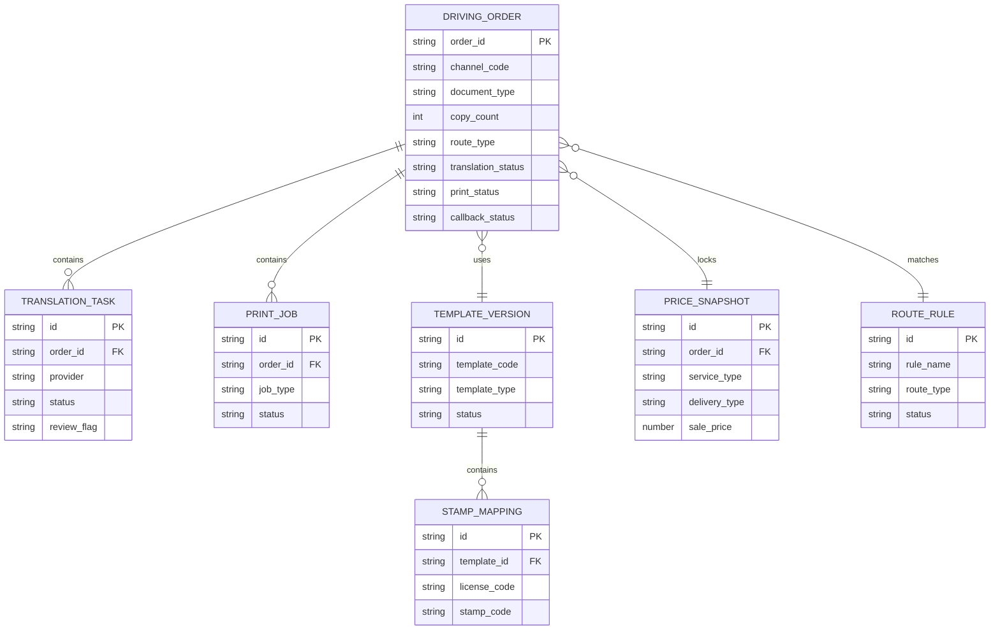
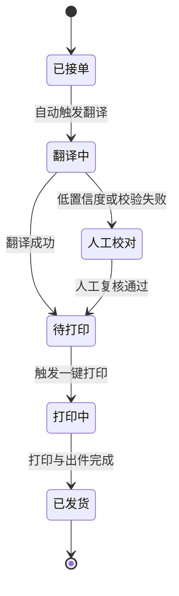
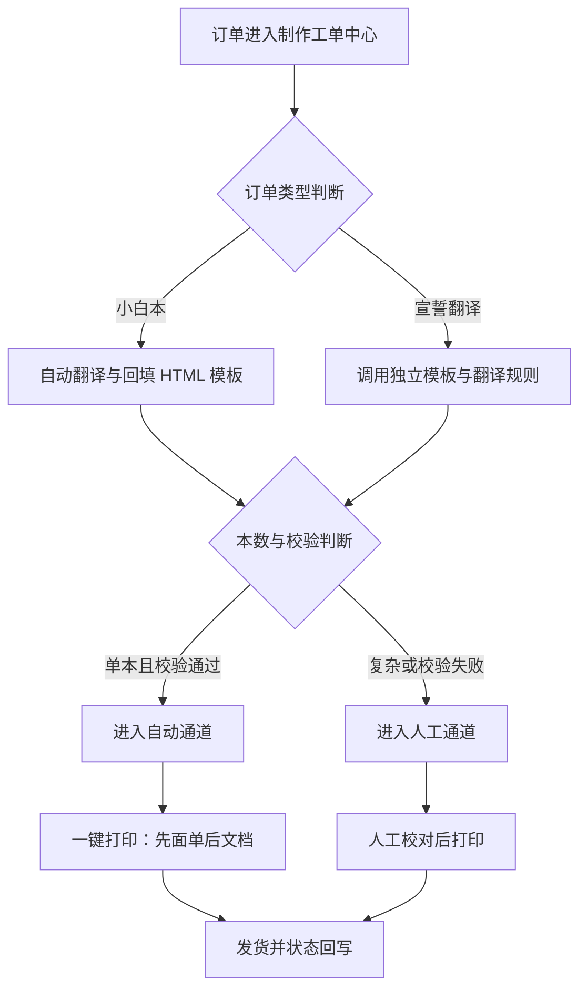
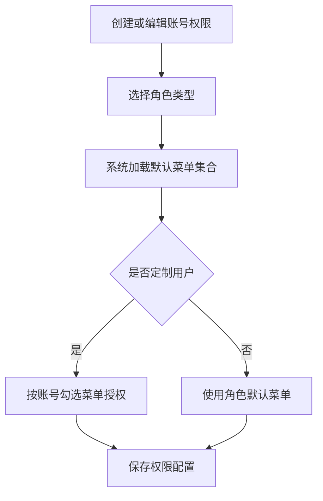
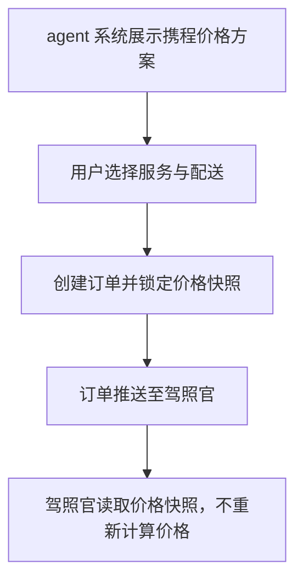

```

```

# [驾照官升级需求]

> **模块**: 驾照官 3.0 升级
> **版本**: v1.5
> **最后更新**: 2026-06-09
> **作者**: Codex

---

## 更新日志

- **v1.5 (2026-06-09)**: 增加“驾照官系统整体UI视图修改”需求，明确整体视觉统一、页面信息分层和状态突出规则
- **v1.4 (2026-05-13)**: 补充葡语公证件翻译销售产品到生产产品映射
- **v1.3 (2026-04-28)**: 按前端销售产品图调整销售产品到生产产品映射，补充 IDP/IDD 产品映射与 `idp` 订单类型
- **v1.2 (2026-04-28)**: 调整携程五档销售方案前端展示名称，并同步更新销售方案编码、服务时效与配送方式映射
- **v1.1 (2026-04-27)**: 补充前端销售产品与驾照官生产产品（含生产时效、交付方式和价格快照字段）的 mapping，明确携程五档服务方案与驾照官生产履约产品的拆解规则
- **v1.0 (2026-04-17)**: 基于 `驾照官 3.0 升级需求文档 PRD.docx` 重构为模板化 PRD；补齐背景、User Stories、Logical View、业务规则、验收标准、Tracking Events 与 i18n 规范

---

## 1. 背景与目标

### 1.1 业务背景

驾照官当前承担驾照翻译认证件、小白本、宣誓翻译等制作与发货相关工作，是整个履约链路中最靠后的生产系统。现阶段系统仍高度依赖人工翻译、人工打印和 Word 模板，整体流程存在工具分散、状态不可追踪、错误处理弱等问题，已经开始限制业务规模化增长。

同时，驾照官还承担了一部分渠道收单职责，导致收单系统与制作系统边界混杂。随着携程价格体系扩展、klook 等渠道差异化菜单、模板升级和自动化机器打印能力接入，系统需要从“操作型后台”升级为“标准化制作发货工作台”。

### 1.2 问题陈述

当前核心问题集中在以下几个方面：

- 小白本翻译依赖按键精灵，稳定性差、错误率高，异常无法优雅处理。
- 小白本模板依赖 Word，格式兼容性差，调试和预览成本高。
- 快递面单与小白本打印分离，人工需要多次点击，制作效率低。
- 不同复杂度订单无自动分流，单本简单订单未被自动化消化。
- 准驾车型盖章依赖人工判断，容易出现漏盖、错盖。
- 菜单和权限结构冗余，不同角色视图不够聚焦。
- 整体 UI 视图风格不统一，列表、详情、操作区的信息层级和状态提示不清晰。
- 驾照官仍承担部分收单能力，与 agent 系统职责边界不清。

---

## 2. 现状洞察（AS-IS）

| 痛点                         | 描述                                                             |
| ---------------------------- | ---------------------------------------------------------------- |
| **翻译自动化不足**     | 依赖按键精灵进行翻译，稳定性差、报错率高，无法有效处理异常。     |
| **模板技术栈落后**     | Word 模板兼容性差，格式容易错乱，模板调试和交付效率低。          |
| **打印动作割裂**       | 快递面单与小白本打印分开执行，人工操作繁琐，易漏打。             |
| **生产通道未分层**     | 所有订单按同一种方式处理，单本订单无法自动消化，复杂订单风险高。 |
| **盖章规则依赖人工**   | 准驾车型识别与盖章仍靠人工判断，标准不统一且易出错。             |
| **系统职责不清**       | 驾照官仍保留部分收单能力，与 agent 系统存在职责重叠。            |
| **权限治理不足**       | 菜单项过多且低频，角色权限和账号定制权限不够精细。               |
| **整体视图体验割裂**   | 页面风格、信息层级和状态反馈不统一，影响操作效率与异常识别。     |
| **价格体系扩展能力弱** | 携程当前仅支持两档价格体系，难以支撑更灵活的售卖策略。           |

---

## 3. 目标（TO-BE）与非目标

### 3.1 目标

| # | 目标                            | 描述                                                  |
| - | ------------------------------- | ----------------------------------------------------- |
| 1 | **建立自动翻译链路**      | 订单进入系统后自动完成翻译、结果回填与人工复核标记。  |
| 2 | **建立自动/人工分流机制** | 单本简单订单自动处理，复杂订单转人工通道。            |
| 3 | **完成模板技术升级**      | 以 HTML 模板替代 Word，提升预览、打印与维护稳定性。   |
| 4 | **实现一键打印闭环**      | 将面单打印与小白本打印绑定为单个任务，减少人工操作。  |
| 5 | **收敛系统边界**          | 驾照官专注制作与发货，渠道收单逐步迁移至 agent 系统。 |
| 6 | **优化菜单和价格治理**    | 支持角色/账号级菜单授权，以及携程 5 档价格体系。      |
| 7 | **统一整体UI视图体验**    | 统一工作台视觉、信息层级与状态表达，提升操作效率。    |

### 3.2 非目标（本期不做）

- **不重构账号体系**: 用户注册、登录、密码等基础账号能力不在本期范围内。
- **不改造支付网关**: 本期不涉及支付链路和支付服务本身的重构。
- **不实现双向文档协同系统**: 本期仅聚焦制作发货系统，不扩展为办公协同平台。
- **不建设复杂财务结算模块**: 不在本期处理账单、发票、结算清分等财务系统能力。

### 3.3 User Stories

#### US-1: 自动翻译替代按键精灵

> **作为** 制作人员
> **我希望** 订单进入系统后自动完成翻译和模板回填
> **以便于** 减少人工点击、复制粘贴和外部自动化工具的不稳定性

**验收标准**:

- 小白本订单进入系统后自动触发翻译任务
- 固定翻译字段优先命中标准翻译库
- 低置信度结果必须标记人工重点核对

#### US-2: 自动化打单与智能分单

> **作为** 运营人员
> **我希望** 单本订单自动进入机器处理通道，复杂订单转人工处理
> **以便于** 降低人工制作成本并控制复杂订单风险

**验收标准**:

- 单本订单默认进入自动通道
- 两本和三本订单默认进入人工通道
- 自动通道失败时能自动降级到人工通道

#### US-3: 一键打印

> **作为** 制作人员
> **我希望** 点击一次即可完成面单和小白本打印
> **以便于** 减少重复操作并降低漏打风险

**验收标准**:

- 面单打印成功后才允许打印小白本
- 小白本打印失败时支持补打，不重复打印面单
- 系统可回写打印状态并支持重试

#### US-4: 系统职责切分

> **作为** 管理员
> **我希望** 驾照官只承担制作和发货职责，收单统一迁移到 agent 系统
> **以便于** 降低系统耦合、明确边界并提升可扩展性

**验收标准**:

- 携程、AVIS、EM 订单由 agent 系统统一收单
- 驾照官仅保留接单、制作、打印、发货、状态回写能力
- 上下游系统之间存在明确的价格和状态契约

---

## 4. 术语表（Terminology）

| 术语                        | 英文                      | 定义                                           |
| --------------------------- | ------------------------- | ---------------------------------------------- |
| 驾照官                      | Driving Licence Workbench | 驾照翻译件、小白本、宣誓翻译等制作与发货工作台 |
| 小白本                      | Smallbook                 | 驾照翻译认证件，需要翻译、盖章、模板回填和打印 |
| 宣誓翻译                    | Affidavit Translation     | 独立于小白本的翻译件流程，使用独立模板和签章   |
| agent 系统                  | Agent System              | 负责渠道收单、价格选择和前置订单创建的系统     |
| 自动通道                    | Auto Route                | 系统自动完成翻译、回填、打印任务的处理路径     |
| 人工通道                    | Manual Route              | 复杂或异常订单进入人工处理的路径               |
| 准入校验（Admission Guard） | Admission Guard           | 动作执行前的守卫条件，如打印机在线、模板可渲染 |
| Canonical（标准化主数据）   | Canonical Data            | 标准化后的订单、渠道、模板、证件字段业务语义   |
| 价格快照                    | Price Snapshot            | 订单创建时锁定的服务类型、配送服务和售价信息   |

---

## 5. 角色与权限

| 角色     | 权限范围                                             | 说明                          |
| -------- | ---------------------------------------------------- | ----------------------------- |
| 管理员   | 菜单配置、用户管理、模板管理、价格配置、查看全部订单 | 负责治理和规则配置            |
| 运营     | 小白本、公证件、宣誓翻译、报表、处理订单             | 负责日常履约与异常处理        |
| 普通用户 | 宣誓翻译、公证件、携程小白本                         | 仅访问被授权的生产入口        |
| 定制用户 | 按账号开放指定菜单                                   | 例如仅处理携程或 klook 小白本 |
| 制作人员 | 查看待处理订单、执行打印、人工校对                   | 聚焦制作和出件动作            |

**权限规则**:

- 商品管理、接口设置、系统设置菜单默认隐藏
- “互动管理”统一改名为“用户管理”
- 无权限菜单不可通过直链访问
- 定制用户需支持账号粒度的菜单授权

---

## 6. 数据模型（业务/交互视角）

### 6.1 实体关系图（ER Diagram）



### 6.2 Logical View（逻辑视图，UI 设计基准）

> [!IMPORTANT]
> **AI 执行约束**
>
> 1. 本章定义制作工作台的业务语义和交互结构，不直接等同于底层表结构。
> 2. 订单详情页、列表页和打印动作必须优先基于此 Logical View 设计。
> 3. 派生字段和映射字段必须显式标注来源为 Stored / Derived / Mapped。
> 4. 技术层表结构仅补充在附录中，不反向驱动页面语义。

#### 6.2.1 逻辑视图写法

```typescript
interface DrivingOrderWorkbenchView {
  orderId: string; // Stored
  channelCode: string; // Stored
  documentType: 'smallbook' | 'affidavit' | 'notary' | 'idp'; // Stored
  copyCount: number; // Stored

  translationStatus: 'pending' | 'running' | 'review_required' | 'succeeded' | 'failed'; // Derived
  routeType: 'auto' | 'manual'; // Derived
  printBundleStatus: 'pending' | 'waybill_done' | 'document_done' | 'failed' | 'done'; // Derived
  stampMappingCode?: string; // Mapped

  templateVersion: {
    code: string;
    type: 'smallbook_html' | 'affidavit_html';
  }; // Mapped

  priceSnapshot?: {
    serviceType: string;
    deliveryType: string;
    salePrice: number;
  }; // Stored

  currentUserPermission: {
    canPrint: boolean; // Derived
    canEditTranslation: boolean; // Derived
    canManageMenu: boolean; // Derived
  };

  actions: {
    onRetryTranslation(orderId: string): void;
    onSubmitManualReview(orderId: string): void;
    onPrintBundle(orderId: string): void;
  };
}
```

#### 6.2.2 计算字段与虚字段

| 数据库存储                                            | 逻辑视图字段         | Spec 写法                                                   | AI 行为                          |
| ----------------------------------------------------- | -------------------- | ----------------------------------------------------------- | -------------------------------- |
| `copy_count`                                        | `routeType`        | `routeType: 'auto' if copy_count === 1 else 'manual'`     | 自动决定进入自动通道还是人工通道 |
| `translation_status`                                | `canPrint`         | `canPrint: true if translation_status === 'succeeded'`    | 控制一键打印按钮展示             |
| `license_code`                                      | `stampMappingCode` | `stampMappingCode: string` *(Mapped from license_code)* | 自动匹配准驾车型盖章结果         |
| `service_type` + `delivery_type` + `sale_price` | `priceSnapshot`    | `priceSnapshot: object`                                   | 下单后锁定价格与配送信息         |

---

## 7. 业务规则与验证

### 7.1 核心业务规则

| 规则编号 | 规则名称     | 规则描述                                                     |
| -------- | ------------ | ------------------------------------------------------------ |
| BR-001   | 自动翻译触发 | 小白本和宣誓翻译订单进入系统后自动触发翻译任务，无需人工点击 |
| BR-002   | 标准库优先   | 固定字段优先使用标准翻译库，未命中时调用第三方翻译 API       |
| BR-003   | 自动通道规则 | 单本订单默认进入自动通道；两本和三本订单默认进入人工通道     |
| BR-004   | 通道降级     | 自动通道任一准入校验失败时自动降级为人工通道                 |
| BR-005   | 盖章映射     | 准驾车型命中映射表后，系统自动叠加对应电子印章               |
| BR-006   | 打印顺序     | 一键打印必须先打印面单，再打印小白本                         |
| BR-007   | 模板升级     | 小白本默认使用 HTML 模板，Word 不再作为主流程默认方案        |
| BR-008   | 菜单权限     | 菜单展示同时受角色权限和账号级授权控制                       |
| BR-009   | 系统边界     | 驾照官负责制作发货；agent 负责渠道收单和前置价格选择         |
| BR-010   | 携程价格锁定 | 携程订单创建时必须锁定 5 档价格方案快照，驾照官仅消费快照    |
| BR-011   | UI视图统一   | 驾照官各核心页面需遵循统一视觉结构、信息层级和状态表达规则   |

### 7.2 数据验证规则

| 字段（含变更标识）       | 验证规则                                                         | 错误提示                           |
| ------------------------ | ---------------------------------------------------------------- | ---------------------------------- |
| [MOD] document_type      | 必须为 `smallbook` / `affidavit` / `notary` / `idp` 之一 | 订单类型缺失或非法，请检查来源数据 |
| [ADD] copy_count         | 仅允许 1、2、3，本数超出时阻断自动通道                           | 订单本数异常，请确认订单内容       |
| [ADD] translation_result | 低置信度结果不可直接进入打印                                     | 翻译结果需人工重点核对             |
| [ADD] license_code       | 需命中盖章映射表或人工确认                                       | 未找到对应准驾车型印章             |
| [ADD] sale_price         | 价格方案必须来自已启用的携程 5 档配置                            | 当前价格方案不可售卖               |
| [MOD] menu_permission    | 无权限账号不可访问隐藏菜单                                       | 当前账号无权访问该菜单             |

### 7.3 状态机（如适用）



**状态转换规则**:

| 当前状态 | 目标状态 | 触发条件                   | 操作权限        |
| -------- | -------- | -------------------------- | --------------- |
| 已接单   | 翻译中   | 订单进入系统，自动触发翻译 | 系统            |
| 翻译中   | 人工校对 | 命中低置信度或规则冲突     | 系统            |
| 翻译中   | 待打印   | 翻译通过且模板生成成功     | 系统            |
| 人工校对 | 待打印   | 人工审核确认无误           | 制作人员 / 运营 |
| 待打印   | 打印中   | 点击一键打印               | 制作人员        |
| 打印中   | 已发货   | 面单和文档打印完成并发货   | 制作人员 / 系统 |

---

## 8. 功能需求

### 8.1 制作工单中心

#### 8.1.1 目标、需求点与优先级

**目标**:

- 统一承接 [小白本]、[宣誓翻译] 等制作单，形成标准化生产工作台。
- 缩短制作链路的人工操作路径，提升翻译、分流、打印与发货回写效率。
- 让标准化订单优先走自动通道，复杂订单可快速切入人工处理。

**需求点与优先级**:

| 需求点             | 说明                                                       | 优先级 |
| ------------------ | ---------------------------------------------------------- | ------ |
| 统一工单入口       | [小白本]、[宣誓翻译] 等制作单统一在制作工单中心处理        | P0     |
| 自动翻译与模板回填 | 订单进入系统后自动触发翻译，并回填 HTML 模板               | P0     |
| 自动 / 人工分流    | 根据订单本数、校验结果和异常状态决定进入自动通道或人工通道 | P0     |
| 模板预览与人工校对 | 支持查看 HTML 模板效果，并在人工校对态修改翻译结果         | P1     |
| 准驾车型映射       | 根据准驾车型自动命中映射规则，未命中时转人工确认           | P1     |
| 一键打印           | 支持面单与文档按既定顺序统一打印                           | P0     |
| 发货状态回写       | 打印与发货完成后同步回写订单状态，便于追踪履约进度         | P1     |

**现状痛点与规则承接**:

> 评审目标：确认制作工单中心是否完整承接第 2 章生产类痛点，并能通过第 7 章规则形成可实现、可回退、可验收的产品方案。

| 现状痛点                   | 本章落地规则                                                                                                   | 本期产品决策                                                         | 验收口径                                                                         | 评审关注点                                                 | 优先级 |
| -------------------------- | -------------------------------------------------------------------------------------------------------------- | -------------------------------------------------------------------- | -------------------------------------------------------------------------------- | ---------------------------------------------------------- | ------ |
| **翻译自动化不足**   | 小白本和宣誓翻译订单进入系统后自动触发翻译任务；<br />固定字段优先使用标准翻译库，未命中时调用第三方翻译 API。 | 自动翻译替代按键精灵；标准库优先，第三方 API 兜底，异常转人工校对。  | 订单接入后自动生成翻译任务；标准字段优先命中标准库；低置信度结果不可进入打印。   | 标准库覆盖范围、低置信度阈值、API 失败重试和人工转单入口。 | P0     |
| **模板技术栈落后**   | 小白本默认使用 HTML 模板，Word 不再作为主流程默认方案。                                                        | 小白本主流程切换为 HTML 模板；Word 仅作为历史兼容或迁移参考。        | 新订单默认生成 HTML 预览；模板渲染失败阻断打印；主流程不再依赖 Word 模板。       | HTML 模板版本管理、打印前校验规则、历史模板兼容边界。      | P0     |
| **打印动作割裂**     | 一键打印必须先打印面单，再打印小白本，且分别记录面单与文档打印状态。                                           | 面单和文档合并为一键打印任务；执行顺序固定为先面单、后文档。         | 面单失败不触发文档打印；文档失败支持单独补打；打印状态可追踪。                   | 打印失败重试、补打权限、面单成功但文档失败的状态处理。     | P0     |
| **生产通道未分层**   | 单本订单默认进入自动通道；两本和三本订单默认进入人工通道；<br />自动通道任一准入校验失败时自动降级为人工通道。 | 单本订单优先自动处理；两本和三本订单默认人工处理；自动准入失败降级。 | copy_count = 1 默认自动通道；copy_count = 2 或 3 默认人工通道；降级原因可记录。  | 自动通道准入条件、降级触发条件、人工处理承接方式。         | P0     |
| **盖章规则依赖人工** | 准驾车型命中映射表后，系统自动叠加对应电子印章；未命中或冲突时必须人工确认。                                   | 准驾车型自动匹配电子印章；未命中或冲突时阻断自动流转并人工确认。     | license_code 命中后生成 stamp_mapping_code；未命中进入人工确认；确认结果可追溯。 | 映射表维护责任、车型冲突处理、人工确认后的日志留存。       | P1     |

#### 8.1.2 筛选条件

> 📖 **字段标识约定**: 本模板在字段名前使用 `[ADD]` / `[MOD]` / `[DEL]` 标识新增、修改、删除字段；`[DEL]` 必须补充替代方案或废弃原因。

**筛选字段定义**:

| 筛选字段                 | 类型   | 必填 | 默认值  | 取值来源 | 说明                             |
| ------------------------ | ------ | ---- | ------- | -------- | -------------------------------- |
| [MOD] order_id           | String | 否   | 无      | 用户输入 | 支持按订单号精确/模糊检索        |
| [MOD] document_type      | Enum   | 否   | `ALL` | 系统枚举 | 小白本 / 宣誓翻译 / 公证件 / IDP |
| [ADD] channel_code       | Enum[] | 否   | 空      | 渠道字典 | 支持多选，如携程、AVIS、EM       |
| [ADD] route_type         | Enum   | 否   | `ALL` | 系统派生 | 自动通道 / 人工通道              |
| [ADD] translation_status | Enum   | 否   | `ALL` | 系统状态 | 翻译中 / 人工校对 / 待打印       |
| [ADD] print_status       | Enum   | 否   | `ALL` | 系统状态 | 待打印 / 打印中 / 已发货         |

**枚举值定义**（如适用）:

| 值            | 名称     | 说明               |
| ------------- | -------- | ------------------ |
| `smallbook` | 小白本   | 驾照翻译认证件     |
| `affidavit` | 宣誓翻译 | 独立模板与签章流程 |
| `notary`    | 公证件   | 香港公证件等流程   |
| `idp`       | IDP      | IDD 国际驾照流程   |
| `auto`      | 自动通道 | 系统自动翻译与打印 |
| `manual`    | 人工通道 | 复杂订单需人工处理 |

**验证规则**（如适用）:

| 字段（含变更标识）  | 验证规则                     | 错误提示                     |
| ------------------- | ---------------------------- | ---------------------------- |
| [ADD] route_type    | 仅允许 `auto` / `manual` | 处理通道类型无效             |
| [MOD] document_type | 必须为有效订单类型           | 订单类型无效，请检查筛选条件 |

**筛选逻辑**:

- 多个筛选条件之间关系默认为 AND
- 订单号模糊匹配，状态与通道按精确枚举过滤

**业务约束**（如适用）:

- 默认优先展示待处理工单
- 人工校对工单在列表中需显著高亮

#### 8.1.3 列表字段定义

**列表展示字段**:

| 字段名（含变更标识） | 类型   | 数据来源                                        | 说明                             | 示例            |
| -------------------- | ------ | ----------------------------------------------- | -------------------------------- | --------------- |
| [MOD] 工单主标识     | String | `driving_order.order_id`                      | 订单主识别信息                   | SB202604170001  |
| [ADD] 订单类型       | Enum   | `driving_order.document_type`                 | 小白本 / 宣誓翻译 / 公证件 / IDP | 小白本          |
| [ADD] 渠道           | String | `driving_order.channel_code`                  | 渠道来源                         | ctrip           |
| [ADD] 处理通道       | Enum   | `DrivingOrderWorkbenchView.routeType`         | 自动或人工处理路径               | auto            |
| [ADD] 翻译状态       | Enum   | `DrivingOrderWorkbenchView.translationStatus` | 当前翻译任务状态                 | review_required |
| [ADD] 打印状态       | Enum   | `DrivingOrderWorkbenchView.printBundleStatus` | 当前打印任务状态                 | waybill_done    |
| [ADD] 操作           | Array  | 动作集合                                        | 查看、人工校对、一键打印         | 一键打印        |

**排序规则**:

- 默认排序：创建时间 DESC，人工校对优先级 DESC
- 支持用户自定义排序的字段：订单类型、翻译状态、打印状态

**分页规则**:

- 默认每页显示：20 条
- 支持的分页大小：20, 50, 100

#### 8.1.4 表单字段定义

**字段行为矩阵 (Field Behavior Matrix)**:

| 字段（含变更标识）               | 创建模式 | 编辑模式  | 查看模式 | 依赖/逻辑说明          |
| :------------------------------- | :------- | :-------- | :------- | :--------------------- |
| **[MOD] 订单基础信息**     | Text     | Text      | Text     | 来源于订单快照，只读   |
| **[ADD] OCR 识别结果**     | Text     | Text      | Text     | 展示原始识别字段       |
| **[ADD] 翻译结果**         | Text     | Input     | Text     | 仅人工校对态允许编辑   |
| **[ADD] 准驾车型映射结果** | Text     | Read-only | Text     | 根据车型自动计算       |
| **[ADD] HTML 模板预览**    | Preview  | Preview   | Preview  | 实时预览打印效果       |
| **[ADD] 一键打印按钮**     | Hidden   | Button    | Hidden   | 仅满足待打印条件时展示 |

**常规字段定义 (Legacy/Simple Forms)**:

| 字段名（含变更标识）     | 类型   | 必填 | 默认值       | 取值来源            | 验证规则                     | 说明           |
| ------------------------ | ------ | ---- | ------------ | ------------------- | ---------------------------- | -------------- |
| [ADD] translation_result | String | 否   | 无           | 系统翻译 / 人工输入 | 低置信度时允许人工改写       | 翻译结果文本   |
| [ADD] stamp_mapping_code | String | 否   | 无           | 映射规则            | 必须命中车型映射表或人工确认 | 盖章组合       |
| [MOD] template_version   | String | 是   | 当前模板版本 | 系统绑定            | 必须为有效模板版本           | 当前 HTML 模板 |

#### 8.1.5 业务流程



**流程说明**:

1. 订单进入系统后先完成订单类型判断与 Canonical（标准化主数据）处理。
2. 小白本走自动翻译与 HTML 模板回填；宣誓翻译走独立模板与签章流程。
3. 系统根据订单本数、模板校验结果和设备状态判断进入自动通道或人工通道。
4. 打印任务统一由一键打印触发，顺序固定为面单优先。

#### 8.1.6 边界场景处理

| 场景                       | 处理方式                                         |
| -------------------------- | ------------------------------------------------ |
| 翻译 API 超时              | 标记为“翻译失败待重试”，允许自动重试和人工转单 |
| OCR 未识别出关键字段       | 阻断自动通道，进入人工校对                       |
| 面单打印成功但文档打印失败 | 保留面单成功状态，仅允许补打文档                 |
| 准驾车型未命中映射表       | 阻断自动盖章，提示人工确认                       |

### 8.2 整体UI视图升级

#### 8.2.1 目标、需求点与优先级

**目标**:

- 统一驾照官系统核心页面的整体视觉风格、布局结构和交互反馈，降低学习成本。
- 强化待处理、异常、人工介入等关键状态的视觉突出能力，提升生产操作效率。
- 让列表页、详情页、筛选区、操作区的信息层级更清晰，减少误操作和遗漏。

**需求点与优先级**:

| 需求点           | 说明                                                           | 优先级 |
| ---------------- | -------------------------------------------------------------- | ------ |
| 整体视觉统一     | 驾照官系统页面需统一颜色、字体、按钮、卡片、表格和状态标签规范 | P1     |
| 页面结构重组     | 优化列表页、详情页、筛选区和操作区布局，形成一致的信息分层     | P0     |
| 关键状态突出     | 待处理、异常、人工校对、打印失败等状态需显著区分               | P0     |
| 角色视图聚焦     | 不同角色优先展示与当前工作相关的信息和操作入口                 | P1     |
| 操作反馈明确     | 点击、保存、打印、拦截、失败等动作需给出明确反馈               | P0     |
| 存量功能平滑承接 | 本次 UI 调整不改变既有业务规则、权限规则和核心数据语义         | P0     |

**现状痛点与规则承接**:

> 评审目标：确认本次 UI 升级不仅是视觉美化，还能支撑制作场景下的信息识别、状态判断和高频操作效率提升。

| 现状痛点                   | 本章落地规则                                                                       | 本期产品决策                                                                   | 验收口径                                                                | 评审关注点                                                   | 优先级 |
| -------------------------- | ---------------------------------------------------------------------------------- | ------------------------------------------------------------------------------ | ----------------------------------------------------------------------- | ------------------------------------------------------------ | ------ |
| **整体视图体验割裂** | 核心页面遵循统一视觉结构、信息层级和状态表达规则；关键状态需显著区分并可快速识别。 | 优先重做驾照官核心工作页面的整体 UI 视图，统一列表、详情、筛选区和操作区表达。 | 同类页面视觉规范一致；待处理/异常状态可一眼识别；高频操作入口位置稳定。 | 是否只改样式不改结构、异常态是否足够突出、是否影响现有流程。 | P0     |

#### 8.2.2 视图范围与结构要求

**视图范围**:

- 制作工单中心列表页
- 工单详情页
- 菜单导航区
- 关键弹窗与操作反馈组件

**结构要求**:

| 视图区块           | 要求                                                                 | 说明                         |
| ------------------ | -------------------------------------------------------------------- | ---------------------------- |
| [MOD] 页面头部     | 保持统一标题区、面包屑或模块标识、主操作入口                         | 便于用户快速识别当前工作区   |
| [MOD] 筛选区       | 筛选项分组展示，默认展示高频筛选条件                                 | 降低低效筛选和重复展开成本   |
| [MOD] 列表区       | 列表字段主次分明，状态列、操作列固定为高关注区域                     | 提升待处理单与异常单识别效率 |
| [ADD] 详情信息区   | 按“基础信息 / 制作信息 / 打印信息 / 异常信息”分组展示              | 避免信息混杂                 |
| [ADD] 状态反馈组件 | 成功、失败、待处理、人工介入等状态需采用统一标签、颜色和提示文案规范 | 保持跨页面一致性             |
| [ADD] 操作反馈机制 | 保存、打印、提交、失败拦截后需即时反馈结果与下一步动作建议           | 提升可控感和可恢复性         |

**业务约束**:

- 本次 UI 视图调整仅修改前端展示结构和交互表达，不新增业务流程分支。
- 不得因 UI 调整改变字段含义、状态机规则、权限控制或上下游接口契约。
- 高风险状态必须优先于普通信息展示，不可被弱化或折叠至二级区域。

#### 8.2.3 边界场景处理

| 场景                     | 处理方式                                               |
| ------------------------ | ------------------------------------------------------ |
| 页面信息过多导致主次不清 | 默认仅展开高频核心信息，其余信息按分组折叠或分区展示   |
| 异常状态与普通状态混淆   | 使用统一异常态标签、提示文案和操作引导，确保明显可区分 |
| UI 改版后用户找不到入口  | 保持高频操作入口位置稳定，并提供明确的区块命名         |
| 仅替换皮肤未提升效率     | 评审和验收需以状态识别效率与操作路径收敛为核心判断口径 |

### 8.3 菜单与权限管理

#### 8.3.1 目标、需求点与优先级

**目标**:

- 收敛导航结构，让不同岗位只看到与自身工作相关的菜单入口。
- 完成“互动管理”到“用户管理”的命名与职责调整，降低理解成本。
- 建立角色级和账号级的菜单授权能力，提升权限治理精度。

**需求点与优先级**:

| 需求点           | 说明                                               | 优先级 |
| ---------------- | -------------------------------------------------- | ------ |
| 导航结构收敛     | 梳理并精简现有菜单，仅保留高频、有效入口           | P1     |
| 菜单命名调整     | 将“互动管理”统一改为“用户管理”                 | P1     |
| 角色级菜单授权   | 按管理员、运营、普通用户、定制用户配置默认菜单集合 | P0     |
| 账号级菜单授权   | 支持按账号粒度对定制用户进行细粒度菜单授权         | P1     |
| 无权限访问拦截   | 用户通过直链访问隐藏菜单时，系统需返回无权限页面   | P0     |
| 权限变更即时生效 | 保存权限配置后，菜单可见性和访问权限需及时生效     | P1     |

**现状痛点与规则承接**:

> 评审目标：确认菜单治理不仅完成前端入口收敛，也完成后端访问控制，避免“菜单隐藏但直链可访问”的权限漏洞。

| 现状痛点               | 本章落地规则                                                         | 本期产品决策                                                   | 验收口径                                                                     | 评审关注点                                               | 优先级 |
| ---------------------- | -------------------------------------------------------------------- | -------------------------------------------------------------- | ---------------------------------------------------------------------------- | -------------------------------------------------------- | ------ |
| **权限治理不足** | 菜单展示同时受角色权限和账号级授权控制；无权限菜单不可通过直链访问。 | 建立角色默认菜单和账号级定制授权；菜单隐藏与后端鉴权同时生效。 | 不同角色仅看到授权菜单；定制用户可按账号配置菜单；无权限直链返回无权限页面。 | 角色菜单基线、定制用户最小授权、权限缓存刷新和生效时机。 | P1     |

#### 8.3.2 筛选条件

**筛选字段定义**:

| 筛选字段              | 类型   | 必填 | 默认值  | 取值来源 | 说明                                |
| --------------------- | ------ | ---- | ------- | -------- | ----------------------------------- |
| [ADD] role_type       | Enum   | 否   | `ALL` | 角色字典 | 管理员 / 运营 / 普通用户 / 定制用户 |
| [ADD] account_keyword | String | 否   | 无      | 用户输入 | 支持账号搜索                        |

**筛选逻辑**:

- 角色与账号关键字关系为 AND

#### 8.3.3 列表字段定义

**列表展示字段**:

| 字段名（含变更标识） | 类型   | 数据来源               | 说明                 | 示例             |
| -------------------- | ------ | ---------------------- | -------------------- | ---------------- |
| [ADD] 账号           | String | `sys_user.account`   | 用户账号             | op_ctrip_01      |
| [ADD] 角色           | Enum   | `sys_user.role_type` | 角色类型             | 运营             |
| [ADD] 菜单权限       | Array  | 授权结果               | 可访问菜单集合       | 携程小白本、报表 |
| [MOD] 操作           | Array  | 动作集合               | 编辑、禁用、调整权限 | 编辑权限         |

**排序规则**:

- 默认排序：更新时间 DESC

**分页规则**:

- 默认每页显示：20 条

#### 8.3.4 表单字段定义

**字段行为矩阵 (Field Behavior Matrix)**:

| 字段（含变更标识）       | 创建模式      | 编辑模式      | 查看模式 | 依赖/逻辑说明          |
| :----------------------- | :------------ | :------------ | :------- | :--------------------- |
| **[ADD] 账号**     | Input (必填)  | Read-only     | Text     | 创建后不可修改         |
| **[ADD] 角色类型** | Select (必填) | Select (必填) | Text     | 决定默认菜单集合       |
| **[ADD] 菜单授权** | TreeSelect    | TreeSelect    | Text     | 定制用户支持细粒度授权 |
| **[MOD] 状态**     | Switch        | Switch        | Text     | 禁用后账号不可使用菜单 |

**常规字段定义 (Legacy/Simple Forms)**:

| 字段名（含变更标识）   | 类型  | 必填 | 默认值 | 取值来源 | 验证规则                    | 说明         |
| ---------------------- | ----- | ---- | ------ | -------- | --------------------------- | ------------ |
| [ADD] role_type        | Enum  | 是   | 无     | 角色字典 | 必须为有效角色              | 当前账号角色 |
| [ADD] menu_permissions | Array | 否   | []     | 菜单树   | 至少保留 1 个入口给定制用户 | 菜单授权清单 |

#### 8.3.5 业务流程



**流程说明**:

1. 角色类型决定默认菜单基线。
2. 定制用户在默认基线之上支持账号级勾选。
3. 保存成功后立即影响菜单可见性和直链访问权限。

#### 8.3.6 边界场景处理

| 场景                        | 处理方式                       |
| --------------------------- | ------------------------------ |
| 菜单隐藏但用户通过 URL 访问 | 直接返回无权限页面             |
| 定制用户未配置任何菜单      | 阻止保存并提示至少授权一个入口 |
| 权限更新后缓存未刷新        | 重新登录或刷新后立即生效       |

### 8.4 携程价格方案与系统边界对接--依赖携程先上、时间未定

#### 8.4.1 目标、需求点与优先级

**目标**:

- 将携程当前价格体系从两档升级为五档服务方案，支撑更灵活的售卖策略。
- 明确定价动作发生在 agent 收单阶段，驾照官仅承接已锁定的价格快照。
- 通过价格快照机制明确上下游系统边界，避免二次定价和履约歧义。

**需求点与优先级**:

| 需求点             | 说明                                              | 优先级 |
| ------------------ | ------------------------------------------------- | ------ |
| 携程价格方案升级   | 将现有两档价格体系升级为五档服务方案              | P0     |
| agent 收单阶段选价 | 由 agent 系统在收单阶段完成服务类型与配送方式选择 | P0     |
| 价格快照锁定       | 订单创建时写入服务类型、配送方式和售价快照        | P0     |
| 驾照官只消费快照   | 驾照官侧不参与二次定价，仅消费已锁定价格信息      | P0     |
| 系统边界清晰       | agent 负责收单与定价，驾照官负责制作与发货履约    | P0     |
| 历史订单价格稳定   | 后续价格配置调整不影响已下单订单的历史快照        | P1     |

**现状痛点与规则承接**:

> 评审目标：确认携程价格方案升级时，上游 agent 与驾照官的职责边界、价格快照契约和历史订单稳定性均已明确。

| 现状痛点                     | 本章落地规则                                                                | 本期产品决策                                                                     | 验收口径                                                                       | 评审关注点                                             | 优先级 |
| ---------------------------- | --------------------------------------------------------------------------- | -------------------------------------------------------------------------------- | ------------------------------------------------------------------------------ | ------------------------------------------------------ | ------ |
| **系统职责不清**       | 驾照官负责制作发货；agent 负责渠道收单、前置价格选择和订单推送。            | agent 负责收单、价格选择和订单推送；驾照官负责接单、制作、打印、发货和状态回写。 | agent 推送订单时已完成收单和价格选择；驾照官侧无二次收单入口；状态回写可追踪。 | 上下游接口契约、状态枚举一致性、迁移期是否保留旧入口。 | P0     |
| **价格体系扩展能力弱** | 携程订单创建时必须锁定 5 档价格方案快照，驾照官仅消费快照，不参与二次定价。 | 携程订单创建时锁定 5 档价格方案快照；驾照官仅消费快照，不重新计算价格。          | 订单写入 priceSnapshot；停用方案不可选；历史订单不受后续价格调整影响。         | 携程上线依赖、价格方案停用策略、快照字段完整性。       | P0     |

#### 8.4.2 筛选条件

**筛选字段定义**:

| 筛选字段            | 类型 | 必填 | 默认值      | 取值来源     | 说明                              |
| ------------------- | ---- | ---- | ----------- | ------------ | --------------------------------- |
| [ADD] service_type  | Enum | 否   | `ALL`     | 价格方案字典 | 正常办理 / 优先办理 / 1V1特级办理 |
| [ADD] delivery_type | Enum | 否   | `ALL`     | 价格方案字典 | 普通配送 / 加急配送               |
| [ADD] status        | Enum | 否   | `enabled` | 系统状态     | 启用 / 停用                       |

**枚举值定义**（如适用）:

| 值                   | 名称        | 说明         |
| -------------------- | ----------- | ------------ |
| `normal`           | 正常办理    | 7 工作日     |
| `priority`         | 优先办理    | 1-2 工作日   |
| `urgent_24h`       | 1V1特级办理 | 24 小时      |
| `normal_delivery`  | 普通配送    | 标准配送方式 |
| `express_delivery` | 加急配送    | 加急配送方式 |

**筛选逻辑**:

- 服务类型、配送方式、状态关系为 AND

#### 8.4.3 列表字段定义

**列表展示字段**:

| 字段名（含变更标识） | 类型   | 数据来源                         | 说明         | 示例     |
| -------------------- | ------ | -------------------------------- | ------------ | -------- |
| [ADD] 服务类型       | String | `price_snapshot.service_type`  | 服务方案名称 | 优先办理 |
| [ADD] 配送服务       | String | `price_snapshot.delivery_type` | 配送方式     | 加急配送 |
| [ADD] 售价           | Number | `price_snapshot.sale_price`    | 锁定售价     | 109      |
| [ADD] 状态           | Enum   | 配置状态                         | 是否可售卖   | enabled  |

**排序规则**:

- 默认排序：服务优先级 ASC，售价 ASC

**分页规则**:

- 默认每页显示：20 条

#### 8.4.4 表单字段定义

**字段行为矩阵 (Field Behavior Matrix)**:

| 字段（含变更标识）       | 创建模式      | 编辑模式      | 查看模式 | 依赖/逻辑说明                |
| :----------------------- | :------------ | :------------ | :------- | :--------------------------- |
| **[ADD] 服务类型** | Select (必填) | Select (必填) | Text     | 决定默认时效描述             |
| **[ADD] 配送服务** | Select (必填) | Select (必填) | Text     | 与服务类型组合决定最终售卖项 |
| **[ADD] 售价**     | Number (必填) | Number (必填) | Text     | 必须为非负数                 |
| **[ADD] 状态**     | Switch        | Switch        | Text     | 停用后不可被 agent 选择      |

#### 8.4.5 业务流程



**流程说明**:

1. 价格选择发生在 agent 收单阶段。
2. 订单创建完成后必须带上服务类型、配送方式和售价快照。
3. 驾照官只消费价格快照并推进制作流程。

#### 8.4.6 边界场景处理

| 场景                     | 处理方式                   |
| ------------------------ | -------------------------- |
| 价格方案未启用           | 在 agent 侧不可选择        |
| 上下游价格枚举不一致     | 阻止接单并触发告警         |
| 用户下单后价格配置被修改 | 历史订单继续使用已锁定快照 |

### 8.5 现状痛点与落地规则映射索引

本节保留第 2 章现状洞察和第 8 章功能模块之间的全局映射索引。具体规则已落入 8.1、8.2、8.3、8.4 各模块的“本章落地规则”中，第 7 章仅作为业务规则库保留编号索引。

| 第 2 章现状痛点              | 已落入第 8 章模块              | 模块内规则摘要                                  | 优先级 |
| ---------------------------- | ------------------------------ | ----------------------------------------------- | ------ |
| **翻译自动化不足**     | 8.1 制作工单中心               | 自动触发翻译；标准库优先，第三方翻译 API 兜底。 | P0     |
| **模板技术栈落后**     | 8.1 制作工单中心               | 小白本默认使用 HTML 模板，Word 不再作为主流程。 | P0     |
| **打印动作割裂**       | 8.1 制作工单中心               | 一键打印固定先面单、后小白本。                  | P0     |
| **生产通道未分层**     | 8.1 制作工单中心               | 单本默认自动通道，多本默认人工通道，失败降级。  | P0     |
| **盖章规则依赖人工**   | 8.1 制作工单中心               | 准驾车型命中映射表后自动叠加电子印章。          | P1     |
| **整体视图体验割裂**   | 8.2 整体UI视图升级             | 统一页面结构、信息层级和状态表达。              | P0     |
| **权限治理不足**       | 8.3 菜单与权限管理             | 菜单展示同时受角色权限和账号级授权控制。        | P1     |
| **系统职责不清**       | 8.4 携程价格方案与系统边界对接 | agent 负责收单和前置选价，驾照官负责制作发货。  | P0     |
| **价格体系扩展能力弱** | 8.4 携程价格方案与系统边界对接 | 携程订单创建时锁定价格快照，驾照官仅消费快照。  | P0     |

### 8.6 产品映射

本节定义前端销售产品进入驾照官后的生产产品映射。

**销售产品到生产产品映射**:

| 前端产品类型 | 产品                                                                                                                                                                                                                                                                                                                                                                                                                                                                      | `production_product_code`                                                                                                                                                                                                                                                                                                                                                                                                                                                                                                                                                                             | 驾照官产品类型 | `document_type` | 交付方式                       |
| ------------ | ------------------------------------------------------------------------------------------------------------------------------------------------------------------------------------------------------------------------------------------------------------------------------------------------------------------------------------------------------------------------------------------------------------------------------------------------------------------------- | ------------------------------------------------------------------------------------------------------------------------------------------------------------------------------------------------------------------------------------------------------------------------------------------------------------------------------------------------------------------------------------------------------------------------------------------------------------------------------------------------------------------------------------------------------------------------------------------------------- | -------------- | ----------------- | ------------------------------ |
| 翻译认证产品 | 驾照翻译国际认证件（小白本）                                                                                                                                                                                                                                                                                                                                                                                                                                              | `jzg_smallbook_new`                                                                                                                                                                                                                                                                                                                                                                                                                                                                                                                                                                                   | 标准件 新版    | `smallbook`     | 普通配送 / 加急配送            |
| 翻译认证产品 | NAATI 澳大利亚认证(电子版)<br />NAATI 澳大利亚认证(原件)<br />NZTA 新西兰认证(电子版)<br />NZTA 新西兰认证(原件)<br />西班牙语宣誓翻译(电子版)<br />西班牙语宣誓翻译(原件)<br />德语宣誓翻译(电子版)<br />德语宣誓翻译(原件)<br />法语宣誓翻译(电子版)<br />法语宣誓翻译(原件)<br />意大利语宣誓翻译(电子版)<br />意大利语宣誓翻译(原件)<br />NAATI 澳大利亚认证(换证电子版)<br />NZTA 新西兰认证(换证电子版)<br />法语宣誓翻译(换证电子版)<br />德语宣誓翻译(换证电子版) | `jzg_naati_au_electronic`<br />`jzg_naati_au_original`<br />`jzg_nzta_nz_electronic`<br />`jzg_nzta_nz_original`<br />`jzg_es_affidavit_electronic`<br />`jzg_es_affidavit_original`<br />`jzg_de_affidavit_electronic`<br />`jzg_de_affidavit_original`<br />`jzg_fr_affidavit_electronic`<br />`jzg_fr_affidavit_original`<br />`jzg_it_affidavit_electronic`<br />`jzg_it_affidavit_original`<br />`jzg_naati_au_exchange_electronic`<br />`jzg_nzta_nz_exchange_electronic`<br />`jzg_fr_affidavit_exchange_electronic`<br />`jzg_de_affidavit_exchange_electronic` | 非标翻译件     | `affidavit`     | 电子交付 / 普通配送 / 加急配送 |
| 公证产品     | 葡语驾照翻译(电子版)<br />葡语驾照翻译(原件)<br />葡语驾照翻译(换证电子版)                                                                                                                                                                                                                                                                                                                                                                                                | `jzg_pt_notary_translation_electronic`<br />`jzg_pt_notary_translation_original`<br />`jzg_pt_notary_translation_exchange_electronic`                                                                                                                                                                                                                                                                                                                                                                                                                                                             | 公证件翻译     | `notary`        | 电子交付 / 普通配送 / 加急配送 |
| 公证产品     | 公证单号<br />公证双号<br />公证海牙单号<br />公证海牙双号                                                                                                                                                                                                                                                                                                                                                                                                                | `jzg_notary_single`<br />`jzg_notary_double`<br />`jzg_notary_apostille_single`<br />`jzg_notary_apostille_double`                                                                                                                                                                                                                                                                                                                                                                                                                                                                              | 公证件         | `notary`        | 普通配送 / 加急配送            |

**映射规则**:

1. 按“前端产品类型 + 产品名称”匹配对应的驾照官产品类型和生产编码。
2. 同一内容块内，`产品` 与 `production_product_code` 按展示顺序一一对应。
3. 电子版产品按电子交付处理，原件、小白本和公证产品按普通配送 / 加急配送处理。
4. 未命中映射的销售产品进入人工确认。

---

## 9. 非功能需求

### 9.1 性能要求

| 指标             | 要求                  |
| ---------------- | --------------------- |
| 自动翻译链路耗时 | < 30s（平均单单耗时） |
| 页面筛选响应时间 | < 500ms (P95)         |
| 打印任务触发反馈 | < 300ms               |
| 并发处理能力     | ≥ 50 单              |

### 9.2 安全要求

- 数据加密：传输层 TLS 1.2+
- 认证方式：统一账号体系认证，不在本期改造登录逻辑
- 权限控制：RBAC + 账号级菜单授权
- 敏感数据脱敏：手机号、收货地址、驾照号需按角色控制展示

### 9.3 可用性要求

- 自动化服务可用性：≥ 99.9%
- 打印失败、翻译失败、模板缺失必须给出明确提示
- 关键动作保留操作日志，支持问题追溯

---

## 10. 测试策略

### 10.1 测试范围

- 单元测试：翻译状态判断、自动/人工通道判断、盖章映射、价格快照锁定
- 集成测试：订单接入、翻译回填、打印链路、菜单权限、价格方案传递
- E2E 测试：单本订单自动生产、复杂订单转人工、携程价格方案下单后流转
- 性能测试：50 单并发翻译与打印任务调度

### 10.2 测试用例（关键场景）

| 用例编号 | 测试场景         | 前置条件         | 操作步骤         | 预期结果                     |
| -------- | ---------------- | ---------------- | ---------------- | ---------------------------- |
| TC-001   | 小白本自动翻译   | 小白本订单已接入 | 进入系统         | 自动触发翻译并回填 HTML 模板 |
| TC-002   | 单本订单自动通道 | copy_count = 1   | 系统路由         | 进入自动通道                 |
| TC-003   | 双本订单人工通道 | copy_count = 2   | 系统路由         | 进入人工通道                 |
| TC-004   | 准驾车型自动盖章 | 准驾车型为 C1    | 生成模板         | 自动叠加 B 印章              |
| TC-005   | 一键打印串行执行 | 订单处于待打印   | 点击一键打印     | 先打印面单，再打印小白本     |
| TC-006   | 菜单权限拦截     | 普通用户登录     | 访问隐藏菜单 URL | 返回无权限页面               |
| TC-007   | 携程价格快照锁定 | 选择 109 档方案  | 创建订单并推送   | 驾照官读取锁定售价 109       |

---

## 11. 验收标准（Acceptance Criteria）

### 11.1 功能验收

**场景1: 小白本自动翻译**

```gherkin
Given 小白本订单进入驾照官系统
When 系统完成 OCR 抽取并触发翻译任务
Then 系统应自动回填 HTML 模板
And 低置信度结果必须标记为人工校对
```

**场景2: 一键打印**

```gherkin
Given 订单已满足待打印条件
When 制作人员点击一键打印
Then 系统应先打印快递面单
And 面单成功后再打印小白本文档
```

**场景3: 系统边界切分**

```gherkin
Given 携程订单在 agent 系统完成收单
When 订单推送至驾照官
Then 驾照官应直接消费价格快照并进入制作流程
```

**场景4: 整体UI视图升级**

```gherkin
Given 用户进入驾照官核心工作页面
When 查看列表、详情、状态和高频操作区
Then 系统应采用统一的视觉结构和信息层级
And 待处理、异常、人工介入等关键状态应被明显区分
```

### 11.2 数据契约验收

- [ ] 字段来源（Stored / Derived / Mapped）已标注完整且与业务描述一致
- [ ] 聚合/计算/映射规则已定义清晰并可追溯到业务规则
- [ ] 所有字段变更均已使用 `[ADD]` / `[MOD]` / `[DEL]` 标识
- [ ] 所有 `[DEL]` 字段均已说明替代字段或废弃原因

### 11.3 性能验收

- [ ] 自动翻译平均耗时满足 30 秒要求
- [ ] 页面筛选响应时间满足要求
- [ ] 50 单并发测试通过

---

## 12. 实施计划

### 12.1 依赖关系

- 依赖第三方翻译 API 能力和 SLA
- 依赖 OCR 抽取能力输出可用字段
- 依赖打印机驱动与机器打印通道稳定
- 依赖 agent 系统推单和价格快照契约

### 12.2 风险与缓解措施

| 风险               | 影响 | 概率 | 缓解措施                         |
| ------------------ | ---- | ---- | -------------------------------- |
| 翻译 API 不稳定    | 高   | 中   | 增加重试机制与人工转单兜底       |
| 打印机离线或异常   | 高   | 中   | 打印前做准入校验，失败时允许补打 |
| 价格枚举不一致     | 高   | 低   | 固化快照契约并在接单时校验       |
| 菜单只做前端隐藏   | 中   | 中   | 同步补充后端鉴权和直链拦截       |
| 系统边界迁移不彻底 | 中   | 中   | 通过渠道白名单和迁移开关逐步切换 |

---

## 13. 附录

### 13.1 字段文档术语对照表

| 中文         | 英文           | 说明                                         |
| ------------ | -------------- | -------------------------------------------- |
| 筛选字段     | Filter Field   | 用于筛选工单或配置项的字段                   |
| 自动通道     | Auto Route     | 系统自动处理路径                             |
| 人工通道     | Manual Route   | 人工介入处理路径                             |
| 价格快照     | Price Snapshot | 下单时锁定的服务、配送和售价信息             |
| 新增字段标识 | `[ADD]`      | 标记本版本新增字段                           |
| 修改字段标识 | `[MOD]`      | 标记本版本规则或语义发生变化的字段           |
| 删除字段标识 | `[DEL]`      | 标记本版本下线字段，需说明替代方案或废弃原因 |

### 13.2 技术附录：Storage Schema（可选，工程维护）

> *AI 注意：本节仅描述底层数据库结构，不直接作为页面或交互设计依据。*

#### 13.2.1 表名：`driving_order`

**表说明**: 驾照官制作工单主表，用于存储制作和履约链路的核心状态。

**字段定义**:

| 字段名             | 类型        | 必填 | 默认值  | 说明         | 约束        |
| ------------------ | ----------- | ---- | ------- | ------------ | ----------- |
| order_id           | varchar(64) | 是   | 无      | 订单主键     | PK          |
| channel_code       | varchar(32) | 是   | 无      | 渠道编码     | INDEX       |
| document_type      | varchar(32) | 是   | 无      | 订单类型     | INDEX       |
| copy_count         | tinyint     | 是   | 1       | 证件本数     | 取值 1/2/3  |
| route_type         | varchar(16) | 是   | manual  | 处理通道     | auto/manual |
| translation_status | varchar(32) | 是   | pending | 翻译状态     | INDEX       |
| print_status       | varchar(32) | 是   | pending | 打印状态     | INDEX       |
| callback_status    | varchar(32) | 否   | pending | 状态回写状态 |             |

**索引**:

- PRIMARY KEY: `order_id`
- INDEX: `idx_channel_type` (`channel_code`, `document_type`)
- INDEX: `idx_route_status` (`route_type`, `translation_status`, `print_status`)

**业务约束**:

- 一笔订单只能绑定一个当前生效模板版本
- 一笔订单只能绑定一个价格快照记录

### 13.3 Tracking Events（建议项）

> [!TIP]
> 本节为建议项，用于提升行为可观测性，不作为功能上线阻断条件。

| 事件名                          | 触发时机             | 关键属性                                            |
| ------------------------------- | -------------------- | --------------------------------------------------- |
| `driving_order_page_view`     | 用户进入制作工单页面 | `page_name`, `user_role`, `channel_scope`     |
| `translation_auto_start`      | 订单自动触发翻译     | `order_id`, `document_type`, `provider`       |
| `translation_review_required` | 命中人工校对         | `order_id`, `reason`                            |
| `print_bundle_submit`         | 用户点击一键打印     | `order_id`, `route_type`                        |
| `print_bundle_failed`         | 打印链路任一步骤失败 | `order_id`, `step`, `error_code`              |
| `menu_permission_update`      | 更新账号菜单权限     | `operator_id`, `target_user_id`, `role_type`  |
| `ctrip_price_selected`        | 选择携程价格方案     | `service_type`, `delivery_type`, `sale_price` |

### 13.4 i18n 资源规范（建议项）

> [!TIP]
> 本节为建议项，用于保证国际化扩展一致性，不作为功能上线阻断条件。

#### 13.4.1 Type 1-5 分类（建议）

| 类型   | 数据类型      | 处理策略           | 示例                       |
| ------ | ------------- | ------------------ | -------------------------- |
| Type 1 | 系统预设数据  | 资源表翻译         | 按钮文案、状态枚举         |
| Type 2 | 纯业务数据    | 不翻译             | 订单号、驾照号、备注       |
| Type 3 | 核心双语字段  | 双字段或标准资源键 | 小白本、宣誓翻译、普通配送 |
| Type 4 | 法律/条款文本 | 法务版本管理       | 声明类、签章类文案         |
| Type 5 | 格式化数据    | 前端按 Locale 渲染 | 日期、货币、地址           |

#### 13.4.2 `resource_key` 命名建议

- 命名格式：`{domain}.{module}.{scope}.{name}`
- 同一语义使用单一 key，避免重复别名
- 错误文案和提示文案分域管理

#### 13.4.3 资源键样例

| UI 文案    | resource_key                                   |
| ---------- | ---------------------------------------------- |
| 自动翻译中 | `driving.translation.status.running`         |
| 需人工校对 | `driving.translation.status.review_required` |
| 一键打印   | `driving.print.action.bundle`                |
| 用户管理   | `driving.nav.user_management`                |
| 优先办理   | `driving.price.service.priority`             |
| 加急配送   | `driving.price.delivery.express`             |

### 13.5 参考文档

- `1/驾照官 3.0 升级需求文档 PRD.docx`
- `docs/templates/prd_spec_template.md`
- `rules/role-pm-architect.md`

### 13.6 变更记录

| 日期       | 版本 | 变更内容                                 | 变更人 |
| ---------- | ---- | ---------------------------------------- | ------ |
| 2026-05-13 | v1.4 | 补充葡语公证件翻译产品映射               | Codex  |
| 2026-04-28 | v1.3 | 按图调整销售产品到生产产品映射           | Codex  |
| 2026-04-28 | v1.2 | 调整携程五档销售方案前端展示名称         | Codex  |
| 2026-04-27 | v1.1 | 补充前端销售产品与驾照官生产产品 mapping | Codex  |
| 2026-04-17 | v1.0 | 基于原始 docx 和标准模板重构 PRD         | Codex  |
