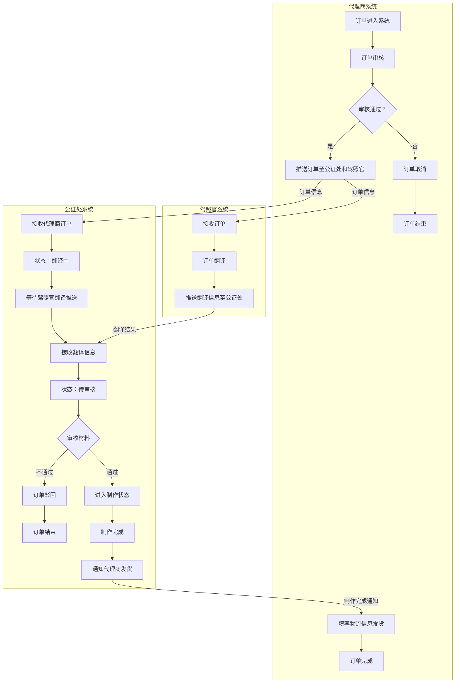

# 订单流程图

根据根目录文件 `哈` 整理。

## 流程说明

### 代理商系统

1. 订单进入系统。
2. 代理商审核订单。
3. 如果审核不通过，订单取消并结束。
4. 如果审核通过，代理商将订单同时推送给驾照官系统和公证处系统。
5. 公证处制作完成后，通知代理商填写物流信息并发货。
6. 发货后订单完成。

### 驾照官系统

1. 接收代理商推送的订单。
2. 完成订单翻译。
3. 将翻译结果推送给公证处系统。

### 公证处系统

1. 接收代理商订单，进入“翻译中”状态。
2. 等待驾照官系统推送翻译结果。
3. 接收翻译信息后，进入“待审核”状态。
4. 审核材料。
5. 如果审核不通过，订单驳回并结束。
6. 如果审核通过，进入制作状态。
7. 制作完成后，通知代理商发货。

## Mermaid 流程图

## 备注

如果当前 Markdown 预览器不支持 Mermaid，你也可以直接阅读上面的“流程说明”部分。
