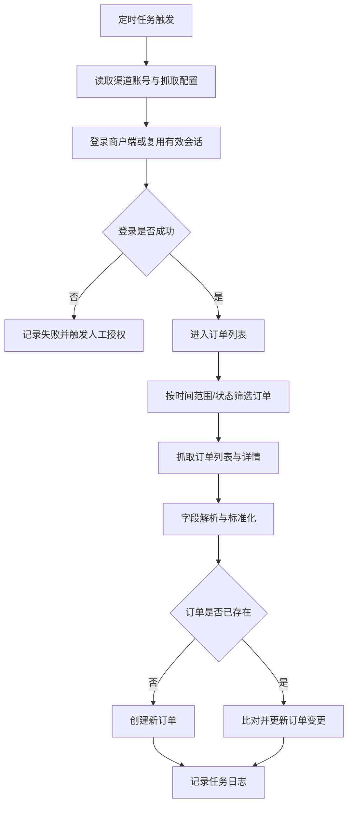
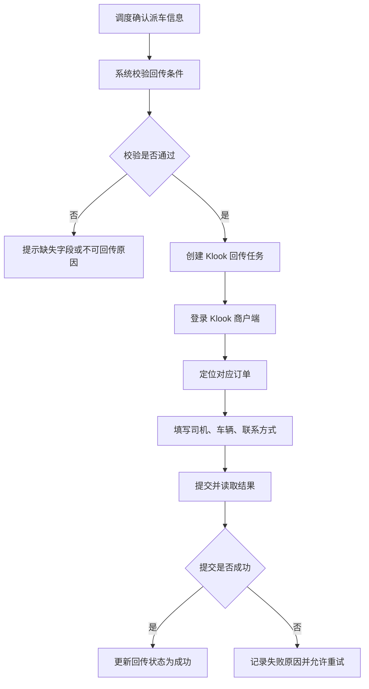

# 渠道订单同步与商户端自动化接入 PRD

> **模块**: FE 渠道订单同步与商户端自动化接入
> **版本**: v1.0
> **最后更新**: 2026-05-14
> **作者**: Codex

---

## 1. 背景与目标

### 1.1 业务背景

FE 系统承担多渠道订单的接入、订单运营和履约协同工作。当前渠道订单同步、商户端订单采集和履约信息回传仍有较多人工操作，尤其在高频同步、客路 Klook 包车/拼车/点对点订单派车信息回传，以及 Heycars、Dida Travel、Klook 三个商户端订单获取方面，存在入口较深、数据回传能力缺失、订单采集不及时等问题。

在未完成正式 API 对接前，业务希望通过页面操作优化和合规可控的浏览器自动化/爬虫能力，先建立过渡性的订单同步与履约闭环，降低运营重复录入成本，并提升渠道订单数据的一致性、及时性和可追踪性。

### 1.2 问题陈述

当前主要问题如下：

- 订单管理列表中的“同步渠道”属于高频操作，但入口收纳在“批量操作”下拉菜单内，运营人员需要额外点击才能触达。
- Klook 包车、拼车、点对点订单在我方系统完成司机、车辆和联系方式分配后，无法自动回传至 Klook 商户端，仍依赖人工二次录入。
- Heycars、Dida Travel、Klook 三个商户端尚未建立 API 接入能力，订单信息分散在各商户后台，新增订单、订单变更和状态更新无法自动进入我方系统。
- 多平台手工查看和录入容易造成漏单、重复录入、数据延迟和系统间信息不一致。

### 1.3 建设目标

| # | 目标                   | 描述                                                                 |
| - | ---------------------- | -------------------------------------------------------------------- |
| 1 | 提升高频同步效率       | 将“同步渠道”调整为订单管理列表工具栏的独立显性按钮，缩短操作路径   |
| 2 | 补齐 Klook 回传闭环    | 支持将我方已确认的司机、车辆和联系方式自动回传至 Klook 商户端        |
| 3 | 建立商户端订单采集能力 | 通过浏览器自动化/爬虫定时抓取 Heycars、Dida Travel、Klook 商户端订单 |
| 4 | 统一渠道订单入库       | 将抓取到的订单标准化后写入 FE 系统，支持后续运营、调度、客服和统计   |
| 5 | 建立可观测与可追溯机制 | 对同步、抓取、回传任务记录状态、日志、失败原因和重试记录             |

### 1.4 非目标

- 本期不替代未来正式 API 对接；爬虫/浏览器自动化作为过渡方案。
- 本期不重构订单核心模型，只新增必要的渠道同步、抓取、回传字段和日志。
- 本期不建设完整 RPA 平台，只实现指定商户端的固定流程自动化。
- 本期不自动处理渠道账号开通、验证码人工授权、合同变更和平台规则变更。
- 本期不覆盖 Heycars、Dida Travel 的履约信息回传，仅覆盖订单抓取；Klook 同时覆盖订单抓取和指定品类派车信息回传。

---

## 2. 需求范围

### 2.1 需求清单

| 编号   | 需求                       | 优先级 | 说明                                                              |
| ------ | -------------------------- | ------ | ----------------------------------------------------------------- |
| RQ-001 | “同步渠道”显性按钮       | P0     | 从批量操作菜单中提取，展示在订单管理列表工具栏                    |
| RQ-002 | Klook 派车信息回传         | P0     | 将包车、拼车、点对点订单的司机、车辆、联系方式回传至 Klook 商户端 |
| RQ-003 | Klook 商户端订单抓取       | P0     | 从 `https://merchant.klook.com/zh-CN/booking` 抓取订单信息      |
| RQ-004 | Dida Travel 商户端订单抓取 | P0     | 从 `https://tna-supplier-int.didatravel.com/order` 抓取订单信息 |
| RQ-005 | Heycars 商户端订单抓取     | P0     | 从 `https://sp.heycars.travel/login` 抓取订单信息               |
| RQ-006 | 抓取任务监控与日志         | P0     | 支持查看任务状态、成功数、失败数、失败原因、最近执行时间          |
| RQ-007 | 失败重试与人工兜底         | P1     | 支持失败任务重试；连续失败后转人工处理                            |

### 2.2 适用渠道与订单类型

| 渠道        | 商户端地址                                        | 本期能力               | 订单类型范围                                         |
| ----------- | ------------------------------------------------- | ---------------------- | ---------------------------------------------------- |
| Heycars     | `https://sp.heycars.travel/login`               | 订单抓取               | 平台商户端可见的订单，字段以页面可读信息为准         |
| Dida Travel | `https://tna-supplier-int.didatravel.com/order` | 订单抓取               | 平台商户端可见的订单，字段以页面可读信息为准         |
| Klook       | `https://merchant.klook.com/zh-CN/booking`      | 订单抓取、派车信息回传 | 抓取覆盖商户端订单；回传仅覆盖包车、拼车、点对点订单 |

---

## 3. 用户角色与用户故事

### 3.1 用户角色

| 角色         | 说明                                             |
| ------------ | ------------------------------------------------ |
| 订单运营人员 | 日常处理渠道订单、触发同步、查看同步结果         |
| 调度人员     | 为包车、拼车、点对点订单分配司机、车辆和联系方式 |
| 渠道运营人员 | 维护渠道账号授权、关注渠道订单采集质量和同步异常 |
| 客服人员     | 基于系统内订单和履约信息响应客户咨询             |
| 系统管理员   | 配置同步任务、账号权限、任务频率和异常告警       |

### 3.2 User Stories

#### US-1: 显性触发同步渠道

> **作为** 订单运营人员
> **我希望** 在订单管理列表中直接看到“同步渠道”按钮
> **以便于** 快速执行高频渠道同步操作，减少重复点击

**验收标准**:

- 订单管理列表工具栏展示独立的“同步渠道”按钮。
- 按钮不再仅隐藏在“批量操作”下拉菜单内。
- 用户点击后可按当前筛选条件或选中订单触发同步。
- 同步触发后展示明确的执行中、成功、失败反馈。

#### US-2: 自动回传 Klook 派车信息

> **作为** 调度人员
> **我希望** 在我方系统确认司机和车辆后，系统能自动将信息回传到 Klook 商户端
> **以便于** 避免手工二次录入，并保证双方履约信息一致

**验收标准**:

- 包车、拼车、点对点订单完成派车确认后，可触发 Klook 回传任务。
- 回传信息至少包含司机姓名、司机手机号、车辆信息、车牌号和服务联系信息。
- 回传成功后记录回传时间、回传人或触发来源、渠道回执状态。
- 改派、换车或联系方式调整后支持再次回传，并保留历史记录。
- 回传失败时展示失败原因，支持人工重试或标记人工处理。

#### US-3: 自动抓取三方商户端订单

> **作为** 渠道运营人员
> **我希望** 系统能定时抓取 Heycars、Dida Travel、Klook 商户端订单
> **以便于** 新增订单和订单变更能及时进入我方系统

**验收标准**:

- 系统可按渠道配置抓取账号、抓取频率和启停状态。
- 抓取任务能识别新增订单、已存在订单和订单变更。
- 抓取到的订单经标准化后进入我方订单池。
- 抓取失败时记录失败渠道、失败步骤、失败原因和截图/页面快照。

#### US-4: 监控同步任务状态

> **作为** 系统管理员
> **我希望** 能查看同步、抓取、回传任务的执行状态
> **以便于** 及时发现失败任务并安排重试或人工介入

**验收标准**:

- 支持按渠道、任务类型、状态、时间范围筛选任务日志。
- 每条日志展示任务类型、渠道、触发方式、开始时间、结束时间、成功数、失败数和失败原因。
- 连续失败达到阈值时生成异常标记或告警。

---

## 4. 功能设计

### 4.1 订单管理列表“同步渠道”按钮

#### 4.1.1 展示规则

| 项       | 规则                                                 |
| -------- | ---------------------------------------------------- |
| 展示位置 | 订单管理列表顶部工具栏，与“导出”“批量操作”等同级 |
| 按钮名称 | 同步渠道                                             |
| 权限控制 | 仅具备渠道同步权限的角色可见                         |
| 可用状态 | 至少存在可同步渠道，且用户具备对应权限时可用         |
| 禁用状态 | 无渠道权限、任务正在执行、当前筛选无可同步数据时禁用 |

#### 4.1.2 交互规则

1. 用户在订单管理列表点击“同步渠道”。
2. 若已选中订单，系统优先对选中订单所属渠道执行同步。
3. 若未选中订单，系统按当前筛选条件和用户权限范围触发渠道同步。
4. 系统展示确认弹窗，说明本次同步范围、渠道和预计影响。
5. 用户确认后创建同步任务。
6. 系统展示任务执行状态，并在完成后提示成功或失败结果。

#### 4.1.3 异常提示

| 场景         | 文案                                     |
| ------------ | ---------------------------------------- |
| 无权限       | 当前账号无渠道同步权限，请联系管理员开通 |
| 无可同步渠道 | 当前筛选范围内暂无可同步渠道订单         |
| 任务执行中   | 渠道同步任务正在执行，请稍后查看结果     |
| 同步失败     | 渠道同步失败，请查看任务日志或稍后重试   |

### 4.2 商户端订单抓取

#### 4.2.1 抓取方式

系统通过浏览器自动化或爬虫任务登录商户端，在账号授权和合规可控前提下抓取订单列表和订单详情。抓取流程应尽量模拟稳定、低频、可追踪的后台操作，避免对渠道平台造成异常访问压力。

#### 4.2.2 抓取流程

#### 4.2.3 抓取频率

| 阶段     | 建议频率         | 说明                         |
| -------- | ---------------- | ---------------------------- |
| 上线初期 | 每30分钟一次     | 便于观察稳定性和渠道风控限制 |
| 稳定运行 | 每10-15分钟一次  | 根据订单量和渠道限制调整     |
| 高峰期   | 支持临时手动同步 | 由具备权限的运营人员触发     |

### 4.3 Klook 派车信息回传

#### 4.3.1 触发条件

| 条件     | 规则                                                      |
| -------- | --------------------------------------------------------- |
| 渠道     | 订单来源为 Klook                                          |
| 订单类型 | 包车、拼车、点对点                                        |
| 派车状态 | 已确认司机和车辆                                          |
| 必填信息 | 司机姓名、司机手机号、车辆品牌/车型、车牌号、服务联系电话 |
| 订单状态 | 未取消、未完成、未关闭                                    |

#### 4.3.2 回传流程

#### 4.3.3 回传字段

| 字段          | 必填 | 来源              | 说明                          |
| ------------- | ---- | ----------------- | ----------------------------- |
| 渠道订单号    | 是   | 订单来源字段      | 用于定位 Klook 商户端订单     |
| 司机姓名      | 是   | 派车信息          | 回传给 Klook 展示给用户或渠道 |
| 司机手机号    | 是   | 派车信息          | 用于服务联系                  |
| 车辆品牌/车型 | 是   | 派车信息          | 如 Toyota Alphard、7座商务车  |
| 车牌号        | 是   | 派车信息          | 服务车辆识别                  |
| 服务联系电话  | 是   | 派车信息/客服配置 | 异常联系或履约联系            |
| 备注          | 否   | 调度备注          | 平台支持时回传                |

### 4.4 任务日志与监控

| 字段              | 类型     | 说明                                                                                             |
| ----------------- | -------- | ------------------------------------------------------------------------------------------------ |
| `task_id`       | String   | 任务唯一 ID                                                                                      |
| `task_type`     | Enum     | `channel_sync` / `order_crawl` / `fulfillment_pushback`                                    |
| `channel_code`  | Enum     | `heycars` / `dida_travel` / `klook`                                                        |
| `trigger_type`  | Enum     | `manual` / `scheduled` / `system_event`                                                    |
| `status`        | Enum     | `pending` / `running` / `success` / `partial_success` / `failed` / `manual_required` |
| `started_at`    | DateTime | 开始时间                                                                                         |
| `finished_at`   | DateTime | 结束时间                                                                                         |
| `success_count` | Number   | 成功数量                                                                                         |
| `failed_count`  | Number   | 失败数量                                                                                         |
| `error_code`    | String   | 失败编码                                                                                         |
| `error_message` | String   | 失败原因                                                                                         |
| `snapshot_url`  | String   | 失败截图或页面快照地址                                                                           |
| `operator_id`   | String   | 手动触发人                                                                                       |

---

## 5. 数据标准化

### 5.1 渠道订单基础字段

| 标准字段                | 来源                | 说明                                         |
| ----------------------- | ------------------- | -------------------------------------------- |
| `source_channel_code` | 抓取配置            | `heycars` / `dida_travel` / `klook`    |
| `source_channel_name` | 抓取配置            | Heycars / Dida Travel / Klook                |
| `channel_order_no`    | 商户端订单号        | 渠道侧订单唯一标识                           |
| `order_status`        | 商户端订单状态      | 需映射为我方订单状态                         |
| `product_type`        | 商户端商品/服务类型 | 包车、拼车、点对点、接送机等                 |
| `customer_name`       | 商户端订单详情      | 客户姓名                                     |
| `customer_phone`      | 商户端订单详情      | 客户联系方式                                 |
| `service_time`        | 商户端订单详情      | 服务时间                                     |
| `pickup_location`     | 商户端订单详情      | 上车/接送地点                                |
| `dropoff_location`    | 商户端订单详情      | 下车/送达地点                                |
| `passenger_count`     | 商户端订单详情      | 乘客数量                                     |
| `luggage_count`       | 商户端订单详情      | 行李数量                                     |
| `price_snapshot`      | 商户端订单详情      | 渠道价格、币种、结算信息，按页面可得信息采集 |
| `raw_payload`         | 抓取结果            | 原始抓取结构，用于排查和补字段               |
| `last_synced_at`      | 系统生成            | 最近同步时间                                 |

### 5.2 去重与更新规则

| 规则         | 说明                                             |
| ------------ | ------------------------------------------------ |
| 唯一键       | `source_channel_code + channel_order_no`       |
| 新订单       | 唯一键不存在时创建订单                           |
| 已存在订单   | 唯一键存在时进行字段比对                         |
| 状态变更     | 渠道状态变化时写入订单状态变更日志               |
| 关键字段变更 | 服务时间、地点、人数、联系方式变化时生成变更提醒 |
| 原始数据保留 | 每次抓取保留原始快照或差异记录，便于回溯         |

---

## 6. 业务规则

| 编号   | 规则名称       | 规则描述                                                       | 优先级 |
| ------ | -------------- | -------------------------------------------------------------- | ------ |
| BR-001 | 显性入口       | “同步渠道”必须作为订单管理列表工具栏独立按钮展示             | P0     |
| BR-002 | 权限控制       | 只有具备渠道同步权限的用户可触发同步、抓取或回传               | P0     |
| BR-003 | 合规授权       | 爬虫/浏览器自动化必须基于公司已授权的商户端账号执行            | P0     |
| BR-004 | 访问频控       | 抓取任务必须支持频率限制，避免异常高频访问渠道平台             | P0     |
| BR-005 | 唯一键去重     | 渠道订单必须按 `source_channel_code + channel_order_no` 去重 | P0     |
| BR-006 | 失败可追溯     | 所有失败任务必须记录渠道、步骤、原因和任务日志                 | P0     |
| BR-007 | Klook 回传范围 | 本期仅对 Klook 包车、拼车、点对点订单回传派车信息              | P0     |
| BR-008 | 回传前校验     | 派车信息缺失时不得触发回传，并提示缺失字段                     | P0     |
| BR-009 | 回传幂等       | 同一订单多次回传应保留历史记录，并以最近成功结果为当前状态     | P1     |
| BR-010 | 人工兜底       | 连续失败达到阈值时任务进入人工处理队列                         | P1     |

---

## 7. 权限与安全

### 7.1 权限点

| 权限点                     | 描述                     | 建议角色                   |
| -------------------------- | ------------------------ | -------------------------- |
| `channel.sync.trigger`   | 手动触发同步渠道         | 订单运营、渠道运营、管理员 |
| `channel.crawl.config`   | 配置抓取账号、频率和启停 | 渠道运营、管理员           |
| `channel.crawl.view_log` | 查看抓取任务日志         | 订单运营、渠道运营、管理员 |
| `klook.pushback.trigger` | 手动触发 Klook 回传      | 调度、渠道运营、管理员     |
| `klook.pushback.retry`   | 重试 Klook 回传失败任务  | 调度、渠道运营、管理员     |

### 7.2 安全要求

- 商户端账号、密码、Cookie、Token 等敏感凭证必须加密存储。
- 任务执行环境不得在日志中明文输出账号密码、验证码、Cookie、Token。
- 抓取和回传任务应记录操作审计，包括触发人、触发时间、执行结果和目标订单。
- 涉及客户手机号、地址、证件等敏感字段时，列表默认脱敏展示，按权限查看完整信息。
- 爬虫/浏览器自动化必须遵守渠道平台账号授权范围和平台规则，出现平台限制或合规风险时应支持快速停用。

---

## 8. 状态与异常处理

### 8.1 任务状态

| 状态                | 含义                 |
| ------------------- | -------------------- |
| `pending`         | 任务已创建，等待执行 |
| `running`         | 任务执行中           |
| `success`         | 任务全部成功         |
| `partial_success` | 部分成功，部分失败   |
| `failed`          | 任务失败             |
| `manual_required` | 需要人工处理         |

### 8.2 常见异常

| 异常               | 处理方式                                     |
| ------------------ | -------------------------------------------- |
| 登录失败           | 记录失败原因，提示检查账号密码或人工重新授权 |
| 验证码/二次验证    | 暂停任务，进入人工授权流程                   |
| 页面结构变化       | 记录解析失败截图，进入人工排查               |
| 商户端限流         | 降低任务频率，延迟重试                       |
| 订单定位失败       | 记录渠道订单号和搜索条件，支持人工复核       |
| Klook 回传提交失败 | 展示失败原因，支持重试或人工录入             |
| 字段缺失           | 标记订单待补充，阻断自动回传                 |

---

## 9. 埋点与监控

| 事件名                           | 触发时机             | 关键属性                                                                       |
| -------------------------------- | -------------------- | ------------------------------------------------------------------------------ |
| `channel_sync_button_click`    | 点击“同步渠道”按钮 | `user_id`, `filter_condition`, `selected_order_count`                    |
| `channel_sync_task_created`    | 创建同步任务         | `task_id`, `channel_code`, `trigger_type`                                |
| `merchant_order_crawl_result`  | 商户端抓取完成       | `task_id`, `channel_code`, `status`, `success_count`, `failed_count` |
| `klook_pushback_started`       | Klook 回传开始       | `task_id`, `order_id`, `channel_order_no`                                |
| `klook_pushback_result`        | Klook 回传结束       | `task_id`, `order_id`, `status`, `error_code`                          |
| `channel_task_manual_required` | 任务进入人工处理     | `task_id`, `channel_code`, `task_type`, `error_code`                   |

---

## 10. 验收标准

| 用例编号 | 场景                 | 前置条件                             | 操作                   | 预期结果                               |
| -------- | -------------------- | ------------------------------------ | ---------------------- | -------------------------------------- |
| TC-001   | 同步按钮展示         | 用户有渠道同步权限                   | 打开订单管理列表       | 工具栏展示“同步渠道”独立按钮         |
| TC-002   | 无权限隐藏/禁用      | 用户无渠道同步权限                   | 打开订单管理列表       | 不展示按钮或按钮禁用，并提示无权限     |
| TC-003   | 手动同步渠道         | 当前筛选存在可同步订单               | 点击“同步渠道”并确认 | 创建同步任务并展示执行状态             |
| TC-004   | Heycars 订单抓取     | Heycars 账号有效                     | 定时任务执行           | 新订单写入订单池，已存在订单更新差异   |
| TC-005   | Dida Travel 订单抓取 | Dida Travel 账号有效                 | 定时任务执行           | 新订单写入订单池，已存在订单更新差异   |
| TC-006   | Klook 订单抓取       | Klook 账号有效                       | 定时任务执行           | 新订单写入订单池，已存在订单更新差异   |
| TC-007   | Klook 派车回传成功   | Klook 包车/拼车/点对点订单已确认派车 | 触发回传               | 商户端信息更新，系统记录回传成功       |
| TC-008   | Klook 派车字段缺失   | 司机手机号或车牌号缺失               | 触发回传               | 系统阻断回传并提示缺失字段             |
| TC-009   | 回传失败重试         | Klook 回传失败                       | 点击重试               | 创建重试任务并保留历史失败记录         |
| TC-010   | 任务日志查询         | 存在任务执行记录                     | 按渠道和状态筛选       | 列表展示任务状态、数量、时间和失败原因 |
| TC-011   | 连续失败人工兜底     | 同一渠道连续失败达到阈值             | 系统自动处理           | 任务状态变为 `manual_required`       |

---

## 11. 风险与待确认

| 风险/待确认项      | 说明                                                 | 建议处理                                                 |
| ------------------ | ---------------------------------------------------- | -------------------------------------------------------- |
| 商户端页面变化     | 页面结构、按钮位置、字段名称变化会导致抓取或回传失败 | 为每个渠道建立页面快照、失败截图和快速修复流程           |
| 账号安全与二次验证 | 商户端可能触发验证码、MFA 或登录风控                 | 设计人工授权流程，并支持会话有效期监控                   |
| 渠道平台规则限制   | 部分平台可能限制自动化访问                           | 上线前由业务确认账号授权和平台规则，必要时降级为人工操作 |
| 订单字段不完整     | 商户端列表页和详情页字段可能不足                     | 保留原始数据快照，字段缺失时进入人工补充                 |
| Klook 回传字段映射 | Klook 商户端具体回传字段和页面位置需联调确认         | 上线前以真实账号验证字段和提交流程                       |
| 订单类型识别       | 包车、拼车、点对点的页面标识可能不统一               | 建立渠道产品名称到我方订单类型的映射表                   |
| 抓取频率           | 高频抓取可能触发平台限流或账号风控                   | 默认低频运行，按渠道配置频率和重试间隔                   |
| API 替代计划       | 爬虫方案长期维护成本高                               | 后续优先推进正式 API 对接，爬虫能力作为过渡方案          |

---

## 12. 后续迭代建议

1. 推进 Heycars、Dida Travel、Klook 正式 API 对接，逐步替代浏览器自动化。
2. 增加渠道字段映射配置后台，支持运营维护字段映射和状态映射。
3. 增加任务失败告警，支持企业微信、飞书或邮件通知。
4. 增加回传前差异预览，让调度人员确认本次将覆盖的司机和车辆信息。
5. 建立渠道 SLA 看板，统计抓取延迟、失败率、人工介入率和回传成功率。
