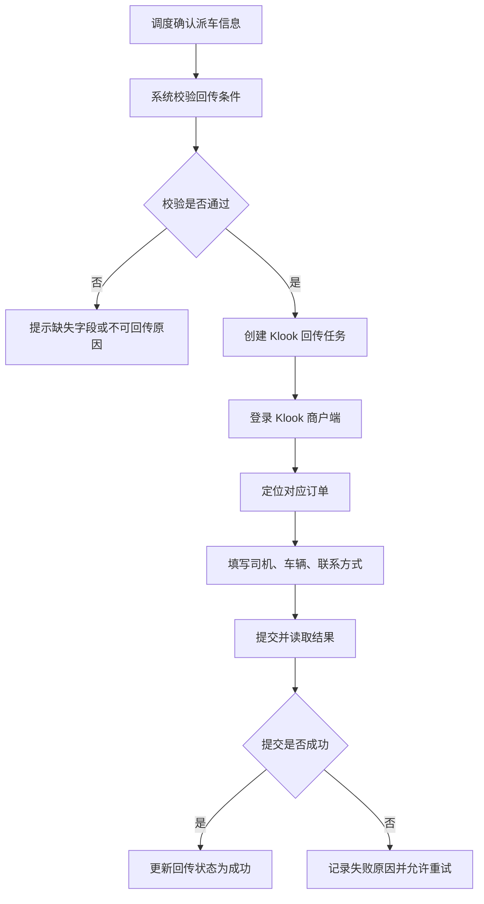

# Klook 订单信息回传_PRD

> **模块**: Klook 订单 信息回传
> **版本**: v1.0
> **最后更新**: 2026-05-18

---

## 1. 背景与目标

### 1.1 业务背景

Klook 包车、拼车、点对点订单在我方系统完成司机、车辆和服务联系方式分配后，需要同步到 Klook 商户端。当前该动作主要依赖人工二次录入，容易造成录入延迟、字段遗漏和两端履约信息不一致。

### 1.2 问题陈述

- 我方系统无法将派车信息无法自动回传至 Klook 商户端。
- 改派、换车、联系方式调整后，缺少可追溯的多次回传记录。
- 回传失败时缺少统一失败原因、截图和重试入口。

### 1.3 建设目标

| # | 目标         | 描述                                          |
| - | ------------ | --------------------------------------------- |
| 1 | 补齐履约闭环 | 将司机、车辆、联系方式自动回传至 Klook 商户端 |
| 2 | 降低人工录入 | 减少调度人员在 Klook 商户端重复录入           |
| 3 | 保留回传记录 | 记录回传时间、触发来源、结果和历史版本        |
| 4 | 支持失败重试 | 失败后记录原因，支持人工重试或标记人工处理--- |

## 2. 需求范围

### 2.1 需求清单

| 编号   | 需求               | 优先级 | 说明                                            |
| ------ | ------------------ | ------ | ----------------------------------------------- |
| RQ-001 | 回传条件校验       | P0     | 校验渠道、订单类型、订单状态和必填派车字段      |
| RQ-002 | 创建回传任务       | P0     | 满足条件后创建 Klook 派车信息回传任务           |
| RQ-003 | 商户端自动填写     | P0     | 登录 Klook 商户端并定位订单，填写司机和车辆信息 |
| RQ-004 | 回传结果记录       | P0     | 记录成功、失败、回执状态和执行日志              |
| RQ-005 | 改派重复回传       | P1     | 改派、换车或联系方式调整后允许再次回传          |
| RQ-006 | 失败重试与人工兜底 | P1     | 回传失败后支持重试，连续失败进入人工处理        |

### 2.2 适用渠道与订单类型

| 渠道  | 商户端地址                                   | 本期能力     | 订单类型范围           |
| ----- | -------------------------------------------- | ------------ | ---------------------- |
| Klook | `https://merchant.klook.com/zh-CN/booking` | 派车信息回传 | 包车、拼车、点对点订单 |

---

## 3. 用户角色与用户故事

### 3.1 用户角色

| 角色         | 说明                                 |
| ------------ | ------------------------------------ |
| 调度人员     | 为订单分配司机、车辆和联系方式       |
| 渠道运营人员 | 关注 Klook 回传成功率和异常          |
| 客服人员     | 基于系统内订单和履约信息响应客户咨询 |
| 系统管理员   | 配置账号权限、任务频率和异常告警     |

### 3.2 User Story

#### US-1: 自动回传 Klook 派车信息

> **作为** 调度人员
> **我希望** 在我方系统确认司机和车辆后，系统能自动将信息回传到 Klook 商户端
> **以便于** 避免手工二次录入，并保证双方履约信息一致

**验收标准**:

- 包车、拼车、点对点订单完成派车确认后，可触发 Klook 回传任务。
- 回传信息至少包含司机姓名、司机手机号、车辆信息、车牌号和服务联系信息。
- 回传成功后记录回传时间、触发来源、渠道回执状态。
- 改派、换车或联系方式调整后支持再次回传，并保留历史记录。
- 回传失败时展示失败原因，支持人工重试或标记人工处理。

---

## 4. 功能设计

### 4.1 触发条件

| 条件     | 规则                                                      |
| -------- | --------------------------------------------------------- |
| 渠道     | 订单来源为 Klook                                          |
| 订单类型 | 包车、拼车、点对点                                        |
| 派车状态 | 已确认司机和车辆                                          |
| 必填信息 | 司机姓名、司机手机号、车辆品牌/车型、车牌号、服务联系电话 |
| 订单状态 | 未取消、未完成、未关闭                                    |

### 4.2 回传流程

### 4.3 回传字段

| 字段          | 必填 | 来源              | 说明                          |
| ------------- | ---- | ----------------- | ----------------------------- |
| 渠道订单号    | 是   | 订单来源字段      | 用于定位 Klook 商户端订单     |
| 司机姓名      | 是   | 派车信息          | 回传给 Klook 展示给用户或渠道 |
| 司机手机号    | 是   | 派车信息          | 用于服务联系                  |
| 车辆品牌/车型 | 是   | 派车信息          | 如 Toyota Alphard、7座商务车  |
| 车牌号        | 是   | 派车信息          | 服务车辆识别                  |
| 服务联系电话  | 是   | 派车信息/客服配置 | 异常联系或履约联系            |
| 备注          | 否   | 调度备注          | 平台支持时回传                |

### 4.4 回传状态

| 状态                | 含义                 |
| ------------------- | -------------------- |
| `pending`         | 任务已创建，等待执行 |
| `running`         | 回传执行中           |
| `success`         | 回传成功             |
| `failed`          | 回传失败             |
| `manual_required` | 需要人工处理         |

---

## 5. 数据与日志

### 5.1 回传记录字段

| 字段                 | 类型     | 说明                          |
| -------------------- | -------- | ----------------------------- |
| `pushback_id`      | String   | 回传记录唯一 ID               |
| `order_id`         | String   | 我方订单号                    |
| `channel_order_no` | String   | Klook 渠道订单号              |
| `driver_name`      | String   | 司机姓名快照                  |
| `driver_phone`     | String   | 司机手机号快照                |
| `vehicle_model`    | String   | 车辆品牌/车型快照             |
| `plate_number`     | String   | 车牌号快照                    |
| `service_phone`    | String   | 服务联系电话快照              |
| `status`           | Enum     | 回传状态                      |
| `trigger_type`     | Enum     | `manual` / `system_event` |
| `operator_id`      | String   | 触发人                        |
| `started_at`       | DateTime | 开始时间                      |
| `finished_at`      | DateTime | 结束时间                      |
| `error_message`    | String   | 失败原因                      |
| `snapshot_url`     | String   | 失败截图或页面快照            |

### 5.2 幂等与历史

| 规则     | 说明                                       |
| -------- | ------------------------------------------ |
| 多次回传 | 同一订单允许多次回传，每次保留独立记录     |
| 当前状态 | 以最近一次成功回传为当前渠道履约状态       |
| 失败保留 | 失败记录不得覆盖最近一次成功记录           |
| 改派场景 | 改派、换车、联系方式调整后创建新的回传记录 |

---

## 6. 业务规则

| 编号   | 规则名称   | 规则描述                                                 | 优先级 |
| ------ | ---------- | -------------------------------------------------------- | ------ |
| BR-001 | 回传范围   | 本期仅对 Klook 包车、拼车、点对点订单回传派车信息        | P0     |
| BR-002 | 回传前校验 | 派车信息缺失时不得触发回传，并提示缺失字段               | P0     |
| BR-003 | 权限控制   | 只有具备 Klook 回传权限的用户可触发或重试                | P0     |
| BR-004 | 回传幂等   | 同一订单多次回传应保留历史记录，以最近成功结果为当前状态 | P1     |
| BR-005 | 人工兜底   | 连续失败达到阈值时任务进入人工处理队列                   | P1     |

---

## 7. 权限与安全

### 7.1 权限点

| 权限点                      | 描述                    | 建议角色               |
| --------------------------- | ----------------------- | ---------------------- |
| `klook.pushback.trigger`  | 手动触发 Klook 回传     | 调度、渠道运营、管理员 |
| `klook.pushback.retry`    | 重试 Klook 回传失败任务 | 调度、渠道运营、管理员 |
| `klook.pushback.view_log` | 查看 Klook 回传日志     | 调度、渠道运营、管理员 |

### 7.2 安全要求

- Klook 商户端账号、密码、Cookie、Token 等敏感凭证必须加密存储。
- 任务日志不得明文输出账号密码、验证码、Cookie、Token。
- 回传任务应记录操作审计，包括触发人、触发时间、执行结果和目标订单。
- 涉及客户手机号、地址等敏感字段时，列表默认脱敏展示，按权限查看完整信息。

---

## 8. 异常处理

| 异常            | 处理方式                                     |
| --------------- | -------------------------------------------- |
| 登录失败        | 记录失败原因，提示检查账号密码或人工重新授权 |
| 验证码/二次验证 | 暂停任务，进入人工授权流程                   |
| 页面结构变化    | 记录解析失败截图，进入人工排查               |
| 订单定位失败    | 记录渠道订单号和搜索条件，支持人工复核       |
| 回传提交失败    | 展示失败原因，支持重试或人工录入             |
| 字段缺失        | 标记订单待补充，阻断自动回传                 |

---

## 9. 埋点与监控

| 事件名                             | 触发时机         | 关键属性                                              |
| ---------------------------------- | ---------------- | ----------------------------------------------------- |
| `klook_pushback_started`         | Klook 回传开始   | `task_id`, `order_id`, `channel_order_no`       |
| `klook_pushback_result`          | Klook 回传结束   | `task_id`, `order_id`, `status`, `error_code` |
| `klook_pushback_retry_click`     | 点击回传重试     | `order_id`, `last_task_id`, `operator_id`       |
| `klook_pushback_manual_required` | 任务进入人工处理 | `task_id`, `order_id`, `error_code`             |

---

## 10. 验收标准

| 用例编号 | 场景         | 前置条件                 | 操作           | 预期结果                                   |
| -------- | ------------ | ------------------------ | -------------- | ------------------------------------------ |
| TC-001   | 回传入口展示 | Klook 目标订单已确认派车 | 查看订单操作区 | 展示回传或自动触发回传能力                 |
| TC-002   | 回传成功     | 必填派车字段完整         | 触发回传       | Klook 商户端信息更新，系统记录回传成功     |
| TC-003   | 字段缺失阻断 | 司机手机号或车牌号缺失   | 触发回传       | 系统阻断回传并提示缺失字段                 |
| TC-004   | 回传失败重试 | Klook 回传失败           | 点击重试       | 创建重试任务并保留历史失败记录             |
| TC-005   | 改派再次回传 | 订单完成改派             | 再次触发回传   | 新增一条回传记录，最近成功记录成为当前状态 |
| TC-006   | 人工兜底     | 连续失败达到阈值         | 系统自动处理   | 任务状态变为 `manual_required`           |

---

## 11. 风险与待确认

| 风险/待确认项      | 说明                                           | 建议处理                               |
| ------------------ | ---------------------------------------------- | -------------------------------------- |
| Klook 页面变化     | 页面结构、按钮位置、字段名称变化会导致回传失败 | 建立页面快照、失败截图和快速修复流程   |
| 账号安全与二次验证 | 商户端可能触发验证码、MFA 或登录风控           | 设计人工授权流程，并支持会话有效期监控 |
| 回传字段映射       | Klook 商户端具体字段和页面位置需联调确认       | 上线前以真实账号验证字段和提交流程     |
| 订单类型识别       | 包车、拼车、点对点的页面标识可能不统一         | 建立渠道产品名称到我方订单类型的映射表 |
