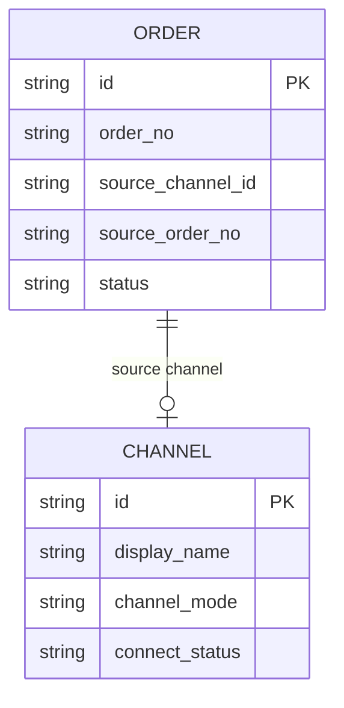
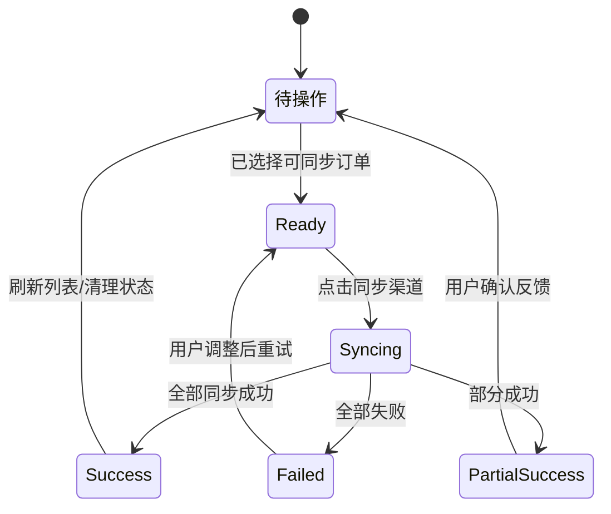
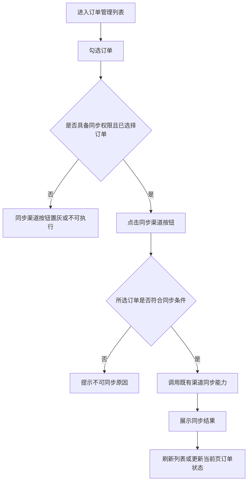

# 同步渠道 显性按钮 _PRD

> **模块**: 订单管理 / 订单列表工具栏
> **版本**: v1.0
> **最后更新**: 2026-05-19

---

## 更新日志

- **v1.0 **: 将“同步渠道”从“批量操作”下拉菜单提取为订单管理列表工具栏独立按钮的产品需求、交互规则与验收标准。

---

## 1. 背景与目标

### 1.1 业务背景

订单运营人员在订单管理列表中需要频繁处理来自渠道的订单。为了获取渠道侧最新订单信息、同步订单状态、减少本地订单与渠道订单之间的信息差，运营人员会在日常工作中高频使用“同步渠道”能力。

当前“批量同步渠道”入口被收纳在“批量操作”下拉菜单中。运营人员必须先点击“批量操作”，再在下拉菜单中查找并点击“同步渠道”，才能触发同步动作。该路径适合低频批量能力，但不适合高频运营动作。

### 1.2 问题陈述

“同步渠道”属于订单运营高频动作，但当前入口层级较深，存在以下问题：

- 操作路径长：每次同步至少需要多一次展开下拉菜单的点击。
- 可发现性弱：新用户或低频用户不容易意识到“同步渠道”藏在批量操作内。
- 效率损耗明显：订单运营日常会重复执行同步操作，额外点击会累积成时间成本。
- 体验不符合重要性：高频关键功能没有在工具栏中显性展示，影响订单处理效率。

---

## 2. 现状洞察（AS-IS）

当前订单管理列表顶部工具栏中，“同步渠道”归属于“批量操作”下拉菜单。用户需要先选择订单，再通过下拉菜单触发批量同步。

| 痛点                       | 描述                                                                         |
| -------------------------- | ---------------------------------------------------------------------------- |
| **入口层级深**       | “同步渠道”隐藏在“批量操作”下拉列表中，用户需要先打开菜单才能看到该功能。 |
| **高频动作不显性**   | 该能力被客户反馈为日常高频功能，但视觉优先级与低频批量操作相同。             |
| **重复点击成本高**   | 运营人员在同一天多次同步订单时，每次都要重复“打开菜单 -> 点击同步”的路径。 |
| **功能可发现性不足** | 新接手订单运营的用户不容易第一时间找到同步入口。                             |

---

## 3. 目标（TO-BE）与非目标

### 3.1 目标

| # | 目标                       | 描述                                                                       |
| - | -------------------------- | -------------------------------------------------------------------------- |
| 1 | **缩短操作路径**     | 将“同步渠道”展示为订单管理列表工具栏中的独立按钮，使用户可直接触发同步。 |
| 2 | **提升可发现性**     | 高频功能在列表主操作区显性展示，降低用户查找成本。                         |
| 3 | **保持原有能力一致** | 新按钮复用原“批量同步渠道”的权限、同步逻辑、结果反馈和异常处理。         |
| 4 | **降低误操作风险**   | 按钮状态需根据勾选订单、订单来源和权限进行可用性控制。                     |

### 3.2 非目标（本期不做）

- **不调整渠道同步接口逻辑**: 本期仅调整入口展示与交互，不改同步 API、同步策略、队列机制或渠道适配逻辑。
- **不新增订单字段或渠道字段**: 不新增数据库字段，不变更订单主数据结构。
- **不重构批量操作体系**: 除“同步渠道”入口提取外，不调整其他批量操作的菜单结构。
- **不新增自动同步能力**: 本期不做定时同步、页面加载自动同步或轮询同步。

### 3.3 User Stories

#### US-1: 订单运营人员直接触发同步渠道

> **作为** 负责渠道订单处理与日常同步操作的订单运营人员
> **我希望** 在订单管理列表工具栏中直接看到并点击“同步渠道”按钮
> **以便于** 快速获取渠道订单最新信息或更新订单状态，减少重复点击成本

**验收标准**:

- 订单管理列表工具栏中展示独立的“同步渠道”按钮。
- 用户勾选符合条件的渠道订单后，可直接点击该按钮触发同步。
- 同步动作的业务结果与原“批量操作”下拉菜单中的“批量同步渠道”保持一致。
- 原下拉菜单中不再重复展示“同步渠道”，避免同一功能存在两个批量入口。

#### US-2: 无权限或未选择订单时避免误触

> **作为** 订单运营人员
> **我希望** 在当前无法同步时清楚看到按钮状态
> **以便于** 理解需要先选择订单或切换到可操作订单后再执行同步

**验收标准**:

- 未选择订单时，“同步渠道”按钮置灰不可点击。
- 当前账号无同步权限时，不展示按钮或展示置灰状态，遵循既有权限体系。
- 已选择订单中存在不可同步订单时，系统需给出明确反馈，避免用户误以为所有订单都已同步成功。

---

## 4. 术语表（Terminology）

| 术语     | 英文          | 定义                                                                 |
| -------- | ------------- | -------------------------------------------------------------------- |
| 同步渠道 | Channel Sync  | 从渠道侧获取订单最新信息，并按既有规则更新本地订单数据或状态的操作。 |
| 渠道订单 | Channel Order | 来源于渠道实例的订单，通常包含外部渠道订单号或来源渠道信息。         |
| 批量操作 | Bulk Action   | 用户勾选一条或多条订单后，可对所选订单统一执行的操作集合。           |
| 工具栏   | Toolbar       | 订单管理列表上方承载筛选、导出、批量操作等高频入口的操作区域。       |

---

## 5. 角色与权限

| 角色         | 权限范围                               | 说明                                     |
| ------------ | -------------------------------------- | ---------------------------------------- |
| 订单运营人员 | 查看订单列表、勾选订单、执行渠道同步   | 本需求的核心使用者。                     |
| 订单管理员   | 具备订单运营权限，并可处理异常同步结果 | 可用于处理同步失败、渠道异常等后续问题。 |
| 只读用户     | 仅查看订单列表                         | 不允许执行“同步渠道”。                 |

**权限规则**:

- “同步渠道”按钮遵循现有“批量同步渠道”的权限控制。
- 无同步权限用户不可执行同步动作。
- 如系统当前采用权限点控制，建议沿用原权限点，例如 `order.channel.sync`。
- 权限不足时，前端不得仅依赖隐藏按钮，后端仍需按原规则校验操作权限。

---

## 6. 数据模型（业务/交互视角）

### 6.1 实体关系图（ER Diagram）

本期不新增业务实体，不变更订单、渠道、同步记录等底层存储结构。同步动作继续基于既有订单与渠道关系执行。



### 6.2 Logical View（逻辑视图，UI 设计基准）

> [!IMPORTANT]
> 本章仅定义页面交互模型，不新增数据库字段。前端页面应基于以下逻辑视图决定按钮展示、可用状态和同步反馈。

```typescript
interface OrderManagementListToolbarView {
  selectedOrderIds: string[];
  selectedOrders: OrderListItemView[];
  currentUserPermission: {
    canSyncChannel: boolean;
  };
  actions: {
    syncChannel(orderIds: string[]): Promise<ChannelSyncResult>;
  };
  uiState: {
    showSyncChannelButton: boolean;
    syncChannelButtonDisabled: boolean;
    syncChannelButtonLabel: '同步渠道';
    syncChannelButtonTooltip?: string;
  };
}

interface OrderListItemView {
  id: string;
  orderNo: string;
  sourceChannelId?: string;
  sourceChannelName?: string;
  sourceOrderNo?: string;
  isChannelOrder: boolean;
  canSyncChannel: boolean;
  syncDisabledReason?: string;
}

interface ChannelSyncResult {
  totalCount: number;
  successCount: number;
  failedCount: number;
  skippedCount: number;
  failedItems?: {
    orderId: string;
    orderNo: string;
    reason: string;
  }[];
}
```

#### 6.2.1 计算字段与虚字段

| 数据库存储                                 | 逻辑视图字段                             | Spec 写法                                    | AI 行为                        |
| ------------------------------------------ | ---------------------------------------- | -------------------------------------------- | ------------------------------ |
| `source_channel_id` / `source_channel` | `isChannelOrder`                       | `true` if order has valid source channel   | 用于判断订单是否属于渠道订单。 |
| 既有权限点                                 | `currentUserPermission.canSyncChannel` | Mapped from auth policy                      | 用于控制按钮展示或置灰。       |
| 订单状态、渠道连接状态、来源渠道           | `canSyncChannel`                       | Derived from existing sync eligibility rules | 用于判断单条订单是否允许同步。 |
| 不落库                                     | `syncChannelButtonDisabled`            | Derived from selection and permission        | 用于控制按钮可用状态。         |

---

## 7. 业务规则与验证

### 7.1 核心业务规则

| 规则编号 | 规则名称         | 规则描述                                                                     |
| -------- | ---------------- | ---------------------------------------------------------------------------- |
| BR-001   | 按钮显性展示     | 在订单管理列表工具栏中新增独立“同步渠道”按钮。                             |
| BR-002   | 原能力复用       | 新按钮触发的同步逻辑、请求参数、权限校验、结果处理与原“批量同步渠道”一致。 |
| BR-003   | 菜单入口去重     | “同步渠道”从“批量操作”下拉菜单中移出，避免重复入口造成理解混乱。         |
| BR-004   | 选择后可用       | 用户至少选择 1 条订单，且具备同步权限时，按钮才可执行。                      |
| BR-005   | 不可同步订单反馈 | 所选订单存在不可同步项时，需按既有规则阻断或跳过，并反馈原因。               |
| BR-006   | 操作结果可见     | 同步完成后需展示成功、失败、跳过数量；失败时提供可理解的失败原因。           |

### 7.2 数据验证规则

本期不新增或修改存储字段。以下为交互参数验证：

| 字段（含变更标识）     | 验证规则                   | 错误提示                                   |
| ---------------------- | -------------------------- | ------------------------------------------ |
| [MOD] selectedOrderIds | 必须至少包含 1 个订单 ID   | 请先选择需要同步的订单                     |
| [MOD] canSyncChannel   | 当前用户必须具备同步权限   | 当前账号暂无同步渠道权限                   |
| [MOD] selectedOrders   | 所选订单需符合渠道同步条件 | 所选订单中存在不可同步的订单，请调整后重试 |

### 7.3 状态机（如适用）

本需求不变更订单主状态机。同步动作可能按既有同步逻辑更新订单状态，但状态转换仍由订单域原有规则裁决。



**状态转换规则**:

| 当前状态         | 目标状态         | 触发条件                         | 操作权限     |
| ---------------- | ---------------- | -------------------------------- | ------------ |
| 待操作           | 已选择可同步订单 | 用户勾选至少 1 条符合条件订单    | 订单同步权限 |
| 已选择可同步订单 | 同步中           | 用户点击“同步渠道”             | 订单同步权限 |
| 同步中           | 全部成功         | 所选订单均同步成功               | 系统返回     |
| 同步中           | 部分成功         | 部分订单同步成功，部分失败或跳过 | 系统返回     |
| 同步中           | 全部失败         | 所有订单同步失败                 | 系统返回     |

---

## 8. 功能需求

### 8.1 订单管理列表工具栏“同步渠道”独立按钮

#### 8.1.1 功能描述

在订单管理列表工具栏中，将“同步渠道”作为独立显性按钮展示。用户勾选订单后，可直接点击该按钮执行渠道同步，无需再进入“批量操作”下拉菜单。

按钮基础要求：

- 按钮文案：`同步渠道`。
- 展示位置：订单管理列表工具栏中，与现有批量操作、导出、刷新等列表级操作保持同一视觉层级。
- 图标建议：使用与“同步/刷新”语义一致的图标。
- 点击后复用原“批量同步渠道”能力。
- 同步中按钮进入 loading 状态，避免重复提交。
- 同步完成后刷新列表数据或按既有策略更新当前页订单状态。

#### 8.1.2 筛选条件

本需求不新增筛选条件。

**筛选字段定义**:

| 筛选字段 | 类型 | 必填 | 默认值 | 取值来源 | 说明               |
| -------- | ---- | ---- | ------ | -------- | ------------------ |
| 无       | -    | -    | -      | -        | 本期不调整筛选区。 |

**筛选逻辑**:

- 原有订单列表筛选逻辑保持不变。
- “同步渠道”按钮应作用于当前已勾选订单，而不是当前筛选结果的全部订单。

#### 8.1.3 列表字段定义

本需求不新增列表展示字段。

**列表展示字段**:

| 字段名（含变更标识） | 类型 | 数据来源 | 说明                   | 示例 |
| -------------------- | ---- | -------- | ---------------------- | ---- |
| 无                   | -    | -        | 本期不新增订单列表字段 | -    |

**排序规则**:

- 原订单列表排序规则保持不变。

**分页规则**:

- 原订单列表分页规则保持不变。
- 跨页选择是否支持，沿用当前订单列表既有选择规则。

#### 8.1.4 表单字段定义

本需求不涉及表单字段。

**字段行为矩阵 (Field Behavior Matrix)**:

| 字段（含变更标识） | 创建模式 | 编辑模式 | 查看模式 | 依赖/逻辑说明    |
| :----------------- | :------- | :------- | :------- | :--------------- |
| 无                 | -        | -        | -        | 本期不涉及表单。 |

#### 8.1.5 业务流程



**流程说明**:

1. 用户进入订单管理列表。
2. 用户勾选一条或多条订单。
3. 系统根据权限、选择状态和订单可同步条件计算按钮状态。
4. 用户点击工具栏中的“同步渠道”按钮。
5. 系统执行既有渠道同步逻辑。
6. 系统展示成功、失败、跳过数量，并刷新列表数据。

#### 8.1.6 边界场景处理

| 场景                       | 处理方式                                                                       |
| -------------------------- | ------------------------------------------------------------------------------ |
| 未选择订单                 | “同步渠道”按钮置灰；如因实现限制仍可点击，则提示“请先选择需要同步的订单”。 |
| 无同步权限                 | 按既有权限策略隐藏或置灰按钮；后端继续拒绝未授权请求。                         |
| 所选订单包含非渠道订单     | 按既有能力规则处理；建议提示“所选订单中存在非渠道订单，无法同步”。           |
| 所选订单部分不可同步       | 支持跳过并展示跳过原因，或阻断并提示用户调整选择；最终以原同步能力规则为准。   |
| 同步接口处理中             | 按钮显示 loading，禁止重复点击。                                               |
| 同步全部失败               | 展示失败提示和失败原因，列表不应误展示为成功状态。                             |
| 同步部分成功               | 展示成功、失败、跳过数量，列表刷新后体现成功订单最新状态。                     |
| 下拉菜单仍存在“同步渠道” | 视为不符合需求；应移除重复入口。                                               |

---

## 9. 非功能需求

### 9.1 性能要求

| 指标         | 要求                                                     |
| ------------ | -------------------------------------------------------- |
| 按钮状态计算 | 选择订单后 100ms 内完成可用状态更新。                    |
| 同步请求响应 | 沿用既有同步接口性能要求；前端需在等待期间展示 loading。 |
| 列表刷新     | 同步完成后按既有列表刷新策略执行，不引入明显额外延迟。   |

### 9.2 安全要求

- 权限控制：沿用原“批量同步渠道”的权限点与后端鉴权。
- 防重复提交：同步中按钮不可重复点击；如后端已有幂等控制，应继续复用。
- 数据保护：同步结果中不展示渠道接口敏感信息、密钥、原始鉴权参数。

### 9.3 可用性要求

- 高频按钮需要在工具栏中稳定展示，用户无需打开下拉菜单即可发现。
- 按钮文案需清晰，不使用容易误解的简称。
- 同步结果反馈需可理解，避免只展示“操作完成”而不说明失败或跳过情况。

---

## 10. 测试策略

### 10.1 测试范围

- UI 测试：按钮展示位置、文案、图标、置灰、loading 状态。
- 权限测试：有权限、无权限角色下的按钮展示和后端拦截。
- 交互测试：未选择订单、选择单条订单、选择多条订单、重复点击。
- 业务测试：同步成功、同步失败、部分成功、不可同步订单。
- 回归测试：其他“批量操作”菜单项不受影响。

### 10.2 测试用例（关键场景）

| 用例编号 | 测试场景               | 前置条件                           | 操作步骤                   | 预期结果                                     |
| -------- | ---------------------- | ---------------------------------- | -------------------------- | -------------------------------------------- |
| TC-001   | 工具栏展示同步渠道按钮 | 用户有同步权限                     | 进入订单管理列表           | 工具栏展示“同步渠道”独立按钮。             |
| TC-002   | 未选择订单时按钮不可用 | 用户有同步权限，未勾选订单         | 查看工具栏按钮状态         | “同步渠道”按钮置灰不可点击。               |
| TC-003   | 选择订单后直接同步     | 用户有同步权限，存在可同步渠道订单 | 勾选订单，点击“同步渠道” | 系统触发同步并展示同步结果。                 |
| TC-004   | 同步中防重复提交       | 同步请求未完成                     | 连续点击“同步渠道”       | 第二次点击被阻止，仅提交一次同步请求。       |
| TC-005   | 无权限用户不可同步     | 用户无同步权限                     | 进入订单管理列表           | 按权限策略隐藏或置灰按钮；接口不可越权调用。 |
| TC-006   | 菜单入口去重           | 用户有同步权限                     | 打开“批量操作”下拉菜单   | 下拉菜单中不再展示“同步渠道”。             |
| TC-007   | 部分同步失败反馈       | 所选订单中部分同步失败             | 点击“同步渠道”           | 展示成功、失败、跳过数量及失败原因。         |

---

## 11. 验收标准（Acceptance Criteria）

### 11.1 功能验收

**场景1: 有权限用户在工具栏直接同步渠道**

```gherkin
Given 用户具备订单渠道同步权限
And 用户进入订单管理列表
And 用户已勾选至少 1 条可同步渠道订单
When 用户点击工具栏中的“同步渠道”按钮
Then 系统应触发既有渠道同步能力
And 同步完成后展示同步结果
And 订单列表应刷新或展示最新订单状态
```

**场景2: 未选择订单时不可执行同步**

```gherkin
Given 用户具备订单渠道同步权限
And 用户进入订单管理列表
And 用户未勾选任何订单
When 用户查看工具栏
Then “同步渠道”按钮应处于不可用状态
```

**场景3: 批量操作下拉菜单不再重复展示同步渠道**

```gherkin
Given 用户具备订单渠道同步权限
And 用户进入订单管理列表
When 用户打开“批量操作”下拉菜单
Then 菜单中不应再出现“同步渠道”入口
And 工具栏中应展示独立“同步渠道”按钮
```

**场景4: 无权限用户不可执行同步**

```gherkin
Given 用户不具备订单渠道同步权限
When 用户进入订单管理列表
Then 系统不应允许用户执行“同步渠道”
And 后端接口仍应拒绝未授权同步请求
```

### 11.2 数据契约验收

- [ ] 本期未新增存储字段，数据模型变更说明完整。
- [ ] 逻辑视图中用于按钮状态的字段来源已标注为 Stored / Derived / Mapped。
- [ ] 交互参数已使用 `[MOD]` 标识现有选择与权限逻辑调整。
- [ ] 不涉及 `[DEL]` 存储字段。

### 11.3 性能验收

- [ ] 勾选订单后按钮状态能即时响应。
- [ ] 同步中存在 loading 或禁用态，避免重复提交。
- [ ] 同步完成后的列表刷新不引入明显性能退化。

---

## 12. 实施计划

### 12.1 依赖关系

- 依赖既有“批量同步渠道”接口或前端 action。
- 依赖既有订单勾选状态。
- 依赖既有权限体系。
- 依赖订单列表工具栏布局可容纳新增按钮。

### 12.2 风险与缓解措施

| 风险                     | 影响 | 概率 | 缓解措施                                                                         |
| ------------------------ | ---- | ---- | -------------------------------------------------------------------------------- |
| 工具栏按钮过多导致拥挤   | 中   | 中   | 按现有工具栏规范调整按钮顺序；在小屏下可保留响应式折叠策略，但桌面端需显性展示。 |
| 新旧入口重复导致用户困惑 | 中   | 中   | 从“批量操作”下拉菜单移除“同步渠道”，仅保留独立按钮作为批量同步入口。         |
| 可同步条件不清晰         | 中   | 中   | 复用原同步逻辑，并在失败/跳过反馈中展示可理解原因。                              |
| 重复点击造成重复同步     | 中   | 低   | 同步中按钮 loading 并禁用，后端继续按既有幂等策略处理。                          |

---

## 13. 附录

### 13.1 字段文档术语对照表

| 中文       | 英文           | 说明                                   |
| ---------- | -------------- | -------------------------------------- |
| 同步渠道   | Channel Sync   | 获取渠道侧最新订单信息并更新本地订单。 |
| 工具栏按钮 | Toolbar Button | 列表顶部直接展示的操作入口。           |
| 置灰       | Disabled       | 用户当前不可点击或不可执行的控件状态。 |
| 加载中     | Loading        | 请求处理中，按钮暂时不可重复触发。     |
| 跳过       | Skipped        | 所选订单因不满足条件未执行同步。       |

### 13.2 技术附录：Storage Schema（可选，工程维护）

本期不新增数据库表，不新增字段，不调整索引。

#### 13.2.1 复用对象

| 对象                    | 说明                               |
| ----------------------- | ---------------------------------- |
| 订单列表勾选状态        | 用于确定同步目标订单集合。         |
| 既有渠道同步接口/action | 用于执行实际同步。                 |
| 既有权限点              | 用于控制按钮展示、置灰和后端鉴权。 |

### 13.3 Tracking Events（建议项）

> [!TIP]
> 本节用于提升行为可观测性，不作为功能上线阻断条件。

| 事件名                                | 触发时机                       | 关键属性                                                                                 |
| ------------------------------------- | ------------------------------ | ---------------------------------------------------------------------------------------- |
| `order_channel_sync_click`          | 用户点击工具栏“同步渠道”按钮 | `selected_count`, `user_role`, `page_name`                                         |
| `order_channel_sync_result`         | 同步请求完成                   | `total_count`, `success_count`, `failed_count`, `skipped_count`, `duration_ms` |
| `order_channel_sync_disabled_hover` | 用户悬停或尝试点击不可用按钮   | `reason`, `selected_count`, `user_role`                                            |

### 13.4 i18n 资源规范（建议项）

> [!TIP]
> 本节用于保证国际化扩展一致性，不作为功能上线阻断条件。

#### 13.4.1 Type 1-5 分类（建议）

| 类型   | 数据类型     | 处理策略           | 示例                             |
| ------ | ------------ | ------------------ | -------------------------------- |
| Type 1 | 系统预设数据 | 资源表翻译         | 按钮文案、提示文案、同步结果文案 |
| Type 2 | 纯业务数据   | 不翻译             | 订单号、渠道订单号               |
| Type 5 | 格式化数据   | 前端按 Locale 渲染 | 同步时间、耗时、数量             |

#### 13.4.2 资源键样例

| UI 文案                  | resource_key                                |
| ------------------------ | ------------------------------------------- |
| 同步渠道                 | `order.action.sync_channel`               |
| 请先选择需要同步的订单   | `order.sync_channel.error.no_selection`   |
| 当前账号暂无同步渠道权限 | `order.sync_channel.error.no_permission`  |
| 同步完成                 | `order.sync_channel.toast.completed`      |
| 部分订单同步失败         | `order.sync_channel.toast.partial_failed` |
