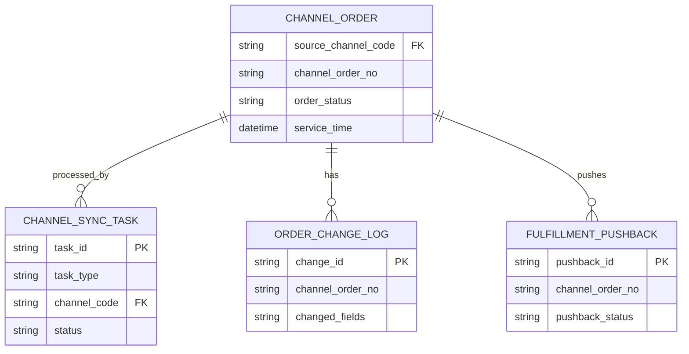
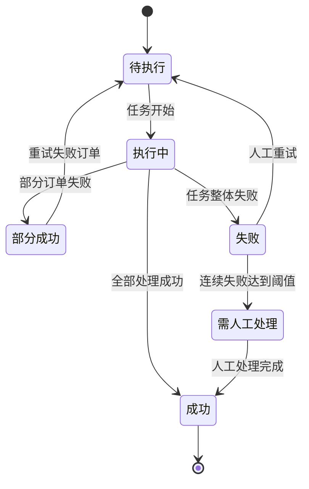
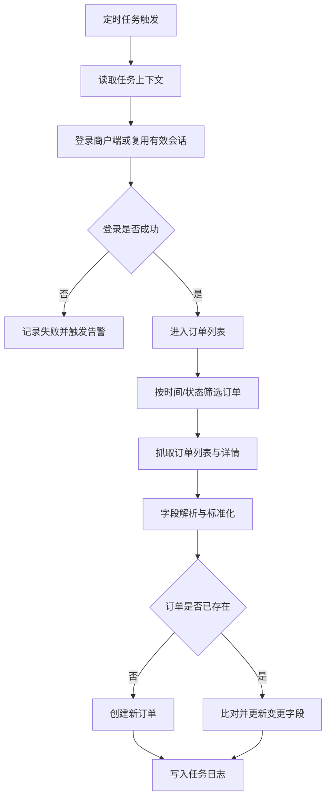
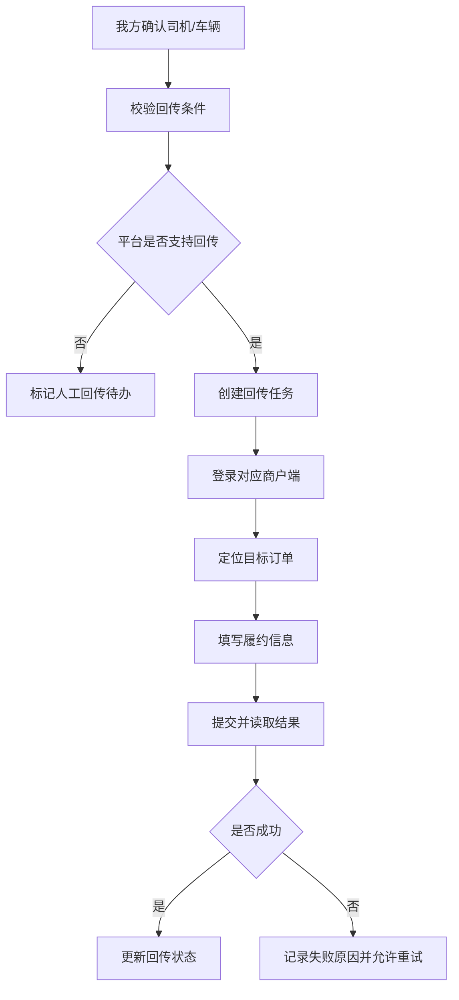

# 商户端订单爬取与履约回传

**版本**: v1.0
**最后更新**: 2026-05-20
**作者**: Codex

---

## 1. 背景与目标

### 1.1 业务背景

公司需要统一处理来自 Heycars、Dida Travel、Klook 三个商户端的订单，但当前尚未与三个渠道建立正式 API 对接能力。订单信息分散在多个商户后台，运营人员需要分别登录各平台查看、整理、录入和跟进，导致订单进入我方系统不及时，后续履约、客服、结算和经营分析都存在滞后。

在账号授权和合规可控的前提下，本需求希望通过浏览器自动化或爬虫方式，定时从三个商户端采集订单信息，并同步至我方系统，作为 API 对接完成前的过渡性接入方案。同时，在平台页面能力允许的情况下，通过浏览器自动化或爬虫方式将我方确认后的司机、车辆、履约信息回传至商户端，减少人工二次录入。

### 1.2 问题陈述

- 新增订单、订单变更和状态更新无法自动进入我方系统。
- 多平台手工查询和录入成本高，容易出现漏单、重复录入和数据滞后。
- 订单履约信息在我方系统确认后，无法稳定回写至商户端。
- 抓取或回传失败时缺少统一日志、截图、重试和人工兜底机制。

---

## 2. 现状洞察（AS-IS）

| 痛点                   | 描述                                                               |
| ---------------------- | ------------------------------------------------------------------ |
| **订单分散**     | Heycars、Dida Travel、Klook 订单分别存在各自商户端，缺少统一入口。 |
| **人工成本高**   | 运营人员需要定时登录多个后台查询、整理或录入订单。                 |
| **时效性不足**   | 新增订单和状态变化不能实时或准实时进入我方系统。                   |
| **数据不一致**   | 手工录入容易导致字段错误、状态不一致、重复订单。                   |
| **履约闭环缺失** | 司机、车辆、联系方式等履约信息无法自动同步回商户端。               |
| **异常不可追溯** | 登录失败、页面变化、字段缺失等问题缺少统一记录和处理流程。         |

---

## 3. 目标（TO-BE）与非目标

### 3.1 目标

| # | 目标                   | 描述                                                               |
| - | ---------------------- | ------------------------------------------------------------------ |
| 1 | **订单自动采集** | 定时抓取 Heycars、Dida Travel、Klook 商户端订单列表和详情。        |
| 2 | **订单统一入库** | 将抓取数据标准化后写入我方订单系统，支持新增、更新和去重。         |
| 3 | **状态增量同步** | 识别订单状态、服务时间、地点、客户信息等关键字段变更。             |
| 4 | **履约信息回传** | 在平台支持的前提下，通过浏览器自动化或爬虫方式将司机、车辆、车牌、联系方式等信息回传商户端。 |
| 5 | **任务可观测**   | 建立任务日志、失败截图、重试、告警和人工兜底机制。                 |

### 3.2 非目标（本期不做）

- **不替代正式 API 对接**: 爬虫/浏览器自动化仅作为过渡性方案。
- **不建设通用 RPA 平台**: 本期仅覆盖指定三个商户端的固定流程。
- **不自动处理账号开通和验证码**: 验证码、二次验证、账号授权失效进入人工处理。
- **不承诺所有渠道都支持爬虫回传**: 回传能力以商户端页面可写能力、授权范围和页面稳定性为准。
- **不重构订单核心模型**: 仅补充渠道同步、抓取、回传所需字段和日志。

### 3.3 User Stories

#### US-1: 自动采集三方商户端订单

> **作为** 渠道运营
> **我希望** 系统能定时抓取 Heycars、Dida Travel、Klook 的订单
> **以便于** 新订单和订单变更能及时进入我方系统

**验收标准**:

- 支持基于已授权商户账号按任务计划执行抓取。
- 能识别新增订单、已存在订单和订单变更。
- 抓取到的订单经标准化后写入我方系统。
- 失败时记录渠道、步骤、原因、截图和重试记录。

#### US-2: 监控抓取与回传任务

> **作为** 系统管理员
> **我希望** 查看抓取和回传任务的状态、日志和异常
> **以便于** 及时发现失败任务并安排重试或人工兜底

**验收标准**:

- 支持按渠道、任务类型、状态、时间筛选任务。
- 展示开始时间、结束时间、成功数、失败数、失败原因。
- 连续失败达到阈值后生成告警或人工待办。

#### US-3: 回传履约信息到商户端

> **作为** 调度人员
> **我希望** 我方确认司机和车辆后，系统能通过浏览器自动化或爬虫方式回传履约信息到商户端
> **以便于** 减少人工二次录入并保持双方履约信息一致

**验收标准**:

- 支持通过浏览器自动化或爬虫方式回传司机姓名、司机电话、车辆信息、车牌号、服务联系方式。
- 回传成功后记录回传时间、内容、结果和触发来源。
- 不支持自动回传的渠道进入人工处理队列。

---

## 4. 术语表（Terminology）

| 术语       | 英文                 | 定义                                                 |
| ---------- | -------------------- | ---------------------------------------------------- |
| 商户端     | Merchant Portal      | Heycars、Dida Travel、Klook 提供给供应商使用的后台。 |
| 订单抓取   | Order Crawl          | 通过浏览器自动化或爬虫读取商户端订单数据。           |
| 履约回传   | Fulfillment Pushback | 通过浏览器自动化或爬虫方式将我方司机、车辆、联系方式等履约信息提交回商户端。   |
| 渠道订单号 | Channel Order No     | 商户端侧订单唯一标识。                               |
| 原始快照   | Raw Snapshot         | 抓取时保留的页面数据、结构化数据或截图。             |
| 人工兜底   | Manual Fallback      | 自动任务失败后由运营人员人工处理的机制。             |

---

## 5. 角色与权限

| 角色       | 权限范围                     | 说明                               |
| ---------- | ---------------------------- | ---------------------------------- |
| 渠道运营   | 查看日志、重试抓取 | 负责账号授权、抓取质量与渠道异常。 |
| 订单运营   | 查看订单、处理变更、人工补录 | 负责订单进入我方系统后的运营处理。 |
| 调度人员   | 确认司机车辆、触发回传       | 负责履约信息确认和回传结果跟进。   |
| 客服人员   | 查看脱敏订单与履约状态       | 用于客户咨询响应。                 |
| 系统管理员 | 管理权限、任务、告警和审计   | 负责系统级配置和异常处置。         |

**权限规则**:

- 商户端授权信息必须安全存储，默认不可明文查看。
- 客户手机号、地址等敏感字段在列表默认脱敏，按权限查看完整信息。
- 履约回传必须由系统事件或具备权限的人员触发。
- 失败任务重试和人工覆盖结果必须保留操作审计。

---

## 6. 数据模型（业务/交互视角）

### 6.1 实体关系图（ER Diagram）



### 6.2 Logical View（逻辑视图，UI 设计基准）

> [!IMPORTANT]
> 本章仅定义业务语义与页面交互模型，不直接等同于底层存储结构。前端页面、任务列表、订单详情与回传操作应基于本逻辑视图设计。

```typescript
interface ChannelOrderSyncView {
  orderSummary: {
    channelOrderNo: string;
    sourceChannelCode: string;
    orderStatus: string;
    orderStatusLabel: string; // Mapped from orderStatus
    productType?: string;
    customerName?: string;
    customerPhoneMasked?: string; // Derived from customerPhone
    serviceTime?: string;
    pickupLocation?: string;
    dropoffLocation?: string;
    hasCriticalChange: boolean; // Derived from change logs
    lastSyncedAt?: string;
  };

  taskSummary: {
    taskId: string;
    taskType: 'order_crawl' | 'fulfillment_pushback';
    status: 'pending' | 'running' | 'success' | 'partial_success' | 'failed' | 'manual_required';
    successCount: number;
    failedCount: number;
    errorMessage?: string;
    snapshotUrl?: string;
  };

  pushbackState: {
    canPushback: boolean; // true if platform supports writable fulfillment fields
    pushbackStatus?: 'not_required' | 'pending' | 'success' | 'failed' | 'manual_required';
    requiredMissingFields: string[];
  };
}
```

### 6.3 计算字段与虚字段

| 数据来源             | 逻辑视图字段            | 规则                                      | AI 行为                                |
| -------------------- | ----------------------- | ----------------------------------------- | -------------------------------------- |
| `customer_phone`   | `customerPhoneMasked` | 手机号默认中间四位脱敏                    | 列表展示脱敏值，详情按权限展示完整值。 |
| `order_status`     | `orderStatusLabel`    | 渠道状态映射为我方统一状态文案            | 使用状态映射表展示。                   |
| `ORDER_CHANGE_LOG` | `hasCriticalChange`   | 服务时间、地点、客户联系方式变化时为 true | 列表提示关键变更。                     |
| 渠道能力识别结果     | `canPushback`         | 渠道存在可写入口且账号有权限时为 true     | 控制回传按钮可见性。                   |

---

## 7. 业务规则与验证

### 7.1 核心业务规则

| 规则编号 | 规则名称   | 规则描述                                                       |
| -------- | ---------- | -------------------------------------------------------------- |
| BR-001   | 合规授权   | 自动化操作必须基于公司已授权商户账号执行。                     |
| BR-002   | 频率控制   | 抓取和回传必须支持渠道级频率限制，避免异常高频访问。           |
| BR-003   | 唯一键去重 | 订单以 `source_channel_code + channel_order_no` 作为唯一键。 |
| BR-004   | 增量更新   | 已存在订单仅更新变化字段，并保留变更日志。                     |
| BR-005   | 失败可追溯 | 失败任务必须记录失败步骤、原因、截图或页面快照。               |
| BR-006   | 回传前校验 | 通过爬虫执行回传前必须校验订单状态、必填字段、平台可写能力和页面可操作性。 |
| BR-007   | 人工兜底   | 连续失败达到阈值后进入人工处理队列。                           |

### 7.2 数据验证规则

| 字段（含变更标识）           | 验证规则                                         | 错误提示           |
| ---------------------------- | ------------------------------------------------ | ------------------ |
| [ADD]`source_channel_code` | 必须为 `heycars` / `dida_travel` / `klook` | 渠道编码无效       |
| [ADD]`channel_order_no`    | 同一渠道内不能为空且唯一                         | 渠道订单号不能为空 |
| [ADD]`service_time`        | 如页面可获取，则必须为合法时间                   | 服务时间格式无效   |
| [ADD]`driver_phone`        | 回传时必填，需符合手机号或国际号码格式           | 司机手机号无效     |
| [ADD]`vehicle_plate`       | 回传时按渠道要求必填                             | 车牌号不能为空     |
| [ADD]`pushback_status`     | 必须为有效枚举                                   | 回传状态无效       |

### 7.3 状态机（如适用）



**状态转换规则**:

| 当前状态    | 目标状态            | 触发条件                     | 操作权限          |
| ----------- | ------------------- | ---------------------------- | ----------------- |
| `pending` | `running`         | 定时任务或人工触发           | 系统 / 渠道运营   |
| `running` | `success`         | 全部订单处理成功             | 系统              |
| `running` | `partial_success` | 存在部分失败订单             | 系统              |
| `running` | `failed`          | 登录失败、页面异常、任务中断 | 系统              |
| `failed`  | `pending`         | 人工点击重试                 | 渠道运营 / 管理员 |
| `failed`  | `manual_required` | 连续失败达到阈值             | 系统              |

---

## 8. 功能需求

### 8.2 商户端订单抓取

#### 8.2.1 功能描述

系统通过浏览器自动化或爬虫任务登录商户端，在授权范围内抓取订单列表和订单详情。抓取结果进入标准化流程，最终写入我方订单系统。

#### 8.2.2 筛选条件

| 筛选字段                    | 类型      | 必填 | 默认值             | 取值来源            | 说明           |
| --------------------------- | --------- | ---- | ------------------ | ------------------- | -------------- |
| [ADD]`channel_code`       | Enum      | 是   | 无                 | 任务入参            | 指定抓取渠道   |
| [ADD]`order_status`       | Enum      | 否   | 全部               | 商户端页面          | 商户端订单状态 |
| [ADD]`service_time_range` | DateRange | 否   | 最近 7 天          | 用户选择 / 系统配置 | 服务时间范围   |
| [ADD]`updated_time_range` | DateRange | 否   | 最近一次成功同步后 | 系统生成            | 增量抓取范围   |

**筛选逻辑**:

- 多个筛选条件之间为 AND。
- 优先使用商户端页面支持的时间和状态筛选。
- 如页面不支持某筛选条件，则抓取后在解析层过滤。

#### 8.2.3 列表字段定义

| 字段名（含变更标识）         | 类型     | 数据来源   | 说明         | 示例             |
| ---------------------------- | -------- | ---------- | ------------ | ---------------- |
| [ADD]`source_channel_code` | Enum     | 任务上下文 | 来源渠道     | `klook`        |
| [ADD]`channel_order_no`    | String   | 商户端订单 | 渠道订单号   | `KLK123456`    |
| [ADD]`order_status`        | Enum     | 商户端订单 | 渠道订单状态 | 已确认           |
| [ADD]`product_type`        | String   | 商户端订单 | 服务类型     | 接机             |
| [ADD]`service_time`        | DateTime | 商户端订单 | 服务时间     | 2026-05-21 09:00 |
| [ADD]`pickup_location`     | String   | 商户端订单 | 上车点       | 机场             |
| [ADD]`dropoff_location`    | String   | 商户端订单 | 下车点       | 酒店             |
| [ADD]`last_synced_at`      | DateTime | 系统生成   | 最近同步时间 | 2026-05-20 10:00 |

#### 8.2.4 业务流程



#### 8.2.5 边界场景处理

| 场景             | 处理方式                               |
| ---------------- | -------------------------------------- |
| 登录失败         | 记录失败原因，提示检查账号授权状态。   |
| 验证码或二次验证 | 暂停任务，进入人工授权流程。           |
| 页面结构变化     | 记录页面快照，任务进入失败状态。       |
| 字段缺失         | 保留原始快照，标记订单待补全。         |
| 重复订单         | 按唯一键去重，仅更新变更字段。         |

### 8.3 履约信息回传

#### 8.3.1 功能描述

当我方订单完成司机、车辆、联系方式确认后，系统根据渠道能力创建履约回传任务，并通过浏览器自动化或爬虫方式登录商户端，将履约字段填写并提交至对应订单页面。若渠道不支持页面写入，或页面结构不满足自动操作条件，则创建人工处理待办。

#### 8.3.2 表单字段定义

| 字段名（含变更标识）      | 类型   | 必填 | 默认值           | 取值来源 | 验证规则     | 说明         |
| ------------------------- | ------ | ---- | ---------------- | -------- | ------------ | ------------ |
| [ADD]`driver_name`      | String | 是   | 无               | 派车信息 | 长度 ≤ 100  | 司机姓名     |
| [ADD]`driver_phone`     | String | 是   | 无               | 派车信息 | 合法电话格式 | 司机手机号   |
| [ADD]`vehicle_brand`    | String | 否   | 无               | 车辆信息 | 长度 ≤ 100  | 车辆品牌     |
| [ADD]`vehicle_model`    | String | 是   | 无               | 车辆信息 | 长度 ≤ 100  | 车辆型号     |
| [ADD]`vehicle_plate`    | String | 是   | 无               | 车辆信息 | 长度 ≤ 50   | 车牌号       |
| [ADD]`service_contact`  | String | 否   | 默认客服联系号码 | 系统配置 | 合法电话格式 | 服务联系方式 |
| [ADD]`fulfillment_note` | Text   | 否   | 无               | 调度备注 | 长度 ≤ 500  | 履约备注     |

#### 8.3.3 业务流程



#### 8.3.4 边界场景处理

| 场景           | 处理方式                           |
| -------------- | ---------------------------------- |
| 渠道无可写入口 | 生成人工回传待办，不阻塞订单履约。 |
| 必填字段缺失   | 阻止回传，提示补全司机或车辆信息。 |
| 回传后再次改派 | 支持再次回传，并保留历史记录。     |
| 页面结构不稳定 | 记录失败截图和页面快照，转人工处理。 |
| 商户端提交失败 | 记录失败原因和截图，支持重试。     |

### 8.4 任务日志与监控

#### 8.4.1 功能描述

提供抓取任务和回传任务的统一监控列表，支持查看任务状态、成功失败数量、失败原因、截图快照和人工处理结果。

#### 8.4.2 列表字段定义

| 字段名（含变更标识）   | 类型   | 数据来源 | 说明        | 示例                   |
| ---------------------- | ------ | -------- | ----------- | ---------------------- |
| [ADD]`task_id`       | String | 任务日志 | 任务唯一 ID | `task_001`           |
| [ADD]`task_type`     | Enum   | 任务日志 | 抓取或回传  | `order_crawl`        |
| [ADD]`channel_code`  | Enum   | 任务日志 | 渠道编码    | `heycars`            |
| [ADD]`trigger_type`  | Enum   | 任务日志 | 触发方式    | `scheduled`          |
| [ADD]`status`        | Enum   | 任务日志 | 任务状态    | `success`            |
| [ADD]`success_count` | Number | 任务日志 | 成功数量    | 20                     |
| [ADD]`failed_count`  | Number | 任务日志 | 失败数量    | 1                      |
| [ADD]`error_message` | String | 任务日志 | 失败原因    | 登录失败               |
| [ADD]`snapshot_url`  | String | 任务日志 | 截图或快照  | `/snapshots/xxx.png` |

#### 8.4.3 边界场景处理

| 场景     | 处理方式                           |
| -------- | ---------------------------------- |
| 连续失败 | 达到阈值后触发告警并进入人工处理。 |
| 部分成功 | 允许仅重试失败订单。               |
| 日志过多 | 支持按时间归档，保留关键快照。     |

---

## 9. 非功能需求

### 9.1 性能要求

| 指标             | 要求                       |
| ---------------- | -------------------------- |
| 任务调度延迟     | 定时任务触发延迟 ≤ 1 分钟 |
| 单渠道抓取耗时   | 常规订单量下 ≤ 5 分钟     |
| 任务列表加载时间 | < 2s                       |
| 日志查询响应时间 | < 1s (P95)                 |

### 9.2 安全要求

- 数据加密：商户端账号、密码、Cookie、Token 等敏感凭证必须加密存储。
- 认证方式：沿用系统现有登录认证和会话机制。
- 权限控制：基于 RBAC 控制配置、查看、重试、回传和人工覆盖权限。
- 敏感数据脱敏：手机号、详细地址、客户姓名等列表默认脱敏。
- 日志安全：日志中不得明文输出密码、验证码、Token、Cookie。

### 9.3 可用性要求

- 抓取失败不影响已入库订单的正常处理。
- 单渠道失败不影响其他渠道任务执行。
- 支持人工补录、人工重试和人工标记处理完成。
- 关键任务日志和原始快照至少保留 30 天。

---

## 10. 测试策略

### 10.1 测试范围

- 单元测试：状态映射、去重规则、字段校验、回传前校验。
- 集成测试：订单写入、任务日志、重试、告警、权限控制。
- E2E 测试：订单抓取、订单更新、履约回传、人工兜底。
- 稳定性测试：页面结构变化、登录失败、限流、网络超时。

### 10.2 测试用例（关键场景）

| 用例编号 | 测试场景       | 前置条件           | 操作步骤                     | 预期结果                     |
| -------- | -------------- | ------------------ | ---------------------------- | ---------------------------- |
| TC-001   | 新增订单抓取   | 渠道账号有效       | 触发 Klook 抓取任务          | 新订单写入系统并记录日志     |
| TC-002   | 已存在订单更新 | 系统已有同渠道订单 | 商户端订单状态变化后再次抓取 | 更新状态并生成变更记录       |
| TC-003   | 登录失败       | 渠道凭证失效       | 执行抓取任务                 | 任务失败并提示检查授权状态   |
| TC-004   | 履约回传成功   | 订单已确认司机车辆且商户端页面可写 | 触发回传任务 | 爬虫完成页面填写与提交，并更新回传状态 |
| TC-005   | 不支持回传     | 渠道无可写入口     | 触发回传任务                 | 生成人工待办，不阻塞订单     |
| TC-006   | 权限校验       | 普通客服账号登录   | 尝试手动重试失败回传任务     | 操作被拒绝                   |

---

## 11. 验收标准（Acceptance Criteria）

### 11.1 功能验收

**场景1: 三渠道订单自动抓取**

```gherkin
Given 三个渠道存在可用授权账号且系统已建立抓取任务
When 系统定时触发订单抓取任务
Then 系统能够抓取订单列表和详情
And 新增订单创建入库，已存在订单按变更字段更新
And 每次任务生成可追溯日志
```

**场景2: 抓取失败可追溯**

```gherkin
Given 商户端登录失败或页面结构变化
When 抓取任务执行失败
Then 系统记录失败渠道、失败步骤、错误原因和页面快照
And 连续失败达到阈值时进入人工处理队列
```

**场景3: 履约信息回传**

```gherkin
Given 订单已完成司机和车辆确认，且商户端存在可写页面
When 系统触发履约回传任务
Then 系统通过浏览器自动化或爬虫方式创建回传动作并提交司机、车辆、车牌和联系方式
And 回传结果写入任务日志和订单详情
```

### 11.2 数据契约验收

- [ ] 字段来源（Stored / Derived / Mapped）已标注完整且与业务描述一致。
- [ ] 聚合、计算、映射规则已定义清晰并可追溯到业务规则。
- [ ] 所有字段变更均已使用 `[ADD]` / `[MOD]` / `[DEL]` 标识。
- [ ] 所有 `[DEL]` 字段均已说明替代字段或废弃原因。本版本暂无 `[DEL]` 字段。

### 11.3 性能验收

- [ ] 任务列表加载时间 < 2s。
- [ ] 日志查询响应时间 < 1s (P95)。
- [ ] 单渠道常规订单量抓取耗时 ≤ 5 分钟。
- [ ] 单渠道失败不影响其他渠道任务。

---

## 12. 实施计划

### 12.1 依赖关系

- 渠道账号与授权有效期。
- Heycars、Dida Travel、Klook 商户端页面可访问性。
- 我方订单系统接收入库接口或中间表。
- 司机、车辆、派车信息已在我方系统内结构化。
- 合规审批与账号使用授权。

### 12.2 里程碑

| 阶段      | 目标                   | 产出                         |
| --------- | ---------------------- | ---------------------------- |
| 第 1 阶段 | 完成任务框架 | 任务日志、权限控制 |
| 第 2 阶段 | 完成三渠道订单抓取     | 订单入库、去重、增量更新     |
| 第 3 阶段 | 完成字段标准化         | 状态映射、关键字段变更记录   |
| 第 4 阶段 | 完成履约回传验证       | 至少 1 个渠道形成回传闭环    |
| 第 5 阶段 | 完成稳定运行机制       | 监控、告警、重试、人工兜底   |

### 12.3 风险与缓解措施

| 风险             | 影响 | 概率 | 缓解措施                                   |
| ---------------- | ---- | ---- | ------------------------------------------ |
| 页面结构变化     | 高   | 中   | 保存快照，建立渠道适配层，快速修复解析器。 |
| 验证码或风控升级 | 高   | 中   | 降频、暂停任务、转人工授权。               |
| 平台不支持回传   | 中   | 中   | 改为内部存档和人工回传待办。               |
| 回传页面结构变化 | 高   | 中   | 保留页面快照，快速修复回传脚本或转人工处理。 |
| 账号权限变化     | 中   | 中   | 定期健康检查，失败后提示检查授权状态。     |
| 字段口径不一致   | 中   | 高   | 建立状态和字段映射表，保留原始数据。       |
| 抓取频率过高     | 高   | 低   | 配置最小频率限制和渠道级限流。             |

---

## 13. 附录

### 13.1 字段文档术语对照表

| 中文         | 英文                   | 说明                                         |
| ------------ | ---------------------- | -------------------------------------------- |
| 筛选字段     | Filter Field           | 用于筛选数据的字段                           |
| 必填         | Required               | 字段必须提供值                               |
| 可选         | Optional               | 字段可以不提供值                             |
| 条件必填     | Conditionally Required | 根据条件决定是否必填                         |
| 默认值       | Default Value          | 字段的默认值                                 |
| 取值来源     | Value Source           | 字段值的来源类型                             |
| 枚举值       | Enum                   | 固定的可选值列表                             |
| 验证规则     | Validation Rule        | 字段值的验证逻辑                             |
| 业务约束     | Business Constraint    | 业务规则和限制条件                           |
| 新增字段标识 | `[ADD]`              | 标记本版本新增字段                           |
| 修改字段标识 | `[MOD]`              | 标记本版本规则或语义发生变化的字段           |
| 删除字段标识 | `[DEL]`              | 标记本版本下线字段，需说明替代方案或废弃原因 |

### 13.2 技术附录：Storage Schema（可选，工程维护）

> 本节仅描述建议存储结构，不直接作为页面或交互设计依据。

#### 13.2.1 表名：`channel_sync_task`

**表说明**: 抓取和回传任务日志表。

| 字段名        | 类型         | 必填 | 默认值        | 说明                                       | 约束  |
| ------------- | ------------ | ---- | ------------- | ------------------------------------------ | ----- |
| task_id       | varchar(100) | 是   | 无            | 任务 ID                                    | PK    |
| task_type     | enum         | 是   | 无            | `order_crawl` / `fulfillment_pushback` |       |
| channel_code  | varchar(50)  | 是   | 无            | 渠道编码                                   | INDEX |
| trigger_type  | enum         | 是   | `scheduled` | 触发方式                                   |       |
| status        | enum         | 是   | `pending`   | 任务状态                                   | INDEX |
| success_count | int          | 是   | 0             | 成功数量                                   |       |
| failed_count  | int          | 是   | 0             | 失败数量                                   |       |
| error_message | text         | 否   | 无            | 失败原因                                   |       |
| snapshot_url  | varchar(500) | 否   | 无            | 截图或快照地址                             |       |
| started_at    | datetime     | 否   | 无            | 开始时间                                   |       |
| finished_at   | datetime     | 否   | 无            | 结束时间                                   |       |

### 13.3 Tracking Events（建议项）

| 事件名                          | 触发时机     | 关键属性                                                                       |
| ------------------------------- | ------------ | ------------------------------------------------------------------------------ |
| `order_crawl_started`         | 抓取任务开始 | `task_id`, `channel_code`, `trigger_type`                                |
| `order_crawl_result`          | 抓取任务结束 | `task_id`, `channel_code`, `status`, `success_count`, `failed_count` |
| `channel_order_created`       | 新订单入库   | `channel_code`, `channel_order_no`, `order_id`                           |
| `channel_order_changed`       | 订单变更     | `channel_code`, `channel_order_no`, `changed_fields`                     |
| `fulfillment_pushback_result` | 履约回传结束 | `task_id`, `channel_code`, `status`, `error_code`                      |

### 13.4 i18n 资源规范（建议项）

| UI 文案    | resource_key                       |
| ---------- | ---------------------------------- |
| 订单抓取   | `channel.crawl.title`            |
| 履约回传   | `channel.pushback.title`         |
| 任务失败   | `channel.error.task_failed`      |
| 需人工处理 | `channel.status.manual_required` |

### 13.5 参考文档

- [PRD 模板](../../docs/templates/prd_spec_template.md)
- [商户端订单抓取 PRD](./merchant_order_crawl_prd.md)
- [Klook 派车信息回传 PRD](./klook_dispatch_pushback_prd.md)
- [渠道订单同步与商户端自动化接入 PRD](./channel_order_sync_automation_prd.md)

### 13.6 变更记录

| 日期       | 版本 | 变更内容                                           | 变更人 |
| ---------- | ---- | -------------------------------------------------- | ------ |
| 2026-05-20 | v1.0 | 基于模板重构多渠道商户端订单爬取与履约回传规格文档 | Codex  |
