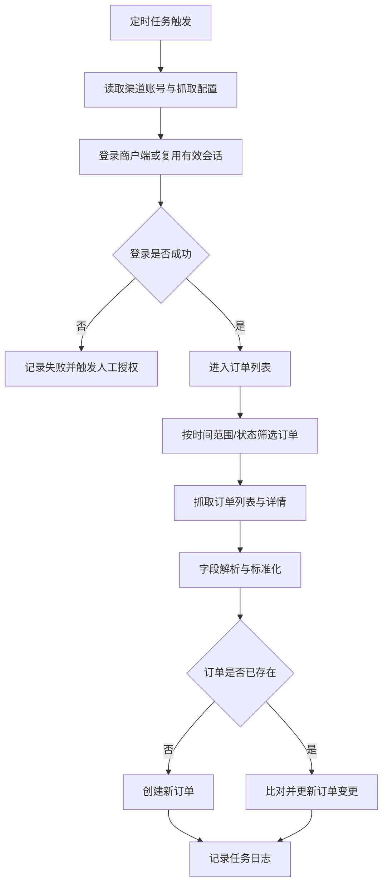

# 爬虫爬取多渠道订单_PRD

> **模块**: FE 商户端订单抓取 / 渠道订单入库
> **版本**: v1.0
> **最后更新**: 2026-05-18

---

## 1. 背景与目标

### 1.1 业务背景

Heycars、Dida Travel、Klook 三个商户端尚未建立正式 API 接入能力，订单信息分散在各商户后台。新增订单、订单变更和状态更新无法自动进入我方 FE 系统，运营需要人工查看、录入和核对。

在正式 API 对接完成前，需要通过合规可控的浏览器自动化或爬虫任务，建立过渡性的订单采集能力，提升渠道订单同步的及时性和可追踪性。

### 1.2 问题陈述

- 多个平台手工查看和录入容易造成漏单、重复录入和数据延迟。
- 商户端订单状态和关键字段变化无法及时同步到我方系统。
- 抓取任务失败时缺少统一日志、截图、重试和人工兜底机制。

### 1.3 建设目标

| # | 目标             | 描述                                             |
| - | ---------------- | ------------------------------------------------ |
| 1 | 建立订单采集能力 | 定时抓取 Heycars、Dida Travel、Klook 商户端订单  |
| 2 | 统一渠道订单入库 | 将抓取到的订单标准化后写入 FE 系统订单池         |
| 3 | 支持增量更新     | 识别新增订单、已存在订单和关键字段变更           |
| 4 | 可观测可追溯     | 记录抓取状态、成功数、失败数、失败原因和页面快照 |
| 5 | 支持人工兜底     | 连续失败后转人工处理，避免长期漏单               |

### 1.4 非目标

- 本期不替代未来正式 API 对接；爬虫/浏览器自动化作为过渡方案。
- 本期不建设完整 RPA 平台，只实现指定商户端的固定流程自动化。
- 本期不覆盖 Heycars、Dida Travel 的履约信息回传。
- 本期不自动处理渠道账号开通、验证码人工授权、合同变更和平台规则变更。

---

## 2. 需求范围

### 2.1 需求清单

| 编号   | 需求                       | 优先级 | 说明                                                              |
| ------ | -------------------------- | ------ | ----------------------------------------------------------------- |
| RQ-001 | Klook 商户端订单抓取       | P0     | 从 `https://merchant.klook.com/zh-CN/booking` 抓取订单信息      |
| RQ-002 | Dida Travel 商户端订单抓取 | P0     | 从 `https://tna-supplier-int.didatravel.com/order` 抓取订单信息 |
| RQ-003 | Heycars 商户端订单抓取     | P0     | 从 `https://sp.heycars.travel/login` 抓取订单信息               |
| RQ-004 | 渠道订单标准化入库         | P0     | 将抓取字段映射为我方订单标准字段                                  |
| RQ-005 | 抓取任务监控与日志         | P0     | 支持查看任务状态、成功数、失败数、失败原因、最近执行时间          |
| RQ-006 | 失败重试与人工兜底         | P1     | 支持失败任务重试；连续失败后转人工处理                            |

### 2.2 适用渠道与订单类型

| 渠道        | 商户端地址                                        | 本期能力 | 订单类型范围                                 |
| ----------- | ------------------------------------------------- | -------- | -------------------------------------------- |
| Heycars     | `https://sp.heycars.travel/login`               | 订单抓取 | 平台商户端可见的订单，字段以页面可读信息为准 |
| Dida Travel | `https://tna-supplier-int.didatravel.com/order` | 订单抓取 | 平台商户端可见的订单，字段以页面可读信息为准 |
| Klook       | `https://merchant.klook.com/zh-CN/booking`      | 订单抓取 | 商户端订单，字段以页面可读信息为准           |

---

## 3. 用户角色与用户故事

### 3.1 用户角色

| 角色         | 说明                                         |
| ------------ | -------------------------------------------- |
| 渠道运营人员 | 维护渠道账号授权、关注订单采集质量和同步异常 |
| 订单运营人员 | 处理抓取入库后的订单和变更提醒               |
| 客服人员     | 基于系统内订单信息响应客户咨询               |
| 系统管理员   | 配置抓取任务、账号权限、任务频率和异常告警   |

### 3.2 User Stories

#### US-1: 自动抓取三方商户端订单

> **作为** 渠道运营人员
> **我希望** 系统能定时抓取 Heycars、Dida Travel、Klook 商户端订单
> **以便于** 新增订单和订单变更能及时进入我方系统

**验收标准**:

- 系统可按渠道配置抓取账号、抓取频率和启停状态。
- 抓取任务能识别新增订单、已存在订单和订单变更。
- 抓取到的订单经标准化后进入我方订单池。
- 抓取失败时记录失败渠道、失败步骤、失败原因和截图/页面快照。

#### US-2: 监控抓取任务状态

> **作为** 系统管理员
> **我希望** 能查看抓取任务的执行状态
> **以便于** 及时发现失败任务并安排重试或人工介入

**验收标准**:

- 支持按渠道、任务状态、时间范围筛选任务日志。
- 每条日志展示渠道、触发方式、开始时间、结束时间、成功数、失败数和失败原因。
- 连续失败达到阈值时生成异常标记或告警。

---

## 4. 功能设计

### 4.1 抓取方式

系统通过浏览器自动化或爬虫任务登录商户端，在账号授权和合规可控前提下抓取订单列表和订单详情。抓取流程应尽量模拟稳定、低频、可追踪的后台操作，避免对渠道平台造成异常访问压力。

### 4.2 抓取流程

### 4.3 抓取频率

| 阶段     | 建议频率         | 说明                         |
| -------- | ---------------- | ---------------------------- |
| 上线初期 | 每30分钟一次     | 便于观察稳定性和渠道风控限制 |
| 稳定运行 | 每10-15分钟一次  | 根据订单量和渠道限制调整     |
| 高峰期   | 支持临时手动同步 | 由具备权限的运营人员触发     |

### 4.4 渠道配置

| 字段         | 说明                                      |
| ------------ | ----------------------------------------- |
| 渠道编码     | `heycars` / `dida_travel` / `klook` |
| 商户端地址   | 对应渠道后台地址                          |
| 账号凭证     | 加密保存账号、密码、Cookie、Token         |
| 抓取频率     | 按渠道配置定时频率                        |
| 启停状态     | 支持启用、停用、暂停                      |
| 最近执行时间 | 最近一次抓取任务开始时间                  |
| 最近执行结果 | 成功、部分成功、失败、需人工处理          |

---

## 5. 数据标准化

### 5.1 渠道订单基础字段

| 标准字段                | 来源                | 说明                                         |
| ----------------------- | ------------------- | -------------------------------------------- |
| `source_channel_code` | 抓取配置            | `heycars` / `dida_travel` / `klook`    |
| `source_channel_name` | 抓取配置            | Heycars / Dida Travel / Klook                |
| `channel_order_no`    | 商户端订单号        | 渠道侧订单唯一标识                           |
| `order_status`        | 商户端订单状态      | 需映射为我方订单状态                         |
| `product_type`        | 商户端商品/服务类型 | 包车、拼车、点对点、接送机等                 |
| `customer_name`       | 商户端订单详情      | 客户姓名                                     |
| `customer_phone`      | 商户端订单详情      | 客户联系方式                                 |
| `service_time`        | 商户端订单详情      | 服务时间                                     |
| `pickup_location`     | 商户端订单详情      | 上车/接送地点                                |
| `dropoff_location`    | 商户端订单详情      | 下车/送达地点                                |
| `passenger_count`     | 商户端订单详情      | 乘客数量                                     |
| `luggage_count`       | 商户端订单详情      | 行李数量                                     |
| `price_snapshot`      | 商户端订单详情      | 渠道价格、币种、结算信息，按页面可得信息采集 |
| `raw_payload`         | 抓取结果            | 原始抓取结构，用于排查和补字段               |
| `last_synced_at`      | 系统生成            | 最近同步时间                                 |

### 5.2 去重与更新规则

| 规则         | 说明                                             |
| ------------ | ------------------------------------------------ |
| 唯一键       | `source_channel_code + channel_order_no`       |
| 新订单       | 唯一键不存在时创建订单                           |
| 已存在订单   | 唯一键存在时进行字段比对                         |
| 状态变更     | 渠道状态变化时写入订单状态变更日志               |
| 关键字段变更 | 服务时间、地点、人数、联系方式变化时生成变更提醒 |
| 原始数据保留 | 每次抓取保留原始快照或差异记录，便于回溯         |

---

## 6. 任务日志与监控

| 字段              | 类型     | 说明                                                                                             |
| ----------------- | -------- | ------------------------------------------------------------------------------------------------ |
| `task_id`       | String   | 任务唯一 ID                                                                                      |
| `task_type`     | Enum     | 固定为 `order_crawl`                                                                           |
| `channel_code`  | Enum     | `heycars` / `dida_travel` / `klook`                                                        |
| `trigger_type`  | Enum     | `manual` / `scheduled`                                                                       |
| `status`        | Enum     | `pending` / `running` / `success` / `partial_success` / `failed` / `manual_required` |
| `started_at`    | DateTime | 开始时间                                                                                         |
| `finished_at`   | DateTime | 结束时间                                                                                         |
| `success_count` | Number   | 成功数量                                                                                         |
| `failed_count`  | Number   | 失败数量                                                                                         |
| `error_code`    | String   | 失败编码                                                                                         |
| `error_message` | String   | 失败原因                                                                                         |
| `snapshot_url`  | String   | 失败截图或页面快照地址                                                                           |
| `operator_id`   | String   | 手动触发人                                                                                       |

---

## 7. 业务规则

| 编号   | 规则名称   | 规则描述                                                       | 优先级 |
| ------ | ---------- | -------------------------------------------------------------- | ------ |
| BR-001 | 合规授权   | 爬虫/浏览器自动化必须基于公司已授权的商户端账号执行            | P0     |
| BR-002 | 访问频控   | 抓取任务必须支持频率限制，避免异常高频访问渠道平台             | P0     |
| BR-003 | 唯一键去重 | 渠道订单必须按 `source_channel_code + channel_order_no` 去重 | P0     |
| BR-004 | 失败可追溯 | 所有失败任务必须记录渠道、步骤、原因和任务日志                 | P0     |
| BR-005 | 人工兜底   | 连续失败达到阈值时任务进入人工处理队列                         | P1     |

---

## 8. 权限与安全

### 8.1 权限点

| 权限点                     | 描述                     | 建议角色                   |
| -------------------------- | ------------------------ | -------------------------- |
| `channel.crawl.config`   | 配置抓取账号、频率和启停 | 渠道运营、管理员           |
| `channel.crawl.view_log` | 查看抓取任务日志         | 订单运营、渠道运营、管理员 |
| `channel.crawl.retry`    | 重试失败抓取任务         | 渠道运营、管理员           |

### 8.2 安全要求

- 商户端账号、密码、Cookie、Token 等敏感凭证必须加密存储。
- 任务执行环境不得在日志中明文输出账号密码、验证码、Cookie、Token。
- 抓取任务应记录操作审计，包括触发人、触发时间、执行结果和目标渠道。
- 涉及客户手机号、地址、证件等敏感字段时，列表默认脱敏展示，按权限查看完整信息。
- 爬虫/浏览器自动化必须遵守渠道平台账号授权范围和平台规则，出现平台限制或合规风险时应支持快速停用。

---

## 9. 异常处理

| 异常            | 处理方式                                     |
| --------------- | -------------------------------------------- |
| 登录失败        | 记录失败原因，提示检查账号密码或人工重新授权 |
| 验证码/二次验证 | 暂停任务，进入人工授权流程                   |
| 页面结构变化    | 记录解析失败截图，进入人工排查               |
| 商户端限流      | 降低任务频率，延迟重试                       |
| 字段缺失        | 标记订单待补充，保留原始数据快照             |
| 重复订单        | 按唯一键去重并记录更新差异                   |

---

## 10. 埋点与监控

| 事件名                           | 触发时机         | 关键属性                                                                       |
| -------------------------------- | ---------------- | ------------------------------------------------------------------------------ |
| `merchant_order_crawl_started` | 商户端抓取开始   | `task_id`, `channel_code`, `trigger_type`                                |
| `merchant_order_crawl_result`  | 商户端抓取完成   | `task_id`, `channel_code`, `status`, `success_count`, `failed_count` |
| `merchant_order_created`       | 抓取入库新订单   | `channel_code`, `channel_order_no`, `order_id`                           |
| `merchant_order_changed`       | 抓取发现订单变更 | `channel_code`, `channel_order_no`, `changed_fields`                     |
| `channel_task_manual_required` | 任务进入人工处理 | `task_id`, `channel_code`, `task_type`, `error_code`                   |

---

## 11. 验收标准

| 用例编号 | 场景                 | 前置条件                 | 操作             | 预期结果                               |
| -------- | -------------------- | ------------------------ | ---------------- | -------------------------------------- |
| TC-001   | Heycars 订单抓取     | Heycars 账号有效         | 定时任务执行     | 新订单写入订单池，已存在订单更新差异   |
| TC-002   | Dida Travel 订单抓取 | Dida Travel 账号有效     | 定时任务执行     | 新订单写入订单池，已存在订单更新差异   |
| TC-003   | Klook 订单抓取       | Klook 账号有效           | 定时任务执行     | 新订单写入订单池，已存在订单更新差异   |
| TC-004   | 去重入库             | 同一渠道订单已存在       | 再次抓取相同订单 | 不创建重复订单，按差异更新             |
| TC-005   | 状态变更提醒         | 渠道订单状态变化         | 抓取任务执行     | 系统更新订单状态并记录变更日志         |
| TC-006   | 任务日志查询         | 存在任务执行记录         | 按渠道和状态筛选 | 列表展示任务状态、数量、时间和失败原因 |
| TC-007   | 连续失败人工兜底     | 同一渠道连续失败达到阈值 | 系统自动处理     | 任务状态变为 `manual_required`       |

---

## 12. 风险与待确认

| 风险/待确认项      | 说明                                           | 建议处理                                                 |
| ------------------ | ---------------------------------------------- | -------------------------------------------------------- |
| 商户端页面变化     | 页面结构、按钮位置、字段名称变化会导致抓取失败 | 为每个渠道建立页面快照、失败截图和快速修复流程           |
| 账号安全与二次验证 | 商户端可能触发验证码、MFA 或登录风控           | 设计人工授权流程，并支持会话有效期监控                   |
| 渠道平台规则限制   | 部分平台可能限制自动化访问                     | 上线前由业务确认账号授权和平台规则，必要时降级为人工操作 |
| 订单字段不完整     | 商户端列表页和详情页字段可能不足               | 保留原始数据快照，字段缺失时进入人工补充                 |
| 抓取频率           | 高频抓取可能触发平台限流或账号风控             | 默认低频运行，按渠道配置频率和重试间隔                   |
| API 替代计划       | 爬虫方案长期维护成本高                         | 后续优先推进正式 API 对接，爬虫能力作为过渡方案          |
