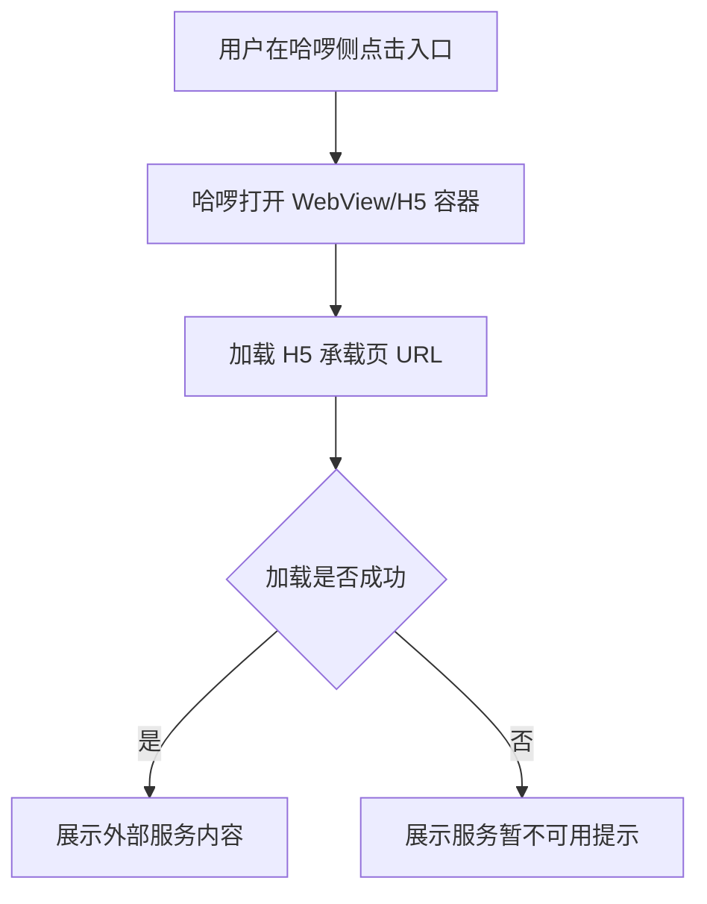
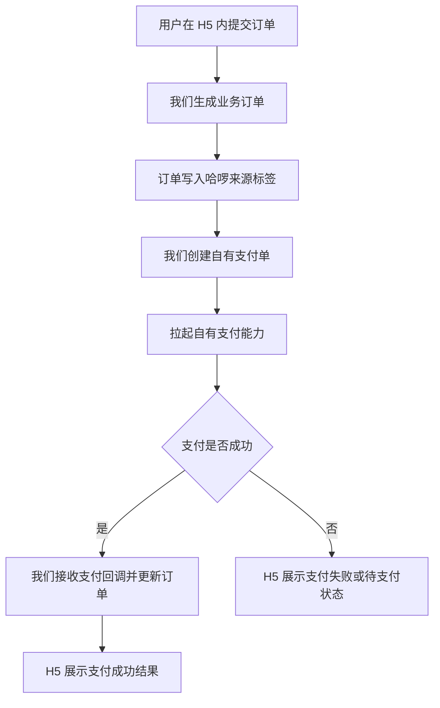

# 哈啰主站 H5 外链 PRD

> **模块**: 哈啰主站 H5 外链
> **版本**: v1.0
> **最后更新**: 2026-04-28
> **作者**: Codex

---

## 更新日志

- **v1.0 (2026-04-28)**: 哈啰主站外链简版 PRD

---

## 1. 背景与目标

### 1.1 背景

业务需要在哈啰主站 场景中提供一个外部服务入口。为降低哈啰侧改造成本，并保持后续内容可独立迭代，本期采用“哈啰入口 + 嵌套 H5 承载页”的方式形成外链：用户在哈啰侧点击入口后，进入哈啰 WebView/H5 容器加载指定 H5 页面。

外链内如涉及下单和支付，交易与支付链路由我们自行承接，包括创建支付单、调用自有支付能力、接收支付回调、同步订单状态和后续对账。哈啰仅提供入口与 H5 容器，不接入哈啰收银台。

系统接收哈啰外链产生的订单时，必须在订单上写入哈啰来源标签，用于订单列表筛选、渠道统计、售后归因和财务对账。

### 1.2 目标

| # | 目标           | 说明                                              |
| - | -------------- | ------------------------------------------------- |
| 1 | 提供哈啰侧入口 | 在哈啰指定页面增加外部服务入口                    |
| 2 | 使用 H5 承载   | 点击入口后在哈啰 WebView/H5 容器内加载承载页      |
| 3 | 保证链接安全   | H5 地址来自可信配置，仅允许 HTTPS                 |
| 4 | 支持后续调整   | H5 承载页地址支持配置化，避免后续修改需要重新发版 |
| 5 | 自有支付承接   | H5 内支付调用我们自有支付链路，不走哈啰收银台     |
| 6 | 订单来源打标   | 哈啰外链产生的订单自动写入哈啰标签和来源字段      |

### 1.3 非目标

- 本期不承接哈啰主站内页面的权限、订单或用户数据同步。
- 本期不开发哈啰原生页面，仅提供 H5 承载方案。
- 本期不接入哈啰收银台，不由哈啰处理收款、退款、对账或支付状态回调。

---

## 2. 需求范围

### 2.1 功能说明

哈啰侧新增外部服务入口。用户点击后，哈啰打开内置 WebView/H5 容器，并加载配置的 H5 承载页 URL。H5 承载页负责展示外部服务内容或继续引导用户进入目标业务页面。

当用户在 H5 内产生支付行为时，H5 调用我们自有支付接口完成收款。哈啰不展示哈啰收银台，也不承担支付状态判断。

### 2.2 入口位置

| 入口                       | 展示名称   | 说明                                           |
| -------------------------- | ---------- | ---------------------------------------------- |
| 哈啰主站/哈啰 App 指定入口 | 待业务确认 | 建议放在服务推荐、合作服务或出行服务相关入口下 |

### 2.3 H5 承载规则

| 规则     | 要求                                                                 |
| -------- | -------------------------------------------------------------------- |
| 打开方式 | 在哈啰 WebView/H5 容器内打开                                         |
| URL 来源 | 读取配置项 `hello_h5_container_url`                                |
| 默认状态 | 未配置 URL 时哈啰侧不展示入口，或展示禁用态                          |
| 安全限制 | 仅允许 `https://` 地址；禁止 `javascript:`、`data:` 等危险协议 |
| 容器能力 | 支持基础返回、刷新、加载失败提示                                     |
| 用户提示 | URL 未配置或格式非法时提示“服务暂不可用，请稍后再试”               |

### 2.4 链路流程

### 2.5 支付链路边界

**边界说明**:

- 支付下单、收款、退款、支付回调、支付状态查询和对账均由我们负责。
- 哈啰不拉起哈啰收银台，不处理支付单，不作为支付状态真源。
- H5 页面只消费我们返回的订单与支付状态，不依赖哈啰支付结果。

### 2.6 订单来源打标规则

| 规则     | 要求                                                               |
| -------- | ------------------------------------------------------------------ |
| 打标时机 | 系统创建业务订单时同步写入                                         |
| 渠道标签 | 订单标签必须包含 `哈啰`                                          |
| 来源编码 | 订单来源编码写入 `hello_h5`                                      |
| 来源入口 | 记录哈啰侧入口位置或入口标识，便于后续归因                         |
| 校验规则 | 来源字段必须来自服务端配置或可信入口参数，不允许用户在前端任意篡改 |
| 展示要求 | 订单列表、订单详情和导出数据需能识别该订单来自哈啰外链             |

---

## 3. 用户故事

### US-1: 通过哈啰入口访问外部服务

> **作为** 哈啰用户
> **我希望** 能在哈啰内点击入口进入 H5 页面
> **以便于** 不离开哈啰使用外部服务

**验收标准**:

- 用户能在哈啰指定位置看到入口。
- 点击入口后，在哈啰 WebView/H5 容器内打开 H5 承载页。
- 用户可通过哈啰容器返回上一页。

### US-2: 管理 H5 承载页地址

> **作为** 管理员
> **我希望** H5 承载页地址可配置
> **以便于** 后续主站地址变更时无需重新发版

**验收标准**:

- 系统通过配置项读取 H5 承载页 URL。
- URL 未配置、为空或非法时，不允许执行跳转。
- 配置变更后，哈啰侧刷新配置或重新进入入口后可读取最新链接。

### US-3: 在 H5 内完成支付

> **作为** 哈啰用户
> **我希望** 在 H5 页面内完成下单和支付
> **以便于** 不跳转哈啰收银台也能完成交易

**验收标准**:

- 用户在 H5 内提交订单后，由我们生成业务订单和支付单。
- 支付过程调用我们自有支付链路，不出现哈啰收银台。
- 支付成功、失败、取消、处理中状态均由我们返回并在 H5 内展示。

### US-4: 识别哈啰外链订单

> **作为** 运营或客服人员
> **我希望** 哈啰外链产生的订单自动带上哈啰标签
> **以便于** 在订单列表、售后处理和渠道统计中快速识别来源

**验收标准**:

- 哈啰外链创建的订单必须包含 `哈啰` 标签。
- 订单详情展示来源为哈啰外链。
- 后台可按哈啰来源或哈啰标签筛选订单。

---

## 4. 功能规则

| 规则编号 | 规则名称 | 规则描述                                                         |
| -------- | -------- | ---------------------------------------------------------------- |
| BR-001   | H5 配置  | H5 承载页 URL 必须来自配置项，不在哈啰入口代码中硬编码           |
| BR-002   | 容器打开 | 点击入口后必须在哈啰 WebView/H5 容器内打开                       |
| BR-003   | 安全协议 | 仅允许 HTTPS H5 地址                                             |
| BR-004   | 异常处理 | URL 缺失、非法或加载失败时，展示服务不可用提示                   |
| BR-005   | 行为记录 | 点击入口和 H5 加载结果需记录基础埋点                             |
| BR-006   | 页面适配 | H5 页面需适配移动端视口，避免横向滚动和内容遮挡                  |
| BR-007   | 自有支付 | H5 内支付必须调用我们自有支付链路，不得跳转哈啰收银台            |
| BR-008   | 支付状态 | 支付状态以我们服务端支付结果和回调为准                           |
| BR-009   | 退款对账 | 退款、支付对账、异常单处理均由我们系统闭环                       |
| BR-010   | 订单打标 | 哈啰外链订单创建时必须写入 `哈啰` 标签和 `hello_h5` 来源编码 |

---

## 5. 页面与交互

### 5.1 展示样式

- 文案：待业务确认，建议使用具体服务名称，避免仅展示“外链”。
- 图标：可使用服务类、证件类或合作服务类图标。
- 状态：
  - 正常：可点击。
  - 禁用：URL 未配置或非法。

### 5.2 点击行为

1. 用户在哈啰侧点击入口。
2. 系统校验 URL 是否存在且为 HTTPS。
3. 校验通过后，哈啰打开 WebView/H5 容器并加载 H5 承载页。
4. H5 加载成功后展示外部服务内容。
5. 校验失败或加载失败时，停留当前页面或展示错误页，并提示服务暂不可用。

### 5.3 H5 页面要求

| 要求       | 说明                                             |
| ---------- | ------------------------------------------------ |
| 移动端适配 | 页面需适配哈啰主站/哈啰 App WebView 和移动浏览器 |
| 加载状态   | 首屏加载时展示 loading，超过阈值展示重试入口     |
| 错误状态   | 网络异常、URL 失效、服务异常时展示错误页         |
| 返回行为   | 支持哈啰容器返回，不阻断用户退出                 |
| 兼容性     | 避免依赖桌面端浏览器能力                         |

### 5.4 支付交互

| 场景       | 交互要求                                                |
| ---------- | ------------------------------------------------------- |
| 提交订单   | H5 调用我们订单接口创建业务订单                         |
| 发起支付   | H5 调用我们支付接口创建支付单，并按自有支付能力拉起支付 |
| 支付成功   | H5 展示支付成功页，并同步展示订单号或服务凭证           |
| 支付失败   | H5 展示失败原因和重新支付入口                           |
| 支付取消   | H5 返回待支付状态，允许用户重新发起支付                 |
| 支付处理中 | H5 展示处理中状态，并提供刷新/查询支付结果入口          |

**支付限制**:

- 不展示、不跳转、不调用哈啰收银台。
- 不使用哈啰支付单号作为交易主键。
- 支付状态不得仅以前端页面结果为准，必须以后端支付结果或回调为准。

---

## 6. 数据与配置

| 配置项                      | 类型    | 必填 | 示例         | 说明                       |
| --------------------------- | ------- | ---- | ------------ | -------------------------- |
| `hello_h5_container_url`  | String  | 是   | 待业务确认   | 哈啰侧加载的 H5 承载页地址 |
| `hello_h5_entry_enabled`  | Boolean | 否   | `true`     | 是否展示哈啰侧入口         |
| `hello_h5_entry_name`     | String  | 否   | 待业务确认   | 哈啰侧入口展示名称         |
| `hello_h5_entry_position` | String  | 否   | 待业务确认   | 哈啰侧入口位置标识         |
| `self_payment_enabled`    | Boolean | 是   | `true`     | 是否启用自有支付链路       |
| `payment_return_url`      | String  | 否   | 待业务确认   | 支付完成后的 H5 回跳地址   |
| `hello_order_source_code` | String  | 是   | `hello_h5` | 哈啰外链订单来源编码       |
| `hello_order_tag_name`    | String  | 是   | `哈啰`     | 写入订单的来源标签名称     |

### 6.1 支付数据字段

| 字段                | 类型   | 来源         | 说明                                                                                |
| ------------------- | ------ | ------------ | ----------------------------------------------------------------------------------- |
| `order_id`        | String | 我们生成     | 业务订单号                                                                          |
| `payment_id`      | String | 我们生成     | 自有支付单号                                                                        |
| `payment_status`  | Enum   | 我们支付服务 | `pending` / `processing` / `paid` / `failed` / `cancelled` / `refunded` |
| `payment_channel` | String | 我们支付服务 | 实际支付渠道，如微信、支付宝等，待业务确认                                          |
| `paid_amount`     | Number | 我们支付服务 | 实际支付金额                                                                        |

### 6.2 订单来源字段

| 字段                      | 类型     | 来源                  | 说明                                      |
| ------------------------- | -------- | --------------------- | ----------------------------------------- |
| `source_channel_code`   | String   | 我们系统写入          | 固定为 `hello_h5`，标识哈啰 H5 外链来源 |
| `source_channel_name`   | String   | 我们系统写入          | 固定为 `哈啰`                           |
| `order_tags`            | String[] | 我们系统写入          | 必须包含 `哈啰`                         |
| `source_entry_position` | String   | 哈啰入口参数/系统配置 | 哈啰侧入口位置，用于归因                  |
| `source_trace_id`       | String   | 哈啰入口参数/我们生成 | 用于排查外链访问、下单和支付链路          |

---

## 7. 埋点

| 事件名                   | 触发时机                     | 关键属性                                                                                |
| ------------------------ | ---------------------------- | --------------------------------------------------------------------------------------- |
| `hello_h5_entry_click` | 用户点击哈啰侧入口           | `user_id`, `entry_position`, `target_url`                                         |
| `hello_h5_load_result` | H5 承载页加载完成或失败      | `user_id`, `target_url`, `success`, `error_code`                                |
| `h5_payment_submit`    | 用户在 H5 内发起支付         | `user_id`, `order_id`, `payment_id`, `amount`                                   |
| `h5_payment_result`    | 支付成功、失败、取消或处理中 | `user_id`, `order_id`, `payment_id`, `payment_status`, `error_code`           |
| `hello_order_created`  | 哈啰外链订单创建成功         | `user_id`, `order_id`, `source_channel_code`, `order_tags`, `source_trace_id` |

---

## 8. 验收标准

| 用例编号 | 场景         | 前置条件                     | 操作               | 预期结果                                       |
| -------- | ------------ | ---------------------------- | ------------------ | ---------------------------------------------- |
| TC-001   | 正常打开 H5  | URL 已配置且为 HTTPS         | 点击哈啰侧入口     | 哈啰 WebView/H5 容器打开并加载目标 H5 页面     |
| TC-002   | URL 未配置   | 配置项为空                   | 查看入口或点击入口 | 入口隐藏/禁用，或提示服务暂不可用              |
| TC-003   | URL 非法     | 配置为非 HTTPS 或危险协议    | 点击入口           | 不打开 H5，并展示错误提示                      |
| TC-004   | H5 加载失败  | URL 合法但页面加载失败       | 点击入口           | 展示加载失败页，支持用户重试或返回             |
| TC-005   | 埋点记录     | 用户点击入口并进入 H5        | 点击入口           | 记录点击事件和 H5 加载结果                     |
| TC-006   | 自有支付成功 | H5 内存在待支付订单          | 发起并完成支付     | 不出现哈啰收银台，订单状态更新为已支付         |
| TC-007   | 支付失败     | 自有支付返回失败             | 发起支付           | H5 展示失败原因，并支持重新支付                |
| TC-008   | 支付回调     | 支付渠道回调成功             | 查询订单状态       | 订单状态以后端支付结果为准                     |
| TC-009   | 哈啰订单打标 | 用户从哈啰入口进入 H5 并下单 | 创建业务订单       | 订单包含 `哈啰` 标签和 `hello_h5` 来源编码 |
| TC-010   | 哈啰订单筛选 | 存在哈啰外链订单             | 按哈啰标签筛选订单 | 仅展示哈啰外链来源订单                         |

---

## 9. 风险与待确认

| 项             | 说明                                                           | 处理建议                                   |
| -------------- | -------------------------------------------------------------- | ------------------------------------------ |
| H5 URL 待确认  | PRD 不硬编码 H5 承载页地址                                     | 由业务或运营确认后写入配置                 |
| 入口位置待确认 | 哈啰侧页面信息架构可能不同                                     | 由哈啰产品或设计确认最终位置               |
| WebView 兼容性 | 哈啰容器可能存在 UA、缓存、返回栈差异                          | 联调阶段覆盖主流机型和哈啰版本             |
| H5 加载性能    | 嵌套 H5 首屏过慢会影响转化                                     | 控制首屏资源体积，增加 loading 和失败重试  |
| 跨域与安全策略 | 若 H5 内继续嵌入第三方页面，可能受 CSP 或 X-Frame-Options 限制 | 优先使用自有 H5 承载页承接业务内容         |
| 支付合规       | 自有支付需满足支付渠道和业务合规要求                           | 上线前完成支付资质、协议和风控校验         |
| 支付状态不一致 | 用户关闭 H5 或网络异常可能导致前端状态与后端回调不一致         | 以后端状态为准，提供支付结果查询和补偿机制 |
| 售后责任边界   | 不走哈啰收银台后，退款和客诉由我们承接                         | PRD 和客服流程中明确售后入口与处理责任     |
| 来源标签缺失   | 哈啰外链订单若未打标，会影响渠道统计、售后归因和财务对账       | 订单创建接口强制校验并写入来源标签         |
| 来源参数篡改   | 若完全信任前端来源参数，可能造成订单归因错误                   | 服务端基于入口配置和白名单校验来源字段     |

---

## 10. 变更记录

| 日期       | 版本 | 变更内容                       | 变更人 |
| ---------- | ---- | ------------------------------ | ------ |
| 2026-04-28 | v1.3 | 补充哈啰外链订单来源标签规则   | Codex  |
| 2026-04-28 | v1.2 | 明确 H5 内支付使用自有支付链路 | Codex  |
| 2026-04-28 | v1.1 | 调整为哈啰侧嵌套 H5 外链方案   | Codex  |
| 2026-04-28 | v1.0 | 新增哈啰主站外链简版 PRD       | Codex  |
