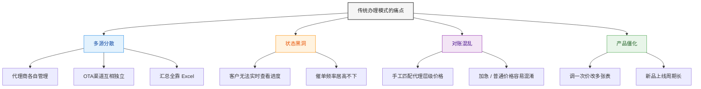
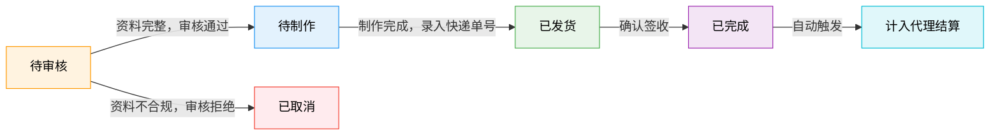
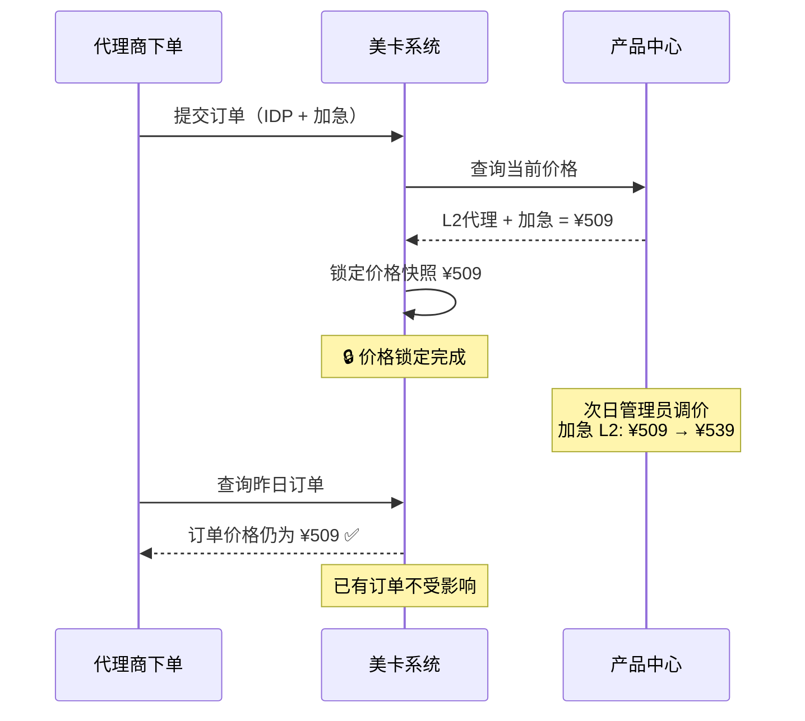
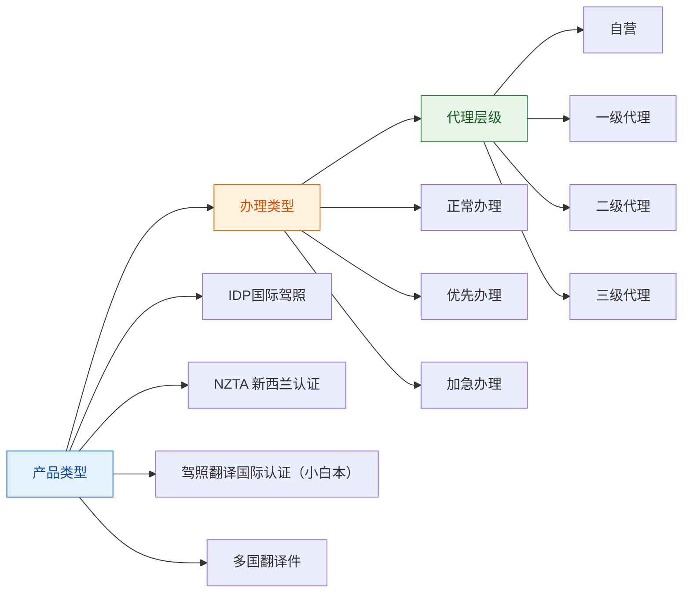
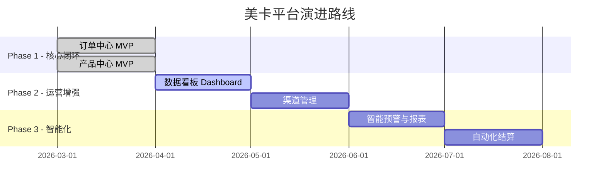

# 美卡 (Mei Ka) — 项目演示文档

## 全球翻译认证集成办理平台 · 核心功能演示

(将项目部署到 Vercel 供开发人员演示和使用，并推送到GitHub 仓库)

（更新项目PRD)

---

## 📌 一句话介绍

> **美卡：连接 OTA 渠道与专业办理能力，打造全球翻译件业务的数字中枢。**

---

## 一、我们要解决什么问题？

### 传统模式的四大痛点



### 美卡的解法

| 痛点     | 美卡方案                 | 核心能力                             |
| -------- | ------------------------ | ------------------------------------ |
| 多源分散 | →**统一订单池**   | 全渠道汇入，一屏管控                 |
| 状态黑洞 | →**全流程状态链** | 待审核 → 待制作 → 已发货，实时同步 |
| 对账混乱 | →**价格锁定引擎** | 下单即锁价，代理等级自动匹配         |
| 产品僵化 | →**灵活产品中心** | 分钟级上架，多维度定价               |

---

## 二、核心产品能力

### 能力一：订单中心 — 统一管控台

**场景演示：运营人员小张的一天**

```
08:30  小张登录后台 → 打开订单中心
       ┌─────────────────────────────────────────────┐
       │  📋 订单列表                                │
       │  ┌───────┬──────┬──────┬──────┬──────┬────┐ │
       │  │订单号 │客户  │产品  │类型  │状态  │操作│ │
       │  ├───────┼──────┼──────┼──────┼──────┼────┤ │
       │  │#10086 │张三  │IDP   │加急  │待审核│审核│ │
       │  │#10087 │李四  │NZTA  │正常  │待制作│查看│ │
       │  │#10088 │王五  │小白本│优先  │已发货│查看│ │
       │  └───────┴──────┴──────┴──────┴──────┴────┘ │
       │  筛选: [渠道▾] [状态▾] [产品▾] [时间范围]    │
       │                          [搜索] [重置]       │
       └─────────────────────────────────────────────┘

09:00  筛选"待审核"订单 → 点击#10086 → 进入详情页
       ┌─────────────────────────────────────────────┐
       │  订单 #10086                    状态：待审核 │
       │  ─────────────────────────────────────────  │
       │  📋 基本信息  │  来源：携程  下单：04-03    │
       │  👤 客户信息  │  张三 / G12345678 / 138xxx  │
       │  📦 产品信息  │  IDP国际驾照 / 加急 / ¥599  │
       │  🚚 配送信息  │  北京市朝阳区xx路xx号        │
       │  ─────────────────────────────────────────  │
       │                    [ 拒绝 ]  [ 修改 ]  [通过]│
       └─────────────────────────────────────────────┘

09:05  审核资料齐全 → 点击"通过"
       ✅ Toast: "审核通过，订单已转入待制作"
       订单 #10086 状态自动变更：待审核 → 待制作
```

**订单生命周期全景**



---

### 能力二：产品中心 — 灵活配置引擎

**场景演示：管理员需要新增一款"NZTA新西兰认证"产品**

```
第一步：填写基本信息
       ┌─────────────────────────────────────────────┐
       │  新增产品                           [目录▾] │
       │  ═══════════════════════════════════════════ │
       │                                             │
       │  📋 基本信息                                │
       │  ┌─────────────────────────────────────────┐│
       │  │ 产品标题*   [ NZTA新西兰认证          ] ││
       │  │ 产品类别*   [ NZTA                   ▾] ││
       │  │ 产品描述    [ 新西兰交通局官方认证... ] ││
       │  └─────────────────────────────────────────┘│
       │                                             │
       │  ⚙️ 办理类型                                │
       │  ┌──────────────┬──────────┐                │
       │  │ 类型名称     │ 预计天数 │                │
       │  ├──────────────┼──────────┤                │
       │  │ 正常办理     │ 15       │                │
       │  │ 优先办理     │ 7        │                │
       │  │ 加急办理     │ 3        │                │
       │  └──────────────┴──────────┘                │
       │                         [+ 添加办理类型]    │
       │                                             │
       │  💰 价格配置                                │
       │  ┌──────────┬──────┬──────┬──────┬──────┐   │
       │  │          │ 自营 │ L1   │ L2   │ L3   │   │
       │  ├──────────┼──────┼──────┼──────┼──────┤   │
       │  │ 正常办理 │ ¥299 │ ¥269 │ ¥249 │ ¥239 │   │
       │  │ 优先办理 │ ¥399 │ ¥359 │ ¥339 │ ¥329 │   │
       │  │ 加急办理 │ ¥599 │ ¥539 │ ¥509 │ ¥499 │   │
       │  └──────────┴──────┴──────┴──────┴──────┘   │
       │                                             │
       │  📊 排序与状态                              │
       │  ┌─────────────────────────────────────────┐│
       │  │ 权重*       [ 100                     ] ││
       │  │ 状态        [ ○已上架  ●已下架        ] ││
       │  └─────────────────────────────────────────┘│
       │  ───────────────────────────────────────── │
       │                          [ 取消 ]  [ 保存 ] │
       └─────────────────────────────────────────────┘
```

**价格锁定机制**



---

## 三、业务规则速览

### 订单规则

| 规则                     | 说明                                       |
| ------------------------ | ------------------------------------------ |
| 🔄**状态单向推进** | 待审核 → 待制作 → 已发货，不可逆向       |
| 👁️**人工审核**   | 支持通过/修改/拒绝，拒绝需填写原因         |
| 🔒**价格锁定**     | 下单时锁定价格快照，后续调价不影响已有订单 |
| 🔗**数据一致性**   | 支付、审核、物流信息双向同步，禁止状态矛盾 |
| 💰**代理结算**     | 订单"已完成"后自动计入代理业绩与待结算账单 |

### 产品规则

| 规则                   | 说明                                         |
| ---------------------- | -------------------------------------------- |
| 🟢🔴**上下架**   | 仅上架产品可下单；下架不影响已有订单         |
| ✅**完整性校验** | 必须包含标题、类别、价格、权重，缺一不可上架 |
| 📊**分层定价**   | 一级/二级/三级/自营四级独立定价              |
| 🔄**办理类型**   | 同一产品多办理类型，每个独立定价             |

---

## 四、产品矩阵全景



> **定价公式**: `最终价格 = 产品 × 办理类型 × 代理等级`
> 每一个三元组合都对应一个独立的结算价格。

---

## 五、设计标准预览

### 列表页标准 (`ORDER_BASE_V1`)

```
┌─────────────────────────────────────────────────────────┐
│  筛选区                                                 │
│  [字段1] [字段2] [字段3]        [展开/收起] [搜索][重置]│
├─────────────────────────────────────────────────────────┤
│  操作区                                                 │
│  [+ 新增]                    已选择 3 条  [批量操作▾]   │
├─────────────────────────────────────────────────────────┤
│  ☐ │ 列1     │ 列2     │ 列3     │ 列4     │ 操作      │
│  ☑ │ ...     │ ...     │ ...     │ ...     │ [编辑]    │
│  ☐ │ ...     │ ...     │ ...     │ ...     │ [编辑]    │
├─────────────────────────────────────────────────────────┤
│  共 156 条  < 1/8 >  前往 [__] 页   每页 [20▾] 条      │
└─────────────────────────────────────────────────────────┘
```

### 表单页标准 (`FORM_BASE_V1`)

```
┌─────────────────────────────────────────────────────────┐
│  页头上下文栏 (白底)                                    │
│  ← 返回列表    新增产品                                 │
├───────────────────────────────────────────┬─────────────┤
│                                           │  📑 目录    │
│  ┌─ 📋 基本信息 ─────────────────────┐   │  · 基本信息 │
│  │  产品标题*  [_______________]      │   │  · 办理类型 │
│  │  产品类别*  [_______________]      │   │  · 价格配置 │
│  └────────────────────────────────────┘   │  · 排序状态 │
│                                           │             │
│  ┌─ ⚙️ 办理类型 ─────────────────────┐   │             │
│  │  ...                               │   │             │
│  └────────────────────────────────────┘   │             │
│                                           │             │
│  ┌─ 💰 价格配置 ─────────────────────┐   │             │
│  │  ...                               │   │             │
│  └────────────────────────────────────┘   │             │
├───────────────────────────────────────────┴─────────────┤
│  ▓▓▓▓▓▓▓▓▓▓▓ 底部吸底操作条 ▓▓▓▓▓▓▓▓▓▓▓▓▓▓▓▓▓▓▓▓▓▓▓  │
│                                      [ 取消 ]  [ 保存 ] │
└─────────────────────────────────────────────────────────┘
```

---

## 六、技术架构一览

| 层级               | 技术               | 说明                                     |
| ------------------ | ------------------ | ---------------------------------------- |
| **前端框架** | React + TypeScript | Google AI Studio Build 生成              |
| **架构模式** | 模块化组件         | `src/modules/*` 按功能划分             |
| **数据层**   | Mock Service       | `services/mockDataService.ts` 模拟     |
| **设计系统** | CSS Variables      | `shared/styles/variables.css` 主题管理 |

```
src/modules/
├── order-management/    ← 订单中心 (本次核心)
└── product-management/  ← 产品中心 (本次核心)
```

---

## 七、项目路线图



---

> 📄 **完整 PRD 详见**: [MEI_KA_PRD_V2.md](./MEI_KA_PRD_V2.md)
