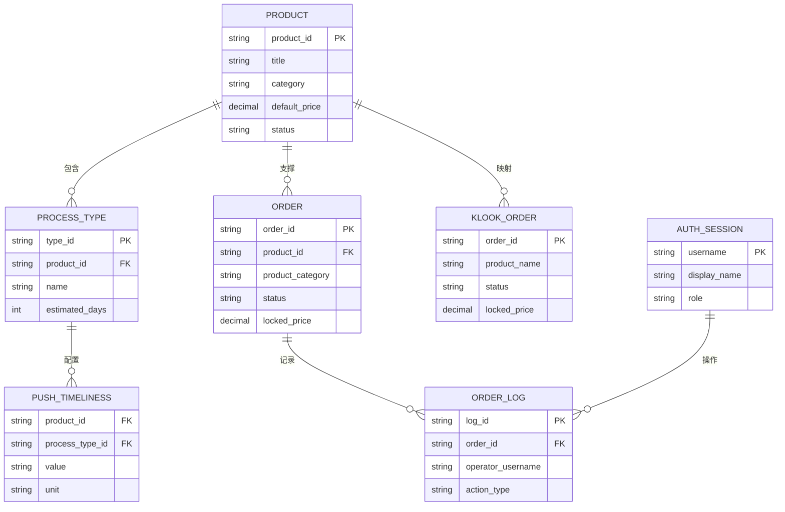
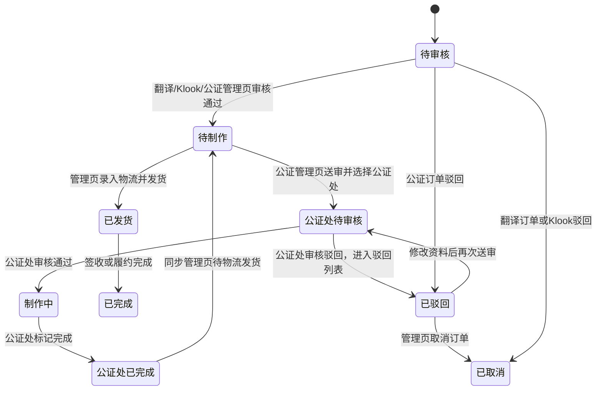
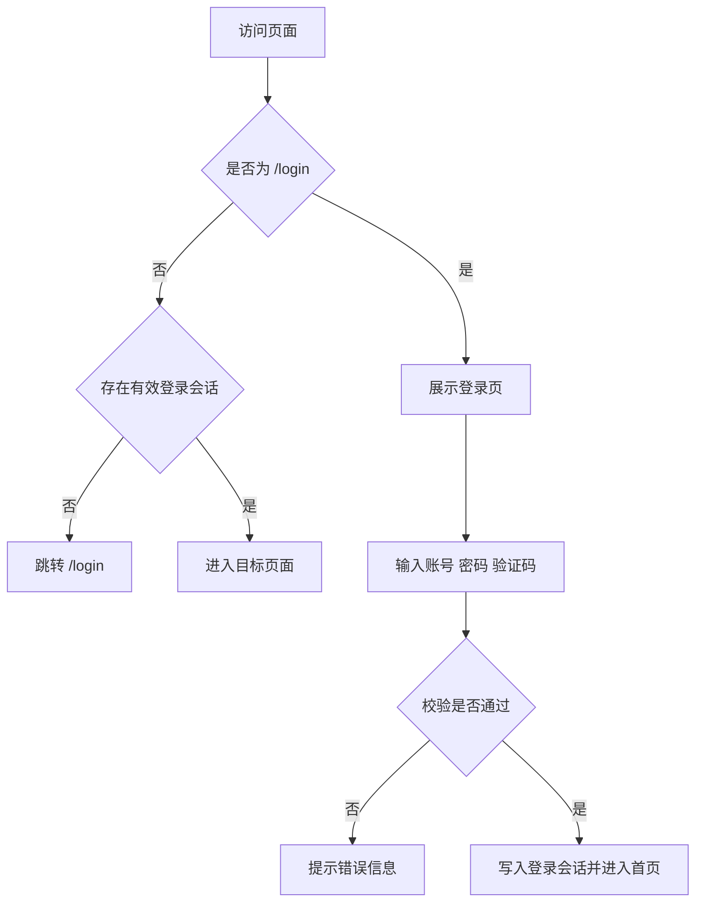
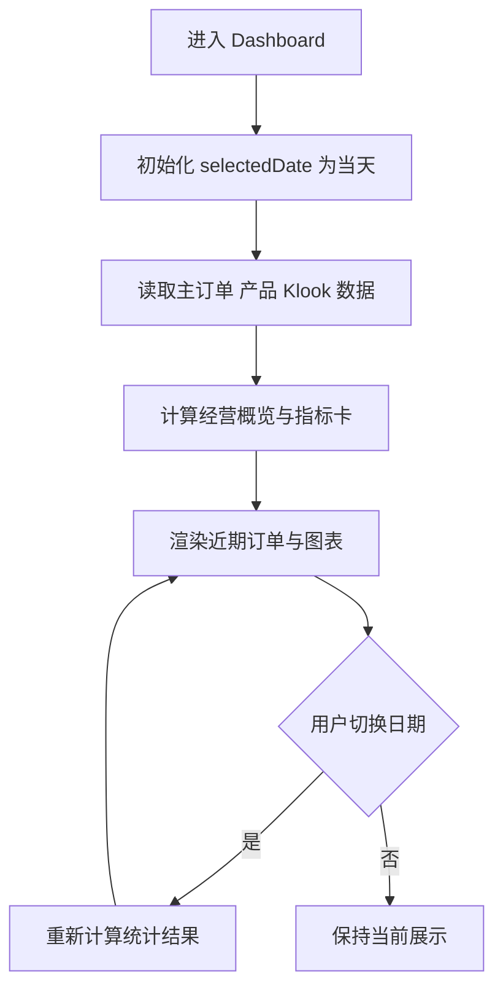
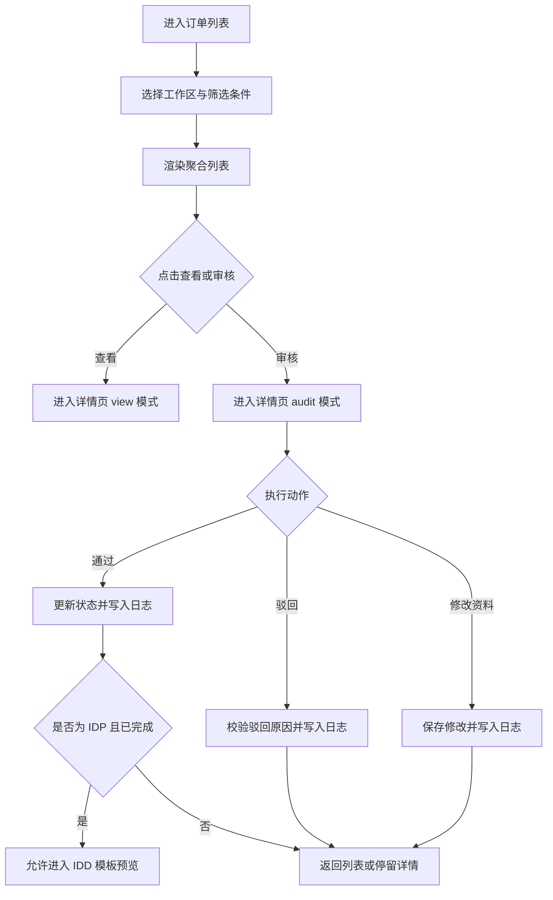
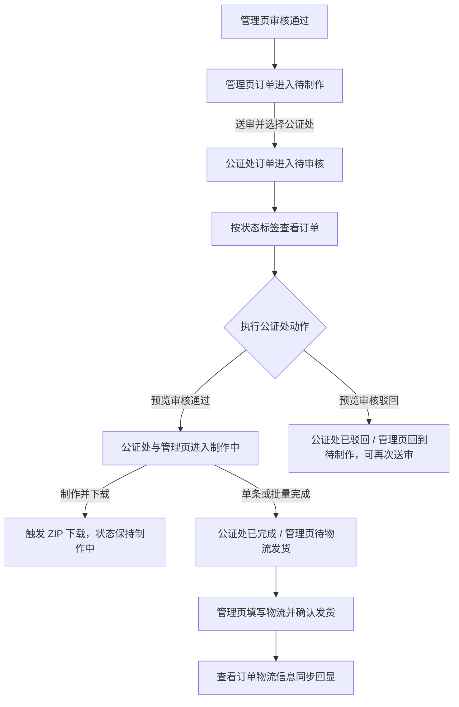
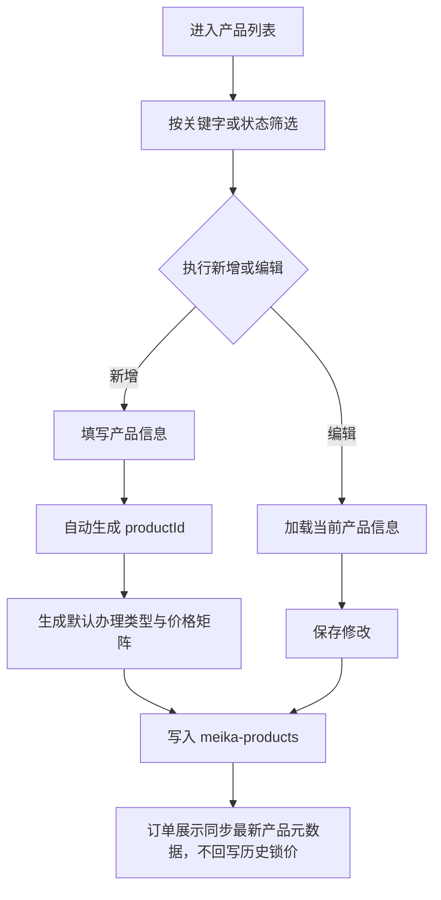
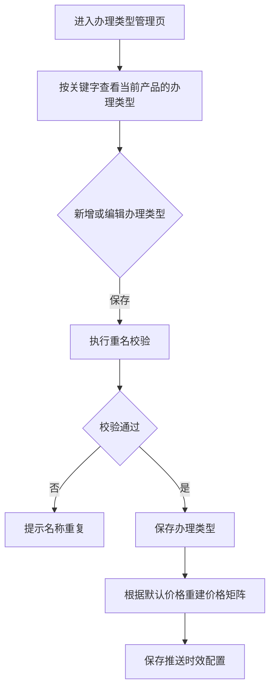
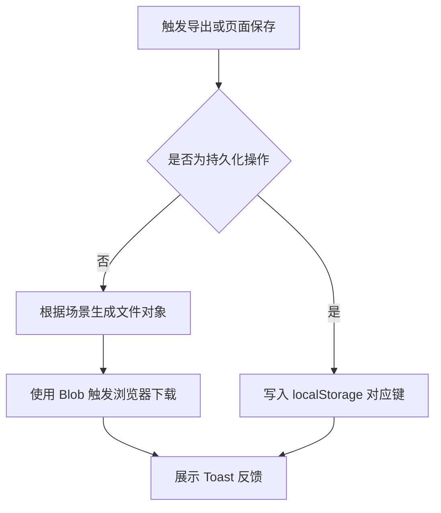

# 美卡平台--管理端 PRD

> **模块**: 美卡管理后台
> **版本**: v1.6
> **最后更新**: 2026-05-14
> **作者**: Codex

---

## 更新日志

- **v1.6 (2026-05-14)**: 将驾照官生产端详细需求拆分为独立 PRD，管理端仅保留中文翻译件生产入口与跨端职责边界
- **v1.5 (2026-05-13)**: 同步换国内驾照翻译件 / 中文翻译件生产端当前实现，补充 `domestic_license` 产品分类、驾照官生产端路由、DOCX 预览编辑、PDF 导出、发货与取消状态规则
- **v1.0 (2026-04-17)**:产出为标准 Specification 文档，补齐用户故事、逻辑视图、数据契约、Tracking Events 与 i18n 规范

---

## 1. 背景与目标

### 1.1 业务背景

美卡管理后台是面向内部运营、审核、公证专员与驾照官生产人员的演示级业务系统，用于统一承载翻译认证订单、换国内驾照翻译件订单、IDP 订单、公证订单、Klook API 订单，以及产品中心、办理类型、推送时效、模板预览与导出能力。

当前系统采用 `React 18 + TypeScript + Vite` 单页应用形态，业务数据主要由前端 Mock Service 初始化，并持久化到浏览器 `localStorage`。系统已经具备可运行 Demo，但原有文档以项目型 PRD 为主，缺少符合标准模板的功能规范文档，难以支持后续模块扩展、测试回归、页面重构和国际化治理。

### 1.2 问题陈述

当前存在以下核心问题：

1. 现有主 PRD 以“演示说明”方式组织，不符合团队统一的 Spec 模板结构，难以作为工程实现与评审基准。
2. 翻译、IDP、公证、Klook 四条订单链路共存，但状态聚合、导出方式、页面入口、持久化边界分散描述，存在理解偏差风险。
3. 订单详情、审核页、模板预览页、公证处制作页之间的交互职责没有通过统一逻辑视图表达，后续改造容易出现字段语义漂移。
4. 当前系统为 Demo 形态，无真实后端、无真实 RBAC、无真实文件上传，但这些“边界”尚未被标准化写清，易导致需求外溢。

---

## 2. 现状洞察（AS-IS）

当前系统已经覆盖登录认证、全局导航、Dashboard、订单中心、驾照官生产端、公证处工作台、产品中心、办理类型管理与浏览器端导出，但系统文档与实现之间仍有以下痛点：

| 痛点                           | 描述                                                                                                            |
| ------------------------------ | --------------------------------------------------------------------------------------------------------------- |
| **文档结构不统一**       | `specs/MEI_KA_PRD_XIN.md` 能描述现状，但未按标准模板拆解用户故事、数据契约、逻辑视图、验收标准。              |
| **多链路口径分散**       | 翻译、IDP、公证、Klook 订单共用部分组件，但各自的筛选项、状态聚合、导出方式和跳转入口分散描述。                 |
| **数据边界隐含在代码中** | `meika-orders`、`meika-klook-orders`、`meika-products` 等持久化键值在文档中说明不足，维护者需要反查代码。 |
| **权限模型为 Demo 级**   | 当前仅有固定演示账号与前端受保护路由，无真实 RBAC；如果不显式说明，容易被误判为已具备生产级权限体系。           |
| **导出能力差异化强**     | 不同模块分别输出 Excel、CSV、DOCX、PDF、ZIP，若没有统一规范，后续重构时容易破坏演示链路。                       |

---

## 3. 目标（TO-BE）与非目标

### 3.1 目标

| # | 目标                         | 描述                                                                                    |
| - | ---------------------------- | --------------------------------------------------------------------------------------- |
| 1 | **标准化现有能力**     | 将当前美卡管理后台的真实能力边界，重构为符合模板要求的标准 Specification。              |
| 2 | **统一多订单链路口径** | 对翻译、IDP、公证、Klook 订单的页面入口、状态流转、导出方式、审核规则形成统一文档基线。 |
| 3 | **沉淀交互与数据基准** | 通过 ER 图、Logical View、字段定义、数据契约明确页面与数据语义，降低后续重构成本。      |
| 4 | **明确 Demo 边界**     | 明确哪些能力已实现，哪些能力仍为占位或未来迭代，避免项目范围失控。                      |

### 3.2 非目标（本期不做）

- **真实后端接入**: 当前版本不接入真实订单服务、真实商品服务、真实 Klook API 或真实数据库。
- **真实权限体系**: 当前版本不实现组织、角色、权限矩阵和细粒度 RBAC。
- **真实支付与履约生态**: 当前版本不覆盖支付、退款、对账、结算、短信、邮件、真实物流。
- **真实文件生产链路**: 当前版本不覆盖文件上传、OCR、电子签、在线 DOCX 编辑和真实模板服务。
- **多租户经营后台**: 当前版本不扩展库存、门店、财务、结算报表等独立后台域能力。

### 3.3 User Stories

#### US-1: 运营人员统一处理订单

> **作为** 管理员 / 运营人员
> **我希望** 在统一后台中查看不同类型订单，并进入对应审核或查看页面
> **以便于** 减少系统切换成本，快速完成日常处理

**验收标准**:

- 可以通过左侧菜单进入翻译、IDP、公证、Klook 等不同订单工作区
- 每类订单列表均可按预定义条件筛选并进入详情页
- 订单详情页可区分查看模式与审核模式

#### US-2: 审核人员留痕处理订单

> **作为** 审核人员
> **我希望** 在审核页面中执行通过、驳回、资料修改等动作
> **以便于** 保持审核结果可追溯、可复盘

**验收标准**:

- 驳回动作必须填写原因
- 审核通过、驳回、资料修改均写入日志
- Klook、公证、翻译订单均具备审核留痕能力

#### US-3: 公证专员推进制作链路

> **作为** 公证专员
> **我希望** 在公证处工作台中审核待审订单、下载制作模板、标记完成
> **以便于** 提升公证订单的处理效率

**验收标准**:

- 管理页点击“送审”后，公证处工作台同订单进入待审核
- 公证处待审核订单审核通过后进入制作中，并同步管理页进入制作中且隐藏“送审”按钮
- 制作中订单支持单条下载模板，下载后仍保持制作中状态
- 制作中订单支持单条或批量完成，完成后管理页显示“物流发货”入口
- 管理页填写物流信息后，查看订单中的物流信息同步显示物流公司与物流单号

#### US-4: 产品管理员维护商品与时效

> **作为** 产品管理员
> **我希望** 维护产品、办理类型、价格矩阵与推送时效
> **以便于** 支撑订单展示口径与运营配置的统一

**验收标准**:

- 产品支持新增、编辑、删除、查看价格详情
- 办理类型支持 CRUD 与重名校验
- 推送时效按 `productId + processTypeId` 粒度持久化

#### US-5: 管理端进入中文翻译件生产端

> **作为** 管理员 / 运营人员
> **我希望** 从管理端或系统切换入口进入驾照官生产端
> **以便于** 将审核后的换国内驾照翻译件订单交由生产端处理

**验收标准**:

- 管理端保留中文翻译件生产端入口与产品 / 审核边界说明
- 审核通过并进入生产链路后的翻译、制作、发货和取消验收由生产端独立 PRD 定义
- 生产端详细需求见 [mei_ka_production side.md](./mei_ka_production%20side.md)

---

## 4. 术语表（Terminology）

| 术语         | 英文                    | 定义                                                                                                                              |
| ------------ | ----------------------- | --------------------------------------------------------------------------------------------------------------------------------- |
| 美卡管理后台 | Mei Ka Admin Console    | 当前演示级运营后台系统，统一承载订单、产品、模板与导出能力。                                                                      |
| 翻译订单     | Translation Order       | `productCategory = translation` 的订单，支持列表筛选、审核、Excel 导出。                                                        |
| IDP 订单     | IDP Order               | `productCategory = idp` 的订单，支持资料编辑与 IDD 模板入口。                                                                   |
| IDD 模板     | IDD Template            | IDP 订单对应的 PDF 模板预览与下载能力，含卡片、完整、信息页三种模板。                                                             |
| 公证订单     | Notary Order            | 需要经过审核、预览、委托书 / PDF 导出的订单。                                                                                     |
| 换国内驾照翻译件 | Domestic License Translation | `productCategory = domestic_license` 且产品名为“换国内驾照翻译件”的订单，管理端审核后进入驾照官生产端。 |
| 中文翻译件生产端 | License Officer Workbench | `/license-officer/orders/chinese-translation`，面向生产人员处理换国内驾照翻译件的翻译、制作、发货与取消。 |
| 公证处工作台 | Notary Office Workbench | 面向公证专员的制作工作区，支持待审核、制作中、已完成、已驳回状态管理；历史 `translating`、`pending_production` 仅作兼容映射。 |
| Klook 订单   | Klook Order             | 独立持久化的 API 来源订单，仅当前匹配“小白本”产品场景。                                                                         |
| 锁价         | Locked Price            | 订单创建时固化的价格快照，后续产品改价不影响历史订单金额。                                                                        |
| 审核模式     | Audit Mode              | 详情页中的可编辑模式，允许通过、驳回或修订资料。                                                                                  |
| 查看模式     | View Mode               | 详情页中的只读模式，仅查看订单、商品、收货与审核信息。                                                                            |
| 推送时效     | Push Timeliness         | 按 `productId + processTypeId` 维度配置的时效信息，支持天 / 小时。                                                              |
| 准入校验     | Admission Guard         | 动作执行前的前置判断，例如登录校验、驳回原因必填、导出前勾选校验。                                                                |

---

## 5. 角色与权限

| 角色              | 权限范围       | 说明                                                                   |
| ----------------- | -------------- | ---------------------------------------------------------------------- |
| 管理员 / 运营人员 | 全局模块访问   | 统一登录后进入后台，查看 Dashboard、订单中心、产品中心、公证处工作台。 |
| 审核人员          | 订单审核与预览 | 进入订单详情、预览页执行审核通过、驳回、资料修订。                     |
| 公证专员          | 公证制作工作区 | 在公证处工作台审核待审订单、下载模板、标记完成。                       |
| 驾照官生产人员    | 中文翻译件生产 | 在驾照官生产端处理中文翻译件翻译、制作、发货与取消。                   |

**权限规则**:

- 当前版本仅提供演示账号 `admin / 123456`，登录成功后创建默认会话 `username=admin`、`displayName=管理员`、`role=运营人员`，无真实 RBAC。
- 用户名校验前执行 `trim + lowercase` 归一化，因此 `ADMIN` 仍按演示账号处理。
- 首次无 `meika-auth-session` 存储时系统会自动写入默认演示会话；主动登出后改写为 `__logged_out__` 哨兵值，访问受保护路由时需重新登录。
- 除 `/login` 外，所有路由均运行在受保护布局下。
- 页面上的动作权限依赖当前页面模式控制，而非真实后端鉴权。
- 审核日志中的操作人默认取当前登录会话账号。

---

## 6. 数据模型（业务/交互视角）

### 6.1 实体关系图（ER Diagram）



### 6.2 Logical View（逻辑视图，UI 设计基准）

> [!IMPORTANT]
> **AI 执行约束**
>
> 1. 本章仅定义业务语义与页面交互模型，不直接等同于底层存储结构。
> 2. 如已按本节定义 `Logical View`，前端页面/组件必须基于 `Logical View` 设计。
> 3. 涉及聚合、计算、映射字段时，必须在 Spec 中明确字段来源与转换规则。
> 4. 底层存储结构如需补充，请写入附录 `13.2 技术附录（可选，工程维护）`。

#### 6.2.1 逻辑视图写法示例

```typescript
interface MeikaAdminConsoleView {
  auth: {
    session: AuthSessionView; // Stored: meika-auth-session
    isProtectedRoute: boolean; // Derived from current route
    canAccessModule: boolean; // Mapped from demo role
  };

  navigation: {
    activeMenuKey: string; // Derived from route path
    sidebarCollapsed: boolean; // Stored: meika-sidebar-collapsed
    routes: RouteEntryView[]; // Stored from menu configuration
  };

  dashboard: DashboardView; // Derived from orders, products, selectedDate

    orderCenter: {
      translation: OrderWorkspaceView; // Derived from meika-orders where productCategory=translation
      domesticLicense: OrderWorkspaceView; // Derived from meika-orders where productCategory=domestic_license
      idp: OrderWorkspaceView; // Derived from meika-orders where productCategory=idp
      notary: OrderWorkspaceView; // Derived from meika-orders where productCategory=notary
      klook: KlookWorkspaceView; // Stored from meika-klook-orders
    };

  licenseOfficerEntry: LicenseOfficerEntryView; // Entry only; production details are defined in the independent PRD

  notaryOffice: NotaryWorkbenchView; // Stored from meika-notary-office-orders and synced with notary orders

  productCenter: {
    products: ProductCardView[]; // Stored from meika-products
    processTypes: ProcessTypeView[]; // Stored from product.processTypes
    pushTimeliness: PushTimelinessView[]; // Stored from meika-push-timeliness-config
  };
}

interface OrderWorkspaceView {
  activeStatusTab: string; // Mapped from underlying order status
  selectedOrderIds: string[]; // Stored in page state
  filters: {
    agentName: string; // Stored: user input
    productName: string; // Stored: user input
    createdAtRange: [string, string] | null; // Stored: user input
    keyword: string; // Stored: user input
  };
  list: OrderCardView[]; // Derived from filtered data source
  exportCapability: {
    format: 'excel' | 'csv'; // Mapped by workspace type
    canExport: boolean; // Derived from selected rows or filtered result
  };
}

interface OrderCardView {
  orderId: string; // Stored
  orderTypeLabel: string; // Mapped from productCategory
  statusLabel: string; // Mapped from status enum
  canAudit: boolean; // Derived from current mode and order status
  canOpenTemplatePreview: boolean; // Derived: idp and completed-like status only
  canSendToNotaryOffice?: boolean; // Derived: notary pending_production and not yet approved by office
  canShip?: boolean; // Derived: notary office completed and management order pending logistics
  logisticsSummary?: string; // Derived from main order logistics fields, fallback to notary office order
}

interface LicenseOfficerEntryView {
  route: '/license-officer/orders/chinese-translation';
  spec: './mei_ka_production side.md';
  responsibility: 'entry-only';
}

interface AuthSessionView {
  username: string; // Stored
  displayName: string; // Stored
  roleLabel: string; // Mapped from role
}
```

#### 6.2.2 计算字段与虚字段

| 数据库存储                | 逻辑视图字段               | Spec 写法                                                    | AI 行为                                                 |
| ------------------------- | -------------------------- | ------------------------------------------------------------ | ------------------------------------------------------- |
| `status`                | `statusLabel`            | `statusLabel: string` *(Mapped from status enum)*        | 自动统一翻译订单、IDP、公证、Klook 列表中的状态显示口径 |
| `productCategory`       | `orderTypeLabel`         | `orderTypeLabel: string` *(Mapped from productCategory)* | 自动渲染“翻译 / IDP / 公证 / Klook”可读文案           |
| `selectedDate + orders` | `dashboard.summaryCards` | `summaryCards: SummaryCardView[]` *(Derived)*            | 自动计算成交金额、待发货金额、异常订单量等指标          |
| `status + route + mode` | `canAudit`               | `canAudit: boolean` *(Derived)*                          | 自动控制详情页按钮与可编辑状态                          |

---

## 7. 业务规则与验证

### 7.1 核心业务规则

| 规则编号 | 规则名称           | 规则描述                                                                                                                                                                                                                                                                         |
| -------- | ------------------ | -------------------------------------------------------------------------------------------------------------------------------------------------------------------------------------------------------------------------------------------------------------------------------- |
| BR-001   | 受保护路由         | `/login` 之外的页面需要存在登录会话才能进入。                                                                                                                                                                                                                                  |
| BR-002   | 演示会话预置       | 浏览器首次无会话存储时自动注入默认演示登录态；退出后写入 `__logged_out__` 哨兵值，需重新登录。                                                                                                                                                                                 |
| BR-003   | 登录凭证固定       | 演示账号固定为 `admin / 123456`；用户名按 `trim + lowercase` 校验，且需通过 4 位大写字母数字验证码校验。                                                                                                                                                                     |
| BR-004   | 锁价规则           | 订单创建后锁定 `lockedPrice`，后续产品改价不影响历史订单。                                                                                                                                                                                                                     |
| BR-005   | 产品元数据同步展示 | 产品与办理类型修改后，订单展示字段可同步为最新元数据，但不回写历史锁价。                                                                                                                                                                                                         |
| BR-006   | 翻译订单状态聚合   | `pending_production` 与 `in_production` 在列表聚合展示为“待制作”；`shipped` 与 `completed` 聚合为“已发货”。                                                                                                                                                          |
| BR-007   | IDP 订单状态聚合   | `pending_review` 之外的状态统一在 IDP 列表显示为“已完成”。                                                                                                                                                                                                                   |
| BR-008   | 公证订单状态聚合   | 公证订单管理列表中，`pending_review` 显示为“待审核”；`pending_production` 与 `in_production` 显示为“待制作”；公证处审核驳回或主订单 `rejected` 显示为“驳回”；`cancelled` 显示为“已取消”；`shipped` 与 `completed` 显示为“已完成”。                       |
| BR-009   | 公证处状态口径     | 公证处工作台可见状态为 `pending_review`、`in_production`、`completed`、`rejected`；`shipped` 按“已完成”展示，历史 `translating`、`pending_production` 仅在 query / 缓存兼容中映射。                                                                              |
| BR-010   | 审核留痕           | 审核通过、驳回、资料修改、制作推进等动作必须写入 `logs`。                                                                                                                                                                                                                      |
| BR-011   | 驳回原因必填       | 翻译、公证、Klook 订单执行驳回时必须填写原因。                                                                                                                                                                                                                                   |
| BR-012   | 办理类型唯一       | 同一产品下不允许出现重名办理类型。                                                                                                                                                                                                                                               |
| BR-013   | 推送时效粒度       | 推送时效按 `productId + processTypeId` 维度持久化，底层结构为 `productId -> processTypeId -> { value, unit }`。                                                                                                                                                              |
| BR-014   | 持久化边界         | 主订单使用 `meika-orders`，公证处工作台使用 `meika-notary-office-orders`，Klook 使用 `meika-klook-orders`，产品使用 `meika-products`。                                                                                                                                   |
| BR-015   | 导出方式固定       | 翻译 / IDP / 公证列表导出为 Excel，Klook 列表导出为 CSV，公证预览导出为 DOCX / PDF，公证处导出为 ZIP，IDD 模板导出为 PDF。                                                                                                                                                       |
| BR-016   | 默认办理类型模板   | 产品标题为 `驾照翻译国际认证件（小白本）` 时默认初始化 5 个办理/配送组合；其他产品默认初始化 `normal` 与 `urgent` 两类。                                                                                                                                                   |
| BR-017   | 推送时效精度       | 推送时效 `value` 底层以字符串存储，支持正数且最多保留 2 位小数，单位仅允许 `day` 或 `hour`。                                                                                                                                                                               |
| BR-018   | Klook 状态边界     | Klook 订单仅允许 `pending_review`、`pending_production`、`shipped`、`cancelled` 四种状态；驳回结果映射为 `cancelled`。                                                                                                                                                 |
| BR-019   | 公证送审与审核同步 | 公证订单管理页审核通过后管理页订单进入 `pending_production`；管理页点击“送审”并选择公证处后，公证处订单进入 `pending_review`；公证处审核通过后同步两侧为 `in_production`，管理页隐藏“送审”按钮；仅公证处审核驳回的订单进入管理页“驳回”列表，支持修改资料后再次送审。 |
| BR-020   | 公证订单页默认排序 | 公证订单页列表按时间倒序展示，`completed` 优先使用 `shippedAt`，其余状态优先使用 `updatedAt`，缺失时回退 `createdAt`。                                                                                                                                                   |
| BR-021   | 公证物流同步       | 公证处制作完成后同步管理页为 `pending_production` 并显示“物流发货”；管理页填写物流后同步主订单与公证处订单的 `status/shippedAt/logisticsCompany/trackingNumber/logs`，查看订单物流信息优先读取主订单，缺失时使用公证处订单兜底。                                           |
| BR-022   | 公证订单记录展示   | 公证订单管理页订单记录按事件触发时间正序展示；第一行展示事件名称；第二行统一展示北京时间 + 公证处名称；“审核通过--制作中”“制作完成”“审核驳回”事件名称不带“公证处”前缀。                                                                                                  |
| BR-023   | 公证驳回订单取消   | 管理页“驳回”列表中的订单点击“取消订单”后，主订单状态改为 `cancelled`，清空当前驳回原因/备注展示，写入“取消订单”日志，并进入“已取消”列表；已取消订单详情状态展示“已取消”，不得继续按公证处已驳回展示。                                                                |
| BR-024   | 产品分类边界       | 产品分类固定为 `translation`、`domestic_license`、`notary`、`idp`；“换国内驾照翻译件”必须使用 `domestic_license`。                                                                                                                                               |
| BR-025   | 中文翻译件生产端边界 | 管理端仅定义入口、产品分类与审核后的跨端流转；生产端可见性、状态映射、制作、发货和取消规则以独立生产端 PRD 为准。                                                                                                                                    |
| BR-024   | 公证姓名拼音识别   | 公证订单修改页中，“姓氏拼音”“名字拼音”必须根据“姓名”输入框实时识别；系统先识别复姓/单姓，再分别将姓氏与名字转为全拼大写；保存时同步写入拼音字段，重新打开保持一致。                                                                                                        |

### 7.2 数据验证规则

| 字段（含变更标识）         | 验证规则                                        | 错误提示             |
| -------------------------- | ----------------------------------------------- | -------------------- |
| [ADD] username             | 必填，`trim + lowercase` 后必须等于 `admin` | 请输入正确的账号     |
| [ADD] password             | 必填，必须等于 `123456`                       | 请输入正确的密码     |
| [ADD] captcha              | 必填，输入值转大写后必须与当前验证码一致        | 验证码不正确         |
| [ADD] rejectReason         | 驳回时必填，长度 `1-200`                      | 请填写驳回原因       |
| [ADD] product.title        | 新增 / 编辑产品时必填，长度 `1-100`           | 请填写产品标题       |
| [ADD] product.defaultPrice | 必填，数值必须大于 `0`                        | 默认价格必须大于 0   |
| [ADD] processType.name     | 同一产品下必填且不可重名                        | 办理类型名称已存在   |
| [ADD] timeliness.value     | 必填，必须为正数且最多 2 位小数                 | 请输入有效的推送时效 |
| [ADD] selectedOrderIds     | 批量完成 / 导出前至少选择一条数据               | 请至少选择一条订单   |

### 7.3 状态机（如适用）



**状态转换规则**:

| 当前状态     | 目标状态     | 触发条件                                     | 操作权限            |
| ------------ | ------------ | -------------------------------------------- | ------------------- |
| 待审核       | 待制作       | 翻译、Klook 或公证管理页审核通过             | 管理员 / 审核人员   |
| 待制作       | 公证处待审核 | 公证管理页点击“送审”并选择公证处           | 管理员 / 运营人员   |
| 公证处待审核 | 制作中       | 公证处预览页审核通过                         | 公证专员 / 审核人员 |
| 公证处待审核 | 已驳回       | 公证处预览页审核驳回，管理页进入“驳回”列表 | 公证专员 / 审核人员 |
| 已驳回       | 公证处待审核 | 管理页修改资料后再次送审                     | 管理员 / 运营人员   |
| 已驳回       | 已取消       | 管理页点击“取消订单”                       | 管理员 / 运营人员   |
| 待审核       | 已取消       | 翻译订单或 Klook 驳回                        | 管理员 / 审核人员   |
| 待审核       | 已驳回       | 公证订单管理页驳回                           | 管理员 / 审核人员   |
| 制作中       | 公证处已完成 | 公证处单条或批量完成                         | 公证专员            |
| 公证处已完成 | 待制作       | 同步管理页待物流发货口径                     | 系统同步            |
| 待制作       | 已发货       | 管理页完成制作后录入物流信息                 | 管理员 / 运营人员   |

---

## 8. 功能需求

### 8.1 登录认证与受保护路由

#### 8.1.1 功能描述

系统提供演示账号登录、验证码校验、退出登录与受保护路由拦截能力。用户首次进入系统可自动生成演示登录态；退出登录后写入登出哨兵，再次访问受保护页面时必须重新登录。登录页默认预填演示账号与密码，验证码为随机 4 位大写字母数字组合；点击刷新或登录失败后会刷新验证码并清空已输入验证码。

#### 8.1.2 筛选条件

**筛选字段定义**:

| 筛选字段       | 类型     | 必填 | 默认值     | 取值来源 | 说明             |
| -------------- | -------- | ---- | ---------- | -------- | ---------------- |
| [ADD] username | String   | 是   | `admin`  | 用户输入 | 演示账号输入框   |
| [ADD] password | Password | 是   | `123456` | 用户输入 | 演示密码输入框   |
| [ADD] captcha  | String   | 是   | 系统生成   | 用户输入 | 4 位验证码输入框 |

**验证规则**:

| 字段（含变更标识） | 验证规则                                | 错误提示   |
| ------------------ | --------------------------------------- | ---------- |
| [ADD] username     | `trim + lowercase` 后必须匹配固定账号 | 账号错误   |
| [ADD] password     | 必须匹配固定密码                        | 密码错误   |
| [ADD] captcha      | 输入值转大写后必须与当前验证码一致      | 验证码错误 |

**筛选逻辑**:

- 三个输入项同时满足时才允许提交登录
- 验证码比较前统一转大写
- 刷新验证码后旧验证码立即失效
- 刷新验证码后同步清空当前验证码输入框

#### 8.1.3 列表字段定义

**列表展示字段**:

| 字段名（含变更标识）  | 类型    | 数据来源               | 说明                   | 示例        |
| --------------------- | ------- | ---------------------- | ---------------------- | ----------- |
| [ADD] routePath       | String  | `location.pathname`  | 当前访问路径           | `/orders` |
| [ADD] isAuthenticated | Boolean | `meika-auth-session` | 当前是否存在有效登录态 | `true`    |
| [ADD] redirectTarget  | String  | 路由守卫逻辑           | 被拦截后跳转目标       | `/login`  |

**排序规则**:

- 不适用

**分页规则**:

- 不适用

#### 8.1.4 表单字段定义

**字段行为矩阵 (Field Behavior Matrix)**:

| 字段（含变更标识）       | 创建模式     | 编辑模式      | 查看模式      | 依赖/逻辑说明                    |
| :----------------------- | :----------- | :------------ | :------------ | :------------------------------- |
| **[ADD] username** | Input (必填) | Hidden (隐藏) | Text (文本)   | 仅登录页输入                     |
| **[ADD] password** | Input (必填) | Hidden (隐藏) | Hidden (隐藏) | 仅登录页输入，查看模式不展示明文 |
| **[ADD] captcha**  | Input (必填) | Hidden (隐藏) | Hidden (隐藏) | 刷新验证码后需重新输入           |

#### 8.1.5 业务流程



**流程说明**:

1. 应用初始化时，如本地不存在 `meika-auth-session` 且未处于显式登出状态，系统会自动写入默认演示会话。
2. 用户访问任意页面时，系统首先判断是否命中受保护路由；若无有效登录态，则统一跳转至 `/login`。
3. 登录成功后写入 `meika-auth-session` 并进入首页。

#### 8.1.6 边界场景处理

| 场景                             | 处理方式                                      |
| -------------------------------- | --------------------------------------------- |
| 验证码刷新后用户仍提交旧值       | 阻断提交并提示“验证码不正确”                |
| 用户点击验证码区域主动刷新       | 重新生成 4 位验证码，并清空已输入验证码       |
| 用户手动修改本地存储中的登录对象 | 在受保护路由校验失败时强制跳转登录页          |
| 用户已登出但停留在旧页面         | 下一次路由跳转或刷新时统一重定向到 `/login` |

### 8.2 Dashboard

#### 8.2.1 功能描述

Dashboard 提供经营概览卡片、订单指标卡、近期订单、渠道分布、产品结构与快捷入口能力，默认按北京时间当天展示累计口径。

#### 8.2.2 筛选条件

**筛选字段定义**:

| 筛选字段           | 类型 | 必填 | 默认值 | 取值来源 | 说明                                 |
| ------------------ | ---- | ---- | ------ | -------- | ------------------------------------ |
| [ADD] selectedDate | Date | 是   | 当天   | 用户输入 | 经营数据统计日期                     |
| [ADD] quickEntry   | Enum | 否   | 无     | 系统预设 | 产品中心 / 公证处 / 翻译订单快捷入口 |

**枚举值定义**（如适用）:

| 值                     | 名称     | 说明             |
| ---------------------- | -------- | ---------------- |
| `products`           | 产品中心 | 跳转产品中心     |
| `notary_office`      | 公证处   | 跳转公证处工作台 |
| `translation_orders` | 翻译订单 | 跳转翻译订单列表 |

**筛选逻辑**:

- 统计口径为“创建时间小于等于所选日期”的累计数据
- 成交总额不包含异常状态订单

#### 8.2.3 列表字段定义

**列表展示字段**:

| 字段名（含变更标识）        | 类型     | 数据来源     | 说明         | 示例               |
| --------------------------- | -------- | ------------ | ------------ | ------------------ |
| [ADD] totalAmount           | Currency | 订单聚合计算 | 成交总额     | `¥12,580`       |
| [ADD] pendingShipmentAmount | Currency | 订单聚合计算 | 待发货金额   | `¥3,200`        |
| [ADD] orderCount            | Number   | 订单聚合计算 | 订单总量     | `128`            |
| [ADD] abnormalOrderCount    | Number   | 订单聚合计算 | 异常订单量   | `4`              |
| [ADD] recentOrders          | Array    | 订单集合     | 近期订单列表 | `#MK20260417001` |

**排序规则**:

- 近期订单默认按创建时间 DESC

**分页规则**:

- 近期订单卡片默认最多展示 10 条

#### 8.2.4 表单字段定义

**常规字段定义 (Legacy/Simple Forms)**:

| 字段名（含变更标识） | 类型 | 必填 | 默认值 | 取值来源 | 验证规则         | 说明                 |
| -------------------- | ---- | ---- | ------ | -------- | ---------------- | -------------------- |
| [ADD] selectedDate   | Date | 是   | 当天   | 用户选择 | 不能晚于当前日期 | Dashboard 日期筛选器 |

#### 8.2.5 业务流程



**流程说明**:

1. Dashboard 进入时读取订单与产品数据源。
2. 指标卡与近期订单根据所选日期动态重算。
3. 用户可通过快捷入口跳转到核心业务模块。

#### 8.2.6 边界场景处理

| 场景                 | 处理方式                               |
| -------------------- | -------------------------------------- |
| 当前日期下无数据     | 图表展示空态，卡片显示 `0`，不报错   |
| 某订单缺失产品元数据 | 统计中按“未知产品”归类，避免页面崩溃 |
| 用户频繁切换日期     | 采用本地计算重绘，不重复初始化数据源   |

### 8.3 订单中心（翻译 / 换国内驾照翻译件 / IDP / 公证 / Klook）

#### 8.3.1 功能描述

订单中心统一承载五类订单工作区，在导航中对应 `订单中心 > 翻译订单管理 / 公证订单管理 / IDP订单管理 / API订单管理 > Klook订单管理`，其中“换国内驾照翻译件”在管理端按翻译/特殊产品订单进入审核，审核通过后进入驾照官生产端：

- 翻译订单：列表筛选、详情查看、审核、Excel 导出
- IDP 订单：列表筛选、详情审核、模板入口、Excel 导出
- 公证订单：列表筛选、预览审核、委托书 / PDF 导出、Excel 导出
- Klook 订单：列表筛选、详情审核、CSV 导出

订单中心的核心目标是统一列表入口、统一详情模式、统一审核留痕，并允许不同订单类型保持各自的状态聚合和导出差异。中文翻译件生产动作不在管理端订单中心完成，而在 `/license-officer/orders/chinese-translation` 完成。

#### 8.3.2 筛选条件

**筛选字段定义**:

| 筛选字段             | 类型      | 必填 | 默认值             | 取值来源 | 说明                         |
| -------------------- | --------- | ---- | ------------------ | -------- | ---------------------------- |
| [ADD] workspaceType  | Enum      | 是   | 当前路由对应工作区 | 系统预设 | 翻译 / IDP / 公证 / Klook    |
| [ADD] agentName      | String    | 否   | 无                 | 用户输入 | 按代理商筛选                 |
| [ADD] productName    | String    | 否   | 无                 | 用户输入 | 按产品名称筛选               |
| [ADD] processType    | String    | 否   | 无                 | 用户输入 | Klook / 公证支持办理类型筛选 |
| [ADD] createdAtRange | DateRange | 否   | 无                 | 用户输入 | 按创建时间筛选               |
| [ADD] keyword        | String    | 否   | 无                 | 用户输入 | 按订单号 / 客户名 / 电话搜索 |
| [ADD] statusTab      | Enum      | 否   | `all`            | 系统预设 | 按列表标签聚合筛选           |

**枚举值定义**（如适用）:

| 值              | 名称       | 说明                              |
| --------------- | ---------- | --------------------------------- |
| `translation` | 翻译订单   | `productCategory = translation` |
| `idp`         | IDP 订单   | `productCategory = idp`         |
| `notary`      | 公证订单   | `productCategory = notary`      |
| `klook`       | Klook 订单 | `meika-klook-orders` 数据源     |

**验证规则**（如适用）:

| 字段（含变更标识）   | 验证规则                         | 错误提示       |
| -------------------- | -------------------------------- | -------------- |
| [ADD] createdAtRange | 开始时间不能大于结束时间         | 时间范围不合法 |
| [ADD] statusTab      | 必须属于当前工作区支持的标签集合 | 状态标签无效   |

**筛选逻辑**:

- 多个筛选条件之间关系为 AND
- `workspaceType` 决定基础数据源与导出格式
- `statusTab` 使用显示层聚合口径，不直接等价于底层枚举

**业务约束**:

- IDP 列表仅区分“待审核 / 已完成”
- Klook 列表使用独立持久化数据源，不复用主订单数组
- Klook 工作区入口固定为 `API订单管理 > Klook订单管理`，访问 `/order-management/api-orders` 时自动重定向至 `/order-management/api-orders/klook`
- Klook 列表仅支持 `pending_review`、`pending_production`、`shipped`、`cancelled` 四种状态，不使用 `rejected` 或 `completed`
- 已完成的 IDP 订单才可进入 IDD 模板预览页

#### 8.3.3 列表字段定义

**列表展示字段**:

| 字段名（含变更标识）   | 类型       | 数据来源                               | 说明           | 示例                   |
| ---------------------- | ---------- | -------------------------------------- | -------------- | ---------------------- |
| [ADD] orderId          | String     | `order.orderId` 或 `klook.orderId` | 订单号         | `MK20260417001`      |
| [ADD] orderTypeLabel   | Enum       | `productCategory` 映射               | 订单类型文案   | `翻译订单`           |
| [ADD] customerName     | String     | 订单数据                               | 客户姓名       | `张三`               |
| [ADD] productName      | String     | 订单数据                               | 产品名称       | `IDP国际驾照`        |
| [ADD] processTypeLabel | String     | 订单数据                               | 办理类型       | `加急`               |
| [ADD] createdAt        | Datetime   | 订单数据                               | 创建时间       | `2026-04-17 09:30`   |
| [ADD] statusLabel      | Enum       | 状态聚合映射                           | 列表展示状态   | `待审核`             |
| [ADD] actionGroup      | Calculated | 路由 + 状态 + 工作区                   | 可执行动作集合 | `查看 / 审核 / 更多` |

**排序规则**:

- 默认排序：`createdAt DESC`
- 支持用户自定义排序的字段：创建时间、状态、产品名称

**分页规则**:

- 默认每页显示：20 条
- 支持的分页大小：10, 20, 50, 100

#### 8.3.4 表单字段定义

**字段行为矩阵 (Field Behavior Matrix)**:

| 字段（含变更标识）              | 创建模式      | 编辑模式            | 查看模式      | 依赖/逻辑说明                                   |
| :------------------------------ | :------------ | :------------------ | :------------ | :---------------------------------------------- |
| **[ADD] customerName**    | Hidden (隐藏) | Input (可编辑)      | Text (文本)   | 审核/订单修改模式支持修改客户或收货人姓名       |
| **[ADD] customerPhone**   | Hidden (隐藏) | Input (可编辑)      | Text (文本)   | 公证订单修改模式支持修改联系电话                |
| **[ADD] deliveryAddress** | Hidden (隐藏) | Textarea (可编辑)   | Text (文本)   | 翻译 / Klook / IDP / 公证审核或订单修改时可修订 |
| **[ADD] rejectReason**    | Hidden (隐藏) | Textarea (条件必填) | Text (文本)   | 仅在驳回动作触发时展示且必填                    |
| **[ADD] licenseInfo**     | Hidden (隐藏) | Input / Textarea    | Text (文本)   | 翻译、Klook、公证场景下展示不同证件字段         |
| **[ADD] idpWhitePhoto**   | Hidden (隐藏) | Upload Placeholder  | Image Preview | 仅 IDP 审核模式展示                             |
| **[ADD] idpSignature**    | Hidden (隐藏) | Upload Placeholder  | Image Preview | 仅 IDP 审核模式展示                             |

**公证订单审核页驾照字段编辑规则**:

| 字段     | 查看模式  | 审核修改模式    | 数据字段                    | 规则                                                       |
| -------- | --------- | --------------- | --------------------------- | ---------------------------------------------------------- |
| 有效年限 | Text      | Select          | `licenseValidYears`       | 下拉值为 `6年`、`10年`、`60年`、`长期`、`自定义` |
| 终止日期 | 条件 Text | 条件 DatePicker | `licenseValidUntilDate`   | 仅当有效年限为 `自定义` 时展示；自定义为空时禁止保存     |
| 发证机构 | Text      | Select          | `licenseIssuingAuthority` | 与用户端发证机构共享下拉字典和选项数据                     |
| 档案编号 | Text      | Input           | `licenseArchiveNumber`    | 支持审核修改并保存                                         |
| 条形码   | Text      | Input           | `licenseBarcodeNumber`    | 支持审核修改并保存                                         |

发证机构共享字典：`公安局交通管理局`、`公安局交通警察支队`、`公安局交通警察总队`、`公安局公安交通管理局`、`公安局交通管理支队`、`公安局交通警察巡逻支队`。

**公证订单驳回列表与订单修改规则**:

1. “驳回”列表仅展示公证处审核驳回的订单，以及主订单状态明确为 `rejected` 的公证订单。
2. “驳回”列表操作项展示“订单修改”“送审”“取消订单”。
3. 点击“订单修改”进入订单修改页时，页面默认处于编辑状态，可修改驾照信息、证件图片。
4. 点击“取消订单”后，订单进入“已取消”列表，详情页状态展示“已取消”，不再展示为“公证处已驳回”。

**常规字段定义 (Legacy/Simple Forms)**:

| 字段名（含变更标识） | 类型   | 必填     | 默认值   | 取值来源 | 验证规则                                   | 说明             |
| -------------------- | ------ | -------- | -------- | -------- | ------------------------------------------ | ---------------- |
| [ADD] mode           | Enum   | 是       | `view` | 路由参数 | 必须为 `view` 或 `audit`               | 决定页面可编辑性 |
| [ADD] auditAction    | Enum   | 否       | 无       | 用户点击 | 必须为 `approve` / `reject` / `save` | 当前审核动作     |
| [ADD] rejectReason   | String | 条件必填 | 无       | 用户输入 | 驳回时长度 `1-200`                       | 驳回原因         |

#### 8.3.5 业务流程



**流程说明**:

1. 用户从订单列表进入不同订单工作区，并通过筛选条件定位目标订单。
2. 详情页通过 `mode` 区分查看模式与审核模式。
3. 审核通过、驳回、资料修改后均需写入 `logs`，并根据订单类型更新状态或入口。
4. 公证订单从“驳回”列表进入订单修改时默认开启编辑态，保存后停留在当前订单详情并更新可见字段。
5. 公证驳回订单取消后立即切换到“已取消”状态，不再参与驳回列表筛选。

#### 8.3.6 边界场景处理

| 场景                               | 处理方式                                                                        |
| ---------------------------------- | ------------------------------------------------------------------------------- |
| 用户点击驳回但未填写原因           | 阻断提交并提示“请填写驳回原因”                                                |
| 导出时未选中任何订单               | 阻断导出并提示“请至少选择一条订单”                                            |
| IDP 订单未达到可预览模板状态       | “更多 / 模板预览”入口隐藏或置灰                                               |
| 公证姓名含未覆盖汉字               | 对无法完整识别的姓氏或名字展示 `--`，不得展示半中文半拼音结果                 |
| 公证驳回订单取消后仍有历史驳回记录 | 以主订单 `cancelled` 为最高优先级，列表归入“已取消”，详情状态展示“已取消” |

### 8.4 公证处工作台

#### 8.4.1 功能描述

公证处工作台面向公证专员，提供待审核、制作中、已完成、已驳回状态管理，以及预览页审核摘要、制作中单条下载模板、单条 / 批量完成制作能力。管理页“送审”后订单进入公证处待审核；公证处审核通过后同步管理页制作中并隐藏再次送审入口；公证处审核驳回后管理页订单进入“驳回”列表，可执行订单修改、再次送审或取消订单；公证处完成后管理页负责物流发货并同步物流信息到查看订单。

#### 8.4.2 筛选条件

**筛选字段定义**:

| 筛选字段           | 类型   | 必填 | 默认值  | 取值来源 | 说明                                     |
| ------------------ | ------ | ---- | ------- | -------- | ---------------------------------------- |
| [ADD] productName  | String | 否   | 无      | 用户输入 | 按产品名称筛选                           |
| [ADD] customerName | String | 否   | 无      | 用户输入 | 按客户姓名筛选                           |
| [ADD] statusTab    | Enum   | 否   | `all` | 系统预设 | 全部 / 待审核 / 制作中 / 已完成 / 已驳回 |

**枚举值定义**（如适用）:

| 值                 | 名称   | 说明                                             |
| ------------------ | ------ | ------------------------------------------------ |
| `all`            | 全部   | 显示全部公证处订单                               |
| `pending_review` | 待审核 | 管理页送审后进入，可进入预览审核                 |
| `in_production`  | 制作中 | 公证处审核通过后进入，支持制作并下载、批量完成   |
| `completed`      | 已完成 | 展示已完成结果；`shipped` 在界面层折叠为已完成 |
| `rejected`       | 已驳回 | 展示已驳回订单                                   |

**筛选逻辑**:

- 多个筛选条件之间关系为 AND
- `statusTab` 使用公证处工作台专属聚合口径
- 历史 `translating`、`pending_production` query 或缓存数据仅用于兼容映射，不作为当前可见标签

#### 8.4.3 列表字段定义

**列表展示字段**:

| 字段名（含变更标识）  | 类型    | 数据来源        | 说明             | 示例                           |
| --------------------- | ------- | --------------- | ---------------- | ------------------------------ |
| [ADD] orderId         | String  | 公证订单数据    | 订单号           | `NT20260417011`              |
| [ADD] customerName    | String  | 公证订单数据    | 客户姓名         | `李四`                       |
| [ADD] productName     | String  | 公证订单数据    | 产品名称         | `驾照公证`                   |
| [ADD] statusLabel     | Enum    | 状态聚合映射    | 工作台状态       | `制作中`                     |
| [ADD] batchSelectable | Boolean | 状态 + 列表模式 | 是否允许批量勾选 | `true`                       |
| [ADD] previewEntry    | String  | 路由映射        | 预览页入口       | `/notary/orders/:id/preview` |

**排序规则**:

- 默认按时间倒序：`completed` 优先使用 `shippedAt DESC`，其余状态优先使用 `updatedAt DESC`，缺失时回退 `createdAt DESC`

**分页规则**:

- 默认每页显示：20 条
- 支持的分页大小：10, 20, 50, 100

#### 8.4.4 表单字段定义

**字段行为矩阵 (Field Behavior Matrix)**:

| 字段（含变更标识）               | 创建模式      | 编辑模式       | 查看模式    | 依赖/逻辑说明              |
| :------------------------------- | :------------ | :------------- | :---------- | :------------------------- |
| **[ADD] selectedOrderIds** | Hidden (隐藏) | Checkbox Group | Text (文本) | 仅制作中支持批量勾选       |
| **[ADD] exportAction**     | Hidden (隐藏) | Button Trigger | Text (文本) | 可触发 ZIP、DOCX、PDF 导出 |
| **[ADD] completionAction** | Hidden (隐藏) | Button Trigger | Text (文本) | 仅制作中支持标记完成       |

#### 8.4.5 业务流程



**流程说明**:

1. 公证专员从工作台按状态切换查看订单。
2. 公证订单管理页审核通过后，管理页订单进入待制作；运营人员点击“送审”并选择公证处后，公证处订单进入待审核。
3. 公证处待审核订单审核通过后，两侧订单进入制作中；管理页待制作聚合仍展示该订单，但不再显示“送审”按钮。
4. 公证处待审核订单审核驳回后，公证处订单进入已驳回，管理页订单进入“驳回”列表；订单信息状态展示“公证处已驳回”，订单记录展示“审核驳回”和驳回时间，操作项显示“订单修改”“送审”“取消订单”。
5. 制作中订单支持单条下载模板，下载后保持制作中。
6. 制作中订单支持单条或批量完成，完成后公证处订单进入已完成，管理页显示“物流发货”入口。
7. 管理页填写物流公司与物流单号后，同步主订单与公证处订单物流字段，并在查看订单物流信息中回显。
8. 管理页在“驳回”列表点击“取消订单”后，订单进入“已取消”列表，详情状态展示“已取消”。

#### 8.4.6 订单记录展示口径

公证订单管理页订单记录展示来自主订单与关联公证处订单的合并日志，按事件触发时间正序排列。每条记录第一行展示事件，第二行展示时间 + 公证处名称。

| 触发节点       | 管理页订单记录事件 | 第二行展示            |
| -------------- | ------------------ | --------------------- |
| 管理页确认送审 | 已送审-审核中      | 北京时间 + 公证处名称 |
| 公证处审核通过 | 审核通过--制作中   | 北京时间 + 公证处名称 |
| 公证处审核驳回 | 审核驳回           | 北京时间 + 公证处名称 |
| 公证处制作完成 | 制作完成           | 北京时间 + 公证处名称 |

展示规则：

- 时间格式为 `YYYY-MM-DD HH:mm:ss`，按北京时间展示。
- “审核通过--制作中”“制作完成”“审核驳回”事件名称不展示“公证处”前缀，第二行仍展示对应公证处名称。
- 公证处驳回后的订单进入“驳回”列表，仍需展示“审核驳回”事件和驳回时间。
- 再次送审会产生新的关联公证处订单与新的订单记录，历史记录不可覆盖。

#### 8.4.7 边界场景处理

| 场景                       | 处理方式                                                                                       |
| -------------------------- | ---------------------------------------------------------------------------------------------- |
| 批量完成时未勾选订单       | 阻断操作并提示先选择制作中的订单                                                               |
| 某订单模板文件缺失         | 仅跳过异常订单并提示失败名单，不中断其他订单下载                                               |
| 已驳回订单被误操作为完成   | 阻断状态推进并提示当前状态不可执行该动作                                                       |
| 公证处已审核通过后重复送审 | 管理页隐藏“送审”按钮，避免重复推送                                                           |
| 公证处审核驳回后再次送审   | 管理页“驳回”列表显示“送审”按钮，生成新的公证处订单，历史订单记录保留                       |
| 公证处审核驳回后取消订单   | 管理页“驳回”列表点击“取消订单”后主订单进入“已取消”，历史驳回记录保留但不影响当前状态展示 |
| 管理页物流发货后详情未回显 | 查看订单优先读取主订单物流字段，缺失时用公证处订单兜底                                         |

### 8.5 驾照官生产端：中文翻译件

驾照官生产端的详细需求已拆分为独立端侧文档：[mei_ka_production side.md](./mei_ka_production%20side.md)。

管理端仅保留以下跨端边界：

- 管理端负责“换国内驾照翻译件”订单的审核、资料修正、产品分类与状态推进。
- 审核通过并进入生产链路后，订单由驾照官生产端负责翻译确认、DOCX 预览编辑、PDF 导出、面单处理、发货与取消。
- 生产端入口为 `/license-officer/orders/chinese-translation`，DOCX 预览编辑页为 `/license-officer/orders/chinese-translation/docx/:orderId`。
- 生产端可见性、状态映射、生产日志、物流字段写入与验收标准，以独立生产端 PRD 为准。

### 8.6 产品中心

#### 8.6.1 功能描述

产品中心负责产品列表、弹窗新增 / 编辑、价格详情、价格修改、删除以及办理类型入口管理，是订单中心产品元数据的统一来源。在当前导航中，产品列表入口显示为 `产品中心 > 在售产品`。

#### 8.6.2 筛选条件

**筛选字段定义**:

| 筛选字段      | 类型   | 必填 | 默认值  | 取值来源 | 说明                      |
| ------------- | ------ | ---- | ------- | -------- | ------------------------- |
| [ADD] keyword | String | 否   | 无      | 用户输入 | 按标题、产品 ID、状态搜索 |
| [ADD] status  | Enum   | 否   | `all` | 用户选择 | 按上下架状态筛选          |

**枚举值定义**（如适用）:

| 值           | 名称   | 说明         |
| ------------ | ------ | ------------ |
| `all`      | 全部   | 显示全部产品 |
| `active`   | 已上架 | 上架产品     |
| `inactive` | 已下架 | 下架产品     |

**筛选逻辑**:

- 关键字命中标题、产品 ID 或状态文本均可返回结果

#### 8.6.3 列表字段定义

**列表展示字段**:

| 字段名（含变更标识） | 类型       | 数据来源                 | 说明           | 示例                       |
| -------------------- | ---------- | ------------------------ | -------------- | -------------------------- |
| [ADD] productId      | String     | `product.productId`    | 产品唯一标识   | `PROD_IDP_001`           |
| [ADD] title          | String     | `product.title`        | 产品标题       | `IDP国际驾照`            |
| [ADD] category       | Enum       | `product.category`     | 产品分类       | `translation` / `domestic_license` / `notary` / `idp` |
| [ADD] defaultPrice   | Currency   | `product.defaultPrice` | 默认价格       | `¥599`                  |
| [ADD] weight         | Number     | `product.weight`       | 排序权重       | `100`                    |
| [ADD] statusLabel    | Enum       | `product.status` 映射  | 上下架文案     | `已上架`                 |
| [ADD] actionGroup    | Calculated | 产品状态 + 权限          | 支持的操作按钮 | `编辑 / 删除 / 办理类型` |

**排序规则**:

- 默认排序：`status DESC, weight DESC, createdAt DESC`

**分页规则**:

- 默认每页显示：20 条
- 支持的分页大小：10, 20, 50, 100

#### 8.6.4 表单字段定义

**常规字段定义 (Legacy/Simple Forms)**:

| 字段名（含变更标识） | 类型    | 必填 | 默认值 | 取值来源 | 验证规则           | 说明         |
| -------------------- | ------- | ---- | ------ | -------- | ------------------ | ------------ |
| [ADD] title          | String  | 是   | 无     | 用户输入 | 长度 `1-100`     | 产品标题     |
| [ADD] category       | Enum    | 是   | 无     | 用户选择 | 必须为 `translation` / `domestic_license` / `notary` / `idp` | 产品分类     |
| [ADD] defaultPrice   | Decimal | 是   | 无     | 用户输入 | 必须大于 `0`     | 默认价格     |
| [ADD] weight         | Integer | 是   | `0`  | 用户输入 | 必须为非负整数     | 产品排序权重 |
| [ADD] coverImage     | String  | 否   | 无     | 用户上传 | 图片地址可为空     | 产品封面图   |
| [ADD] description    | String  | 否   | 无     | 用户输入 | 长度 `<= 500`    | 产品描述     |

#### 8.6.5 业务流程



**流程说明**:

1. 产品的新增与编辑主要通过弹窗完成。
2. 新增产品时自动生成 `productId`，并初始化默认办理类型与价格矩阵。
3. 保存后更新产品数据源，并同步刷新订单展示中的产品元数据口径，但不回写历史 `lockedPrice`。

#### 8.6.6 边界场景处理

| 场景                       | 处理方式                                                     |
| -------------------------- | ------------------------------------------------------------ |
| 产品标题为空               | 阻断保存并提示“请填写产品标题”                             |
| 默认价格小于等于 0         | 阻断保存并提示“默认价格必须大于 0”                         |
| 删除产品时存在历史订单引用 | 当前 Demo 允许删除产品，但历史订单继续依赖锁价与快照字段展示 |

### 8.7 办理类型管理与推送时效

#### 8.7.1 功能描述

办理类型管理页用于维护产品下的办理类型、预计天数、价格矩阵与推送时效配置，是产品中心的重要扩展页。新建产品时，办理类型初始化遵循产品标题规则：当产品标题为 `驾照翻译国际认证件（小白本）` 时，默认生成 5 个办理/配送组合模板；其他产品默认生成 `normal` 与 `urgent` 两类基础模板。

#### 8.7.2 筛选条件

**筛选字段定义**:

| 筛选字段        | 类型   | 必填 | 默认值          | 取值来源 | 说明               |
| --------------- | ------ | ---- | --------------- | -------- | ------------------ |
| [ADD] keyword   | String | 否   | 无              | 用户输入 | 按办理类型名称搜索 |
| [ADD] productId | String | 是   | 当前路由产品 ID | 路由参数 | 当前产品范围       |

**筛选逻辑**:

- 仅在当前 `productId` 范围内搜索办理类型

#### 8.7.3 列表字段定义

**列表展示字段**:

| 字段名（含变更标识） | 类型       | 数据来源                         | 说明         | 示例               |
| -------------------- | ---------- | -------------------------------- | ------------ | ------------------ |
| [ADD] typeId         | String     | `processType.typeId`           | 办理类型 ID  | `urgent`         |
| [ADD] name           | String     | `processType.name`             | 办理类型名称 | `加急`           |
| [ADD] estimatedDays  | Number     | `processType.estimatedDays`    | 预计时长     | `3`              |
| [ADD] pricingSummary | Calculated | `processType.pricing`          | 价格矩阵摘要 | `一级代理 ¥699` |
| [ADD] pushTimeliness | Calculated | `meika-push-timeliness-config` | 推送时效摘要 | `3 天`           |

**排序规则**:

- 默认排序：`weight DESC, name ASC`

**分页规则**:

- 默认每页显示：20 条

#### 8.7.4 表单字段定义

**常规字段定义 (Legacy/Simple Forms)**:

| 字段名（含变更标识）  | 类型    | 必填 | 默认值   | 取值来源 | 验证规则                  | 说明                             |
| --------------------- | ------- | ---- | -------- | -------- | ------------------------- | -------------------------------- |
| [ADD] name            | String  | 是   | 无       | 用户输入 | 同产品下不可重复          | 办理类型名称                     |
| [ADD] description     | String  | 否   | 无       | 用户输入 | 长度 `<= 200`           | 办理类型说明                     |
| [ADD] estimatedDays   | Integer | 是   | 系统默认 | 用户输入 | 必须大于 `0`            | 预计时长                         |
| [ADD] timelinessValue | Decimal | 是   | 无       | 用户输入 | 必须为正数且最多 2 位小数 | 推送时效值（底层以字符串持久化） |
| [ADD] timelinessUnit  | Enum    | 是   | `day`  | 用户选择 | `day` / `hour`        | 推送时效单位                     |

#### 8.7.5 业务流程



**流程说明**:

1. 办理类型在单个产品维度内管理。
2. 保存办理类型时必须完成重名校验。
3. 默认价格变化时需联动重建价格矩阵，并同步保存推送时效；推送时效按 `productId -> processTypeId -> { value, unit }` 结构持久化，并兼容旧版键名迁移。

#### 8.7.6 边界场景处理

| 场景                             | 处理方式                                        |
| -------------------------------- | ----------------------------------------------- |
| 同一产品下新增重名办理类型       | 阻断保存并提示“办理类型名称已存在”            |
| 推送时效未填写单位               | 阻断保存并提示“请选择时效单位”                |
| 删除办理类型后仍存在推送时效配置 | 同步清理对应 `productId + processTypeId` 配置 |

### 8.8 共享导出能力与持久化

#### 8.8.1 功能描述

系统提供统一分页、Toast 反馈、浏览器端 Blob 下载与本地持久化能力，支撑不同模块的导出与会话保持。

#### 8.8.2 筛选条件

**筛选字段定义**:

| 筛选字段               | 类型     | 必填     | 默认值 | 取值来源   | 说明                 |
| ---------------------- | -------- | -------- | ------ | ---------- | -------------------- |
| [ADD] exportScene      | Enum     | 是       | 无     | 页面上下文 | 当前导出场景         |
| [ADD] selectedOrderIds | String[] | 条件必填 | 无     | 页面状态   | 批量导出时的勾选结果 |

**枚举值定义**（如适用）:

| 值                    | 名称           | 说明                   |
| --------------------- | -------------- | ---------------------- |
| `translation_excel` | 翻译订单 Excel | 浏览器端 Excel 导出    |
| `idp_excel`         | IDP 订单 Excel | 浏览器端 Excel 导出    |
| `notary_excel`      | 公证订单 Excel | 浏览器端 Excel 导出    |
| `klook_csv`         | Klook CSV      | 浏览器端 UTF-8 BOM CSV |
| `notary_docx_pdf`   | 公证预览导出   | DOCX / PDF 导出        |
| `notary_zip`        | 公证处模板下载 | ZIP 模板               |
| `domestic_license_excel` | 中文翻译件列表 | Excel 订单列表导出 |
| `domestic_license_pdf` | 中文翻译件制作 | DOCX 预览编辑后导出 PDF |
| `idd_pdf`           | IDD 模板 PDF   | 单文件下载             |

**筛选逻辑**:

- 导出场景由当前路由与工作区上下文决定
- 批量导出默认基于当前选中记录；未勾选时可回退为当前筛选结果

#### 8.8.3 列表字段定义

**列表展示字段**:

| 字段名（含变更标识） | 类型   | 数据来源     | 说明           | 示例             |
| -------------------- | ------ | ------------ | -------------- | ---------------- |
| [ADD] storageKey     | String | 系统预设     | 本地持久化键名 | `meika-orders` |
| [ADD] storageScope   | String | 系统预设     | 键名用途       | `主订单数据`   |
| [ADD] exportFormat   | Enum   | 导出场景映射 | 当前导出格式   | `excel`        |
| [ADD] feedbackType   | Enum   | 交互逻辑     | 导出反馈方式   | `toast`        |

**排序规则**:

- 不适用

**分页规则**:

- 不适用

#### 8.8.4 表单字段定义

**常规字段定义 (Legacy/Simple Forms)**:

| 字段名（含变更标识） | 类型   | 必填 | 默认值     | 取值来源 | 验证规则         | 说明         |
| -------------------- | ------ | ---- | ---------- | -------- | ---------------- | ------------ |
| [ADD] storageKey     | String | 是   | 系统预设   | 系统生成 | 必须属于允许列表 | 本地存储键名 |
| [ADD] fileName       | String | 是   | 场景默认值 | 系统生成 | 不得为空         | 下载文件名   |
| [ADD] fileFormat     | Enum   | 是   | 场景默认值 | 系统映射 | 必须属于支持格式 | 下载格式     |

#### 8.8.5 业务流程



**流程说明**:

1. 页面保存类动作优先写入本地持久化键。
2. 导出类动作根据当前场景生成不同格式文件。
3. 所有关键动作均应提供 Toast 或页面级反馈。

#### 8.8.6 边界场景处理

| 场景                     | 处理方式                       |
| ------------------------ | ------------------------------ |
| 浏览器不支持目标文件下载 | 提示下载失败并保留当前页面状态 |
| 本地存储满或写入失败     | 提示保存失败，不静默吞错       |
| 导出文件名包含非法字符   | 自动清洗文件名后再下载         |

## 9. 非功能需求

### 9.1 性能要求

| 指标             | 要求                             |
| ---------------- | -------------------------------- |
| 页面首屏加载时间 | < 2s                             |
| 列表筛选响应时间 | < 300ms（前端本地数据集场景）    |
| 导出触发时间     | < 5s（500 条以内记录）           |
| 并发用户数       | Demo 场景下支持 ≥ 50 个并发访问 |

### 9.2 安全要求

- 数据加密：仅演示环境，不涉及传输层实现，但正式化时需采用 TLS 1.2+
- 认证方式：当前为前端演示会话，后续可替换为 JWT Token
- 权限控制：当前仅受保护路由，不提供真实 RBAC
- 敏感数据脱敏：密码字段不回显；证件号码、手机号在查看模式建议部分脱敏

### 9.3 可用性要求

- 页面刷新后需保留登录态、侧边栏折叠状态、产品数据、主订单数据、公证处订单数据、Klook 订单数据、推送时效配置
- 核心操作必须有显式反馈，不能出现无响应点击
- 空状态、无数据状态、异常状态需提供明确占位文案

### 9.4 演示部署

- 当前 Demo 已部署到 Vercel Production，用于开发人员演示和试用。
- 演示访问地址：`https://meika-admin-demo-20260408.vercel.app`
- 部署不改变本地 Demo 数据边界；业务数据仍以浏览器 `localStorage` 初始化和持久化为主。

---

## 10. 测试策略

### 10.1 测试范围

- 单元测试：订单状态聚合、导出工具、推送时效配置、登录校验
- 集成测试：受保护路由、详情审核动作、产品与订单展示联动
- E2E 测试：登录、订单审核、模板预览、公证送审、物流同步、产品新增
- 性能测试：本地大列表筛选与导出场景

### 10.2 测试用例（关键场景）

| 用例编号 | 测试场景                   | 前置条件                  | 操作步骤                           | 预期结果                                                   |
| -------- | -------------------------- | ------------------------- | ---------------------------------- | ---------------------------------------------------------- |
| TC-001   | 登录成功                   | 位于 `/login`           | 输入正确账号、密码、验证码后提交   | 进入首页并生成登录会话                                     |
| TC-002   | 翻译订单审核通过           | 存在待审核翻译订单        | 进入审核页点击通过                 | 订单进入待制作并写入日志                                   |
| TC-003   | Klook 订单驳回             | 存在待审核 Klook 订单     | 不填原因直接点击驳回               | 阻断提交并提示原因必填                                     |
| TC-004   | IDD 模板预览               | 存在可预览的 IDP 完成订单 | 点击“更多”进入模板页并切换模板   | 三套模板均可预览与下载                                     |
| TC-005   | 公证处制作中下载与完成     | 存在制作中公证处订单      | 点击“制作并下载”后再标记完成     | ZIP 下载成功，下载后仍为制作中；完成后公证处订单进入已完成 |
| TC-006   | 产品新增                   | 位于产品中心              | 新增产品并保存                     | 自动生成 `productId` 与默认办理类型                      |
| TC-007   | 办理类型重名校验           | 当前产品下已存在“加急”  | 新增同名办理类型                   | 保存失败并提示名称重复                                     |
| TC-008   | 公证管理页送审至公证处     | 存在待制作公证管理页订单  | 点击“送审”并选择公证处           | 公证处订单页同订单进入待审核                               |
| TC-009   | 公证处审核通过隐藏送审     | 公证处存在待审核订单      | 在公证处预览页点击审核通过         | 公证处和管理页同订单进入制作中，管理页不再显示“送审”按钮 |
| TC-010   | 管理页物流发货同步查看订单 | 公证处订单已完成          | 管理页填写物流公司与物流单号并发货 | 查看订单物流信息显示同一物流公司与物流单号                 |
| TC-011   | 中文翻译件生产端入口边界   | 存在审核通过的换国内驾照翻译件订单 | 从系统切换入口进入生产端 | 可进入中文翻译件生产列表；生产端详细验收见独立生产端 PRD |

---

## 11. 验收标准（Acceptance Criteria）

### 11.1 功能验收

**场景1: 登录并进入后台**

```gherkin
Given 用户位于登录页
When 输入正确的账号 密码 和验证码并提交
Then 系统写入登录会话并跳转到首页
And 后续访问受保护路由时不再被重定向
```

**场景2: 订单审核留痕**

```gherkin
Given 审核人员进入订单详情 audit 模式
When 执行通过 驳回 或资料修改
Then 对应订单状态按规则更新
And 日志中记录操作人 动作类型 和时间
```

**场景3: IDP 模板预览**

```gherkin
Given 一条 IDP 订单处于已完成类状态
When 用户从订单列表进入模板预览页并切换模板
Then 系统展示对应 PDF 预览
And 支持下载当前模板文件
```

**场景4: 公证处制作中下载与完成**

```gherkin
Given 公证处工作台存在制作中订单
When 公证专员点击制作并下载
Then 系统生成 ZIP 模板并触发浏览器下载
And 订单保持制作中状态
When 公证专员将订单标记为已完成
Then 公证处订单进入已完成
And 管理页同订单显示物流发货入口
```

**场景4-补充: 公证送审与审核通过同步**

```gherkin
Given 管理员在公证订单管理页存在一条待制作订单
When 点击送审并选择公证处
Then 订单在公证订单管理页进入待制作
And 同订单在公证订单页进入待审核
When 公证处预览页审核通过
Then 同订单在公证订单页进入制作中
And 管理页不再显示送审按钮
```

**场景4-补充2: 物流发货同步查看订单**

```gherkin
Given 公证处工作台存在一条已完成订单
And 公证订单管理页同订单显示物流发货入口
When 运营人员填写物流公司和物流单号并确认发货
Then 管理页和公证处订单同步为已发货
And 查看订单中的物流信息显示同一物流公司和物流单号
```

**场景4-补充3: 中文翻译件生产端入口边界**

```gherkin
Given 管理端存在一条审核通过的换国内驾照翻译件订单
When 用户从系统切换入口进入驾照官生产端
Then 系统打开中文翻译件生产列表
And 翻译确认、DOCX 预览编辑、PDF 导出、发货与取消验收以独立生产端 PRD 为准
```

**场景5: 产品与办理类型联动**

```gherkin
Given 产品管理员进入办理类型管理页
When 新增一个合法的办理类型并保存推送时效
Then 办理类型列表出现新记录
And 推送时效按 productId 和 processTypeId 持久化
```

### 11.2 数据契约验收

- [ ] 字段来源（Stored / Derived / Mapped）已标注完整且与业务描述一致
- [ ] 聚合/计算/映射规则已定义清晰并可追溯到业务规则
- [ ] 所有字段变更均已使用 `[ADD]` / `[MOD]` / `[DEL]` 标识
- [ ] 所有 `[DEL]` 字段均已说明替代字段或废弃原因

### 11.3 性能验收

- [ ] 登录后页面加载时间满足要求
- [ ] 本地列表筛选响应时间满足要求
- [ ] 导出链路在目标数据量下可稳定完成

---

## 12. 实施计划

### 12.1 依赖关系

- 依赖1：当前代码实现与 `specs/MEI_KA_PRD_XIN.md` 一致，作为本 Spec 的事实来源
- 依赖2：订单、产品、推送时效等本地数据服务维持当前 `localStorage` 持久化策略
- 依赖3：导出模板、PDF、DOCX、ZIP 静态资源继续由当前前端工程提供

### 12.2 风险与缓解措施

| 风险                      | 影响 | 概率 | 缓解措施                                      |
| ------------------------- | ---- | ---- | --------------------------------------------- |
| 多订单链路状态口径被误改  | 高   | 中   | 使用状态聚合规则表与验收用例固化当前行为      |
| 导出链路在重构中失效      | 高   | 中   | 将不同导出格式写入统一规范并建立 E2E 回归用例 |
| 产品元数据与订单展示脱节  | 中   | 中   | 通过锁价规则与元数据同步展示规则双重约束      |
| Demo 边界被误解为生产能力 | 中   | 高   | 在非目标、权限、安全章节中明确演示级边界      |

---

## 13. 附录

### 13.1 字段文档术语对照表

| 中文         | 英文               | 说明                             |
| ------------ | ------------------ | -------------------------------- |
| 筛选字段     | Filter Field       | 用于筛选数据的字段               |
| 列表字段     | List Field         | 用于列表展示的字段               |
| 表单字段     | Form Field         | 用于创建、编辑或审核输入的字段   |
| 查看模式     | View Mode          | 只读查看详情的页面模式           |
| 审核模式     | Audit Mode         | 允许执行审核动作的页面模式       |
| 持久化键     | Storage Key        | 浏览器 `localStorage` 中的键名 |
| 状态聚合     | Status Aggregation | 底层状态映射到列表显示状态的过程 |
| 锁价         | Locked Price       | 下单时被固化的订单价格           |
| 推送时效     | Push Timeliness    | 按产品与办理类型维度配置的时效   |
| 新增字段标识 | `[ADD]`          | 标记本版本新增字段               |

### 13.2 技术附录：Storage Schema（可选，工程维护）

> *AI 注意：本节描述当前前端 Demo 的本地持久化结构，不直接作为页面交互设计依据。*

#### 13.2.1 存储对象：`meika-auth-session`

**表说明**: 当前登录会话对象，控制受保护路由访问。

**字段定义**:

| 字段名      | 类型   | 必填 | 默认值       | 说明     | 约束        |
| ----------- | ------ | ---- | ------------ | -------- | ----------- |
| username    | string | 是   | 无           | 登录账号 | DEMO 固定值 |
| displayName | string | 是   | `管理员`   | 展示名称 |             |
| role        | string | 是   | `运营人员` | 角色标识 | Demo 固定值 |

**业务约束**:

- 原始存储值可能为序列化会话对象，或显式登出哨兵值 `__logged_out__`
- 浏览器首次无存储时会自动写入默认演示会话；登出后会写入哨兵值并清理有效会话语义

#### 13.2.2 存储对象：`meika-orders`

**表说明**: 主订单数据源，承载翻译、IDP、公证订单。

**字段定义**:

| 字段名           | 类型   | 必填 | 默认值             | 说明           | 约束                                   |
| ---------------- | ------ | ---- | ------------------ | -------------- | -------------------------------------- |
| orderId          | string | 是   | 无                 | 订单号         | 唯一                                   |
| productId        | string | 是   | 无                 | 产品 ID        | 关联产品                               |
| productCategory  | string | 是   | 无                 | 订单分类       | `translation` / `domestic_license` / `idp` / `notary` |
| status           | string | 是   | `pending_review` | 底层状态       | 受状态机约束                           |
| lockedPrice      | number | 是   | `0`              | 锁定价格       | 不受后续产品改价影响                   |
| logs             | array  | 否   | `[]`             | 审核与操作日志 | 动作留痕                               |
| shippedAt        | string | 否   | 无                 | 发货时间       | 物流发货时写入                         |
| logisticsCompany | string | 否   | 空字符串           | 物流公司       | 公证管理页发货时必填                   |
| trackingNumber   | string | 否   | 空字符串           | 物流单号       | 公证管理页发货时必填                   |
| domesticLicenseInfo | object | 否 | 无 | 换国内驾照翻译件信息 | 仅中文翻译件订单使用 |

**业务约束**:

- 公证订单管理页“送审”不会直接改写主订单为公证处待审核，而是写入公证处订单数据源。
- 公证处审核通过后，主订单同订单同步为 `in_production`，管理页不再显示“送审”按钮。
- 公证处审核驳回后，主订单保留驳回语义并在管理页进入“驳回”列表，操作项展示“订单修改”“送审”“取消订单”。
- 公证处制作完成后，主订单同订单同步为 `pending_production`，用于展示“物流发货”入口。
- 管理页物流发货后，主订单与公证处订单同步 `status/shippedAt/logisticsCompany/trackingNumber/logs`。
- 查看订单物流信息优先读取主订单物流字段；主订单缺失时从公证处订单同名字段兜底。
- 中文翻译件生产端日志、制作状态和物流字段写入规则，以独立生产端 PRD 为准。

**索引**:

- INDEX: `productCategory`
- INDEX: `status`

#### 13.2.3 存储对象：`meika-notary-office-orders`

**表说明**: 公证处工作台独立订单数据源，承接管理页送审后的公证处审核、制作、完成与物流同步状态。

**字段定义**:

| 字段名                   | 类型   | 必填 | 默认值             | 说明           | 约束                                         |
| ------------------------ | ------ | ---- | ------------------ | -------------- | -------------------------------------------- |
| orderId                  | string | 是   | 无                 | 订单号         | 首次或再次送审可生成独立公证处订单号         |
| managementOrderId        | string | 否   | 无                 | 管理页主订单号 | 用于将再次送审的公证处订单关联回主订单       |
| notarySubmissionSequence | number | 否   | `1`              | 送审次数       | 同一管理页主订单多次送审时递增               |
| productCategory          | string | 是   | `notary`         | 订单分类       | 固定为公证订单                               |
| status                   | string | 是   | `pending_review` | 公证处状态     | 当前可见口径为待审核、制作中、已完成、已驳回 |
| officeId                 | string | 否   | 无                 | 公证处 ID      | 管理页送审选择公证处后写入                   |
| officeName               | string | 否   | 无                 | 公证处名称     | 管理页送审选择公证处后写入                   |
| shippedAt                | string | 否   | 无                 | 发货时间       | 管理页物流发货时同步                         |
| logisticsCompany         | string | 否   | 空字符串           | 物流公司       | 管理页物流发货时同步                         |
| trackingNumber           | string | 否   | 空字符串           | 物流单号       | 管理页物流发货时同步                         |
| logs                     | array  | 否   | `[]`             | 操作日志       | 审核、下载、完成、物流动作留痕               |

**业务约束**:

- 管理页送审后，公证处订单进入 `pending_review`。
- 公证处审核通过后，公证处订单进入 `in_production`，并同步主订单为 `in_production`。
- 公证处审核驳回后，公证处订单进入 `rejected`；管理页主订单进入“驳回”列表，允许修改资料后再次送审，或直接取消订单进入“已取消”列表。
- 制作中模板下载不会改变状态，仅追加日志。
- 公证处单条或批量完成后，公证处订单进入 `completed`，并同步主订单回到可物流发货口径。
- 历史 `translating`、`pending_production` 数据仅作兼容映射，不作为当前新流程入口。

**索引**:

- INDEX: `status`
- INDEX: `officeId`

#### 13.2.4 存储对象：`meika-klook-orders`

**表说明**: Klook 订单独立数据源。

**字段定义**:

| 字段名       | 类型   | 必填 | 默认值             | 说明     | 约束                   |
| ------------ | ------ | ---- | ------------------ | -------- | ---------------------- |
| orderId      | string | 是   | 无                 | 订单号   | 唯一                   |
| productName  | string | 是   | 无                 | 产品名称 | 当前匹配小白本场景     |
| status       | string | 是   | `pending_review` | 订单状态 | 使用 Klook 工作区口径  |
| lockedPrice  | number | 否   | `289`            | 锁定价格 | 缺失时自动回填默认值   |
| rejectReason | string | 否   | 无                 | 驳回原因 | 驳回时必填             |
| logs         | array  | 否   | `[]`             | 操作日志 | 为空时自动生成默认日志 |

**业务约束**:

- Klook 状态仅允许 `pending_review`、`pending_production`、`shipped`、`cancelled`
- Klook 驳回结果写入 `cancelled`，并保留 `rejectReason`

#### 13.2.5 存储对象：`meika-products`

**表说明**: 产品与办理类型主数据。

**字段定义**:

| 字段名       | 类型   | 必填 | 默认值     | 说明         | 约束             |
| ------------ | ------ | ---- | ---------- | ------------ | ---------------- |
| productId    | string | 是   | 无         | 产品 ID      | 唯一             |
| title        | string | 是   | 无         | 产品标题     |                  |
| category     | string | 是   | 无         | 产品分类     | `translation` / `domestic_license` / `notary` / `idp` |
| defaultPrice | number | 是   | `0`      | 默认价格     | 大于 0           |
| status       | string | 是   | `active` | 上下架状态   |                  |
| processTypes | array  | 否   | `[]`     | 办理类型列表 | 子项名称不可重名 |

#### 13.2.6 存储对象：`meika-push-timeliness-config`

**表说明**: 按产品与办理类型维度保存推送时效。

**JSON 结构**:

```typescript
type PushTimelinessConfig = Record<string, Record<string, { value: string; unit: 'day' | 'hour' }>>;
```

**字段定义**:

| 字段路径      | 类型       | 必填 | 默认值  | 说明                 | 约束                                       |
| ------------- | ---------- | ---- | ------- | -------------------- | ------------------------------------------ |
| productId     | object key | 是   | 无      | 外层产品维度 key     | 必须对应已存在 `productId`               |
| processTypeId | object key | 是   | 无      | 内层办理类型维度 key | 必须对应当前产品下已存在 `processTypeId` |
| value         | string     | 是   | `''`  | 时效值               | 支持正数，最多 2 位小数；持久化为字符串    |
| unit          | string     | 是   | `day` | 时效单位             | `day` / `hour`                         |

**业务约束**:

- 标准持久化结构为 `productId -> processTypeId -> entry`
- 读取时兼容 `normal`、`priority`、`urgent` 及其旧版变体键名，并迁移到标准结构
- 仅保留当前产品与办理类型集合中仍有效的配置

### 13.3 Tracking Events（建议项）

> [!TIP]
> 本节为建议项，用于提升行为可观测性，不作为功能上线阻断条件。

| 事件名                       | 触发时机                   | 关键属性                                                                  |
| ---------------------------- | -------------------------- | ------------------------------------------------------------------------- |
| `auth_login_submit`        | 用户提交登录表单           | `username`, `success`, `failure_reason`                             |
| `dashboard_page_view`      | 用户进入 Dashboard         | `selected_date`, `user_role`                                          |
| `order_filter_apply`       | 用户应用订单筛选条件       | `workspace_type`, `filter_fields`, `result_count`                   |
| `order_audit_submit`       | 用户提交审核动作           | `workspace_type`, `order_id`, `action_type`, `success`            |
| `idd_template_download`    | 用户下载 IDD 模板          | `order_id`, `template_name`                                           |
| `notary_send_review`       | 管理页送审至公证处         | `order_id`, `office_id`, `office_name`, `success`                 |
| `notary_office_audit`      | 公证处提交审核动作         | `order_id`, `action_type`, `success`                                |
| `notary_template_download` | 公证处制作中下载模板       | `order_id`, `success`                                                 |
| `notary_batch_complete`    | 公证处批量完成制作         | `order_count`, `success_count`                                        |
| `notary_logistics_submit`  | 管理页提交物流发货         | `order_id`, `logistics_company`, `has_tracking_number`, `success` |
| `product_save_submit`      | 用户保存产品               | `product_id`, `is_new`, `success`                                   |
| `process_type_save_submit` | 用户保存办理类型或推送时效 | `product_id`, `process_type_id`, `success`                          |

> 中文翻译件生产端专属事件见独立生产端 PRD。

### 13.4 i18n 资源规范（建议项）

> [!TIP]
> 本节为建议项，用于保证国际化扩展一致性，不作为功能上线阻断条件。

当前代码仅内置 `zh-CN` 与 `en-US` 两套资源；`menu.idpOrderManagement`、`menu.apiOrderManagement`、`menu.klookOrderManagement` 通过 fallback translation 补齐。日语、德语等其他语种属于未来扩展，不纳入当前实现范围。

#### 13.4.1 Type 1-5 分类（建议）

| 类型   | 数据类型      | 处理策略           | 示例                             |
| ------ | ------------- | ------------------ | -------------------------------- |
| Type 1 | 系统预设数据  | 资源表翻译         | 状态标签、按钮文案、菜单标题     |
| Type 2 | 纯业务数据    | 不翻译             | 订单号、手机号、证件号、备注     |
| Type 3 | 核心双语字段  | 双字段存储         | 产品标题、模板名称（如未来需要） |
| Type 4 | 法律/条款文本 | 法务版本管理       | 委托书说明、政策声明             |
| Type 5 | 格式化数据    | 前端按 Locale 渲染 | 时间、货币、数字                 |

#### 13.4.2 `resource_key` 命名建议

- 命名格式：`{domain}.{module}.{scope}.{name}`
- 全部小写，使用 `.` 分层
- 同一语义保持单一 key，避免同义重复
- 错误文案与普通文案分域管理

#### 13.4.3 资源键样例

| UI 文案      | resource_key                                   |
| ------------ | ---------------------------------------------- |
| 登录         | `auth.login.action.submit`                   |
| 验证码错误   | `auth.login.error.captcha_invalid`           |
| 翻译订单管理 | `order.translation.nav.title`                |
| 审核通过     | `order.audit.action.approve`                 |
| 驳回原因     | `order.audit.field.reject_reason`            |
| 公证处工作台 | `notary.workbench.nav.title`                 |
| 添加产品     | `product.list.action.create`                 |
| 推送时效     | `product.process_type.field.push_timeliness` |

### 13.5 参考文档

- `docs/templates/prd_spec_template.md`
- `specs/MEI_KA_PRD_XIN.md`
- `specs/Meika System Port/mei_ka_production side.md`
- `src/App.tsx`
- `src/modules/auth/LoginPage.tsx`
- `src/services/mockDataService.ts`
- `src/modules/order-management/klookOrderService.ts`
- `src/shared/config/menuConfig.ts`
- `src/shared/utils/auth.ts`
- `src/shared/i18n/config.ts`
- `src/shared/utils/productProcessType.ts`
- `src/shared/utils/pushTimeliness.ts`

### 13.6 变更记录

| 日期       | 版本 | 变更内容                                                                                                   | 变更人 |
| ---------- | ---- | ---------------------------------------------------------------------------------------------------------- | ------ |
| 2026-05-14 | v1.6 | 拆分驾照官生产端详细需求为独立 PRD，管理端保留中文翻译件生产入口与跨端职责边界                             | Codex  |
| 2026-05-13 | v1.5 | 同步中文翻译件生产端、换国内驾照翻译件产品分类、DOCX 预览编辑、PDF 导出、生产端发货与取消规则             | Codex  |
| 2026-05-13 | v1.4 | 更新公证订单驳回列表、订单修改、取消订单状态流转、姓名拼音自动识别与收货信息可修改规则                     | Codex  |
| 2026-05-06 | v1.3 | 补充公证订单审核页资料修改字段、有效年限下拉、终止日期条件展示、发证机构共享字典、档案编号与条形码编辑口径 | Codex  |
| 2026-04-30 | v1.2 | 同步公证订单记录事件展示、驳回回到待制作并支持再次送审、删除制作模板列口径                                 | Codex  |
| 2026-04-28 | v1.1 | 同步公证链路送审、审核通过、制作完成与物流发货当前实现口径                                                 | Codex  |
| 2026-04-21 | v1.0 | 基于现有美卡主 PRD 重构为标准模板版 Specification                                                          | Codex  |
