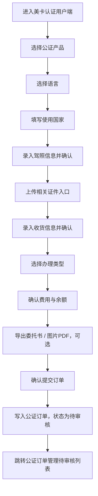

# 美卡平台-用户端 PRD

> **模块**: 美卡认证用户端
> **版本**: v1.2
> **最后更新**: 2026-05-13
> **作者**: Codex

---

## 更新日志

- **v1.2 (2026-05-13)**: 同步当前项目产品分类边界，明确用户端仍只创建公证订单，`domestic_license` 换国内驾照翻译件不从本入口下单
- **v1.1 (2026-05-06)**: 补充使用国家输入框、自定义终止日期、日期选择器样式、发证机构共享字典、档案编号与条形码写入口径。
- **v1.0 (2026-04-29)**: “美卡认证用户端” PRD，客户端录单流程、字段口径、订单提交、异常边界与订单中心联动。

---

## 1. 背景与目标

### 1.1 业务背景

美卡后台当前已提供运营侧订单管理、公证订单管理与公证处工作台。为了模拟用户自助录入订单的前台体验，系统提供“美卡认证用户端”页面，由用户端完成产品选择、语言与使用国家填写、驾照信息录入、收货信息确认、办理类型选择与订单提交。

### 1.2 目标

| # | 目标                   | 描述                                                                       |
| - | ---------------------- | -------------------------------------------------------------------------- |
| 1 | 明确客户端录单入口     | 用户可进入用户端录单页并看到当前录单工作台                                 |
| 2 | 固化录单五步流程       | 选择产品、确认驾照信息、确认收货信息、选择办理类型、提交订单               |
| 3 | 支撑公证订单创建       | 客户端提交后创建公证类订单，并进入后台公证订单管理待审核列表               |
| 4 | 提供客户端费用确认     | 展示产品费用、当前余额与支付后余额                                         |
| 5 | 保留材料与文档动作入口 | 提供证件上传、委托书导出、图片转 PDF 等演示入口                            |
| 6 | 保证演示链路可验收     | 明确使用国家、终止日期等提交阻断、字段兜底、Toast 反馈、跳转和订单写入口径 |

### 1.3 非目标

- 不实现真实代理账号体系、代理等级切换与权限矩阵。
- 不实现真实账户扣款、在线支付、充值与账单结算。
- 不实现文件二进制上传、OCR 识别、真实委托书生成与真实 PDF 导出。
- 不实现外部代理门户后端 API 联调。

---

## 2. 范围

### 2.1 In Scope

- 录单页左侧步骤导航与锚点滚动。
- 公证类在售产品选择与语言选项联动。
- 使用国家输入框、必填校验与订单写入。
- 驾照信息录入、证件材料上传入口展示。
- 驾照有效期自定义终止日期选择与提交校验。
- 收货信息录入、地址识别演示入口。
- 办理类型选择、费用与余额展示。
- 委托书导出、图片 PDF 导出演示入口。
- 确认提交订单后写入主订单数据，并跳转公证订单管理待审核。
- 页面顶部品牌、演示导航、返回后台按钮。
- 提交失败/阻断提示、提交中按钮禁用和成功 Toast。
- 仅提交 `productCategory=notary` 的公证订单；换国内驾照翻译件属于 `domestic_license` 产品分类，由管理端审核后进入驾照官生产端，不从当前用户端录单页创建。

### 2.2 Out of Scope

- 客户端订单列表、客户端订单详情。
- 客户端登录页与独立会话。
- 真实地址解析、收货地址库、常用联系人管理。
- 真实文件预览、文件删除持久化、上传进度。
- 真实支付风控、余额不足阻断与资金流水。

---

## 3. 用户角色

| 角色              | 使用场景                                   | 权限说明                                   |
| ----------------- | ------------------------------------------ | ------------------------------------------ |
| 后台管理员 / 运营 | 进入用户端进行演示录单                     | 复用当前有效会话，可进入 `/agent-system` |
| 代理用户（演示）  | 录入客户驾照、公证产品与收货信息并提交订单 | 当前不做独立账号鉴权                       |
| 后台审核人员      | 在公证订单管理中审核客户端提交的订单       | 订单提交后进入待审核池                     |
| 驾照官生产人员    | 处理中文翻译件生产订单                     | 不通过当前用户端创建订单                   |

### 3.1 User Stories

#### US-AOE-001 客户端快速录单

> **作为** 代理用户（演示）
> **我希望** 在一个页面内完成产品、证件、收货、办理类型和费用确认
> **以便于** 快速提交一条可进入后台审核的公证订单

#### US-AOE-002 运营演示链路闭环

> **作为** 后台管理员 / 运营
> **我希望** 客户端提交后能在公证订单管理待审核列表看到新订单
> **以便于** 演示代理录单到后台审核的完整闭环

#### US-AOE-003 审核人员接单

> **作为** 后台审核人员
> **我希望** 客户端提交的订单字段有稳定兜底值和日志
> **以便于** 在待审核池中直接识别订单来源并继续处理

---

## 4. 入口与信息架构

### 4.1 页面标题与导航

- 页面品牌：`美卡认证用户端`。
- 顶部导航：`首页`、`下单入口`、`订单中心`、`公证业务`、`产品列表`、`账户中心`。
- 当前激活导航：`下单入口`。
- 左侧步骤导航：
  - `选择产品`
  - `确认驾照信息`
  - `确认收货信息`
  - `选择办理类型`
  - `提交订单`
- 左侧导航与页面主体的锚点顺序必须保持一致。

### 4.2 交互原则

- 页面为单页纵向录单流程。
- 点击左侧步骤导航时平滑滚动到对应区域。
- 页面滚动时左侧步骤自动高亮当前区域。
- 提交中状态下禁用重复提交。
- Toast 用于反馈确认、上传入口、地址识别、导出和提交结果。
- 当前版本允许大部分表单字段为空提交，由提交规则统一兜底；使用国家与自定义终止日期属于提交阻断例外。

### 4.3 页面状态

| 状态       | 触发条件                                     | 页面表现                                           |
| ---------- | -------------------------------------------- | -------------------------------------------------- |
| 初始态     | 页面首次进入                                 | 默认选中首个在售公证产品、首个语言、首个办理类型   |
| 产品空态   | 无在售公证产品                               | 产品选择区展示 `暂无在售公证产品`，提交时阻断    |
| 提交阻断态 | 缺少产品、办理类型、自定义终止日期或使用国家 | 展示对应 Toast，不创建订单                         |
| 提交中     | 点击确认提交后                               | `确认提交订单` 按钮置为 `提交中...` 并禁用     |
| 提交成功态 | 订单写入成功                                 | 展示订单成功 Toast，700ms 后跳转待审核列表         |
| 演示动作态 | 上传、地址识别、导出                         | 只展示 Toast，不产生真实文件、识别结果或下载副作用 |

---

## 5. 业务流程



**异常流程**

- 无在售公证产品：停留当前页并提示 `暂无可提交的公证产品`。
- 当前产品无办理类型：停留当前页并提示 `请先配置办理类型`。
- 使用国家为空：停留当前页并提示 `请选择使用国家`。
- 有效期选择 `自定义` 但未选择终止日期：停留当前页并提示 `请选择终止日期`。
- 地址识别输入为空：只阻断地址识别动作，不阻断整单提交。
- 上传、导出、确认驾照、确认收货均为演示反馈动作，不改变主流程是否可提交。

---

## 6. 功能需求

### 6.1 FR-AOE-001 选择产品

**描述**
代理用户选择在售公证类产品，并根据产品类型选择语言。

**规则**

- 产品来源：产品中心中 `category = notary` 且 `status = active` 的产品。
- 排序：按 `weight DESC`，权重相同时按产品标题升序。
- 产品为空时显示 `暂无在售公证产品`。
- 页面初始进入时，若存在在售公证产品，默认选中排序后的第一个产品。
- 语言联动：
  - 产品标题包含 `公证双号` 或 `公证海牙双号`：语言为 `英语`、`意大利语`。
  - 其它公证产品：语言为 `英语`、`法语`、`西班牙语`、`意大利语`、`德语`。
- 语言字段下方展示 `使用国家` 输入框。
- 使用国家为必填，placeholder 为 `请输入使用国家`。
- 使用国家采用普通文本输入框，不提供下拉候选；录单员手动输入国家或地区名称。
- 切换产品后，默认选中该产品的第一个语言与第一个办理类型。

**验收标准**

- 产品列表不展示非公证类、下架产品。
- 切换到双号类产品后，语言选项只保留 `英语`、`意大利语`。
- 切换到其它公证产品后，语言选项恢复为五语种。
- 语言下方展示使用国家输入框，且不是下拉框。
- 当前已选语言或办理类型不属于新产品可用范围时，必须重置，不能保留脏选项。

### 6.2 FR-AOE-002 确认驾照信息

**描述**
代理用户录入客户驾照与证件基础信息。

**字段**

| 字段         | 类型       | 当前行为                                          |
| ------------ | ---------- | ------------------------------------------------- |
| 驾驶证号码   | 文本       | 可填；为空提交时使用系统生成兜底值                |
| 姓名         | 文本       | 可填；为空时优先使用收货人姓名                    |
| 姓氏拼音     | 文本       | 可填                                              |
| 名字拼音     | 文本       | 可填                                              |
| 性别         | 单选       | 默认男，可选女                                    |
| 国籍         | 文本       | 可填；为空时提交使用 `中国/CHN`                 |
| 出生日期     | 日期选择器 | 可选                                              |
| 驾照地址详情 | 多行文本   | 可填；为空时可用收货地址兜底                      |
| 准驾车型     | 文本       | 可填；为空时提交使用 `C1`                       |
| 档案编号     | 文本       | UI 标识必填，当前演示不阻断提交                   |
| 条形码       | 文本       | UI 标识必填，当前演示不阻断提交                   |
| 初次领证日期 | 日期选择器 | 可选                                              |
| 有效起始日期 | 日期选择器 | 可选                                              |
| 有效期       | 选项       | `6年`、`10年`、`60年`、`长期`、`自定义` |
| 终止日期     | 日期选择器 | 有效期选择 `自定义` 时展示并必选                |
| 发证地区     | 省市联动   | UI 标识必填，选择省后展示城市                     |
| 发证机构     | 下拉       | 可选；与管理端公证订单审核修改页共享选项数据      |

**交互**

- 点击 `确认驾照信息` 后展示 Toast：`驾照信息已确认`。
- 日期选择器支持月份与年份切换，输入框右侧展示日历图标，弹层采用白底圆角日历面板。
- 有效截止日期由“有效起始日期 + 有效期”计算；选择 `长期` 时不生成截止日期。
- 有效期选择 `自定义` 时，在有效期下一行展示 `终止日期` 日期选择器。
- 有效期选择 `自定义` 但未选择终止日期时，提交订单阻断并提示 `请选择终止日期`。
- 省市联动：未选择省份前城市选择不可用；切换省份后，若当前城市不属于新省份则清空城市。
- 档案编号、条形码、发证地区在 UI 上展示必填标识，但当前演示不阻断提交。
- 发证机构下拉选项与管理端公证订单审核修改页一致：`公安局交通管理局`、`公安局交通警察支队`、`公安局交通警察总队`、`公安局公安交通管理局`、`公安局交通管理支队`、`公安局交通警察巡逻支队`。

**提交写入口径**

| 字段                        | 写入口径                                                                                                            |
| --------------------------- | ------------------------------------------------------------------------------------------------------------------- |
| `licenseName`             | 驾照姓名；为空时使用收货人姓名；仍为空使用 `代理客户`                                                             |
| `licenseNo`               | 驾驶证号码；为空时生成 `D` + 当前时间戳后 8 位                                                                    |
| `licenseGender`           | 性别；为空时使用 `男`                                                                                             |
| `licenseNationality`      | 国籍；为空时使用 `中国/CHN`                                                                                       |
| `licenseCategory`         | 准驾车型；为空时使用 `C1`                                                                                         |
| `licenseAddress`          | 驾照地址；为空时使用订单收货地址                                                                                    |
| `licenseArchiveNumber`    | 档案编号；按录单员输入写入，允许后续管理端审核修改                                                                  |
| `licenseBarcodeNumber`    | 条形码；按录单员输入写入，允许后续管理端审核修改                                                                    |
| `licenseValidUntilDate`   | 有效期为 `自定义` 时写入手动选择的终止日期；否则写入有效起始日期 + 有效期；有效期为 `长期` 或起始日期为空时写空 |
| `licenseValidYears`       | 当前所选有效期，支持 `6年`、`10年`、`60年`、`长期`、`自定义`                                              |
| `licenseIssuingAuthority` | 发证机构；按共享字典下拉所选值写入                                                                                  |
| `licenseIssuingRegion`    | 省份 + 城市，使用空格拼接                                                                                           |

### 6.3 FR-AOE-003 上传相关证件

**描述**
页面展示证件材料上传入口，为后续真实上传能力预留交互位置。

**入口**

- 驾照正面照片
- 驾照反面照片
- 驾照副页正面照片
- 驾照副页反面照片
- 身份证正面
- 身份证反面
- 电子驾照
- 电子签名

**当前行为**

- 点击任一上传卡片时展示对应 Toast：`{材料名称}上传入口已打开`。
- 不持久化文件，不生成真实文件对象。
- 上传入口不影响提交按钮可用性。
- 上传卡片仅作为后续真实上传能力的占位，不展示文件名、缩略图、上传进度或删除动作。

### 6.4 FR-AOE-004 确认收货信息

**描述**
代理用户录入订单收货地址与收货人信息。

**字段**

| 字段       | 类型     | 当前行为                       |
| ---------- | -------- | ------------------------------ |
| 地址信息   | 下拉     | 示例省市区选项                 |
| 详细地址   | 多行文本 | 可填                           |
| 收货人姓名 | 文本     | 可填；为空时可由驾照姓名兜底   |
| 手机号码   | 文本     | 可填；为空时提交使用演示手机号 |

**交互**

- 点击 `确认收货信息` 后展示 Toast：`收货信息已确认`。
- 收货信息允许为空提交，由提交规则兜底。
- 地址展示时按“地址信息 + 详细地址”拼接；两者均为空时优先使用地址识别文本。

**提交写入口径**

| 字段                | 写入口径                                                           |
| ------------------- | ------------------------------------------------------------------ |
| `customerName`    | 收货人姓名；为空时使用驾照姓名；仍为空使用 `代理客户`            |
| `customerPhone`   | 手机号码；为空时使用演示手机号 `13800138000`                     |
| `deliveryAddress` | 地址信息 + 详细地址；为空时使用地址识别文本；仍为空使用 `待补充` |

### 6.5 FR-AOE-005 地址识别

**描述**
提供地址识别演示输入区。

**规则**

- 地址识别输入为空时，阻断并提示：`请先输入完整地址信息`。
- 地址识别输入非空时，展示 Toast：`地址识别已提交`。
- 当前版本不进行真实地址解析，不自动拆分省市区、姓名、电话。
- 用户编辑地址识别文本时，已展示的错误提示应自动清除。
- 地址识别文本可作为提交时 `deliveryAddress` 的兜底来源。

### 6.6 FR-AOE-006 选择办理类型

**描述**
根据所选产品展示可选办理类型卡片。

**规则**

- 办理类型来源：所选产品的 `processTypes`。
- 卡片展示：价格、办理类型名称、描述。
- 若描述为空，展示 `约 {estimatedDays} 个工作日`。
- 价格口径：优先读取 `self` 代理等级价格；缺失时使用该办理类型第一条价格。
- 产品未选择时显示：`请先选择驾照翻译认证产品`。
- 点击办理类型卡片后高亮选中。
- 切换产品后，默认选择新产品的第一个办理类型；若无办理类型，提交时提示 `请先配置办理类型`。

### 6.7 FR-AOE-007 提交订单与费用确认

**描述**
代理用户在提交订单区确认费用，并可执行导出和提交动作。

**展示**

- `产品费用`：当前办理类型价格。
- `当前余额`：当前演示固定余额 `¥28304`。
- `支付后余额`：当前余额 - 产品费用。

**动作**

| 动作             | 当前行为                           |
| ---------------- | ---------------------------------- |
| 导出外事办委托书 | 展示 Toast：`外事办委托书已导出` |
| 导出北部湾委托书 | 展示 Toast：`北部湾委托书已导出` |
| 导出张江委托书   | 展示 Toast：`张江委托书已导出`   |
| 导出图片为PDF    | 展示 Toast：`图片 PDF 已导出`    |
| 确认提交订单     | 创建订单并跳转公证订单管理         |

**提示**

- 提交区固定展示提醒：`提交前请确认所有信息无误，提交后将无法修改`。

**提交阻断**

| 条件                           | 反馈                            |
| ------------------------------ | ------------------------------- |
| 无在售公证产品                 | Toast：`暂无可提交的公证产品` |
| 当前产品无办理类型             | Toast：`请先配置办理类型`     |
| 有效期为自定义但未选择终止日期 | Toast：`请选择终止日期`       |
| 使用国家为空                   | Toast：`请选择使用国家`       |
| 正在提交中重复点击             | 忽略点击，不重复创建订单        |

### 6.8 FR-AOE-008 创建公证订单

**描述**
点击 `确认提交订单` 后，系统创建一条公证订单并进入后台待审核。

**创建规则**

| 字段                                      | 写入规则                                                                          |
| ----------------------------------------- | --------------------------------------------------------------------------------- |
| `orderId`                               | 由订单服务生成；当前不允许前台手动编辑                                            |
| `customerName`                          | 见 6.4 提交写入口径                                                               |
| `customerPhone`                         | 见 6.4 提交写入口径                                                               |
| `customerPassport`                      | 使用 `licenseNo`                                                                |
| `customerEmail`                         | 生成演示邮箱 `agent-{timestamp}@example.com`                                    |
| `productCategory`                       | 固定为 `notary`                                                                 |
| `productId`                             | 当前所选产品 ID                                                                   |
| `productName`                           | 根据产品标题归一为 `公证单号`、`公证双号`、`公证海牙单号`、`公证海牙双号` |
| `processType` / `processTypeId`       | 当前所选办理类型                                                                  |
| `language`                              | 当前所选语言；为空时回退到当前产品第一个可用语言                                  |
| `useCountry`                            | 使用国家输入框内容；提交时 trim 后写入，必填                                      |
| `lockedPrice`                           | 当前办理类型价格                                                                  |
| `status`                                | 固定为 `pending_review`                                                         |
| `channel`                               | 固定为 `private`                                                                |
| `agentLevel`                            | 固定为 `self`                                                                   |
| `pushTimeliness`                        | 固定为 `instant`                                                                |
| `deliveryAddress`                       | 见 6.4 提交写入口径                                                               |
| `logisticsCompany` / `trackingNumber` | 初始化为空字符串                                                                  |
| `license*` 字段                         | 见 6.2 提交写入口径                                                               |
| `remark`                                | `用户端提交`                                                                    |
| `createdAt` / `updatedAt`             | 当前北京时间                                                                      |
| `logs`                                  | 写入 `订单创建：用户端确认提交`，operator 为 `用户端`                         |

**成功反馈**

- 展示 Toast：`订单 {orderId} 已进入公证订单管理`。
- 700ms 后跳转：`/order-management/notary-orders?status=pending_review`。
- 新订单应插入主订单列表顶部，并可被公证订单管理待审核筛选读出。

---

## 7. 数据模型

### 7.1 Logical View

```typescript
interface AgentOrderEntryView {
  products: NotaryProductOption[];
  selectedProductId: string;
  selectedLanguage: string;
  useCountry: string;
  selectedProcessTypeId: string;
  addressRecognitionText?: string;
  isSubmittingOrder: boolean;
  activeStep: 'product' | 'certificate' | 'delivery' | 'processType' | 'checkout';
  certificate: {
    licenseNo?: string;
    licenseName?: string;
    idpSurnameEn?: string;
    idpGivenNameEn?: string;
    gender: '男' | '女';
    licenseNationality?: string;
    licenseBirthDate?: string;
    licenseAddress?: string;
    licenseCategory?: string;
    archiveNumber?: string;
    barcodeNumber?: string;
    licenseFirstIssueDate?: string;
    licenseValidFromDate?: string;
    licenseValidUntilDate?: string;
    licenseValidYears: '6年' | '10年' | '60年' | '长期' | '自定义';
    licenseIssuingRegion?: string;
    licenseIssuingAuthority?: string;
  };
  delivery: {
    deliveryRegion?: string;
    deliveryAddress?: string;
    customerName?: string;
    customerPhone?: string;
  };
  checkout: {
    productFee: number;
    currentBalance: number;
    balanceAfterPayment: number;
  };
  toast?: string;
}

interface NotaryProductOption {
  productId: string;
  title: string;
  category: 'notary';
  status: 'active';
  weight: number;
  languageOptions: string[];
  processTypes: Array<{
    typeId: string;
    name: string;
    description?: string;
    estimatedDays: number;
    price: number; // Derived: self price, fallback to first pricing item
  }>;
}

interface SubmittedAgentNotaryOrder {
  orderId: string;
  customerName: string;
  customerPhone: string;
  customerPassport: string;
  customerEmail: string;
  productId: string;
  productName: '公证单号' | '公证双号' | '公证海牙单号' | '公证海牙双号';
  productCategory: 'notary';
  processType: string;
  processTypeId: string;
  pushTimeliness: 'instant';
  language?: string;
  useCountry: string;
  lockedPrice: number;
  status: 'pending_review';
  channel: 'private';
  agentLevel: 'self';
  deliveryAddress: string;
  logisticsCompany: '';
  trackingNumber: '';
  remark: '用户端提交';
  licenseName: string;
  licenseNo: string;
  licenseCategory: string;
  licenseGender: '男' | '女';
  licenseNationality: string;
  licenseBirthDate?: string;
  licenseAddress: string;
  licenseFirstIssueDate?: string;
  licenseValidFromDate?: string;
  licenseValidUntilDate?: string;
  licenseValidYears: '6年' | '10年' | '60年' | '长期' | '自定义';
  licenseIssuingAuthority?: string;
  licenseIssuingRegion?: string;
  createdAt: string;
  updatedAt: string;
  logs: Array<{
    time: string;
    operator: '用户端';
    action: '订单创建：用户端确认提交';
  }>;
}
```

### 7.2 数据来源与持久化

| 数据           | 来源                       | 当前持久化口径                       |
| -------------- | -------------------------- | ------------------------------------ |
| 产品与办理类型 | 产品中心 `getProducts()` | 只读；过滤出在售公证产品             |
| 录单表单状态   | 页面本地 state / form      | 页面刷新后不保留草稿                 |
| 提交订单       | 订单服务 `addOrder()`    | 写入主订单数据源，插入列表顶部       |
| 当前余额       | 演示常量                   | 固定 `¥28304`，不扣减、不生成流水 |
| 上传/导出动作  | 页面按钮                   | 不持久化，不写订单附件               |

---

## 8. 业务规则

| 编号       | 规则                                                                                 |
| ---------- | ------------------------------------------------------------------------------------ |
| BR-AOE-001 | 代理录单页只读取在售公证产品，不展示翻译、IDP、Klook 产品                            |
| BR-AOE-002 | 产品切换后，语言与办理类型需要重置到新产品可用范围内                                 |
| BR-AOE-003 | 办理类型价格在提交订单时锁定为 `lockedPrice`                                       |
| BR-AOE-004 | 订单提交后统一进入公证订单管理的待审核状态                                           |
| BR-AOE-005 | 重复点击提交按钮时不得创建重复订单                                                   |
| BR-AOE-006 | 地址识别为空时必须阻断识别动作                                                       |
| BR-AOE-007 | 当前上传与导出为演示动作，不产生真实文件副作用                                       |
| BR-AOE-008 | 有效期为 `长期` 时不计算有效截止日期                                               |
| BR-AOE-009 | 页面显示必填标识的字段默认仅作业务提醒；使用国家与自定义终止日期属于当前提交阻断例外 |
| BR-AOE-010 | 产品标题归一必须优先识别海牙双号、海牙单号、双号，其余归为公证单号                   |
| BR-AOE-011 | 提交成功后应带 `status=pending_review` 过滤参数进入公证订单管理列表                |
| BR-AOE-012 | 余额为演示口径，不因提交订单扣减，也不生成账户流水                                   |
| BR-AOE-013 | 订单时间统一使用北京时间，`createdAt` 与 `updatedAt` 首次创建时一致              |
| BR-AOE-014 | 使用国家为公证订单必填字段，提交时需写入 `useCountry`                              |
| BR-AOE-015 | 有效期选择 `自定义` 时，终止日期必须由录单员手动选择                               |
| BR-AOE-016 | 发证机构选项需与管理端公证订单审核修改页共享同一套字典                               |
| BR-AOE-017 | 档案编号、条形码提交时需写入订单，后续可由管理端审核修改                             |
| BR-AOE-018 | 当前录单页不读取 `domestic_license` 产品，不创建“换国内驾照翻译件”订单           |

---

## 9. 边界场景

| 场景                           | 处理方式                                               |
| ------------------------------ | ------------------------------------------------------ |
| 无在售公证产品                 | 产品下拉展示空态，提交时提示 `暂无可提交的公证产品`  |
| 产品无办理类型                 | 提交时提示 `请先配置办理类型`                        |
| 当前产品不支持已选语言         | 自动清空语言；提交时可回退到当前产品第一个语言         |
| 当前产品不支持已选办理类型     | 自动清空办理类型；提交时可回退到当前产品第一个办理类型 |
| 选择省份后城市不属于该省       | 自动清空城市                                           |
| 地址识别文本为空               | 显示错误 `请先输入完整地址信息`                      |
| 收货地址为空                   | 优先使用地址识别文本；仍为空写入 `待补充`            |
| 收货人和驾照姓名均为空         | 写入 `代理客户`                                      |
| 驾驶证号码为空                 | 系统生成 `D` + 当前时间戳后 8 位                     |
| 有效起始日期为空               | 有效截止日期为空                                       |
| 有效期选择自定义但终止日期为空 | 提交阻断，提示 `请选择终止日期`                      |
| 使用国家为空                   | 提交阻断，提示 `请选择使用国家`                      |
| 用户重复提交                   | 提交中按钮禁用，避免重复写入                           |
| 余额不足                       | 当前不阻断，仅展示支付后余额；后续版本接入资金规则     |
| 跳转前关闭页面                 | 已创建订单保留在主订单数据源；未完成跳转不回滚订单     |

---

## 10. 非功能需求

- 页面首次渲染在本地演示数据下应小于 2s。
- 锚点滚动与当前步骤高亮应无明显卡顿。
- 提交动作反馈必须可见，至少包含 Toast 与按钮禁用状态。
- 表单区域在桌面宽度下应保持清晰分组，移动端可纵向堆叠。
- 订单提交后必须保证后台公证订单管理能读取到新订单。
- 日期选择器、单选项、下拉框、上传入口和导出按钮应可通过键盘聚焦与操作。
- 订单创建、Toast、跳转等动作不得依赖真实网络请求。
- 页面刷新不恢复草稿属于当前可接受行为，但不得破坏已提交订单数据。

---

## 11. 验收用例

| 用例        | 场景               | 操作                                       | 预期                                                                   |
| ----------- | ------------------ | ------------------------------------------ | ---------------------------------------------------------------------- |
| TC-AOE-001  | 默认选择           | 首次进入页面                               | 默认选中首个在售公证产品、首个语言、首个办理类型                       |
| TC-AOE-002  | 产品语言联动       | 选择公证双号类产品                         | 语言仅展示英语、意大利语                                               |
| TC-AOE-003  | 单号语言联动       | 选择非双号公证产品                         | 展示英语、法语、西班牙语、意大利语、德语                               |
| TC-AOE-004  | 驾照信息确认       | 点击 `确认驾照信息`                      | 展示 `驾照信息已确认`                                                |
| TC-AOE-005  | 有效期长期         | 有效期选择 `长期` 后提交                 | `licenseValidUntilDate` 为空                                         |
| TC-AOE-005A | 有效期自定义       | 有效期选择 `自定义`                      | 展示 `终止日期` 日期选择器                                           |
| TC-AOE-005B | 自定义终止日期缺失 | 有效期选择 `自定义` 但不选终止日期后提交 | 阻断提交并提示 `请选择终止日期`                                      |
| TC-AOE-006  | 地址识别空输入     | 不填地址识别文本并点击识别                 | 阻断并显示 `请先输入完整地址信息`                                    |
| TC-AOE-007  | 地址识别有输入     | 输入完整地址后点击识别                     | 展示 `地址识别已提交`                                                |
| TC-AOE-008  | 收货信息确认       | 点击 `确认收货信息`                      | 展示 `收货信息已确认`                                                |
| TC-AOE-009  | 办理类型选择       | 点击任一办理类型卡片                       | 卡片高亮，费用和支付后余额同步变化                                     |
| TC-AOE-010  | 委托书导出         | 点击任一导出按钮                           | 展示对应导出 Toast，不下载真实文件                                     |
| TC-AOE-011  | 上传入口           | 点击任一上传卡片                           | 展示 `{材料名称}上传入口已打开`，不创建真实文件                      |
| TC-AOE-011A | 使用国家输入       | 在语言下方填写使用国家                     | 输入框保存文本，提交后订单写入 `useCountry`                          |
| TC-AOE-011B | 使用国家缺失       | 不填写使用国家后点击提交                   | 阻断提交并提示 `请选择使用国家`                                      |
| TC-AOE-011C | 档案编号条形码写入 | 填写档案编号、条形码后提交                 | 订单写入 `licenseArchiveNumber` 与 `licenseBarcodeNumber`          |
| TC-AOE-012  | 确认提交订单       | 完成基础选择后点击提交                     | 创建 `pending_review` 公证订单，`remark=用户端提交`                |
| TC-AOE-013  | 字段兜底提交       | 姓名、手机号、地址、驾照号留空             | 按 6.2/6.4 兜底规则写入订单                                            |
| TC-AOE-014  | 提交后跳转         | 订单创建成功                               | 700ms 后跳转 `/order-management/notary-orders?status=pending_review` |
| TC-AOE-015  | 无办理类型         | 产品无办理类型时提交                       | 提示 `请先配置办理类型`                                              |
| TC-AOE-016  | 重复提交           | 提交中再次点击按钮                         | 按钮禁用，不创建重复订单                                               |

---

## 12. Tracking Events 与埋点建议

| 事件                            | 触发时机         | 关键参数                                                       |
| ------------------------------- | ---------------- | -------------------------------------------------------------- |
| `agent_step_anchor_click`     | 点击左侧步骤导航 | `stepName`, `stepIndex`                                    |
| `agent_product_select`        | 切换产品         | `productId`, `productName`, `languageCount`              |
| `agent_language_select`       | 切换语言         | `productId`, `language`                                    |
| `agent_use_country_change`    | 填写使用国家     | `hasValue`                                                   |
| `agent_process_type_select`   | 选择办理类型     | `productId`, `processTypeId`, `price`                    |
| `agent_certificate_confirm`   | 点击确认驾照信息 | `hasLicenseNo`, `hasLicenseName`                           |
| `agent_delivery_confirm`      | 点击确认收货信息 | `hasDeliveryAddress`, `hasCustomerPhone`                   |
| `agent_address_recognition`   | 点击地址识别     | `hasInput`, `result`                                       |
| `agent_material_upload_click` | 点击上传入口     | `materialType`                                               |
| `agent_document_export_click` | 点击导出入口     | `documentType`                                               |
| `agent_order_submit`          | 提交订单成功     | `orderId`, `productId`, `processTypeId`, `lockedPrice` |
| `agent_order_submit_blocked`  | 提交订单被阻断   | `reason`, `productId`                                      |

---

## 13. 后续版本建议

- v1.3：补齐余额不足阻断、手机号格式校验和更细的字段合法性校验。
- v1.4：接入真实材料上传、文件预览与图片转 PDF。
- v1.5：接入真实委托书模板生成与下载。
- v1.6：增加客户端订单中心、订单草稿与继续编辑能力。
- v2.0：接入真实代理账号、余额、账单与支付流水。
