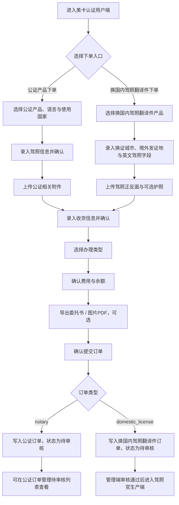

# 美卡平台-用户端 PRD

> **模块**: 美卡认证用户端
> **版本**: v1.0
> **最后更新**: 2026-05-19
> **作者**: Codex

---

## 更新日志

- **v1.0 (2026-04-29)**: “美卡认证用户端” PRD，客户端录单流程、字段口径、订单提交、异常边界与订单中心联动。

---

## 1. 背景与目标

### 1.1 业务背景

美卡后台当前已提供运营侧订单管理、公证订单管理、公证处工作台与驾照官生产端。为了模拟用户自助录入订单的前台体验，系统提供“美卡认证用户端”页面，由用户端完成公证产品下单或换国内驾照翻译件下单，并将订单写入主订单数据源。

当前用户端支持两个录单入口：`公证产品下单` 与 `换国内驾照翻译件下单`。公证订单提交后进入后台公证订单管理待审核；换国内驾照翻译件订单提交后进入管理端待审核，审核通过后由驾照官生产端继续处理。

### 1.2 目标

| # | 目标                   | 描述                                                                         |
| - | ---------------------- | ---------------------------------------------------------------------------- |
| 1 | 明确客户端录单入口     | 用户可进入用户端录单页并看到当前录单工作台                                   |
| 2 | 固化双录单流程         | 公证订单与换国内驾照翻译件共用产品、证件、收货、办理类型、提交五步骨架       |
| 3 | 支撑多分类订单创建     | 客户端可创建 `notary` 公证订单与 `domestic_license` 换国内驾照翻译件订单 |
| 4 | 提供客户端费用确认     | 展示产品费用、当前余额与支付后余额                                           |
| 5 | 保留材料与文档动作入口 | 提供附件上传、委托书导出、图片转 PDF、本地图片预览与送审材料生成口径         |
| 6 | 保证演示链路可验收     | 明确必传附件、提交阻断、字段兜底、Toast 反馈、跳转和订单写入口径             |
| 7 | 提供用户端订单中心     | 支持用户端查看已提交订单、按状态 / 产品 / 日期筛选并预览附件资料             |

### 1.3 非目标

- 不实现真实代理账号体系、代理等级切换与权限矩阵。
- 不实现真实账户扣款、在线支付、充值与账单结算。
- 不接入远程文件服务、OCR 识别、真实委托书生成服务与真实支付后端；当前图片仅做浏览器本地持久化和演示预览。
- 不实现外部代理门户后端 API 联调。

---

## 2. 范围

### 2.1 In Scope

- 录单页左侧步骤导航与锚点滚动。
- 下单入口切换：`公证产品下单` / `换国内驾照翻译件下单`。
- 公证类在售产品选择与语言选项联动。
- 换国内驾照翻译件产品选择、换证城市、境外驾驶证发放国家及城市、英文驾照字段录入。
- 使用国家输入框、必填校验与订单写入。
- 驾照信息录入、附件上传、本地图片引用保存与预览。
- 驾照有效期自定义终止日期选择与提交校验。
- 收货信息录入、地址识别演示入口。
- 办理类型选择、费用与余额展示。
- 委托书导出、图片 PDF 导出演示入口。
- 确认提交订单后写入主订单数据，并跳转公证订单管理待审核。
- 用户端订单中心列表、状态筛选、产品筛选、日期筛选、订单资料弹窗查看。
- 页面顶部品牌、演示导航、返回后台按钮。
- 提交失败/阻断提示、提交中按钮禁用和成功 Toast。
- 公证订单写入 `productCategory=notary`；换国内驾照翻译件写入 `productCategory=domestic_license` 与 `domesticLicenseInfo`。

### 2.2 Out of Scope

- 客户端登录页与独立会话。
- 真实地址解析、收货地址库、常用联系人管理。
- 远程附件存储、上传进度、文件删除服务端持久化。
- 真实支付风控、余额不足阻断与资金流水。
- 驾照官生产端的翻译、制作、发货和取消操作；该部分由独立生产端 PRD 定义。

---

## 3. 用户角色

| 角色              | 使用场景                                               | 权限说明                                   |
| ----------------- | ------------------------------------------------------ | ------------------------------------------ |
| 后台管理员 / 运营 | 进入用户端进行演示录单                                 | 复用当前有效会话，可进入 `/agent-system` |
| 代理用户（演示）  | 录入客户驾照、公证产品或换国内驾照翻译件信息并提交订单 | 当前不做独立账号鉴权                       |
| 后台审核人员      | 在管理端审核客户端提交的公证或换国内驾照翻译件订单     | 订单提交后进入待审核池                     |
| 驾照官生产人员    | 处理审核通过后的中文翻译件生产订单                     | 不访问用户端录单页                         |

### 3.1 User Stories

#### US-AOE-001 客户端快速录单

> **作为** 代理用户（演示）
> **我希望** 在一个页面内完成产品、证件、收货、办理类型和费用确认
> **以便于** 快速提交一条可进入后台审核的公证订单

#### US-AOE-002 运营演示链路闭环

> **作为** 后台管理员 / 运营
> **我希望** 客户端提交后能在公证订单管理待审核列表看到新订单
> **以便于** 演示代理录单到后台审核的完整闭环

#### US-AOE-003 审核人员接单

> **作为** 后台审核人员
> **我希望** 客户端提交的订单字段有稳定兜底值和日志
> **以便于** 在待审核池中直接识别订单来源并继续处理

#### US-AOE-004 换国内驾照翻译件下单

> **作为** 代理用户（演示）
> **我希望** 在用户端选择换国内驾照翻译件并录入境外驾照字段、换证城市和附件
> **以便于** 提交一条可由管理端审核并进入驾照官生产端的订单

#### US-AOE-005 用户端查看已提交资料

> **作为** 后台管理员 / 运营
> **我希望** 在用户端订单中心查看订单列表和附件资料
> **以便于** 快速核对录单结果是否已完整写入主订单

---

## 4. 入口与信息架构

### 4.1 页面标题与导航

- 页面品牌：`美卡认证用户端`。
- 顶部导航：`首页`、`下单入口`、`订单中心`、`公证业务`、`产品列表`、`账户中心`。
- 当前激活导航：`下单入口`。
- 下单入口支持切换：`公证产品下单` / `换国内驾照翻译件下单`。
- 左侧步骤导航：
  - `选择产品`
  - `确认驾照信息`
  - `确认收货信息`
  - `选择办理类型`
  - `提交订单`
- 左侧导航与页面主体的锚点顺序必须保持一致。

### 4.2 交互原则

- 页面为单页纵向录单流程。
- 点击左侧步骤导航时平滑滚动到对应区域。
- 页面滚动时左侧步骤自动高亮当前区域。
- 提交中状态下禁用重复提交。
- Toast 用于反馈确认、附件上传、地址识别、导出和提交结果。
- 公证产品下单允许大部分表单字段为空提交，由提交规则统一兜底；使用国家、自定义终止日期和护照首页属于提交阻断例外。
- 换国内驾照翻译件下单必须填写换证城市、驾驶证发放国家及城市、中文姓名，并上传驾照正反面照片。
- 图片上传后先压缩为 Data URL，再优先写入浏览器 IndexedDB 并在订单中保存 `meika-local-image://` 引用；浏览器不支持或写入失败时可回退保存 Data URL。

### 4.3 页面状态

| 状态       | 触发条件                               | 页面表现                                                            |
| ---------- | -------------------------------------- | ------------------------------------------------------------------- |
| 初始态     | 页面首次进入                           | 默认进入公证产品下单，选中当前入口首个在售产品、首个语言 / 办理类型 |
| 产品空态   | 当前入口无在售产品                     | 产品选择区展示空态，提交时阻断                                      |
| 提交阻断态 | 缺少产品、办理类型、关键字段或必传附件 | 展示对应 Toast，不创建订单                                          |
| 提交中     | 点击确认提交后                         | `确认提交订单` 按钮置为 `提交中...` 并禁用                      |
| 提交成功态 | 订单写入成功                           | 展示订单成功 Toast，并进入用户端订单中心或后台待审核列表            |
| 存储失败态 | 本地图片或订单写入超出浏览器存储限制   | 展示本地存储空间不足提示，不创建重复订单                            |
| 演示动作态 | 地址识别、导出                         | 只展示 Toast，不产生真实识别结果或下载副作用                        |

---

## 5. 业务流程



**异常流程**

- 当前入口无在售产品：停留当前页并提示 `暂无可提交的公证产品` 或对应入口空态。
- 当前产品无办理类型：停留当前页并提示 `请先配置办理类型`。
- 使用国家为空：停留当前页并提示 `请选择使用国家`。
- 有效期选择 `自定义` 但未选择终止日期：停留当前页并提示 `请选择终止日期`。
- 公证产品下单未上传护照首页：停留当前页并提示 `请上传护照首页`。
- 换国内驾照翻译件缺少换证城市、驾驶证发放国家及城市、中文姓名、驾照正面或驾照反面：停留当前页并提示对应缺失项。
- 地址识别输入为空：只阻断地址识别动作，不阻断整单提交。
- 附件上传会写入订单图片引用；导出、确认驾照、确认收货仍为演示反馈动作，不改变主流程是否可提交。

---

## 6. 功能需求

### 6.1 FR-AOE-001 选择产品

**描述**
代理用户在下单入口中选择在售产品。公证产品下单读取 `category = notary`，换国内驾照翻译件下单读取 `category = domestic_license` 且优先展示标题为“换国内驾照翻译件”的产品。

**规则**

- 产品来源：产品中心中当前入口对应 `category` 且 `status = active` 的产品。
- 排序：按 `weight DESC`，权重相同时按产品标题升序。
- 换国内驾照翻译件入口中，标题为 `换国内驾照翻译件` 的产品排在最前。
- 产品为空时显示当前入口空态。
- 页面初始进入或切换入口时，若存在在售产品，默认选中排序后的第一个产品。
- 公证产品语言联动：
  - 产品标题包含 `公证双号` 或 `公证海牙双号`：语言为 `英语`、`意大利语`。
  - 其它公证产品：语言为 `英语`、`法语`、`西班牙语`、`意大利语`、`德语`。
- 公证入口语言字段下方展示 `使用国家` 输入框。
- 使用国家为必填，placeholder 为 `请输入使用国家`。
- 使用国家采用普通文本输入框，不提供下拉候选；录单员手动输入国家或地区名称。
- 切换产品后，默认选中该产品的第一个语言与第一个办理类型。

**验收标准**

- 产品列表不展示当前入口之外的分类或下架产品。
- 切换到双号类产品后，语言选项只保留 `英语`、`意大利语`。
- 切换到其它公证产品后，语言选项恢复为五语种。
- 语言下方展示使用国家输入框，且不是下拉框。
- 当前已选语言或办理类型不属于新产品可用范围时，必须重置，不能保留脏选项。

### 6.2 FR-AOE-002 确认驾照信息

**描述**
代理用户录入客户驾照与证件基础信息。

**字段**

| 字段         | 类型       | 当前行为                                          |
| ------------ | ---------- | ------------------------------------------------- |
| 驾驶证号码   | 文本       | 可填；为空提交时使用系统生成兜底值                |
| 姓名         | 文本       | 可填；为空时优先使用收货人姓名                    |
| 姓氏拼音     | 文本       | 可填                                              |
| 名字拼音     | 文本       | 可填                                              |
| 性别         | 单选       | 默认男，可选女                                    |
| 国籍         | 文本       | 可填；为空时提交使用 `中国/CHN`                 |
| 出生日期     | 日期选择器 | 可选                                              |
| 驾照地址详情 | 多行文本   | 可填；为空时可用收货地址兜底                      |
| 准驾车型     | 文本       | 可填；为空时提交使用 `C1`                       |
| 档案编号     | 文本       | UI 标识必填，当前演示不阻断提交                   |
| 条形码       | 文本       | UI 标识必填，当前演示不阻断提交                   |
| 初次领证日期 | 日期选择器 | 可选                                              |
| 有效起始日期 | 日期选择器 | 可选                                              |
| 有效期       | 选项       | `6年`、`10年`、`60年`、`长期`、`自定义` |
| 终止日期     | 日期选择器 | 有效期选择 `自定义` 时展示并必选                |
| 发证地区     | 省市联动   | UI 标识必填，选择省后展示城市                     |
| 发证机构     | 下拉       | 可选；与管理端公证订单审核修改页共享选项数据      |

**交互**

- 点击 `确认驾照信息` 后展示 Toast：`驾照信息已确认`。
- 日期选择器支持月份与年份切换，输入框右侧展示日历图标，弹层采用白底圆角日历面板。
- 有效截止日期由“有效起始日期 + 有效期”计算；选择 `长期` 时不生成截止日期。
- 有效期选择 `自定义` 时，在有效期下一行展示 `终止日期` 日期选择器。
- 有效期选择 `自定义` 但未选择终止日期时，提交订单阻断并提示 `请选择终止日期`。
- 省市联动：未选择省份前城市选择不可用；切换省份后，若当前城市不属于新省份则清空城市。
- 档案编号、条形码、发证地区在 UI 上展示必填标识，但当前演示不阻断提交。
- 发证机构下拉选项与管理端公证订单审核修改页一致：`公安局交通管理局`、`公安局交通警察支队`、`公安局交通警察总队`、`公安局公安交通管理局`、`公安局交通管理支队`、`公安局交通警察巡逻支队`。

**提交写入口径**

| 字段                        | 写入口径                                                                                                            |
| --------------------------- | ------------------------------------------------------------------------------------------------------------------- |
| `licenseName`             | 驾照姓名；为空时使用收货人姓名；仍为空使用 `代理客户`                                                             |
| `licenseNo`               | 驾驶证号码；为空时生成 `D` + 当前时间戳后 8 位                                                                    |
| `licenseGender`           | 性别；为空时使用 `男`                                                                                             |
| `licenseNationality`      | 国籍；为空时使用 `中国/CHN`                                                                                       |
| `licenseCategory`         | 准驾车型；为空时使用 `C1`                                                                                         |
| `licenseAddress`          | 驾照地址；为空时使用订单收货地址                                                                                    |
| `licenseArchiveNumber`    | 档案编号；按录单员输入写入，允许后续管理端审核修改                                                                  |
| `licenseBarcodeNumber`    | 条形码；按录单员输入写入，允许后续管理端审核修改                                                                    |
| `licenseValidUntilDate`   | 有效期为 `自定义` 时写入手动选择的终止日期；否则写入有效起始日期 + 有效期；有效期为 `长期` 或起始日期为空时写空 |
| `licenseValidYears`       | 当前所选有效期，支持 `6年`、`10年`、`60年`、`长期`、`自定义`                                              |
| `licenseIssuingAuthority` | 发证机构；按共享字典下拉所选值写入                                                                                  |
| `licenseIssuingRegion`    | 省份 + 城市，使用空格拼接                                                                                           |

### 6.3 FR-AOE-003 上传相关附件

**描述**
页面展示附件上传入口。当前版本会压缩图片并保存到浏览器本地图片库，订单仅持有可解析的图片引用，用于管理端、公证处工作台和用户端订单中心回显。

**公证产品附件入口**

- 驾照正面照片
- 驾照反面照片
- 驾照副页正面照片
- 驾照副页反面照片
- 身份证正面
- 身份证反面
- 护照首页（必传）
- 护照签证页（选填）
- 行程单
- 电子驾照
- 电子签名

**换国内驾照翻译件附件入口**

- 驾照正面照片（必传）
- 驾照反面照片（必传）
- 护照（选填）

**当前行为**

- 仅允许上传图片格式附件。
- 图片上传后会压缩尺寸与质量；成功后展示缩略图和文件名，并提示 `{fileName} 已上传`。
- 公证产品下单提交前必须存在 `passport-front`；换国内驾照翻译件提交前必须存在 `frontPhoto` 与 `backPhoto`。
- 提交时，附件写入 `notaryCertificateImages` 或 `domesticLicenseInfo`，图片值优先保存为 `meika-local-image://` 引用。
- 浏览器本地存储空间不足时阻断提交并提示清理缓存。

### 6.4 FR-AOE-004 确认收货信息

**描述**
代理用户录入订单收货地址与收货人信息。

**字段**

| 字段       | 类型     | 当前行为                       |
| ---------- | -------- | ------------------------------ |
| 地址信息   | 下拉     | 示例省市区选项                 |
| 详细地址   | 多行文本 | 可填                           |
| 收货人姓名 | 文本     | 可填；为空时可由驾照姓名兜底   |
| 手机号码   | 文本     | 可填；为空时提交使用演示手机号 |

**交互**

- 点击 `确认收货信息` 后展示 Toast：`收货信息已确认`。
- 收货信息允许为空提交，由提交规则兜底。
- 地址展示时按“地址信息 + 详细地址”拼接；两者均为空时优先使用地址识别文本。

**提交写入口径**

| 字段                | 写入口径                                                           |
| ------------------- | ------------------------------------------------------------------ |
| `customerName`    | 收货人姓名；为空时使用驾照姓名；仍为空使用 `代理客户`            |
| `customerPhone`   | 手机号码；为空时使用演示手机号 `13800138000`                     |
| `deliveryAddress` | 地址信息 + 详细地址；为空时使用地址识别文本；仍为空使用 `待补充` |

### 6.5 FR-AOE-005 地址识别

**描述**
提供地址识别演示输入区。

**规则**

- 地址识别输入为空时，阻断并提示：`请先输入完整地址信息`。
- 地址识别输入非空时，展示 Toast：`地址识别已提交`。
- 当前版本不进行真实地址解析，不自动拆分省市区、姓名、电话。
- 用户编辑地址识别文本时，已展示的错误提示应自动清除。
- 地址识别文本可作为提交时 `deliveryAddress` 的兜底来源。

### 6.6 FR-AOE-006 选择办理类型

**描述**
根据所选产品展示可选办理类型卡片。

**规则**

- 办理类型来源：所选产品的 `processTypes`。
- 卡片展示：价格、办理类型名称、描述。
- 若描述为空，展示 `约 {estimatedDays} 个工作日`。
- 价格口径：优先读取 `self` 代理等级价格；缺失时使用该办理类型第一条价格。
- 产品未选择时显示：`请先选择驾照翻译认证产品`。
- 点击办理类型卡片后高亮选中。
- 切换产品后，默认选择新产品的第一个办理类型；若无办理类型，提交时提示 `请先配置办理类型`。

### 6.7 FR-AOE-007 提交订单与费用确认

**描述**
代理用户在提交订单区确认费用，并可执行导出和提交动作。

**展示**

- `产品费用`：当前办理类型价格。
- `当前余额`：当前演示固定余额 `¥28304`。
- `支付后余额`：当前余额 - 产品费用。

**动作**

| 动作             | 当前行为                                      |
| ---------------- | --------------------------------------------- |
| 导出外事办委托书 | 展示 Toast：`外事办委托书已导出`            |
| 导出北部湾委托书 | 展示 Toast：`北部湾委托书已导出`            |
| 导出张江委托书   | 展示 Toast：`张江委托书已导出`              |
| 导出图片为PDF    | 展示 Toast：`图片 PDF 已导出`               |
| 确认提交订单     | 创建订单并更新用户端订单中心 / 后台待审核数据 |

**提示**

- 提交区固定展示提醒：`提交前请确认所有信息无误，提交后将无法修改`。

**提交阻断**

| 条件                           | 反馈                                                |
| ------------------------------ | --------------------------------------------------- |
| 无在售公证产品                 | Toast：`暂无可提交的公证产品`                     |
| 当前产品无办理类型             | Toast：`请先配置办理类型`                         |
| 有效期为自定义但未选择终止日期 | Toast：`请选择终止日期`                           |
| 使用国家为空                   | Toast：`请选择使用国家`                           |
| 公证产品未上传护照首页         | Toast：`请上传护照首页`                           |
| 换国内驾照翻译件缺少关键字段   | Toast：按缺失项展示对应提示                         |
| 本地存储空间不足               | Toast：`本地存储空间不足，请清理浏览器缓存后再试` |
| 正在提交中重复点击             | 忽略点击，不重复创建订单                            |

### 6.8 FR-AOE-008 创建公证订单

**描述**
点击 `确认提交订单` 后，系统创建一条公证订单并进入后台待审核。

**创建规则**

| 字段                                      | 写入规则                                                                          |
| ----------------------------------------- | --------------------------------------------------------------------------------- |
| `orderId`                               | 由订单服务生成；当前不允许前台手动编辑                                            |
| `customerName`                          | 见 6.4 提交写入口径                                                               |
| `customerPhone`                         | 见 6.4 提交写入口径                                                               |
| `customerPassport`                      | 使用 `licenseNo`                                                                |
| `customerEmail`                         | 生成演示邮箱 `agent-{timestamp}@example.com`                                    |
| `productCategory`                       | 固定为 `notary`                                                                 |
| `productId`                             | 当前所选产品 ID                                                                   |
| `productName`                           | 根据产品标题归一为 `公证单号`、`公证双号`、`公证海牙单号`、`公证海牙双号` |
| `processType` / `processTypeId`       | 当前所选办理类型                                                                  |
| `language`                              | 当前所选语言；为空时回退到当前产品第一个可用语言                                  |
| `useCountry`                            | 使用国家输入框内容；提交时 trim 后写入，必填                                      |
| `lockedPrice`                           | 当前办理类型价格                                                                  |
| `status`                                | 固定为 `pending_review`                                                         |
| `channel`                               | 固定为 `private`                                                                |
| `agentLevel`                            | 固定为 `self`                                                                   |
| `pushTimeliness`                        | 固定为 `instant`                                                                |
| `deliveryAddress`                       | 见 6.4 提交写入口径                                                               |
| `logisticsCompany` / `trackingNumber` | 初始化为空字符串                                                                  |
| `license*` 字段                         | 见 6.2 提交写入口径                                                               |
| `notaryCertificateImages`               | 公证附件图片引用；由上传图片本地持久化后生成                                      |
| `remark`                                | `用户端提交`                                                                    |
| `createdAt` / `updatedAt`             | 当前北京时间                                                                      |
| `logs`                                  | 写入 `订单创建：用户端公证产品下单确认提交`，operator 为 `用户端`             |

**成功反馈**

- 展示 Toast：`订单 {orderId} 已进入公证订单管理`。
- 700ms 后跳转：`/order-management/notary-orders?status=pending_review`。
- 新订单应插入主订单列表顶部，并可被公证订单管理待审核筛选读出。

### 6.9 FR-AOE-009 创建换国内驾照翻译件订单

**描述**
选择 `换国内驾照翻译件下单` 后，用户端创建 `domestic_license` 订单，供管理端审核并进入驾照官生产端。

**必填校验**

| 条件                       | 反馈                                  |
| -------------------------- | ------------------------------------- |
| 未选择换证城市             | Toast：`请选择换证城市`             |
| 未选择驾驶证发放国家及城市 | Toast：`请选择驾驶证发放国家及城市` |
| 未填写中文姓名             | Toast：`请填写中文姓名`             |
| 未上传驾照正面照片         | Toast：`请上传驾照正面照片`         |
| 未上传驾照反面照片         | Toast：`请上传驾照反面照片`         |

**创建规则**

| 字段                     | 写入规则                                                     |
| ------------------------ | ------------------------------------------------------------ |
| `productCategory`      | 固定为 `domestic_license`                                  |
| `productName`          | 当前所选产品标题，优先为 `换国内驾照翻译件`                |
| `status`               | 固定为 `pending_review`，管理端审核前生产端不可见          |
| `licenseName`          | 中文姓名                                                     |
| `licenseNo`            | DL/驾驶证编号；为空时生成 `DL` + 当前时间戳后 8 位         |
| `licenseIssuingRegion` | 换证省份 + 城市                                              |
| `licenseAddress`       | 境外驾驶证发放国家 + 城市                                    |
| `useCountry`           | 境外驾驶证发放国家                                           |
| `domesticLicenseInfo`  | 写入换证城市、境外发证地、英文驾照字段、正反面照片与可选护照 |
| `logs`                 | 写入 `订单创建：用户端换国内驾照翻译件下单确认提交`        |

**与生产端边界**

- 用户端只负责创建待审核订单。
- 管理端审核通过后，订单进入驾照官生产端可见范围。
- 翻译确认、DOCX 预览编辑、PDF 导出、发货和取消以 [mei_ka_production side.md](./mei_ka_production%20side.md) 为准。

---

## 7. 数据模型

### 7.1 Logical View

```typescript
interface AgentOrderEntryView {
  entryType: 'notary' | 'domesticLicenseTranslation';
  products: Array<NotaryProductOption | DomesticLicenseProductOption>;
  selectedProductId: string;
  selectedLanguage: string;
  useCountry: string;
  selectedProcessTypeId: string;
  addressRecognitionText?: string;
  isSubmittingOrder: boolean;
  activeStep: 'product' | 'certificate' | 'delivery' | 'processType' | 'checkout';
  certificate: {
    licenseNo?: string;
    licenseName?: string;
    idpSurnameEn?: string;
    idpGivenNameEn?: string;
    gender: '男' | '女';
    licenseNationality?: string;
    licenseBirthDate?: string;
    licenseAddress?: string;
    licenseCategory?: string;
    archiveNumber?: string;
    barcodeNumber?: string;
    licenseFirstIssueDate?: string;
    licenseValidFromDate?: string;
    licenseValidUntilDate?: string;
    licenseValidYears: '6年' | '10年' | '60年' | '长期' | '自定义';
    licenseIssuingRegion?: string;
    licenseIssuingAuthority?: string;
  };
  delivery: {
    deliveryRegion?: string;
    deliveryAddress?: string;
    customerName?: string;
    customerPhone?: string;
  };
  checkout: {
    productFee: number;
    currentBalance: number;
    balanceAfterPayment: number;
  };
  notaryCertificateImages: Record<
    'license-front' | 'license-back' | 'extra-front' | 'extra-back' | 'identity-front' | 'identity-back' | 'passport-front' | 'passport-visa' | 'flight-itinerary' | 'digital-license' | 'signature',
    string
  >;
  domesticLicense?: DomesticLicenseOrderEntryView;
  toast?: string;
}

interface NotaryProductOption {
  productId: string;
  title: string;
  category: 'notary';
  status: 'active';
  weight: number;
  languageOptions: string[];
  processTypes: Array<{
    typeId: string;
    name: string;
    description?: string;
    estimatedDays: number;
    price: number; // Derived: self price, fallback to first pricing item
  }>;
}

interface DomesticLicenseProductOption {
  productId: string;
  title: '换国内驾照翻译件' | string;
  category: 'domestic_license';
  status: 'active';
  weight: number;
  processTypes: NotaryProductOption['processTypes'];
}

interface DomesticLicenseOrderEntryView {
  exchangeProvince: string;
  exchangeCity: string;
  foreignCountry: string;
  foreignCity: string;
  chineseName: string;
  licenseNumber?: string;
  expiryDate?: string;
  surname?: string;
  givenName?: string;
  birthDate?: string;
  rstr?: string;
  sex: string;
  hairColor?: string;
  eyeColor?: string;
  height?: string;
  weight?: string;
  issueDate?: string;
  fileNumber?: string;
  classType?: string;
  endorsements?: string;
  restrictions?: string;
  other?: string;
  frontPhoto: string;
  backPhoto: string;
  passportPhoto?: string;
}

interface SubmittedAgentNotaryOrder {
  orderId: string;
  customerName: string;
  customerPhone: string;
  customerPassport: string;
  customerEmail: string;
  productId: string;
  productName: '公证单号' | '公证双号' | '公证海牙单号' | '公证海牙双号';
  productCategory: 'notary';
  processType: string;
  processTypeId: string;
  pushTimeliness: 'instant';
  language?: string;
  useCountry: string;
  lockedPrice: number;
  status: 'pending_review';
  channel: 'private';
  agentLevel: 'self';
  deliveryAddress: string;
  logisticsCompany: '';
  trackingNumber: '';
  remark: '用户端提交';
  licenseName: string;
  licenseNo: string;
  licenseCategory: string;
  licenseGender: '男' | '女';
  licenseNationality: string;
  licenseBirthDate?: string;
  licenseAddress: string;
  licenseFirstIssueDate?: string;
  licenseValidFromDate?: string;
  licenseValidUntilDate?: string;
  licenseValidYears: '6年' | '10年' | '60年' | '长期' | '自定义';
  licenseIssuingAuthority?: string;
  licenseIssuingRegion?: string;
  notaryCertificateImages: Record<string, string>;
  createdAt: string;
  updatedAt: string;
  logs: Array<{
    time: string;
    operator: '用户端';
    action: '订单创建：用户端公证产品下单确认提交';
  }>;
}

interface SubmittedAgentDomesticLicenseOrder extends Omit<SubmittedAgentNotaryOrder, 'productName' | 'productCategory' | 'language' | 'useCountry' | 'notaryCertificateImages'> {
  productName: '换国内驾照翻译件' | string;
  productCategory: 'domestic_license';
  useCountry: string; // foreignCountry
  domesticLicenseInfo: DomesticLicenseOrderEntryView;
}
```

### 7.2 数据来源与持久化

| 数据           | 来源                       | 当前持久化口径                                                               |
| -------------- | -------------------------- | ---------------------------------------------------------------------------- |
| 产品与办理类型 | 产品中心 `getProducts()` | 只读；按入口过滤在售公证或 `domestic_license` 产品                         |
| 录单表单状态   | 页面本地 state / form      | 页面刷新后不保留草稿                                                         |
| 提交订单       | 订单服务 `addOrder()`    | 写入主订单数据源，插入列表顶部                                               |
| 当前余额       | 演示常量                   | 固定 `¥28304`，不扣减、不生成流水                                         |
| 附件图片       | 上传控件 + IndexedDB       | 优先写入 `meika-local-image-store`，订单保存 `meika-local-image://` 引用 |
| 导出动作       | 页面按钮                   | 展示 Toast，不生成真实委托书服务端文件                                       |

---

## 8. 业务规则

| 编号       | 规则                                                                                                          |
| ---------- | ------------------------------------------------------------------------------------------------------------- |
| BR-AOE-001 | 代理录单页按入口读取在售产品：公证入口只读 `notary`，换国内驾照翻译件入口只读 `domestic_license`          |
| BR-AOE-002 | 产品切换后，语言与办理类型需要重置到新产品可用范围内                                                          |
| BR-AOE-003 | 办理类型价格在提交订单时锁定为 `lockedPrice`                                                                |
| BR-AOE-004 | 订单提交后统一进入主订单待审核状态；公证订单进入公证订单管理待审核，换国内驾照翻译件进入管理端待审核          |
| BR-AOE-005 | 重复点击提交按钮时不得创建重复订单                                                                            |
| BR-AOE-006 | 地址识别为空时必须阻断识别动作                                                                                |
| BR-AOE-007 | 当前导出为演示动作；图片上传产生本地图片引用，不接入远程文件服务                                              |
| BR-AOE-008 | 有效期为 `长期` 时不计算有效截止日期                                                                        |
| BR-AOE-009 | 页面显示必填标识的字段默认仅作业务提醒；使用国家与自定义终止日期属于当前提交阻断例外                          |
| BR-AOE-010 | 产品标题归一必须优先识别海牙双号、海牙单号、双号，其余归为公证单号                                            |
| BR-AOE-011 | 提交成功后应带 `status=pending_review` 过滤参数进入公证订单管理列表                                         |
| BR-AOE-012 | 余额为演示口径，不因提交订单扣减，也不生成账户流水                                                            |
| BR-AOE-013 | 订单时间统一使用北京时间，`createdAt` 与 `updatedAt` 首次创建时一致                                       |
| BR-AOE-014 | 使用国家为公证订单必填字段，提交时需写入 `useCountry`                                                       |
| BR-AOE-015 | 有效期选择 `自定义` 时，终止日期必须由录单员手动选择                                                        |
| BR-AOE-016 | 发证机构选项需与管理端公证订单审核修改页共享同一套字典                                                        |
| BR-AOE-017 | 档案编号、条形码提交时需写入订单，后续可由管理端审核修改                                                      |
| BR-AOE-018 | 公证产品下单必须上传护照首页，护照签证页选填，行程单有上传时用于后续生成送审 PDF                              |
| BR-AOE-019 | 换国内驾照翻译件下单必须填写换证城市、境外驾驶证发放国家及城市、中文姓名，并上传驾照正反面                    |
| BR-AOE-020 | `notaryCertificateImages` 与 `domesticLicenseInfo` 中的图片字段优先保存为本地图片引用，展示时需解析后渲染 |
| BR-AOE-021 | 浏览器本地存储空间不足时不得创建半成品订单，应回滚订单写入并提示用户清理缓存                                  |
| BR-AOE-022 | 换国内驾照翻译件订单提交后状态为 `pending_review`，管理端审核通过前生产端不展示                             |

---

## 9. 边界场景

| 场景                           | 处理方式                                               |
| ------------------------------ | ------------------------------------------------------ |
| 无在售公证产品                 | 产品下拉展示空态，提交时提示 `暂无可提交的公证产品`  |
| 产品无办理类型                 | 提交时提示 `请先配置办理类型`                        |
| 当前产品不支持已选语言         | 自动清空语言；提交时可回退到当前产品第一个语言         |
| 当前产品不支持已选办理类型     | 自动清空办理类型；提交时可回退到当前产品第一个办理类型 |
| 选择省份后城市不属于该省       | 自动清空城市                                           |
| 地址识别文本为空               | 显示错误 `请先输入完整地址信息`                      |
| 收货地址为空                   | 优先使用地址识别文本；仍为空写入 `待补充`            |
| 收货人和驾照姓名均为空         | 写入 `代理客户`                                      |
| 驾驶证号码为空                 | 系统生成 `D` + 当前时间戳后 8 位                     |
| 有效起始日期为空               | 有效截止日期为空                                       |
| 有效期选择自定义但终止日期为空 | 提交阻断，提示 `请选择终止日期`                      |
| 使用国家为空                   | 提交阻断，提示 `请选择使用国家`                      |
| 公证护照首页为空               | 提交阻断，提示 `请上传护照首页`                      |
| 换证城市为空                   | 提交阻断，提示 `请选择换证城市`                      |
| 境外驾驶证发放地为空           | 提交阻断，提示 `请选择驾驶证发放国家及城市`          |
| 中文姓名为空                   | 提交阻断，提示 `请填写中文姓名`                      |
| 换国内驾照翻译件正反面缺失     | 提交阻断，提示上传缺失的驾照照片                       |
| 本地图片存储失败               | 提示本地存储空间不足或订单提交失败，不创建重复订单     |
| 用户重复提交                   | 提交中按钮禁用，避免重复写入                           |
| 余额不足                       | 当前不阻断，仅展示支付后余额；后续版本接入资金规则     |
| 跳转前关闭页面                 | 已创建订单保留在主订单数据源；未完成跳转不回滚订单     |

---

## 10. 非功能需求

- 页面首次渲染在本地演示数据下应小于 2s。
- 锚点滚动与当前步骤高亮应无明显卡顿。
- 提交动作反馈必须可见，至少包含 Toast 与按钮禁用状态。
- 表单区域在桌面宽度下应保持清晰分组，移动端可纵向堆叠。
- 订单提交后必须保证后台公证订单管理能读取到新订单。
- 日期选择器、单选项、下拉框、上传入口和导出按钮应可通过键盘聚焦与操作。
- 订单创建、Toast、跳转等动作不得依赖真实网络请求。
- IndexedDB 不可用时允许回退使用压缩后的 Data URL，但不得导致页面崩溃。
- 页面刷新不恢复草稿属于当前可接受行为，但不得破坏已提交订单数据。

---

## 11. 验收用例

| 用例        | 场景                 | 操作                                                     | 预期                                                                                 |
| ----------- | -------------------- | -------------------------------------------------------- | ------------------------------------------------------------------------------------ |
| TC-AOE-001  | 默认选择             | 首次进入页面                                             | 默认进入公证产品下单并选中首个在售公证产品、首个语言、首个办理类型                   |
| TC-AOE-002  | 产品语言联动         | 选择公证双号类产品                                       | 语言仅展示英语、意大利语                                                             |
| TC-AOE-003  | 单号语言联动         | 选择非双号公证产品                                       | 展示英语、法语、西班牙语、意大利语、德语                                             |
| TC-AOE-004  | 驾照信息确认         | 点击 `确认驾照信息`                                    | 展示 `驾照信息已确认`                                                              |
| TC-AOE-005  | 有效期长期           | 有效期选择 `长期` 后提交                               | `licenseValidUntilDate` 为空                                                       |
| TC-AOE-005A | 有效期自定义         | 有效期选择 `自定义`                                    | 展示 `终止日期` 日期选择器                                                         |
| TC-AOE-005B | 自定义终止日期缺失   | 有效期选择 `自定义` 但不选终止日期后提交               | 阻断提交并提示 `请选择终止日期`                                                    |
| TC-AOE-006  | 地址识别空输入       | 不填地址识别文本并点击识别                               | 阻断并显示 `请先输入完整地址信息`                                                  |
| TC-AOE-007  | 地址识别有输入       | 输入完整地址后点击识别                                   | 展示 `地址识别已提交`                                                              |
| TC-AOE-008  | 收货信息确认         | 点击 `确认收货信息`                                    | 展示 `收货信息已确认`                                                              |
| TC-AOE-009  | 办理类型选择         | 点击任一办理类型卡片                                     | 卡片高亮，费用和支付后余额同步变化                                                   |
| TC-AOE-010  | 委托书导出           | 点击任一导出按钮                                         | 展示对应导出 Toast，不下载真实文件                                                   |
| TC-AOE-011  | 上传入口             | 上传任一图片附件                                         | 展示缩略图和文件名，提交后订单写入对应图片引用                                       |
| TC-AOE-011A | 使用国家输入         | 在语言下方填写使用国家                                   | 输入框保存文本，提交后订单写入 `useCountry`                                        |
| TC-AOE-011B | 使用国家缺失         | 不填写使用国家后点击提交                                 | 阻断提交并提示 `请选择使用国家`                                                    |
| TC-AOE-011C | 档案编号条形码写入   | 填写档案编号、条形码后提交                               | 订单写入 `licenseArchiveNumber` 与 `licenseBarcodeNumber`                        |
| TC-AOE-012  | 确认提交订单         | 完成基础选择后点击提交                                   | 创建 `pending_review` 公证订单，`remark=用户端提交`                              |
| TC-AOE-013  | 字段兜底提交         | 姓名、手机号、地址、驾照号留空                           | 按 6.2/6.4 兜底规则写入订单                                                          |
| TC-AOE-014  | 提交后跳转           | 订单创建成功                                             | 700ms 后跳转 `/order-management/notary-orders?status=pending_review`               |
| TC-AOE-015  | 无办理类型           | 产品无办理类型时提交                                     | 提示 `请先配置办理类型`                                                            |
| TC-AOE-016  | 重复提交             | 提交中再次点击按钮                                       | 按钮禁用，不创建重复订单                                                             |
| TC-AOE-017  | 公证护照首页缺失     | 不上传护照首页后提交公证订单                             | 阻断提交并提示 `请上传护照首页`                                                    |
| TC-AOE-018  | 换国内驾照翻译件下单 | 填写换证城市、境外发证地、中文姓名并上传驾照正反面后提交 | 创建 `pending_review` 的 `domestic_license` 订单，并写入 `domesticLicenseInfo` |
| TC-AOE-019  | 换国内驾照必填缺失   | 不上传驾照正面或反面后提交                               | 阻断提交并提示缺失附件                                                               |
| TC-AOE-020  | 订单中心查看附件     | 打开用户端订单中心并查看订单资料                         | 公证订单展示上传附件；换国内驾照翻译件展示驾照正反面和可选护照                       |
| TC-AOE-021  | 本地图片引用解析     | 已提交订单中的图片为 `meika-local-image://`            | 订单中心、管理端、公证端预览均能解析并显示图片                                       |

---

## 12. Tracking Events 与埋点建议

| 事件                              | 触发时机         | 关键参数                                                       |
| --------------------------------- | ---------------- | -------------------------------------------------------------- |
| `agent_step_anchor_click`       | 点击左侧步骤导航 | `stepName`, `stepIndex`                                    |
| `agent_product_select`          | 切换产品         | `productId`, `productName`, `languageCount`              |
| `agent_language_select`         | 切换语言         | `productId`, `language`                                    |
| `agent_use_country_change`      | 填写使用国家     | `hasValue`                                                   |
| `agent_process_type_select`     | 选择办理类型     | `productId`, `processTypeId`, `price`                    |
| `agent_certificate_confirm`     | 点击确认驾照信息 | `hasLicenseNo`, `hasLicenseName`                           |
| `agent_delivery_confirm`        | 点击确认收货信息 | `hasDeliveryAddress`, `hasCustomerPhone`                   |
| `agent_address_recognition`     | 点击地址识别     | `hasInput`, `result`                                       |
| `agent_material_upload_click`   | 点击上传入口     | `materialType`                                               |
| `agent_material_upload_success` | 图片上传成功     | `materialType`, `stored_as_local_ref`                      |
| `agent_document_export_click`   | 点击导出入口     | `documentType`                                               |
| `agent_order_submit`            | 提交订单成功     | `orderId`, `productId`, `processTypeId`, `lockedPrice` |
| `agent_order_submit_blocked`    | 提交订单被阻断   | `reason`, `productId`                                      |
