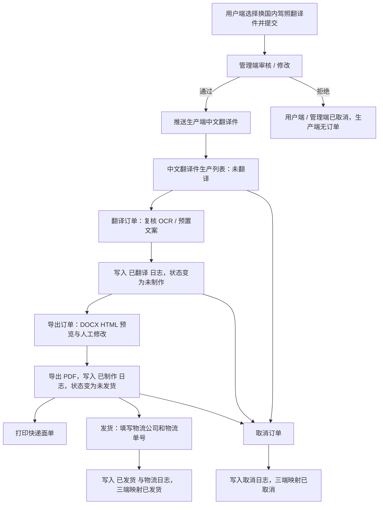

# 美卡平台--驾照官生产端 PRD

> **模块**: 驾照官生产端 / 中文翻译件生产
> **版本**: v1.0
> **最后更新**: 2026-05-14
> **作者**: Codex

---

## 更新日志

- **v1.0 (2026-05-14)**: 定义生产、翻译确认、DOCX 预览编辑、PDF 导出、发货、取消、状态映射与验收标准。

---

## 1. 背景与目标

### 1.1 业务背景

驾照官生产端用于承接管理端审核后订单。完整业务链路为：用户端录入 -> 管理端审核 / 修改 -> 生产端翻译制作 ->  物流发货。

### 1.2 目标

| # | 目标               | 说明                                                                     |
| - | ------------------ | ------------------------------------------------------------------------ |
| 1 | 独立承载生产端需求 | 将中文翻译件生产链路形成可单独评审、开发和验收的端侧文档。               |
| 2 | 明确生产状态机     | 统一“未翻译、未制作、未发货、已发货、已取消”的判定规则和可执行动作。   |
| 3 | 固化导出制作链路   | 明确 DOCX 模板预览、信息编辑、PDF 导出与制作完成日志的口径。             |
| 4 | 对齐三端状态映射   | 按 `order_status_mapping.md` 约束生产端与用户端、管理端的状态关系。    |
| 5 | 明确 Demo 边界     | 说明 OCR、面单打印、物流发货、权限与文件服务当前均为演示实现或前端兜底。 |

### 1.3 非目标

- 不重新定义用户端录单、管理端审核、产品中心配置的完整需求，仅引用其产出的订单数据。

---

## 2. 角色与范围

### 2.1 角色

| 角色                  | 使用范围         | 权限说明                                                               |
| --------------------- | ---------------- | ---------------------------------------------------------------------- |
| 驾照官生产人员        | 中文翻译件生产端 | 查看进入生产链路的订单，执行翻译确认、导出制作、打印面单、发货与取消。 |
| 管理端运营 / 审核人员 | 管理端订单中心   | 负责订单审核、资料修正、状态推进与跨端入口；不在生产端执行制作动作。   |
| 用户 / 代理           | 用户端录单       | 创建换国内驾照翻译件订单；不访问生产端。                               |

### 2.2 范围边界

| 范围     | 生产端责任                                                     |
| -------- | -------------------------------------------------------------- |
| 订单准入 | 仅接收管理端审核通过并进入生产链路的“换国内驾照翻译件”订单。 |
| 翻译制作 | 复核驾照正反面照片与字段信息，确认 OCR / 预置翻译文案。        |
| 文档生成 | 基于指定 DOCX 模板生成中文翻译件预览，允许人工修改并导出 PDF。 |
| 物流处理 | 对未发货订单打印演示面单、填写物流公司和物流单号并确认发货。   |
| 状态回写 | 将翻译、制作、发货、取消节点写入主订单日志，并同步主订单状态。 |

---

## 3. 页面与入口

### 3.1 路由

| 页面                       | 路由                                                          | 说明                                                     |
| -------------------------- | ------------------------------------------------------------- | -------------------------------------------------------- |
| 中文翻译件生产列表         | `/license-officer/orders/chinese-translation`               | 生产端主工作台，展示订单筛选、状态统计、列表与生产动作。 |
| 中文翻译件 DOCX 预览编辑页 | `/license-officer/orders/chinese-translation/docx/:orderId` | 从“导出订单”进入，用于加载模板、编辑预览与导出 PDF。   |

### 3.2 布局

- 页面布局独立于管理端主侧边栏。
- 左侧菜单显示“非标宣誓公证件 / 中文翻译件”。
- 面包屑显示 `驾照官后台 / 非标宣誓公证件 / 中文翻译件`。
- 底部支持切换管理端、切换用户端与退出登录。

---

## 4. 数据来源与可见性

### 4.1 数据来源

| 数据       | 来源                          | 说明                                                               |
| ---------- | ----------------------------- | ------------------------------------------------------------------ |
| 主订单     | `meika-orders`              | 生产端直接读取主订单列表。                                         |
| 驾照信息   | `order.domesticLicenseInfo` | 存放换证城市、境外发证地、中文姓名、驾照编号、照片与英文驾照字段。 |
| 订单状态   | `order.status`              | 与生产端日志共同映射生产状态。                                     |
| 生产日志   | `order.logs[]`              | 生产动作使用 `operator = "生产端"` 写入。                        |
| 管理端标识 | `order.managementOrderId`   | 作为进入生产链路的辅助判断依据。                                   |

### 4.2 订单识别

生产端订单必须满足“换国内驾照翻译件”业务身份：

- 产品名为 `换国内驾照翻译件`。
- 产品分类为 `domestic_license`。
- 存在 `domesticLicenseInfo` 时，可作为换国内驾照翻译件订单的辅助识别依据。
- 订单需包含用户端“确认驾照信息模块”写入的驾照字段与附件。

### 4.3 生产端可见性

| 条件     | 规则                                                                                                                         |
| -------- | ---------------------------------------------------------------------------------------------------------------------------- |
| 产品     | `order.productName.trim() === "换国内驾照翻译件"`                                                                          |
| 管理状态 | `pending_review` 和 `rejected` 不展示在生产端                                                                            |
| 生产链路 | `status` 属于 `pending_production / in_production / shipped / completed`，或存在 `managementOrderId`，或存在生产端日志 |

---

## 5. 信息架构与状态映射

### 5.1 业务流程



### 5.2 逻辑视图

| 视图                                     | 说明                                                                          |
| ---------------------------------------- | ----------------------------------------------------------------------------- |
| `ChineseTranslationProductionView`     | 中文翻译件生产列表、筛选、状态统计与批量导出入口。                            |
| `ChineseTranslationOrderRowView`       | 单条生产订单行，聚合订单信息、收货信息、状态与操作。                          |
| `DomesticLicenseTranslationEditorView` | DOCX 模板预览编辑与 PDF 导出页。                                              |
| `DomesticLicenseInfoView`              | 换国内驾照翻译件专属字段展示，包括发证国家 / 城市、换证城市、驾照字段与照片。 |

### 5.3 三端状态映射

生产端状态映射采用 `specs/Requirements Management/映射/order_status_mapping.md` 口径：

| 触发场景             | 用户端 | 管理端 | 生产端 |
| -------------------- | ------ | ------ | ------ |
| 用户端提交待审核订单 | 待审核 | 待审核 | 无订单 |
| 管理端审核通过       | 制作中 | 待制作 | 未翻译 |
| 管理端审核拒绝       | 已取消 | 已取消 | 无订单 |
| 生产端翻译订单后     | 制作中 | 待制作 | 未制作 |
| 生产端导出 PDF 后    | 制作中 | 待制作 | 未发货 |
| 生产端发货后         | 已发货 | 已发货 | 已发货 |
| 生产端取消订单       | 已取消 | 已取消 | 已取消 |

说明：

- `待审核` 仅存在于用户端和管理端，生产端无订单。
- 生产端 `未翻译 / 未制作 / 未发货` 都属于管理端 `待制作` 阶段，对用户端统一展示为 `制作中`。
- 生产端 `已发货` 和 `已取消` 必须同步映射到管理端与用户端。

---

## 6. 生产列表需求

### 6.1 筛选条件

| 字段               | 类型   | 默认值  | 说明                                                      |
| ------------------ | ------ | ------- | --------------------------------------------------------- |
| `statusTab`      | Enum   | `all` | 全部 / 未翻译 / 未制作 / 未发货 / 已发货 / 已取消         |
| `orderId`        | Input  | 空      | 订单号模糊搜索                                            |
| `keyword`        | Input  | 空      | 综合搜索，匹配中文姓名、驾驶证编号、手机号、护照 / 证件号 |
| `processType`    | Select | 全部    | 按当前可见订单中的办理类型动态生成                        |
| `foreignCountry` | Select | 全部    | 境外驾驶证发放国家                                        |
| `foreignCity`    | Select | 全部    | 选择国家后启用，展示该国家下城市                          |

筛选规则：

- 筛选条件之间为 AND 关系。
- 状态统计受除状态外的当前筛选条件影响。
- 列表默认按 `createdAt DESC` 排序。
- 每页默认展示 20 条。

### 6.2 列表字段

| 字段     | 来源                           | 说明                                                                               |
| -------- | ------------------------------ | ---------------------------------------------------------------------------------- |
| 序号     | Derived                        | 当前分页序号                                                                       |
| 订单号   | `order.orderId`              | 主订单号                                                                           |
| 订单类型 | 固定文案                       | `中文翻译件`                                                                     |
| 内容     | 订单与 `domesticLicenseInfo` | 商品、办理类型、换证城市、境外驾驶证发放国家及城市、中文姓名、驾驶证编号、准驾车型 |
| 订单状态 | Mapped                         | 未翻译、未制作、未发货、已发货、已取消                                             |
| 发起时间 | `order.createdAt`            | 订单创建时间                                                                       |
| 订单信息 | 订单与 `domesticLicenseInfo` | 与“内容”一致，列表卡片中分组展示                                                 |
| 收货信息 | 订单字段                       | 收货人、手机号、收货地址                                                           |
| 操作     | Derived                        | 根据生产状态展示按钮                                                               |

### 6.3 查看订单字段

查看订单用于核对生产资料，展示内容来自用户端下单入口和管理端审核修改后的最新值。

**商品信息**

| 字段                 | 来源                                                                                      |
| -------------------- | ----------------------------------------------------------------------------------------- |
| 商品名称             | `order.productName`                                                                     |
| 换证城市             | `domesticLicenseInfo.exchangeProvince + exchangeCity` 或 `order.licenseIssuingRegion` |
| 驾驶证发放国家及城市 | `domesticLicenseInfo.foreignCountry + foreignCity`                                      |
| 办理类型             | `order.processType`                                                                     |

**驾照信息**

| 字段                      | 来源                                                     |
| ------------------------- | -------------------------------------------------------- |
| 中文姓名                  | `domesticLicenseInfo.chineseName`，可覆盖 OCR 识别结果 |
| DL/驾驶证编号             | `domesticLicenseInfo.licenseNumber`                    |
| EXP/有效期至              | `domesticLicenseInfo.expiryDate`                       |
| LN/姓                     | `domesticLicenseInfo.surname`                          |
| FN/名                     | `domesticLicenseInfo.givenName`                        |
| DOB/出生日期              | `domesticLicenseInfo.birthDate`                        |
| RSTR/限制条件             | `domesticLicenseInfo.rstr`                             |
| SEX/性别                  | `domesticLicenseInfo.sex`                              |
| HAIR/头发颜色             | `domesticLicenseInfo.hairColor`                        |
| EYES/眼睛                 | `domesticLicenseInfo.eyeColor`                         |
| HGT/身高                  | `domesticLicenseInfo.height`                           |
| WGT/体重                  | `domesticLicenseInfo.weight`                           |
| ISS/签发日期              | `domesticLicenseInfo.issueDate`                        |
| DD/文件识别号             | `domesticLicenseInfo.fileNumber`                       |
| CLASS/准驾车型            | `domesticLicenseInfo.classType`                        |
| ENDORSEMENTS/额外准驾车型 | `domesticLicenseInfo.endorsements`                     |
| RESTRICTIONS/限制条件     | `domesticLicenseInfo.restrictions`                     |
| 其他                      | `domesticLicenseInfo.other`                            |

**附件信息**

- 驾照正面照片：必填，生产端可预览放大。
- 驾照反面照片：必填，生产端可预览放大。
- 护照：非必填，有上传时生产端展示。

---

## 7. 生产状态与操作

### 7.1 状态映射

| 生产状态 | 判定规则                                               | 操作                                                   |
| -------- | ------------------------------------------------------ | ------------------------------------------------------ |
| 未翻译   | `status=pending_production` 且无生产端“已翻译”日志 | 查看订单、翻译订单、取消订单                           |
| 未制作   | 存在生产端“已翻译”日志，且未制作                     | 查看订单、导出订单、取消订单                           |
| 未发货   | `status=in_production` 或存在生产端“已制作”日志    | 查看订单、打印京东、打印顺丰、打印极兔、发货、取消订单 |
| 已发货   | `status=shipped/completed`                           | 查看订单，展示物流公司、物流单号、发货时间             |
| 已取消   | `status=cancelled/rejected`                          | 查看订单                                               |

### 7.2 操作规则

| 操作     | 入口状态                 | 结果                                                                 |
| -------- | ------------------------ | -------------------------------------------------------------------- |
| 查看订单 | 全部状态                 | 打开查看弹窗，只读展示商品信息、驾照信息、附件、收货与日志信息。     |
| 翻译订单 | 未翻译                   | 打开图片文案识别翻译对照弹窗，确认后写入生产端“已翻译”日志。       |
| 导出订单 | 未制作                   | 跳转 DOCX 预览编辑页，加载模板并按订单字段填充预览。                 |
| 导出 PDF | DOCX 预览编辑页          | 成功后写入生产端“已制作”日志，并将主订单更新为 `in_production`。 |
| 打印面单 | 未发货                   | 当前为演示反馈，支持京东、顺丰、极兔三个按钮。                       |
| 发货     | 未发货                   | 必须选择快递公司并填写物流单号，确认后更新为 `shipped`。           |
| 取消订单 | 未翻译 / 未制作 / 未发货 | 主订单更新为 `cancelled`，并写入生产端“取消订单”日志。           |

### 7.3 订单记录节点

生产端关键节点必须写入订单记录，并在用户端订单记录中可追溯：

| 节点     | 触发条件                               | 记录内容                                    |
| -------- | -------------------------------------- | ------------------------------------------- |
| 已翻译   | 未翻译订单点击“翻译订单”并确认翻译   | 展示“已翻译 + 时间”                       |
| 已制作   | 未制作订单进入导出订单页并成功导出 PDF | 展示“已制作 + 时间”                       |
| 已发货   | 未发货订单填写物流信息并确认发货       | 展示“已发货 + 时间”，并展示快递及物流单号 |
| 取消订单 | 未发货前生产端取消订单                 | 展示“取消订单 + 时间”                     |

---

## 8. 翻译确认

### 8.1 弹窗内容

- 展示驾照正反面照片。
- 展示 OCR / 预置文案对照结果，当前实现包含 DL、EXP、LN、FN、DOB、RSTR、SEX、HAIR、EYES、HGT、WGT、ISS、DD、CLASS、ENDORSEMENTS、RESTRICTIONS 等常见字段。
- 支持人工修改翻译文案，用于复核原驾照并补充缺少信息。
- 支持使用订单字段和内置兜底数据生成翻译文案。
- 支持确认翻译。

### 8.2 写入规则

确认翻译后：

- 在 `order.logs` 写入 `operator = "生产端"`、`action = "已翻译"` 的日志。
- 生产状态从“未翻译”映射为“未制作”。
- 用户端继续展示 `制作中`，管理端继续展示 `待制作`。
- 不修改物流字段。

---

## 9. DOCX 预览编辑与 PDF 导出

### 9.1 模板

| 模板           | 来源                                                           |
| -------------- | -------------------------------------------------------------- |
| 中文翻译件模板 | `docs/ETC/换证附件/副本中文-ID card May 8, 2026 (2)(1).docx` |

### 9.2 页面能力

- 页面加载后将 DOCX 转为 HTML 预览。
- 将订单中的驾照信息、照片、OCR 字段写入预览。
- 点击“修改信息”后，文档页可编辑。
- 点击“保存修改”后，将当前预览 HTML 保存到页面状态。
- 点击“导出PDF”后优先生成 PDF 文件，失败时退化为浏览器打印窗口。
- PDF 文件名规则为 `{中文姓名}中文翻译件.pdf`；若无法提取中文姓名，则使用 `未命名中文翻译件.pdf`。
- 非生产端可见订单打开该页面时展示“订单尚未推送到生产端”状态。

### 9.3 制作完成规则

PDF 导出成功后：

- 写入生产端“已制作”日志。
- 将主订单状态更新为 `in_production`。
- 生产状态从“未制作”映射为“未发货”。
- 用户端继续展示 `制作中`，管理端继续展示 `待制作`。

### 9.4 PDF 框线规则

导出 PDF 时，图片区、正文区、说明区各自仅保留最外层框线，内部框线隐藏。当前实现通过 PDF 导出样式覆盖表格内部边框：

- 导出根节点不显示额外页面边框和阴影。
- `.docx-table-wrap` 保留 `1px` 外框。
- 表格及单元格内部边框置为 `0`。

---

## 10. 发货与取消

### 10.1 发货

| 字段     | 规则                                   |
| -------- | -------------------------------------- |
| 物流公司 | 必须选择：顺丰快递、极兔快递、京东快递 |
| 物流单号 | 必填，不允许为空                       |
| 发货时间 | 确认发货时写入当前时间                 |

确认发货后：

- 主订单状态更新为 `shipped`。
- 写入 `logisticsCompany`、`trackingNumber`、`shippedAt`。
- 写入生产端“已发货”日志，并追加 `物流发货：{物流公司} {物流单号}` 日志。
- 列表展示物流公司、物流单号和发货时间。
- 用户端和管理端均映射为 `已发货`。

### 10.2 取消

取消订单仅允许在未翻译、未制作、未发货状态执行。取消后：

- 主订单状态更新为 `cancelled`。
- 写入生产端“取消订单”日志。
- 用户端和管理端均映射为 `已取消`。
- 已发货、已取消订单不可再次取消。

---

## 11. 业务规则

| 编号      | 规则         | 说明                                                                            |
| --------- | ------------ | ------------------------------------------------------------------------------- |
| BR-LO-001 | 可见性兜底   | 存在 `managementOrderId` 或生产端日志的订单视为已进入生产链路。               |
| BR-LO-002 | 状态映射     | 生产状态由主订单 `status` 与生产端日志共同计算，不单独持久化生产状态字段。    |
| BR-LO-003 | 制作完成     | PDF 导出成功后才写入“已制作”日志并更新 `in_production`。                    |
| BR-LO-004 | 发货必填     | 发货必须同时具备物流公司和物流单号。                                            |
| BR-LO-005 | 取消限制     | 已发货、已取消订单不可取消；取消仅适用于生产未完成订单。                        |
| BR-LO-006 | 中文姓名覆盖 | 中文姓名以用户端 / 管理端维护值为准，可覆盖 OCR 识别姓名并作为 PDF 文件名来源。 |
| BR-LO-007 | 办理类型来源 | 办理类型来自产品中心中标题为“换国内驾照翻译件”的产品配置。                    |
| BR-LO-008 | 状态映射一致 | 生产端所有状态变化必须符合 `order_status_mapping.md` 的三端关系。             |
| BR-LO-009 | PDF 框线     | 导出 PDF 的图片区、正文区、说明区仅保留最外层框线。                             |

---

## 12. 边界场景

| 场景                       | 处理方式                                                          |
| -------------------------- | ----------------------------------------------------------------- |
| 当前筛选条件下无订单       | 展示空态，导出按钮禁用                                            |
| OCR 服务失败               | 使用内置字段与订单兜底数据生成翻译文案                            |
| OCR 识别错误或字段缺失     | 生产人员可在翻译对照弹窗或 DOCX 预览页人工修改内容                |
| 发货缺少物流公司或单号     | 阻断并提示 `请选择物流公司并填写物流单号`                       |
| 已发货或已取消订单点击取消 | 阻断并提示当前状态不可取消                                        |
| DOCX 模板加载失败          | 展示错误态与“重新加载”按钮                                      |
| PDF 导出失败               | 尝试打开打印窗口兜底；仍失败则提示 `PDF 导出失败，请稍后重试。` |
| 非生产端订单访问编辑页     | 展示“订单尚未推送到生产端”状态                                  |
| 中文姓名为空               | PDF 文件名回退为 `未命名中文翻译件.pdf`                         |

---

## 13. 验收标准

### 13.1 测试用例

| 编号      | 场景             | 前置条件                               | 预期                                                       |
| --------- | ---------------- | -------------------------------------- | ---------------------------------------------------------- |
| TC-LO-001 | 生产端可见性     | 存在审核通过的“换国内驾照翻译件”订单 | 订单展示在中文翻译件生产列表                               |
| TC-LO-002 | 待审核订单不可见 | 订单状态为 `pending_review`          | 订单不展示在生产端                                         |
| TC-LO-003 | 确认翻译         | 订单处于未翻译                         | 写入“已翻译”日志，状态变为未制作                         |
| TC-LO-004 | 导出 PDF         | 订单处于未制作                         | 成功导出后写入“已制作”日志，状态变为未发货               |
| TC-LO-005 | 发货             | 订单处于未发货且填写物流信息           | 主订单更新为 `shipped`，列表回显物流信息                 |
| TC-LO-006 | 取消订单         | 订单处于未翻译 / 未制作 / 未发货       | 主订单更新为 `cancelled`，写入取消日志                   |
| TC-LO-007 | 已发货不可取消   | 订单处于已发货                         | 阻断取消并提示当前状态不可取消                             |
| TC-LO-008 | 查看订单         | 订单存在完整驾照信息与附件             | 展示商品信息、换证城市、发放国家及城市、驾照字段和附件     |
| TC-LO-009 | PDF 文件名       | 订单中文姓名为“张三”                 | 导出的 PDF 文件名为 `张三中文翻译件.pdf`                 |
| TC-LO-010 | PDF 框线规则     | 成功导出 PDF                           | 图片区、正文区、说明区仅保留最外层框线，内部框线隐藏       |
| TC-LO-011 | 三端状态映射     | 生产端执行翻译、导出、发货或取消       | 用户端、管理端、生产端状态符合 `order_status_mapping.md` |

### 13.2 Gherkin

```gherkin
Feature: 中文翻译件生产链路

  Scenario: 生产人员完成翻译、制作和发货
    Given 驾照官生产端存在一条未翻译的换国内驾照翻译件订单
    When 生产人员确认翻译
    Then 订单写入生产端“已翻译”日志
    And 生产端状态变为未制作
    And 用户端仍显示制作中
    And 管理端仍显示待制作
    When 生产人员导出 PDF
    Then 订单写入生产端“已制作”日志
    And 生产端状态变为未发货
    When 生产人员选择“顺丰快递”并填写物流单号后确认发货
    Then 主订单状态变为已发货
    And 生产端列表展示物流公司、物流单号和发货时间
    And 用户端和管理端均显示已发货
```

---

## 14. Tracking Events

| 事件名                              | 触发时机           | 属性                                                                      |
| ----------------------------------- | ------------------ | ------------------------------------------------------------------------- |
| `domestic_translation_confirm`    | 中文翻译件确认翻译 | `order_id`, `success`                                                 |
| `domestic_translation_pdf_export` | 中文翻译件导出 PDF | `order_id`, `success`                                                 |
| `domestic_translation_ship`       | 中文翻译件确认发货 | `order_id`, `logistics_company`, `has_tracking_number`, `success` |

---

## 15. 相关文件

- `specs/Requirements Management/换国内驾照翻译件.md`
- `specs/Requirements Management/映射/order_status_mapping.md`
- `specs/Meika System Port/mei_ka_Admin side.md`
- `src/modules/license-officer/LicenseOfficerLayout.tsx`
- `src/modules/license-officer/ChineseTranslationOrders.tsx`
- `src/modules/license-officer/DomesticLicenseTranslationEditor.tsx`
- `src/modules/license-officer/productionOrderVisibility.ts`
- `src/shared/utils/domesticLicenseTranslationTemplate.ts`
- `src/shared/utils/exportTranslationOrders.ts`
- `src/services/mockDataService.ts`
