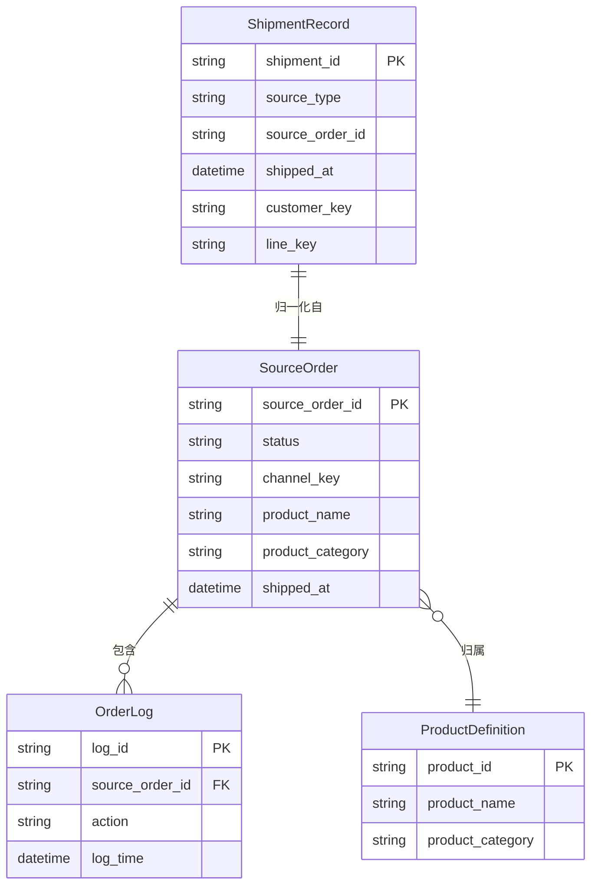
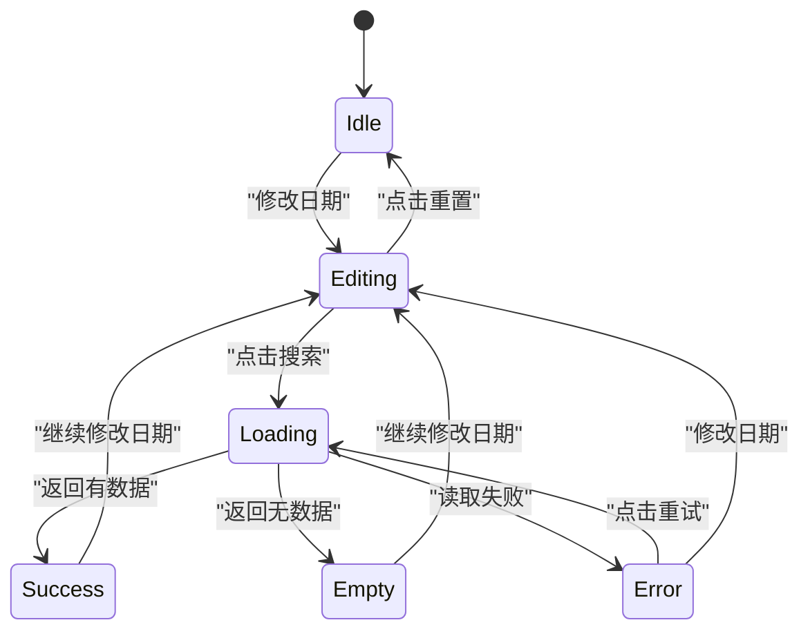
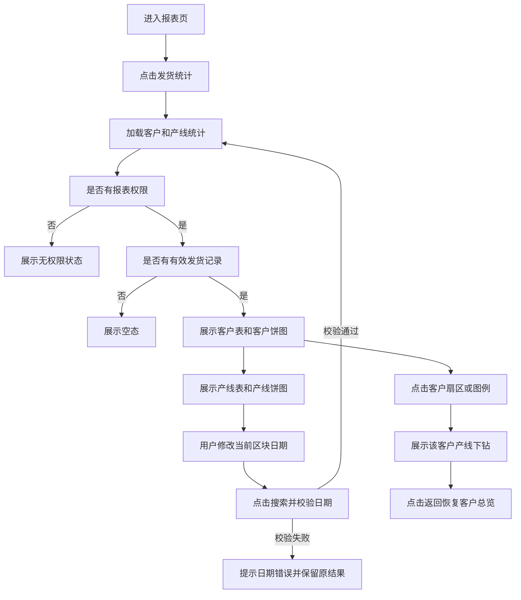

# 美卡平台——驾照官生产端「报表—发货统计」页 PRD

> **模块**: 驾照官生产端 / 报表 / 发货统计
> **版本**: v1.0
> **最后更新**: 2026-09-30
> **作者**: Codex

---

## 更新日志

- **v1.0 (2026-09-30)**: 将生产端报表中的“发货统计”页签拆分为独立 PRD，明确统计口径、筛选、客户与产线维度、图表下钻、权限和验收标准。

---

## 1. 背景与目标

### 1.1 业务背景

驾照官生产端负责翻译件、公证件、宣誓翻译件和换国内驾照翻译件的履约与发货。运营人员需要按日期快速了解发货量，判断重点客户的履约规模，并观察各产线的产能分布。

当前“发货统计”作为报表页中的一个页签实现，包含重要客户统计和各产线统计两个视图。该能力尚未形成独立的业务规格，发货日期、客户归因、产线归类、外部渠道数据和空数据处理容易出现口径不一致。

### 1.2 问题陈述

- 发货数据来自主订单和外部渠道订单，缺少统一的发货记录归一化规则。
- 运营人员需要在客户维度和产线维度之间切换，现有统计口径和字段含义不够明确。
- 日期筛选需要按发货日期统计，并且两个统计区块需要独立查询；当前缺少对默认值、边界和非法区间的正式定义。
- 客户总量、产线拆分、未分类订单和重复订单的关系没有形成数据契约，容易导致报表总量无法解释。

---

## 2. 现状洞察（AS-IS）

当前入口为生产端左侧菜单“报表 > 报表”，页面内有“翻译及制作数量”和“发货统计”两个页签。发货统计页签包含：

1. **重要客户发货统计**：表格展示客户总发货订单数量以及小白本、国内公证、宣誓翻译件、香港公证件四个产线拆分；右侧饼图支持点击客户查看该客户的产线分布。
2. **各产线发货统计**：表格和饼图展示小白本、宣誓翻译件、国内公证、香港公证件、换国内驾照五类产线发货数量。
3. 两个区块均有开始日期、结束日期、搜索、重置控件，默认日期为北京时间当天。

| 痛点 | 描述 |
| --- | --- |
| **统计来源分散** | 主订单、Klook、哈啰等外部订单来源的发货状态和时间字段不同，缺少统一的归一化契约。 |
| **维度口径不透明** | 客户标签和产线标签由渠道、产品分类及产品名称共同决定，优先级未在产品文档中固化。 |
| **异常数据不可解释** | 缺少发货时间、无法识别产线或同一订单重复记录时，用户无法判断为何没有进入统计。 |
| **查询状态未定义** | 空数据、日期非法、数据读取失败和权限不足缺少统一反馈要求。 |

---

## 3. 目标（TO-BE）与非目标

### 3.1 目标

| # | 目标 | 描述 |
| - | --- | --- |
| 1 | **统一发货统计口径** | 以有效发货事件和北京时间发货日期为唯一统计基础，每个来源订单在一个统计区间内最多计数一次。 |
| 2 | **提供双维度分析** | 同时支持重要客户和生产线两个固定维度，并保持客户总量与产线拆分可解释。 |
| 3 | **降低查询成本** | 默认查询当天，两个统计区块独立筛选，客户图表支持点击下钻并可返回总览。 |
| 4 | **保证数据可追溯** | 固化订单来源、客户映射、产线分类和重复数据处理规则，为后续接口和数据仓库实现提供契约。 |
| 5 | **明确生产端权限边界** | 只有拥有生产端报表查看权限的用户可以访问和查看聚合数据。 |

### 3.2 非目标（本期不做）

- **不做订单明细列表**：本期只展示聚合数量和占比，不提供从统计结果进入订单明细的能力。
- **不做自定义维度**：客户和产线采用固定枚举，不支持用户新增、删除或重命名维度。
- **不做导出**：本期不提供 Excel、CSV 或图片导出。
- **不做实时物流轨迹**：统计只判断订单是否已发货及发货时间，不读取承运商轨迹和签收状态。
- **不改变订单状态**：报表只读订单和发货记录，不执行发货、取消或修改订单的动作。

### 3.3 User Stories

#### US-1: 按日期查看发货总量

> **作为** 生产端运营人员
> **我希望** 按开始日期和结束日期查询发货统计
> **以便于** 了解指定时间段内的实际发货规模。

**验收标准**:

- 默认开始日期和结束日期均为北京时间当天。
- 查询结果只包含发货日期落在闭区间内的有效发货订单。
- 当结束日期早于开始日期时，系统阻止查询并给出明确提示。

#### US-2: 查看重点客户发货分布

> **作为** 生产端运营人员
> **我希望** 查看携程、Klook、哈啰和自营的发货数量及产线拆分
> **以便于** 评估重点客户履约量并定位客户结构。

**验收标准**:

- 客户表固定展示“携程、klook、哈啰、自营”四行。
- 每行展示发货订单总数及四项核心产线数量。
- 点击客户饼图或图例后，展示该客户的产线发货分布，并支持返回客户总览。

#### US-3: 查看各产线发货量

> **作为** 生产端负责人
> **我希望** 查看各产线的发货数量和占比
> **以便于** 识别产能波动和资源需求。

**验收标准**:

- 产线表固定展示小白本、宣誓翻译件、国内公证、香港公证件、换国内驾照五行。
- 表格和饼图使用相同的统计结果。
- 数量为零时表格显示“-”，图表不绘制零值扇区。

#### US-4: 在数据异常时得到反馈

> **作为** 生产端报表用户
> **我希望** 在无数据、数据读取失败或没有权限时看到明确状态
> **以便于** 判断是业务上没有发货，还是系统需要处理。

**验收标准**:

- 无数据时展示空态，不显示误导性的百分比。
- 数据读取失败时展示错误提示和重试入口。
- 没有报表权限时不渲染统计数据，并提示联系管理员。

---

## 4. 术语表（Terminology）

| 术语 | 英文 | 定义 |
| --- | --- | --- |
| 发货事件 | Shipment Event | 订单满足已发货判定并具有可用发货时间的业务事件。 |
| 发货订单 | Shipped Order | 在当前统计区间内按来源订单 ID 去重后的有效发货记录。 |
| 重要客户 | Key Customer | 本页面固定统计的客户维度：携程、klook、哈啰、自营。 |
| 产线 | Production Line | 根据产品分类和产品名称映射出的业务生产类型。 |
| 客户总览 | Customer Overview | 重要客户区块展示所有客户的发货数量和占比的状态。 |
| 客户下钻 | Customer Drill-down | 点击某客户后，只展示该客户产线发货分布的状态。 |
| 统计区间 | Reporting Range | 由开始日期和结束日期组成的北京时间闭区间。 |
| 未分类记录 | Unclassified Record | 已有有效发货事件但无法映射到页面产线枚举的记录。 |

---

## 5. 角色与权限

| 角色 | 权限范围 | 说明 |
| --- | --- | --- |
| 生产端运营人员 | 查看发货统计 | 可进入报表页、修改日期、查看客户和产线图表、执行客户下钻。 |
| 生产端负责人 | 查看发货统计 | 与运营人员相同；可用于日常产能和客户履约分析。 |
| 无报表权限用户 | 无 | 不显示统计数据和统计结果入口，提示无权限。 |

**权限规则**:

- 页面访问权限建议使用 `production.report.view`，客户下钻和图表交互复用页面查看权限。
- 权限校验必须在页面入口和数据查询接口（如后续服务化）同时执行。
- 页面仅展示聚合数量，不展示收货人、手机号、地址、物流单号等个人或物流明细。

---

## 6. 数据模型（业务/交互视角）

### 6.1 实体关系图（ER Diagram）

以下为业务逻辑关系图，`ShipmentRecord` 为统计查询时生成的归一化记录，不要求本期新增独立存储表。



### 6.2 Logical View（逻辑视图，UI 设计基准）

> 本节定义页面的业务语义和交互模型。`Stored` 表示直接来自订单或日志的字段，`Mapped` 表示按枚举规则映射，`Derived` 表示聚合或计算字段。

```typescript
type ShipmentReportState = 'idle' | 'editing' | 'loading' | 'success' | 'empty' | 'error';

interface DateRange {
  startDate: string; // Stored/用户输入：YYYY-MM-DD；空值表示无边界
  endDate: string;   // Stored/用户输入：YYYY-MM-DD；空值表示无边界
}

interface ShipmentCustomerRow {
  customerKey: 'ctrip' | 'klook' | 'hello' | 'self'; // Mapped：来源渠道归一化键
  customerLabel: string; // Mapped：携程 / klook / 哈啰 / 自营
  totalCount: number; // Derived：客户维度有效发货订单去重计数
  smallbookCount: number; // Derived：产线为小白本的计数
  domesticNotaryCount: number; // Derived：产线为国内公证的计数
  swornTranslationCount: number; // Derived：产线为宣誓翻译件的计数
  hongKongNotaryCount: number; // Derived：产线为香港公证件的计数
}

interface ShipmentLineRow {
  lineKey: 'smallbook' | 'sworn' | 'notary' | 'hongKongNotary' | 'domesticLicense'; // Mapped
  lineLabel: string; // Mapped：页面展示名称
  count: number; // Derived：产线维度有效发货订单去重计数
}

interface ShipmentChartView {
  total: number; // Derived：当前视图 items 的 count 之和
  items: Array<{
    label: string; // Mapped
    count: number; // Derived
    percentage: number; // Derived：count / total * 100，保留一位小数展示
  }>;
  variant: 'pie' | 'donut';
}

interface ShipmentStatisticsPageView {
  page: {
    route: string; // Stored/配置：/license-officer/reports/list
    activeTab: 'shipment-data'; // Stored/交互状态
    canView: boolean; // Derived：权限计算结果
  };
  customerPanel: {
    state: ShipmentReportState;
    draftRange: DateRange; // Stored/交互状态：尚未应用的筛选值
    appliedRange: DateRange; // Stored/交互状态：当前统计生效的筛选值
    rows: ShipmentCustomerRow[]; // Derived
    chart: ShipmentChartView; // Derived
    selectedCustomer: ShipmentCustomerRow['customerKey'] | null; // Stored/交互状态
    detailRows: ShipmentLineRow[]; // Derived：仅选中客户的四项核心产线
  };
  linePanel: {
    state: ShipmentReportState;
    draftRange: DateRange;
    appliedRange: DateRange;
    rows: ShipmentLineRow[]; // Derived
    chart: ShipmentChartView; // Derived
  };
  actions: {
    applyCustomerRange(): void;
    resetCustomerRange(): void;
    selectCustomer(customerKey: ShipmentCustomerRow['customerKey']): void;
    clearCustomerSelection(): void;
    applyLineRange(): void;
    resetLineRange(): void;
    retry(panel: 'customer' | 'line'): void;
  };
}
```

交互约束：

- `draftRange` 修改时只更新输入框，不刷新统计结果；点击“搜索”后复制为 `appliedRange`。
- 客户下钻只改变客户区块的 `selectedCustomer` 和 `detailRows`，不改变产线区块的筛选条件。
- 客户总量按所有有效发货记录计数；无法映射产线的记录仍进入 `totalCount`，但不进入任何产线拆分字段，并记录数据质量指标。
- 图表百分比只对当前图表 `items` 中的有效数量计算；总量为 0 时所有百分比显示 `0.0%`，中心总量显示“-”。

---

## 7. 业务规则与验证

### 7.1 核心业务规则

| 规则编号 | 规则名称 | 规则描述 |
| --- | --- | --- |
| BR-SHIP-001 | 发货事件判定 | 主订单满足 `status = shipped/completed` 或存在“已发货”日志，并能得到 `shippedAt` 或日志时间；外部订单满足已发货状态、已发货记录标签或已发货日志，并能得到有效时间。 |
| BR-SHIP-002 | 发货日期口径 | 所有时间先转换为 `Asia/Shanghai`，只取日期部分参与筛选；开始日期和结束日期均包含在统计区间内。 |
| BR-SHIP-003 | 订单去重 | 以 `source_type + source_order_id` 作为统计唯一键；同一订单存在多个已发货日志时只计数一次，优先使用 `shippedAt`，否则使用最早有效的已发货日志时间。 |
| BR-SHIP-004 | 客户映射 | 主订单 `channel = ctrip` 映射为“携程”；Klook 外部订单映射为“klook”；哈啰外部订单映射为“哈啰”；其余主订单映射为“自营”。 |
| BR-SHIP-005 | 产线映射优先级 | 依次按“换国内驾照、香港公证件、国内公证、小白本、宣誓翻译件”判断；命中第一项后停止继续匹配。 |
| BR-SHIP-006 | 客户统计拆分 | 客户表总量包含所有有效发货订单；四项拆分只展示小白本、国内公证、宣誓翻译件、香港公证件。换国内驾照仅在产线统计中展示。 |
| BR-SHIP-007 | 未分类处理 | 有效发货但无法映射产线的订单计入客户总量，产线统计不计入；前端不得因单条脏数据导致整个页面失败。 |
| BR-SHIP-008 | 区块独立筛选 | 客户区块和产线区块分别维护草稿区间和生效区间；一个区块点击搜索或重置不会改变另一个区块的查询结果。 |
| BR-SHIP-009 | 固定顺序 | 客户按“携程、klook、哈啰、自营”展示；产线按“小白本、宣誓翻译件、国内公证、香港公证件、换国内驾照”展示。 |
| BR-SHIP-010 | 只读边界 | 统计页面不得修改订单状态、物流信息、订单日志或产品配置。 |

### 7.2 数据验证规则

| 字段（含变更标识） | 验证规则 | 错误提示 |
| --- | --- | --- |
| [ADD] `startDate` | 为空或符合 `YYYY-MM-DD`，且为合法日历日期。 | `开始日期格式不正确，请重新选择。` |
| [ADD] `endDate` | 为空或符合 `YYYY-MM-DD`，且为合法日历日期。 | `结束日期格式不正确，请重新选择。` |
| [ADD] `dateRange` | 当两端均有值时，`startDate <= endDate`。 | `结束日期不能早于开始日期。` |
| [ADD] `sourceOrderId` | 同一 `source_type` 下不能为空；聚合前按该字段去重。 | `发货订单缺少来源订单号，已从统计中排除。` |
| [ADD] `shippedAt` | 必须能够解析为有效时间并转换为北京时间日期；无法解析的记录不得进入日期统计。 | `发货时间无效，该订单未计入统计。` |
| [ADD] `productCategory` / `productName` | 至少有一个可用于产线映射；均缺失时按未分类处理。 | `订单缺少产线信息，已计入客户总量但未计入产线统计。` |

### 7.3 状态机（查询状态）



**状态转换规则**:

| 当前状态 | 目标状态 | 触发条件 | 操作权限 |
| --- | --- | --- | --- |
| Idle | Editing | 用户修改任一日期输入 | 有报表查看权限 |
| Editing | Loading | 当前区间通过校验并点击搜索 | 有报表查看权限 |
| Editing | Idle | 点击重置并恢复当天 | 有报表查看权限 |
| Loading | Success | 查询完成且至少有一条有效记录 | 系统 |
| Loading | Empty | 查询完成但没有有效记录 | 系统 |
| Loading | Error | 接口、缓存或本地数据读取失败 | 系统 |
| Error | Loading | 点击重试 | 有报表查看权限 |

---

## 8. 功能需求

### 8.1 页面入口与布局

#### 8.1.1 功能描述

- 入口路径沿用 `/license-officer/reports/list`，进入页面后可在报表类型中选择“发货统计”。
- 面包屑展示 `驾照官后台 / 报表 / 报表`；发货统计页签激活时隐藏重复的大标题，保持统计内容优先。
- 页面由“重要客户发货统计”和“各产线发货统计”两个纵向区块组成。
- 每个区块包含：区块标题、日期筛选、搜索、重置、数据表格、图表和状态反馈。
- 页面首次进入时默认激活“翻译及制作数量”页签；用户点击“发货统计”后加载本页数据。若从深链接进入发货统计，直接激活本页签。

#### 8.1.2 权限与状态

- 无 `production.report.view` 权限时展示无权限状态，不请求统计数据。
- 数据加载期间，区块内展示加载状态，禁止重复提交同一查询。
- 客户区块和产线区块允许独立进入 `success`、`empty` 或 `error` 状态。

### 8.2 日期筛选

#### 8.2.1 筛选字段定义

| 筛选字段 | 类型 | 必填 | 默认值 | 取值来源 | 说明 |
| --- | --- | --- | --- | --- | --- |
| [ADD] `startDate` | Date / String | 否 | 北京时间当天 | 用户选择 | 统计区间开始日期，包含当天；为空表示不设下界。 |
| [ADD] `endDate` | Date / String | 否 | 北京时间当天 | 用户选择 | 统计区间结束日期，包含当天；为空表示不设上界。 |
| [ADD] `apply` | Action | - | - | 用户点击 | 校验并应用当前区块草稿区间。 |
| [ADD] `reset` | Action | - | - | 用户点击 | 当前区块恢复开始日期和结束日期为北京时间当天，并立即刷新。 |

**验证规则**:

| 字段（含变更标识） | 验证规则 | 错误提示 |
| --- | --- | --- |
| [ADD] `startDate` | 只能选择合法日期；文本值必须符合 `YYYY-MM-DD`。 | `开始日期格式不正确，请重新选择。` |
| [ADD] `endDate` | 只能选择合法日期；文本值必须符合 `YYYY-MM-DD`。 | `结束日期格式不正确，请重新选择。` |
| [ADD] `startDate + endDate` | 两端均填写时，开始日期不得晚于结束日期。 | `结束日期不能早于开始日期。` |

**筛选逻辑**:

- 日期筛选只作用于当前区块，区块之间为独立状态。
- 订单发货日期按闭区间过滤：`date >= startDate && date <= endDate`。
- 输入框修改不会自动查询；只有点击“搜索”才更新结果。
- “重置”清空客户下钻状态，并将当前区块恢复为当天；产线区块重置不影响客户区块。

### 8.3 重要客户发货统计

#### 8.3.1 列表字段定义

| 字段名（含变更标识） | 类型 | 数据来源 | 说明 | 示例 |
| --- | --- | --- | --- | --- |
| [ADD] `customerLabel` | Enum / String | Mapped：`channel` 或外部订单来源 | 客户名称，固定四行 | 携程 |
| [ADD] `totalCount` | Integer | Derived：有效发货订单去重计数 | 客户总发货订单数量 | 12 |
| [ADD] `smallbookCount` | Integer | Derived：`lineKey = smallbook` | 小白本发货数量 | 5 |
| [ADD] `domesticNotaryCount` | Integer | Derived：`lineKey = notary` | 国内公证发货数量 | 2 |
| [ADD] `swornTranslationCount` | Integer | Derived：`lineKey = sworn` | 宣誓翻译件发货数量 | 3 |
| [ADD] `hongKongNotaryCount` | Integer | Derived：`lineKey = hongKongNotary` | 香港公证件发货数量 | 1 |

**展示规则**:

- 固定展示四行：携程、klook、哈啰、自营，即使数量为零也保留行。
- 数量为 0 时表格显示 `-`；数量大于 0 时显示整数。
- 不增加合计行，饼图中心展示当前客户列表的发货总量。
- 表格和饼图必须使用同一份 `ShipmentCustomerRow[]` 结果。

#### 8.3.2 客户图表与下钻

- 客户总览使用饼图，图例展示客户名称、数量和占比；中心展示“发货总量”。
- 点击任意客户扇区或图例后，切换为该客户的环形图，标题为“{客户} · 产线发货”。
- 下钻只展示小白本、国内公证、宣誓翻译件、香港公证件四项；换国内驾照保留在产线总览，不进入客户下钻。
- 点击“返回”恢复客户总览，日期区间和客户表结果保持不变。
- 鼠标悬停显示数量和百分比；键盘聚焦后按 Enter 或 Space 与点击行为一致。
- 零值项不绘制扇区；当前视图所有值为零时展示“暂无发货数据”。

### 8.4 各产线发货统计

#### 8.4.1 列表字段定义

| 字段名（含变更标识） | 类型 | 数据来源 | 说明 | 示例 |
| --- | --- | --- | --- | --- |
| [ADD] `lineLabel` | Enum / String | Mapped：产品分类和产品名称 | 产线名称，固定五行 | 小白本 |
| [ADD] `count` | Integer | Derived：产线有效发货订单去重计数 | 该产线发货数量 | 8 |

**产线枚举**:

| 值 | 名称 | 匹配规则（按优先级） |
| --- | --- | --- |
| `smallbook` | 小白本 | 产品名称包含“小白本”，且未命中更高优先级。 |
| `sworn` | 宣誓翻译件 | 产品分类为 `translation`，或产品名称包含“宣誓”。 |
| `notary` | 国内公证 | 产品分类为 `notary` 或产品名称包含“公证”，且未命中香港公证。 |
| `hongKongNotary` | 香港公证件 | 产品分类为 `local_language_notary`，或产品名称同时包含“香港”和“公证”。 |
| `domesticLicense` | 换国内驾照 | 产品分类为 `domestic_license`，或产品名称包含“换国内驾照”。 |

**展示规则**:

- 固定展示五行：小白本、宣誓翻译件、国内公证、香港公证件、换国内驾照。
- 数量为 0 时表格显示 `-`；饼图不绘制零值扇区。
- 饼图中心展示五类产线当前筛选区间的发货总量。
- 图表图例显示产线名称、数量和百分比，百分比保留一位小数。

### 8.5 数据刷新与一致性

- 订单数据发生变更时，页面重新计算当前已应用区间；不得丢失用户当前区间或客户下钻状态，除非当前记录已不满足下钻条件。
- 客户区块和产线区块的数据刷新可以并行，但必须分别处理 loading、success、empty、error 状态。
- 统计查询不得把演示样例记录作为生产业务数据；样例数据只允许在 Demo 初始化层存在，并必须带有明确的 `source_type = demo` 标识，生产环境默认排除。
- 外部渠道接口返回部分失败时，已成功获取的来源可以展示，但必须提示“部分数据加载失败”，并提供重试入口；若无法确认结果完整性，需显示数据完整性提示。

### 8.6 业务流程



**流程说明**:

1. 用户进入报表页并点击“发货统计”，系统校验权限后分别加载两个区块。
2. 系统按有效发货事件、北京时间日期、客户映射和产线映射生成两组逻辑视图。
3. 用户修改日期后点击“搜索”，系统先校验日期区间；校验失败时不覆盖当前已展示结果。
4. 用户可在客户图表中点击客户进入下钻，再点击“返回”回到客户总览。

### 8.7 边界场景处理

| 场景 | 处理方式 |
| --- | --- |
| 日期区间为空 | 允许查询；开始为空表示不设下界，结束为空表示不设上界。默认状态仍为当天至当天。 |
| 结束日期早于开始日期 | 阻止查询，提示 `结束日期不能早于开始日期。`，并保留原统计结果。 |
| 当前区间没有发货记录 | 表格保留固定维度行并显示 `-`，图表显示“暂无发货数据”。 |
| 订单状态为已发货但没有可解析发货时间 | 不计入日期统计，并记录数据质量日志；不得使用当前时间补齐。 |
| 同一订单出现多条已发货日志 | 按来源订单唯一键去重，只统计一次；优先使用 `shippedAt`，否则使用最早有效日志时间。 |
| 产品分类和名称均无法识别产线 | 计入客户总量，不计入产线拆分，并记录未分类数量。 |
| 外部渠道数据部分失败 | 展示可用来源结果并提示部分失败；提供重试，不得静默当作完整结果。 |
| 无报表权限 | 不请求或不展示聚合数据，展示无权限提示。 |
| 用户快速重复点击搜索 | 对同一查询去重或取消前一请求，最终结果必须对应最后一次有效查询。 |

---

## 9. 非功能需求

### 9.1 性能要求

| 指标 | 要求 |
| --- | --- |
| 首次展示 | 已有缓存或本地数据时，点击发货统计后 1 秒内展示 loading 状态，2 秒内展示结果或空态。 |
| 查询响应 | 统计接口 P95 ≤ 1.5 秒；以 10,000 条发货记录为基准。 |
| 交互响应 | 客户图表下钻、返回和图例高亮在 100ms 内完成。 |
| 数据刷新 | 订单变更事件触发后 2 秒内完成当前区间重新计算或显示错误状态。 |

### 9.2 安全要求

- 页面和后续统计接口均使用 RBAC 权限校验。
- 统计接口不得返回不必要的个人资料、收货地址或完整物流单号。
- 事件埋点只使用聚合数量、来源类型和筛选字段名，不上传个人敏感字段。

### 9.3 可用性与无障碍要求

- 日期输入、搜索、重置、图例和返回按钮均支持键盘操作。
- 图表必须提供可读的 `aria-label`，并在表格中提供同一份数值信息作为无障碍替代。
- 颜色不是唯一的信息编码方式；图例同时展示名称、数量和百分比。
- 加载、空态、错误和无权限状态均需有文字反馈。

### 9.4 可观测性要求

- 记录查询耗时、数据源成功/失败状态、有效记录数、未分类记录数和去重数量。
- 不在日志中记录收货人、手机号、地址、证件号和完整物流单号。

---

## 10. 测试策略

### 10.1 测试范围

- 单元测试：客户映射、产线映射、日期区间、北京时间转换和订单去重。
- 集成测试：主订单、Klook、哈啰三类来源的统计归一化与部分失败处理。
- E2E 测试：进入页签、搜索、重置、空态、客户下钻、返回和权限控制。
- 可访问性测试：键盘操作、ARIA 标签、表格与图表数值一致性。
- 性能测试：10,000 条发货记录和连续查询场景。

### 10.2 测试用例（关键场景）

| 用例编号 | 测试场景 | 前置条件 | 操作步骤 | 预期结果 |
| --- | --- | --- | --- | --- |
| TC-SHIP-001 | 默认当天统计 | 存在当天和历史发货记录 | 进入发货统计 | 两个区块默认开始/结束日期均为北京时间当天，只统计当天记录。 |
| TC-SHIP-002 | 日期区间查询 | 存在跨多日发货记录 | 设置开始、结束日期并搜索 | 两端日期均包含，两个区块仅刷新各自结果。 |
| TC-SHIP-003 | 非法日期区间 | 结束日期早于开始日期 | 点击搜索 | 阻止查询，提示错误，原结果不变。 |
| TC-SHIP-004 | 客户表与图表一致 | 存在四个客户的发货记录 | 查看客户表和饼图 | 图表每个扇区数量与表格 `totalCount` 一致。 |
| TC-SHIP-005 | 客户下钻 | 携程存在四类核心产线记录 | 点击携程扇区，再点击返回 | 显示携程四类产线分布；返回后恢复客户总览。 |
| TC-SHIP-006 | 产线统计 | 存在五类产线记录 | 查看产线表和饼图 | 五行固定展示，数量与图表一致，换国内驾照只在产线总览展示。 |
| TC-SHIP-007 | 重复发货日志 | 一个订单存在两条已发货日志 | 查询包含该订单的日期 | 该订单只计数一次。 |
| TC-SHIP-008 | 未分类产线 | 订单已发货但缺少产品分类和可识别名称 | 查询该订单 | 客户总量增加，产线数量不增加，并产生数据质量记录。 |
| TC-SHIP-009 | 无数据空态 | 查询区间没有发货记录 | 搜索 | 表格数量显示 `-`，图表显示“暂无发货数据”。 |
| TC-SHIP-010 | 无权限 | 当前用户没有 `production.report.view` | 进入发货统计 | 不展示统计数据，显示无权限提示。 |

---

## 11. 验收标准（Acceptance Criteria）

### 11.1 功能验收

**场景1: 默认查询当天发货**

```gherkin
Given 用户拥有 production.report.view 权限
And 系统存在北京时间当天的有效发货订单
When 用户进入“报表 - 发货统计”页
Then 客户区块和产线区块的开始日期、结束日期均默认为当天
And 两个区块分别展示当天的统计结果
```

**场景2: 查询指定日期区间**

```gherkin
Given 用户已打开“发货统计”页
And 用户将客户区块日期设置为 2026-09-01 至 2026-09-07
When 用户点击客户区块的“搜索”
Then 系统只统计发货日期在 2026-09-01 至 2026-09-07 的订单
And 产线区块的已应用日期和结果保持不变
```

**场景3: 客户下钻**

```gherkin
Given 客户总览中“携程”发货数量大于 0
When 用户点击“携程”饼图扇区
Then 图表切换为“携程 · 产线发货”
And 图表展示小白本、国内公证、宣誓翻译件、香港公证件的数量和占比
When 用户点击“返回”
Then 图表恢复客户总览
```

**场景4: 异常日期阻断查询**

```gherkin
Given 用户输入的开始日期晚于结束日期
When 用户点击任一区块的“搜索”
Then 系统提示“结束日期不能早于开始日期。”
And 不发起统计查询
And 当前已展示的统计结果保持不变
```

### 11.2 数据契约验收

- [ ] 所有逻辑视图字段均标注 `Stored`、`Derived` 或 `Mapped` 来源。
- [ ] 主订单、Klook、哈啰来源的发货判定、日期回退和订单去重规则已实现并可测试。
- [ ] 客户和产线枚举、映射优先级与固定展示顺序一致。
- [ ] 未分类订单的客户总量与产线统计处理符合 BR-SHIP-007。
- [ ] 所有新增字段均使用 `[ADD]` 标识；本期没有删除字段。

### 11.3 性能验收

- [ ] 10,000 条发货记录下，统计查询 P95 ≤ 1.5 秒。
- [ ] 首次点击页签后 2 秒内显示结果、空态或错误态。
- [ ] 图表下钻、返回和重置操作无明显卡顿。

---

## 12. 实施计划

### 12.1 依赖关系

- 依赖统一订单模型中的 `orderId`、`status`、`channel`、`productCategory`、`productName`、`shippedAt`、`logs` 字段。
- 依赖外部渠道订单服务提供 Klook、哈啰订单的来源订单号、发货状态、产品名称和发货时间。
- 依赖生产端报表菜单权限 `production.report.view`。
- 依赖北京时间格式化工具，禁止使用浏览器本地时区直接截取外部时间。
- 若统计从前端计算迁移到服务端，需先建立 `ShipmentRecord` 归一化查询接口，保持本 PRD 的逻辑视图不变。

### 12.2 风险与缓解措施

| 风险 | 影响 | 概率 | 缓解措施 |
| --- | --- | --- | --- |
| 外部渠道发货字段不稳定 | 客户总量缺失或延迟 | 中 | 为每个来源定义字段适配器和数据源健康状态；部分失败必须提示。 |
| 产品名称依赖导致产线误归类 | 产线分布失真 | 中 | 优先使用 `productCategory`；维护映射优先级和未分类数据质量指标。 |
| 重复日志或重复接口记录 | 数量被重复计算 | 中 | 以来源类型和来源订单号去重，增加重复计数监控。 |
| 时区转换错误 | 跨日统计不准确 | 中 | 统一转换为 `Asia/Shanghai`，补充 UTC、带偏移量和无时区时间测试。 |
| 大数据量前端计算变慢 | 页面卡顿 | 低 | 优先服务端聚合；前端保留分页/分块或缓存策略。 |

---

## 13. 附录

### 13.1 字段文档术语对照表

| 中文 | 英文 | 说明 |
| --- | --- | --- |
| 发货订单 | Shipped Order | 在统计区间内有效且去重后的发货记录。 |
| 统计区间 | Reporting Range | 按北京时间计算的开始日期至结束日期闭区间。 |
| 客户维度 | Customer Dimension | 按客户标签聚合发货订单。 |
| 产线维度 | Production Line Dimension | 按产品映射后的生产类型聚合发货订单。 |
| 下钻 | Drill-down | 从客户总览进入单一客户的产线分布。 |
| 未分类 | Unclassified | 无法映射到页面产线枚举的有效发货记录。 |
| 新增字段标识 | `[ADD]` | 标记本版本新增的页面或逻辑字段。 |
| 修改字段标识 | `[MOD]` | 标记本版本规则或语义发生变化的字段。 |
| 删除字段标识 | `[DEL]` | 标记本版本下线字段，需说明替代方案或废弃原因。 |

### 13.2 技术附录：Storage Schema（可选，工程维护）

本期不新增独立报表存储表。统计查询基于现有来源数据实时或准实时聚合；如后续落库，建议保留以下字段以支持重放、去重和审计：

| 字段名 | 类型 | 必填 | 默认值 | 说明 | 约束 |
| --- | --- | --- | --- | --- | --- |
| `source_type` | enum | 是 | 无 | `main_order` / `klook` / `hello` / `demo` | 与 `source_order_id` 组成唯一键 |
| `source_order_id` | varchar(100) | 是 | 无 | 来源订单号 | 非空 |
| `shipped_at` | datetime | 是 | 无 | 标准化后的北京时间发货时间 | 必须可解析 |
| `customer_key` | enum | 是 | 无 | `ctrip` / `klook` / `hello` / `self` | 由映射规则生成 |
| `line_key` | enum | 否 | `unclassified` | 五项产线或 `unclassified` | 由优先级规则生成 |
| `dedupe_key` | varchar(220) | 是 | 无 | `{source_type}:{source_order_id}` | UNIQUE |
| `created_at` | datetime | 是 | CURRENT_TIMESTAMP | 记录创建时间 |  |
| `updated_at` | datetime | 是 | CURRENT_TIMESTAMP | 记录更新时间 |  |

**索引**:

- UNIQUE KEY: `uk_shipment_dedupe` (`dedupe_key`)
- INDEX: `idx_shipment_date_customer` (`shipped_at`, `customer_key`)
- INDEX: `idx_shipment_date_line` (`shipped_at`, `line_key`)

### 13.3 Tracking Events（建议项）

> [!TIP]
> 本节用于提升行为可观测性，不作为功能上线阻断条件。

| 事件名 | 触发时机 | 关键属性 |
| --- | --- | --- |
| `shipment_report_page_view` | 用户进入发货统计页签 | `user_role`, `permission`, `source_types` |
| `shipment_report_filter_edit` | 用户修改日期输入 | `panel`, `field`, `has_value` |
| `shipment_report_filter_apply` | 用户点击搜索并通过校验 | `panel`, `start_date`, `end_date`, `duration_ms`, `result_count`, `unclassified_count` |
| `shipment_report_filter_reset` | 用户点击重置 | `panel`, `reset_to_date` |
| `shipment_report_customer_drilldown` | 用户点击客户扇区或图例 | `customer_key`, `result_count` |
| `shipment_report_chart_interaction` | 用户悬停、聚焦或点击图表元素 | `panel`, `chart_variant`, `item_key`, `interaction_type` |
| `shipment_report_query_error` | 统计读取失败或部分失败 | `panel`, `source_type`, `error_code`, `retryable` |

### 13.4 i18n 资源规范（建议项）

#### 13.4.1 Type 1-5 分类

| 类型 | 数据类型 | 处理策略 | 本页示例 |
| --- | --- | --- | --- |
| Type 1 | 系统预设数据 | 资源表翻译 | 页面标题、按钮、状态、客户和产线枚举名称 |
| Type 2 | 纯业务数据 | 不翻译 | 数量、订单号（本期不展示）、数据质量计数 |
| Type 3 | 核心双语字段 | 双字段存储 | 客户或产品主数据未来若支持多语言名称 |
| Type 4 | 法律/条款文本 | 法务版本管理 | 本页不涉及 |
| Type 5 | 格式化数据 | 前端按 Locale 渲染 | 日期、百分比、数量格式 |

#### 13.4.2 `resource_key` 命名建议

- 命名格式：`production.report.shipment.{scope}.{name}`。
- 系统预设枚举使用统一资源键，客户和产线键不得直接写死中文展示文本。
- 错误、空态和提示分别使用 `error.*`、`empty.*`、`hint.*` 命名空间。

#### 13.4.3 资源键样例

| UI 文案 | resource_key |
| --- | --- |
| 发货统计 | `production.report.shipment.title` |
| 重要客户发货统计 | `production.report.shipment.customer.title` |
| 各产线发货统计 | `production.report.shipment.line.title` |
| 开始日期 | `production.report.shipment.filter.start_date` |
| 结束日期 | `production.report.shipment.filter.end_date` |
| 搜索 | `production.report.shipment.action.search` |
| 重置 | `production.report.shipment.action.reset` |
| 返回 | `production.report.shipment.action.back` |
| 发货总量 | `production.report.shipment.metric.total` |
| 暂无发货数据 | `production.report.shipment.empty.no_data` |
| 结束日期不能早于开始日期 | `production.report.shipment.error.invalid_date_range` |
| 携程 | `production.report.shipment.customer.ctrip` |
| klook | `production.report.shipment.customer.klook` |
| 哈啰 | `production.report.shipment.customer.hello` |
| 自营 | `production.report.shipment.customer.self` |
| 小白本 | `production.report.shipment.line.smallbook` |
| 宣誓翻译件 | `production.report.shipment.line.sworn` |
| 国内公证 | `production.report.shipment.line.notary` |
| 香港公证件 | `production.report.shipment.line.hong_kong_notary` |
| 换国内驾照 | `production.report.shipment.line.domestic_license` |

### 13.5 参考文档

- [生产端 PRD](./mei_ka_production%20side.md)
- [管理端 PRD](./mei_ka_Admin%20side.md)
- [报表页实现](../../src/modules/license-officer/ReportListPage.tsx)
- [订单类型定义](../../src/shared/types/index.ts)
- [生产时间与日报表工具](../../src/modules/license-officer/productionActivity.ts)
- [外部渠道订单服务](../../src/modules/order-management/klookOrderService.ts)

### 13.6 变更记录

| 日期 | 版本 | 变更内容 | 变更人 |
| --- | --- | --- | --- |
| 2026-09-30 | v1.0 | 独立定义生产端报表—发货统计页的业务、数据、交互与验收要求 | Codex |
