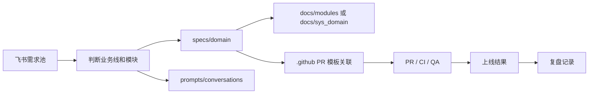
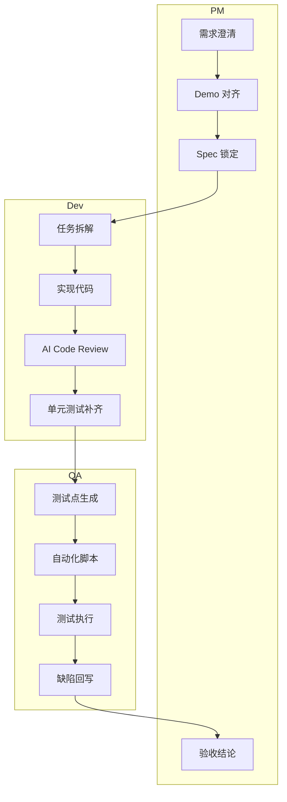
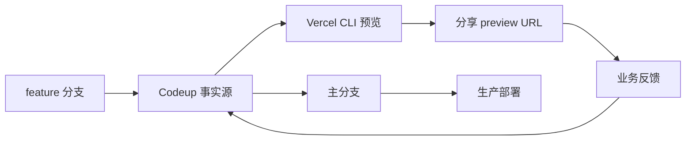
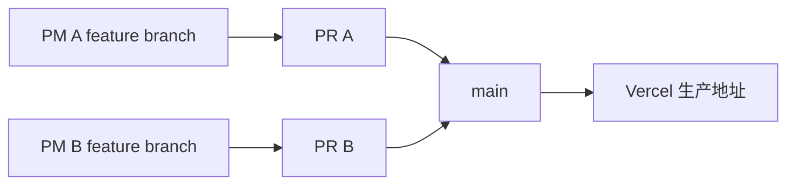
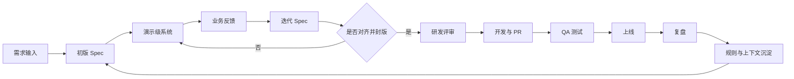

# 产研团队 AI-Driven Dev PM 使用手册

基于《内部指南：AI-Driven Dev 产研协同 Guideline V0.1》整理，并结合当前按业务线分代码仓的协作方式进行落地说明。

本文面向产品经理，目标不是介绍 AI 概念，而是明确 PM 在日常需求推进中，如何使用 AI、如何使用仓库、如何与研发和测试对齐，以及哪些内容必须沉淀到代码仓。

## 1. 适用范围

- 适用于当前 `ixtech-ai` 代码组下，按业务线拆分的研发协作模式。
- 每条业务线维护独立代码仓，需求、Spec、上下文、文档和研发交付围绕对应业务仓展开。
- 本文以 merchant 仓 `pm-ai-learning` 为例说明。

代码组：

- `https://codeup.aliyun.com/677b967610def31b486d77d9/ixtech-ai`

merchant 仓示例结构：

```text
pm-ai-learning
├── .agent
├── .claude
├── .github
├── docs
├── prompts
├── specs
├── src
├── CHANGELOG.md
├── README.md
├── package.json
└── translation-analysis.json
```

## 2. PM 在 AI-Driven Dev 中的角色定位

PM 不是把需求丢给 AI 就结束，而是要负责以下四件事：

1. 用 AI 加速需求澄清、方案比较和文档初稿生成。
2. 把业务上下文组织成 AI 可理解、可复用、可追溯的输入。
3. 在代码仓内沉淀 Spec、上下文包、过程性工件和协作链接，形成团队共享资产。
4. 在需求评审、开发、测试、上线、复盘各节点负责对齐基线。

一句话原则：

- AI 是副驾，不是最终决策者。
- 上下文和过程性工件比单句指令更重要。
- 上下文对齐优先于个人效率。
- 任何涉及密钥、真实隐私数据、敏感业务数据的内容不得直接输入公共模型。

## 3. 分仓模式下的协作原则

### 3.1 为什么按业务线分仓

- 降低跨团队上下文污染，让 AI 更容易理解当前业务域。
- 让需求、代码、文档、上下文、PR 统一归属到同一个业务仓。
- 便于按业务线建立自己的规范、模板、自动化通知和知识沉淀。

### 3.2 PM 的仓库选择规则

- 新需求先判断归属业务线，再进入对应仓库推进。
- 不要把 merchant 的需求写到其他业务线仓库中。
- 如果需求跨多个业务域，主仓以责任归属业务线为准，跨域影响在 Spec 中明确标注。
- 如果需求影响平台级能力或多个模块共用能力，优先在 `specs/sys` 或 `docs/sys_domain` 中补充全局说明，再分别拆分到具体模块。

### 3.3 merchant 仓中的业务域映射

在 `pm-ai-learning` 中，`specs` 已经按业务域拆分，PM 应优先按域归档：

- `specs/branch`：门店相关需求
- `specs/channel`：渠道相关需求
- `specs/inventory`：库存相关需求
- `specs/order`：订单相关需求
- `specs/price`：价格相关需求
- `specs/product`：商品相关需求
- `specs/sys`：系统级、跨模块规则
- `specs/vehicle`：车辆相关需求

规则：

- 单一模块需求，放到对应 `specs/<domain>`。
- 多模块联动需求，放到主模块目录，并在标题和正文中标注影响模块。
- 涉及全局流程、公共规则、统一字典、统一状态机的内容，补充到 `specs/sys`。

## 4. PM 重点关注的仓库目录

| 目录 | PM 是否主责 | 用途 | PM 关注点 |
| --- | --- | --- | --- |
| `.agent` | 否 | Agent 规则、脚本、技能、工作流 | 知道团队已有自动化能力，不要求 PM 直接维护 |
| `.claude` | 否 | AI 助手命令与技能配置 | 了解团队已有模板或命令能力 |
| `.github` | 部分 | PR 模板、脚本、工作流、通知 | 关注 PR 模板中是否强制关联需求链接、Spec 链接 |
| `docs` | 部分 | 稳态知识文档、接口、模块、领域说明 | PM 需要补充业务概念、流程口径、模块说明 |
| `prompts/conversations` | 是 | 需求讨论、上下文、过程性工件沉淀 | 关键决策、实现计划和评审结论要留痕 |
| `specs` | 是 | 需求 Spec、验收口径、规则定义 | PM 的核心主阵地 |
| `src` | 否 | 代码实现 | PM 不直接维护，但需理解 Demo 与落地的差异 |

建议理解方式：

- `specs` 解决“这次要做什么”。
- `docs` 解决“长期规则和背景是什么”。
- `prompts/conversations` 解决“我们是如何沉淀上下文、决策和过程性工件的”。

## 5. PM 标准工作流

### 5.1 Phase 1：需求收集与澄清

输入来源：

- 飞书文档中的需求池
- 飞书多维表格中的任务板
- 业务方临时提案
- Roadmap 已规划事项

PM 动作：

1. 明确问题定义，而不是直接写功能解法。
2. 补齐目标用户、业务场景、触发条件、约束、成功标准。
3. 先判断归属业务线和模块目录，再进入对应代码仓推进。
4. 对复杂需求先让 AI 生成澄清问题清单，提前暴露边界条件和异常情况。

建议让 AI 参与的事项：

- 竞品分析
- 场景拆解
- 用户故事初稿
- 边界条件清单
- 风险点和反向提问清单

产出物：

- 结构化需求摘要
- 业务线归属
- 模块归属
- 初版验收目标

### 5.2 Phase 2：Demo 优先，先对齐再锁需求

这里的 Demo 不是手绘线框图的替代品，而是一个可访问、可点击、尽量接近真实体验的演示级系统。它的目的，是尽快把无法一次性准确描述的需求落到具体交互上，让业务先看到、先试用、先反馈，再进入锁定需求。

PM 动作：

1. 用自然语言描述页面目标、关键流程、核心状态和主要交互。
2. 让 AI 输出可访问的演示级原型、页面结构或近真实交互 Demo。
3. 先给业务侧看 Demo，不要一上来就拉研发解读一长篇文档。
4. Demo 不符合预期时，优先调整上下文、交互假设和状态设计，而不是直接进入开发。

注意：

- Demo 用于对齐业务预期，不等于最终上线版本。
- Demo 应尽量具备真实场景中的关键状态、跳转、反馈和文案。
- Demo 对前端是方向基线，不应替代正式交互和技术实现约束。

产出物：

- 可演示原型或 Demo
- 关键页面截图或链接
- 对应上下文和过程性工件沉淀到 `prompts/conversations`

### 5.3 Phase 3：编写并锁定 Spec

当 Demo 基本确认后，PM 需要把需求落到 Spec，形成研发和测试的共同基线。

建议文件放置规则：

- 按模块放入 `specs/<domain>/`
- 文件名建议采用：
  - `YYYY-MM-DD-主题名.md`
  - 或 `YYYYMMDD-主题名-v1.md`

示例：

- `specs/order/2026-04-21-order-cancel-reason.md`
- `specs/price/2026-04-21-price-rule-priority.md`
- `specs/sys/2026-04-21-unified-status-dictionary.md`

每份 Spec 至少应包含：

1. 背景与目标
2. 业务范围与不做范围
3. 角色与使用场景
4. 核心流程
5. 字段定义和状态定义
6. 前后端交互口径
7. 验收标准 Acceptance Criteria
8. 异常与边界处理
9. 数据口径或埋点要求
10. 上线影响与回滚注意事项

最低可用模板：

```md
# 标题

## 背景

## 目标

## 范围

## 非目标

## 用户故事

## 业务流程

## 字段/状态定义

## 接口与数据要求

## 验收标准

## 异常与边界

## 风险与依赖
```

原则：

- Spec 指导后端和测试。
- Demo 指导前端。
- 两者必须一致，不一致时以评审结论为准，并同步更新。

### 5.4 Phase 4：需求评审与任务拆解

需求评审不是“PM 讲一遍”，而是围绕同一份 Spec 做交叉质询。

评审前 PM 必须准备：

- 已锁定的 Spec
- 对应 Demo 或页面说明
- 关键字段和状态说明
- 验收标准
- 已知风险和未决项

评审中各角色分工：

- PM：讲业务目标、范围、边界、验收。
- Dev：评估复杂度、拆技术任务、补充接口约束。
- QA：用 AI 生成反向提问和测试点，挑战需求完整性。

评审后的结果必须沉淀：

- 需求状态
- 负责人
- 预计排期
- 技术依赖
- 未决事项
- 相关链接

### 5.5 Phase 5：开发协同

开发开始后，PM 不应只在飞书群里口头跟进，而应维护仓库内外的链接闭环。

必须执行的链接契约：

- 飞书任务卡中必须有 Spec 链接和 PR 链接。
- PR 模板中必须有 Feishu Task ID 或 URL。
- 如果需求发生口径变更，先改 Spec，再通知开发和测试，不允许只在群里口头同步。

PM 协同重点：

- 确认前后端使用的是同一版 Spec。
- 确认 Mock 数据与字段定义一致。
- 确认新增字段、状态、规则是否同步到 `docs` 中的长期文档。

### 5.6 Phase 6：测试与验收

在 AI-Driven Dev 模式下，测试不应等到提测后才第一次系统理解需求。

PM 需要提供给 QA：

- 最终 Spec 链接
- AC 验收标准
- 关键主流程
- 高风险边界场景
- 是否有灰度、兼容、历史数据迁移要求

建议 QA 使用 AI 生成：

- 正向用例
- 逆向用例
- 异常边界用例
- 自动化冒烟脚本初稿

PM 在验收时重点关注：

- 是否满足业务闭环，而不只是页面“看起来能点”
- 是否覆盖关键边界和失败路径
- 是否与 Demo 和 Spec 一致

### 5.7 Phase 7：发布、复盘与资产沉淀

上线后，不要让需求只留在聊天记录里。

PM 需要完成：

1. 记录最终上线版本和发布日期。
2. 回写需求状态和结果。
3. 将实现计划、评审结论、踩坑记录沉淀到仓库或知识库。
4. 对延期、返工、严重缺陷做复盘，形成流程改进项。

建议复盘时让 AI 帮助总结：

- 延期原因
- 需求变更来源
- 对齐失败节点
- Top 3 流程痛点

## 6. PM 在仓库中的具体写法规范

### 6.1 `specs` 的使用规则

- 每一个进入研发排期的需求，原则上都应在 `specs` 下有记录。
- 同一需求若经历大改，保留版本迭代痕迹，不要静默覆盖关键结论。
- 标题必须能看出模块、动作和主题，避免出现“需求优化”“逻辑调整”这类模糊命名。

不推荐：

- `specs/order/优化一下.md`
- `specs/sys/新需求.md`

推荐：

- `specs/order/2026-04-21-refund-approval-rules.md`
- `specs/vehicle/2026-04-21-vehicle-tag-display-priority.md`

### 6.2 `docs` 的使用规则

`docs` 用于沉淀相对长期稳定、多人共享的知识，不应只放一次性需求说明。

建议用途：

- `docs/api`：接口规范、鉴权说明、错误码
- `docs/guides`：协作流程、使用指南、操作手册
- `docs/modules`：模块长期说明
- `docs/schema`：核心数据结构或数据字典
- `docs/sys_domain`：跨模块领域规则、统一术语、系统级定义

规则：

- 一次性需求优先写 `specs`
- 稳定规则沉淀到 `docs`
- 当某个 Spec 中的规则被多次复用时，应升级到 `docs`

### 6.3 上下文与过程性工件的使用规则

真正有价值的是上下文和过程性工件，不是某一句单句指令本身。

应沉淀的内容包括：

- implement plan
- decision log
- 评审纪要
- 需求澄清记录
- 版本差异说明
- 测试结论
- 风险清单

建议记录内容：

- 适用场景
- 输入上下文
- 关键约束
- 过程性决策
- 输出结果
- 需要继续补齐的部分

目标：

- 让上下文可复用、可追溯、可继续迭代
- 让团队成员不重复从零搭建同一轮理解

## 7. PM 的 AI 使用规范

### 7.1 推荐使用场景

- 需求预研
- 竞品梳理
- PRD 初稿生成
- User Story 和 AC 生成
- 反向提问
- 页面文案草拟
- Mock 数据结构生成
- 风险清单整理
- 会议纪要提炼
- 周报和复盘总结

### 7.2 不推荐直接依赖 AI 的场景

- 最终业务规则拍板
- 跨团队责任边界裁定
- 高风险字段口径确认
- 涉及真实用户隐私或敏感数据的内容输入

### 7.3 PM 的 AI 输出审查清单

AI 输出进入团队前，PM 至少检查以下内容：

- 业务目标是否被正确理解
- 范围是否越界
- 是否遗漏异常分支
- 字段定义是否前后一致
- 验收标准是否可测试
- 术语是否与现有系统一致
- 是否引入不现实的假设

## 8. 跨角色协作门禁

### 8.1 进入开发前

以下条件至少满足后，需求才应进入正式开发：

- Spec 已有明确版本
- Demo 已完成业务侧初步确认
- AC 已写清楚
- 模块归属已明确
- 接口或字段口径已对齐
- 飞书任务已挂接 Spec 链接

### 8.2 提测前

- PR 已关联需求链接
- Dev 已完成基础自测
- AI Code Review 已执行
- 单元测试或基础自动化已补齐
- Spec 变更已回写

### 8.3 上线前

- 验收结论明确
- 风险点已确认
- 回滚方案已知晓
- 相关文档已同步

## 9. 通知与追踪机制

为减少信息割裂，建议使用以下机制：

- 飞书群 Webhook 机器人同步 Spec 更新、PR 提交、CI 结果
- 飞书任务表新增 Spec 链接列和 PR 链接列
- PR 模板强制填写需求链接
- QA、Dev、PM 在同一条需求链路上追踪进度

PM 需要特别关注三类通知：

- Spec 口径变更通知
- PR 发起与 Reviewer 指派通知
- 自动化测试失败通知

## 10. PM 常用上下文与工件模板

### 10.1 implement plan

```md
# Implement Plan

## 目标

## 已知上下文

## 约束

## 方案选项

## 选定方案

## 风险

## 待确认项
```

### 10.2 decision log

```md
# Decision Log

## 决策点

## 备选方案

## 决策结论

## 决策原因

## 影响范围

## 后续动作
```

### 10.3 review notes

```md
# Review Notes

## 需求背景

## 关键争议点

## 已达成共识

## 未对齐项

## 下一步动作
```

## 11. PM 价值衡量指标

建议按季度跟踪以下指标：

- `prototype_adoption_rate`：前端承接 PM 原型比例
- `alignment_cycle_count`：需求对齐轮次
- `pm_to_demo_leadtime`：从需求澄清到可演示原型时长
- `bug_leakage_rate`：线上缺陷泄漏率

补充建议：

- Spec 补录及时率
- PR 链接挂载完整率
- AC 完整率
- 复用上下文包或工件数量

## 12. merchant 仓的 PM 日常动作建议

以 merchant 仓为例，PM 的日常使用动作建议如下：

1. 新需求进入时，先判断属于 `order / price / product / inventory / vehicle / branch / channel / sys` 哪个域。
2. 用 AI 产出澄清问题清单和 Demo 初稿。
3. 把核心结论写入 `specs/<domain>/`。
4. 把关键上下文和过程性工件沉淀到 `prompts/conversations/`。
5. 如果形成可长期复用的规则，再补充到 `docs/modules` 或 `docs/sys_domain`。
6. 在飞书任务中补上 Spec 链接，在 PR 中要求补上需求链接。
7. 提测和上线前，始终以 Spec 和 AC 为验收基线。

## 13. 最低执行标准

如果团队刚开始落地 AI-Driven Dev，PM 至少做到以下五件事：

1. 每个正式开发需求都有 Spec。
2. 每个 Spec 都有明确 AC。
3. 每个需求都能从飞书任务跳到 Spec，再跳到 PR。
4. 每个复杂需求都至少保留一份可复用的上下文包或工件。
5. 每次迭代结束后，都能复盘一条流程改进项。

做到以上五点，团队就已经从“零散使用 AI”进入“可协同、可沉淀、可复用”的状态。

## 14. Mermaid 工作流程图

以下流程图参考了你给的文章思路，把“需求 -> 技术方案 -> 代码 -> 测试 -> 复盘”的链路，改写成 PM 可直接使用的版本。

### 14.1 PM 需求到交付总流程


### 14.2 merchant 仓内沉淀链路



### 14.3 PM / Dev / QA 协同闭环



## 15. Spec Driven Design 操作框架

本手册的核心方法论是 `Spec Driven Design`。

意思是：

- 先形成初版 Spec，再基于初版 Spec 生成演示级系统。
- 通过业务人员对演示级系统的真实反馈，持续迭代 Spec 和演示级系统本身，让需求逐步明细、逐步收敛。
- 当 Spec 与业务预期对齐并封版后，再进入正式的研发评审、开发和测试。
- AI 的作用不是替代 PM，而是把需求澄清、优先级判断、分析、演示级体验和评审这些环节加速并标准化。
- 所有产物都要回到仓库、回到版本、回到可追溯的交付链路里。

### 15.1 PM 的价值，如何迁移到 AI 辅助链路

过去 PM 的链路是：

- 接收需求
- 排优先级
- 做需求分析
- 画线框图
- 拉评审
- 反复口头同步

AI 辅助后的链路是：

- 接收需求后，AI 先帮忙补全背景、问题、边界和风险
- AI 帮助整理优先级判断依据和影响范围
- AI 生成分析初稿、演示级原型和澄清问题清单
- AI 生成 Spec 初稿和评审材料
- PM 只做判断、取舍、确认和对齐

价值主要体现在：

- 更快看到接近真实体验的东西
- 更早获得业务真实反馈
- 更早把模糊需求落到可讨论的交互上
- 更少返工和口头扯皮
- 更容易沉淀可复用资产

### 15.2 整体工作流与工具

建议工具链如下：

| 环节 | 工具 | 作用 |
| --- | --- | --- |
| 需求收集 | 飞书文档 / 飞书多维表格 / 飞书群 | 接收需求、记录讨论、同步状态 |
| 需求分析 | AI IDE / AI Agent | 生成澄清问题、分析初稿、原型草图 |
| 规范沉淀 | `specs` / `docs` / `prompts` | 存放 Spec、长期规则、过程性工件 |
| 开发协同 | Git / Codeup / PR / Vercel CLI | 代码实现、评审、版本管理、链接追踪、预览部署 |
| 测试交付 | QA 工具链 + AI | 测试点、脚本、验收、缺陷回写 |

最小闭环是：

- 飞书接需求
- AI 辅助出 Spec 和演示级系统
- Codeup 上做 PR 和 Review
- QA 验收
- 结果回写到飞书和仓库

### 15.3 项目框架里，每个部分代表什么

这里不再只按“全局 / 项目 / 特性”看，而是按五个维度看：

- `env`：运行、预览、部署时的环境配置
- `skills`：AI 可复用能力、规则、脚本、工作流
- `ref`：参考资料、背景资料、长期知识
- `spec`：PRD / Spec / 验收口径
- `src`：可访问的演示级代码或正式实现代码

#### env

- 含义：决定系统在哪里运行、如何预览、如何部署
- 例子：本地 `.env`、Vercel preview / prod、构建命令、环境变量
- 全局：统一的环境变量命名规范、部署基线、公共运行约束
- 项目级：某个业务仓自己的 Vercel 项目配置、构建参数、API 地址
- 功能级：某个 feature 分支临时启用的实验开关、页面 mock 配置
- 维护者：Dev 主责，PM 确认可访问性，QA 校验环境一致性

#### skills

- 含义：AI / 自动化能力的复用单元
- 例子：实现计划模板、Agent 工作流、PRD 生成规则、测试点生成规则
- 全局：公司统一可复用的 AI 规范、通用自动化脚本、通用工作流
- 项目级：某个业务仓专用的 skills、workflow、命令模板
- 功能级：某个需求专用的临时上下文包、一次性任务脚本
- 维护者：PM 牵头定义，Dev / QA 共建，AI 先锋复用维护

#### ref

- 含义：让 AI 和团队对齐上下文的参考材料
- 例子：指南、业务规则、接口说明、历史复盘、模块说明
- 全局：公司级方法论、统一术语、公共规则、通用约束
- 项目级：业务域文档、模块说明、长期流程、跨需求背景
- 功能级：当前需求的澄清材料、Demo 链接、评审结论、临时说明
- 维护者：PM 主责整理，Dev 和 QA 补充技术与测试参考

#### spec

- 含义：需求的正式定义，也是研发和测试的执行基线
- 例子：PRD、Spec、AC、流程、字段定义、状态定义
- 全局：系统级规范、统一状态机、统一口径、公共规则
- 项目级：某业务域长期有效的项目规范和模块约定
- 功能级：某个具体需求的 spec 文件和验收标准
- 维护者：PM 主责，Dev 和 QA 共评共改

#### src

- 含义：可以被打开、访问、验证的真实代码
- 例子：演示级页面、业务页面、组件、服务、接口调用
- 全局：公共组件库、基础壳、通用能力
- 项目级：业务仓共享模块、页面框架、领域级组件
- 功能级：具体需求页面、交互、演示原型、功能实现
- 维护者：Dev 主责，PM 关注体验是否贴合 Spec，QA 验证行为

#### 归属原则

- `env` 管“怎么跑起来”。
- `skills` 管“怎么让 AI/自动化复用”。
- `ref` 管“AI 和人要看什么上下文”。
- `spec` 管“这次要做什么”。
- `src` 管“实际做出来什么”。

#### 分类原则

- 全局：跨业务线都应一致的 env、skills、ref、spec、src 约束。
- 项目级：只对某个业务仓长期有效的 env、skills、ref、spec、src 资产。
- 功能级：只服务单个需求的 env、skills、ref、spec、src 产物。

### 15.4 每个人在每个阶段做什么

#### PM

- 接收需求
- 判定优先级和归属域
- 组织 AI 输出澄清材料
- 锁 Spec
- 推动评审
- 跟踪验收

#### Dev

- 根据 Spec 拆任务
- 评估技术复杂度
- 建分支、提交代码、发 PR
- 做 AI Code Review 和单测补齐
- 回写实现结果

#### QA

- 根据 Spec 生成测试点
- 出测试用例和自动化脚本
- 执行验证
- 回写缺陷和验收结果

#### 建议的 Git / Codeup 流程

1. 需求进入后先锁定 Spec。
2. Dev 或 PM 创建 feature 分支。
3. 按任务提交 commit。
4. 发起 PR，关联需求链接、Spec 链接和 Vercel 预览地址。
5. 走 Review 和 CI。
6. 合并后由 QA 验证。
7. 最后把结果回写到 Spec 和 docs。

建议的最小 git 操作：

```bash
git checkout -b feat/order/refund-demo
git add specs/order/2026-04-21-refund-demo.md docs/modules/order.md
git commit -m "feat(spec): add refund demo spec"
git push -u origin feat/order/refund-demo
```

### 15.5 Vercel 演示级系统部署

Vercel 在这里的作用，不是“正式发布”，而是给业务一个随时可访问的演示地址，用来替代静态截图和手绘原型。

当前如果代码仓是 Codeup，建议把 Codeup 作为事实源，再通过 Vercel CLI 生成 preview URL；如果后续把仓镜像到 Vercel 支持的 Git provider，也可以切回自动预览模式。

推荐流程：

1. 先把演示级系统放在独立 feature 分支上。
2. 如果仓库已接入 Vercel 支持的 Git provider，就走 Dashboard 自动预览。
3. 如果仓库仍在 Codeup，就在本地工作区执行 Vercel CLI。
4. 先执行 `vercel link` 绑定项目，再执行 `vercel` 生成 preview URL。
5. 需要生产地址时执行 `vercel --prod`，或者在支持的 Git provider 上合并到主分支后自动生产部署。
6. 业务、PM、Dev 直接看这个 URL 做反馈。
7. 需求确认后，再进入主分支或正式发布流程。

```bash
vercel link
vercel
vercel --prod
```

对 PM 来说，这个流程的价值是：

- 原型不再是静态图，而是可访问的体验
- 业务反馈围绕真实交互展开
- 需求尽快从“说不清”变成“点得出来”



### 15.6 规范和原则，以及如何迭代

核心原则：

- Spec 先于实现
- 上下文与过程性工件先沉淀再复用
- AI 先生成草案，人工负责决策
- 所有关键结论都必须可追溯

规范迭代方式：

1. 从一次需求中发现问题。
2. 把问题写回 Spec 或 docs。
3. 把高质量上下文包、implement plan、decision log 放入 `prompts/conversations`。
4. 把共性规则升级到 `docs` 或 `specs/sys`。
5. 每次迭代后复盘门禁和模板。

### 15.7 PM / Dev / QA 的交付物

#### PM 交付物

- 需求背景
- 优先级判断
- Spec
- Demo 或原型
- 验收标准

#### Dev 交付物

- 技术方案
- 任务拆解
- 代码提交
- PR
- 单元测试
- 实现说明

#### QA 交付物

- 测试点
- 测试用例
- 自动化脚本
- 缺陷单
- 验收结论

### 15.8 多 PM 协作时如何避免冲突

一个业务线多个 PM 时，Git 是协作边界，不是仅仅存代码的工具。

原则：

- 一个 feature 只对应一个主负责人。
- 一个 Spec 文件尽量只由一个人主写。
- 多人协作时，通过 PR 评论和后续提交补充，不直接同时改同一文件。
- Global 和 Project 层文件要指定 owner，避免多人同时改同一片区域。

推荐做法：

1. 每个 PM 先认领自己的 feature 分支。
2. 同一业务线下，按文件拆分责任，而不是按口头分工。
3. 需要共改的内容先在 PR 中对齐，再合并。
4. 以 main 分支作为唯一事实来源。
5. 分支命名建议使用 `feat/<domain>/<owner>/<topic>`。



### 15.9 如何确保整体闭环

闭环不是“做完就算”，而是每一环都能回到下一轮输入。

闭环检查点：

- 需求有没有沉淀成 Spec
- Spec 有没有被开发和测试真正使用
- PR 有没有关联需求和 Spec
- 测试结果有没有回写
- 复盘结论有没有进入 docs / context / specs


