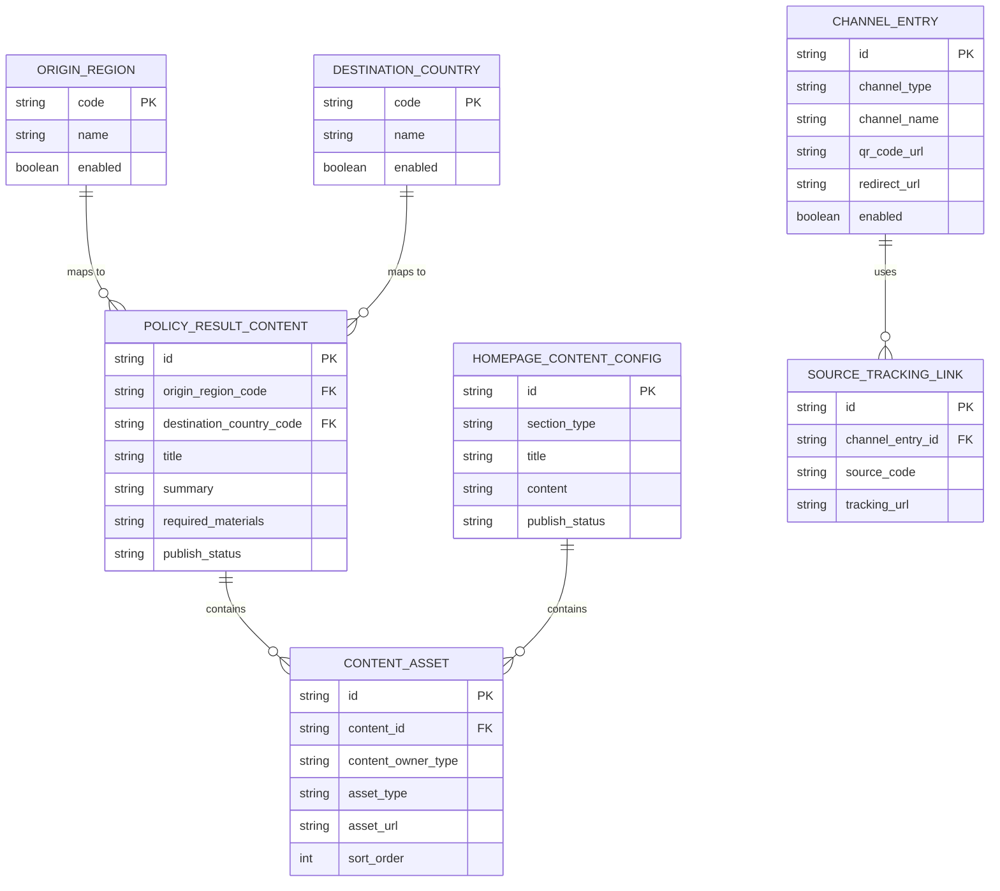
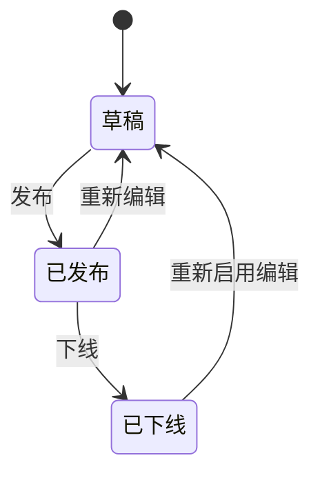
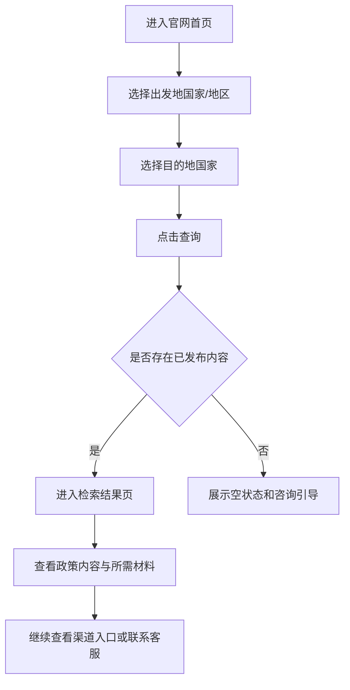
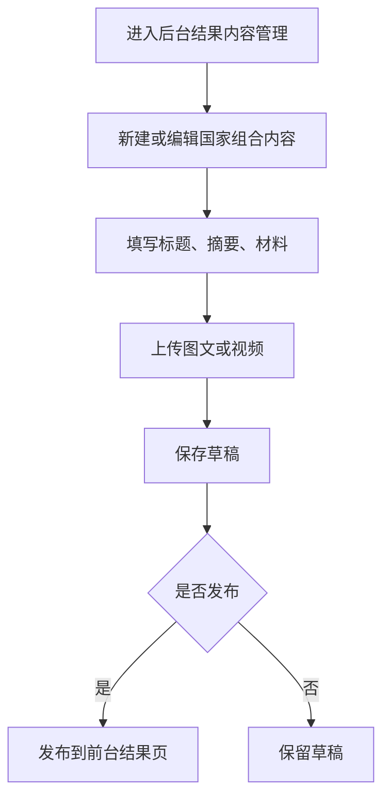
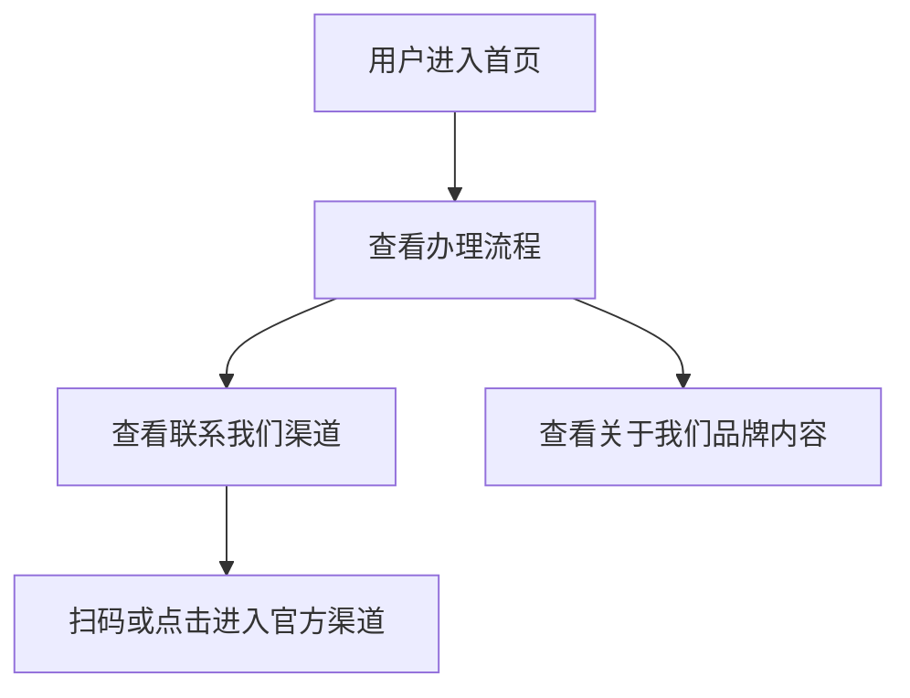
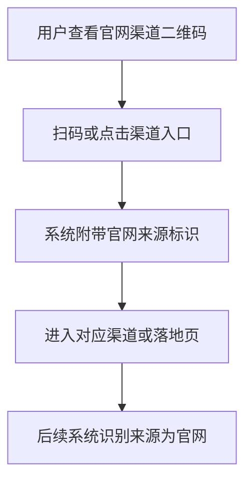

# SIDL官网PC端 Specification

> **模块**: SIDL 官网 PC 端
> **版本**: v1.1
> **最后更新**: 2026-06-04
> **作者**: Codex

---

## 更新日志

- **v1.1 (2026-06-04)**: 明确办理流程静态图、联系我们渠道二维码、关于我们品牌形象内容均由后台维护，不在前端写死
- **v1.0 (2026-06-04)**: 基于 `SIDL官网PC端BRD20260521.md` 生成模板化 PRD，补齐页面结构、后台维护、来源识别、数据模型与验收标准

---

## 1. 背景与目标

### 1.1 业务背景

SIDL 是美卡新注册的对外品牌，官网 PC 端将作为该品牌面向用户的官方门户网站，承接“中国用户出境到全球各国家租车自驾时所需的驾照翻译相关服务”信息展示与引流转化职责。

本次开发基于现有网站进行迭代，不是从零新建一套独立系统。官网需要体现品牌的专业性、信息完整性和办理便捷性，并通过统一入口把用户引导到各官方销售渠道完成咨询和购买。

### 1.2 问题陈述

当前 BRD 对官网的核心诉求集中在以下几个方面：

- 官网需要比普通个人媒体或零散网站提供更准确的各国自驾租车和驾照翻译政策信息。
- 官网需要覆盖尽可能多的目的地国家，并支持用户快速检索“中国出发地 + 目的地国家”对应的办理要求。
- 官网需要统一承接各销售渠道，降低用户理解和下单路径分散带来的流失。
- 官网需要支持后台维护图文和视频内容，确保政策信息能及时更新。
- 官网需要识别用户是否通过官网二维码进入下单渠道，为后续渠道转化追踪提供依据。

---

## 2. 现状洞察（AS-IS）

当前官网能力尚未形成“检索查询 + 内容维护 + 渠道引流 + 来源识别”的完整闭环，BRD 明确提出的展示和维护诉求还未被系统化承接。

| 痛点 | 描述 |
| --- | --- |
| **信息入口不集中** | 用户无法在官网通过标准化检索快速获得“出发地国家 + 目的地国家”的办理政策和材料要求。 |
| **政策内容维护弱** | 最新政策图文或视频内容缺少后台可维护机制，更新效率和一致性难保障。 |
| **渠道触达分散** | 淘宝、微信、支付宝、小红书、京东、抖音等渠道缺少统一品牌展示入口。 |
| **来源识别缺失** | 无法判断哪些客户是扫描官网二维码进入渠道，难以评估官网引流效果。 |
| **品牌内容承接不足** | “关于我们”类品牌形象内容未形成明确的官网展示模块。 |

---

## 3. 目标（TO-BE）与非目标

### 3.1 目标

| # | 目标 | 描述 |
| - | --- | --- |
| 1 | **建立国家检索入口** | 用户可选择出发地国家和目的地国家，查询对应驾照翻译政策与所需材料。 |
| 2 | **建立结果内容维护机制** | 后台可维护检索结果页的图文和视频内容，支持政策持续更新。 |
| 3 | **统一展示办理与联系渠道** | 官网集中展示由后台维护的办理流程内容和各官方购买渠道二维码/入口。 |
| 4 | **沉淀品牌展示页** | 通过由后台维护的“关于我们”模块建立 SIDL 官方品牌形象。 |
| 5 | **支持来源识别** | 识别通过官网二维码进入各购买渠道的用户来源，为后续转化追踪提供数据基础。 |

### 3.2 非目标（本期不做）

- **不实现在线下单闭环**: 本期官网负责检索、展示、引流，不直接在官网内完成支付和履约。
- **不实现政策自动抓取**: 各国政策内容由后台人工上传维护，不建设自动采集系统。
- **不建设复杂 CMS**: 本期只覆盖本需求所需的结果页内容维护和基础品牌内容维护。
- **不覆盖移动端独立规格**: 本期 PRD 聚焦 PC 端官网，不展开 H5 或小程序专属交互规范。

### 3.3 User Stories

#### US-1: 快速检索目的地办理要求

> **作为** 计划出境自驾租车的中国用户
> **我希望** 选择出发地国家和目的地国家后快速看到所需办理材料和政策说明
> **以便于** 判断自己是否需要办理驾照翻译件、宣誓翻译或携带原件

**验收标准**:

- 首页存在出发地国家和目的地国家选择入口
- 点击查询后进入结果页
- 结果页可展示对应国家的政策说明和所需材料

#### US-2: 通过官网进入官方购买渠道

> **作为** 已了解办理要求的用户
> **我希望** 在官网直接看到官方购买渠道二维码或入口
> **以便于** 按我习惯的方式继续咨询和购买

**验收标准**:

- 官网存在“联系我们”模块
- 模块内展示各官方渠道二维码或店铺入口
- 用户扫码或点击后可带上官网来源标识

#### US-4: 运营维护首页展示素材

> **作为** 内容运营
> **我希望** 在后台维护办理流程静态图、联系我们二维码和关于我们品牌形象内容
> **以便于** 官网展示内容可以根据业务需要持续更新，而不是依赖前端改版发版

**验收标准**:

- 后台支持维护办理流程静态图
- 后台支持维护各渠道二维码和跳转入口
- 后台支持维护关于我们品牌形象图片与图文内容

#### US-3: 运营维护最新政策内容

> **作为** 运营人员
> **我希望** 在后台上传和维护国家政策图文或视频内容
> **以便于** 保持官网信息及时、准确、可持续更新

**验收标准**:

- 后台支持维护检索结果页内容
- 同一出发地国家和目的地国家组合可配置对应内容
- 已发布内容可在前台结果页展示

---

## 4. 术语表（Terminology）

| 术语 | 英文 | 定义 |
| --- | --- | --- |
| 出发地国家 | Origin Region | 用户当前持有驾照的地区来源，本期限定为中国大陆/香港/澳门/台湾 |
| 目的地国家 | Destination Country | 用户计划前往租车自驾的国家 |
| 检索结果页 | Search Result Page | 用户选择出发地国家和目的地国家后展示政策和材料要求的页面 |
| 政策内容 | Policy Content | 与指定国家组合对应的图文说明、视频说明和办理要求 |
| 渠道二维码 | Channel QR Code | 指向淘宝、支付宝小程序、微信小程序等官方渠道的二维码或入口图 |
| 来源识别 | Source Attribution | 识别用户是否从官网页面或官网二维码进入后续购买渠道 |
| 首页展示配置 | Homepage Content Configuration | 用于维护办理流程、联系我们、关于我们等首页展示内容的后台配置集合 |

---

## 5. 角色与权限

| 角色 | 权限范围 | 说明 |
| --- | --- | --- |
| 官网访客 | 使用检索、浏览结果页、查看办理流程、查看联系我们、查看关于我们 | 前台普通用户 |
| 内容运营 | 维护结果页内容、维护办理流程内容、维护关于我们内容、维护渠道二维码 | 后台内容维护角色 |
| 管理员 | 审核发布内容、管理可用国家、管理来源识别配置 | 后台管理角色 |
| 系统 | 处理查询、渲染页面、记录来源参数、返回内容结果 | 平台服务执行方 |

**权限规则**:

- 前台访客仅可查看已发布内容，不能访问后台维护入口。
- 内容运营可编辑内容草稿，但发布动作默认由管理员或具备发布权限的角色执行。
- 来源识别参数配置仅管理员可维护，避免渠道归因规则混乱。

---

## 6. 数据模型（业务/交互视角）

### 6.1 实体关系图（ER Diagram）



### 6.2 Logical View（逻辑视图，UI 设计基准）

> [!IMPORTANT]
> **AI 执行约束**
>
> 1. 本章仅定义官网前后台的业务语义和页面交互模型，不直接等同底层存储结构。
> 2. PC 端首页、结果页、联系我们页和后台内容维护页必须基于本节 `Logical View` 设计。
> 3. 检索结果展示需要明确区分静态结构字段与后台维护内容字段。
> 4. 来源识别必须在视图层体现“当前渠道入口带有来源标识”的业务语义。

```typescript
interface SidlHomePageView {
  hero: {
    brandTitle: string;
    brandSubtitle: string;
    searchForm: SearchFormView;
  };
  processSection: HomepageAssetBlock[];
  contactSection: ChannelCardView[];
  aboutSection: HomepageAssetBlock[];
}

interface SearchFormView {
  originRegionOptions: OriginRegionOption[];
  destinationCountryOptions: DestinationCountryOption[];
  selectedOriginRegion?: string;
  selectedDestinationCountry?: string;
  actions: {
    onSearch(): void;
  };
}

interface SearchResultPageView {
  query: {
    originRegionCode: string;
    destinationCountryCode: string;
  };
  resultHeader: {
    title: string;
    summary: string;
  };
  materials: string[];
  contentBlocks: ResultContentBlock[];
  recommendedChannels: ChannelCardView[];
}

interface ResultContentBlock {
  type: 'rich_text' | 'image' | 'video';
  content: string;
  sortOrder: number;
}

interface ChannelCardView {
  channelType: string;
  channelName: string;
  qrCodeUrl?: string;
  redirectUrl?: string;
  trackingSourceCode: string;
}

interface HomepageAssetBlock {
  sectionType: 'process' | 'about';
  title?: string;
  content?: string;
  imageUrl?: string;
  sortOrder: number;
}
```

### 6.3 计算字段与虚字段

| 数据库存储 | 逻辑视图字段 | Spec 写法 | AI 行为 |
| --- | --- | --- | --- |
| `required_materials` 原始字符串/数组 | `materials` | `string[]` *(Derived from stored materials config)* | 自动拆分为前台材料标签或列表 |
| `publish_status` | `isPublished` | `true if publish_status === 'published'` | 控制前台是否可见 |
| `channel_entry + source_tracking_link` | `trackingSourceCode` | `Mapped from tracking link config` | 前台自动拼接带来源参数的跳转/扫码入口 |
| `homepage_content_config + content_asset` | `processSection/aboutSection` | `Derived from homepage section config` | 首页动态渲染办理流程与关于我们内容 |

---

## 7. 业务规则与验证

### 7.1 核心业务规则

| 规则编号 | 规则名称 | 规则描述 |
| --- | --- | --- |
| BR-001 | 检索维度限定 | 出发地国家本期仅支持中国大陆、香港、澳门、台湾 |
| BR-002 | 查询必填 | 用户必须同时选择出发地国家和目的地国家后才可点击查询 |
| BR-003 | 结果内容按国家组合匹配 | 检索结果页内容必须由“出发地国家 + 目的地国家”组合唯一匹配 |
| BR-004 | 前台仅展示已发布内容 | 处于草稿或下线状态的政策内容不得在前台展示 |
| BR-005 | 联系渠道统一维护 | 联系我们模块展示的二维码和渠道入口以后台配置为准 |
| BR-006 | 来源识别透传 | 从官网二维码或渠道入口跳转时必须带上官网来源标识 |
| BR-007 | 办理流程后台维护 | 办理流程以前台静态图片形式展示，但图片内容由后台维护，不在前端写死 |
| BR-008 | 关于我们后台维护 | 关于我们模块的品牌形象图片和图文内容由后台维护，不在前端写死 |

### 7.2 数据验证规则

| 字段（含变更标识） | 验证规则 | 错误提示 |
| --- | --- | --- |
| [ADD] `origin_region_code` | 必须为支持的出发地地区枚举之一 | `请选择有效的出发地国家/地区` |
| [ADD] `destination_country_code` | 必须为启用中的目的地国家 | `请选择有效的目的地国家` |
| [ADD] `required_materials` | 至少配置 1 项所需材料 | `请至少填写一项所需材料` |
| [ADD] `content_asset.asset_type` | 仅支持 `rich_text`、`image`、`video` | `内容类型仅支持图文或视频` |
| [ADD] `channel_entry.redirect_url` | 若配置跳转链接则必须为合法 URL | `请输入有效的渠道链接` |
| [ADD] `channel_entry.qr_code_url` | 若展示二维码则必须上传图片资源 | `请上传渠道二维码` |

### 7.3 状态机（如适用）



**状态转换规则**:

| 当前状态 | 目标状态 | 触发条件 | 操作权限 |
| --- | --- | --- | --- |
| `draft` | `published` | 内容完整并执行发布动作 | 管理员/有发布权限角色 |
| `published` | `draft` | 需要修改已发布内容 | 内容运营/管理员 |
| `published` | `offline` | 内容不再对前台展示 | 管理员 |
| `offline` | `draft` | 重新启用内容编辑 | 内容运营/管理员 |

---

## 8. 功能需求

### 8.1 首页检索入口与结果页

#### 8.1.1 功能描述

官网首页需提供“出发地国家/地区 + 目的地国家”的检索入口。用户选择组合后点击查询，跳转至检索结果页，展示该组合下的最新政策内容、所需材料，以及图文或视频说明。

BRD 中的示例逻辑为：

- 当前所持驾驶证：`中国大陆驾驶证`
- 目的地国家：`德国`
- 查询结果：`驾照翻译件 + 德语宣誓 + 中国驾照原件`

#### 8.1.2 筛选条件

**筛选字段定义**:

| 筛选字段 | 类型 | 必填 | 默认值 | 取值来源 | 说明 |
| --- | --- | --- | --- | --- | --- |
| [ADD] `originRegionCode` | Enum | 是 | 无 | 系统枚举 | 当前所持驾驶证来源地区 |
| [ADD] `destinationCountryCode` | Enum | 是 | 无 | 国家库 | 目的地国家 |

**枚举值定义**:

| 值 | 名称 | 说明 |
| --- | --- | --- |
| `cn_mainland` | 中国大陆 | 中国大陆驾驶证 |
| `cn_hk` | 中国香港 | 香港驾驶证 |
| `cn_mo` | 中国澳门 | 澳门驾驶证 |
| `cn_tw` | 中国台湾 | 台湾驾驶证 |

**验证规则**:

| 字段（含变更标识） | 验证规则 | 错误提示 |
| --- | --- | --- |
| [ADD] `originRegionCode` | 必填 | `请选择当前所持驾驶证地区` |
| [ADD] `destinationCountryCode` | 必填 | `请选择目的地国家` |

**筛选逻辑**:

- `originRegionCode` 与 `destinationCountryCode` 为 AND 组合查询。
- 若目标组合无发布内容，返回空状态页而不是报错页。

**业务约束**:

- 出发地国家固定为中国相关四个地区，不开放自由输入。
- 目的地国家应支持后台启停控制。

#### 8.1.3 列表字段定义

**结果页展示字段**:

| 字段名（含变更标识） | 类型 | 数据来源 | 说明 | 示例 |
| --- | --- | --- | --- | --- |
| [ADD] `resultTitle` | String | `policy_result_content.title` | 结果标题 | `中国大陆驾照在德国自驾所需材料` |
| [ADD] `resultSummary` | String | `policy_result_content.summary` | 摘要说明 | `可使用德语宣誓翻译件配合原件办理` |
| [ADD] `requiredMaterials` | String[] | `policy_result_content.required_materials` | 所需材料列表 | `驾照翻译件` |
| [ADD] `contentBlocks` | Mixed | `content_asset` | 图文/视频内容块 | `视频讲解` |
| [ADD] `updatedAtLabel` | Datetime | `policy_result_content.updated_at` | 最近更新时间展示 | `2026-06-04` |

**排序规则**:

- 结果页内容块按 `sort_order ASC` 展示

**分页规则**:

- 前台结果页不分页，按单个结果页面完整展示

#### 8.1.4 表单字段定义

**字段行为矩阵 (Field Behavior Matrix)**:

| 字段（含变更标识） | 创建模式 | 编辑模式 | 查看模式 | 依赖/逻辑说明 |
| --- | --- | --- | --- | --- |
| [ADD] `originRegionCode` | Select (必填) | Read-only | Text | 前台查询时用户选择，结果页只展示 |
| [ADD] `destinationCountryCode` | Select (必填) | Read-only | Text | 前台查询时用户选择，结果页只展示 |
| [ADD] `requiredMaterials` | Hidden | Read-only | Tag/List | 由后台配置结果内容决定 |

#### 8.1.5 业务流程



**流程说明**:

1. 用户进入官网首页并完成国家组合选择。
2. 系统根据组合查询已发布内容。
3. 若有内容则渲染结果页，若无内容则展示空状态和咨询引导。
4. 用户可在结果页继续进入官方渠道。

#### 8.1.6 边界场景处理

| 场景 | 处理方式 |
| --- | --- |
| 未选择完整条件即点击查询 | 阻断查询并提示补全筛选条件 |
| 国家组合暂无内容 | 展示“暂未收录，可联系客服咨询”空状态 |
| 结果内容缺少视频 | 正常展示图文内容，不要求图文和视频同时存在 |

### 8.2 检索结果页后台内容维护

#### 8.2.1 功能描述

后台需支持对检索结果页进行内容维护，运营可按“出发地国家 + 目的地国家”创建或编辑对应政策内容，并上传图文或视频资源。

#### 8.2.2 筛选条件

**筛选字段定义**:

| 筛选字段 | 类型 | 必填 | 默认值 | 取值来源 | 说明 |
| --- | --- | --- | --- | --- | --- |
| [ADD] `originRegionCode` | Enum | 否 | 无 | 系统枚举 | 按出发地筛选内容 |
| [ADD] `destinationCountryCode` | Enum | 否 | 无 | 国家库 | 按目的地国家筛选内容 |
| [ADD] `publishStatus` | Enum | 否 | `draft` | 系统枚举 | 按发布状态筛选 |

**枚举值定义**:

| 值 | 名称 | 说明 |
| --- | --- | --- |
| `draft` | 草稿 | 未发布内容 |
| `published` | 已发布 | 前台可见内容 |
| `offline` | 已下线 | 前台不可见内容 |

**业务约束**:

- 同一“出发地国家 + 目的地国家”组合本期仅允许 1 条生效中的已发布内容。

#### 8.2.3 列表字段定义

**列表展示字段**:

| 字段名（含变更标识） | 类型 | 数据来源 | 说明 | 示例 |
| --- | --- | --- | --- | --- |
| [ADD] `originRegionName` | String | `origin_region.name` | 出发地国家/地区 | `中国大陆` |
| [ADD] `destinationCountryName` | String | `destination_country.name` | 目的地国家 | `德国` |
| [ADD] `title` | String | `policy_result_content.title` | 内容标题 | `德国自驾办理说明` |
| [ADD] `publishStatus` | Enum | `policy_result_content.publish_status` | 发布状态 | `published` |
| [ADD] `updatedAt` | Datetime | `policy_result_content.updated_at` | 更新时间 | `2026-06-04 15:30:00` |

**排序规则**:

- 默认排序：`updatedAt DESC`

**分页规则**:

- 默认每页显示：20 条
- 支持分页大小：10、20、50、100

#### 8.2.4 表单字段定义

**常规字段定义 (Legacy/Simple Forms)**:

| 字段名（含变更标识） | 类型 | 必填 | 默认值 | 取值来源 | 验证规则 | 说明 |
| --- | --- | --- | --- | --- | --- | --- |
| [ADD] `originRegionCode` | Enum | 是 | 无 | 系统枚举 | 必须为支持地区 | 出发地国家/地区 |
| [ADD] `destinationCountryCode` | Enum | 是 | 无 | 国家库 | 必须为启用国家 | 目的地国家 |
| [ADD] `title` | String | 是 | 无 | 用户输入 | 长度 ≤ 100 | 结果页标题 |
| [ADD] `summary` | String | 是 | 无 | 用户输入 | 长度 ≤ 300 | 结果摘要 |
| [ADD] `requiredMaterials` | Array | 是 | 无 | 用户输入 | 至少 1 项 | 所需材料 |
| [ADD] `contentAssets` | Mixed | 否 | 无 | 上传资源 | 仅支持图文/视频 | 内容块 |
| [ADD] `publishStatus` | Enum | 是 | `draft` | 系统枚举 | 必须为有效状态 | 发布状态 |

#### 8.2.5 业务流程



#### 8.2.6 边界场景处理

| 场景 | 处理方式 |
| --- | --- |
| 同组合重复发布 | 阻断发布或提示覆盖当前生效内容 |
| 上传视频失败 | 提示重试，已保存的图文内容不丢失 |
| 必填字段未填 | 阻断保存/发布并提示具体缺失项 |

### 8.3 办理流程、联系我们、关于我们

#### 8.3.1 功能描述

官网前台需展示办理流程、联系我们和关于我们三个展示模块，三者的展示内容均由后台维护：

- 办理流程：展示后台维护的静态图片，可承载 `联系客服 -> 确认材料 -> 商谈价格 -> 下单购买 -> 收货` 等流程内容
- 联系我们：展示后台维护的各官方渠道二维码或店铺入口
- 关于我们：展示后台维护的品牌形象图片和图文内容

#### 8.3.2 列表字段定义

**列表展示字段**:

| 字段名（含变更标识） | 类型 | 数据来源 | 说明 | 示例 |
| --- | --- | --- | --- | --- |
| [ADD] `processAssets` | Array | `homepage_content_config + content_asset` | 办理流程展示素材 | `process-banner.png` |
| [ADD] `channelName` | String | `channel_entry.channel_name` | 渠道名称 | `微信小程序` |
| [ADD] `channelQrCode` | Image | `channel_entry.qr_code_url` | 渠道二维码 | `wechat_qr.png` |
| [ADD] `aboutAssets` | Mixed | `homepage_content_config + content_asset` | 关于我们品牌图文素材 | `SIDL 品牌介绍` |

#### 8.3.3 表单字段定义

**常规字段定义 (Legacy/Simple Forms)**:

| 字段名（含变更标识） | 类型 | 必填 | 默认值 | 取值来源 | 验证规则 | 说明 |
| --- | --- | --- | --- | --- | --- | --- |
| [ADD] `processImage` | Image | 否 | 无 | 上传资源 | 合法图片格式 | 办理流程静态图 |
| [ADD] `processTitle` | String | 否 | 无 | 用户输入 | 长度 ≤ 50 | 办理流程模块标题 |
| [ADD] `channelName` | String | 是 | 无 | 用户输入 | 长度 ≤ 50 | 渠道名称 |
| [ADD] `qrCodeUrl` | Image | 否 | 无 | 上传资源 | 合法图片格式 | 渠道二维码 |
| [ADD] `redirectUrl` | String | 否 | 无 | 用户输入 | 合法 URL | 渠道跳转链接 |
| [ADD] `aboutImage` | Image | 否 | 无 | 上传资源 | 合法图片格式 | 关于我们品牌形象图片 |
| [ADD] `aboutTitle` | String | 否 | 无 | 用户输入 | 长度 ≤ 50 | 关于我们模块标题 |
| [ADD] `aboutContent` | RichText | 是 | 无 | 用户输入 | 不可为空 | 关于我们内容 |

#### 8.3.4 业务流程



#### 8.3.5 边界场景处理

| 场景 | 处理方式 |
| --- | --- |
| 某渠道暂无二维码 | 可仅展示店铺名称和跳转入口 |
| 渠道临时停用 | 后台可下线该渠道，前台不展示 |
| 办理流程未上传图片 | 可不展示该模块，或展示默认占位并提示后台补全 |
| 关于我们内容为空 | 阻断发布，要求补全品牌内容 |
| 关于我们未上传品牌图片 | 可仅展示图文内容，不阻断整体页面展示 |

### 8.4 来源识别

#### 8.4.1 功能描述

官网需支持识别哪些客户是扫描官网二维码进入后续购买渠道的。前台展示的二维码和渠道链接应带有来源标识，后续渠道或落地页可基于该标识识别“来自官网”。

#### 8.4.2 列表字段定义

**列表展示字段**:

| 字段名（含变更标识） | 类型 | 数据来源 | 说明 | 示例 |
| --- | --- | --- | --- | --- |
| [ADD] `sourceCode` | String | `source_tracking_link.source_code` | 来源标识编码 | `sidl_official_pc` |
| [ADD] `channelName` | String | `channel_entry.channel_name` | 对应渠道 | `淘宝店铺` |
| [ADD] `trackingUrl` | String | `source_tracking_link.tracking_url` | 带来源参数的链接 | `https://xxx?source=sidl_official_pc` |
| [ADD] `scanCount` | Integer | 统计服务 | 扫码/点击次数 | `128` |

#### 8.4.3 业务流程



#### 8.4.4 边界场景处理

| 场景 | 处理方式 |
| --- | --- |
| 某渠道无法接收来源参数 | 使用专属二维码或专属跳转链接实现归因 |
| 用户截图转发二维码 | 仍按二维码内置来源参数识别 |
| 统计服务异常 | 不影响用户扫码或跳转，但需记录异常日志 |

---

## 9. 非功能需求

### 9.1 性能要求

| 指标 | 要求 |
| --- | --- |
| 首页加载时间 | < 2s |
| 查询接口响应时间 | < 800ms (P95) |
| 后台内容保存接口 | < 1s (P95) |

### 9.2 安全要求

- 后台内容维护接口需登录后访问
- 后台权限按 RBAC 控制
- 上传视频和图片资源需做格式与大小校验
- 渠道跳转链接需做合法域名校验，避免错误外链

### 9.3 可用性要求

- 当前台无匹配结果时需展示清晰空状态，不应出现系统异常页
- 后台保存草稿后应支持继续编辑
- 官网在内容资源缺失部分模块时，应尽量降级展示而非整页不可用

---

## 10. 测试策略

### 10.1 测试范围

- 单元测试：查询参数校验、来源参数拼接、发布状态控制
- 集成测试：结果页内容查询、后台内容保存与发布、渠道跳转链接生成
- E2E 测试：首页查询到结果页，再到渠道扫码/跳转的关键链路
- 异常测试：无结果、资源缺失、渠道停用、统计异常

### 10.2 测试用例（关键场景）

| 用例编号 | 测试场景 | 前置条件 | 操作步骤 | 预期结果 |
| --- | --- | --- | --- | --- |
| TC-001 | 国家组合查询成功 | 已配置中国大陆 -> 德国已发布内容 | 选择中国大陆和德国并点击查询 | 正常展示结果页、所需材料和图文/视频内容 |
| TC-002 | 国家组合无内容 | 未配置目标组合内容 | 选择对应组合并点击查询 | 展示空状态和咨询引导 |
| TC-003 | 后台发布结果页内容 | 管理员已登录后台 | 新建国家组合内容并发布 | 前台对应结果页可见 |
| TC-004 | 渠道来源识别 | 已配置官网来源参数 | 扫码或点击渠道入口 | 跳转链接带来源标识 |
| TC-005 | 渠道停用 | 某渠道已设为停用 | 打开联系我们模块 | 停用渠道不展示 |

---

## 11. 验收标准（Acceptance Criteria）

### 11.1 功能验收

**场景1: 用户按国家组合查询政策内容**

```gherkin
Given 前台已存在一条中国大陆到德国的已发布政策内容
When 用户在官网首页选择中国大陆和德国并点击查询
Then 系统应进入检索结果页
And 页面应展示对应政策说明和所需材料
```

**场景2: 运营发布结果页内容后前台可见**

```gherkin
Given 内容运营已在后台填写完整的国家组合政策内容
When 具备权限的角色执行发布
Then 前台对应组合查询结果应可见
And 草稿或下线内容不应在前台展示
```

**场景3: 用户通过官网二维码进入渠道**

```gherkin
Given 官网联系我们模块已配置带来源参数的渠道二维码
When 用户扫描二维码进入渠道
Then 跳转链路应带上官网来源标识
And 后续系统可识别来源为官网
```

### 11.2 数据契约验收

- [ ] 国家组合与结果内容的映射关系已定义清楚
- [ ] 前台结果页展示字段来源已标注完整
- [ ] 渠道入口和来源识别字段已定义清楚
- [ ] 本期新增字段已使用 `[ADD]` 标识

### 11.3 性能验收

- [ ] 首页加载时间满足 `< 2s`
- [ ] 查询接口响应时间满足 `< 800ms (P95)`
- [ ] 后台保存接口满足 `< 1s (P95)`

---

## 12. 实施计划

### 12.1 依赖关系

- 依赖现有官网代码结构可承接 PC 端模块扩展
- 依赖国家库或基础配置支持目的地国家启停
- 依赖渠道方支持来源参数透传或专属二维码归因
- 依赖运营提供各国家组合的政策内容、图文、视频和品牌素材

### 12.2 风险与缓解措施

| 风险 | 影响 | 概率 | 缓解措施 |
| --- | --- | --- | --- |
| 政策内容更新不及时 | 高 | 中 | 后台支持快速维护，明确运营更新责任人和频率 |
| 某些渠道不支持来源参数 | 中 | 中 | 改用专属二维码或中转链接方案归因 |
| 国家覆盖范围快速扩大 | 中 | 高 | 结果内容按国家组合配置，预留可扩展国家库结构 |
| 图文视频资源不完整 | 中 | 中 | 支持图文或视频单独存在，先保证可发布最小内容 |
