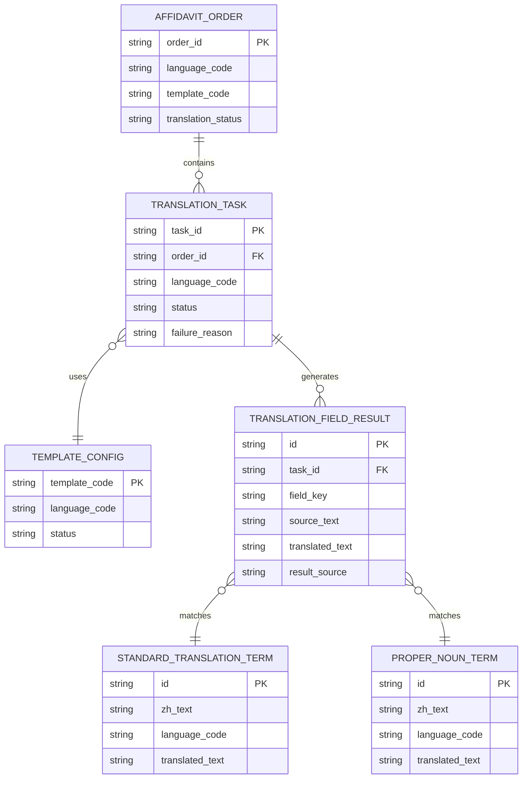
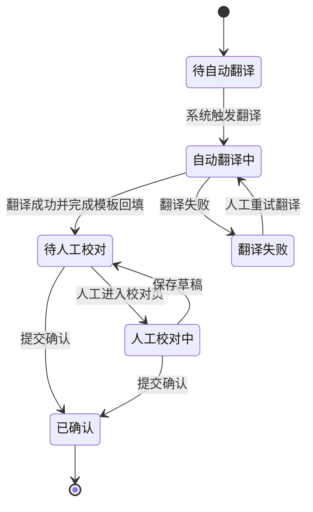
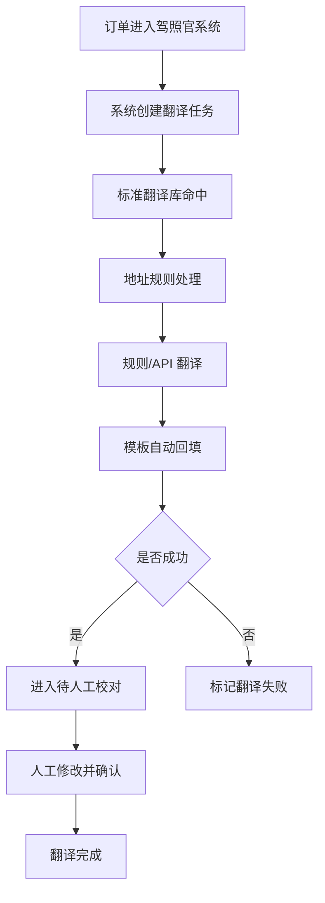
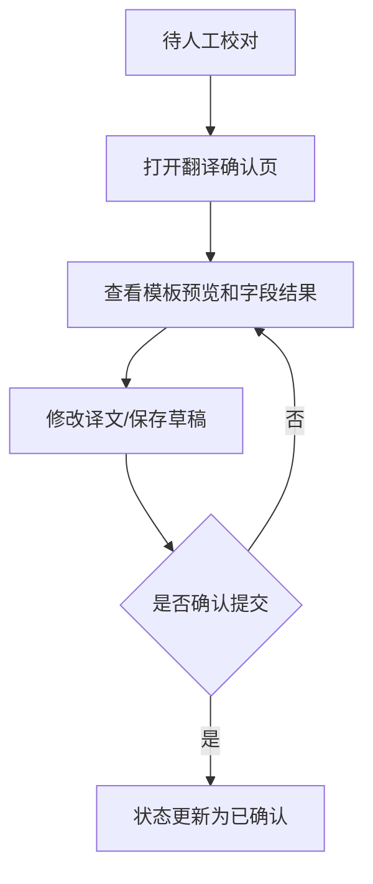
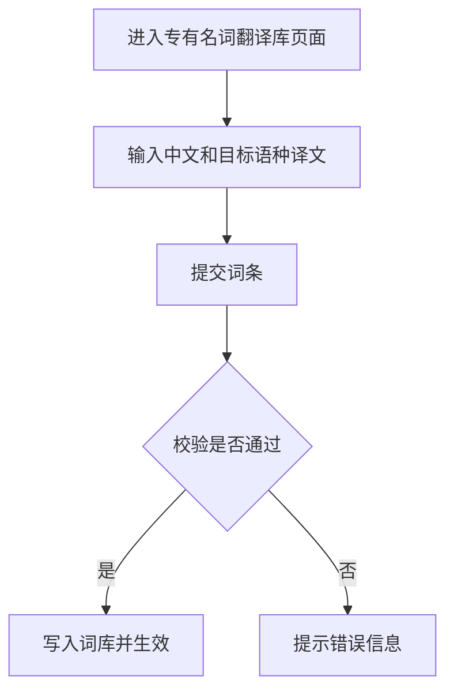

# 小语种宣誓翻译 Specification

## 1. 背景与目标

### 1.1 业务背景

当前宣誓翻译订单进入驾照官系统后，仍高度依赖外部网页工具进行小语种翻译和人工排版。制作人员需要在系统、金山词霸、豆包等网页之间反复切换，手动复制结果并填入模板，整个制作链路割裂，难以沉淀标准化能力。

随着法语、德语、西班牙语、意大利语等小语种宣誓翻译订单增长，系统需要建设一条可复用的自动翻译链路，支持基于固定规则、标准词库和模板库完成自动翻译与自动回填，同时保留人工校对作为最终质量保障。

### 1.2 问题陈述

当前核心问题包括：

- 翻译依赖外部网页工具，稳定性差，且无法直接通过标准 API 无缝接入现有系统。
- 固定字段、地址、专有名词缺少统一标准库，不同制作人员输出口径不一致。
- 翻译结果不能自动回填模板，仍需人工复制、粘贴、排版。
- 人工校对中发现的标准译法无法沉淀复用，同类内容重复劳动。
- 专有名词目前前期只能依赖拼音兜底，缺少系统内维护与替换机制。

---

## 2. 现状洞察（AS-IS）

当前宣誓翻译流程以人工处理为主，系统只承接订单，不承接翻译规则执行、模板自动回填和词库持续沉淀。

| 痛点                       | 描述                                                       |
| -------------------------- | ---------------------------------------------------------- |
| **翻译工具分散**     | 需要频繁切换驾照官系统与外部网页工具，人工操作链路长。     |
| **翻译口径不统一**   | 固定字段、地址、专有名词由不同人员手工处理，结果一致性差。 |
| **模板回填依赖人工** | 翻译后的内容需要人工粘贴到模板中，耗时且易出错。           |
| **标准词沉淀缺失**   | 人工校对形成的新标准译法不能直接进入可复用词库。           |
| **专有名词维护缺位** | 当前无系统内页面维护中文专有名词与对应小语种译法。         |

---

## 3. 目标（TO-BE）与非目标

### 3.1 目标

| # | 目标                           | 描述                                                       |
| - | ------------------------------ | ---------------------------------------------------------- |
| 1 | **建立自动翻译链路**     | 宣誓翻译订单进入系统后自动触发翻译，无需人工点击网页工具。 |
| 2 | **统一翻译口径**         | 固定字段优先命中标准翻译库，地址字段按语种翻译规则处理。   |
| 3 | **实现模板自动回填**     | 翻译结果自动填入对应宣誓翻译模板，并生成可校对结果。       |
| 4 | **保留人工必审**         | 自动翻译后的订单必须经过人工核对和确认后才能进入下一环节。 |
| 5 | **建设专有名词沉淀机制** | 通过系统内维护页录入专有名词译法，后续订单优先复用。       |

### 3.2 非目标（本期不做）

- **不取消人工终审**: 本期自动翻译不能替代人工最终确认。
- **不扩展全部语言**: 本期仅覆盖法语、德语、西班牙语、意大利语。
- **不建设复杂审批流**: 不实现多级词库审核、版本发布审批等管理能力。
- **不批量重跑历史订单**: 历史已完成订单不在本期批量重翻范围内。

### 3.3 User Stories

#### US-1: 自动翻译替代网页切换

> **作为** 驾照官制作人员
> **我希望** 宣誓翻译订单进入系统后自动完成初始翻译和模板回填
> **以便于** 减少反复切换网页工具和手工复制粘贴

**验收标准**:

- 订单进入系统后自动生成翻译任务
- 固定字段优先命中标准翻译库
- 翻译结果可自动回填至模板对应位置

#### US-2: 人工校对保证出件质量

> **作为** 驾照官制作人员
> **我希望** 在系统内直接查看并修改自动翻译结果
> **以便于** 保证最终出件内容准确可控

**验收标准**:

- 自动翻译完成后订单进入待人工校对状态
- 制作人员可直接修改翻译结果
- 未完成人工确认的订单不能进入最终完成状态

#### US-3: 专有名词持续沉淀

> **作为** 运营或维护人员
> **我希望** 在系统内维护中文专有名词与对应小语种译法
> **以便于** 后续同类订单直接复用标准结果而不是继续用拼音兜底

**验收标准**:

- 系统提供专有名词翻译维护页
- 可按语言维度保存同一中文词条的不同译法
- 新词条可参与后续翻译命中

---

## 4. 术语表（Terminology）

| 术语           | 英文                            | 定义                                                 |
| -------------- | ------------------------------- | ---------------------------------------------------- |
| 宣誓翻译       | Affidavit Translation           | 针对特定语种的独立翻译件流程，使用独立模板和翻译规则 |
| 标准翻译库     | Standard Translation Library    | 用于存储固定字段标准译法的规则库                     |
| 专有名词翻译库 | Proper Noun Translation Library | 用于存储中文专有名词到目标语言译法的维护库           |
| 地址规则引擎   | Address Rule Engine             | 按不同语种对地址结构、大小写和语序进行转换的规则能力 |
| 模板回填       | Template Autofill               | 将翻译结果自动填入宣誓翻译模板对应字段位置           |
| 人工校对       | Manual Review                   | 制作人员对自动翻译结果进行核对、修正、确认的步骤     |

---

## 5. 角色与权限

| 角色           | 权限范围                                   | 说明                           |
| -------------- | ------------------------------------------ | ------------------------------ |
| 驾照官制作人员 | 查看翻译结果、编辑翻译内容、提交人工确认   | 负责订单翻译结果核对与最终确认 |
| 运营/维护人员  | 维护标准翻译库、维护专有名词翻译库         | 负责规则沉淀与词库扩充         |
| 系统           | 自动触发翻译、规则命中、模板回填、状态流转 | 后台自动处理逻辑执行方         |

**权限规则**:

- 仅具备宣誓翻译处理权限的角色可查看和确认翻译结果。
- 仅具备词库维护权限的角色可新增或更新标准词条、专有名词词条。
- 系统自动翻译结果不可绕过人工确认直接标记为最终完成。

---

## 6. 数据模型（业务/交互视角）

### 6.1 实体关系图（ER Diagram）



### 6.2 Logical View（逻辑视图，UI 设计基准）

> [!IMPORTANT]
> **AI 执行约束**
>
> 1. 本章定义宣誓翻译页面的业务语义与交互模型，不直接等同底层存储结构。
> 2. 前端翻译确认页、词库维护页必须基于本节 `Logical View` 设计。
> 3. 涉及字段来源映射时，必须区分“标准库命中”“专有名词命中”“规则翻译”“拼音兜底”。

```typescript
interface AffidavitTranslationReviewView {
  orderId: string;
  languageCode: 'fr' | 'de' | 'es' | 'it';
  templateCode: string;
  translationStatus:
    | 'pending_translation'
    | 'translating'
    | 'pending_review'
    | 'reviewing'
    | 'translated_confirmed'
    | 'translation_failed';
  sections: TranslationSection[];
  templatePreviewHtml: string;
  reviewActions: {
    saveDraft(): void;
    confirmReview(): void;
    retryTranslation(): void;
  };
}

interface TranslationSection {
  sectionKey: string;
  sectionLabel: string;
  fields: TranslationFieldView[];
}

interface TranslationFieldView {
  fieldKey: string;
  fieldLabel: string;
  sourceText: string;
  translatedText: string;
  resultSource: 'standard_library' | 'proper_noun_library' | 'rule_engine' | 'pinyin_fallback' | 'manual_edit';
  reviewFlag: 'normal' | 'needs_attention';
}

interface ProperNounLibraryFormView {
  zhText: string;
  languageCode: 'fr' | 'de' | 'es' | 'it';
  translatedText: string;
  submitAction(): void;
}
```

### 6.3 计算字段与虚字段

| 数据库存储             | 逻辑视图字段            | Spec 写法                                                        | AI 行为                                    |
| ---------------------- | ----------------------- | ---------------------------------------------------------------- | ------------------------------------------ |
| `translation_status` | `canConfirmReview`    | `true if translationStatus in ['pending_review', 'reviewing']` | 自动控制“确认校对”按钮可用性             |
| `result_source`      | `sourceLabel`         | `Mapped from result_source enum`                               | 自动展示“标准库/规则翻译/拼音兜底”等标签 |
| 多字段翻译结果         | `templatePreviewHtml` | `Derived from translated fields + template config`             | 自动生成预览内容                           |

---

## 7. 业务规则与验证

### 7.1 核心业务规则

| 规则编号 | 规则名称               | 规则描述                                                      |
| -------- | ---------------------- | ------------------------------------------------------------- |
| BR-001   | 自动翻译触发           | 宣誓翻译订单进入系统后必须自动触发翻译任务                    |
| BR-002   | 标准库优先             | 固定字段优先命中标准翻译库，未命中时才进入规则翻译或 API 翻译 |
| BR-003   | 地址规则强制生效       | 地址字段必须按目标语言规则处理，不可直接使用普通机翻覆盖      |
| BR-004   | 拼音兜底               | 专有名词未命中词库时允许先输出拼音，但必须进入人工校对        |
| BR-005   | 人工必审               | 自动翻译完成后必须经过人工校对，未确认前不得进入最终完成状态  |
| BR-006   | 模板以最终人工结果为准 | 人工修改后的翻译结果优先级高于系统自动生成结果                |
| BR-007   | 专有名词可复用         | 新增的专有名词词条在后续订单翻译时应可优先命中                |

### 7.2 数据验证规则

| 字段（含变更标识）          | 验证规则                                                                | 错误提示                                 |
| --------------------------- | ----------------------------------------------------------------------- | ---------------------------------------- |
| [ADD]`language_code`      | 必须为 `fr`、`de`、`es`、`it` 之一                              | `仅支持法语、德语、西班牙语、意大利语` |
| [ADD]`template_code`      | 必须存在启用中的模板配置                                                | `未找到可用模板，请检查模板配置`       |
| [ADD]`zh_text`            | 专有名词中文内容不能为空                                                | `请输入中文专有名词`                   |
| [ADD]`translated_text`    | 目标语种译文不能为空                                                    | `请输入对应语种翻译内容`               |
| [MOD]`translation_status` | 未经人工确认不得直接从 `pending_review` 进入 `translated_confirmed` | `请先完成人工校对`                     |

### 7.3 状态机（如适用）



**状态转换规则**:

| 当前状态                | 目标状态                 | 触发条件                   | 操作权限       |
| ----------------------- | ------------------------ | -------------------------- | -------------- |
| `pending_translation` | `translating`          | 订单进入系统并触发自动翻译 | 系统           |
| `translating`         | `pending_review`       | 翻译成功且模板回填成功     | 系统           |
| `translating`         | `translation_failed`   | 翻译 API 或规则执行失败    | 系统           |
| `pending_review`      | `reviewing`            | 制作人员进入校对页面       | 驾照官制作人员 |
| `pending_review`      | `translated_confirmed` | 人工直接确认通过           | 驾照官制作人员 |
| `reviewing`           | `translated_confirmed` | 人工完成修改并确认         | 驾照官制作人员 |
| `translation_failed`  | `translating`          | 人工点击重试               | 驾照官制作人员 |

---

## 8. 功能需求

### 8.1 自动翻译任务

#### 8.1.1 功能描述

系统在宣誓翻译订单进入驾照官系统后，自动识别语种、模板类型和待翻译字段，创建翻译任务并进入执行流程。翻译顺序为：固定字段标准库命中 -> 地址规则处理 -> 其余字段规则/API 翻译 -> 拼音兜底。

#### 8.1.2 筛选条件

**筛选字段定义**:

| 筛选字段                   | 类型   | 必填 | 默认值             | 取值来源 | 说明                 |
| -------------------------- | ------ | ---- | ------------------ | -------- | -------------------- |
| [ADD]`orderId`           | String | 否   | 无                 | 用户输入 | 按订单号查询翻译任务 |
| [ADD]`languageCode`      | Enum   | 否   | 无                 | 系统枚举 | 按语种筛选           |
| [ADD]`translationStatus` | Enum   | 否   | `pending_review` | 系统枚举 | 按翻译状态筛选       |

**枚举值定义**:

| 值     | 名称     | 说明                 |
| ------ | -------- | -------------------- |
| `fr` | 法语     | 法语宣誓翻译订单     |
| `de` | 德语     | 德语宣誓翻译订单     |
| `es` | 西班牙语 | 西班牙语宣誓翻译订单 |
| `it` | 意大利语 | 意大利语宣誓翻译订单 |

**验证规则**:

| 字段（含变更标识） | 验证规则           | 错误提示               |
| ------------------ | ------------------ | ---------------------- |
| [ADD]`orderId`   | 长度不超过 64 字符 | `订单号长度超出限制` |

**筛选逻辑**:

- 多个筛选条件之间为 AND 关系。
- 不传筛选条件时默认展示当前角色可见的待处理任务。

**业务约束**:

- 同一订单在未结束当前翻译任务前，不应生成重复有效任务。
- `translation_failed` 状态的订单允许人工重试。

#### 8.1.3 列表字段定义

**列表展示字段**:

| 字段名（含变更标识）       | 类型   | 数据来源                            | 说明         | 示例                |
| -------------------------- | ------ | ----------------------------------- | ------------ | ------------------- |
| [ADD]`orderId`           | String | `affidavit_order.order_id`        | 订单号       | `AF20260604001`   |
| [ADD]`languageCode`      | Enum   | `affidavit_order.language_code`   | 语种         | `fr`              |
| [ADD]`translationStatus` | Enum   | `translation_task.status`         | 当前翻译状态 | `pending_review`  |
| [ADD]`templateCode`      | String | `affidavit_order.template_code`   | 使用模板编码 | `affidavit_fr_v1` |
| [ADD]`failureReason`     | String | `translation_task.failure_reason` | 失败原因     | `模板回填失败`    |

**排序规则**:

- 默认排序：`updatedAt DESC`
- 支持排序字段：`createdAt`、`updatedAt`

**分页规则**:

- 默认每页显示：20 条
- 支持分页大小：10、20、50、100

#### 8.1.4 表单字段定义

**字段行为矩阵 (Field Behavior Matrix)**:

| 字段（含变更标识）      | 创建模式 | 编辑模式  | 查看模式 | 依赖/逻辑说明                       |
| ----------------------- | -------- | --------- | -------- | ----------------------------------- |
| [ADD]`sourceText`     | Hidden   | Read-only | Text     | 原始中文仅展示，不允许修改          |
| [ADD]`translatedText` | Hidden   | Textarea  | Text     | 人工校对时可修改最终译文            |
| [ADD]`resultSource`   | Hidden   | Read-only | Tag      | 展示字段来源：标准库/规则/拼音/人工 |
| [ADD]`reviewFlag`     | Hidden   | Read-only | Tag      | 标记重点核对字段                    |

#### 8.1.5 业务流程



**流程说明**:

1. 订单进入系统后，系统自动创建翻译任务。
2. 系统优先命中标准翻译库，再对地址字段执行语种规则。
3. 未命中内容继续走规则/API 翻译，专有名词不足时走拼音兜底。
4. 翻译结果自动回填模板后进入人工校对。
5. 人工确认后订单进入翻译完成状态。

#### 8.1.6 边界场景处理

| 场景          | 处理方式                                                |
| ------------- | ------------------------------------------------------- |
| 翻译 API 失败 | 订单进入 `translation_failed`，提示可重试或转人工处理 |
| 模板缺失      | 阻断回填并提示检查模板配置                              |
| 标准库未命中  | 继续走规则翻译或拼音兜底，不阻断，但标记人工重点核对    |

### 8.2 人工校对与确认

#### 8.2.1 功能描述

自动翻译完成后，制作人员需在系统内查看模板预览和字段结果，直接修改译文并提交确认。人工校对结果是最终出件依据。

#### 8.2.2 表单字段定义

**常规字段定义 (Legacy/Simple Forms)**:

| 字段名（含变更标识）    | 类型    | 必填 | 默认值       | 取值来源          | 验证规则     | 说明         |
| ----------------------- | ------- | ---- | ------------ | ----------------- | ------------ | ------------ |
| [ADD]`translatedText` | String  | 是   | 系统翻译结果 | 系统生成/人工修改 | 不可为空     | 最终译文     |
| [ADD]`reviewComment`  | String  | 否   | 无           | 用户输入          | 长度 ≤ 500  | 校对备注     |
| [ADD]`confirmAction`  | Boolean | 是   | `false`    | 用户操作          | 必须显式确认 | 提交最终确认 |

#### 8.2.3 业务流程



#### 8.2.4 边界场景处理

| 场景                   | 处理方式                                                   |
| ---------------------- | ---------------------------------------------------------- |
| 未填写必要译文即确认   | 阻断提交并提示补全内容                                     |
| 人工修改后离开页面     | 支持保存草稿，状态维持 `pending_review` 或 `reviewing` |
| 已确认订单再次进入页面 | 默认只读，若需重开应走后续补充流程                         |

### 8.3 专有名词翻译库维护页

#### 8.3.1 功能描述

系统需提供专有名词翻译维护页，支持维护人员录入中文专有名词与目标语种译文，用于替换前期拼音兜底结果并提升后续翻译质量。

#### 8.3.2 列表字段定义

**列表展示字段**:

| 字段名（含变更标识）    | 类型     | 数据来源                             | 说明         | 示例                    |
| ----------------------- | -------- | ------------------------------------ | ------------ | ----------------------- |
| [ADD]`zhText`         | String   | `proper_noun_term.zh_text`         | 中文专有名词 | `胡家灰村`            |
| [ADD]`languageCode`   | Enum     | `proper_noun_term.language_code`   | 目标语种     | `fr`                  |
| [ADD]`translatedText` | String   | `proper_noun_term.translated_text` | 译文         | `Hujiahui`            |
| [ADD]`updatedAt`      | Datetime | `proper_noun_term.updated_at`      | 最近更新时间 | `2026-06-04 10:30:00` |

#### 8.3.3 表单字段定义

**常规字段定义 (Legacy/Simple Forms)**:

| 字段名（含变更标识）    | 类型   | 必填 | 默认值 | 取值来源 | 验证规则       | 说明         |
| ----------------------- | ------ | ---- | ------ | -------- | -------------- | ------------ |
| [ADD]`zhText`         | String | 是   | 无     | 用户输入 | 长度 ≤ 100    | 中文专有名词 |
| [ADD]`languageCode`   | Enum   | 是   | 无     | 系统枚举 | 必须为支持语种 | 目标语种     |
| [ADD]`translatedText` | String | 是   | 无     | 用户输入 | 长度 ≤ 200    | 对应译文     |

#### 8.3.4 业务流程



#### 8.3.5 边界场景处理

| 场景           | 处理方式                               |
| -------------- | -------------------------------------- |
| 重复词条提交   | 提示是否覆盖已有译文或新增其他语种版本 |
| 不支持语种提交 | 阻断提交并提示仅支持四种语种           |
| 中文或译文为空 | 阻断提交并提示补全字段                 |

---

## 9. 非功能需求

### 9.1 性能要求

| 指标                 | 要求          |
| -------------------- | ------------- |
| 单单自动翻译平均耗时 | < 30s         |
| 翻译确认页加载时间   | < 2s          |
| 词库维护提交响应时间 | < 500ms (P95) |

### 9.2 安全要求

- 数据传输使用 TLS 1.2+
- 页面与动作权限按 RBAC 控制
- 词库维护操作需记录操作人和更新时间
- 订单译文与原文仅向具备权限的角色可见

### 9.3 可用性要求

- 翻译失败需可追溯失败原因
- 模板回填失败需具备可重试与人工兜底能力
- 人工校对过程应支持保存草稿，避免误关页面导致内容丢失

---

## 10. 测试策略

### 10.1 测试范围

- 单元测试：地址规则引擎、标准库优先逻辑、状态流转
- 集成测试：翻译 API、模板回填、词库维护接口
- E2E 测试：订单进入系统到人工确认完成的关键链路
- 异常测试：翻译失败、模板缺失、词库未命中、重复词条提交

### 10.2 测试用例（关键场景）

| 用例编号 | 测试场景         | 前置条件                      | 操作步骤             | 预期结果                                      |
| -------- | ---------------- | ----------------------------- | -------------------- | --------------------------------------------- |
| TC-001   | 自动翻译触发     | 存在一条法语宣誓翻译订单      | 订单进入驾照官系统   | 系统自动创建翻译任务并进入 `translating`    |
| TC-002   | 地址规则生效     | 存在德语地址字段              | 执行自动翻译         | 结果包含 `VR China`，且省市区前置、路名后置 |
| TC-003   | 人工校对确认     | 订单已进入 `pending_review` | 修改译文并点击确认   | 状态变为 `translated_confirmed`             |
| TC-004   | 翻译失败重试     | 翻译任务失败                  | 点击重试             | 任务重新进入 `translating`                  |
| TC-005   | 专有名词词条生效 | 已新增专有名词词条            | 创建同类新订单并翻译 | 新订单优先命中词库结果而非拼音                |

---

## 11. 验收标准（Acceptance Criteria）

### 11.1 功能验收

**场景1: 宣誓翻译订单自动进入翻译流程**

```gherkin
Given 存在一条支持语种的宣誓翻译订单
When 订单进入驾照官系统
Then 系统应自动创建翻译任务
And 系统应按标准库、地址规则和模板回填逻辑执行翻译
```

**场景2: 人工校对后完成确认**

```gherkin
Given 订单已完成自动翻译并进入待人工校对状态
When 制作人员在系统内修改并确认译文
Then 订单状态应更新为已确认
And 最终模板内容应以人工确认结果为准
```

**场景3: 专有名词维护后参与复用**

```gherkin
Given 维护人员已新增一条专有名词翻译词条
When 后续同类中文词条再次参与翻译
Then 系统应优先命中词库结果
And 不再默认使用拼音兜底
```

### 11.2 数据契约验收

- [ ] 字段来源和映射规则已标注完整
- [ ] 状态流转与业务规则一致
- [ ] 本期新增字段已使用 `[ADD]` / `[MOD]` 标识
- [ ] 校对结果、词库词条、模板配置的关键字段已定义清楚

### 11.3 性能验收

- [ ] 单单自动翻译平均耗时满足 `< 30s`
- [ ] 翻译确认页加载时间满足 `< 2s`
- [ ] 词库维护提交响应时间满足 `< 500ms (P95)`

---

## 12. 附录

### 12.1 语言与地址规则补充

#### 法语规则

- 除首个字母及专有名词外，其余地址通用词默认小写
- 示例：`N°102, village de Hujiahui, rue de Gaoqiao, district de Huangyan, ville de Taizhou, province du Zhejiang`

#### 德语规则

- 地址首字母需大写
- 地址末尾需补充 `VR China`
- 省/市/区需放在地名前面
- 路、街道需放在地名后面
- 示例：`Zimmer 207, Gebäude 7, Nr. 631 Huanghesan Straße, Bezirk Bincheng, Stadt Binzhou, Provinz Shandong, VR China`

#### 西班牙语规则

- 地址首字母需大写
- 示例：`No. 102, Aldea de Hujiahui, Calle Gaoqiao, Distrito de Huangyan, Ciudad de Taizhou, Provincia de Zhejiang`

#### 意大利语规则

- 除首个字母及专有名词外，其余地址通用词默认小写
- 示例：`N. 102, villaggio di Hujiahui, via Gaoqiao, distretto di Huangyan, città di Taizhou, provincia di Zhejiang`

### 12.2 地址通用词标准映射

| 项目        | 意大利语                          | 德语                       | 法语                                  | 西班牙语                        |
| ----------- | --------------------------------- | -------------------------- | ------------------------------------- | ------------------------------- |
| 大道        | Viale                             | Allee                      | Avenue                                | Avenida                         |
| 道路        | Strada                            | Straße                    | Rue                                   | Calle                           |
| 小区/社区   | Residenza                         | Wohnanlage                 | Résidence                            | Urbanización                   |
| 楼栋        | Edificio                          | Gebäude                   | Bâtiment                             | Edificio                        |
| 房间/户     | Appartamento                      | Wohnung                    | Appartement                           | Apartamento                     |
| 一期/二期   | Prima Fase / Seconda Fase         | Erste Phase / Zweite Phase | Première Phase / Deuxième Phase     | Primera Fase / Segunda Fase     |
| 单元        | Unità                            | Einheit                    | Unité                                | Unidad                          |
| 商寓        | Residenza Commerciale             | Geschäftswohnanlage       | Résidence Commerciale                | Residencia Comercial            |
| 楼层        | Piano                             | Etage                      | Étage                                | Piso                            |
| 别墅        | Villa                             | Villa                      | Villa                                 | Villa                           |
| 编号        | Numero                            | Nummer                     | Numéro                               | Número                         |
| 组/队       | Gruppo                            | Gruppe                     | Groupe                                | Grupo                           |
| 弄/巷       | Vicolo                            | Gasse                      | Impasse                               | Callejón                       |
| 村          | Villaggio                         | Dorf                       | Village                               | Pueblo                          |
| 乡镇        | Comune                            | Gemeinde                   | Commune                               | Municipio                       |
| 县          | Contea                            | Landkreis                  | comté                                | condado                         |
| 区          | Distretto                         | Bezirk                     | District                              | Distrito                        |
| 市          | Città                            | Stadt                      | ville                                 | Ciudad                          |
| 省          | Provincia                         | Provinz                    | province                              | Provincia                       |
| 省/市连接词 | di                                | 无                         | de                                    | de                              |
| 国名标注    | Repubblica Popolare Cinese（RPC） | VR China                   | République Populaire de Chine（RPC） | República Popular China（RPC） |

### 12.3 模板示例口径

- 意大利语模板：`[房间/单元] [楼栋], [小区/社区], [道路] [门牌号], [区], [城市], Provincia [省份], Cina`
- 德语模板：`[房间], [楼栋], [道路] [门牌号], [区], [城市], Provinz [省份], VR China`
- 法语模板：`[房间], [楼栋], [道路] [门牌号], [区], [城市], Province [省份], Chine`
- 西班牙语模板：`[房间], [楼栋], [小区], [道路] [门牌号], [区], [城市], Provincia de [省份], China`
