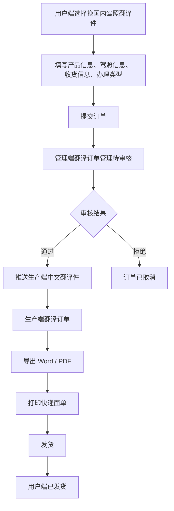
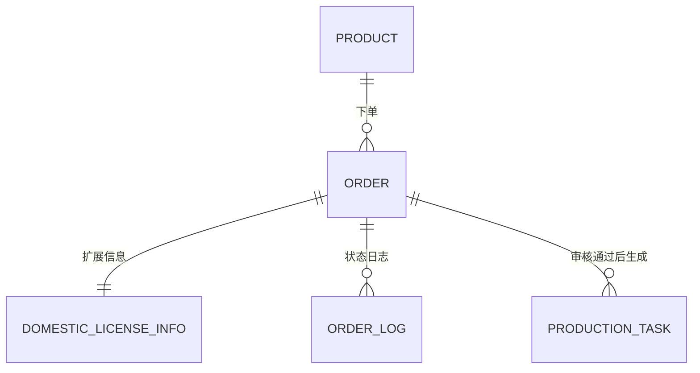
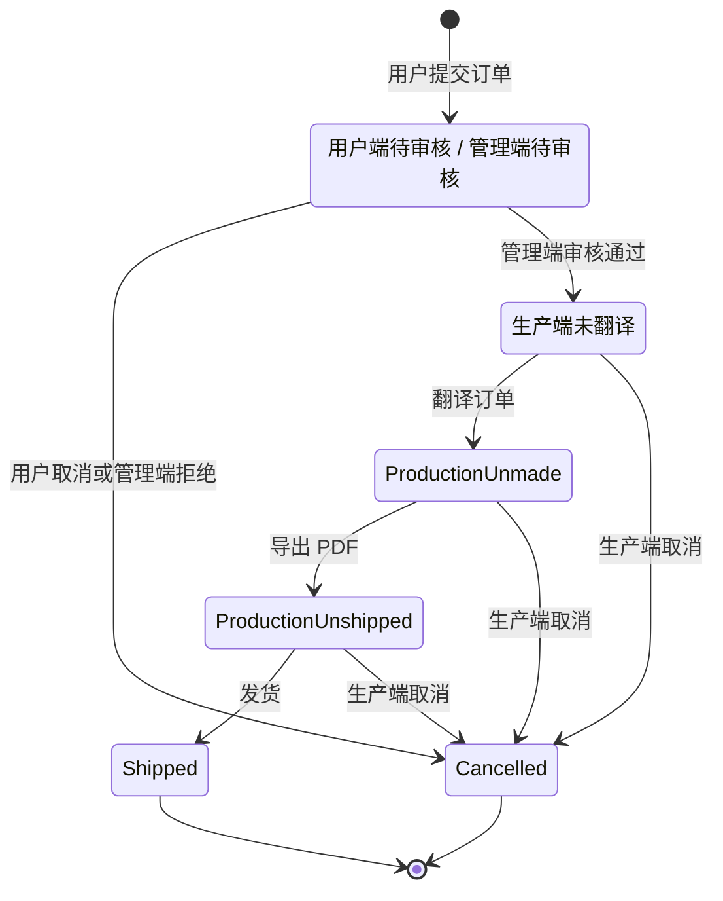

# 换国内驾照翻译件 PRD

> **模块**: 换国内驾照翻译件
> **版本**: v1.0
> **最后更新**: 2026-05-09
> **来源文档**: `specs/Requirements Management/换国内驾照翻译件.md`

---

## 更新日志

| 日期       | 版本 | 变更内容                                       | 变更人 |
| ---------- | ---- | ---------------------------------------------- | ------ |
| 2026-05-09 | v1.0 | 基于原始需求整理用户端、管理端、生产端完整 PRD | Codex  |

---

## 1. 背景与目标

### 1.1 业务背景

平台当前已有翻译认证、公证、IDP 等订单能力，但“境外驾驶证换领国内驾照所需翻译件”存在独立的表单字段、附件材料、模板匹配和生产制作流程。该类订单需要从用户端独立下单，经过管理端审核后进入生产端翻译制作，并最终生成可用于换证办理的翻译件文档。

### 1.2 问题陈述

| 痛点             | 描述                                                                                                      |
| ---------------- | --------------------------------------------------------------------------------------------------------- |
| 下单入口不独立   | 用户需要在通用翻译认证入口中选择，无法准确收集换证城市、境外发证地、加州驾照字段等业务信息。              |
| 审核信息分散     | 管理端缺少针对换国内驾照翻译件的完整信息展示与修改口径。                                                  |
| 生产流程不明确   | 生产端需要完成 OCR/人工复核、翻译制作、模板导出、PDF 生成、面单打印和发货，但当前状态与操作未被统一定义。 |
| 三端状态映射不清 | 用户端、管理端、生产端存在不同状态表达，需要明确映射关系。                                                |

---

## 2. 目标与非目标

### 2.1 目标

| # | 目标           | 描述                                                                       |
| - | -------------- | -------------------------------------------------------------------------- |
| 1 | 独立下单入口   | 用户端新增“换国内驾照翻译件”独立下单入口，默认关联对应产品。             |
| 2 | 完整采集信息   | 支持换证城市、境外发证国家及城市、中文姓名、驾照字段、附件和收货信息采集。 |
| 3 | 订单统一管理   | 订单进入管理端翻译订单管理，支持筛选、查看、修改、审核通过、拒绝。         |
| 4 | 生产端闭环制作 | 生产端中文翻译件页面支持查看、翻译、导出、打印面单、发货、取消。           |
| 5 | 状态映射一致   | 三端状态按订单关系映射统一流转。                                           |

### 2.2 非目标

- 本期不定义真实 OCR 服务商接入细节，仅要求生产端可基于 OCR 识别内容进行翻译和人工补全。
- 本期不定义快递平台真实 API 对接，仅要求预留京东、顺丰、极兔打印入口。
- 本期不重新设计全部翻译认证产品体系，仅新增并隔离“换国内驾照翻译件”产品类型。

---

## 3. 角色与权限

| 角色              | 权限范围                                     | 说明                                         |
| ----------------- | -------------------------------------------- | -------------------------------------------- |
| 用户端/代理端用户 | 下单、查看订单、查看驾照信息、取消待审核订单 | 仅可操作自己提交的订单。                     |
| 管理端审核员      | 查看、筛选、修改、审核通过、拒绝             | 审核通过后推送至生产端。                     |
| 产品运营          | 在售产品配置、办理类型配置                   | 负责维护“换国内驾照翻译件”产品和办理类型。 |
| 生产端人员        | 查看、翻译、导出、打印面单、发货、取消       | 处理审核通过后的生产订单。                   |

**权限规则**:

- 用户端仅 `待审核` 订单可取消。
- 管理端仅 `待审核` 订单可审核通过或拒绝。
- 生产端仅审核通过后的订单可进入中文翻译件页面。
- 生产端 `已发货` 订单不可取消。

---

## 4. 术语表

| 术语             | 英文                                  | 定义                                                      |
| ---------------- | ------------------------------------- | --------------------------------------------------------- |
| 换国内驾照翻译件 | Domestic License Exchange Translation | 境外驾驶证用于换领中国国内驾照的中文翻译件。              |
| 换证城市         | Exchange City                         | 用户计划办理换证的中国省市，用于业务展示和后续办理匹配。  |
| 境外发证地       | Foreign Issuing Location              | 境外驾驶证发放国家及城市/州，用于模板匹配和翻译内容生成。 |
| 中文翻译件       | Chinese Translation Document          | 生产端翻译制作并导出的文档或 PDF。                        |

---

## 5. 业务流程



---

## 6. 数据模型与逻辑视图

### 6.1 逻辑实体



### 6.2 用户端订单逻辑视图

```typescript
interface DomesticLicenseOrderView {
  order: {
    orderId: string;
    productName: '换国内驾照翻译件';
    processType: string;
    price: number;
    status: '待审核' | '制作中' | '已发货' | '已取消';
    createdAt: string;
  };
  recipient: {
    name: string;
    phone: string;
    address: string;
  };
  license: {
    licenseNumber: string; // DL/驾驶证编号
    chineseName: string;
    classType: string;
    exchangeCity: string; // 省 + 市
    foreignIssuingLocation: string; // 国家 + 城市/州
  };
  actions: {
    canViewOrder: true;
    canViewLicenseInfo: true;
    canCancel: boolean; // true if status === '待审核'
  };
}
```

### 6.3 核心字段定义

| 字段             | 类型   | 必填 | 来源              | 说明                                               |
| ---------------- | ------ | ---- | ----------------- | -------------------------------------------------- |
| productName      | String | 是   | 产品中心          | 固定为“换国内驾照翻译件”。                       |
| processType      | String | 是   | 产品中心-办理类型 | 根据产品标题为“换国内驾照翻译件”的办理类型展示。 |
| exchangeProvince | String | 是   | 用户选择          | 换证省份。                                         |
| exchangeCity     | String | 是   | 用户选择          | 换证城市。                                         |
| foreignCountry   | String | 是   | 用户选择          | 境外驾驶证发放国家。                               |
| foreignCity      | String | 是   | 用户选择          | 境外驾驶证发放城市/州。                            |
| chineseName      | String | 是   | 用户输入          | 最终翻译件体现姓名，可覆盖 OCR 结果。              |
| licenseNumber    | String | 否   | 用户输入/OCR      | DL/驾驶证编号。                                    |
| frontPhoto       | Image  | 是   | 用户上传          | 驾照正面照片。                                     |
| backPhoto        | Image  | 是   | 用户上传          | 驾照反面照片。                                     |
| passportPhoto    | Image  | 否   | 用户上传          | 护照照片。                                         |
| deliveryName     | String | 是   | 用户输入          | 收货人。                                           |
| deliveryPhone    | String | 是   | 用户输入          | 手机号。                                           |
| deliveryAddress  | String | 是   | 用户输入          | 收货地址。                                         |

---

## 7. 业务规则与验证

### 7.1 业务规则

| 规则编号 | 规则名称     | 规则描述                                                                      |
| -------- | ------------ | ----------------------------------------------------------------------------- |
| BR-001   | 产品默认规则 | 用户进入“换国内驾照翻译件”下单入口时，产品默认选择同名产品。                |
| BR-002   | 办理类型来源 | 办理类型必须来自管理端产品中心中标题为“换国内驾照翻译件”的产品配置。        |
| BR-003   | 必填材料     | 驾照正面照片、驾照反面照片必传；护照非必传。                                  |
| BR-004   | 中文姓名覆盖 | 中文姓名为最终翻译件展示姓名，可覆盖 OCR 识别姓名。                           |
| BR-005   | 待审核取消   | 用户端仅 `待审核` 订单展示取消按钮并允许取消。                              |
| BR-006   | 审核通过推送 | 管理端审核通过后，订单进入生产端中文翻译件页面，生产端初始状态为 `未翻译`。 |

### 7.2 表单验证规则

| 字段                     | 验证规则                 | 错误提示                       |
| ------------------------ | ------------------------ | ------------------------------ |
| 换证城市                 | 省、市均需选择           | 请选择换证城市                 |
| 境外驾驶证发放国家及城市 | 国家、城市均需选择       | 请选择境外驾驶证发放国家及城市 |
| 中文姓名                 | 非空                     | 请填写中文姓名                 |
| 驾照正面照片             | 必传且为图片格式         | 请上传驾照正面照片             |
| 驾照反面照片             | 必传且为图片格式         | 请上传驾照反面照片             |
| 收货人                   | 非空                     | 请填写收货人                   |
| 手机号                   | 非空，建议校验手机号格式 | 请填写有效手机号               |
| 收货地址                 | 非空                     | 请填写收货地址                 |
| 办理类型                 | 必选                     | 请选择办理类型                 |

### 7.3 状态机



### 7.4 三端状态映射

| 触发场景             | 用户端 | 管理端 | 生产端 |
| -------------------- | ------ | ------ | ------ |
| 用户端提交待审核订单 | 待审核 | 待审核 | 无订单 |
| 管理端审核通过       | 制作中 | 待制作 | 未翻译 |
| 管理端审核拒绝       | 已取消 | 已取消 | 无订单 |
| 生产端翻译订单后     | 制作中 | 待制作 | 未制作 |
| 生产端导出 PDF 后    | 制作中 | 待制作 | 未发货 |
| 生产端发货后         | 已发货 | 已发货 | 已发货 |
| 生产端取消订单       | 已取消 | 已取消 | 已取消 |

---

## 8. 功能需求

### 8.1 用户端-下单入口

#### 8.1.1 选择产品模块

| 字段                     | 控件                | 必填 | 默认值/来源      | 说明                         |
| ------------------------ | ------------------- | ---- | ---------------- | ---------------------------- |
| 驾照翻译认证产品         | Select/只读选择     | 是   | 换国内驾照翻译件 | 默认选中同名产品。           |
| 换证城市                 | 省市联动 Select     | 是   | 用户选择         | 示例：广东-深圳、浙江-杭州。 |
| 境外驾驶证发放国家及城市 | 国家城市联动 Select | 是   | 用户选择         | 用于模板匹配和翻译内容生成。 |
| 中文姓名                 | Input               | 是   | 用户输入         | 最终翻译件体现姓名。         |

#### 8.1.2 确认驾照信息模块

**附件上传**:

| 材料         | 必填 | 说明                   |
| ------------ | ---- | ---------------------- |
| 驾照正面照片 | 是   | 上传后需展示图片预览。 |
| 驾照反面照片 | 是   | 上传后需展示图片预览。 |
| 护照         | 否   | 上传后需展示图片预览。 |

**信息填写字段**:--以加利福尼亚州为例 

| 字段                      | 控件           | 必填 | 说明             |
| ------------------------- | -------------- | ---- | ---------------- |
| DL/驾驶证编号             | Input          | 否   | 驾驶证编号。     |
| EXP/有效期至              | DatePicker     | 否   | 有效期截止日期。 |
| LN/姓                     | Input          | 否   | 英文/原文姓。    |
| FN/名                     | Input          | 否   | 英文/原文名。    |
| DOB/出生日期              | DatePicker     | 否   | 出生日期。       |
| RSTR/限制条件             | Input          | 否   | 正面限制字段。   |
| SEX/性别                  | Button/Radio   | 否   | 男、女。         |
| HAIR/头发颜色             | Select         | 否   | 头发颜色。       |
| EYES/眼睛                 | Select         | 否   | 眼睛颜色。       |
| HGT/身高                  | Input          | 否   | 原证件身高内容。 |
| WGT/体重                  | Input          | 否   | 原证件体重内容。 |
| ISS/签发日期              | DatePicker     | 否   | 签发日期。       |
| DD/文件识别号             | Input          | 否   | 文件识别号。     |
| CLASS/准驾车型            | Input          | 否   | 准驾车型。       |
| ENDORSEMENTS/额外准驾车型 | Input          | 否   | 额外准驾车型。   |
| RESTRICTIONS/限制条件     | Input          | 否   | 背面限制字段。   |
| 其他                      | Input/Textarea | 否   | 其他补充信息。   |

#### 8.1.3 确认收货信息模块

| 字段     | 控件           | 必填 | 说明           |
| -------- | -------------- | ---- | -------------- |
| 收货人   | Input          | 是   | 收件人姓名。   |
| 手机号   | Input          | 是   | 收件人手机号。 |
| 收货地址 | Input/Textarea | 是   | 完整收货地址。 |

#### 8.1.4 选择办理类型

- 展示管理端产品中心中产品标题为“换国内驾照翻译件”的办理类型。
- 用户必须选择办理类型后才能提交订单。
- 价格随办理类型配置展示。

### 8.2 用户端-订单列表

#### 8.2.1 列表能力

| 能力         | 说明                                                             |
| ------------ | ---------------------------------------------------------------- |
| 展示订单     | “换国内驾照翻译件”订单与其他订单逻辑一致进入用户端订单列表。   |
| 搜索筛选     | 支持按订单号、商品名称、姓名、手机号、收货地址、驾照编号等搜索。 |
| 查看订单     | 展示订单完整信息。                                               |
| 查看驾照信息 | 展示下单入口“确认驾照信息模块”填写与上传内容。                 |
| 取消订单     | 仅待审核订单展示取消按钮。                                       |

#### 8.2.2 查看订单展示内容

| 模块     | 字段                                                                  |
| -------- | --------------------------------------------------------------------- |
| 收货信息 | 收件人、联系电话、收货地址                                            |
| 商品信息 | 订单编号、商品名称、办理类型、价格                                    |
| 驾照信息 | DL/驾驶证编号、中文姓名、准驾车型、换证城市、境外驾驶证发放国家及城市 |
| 订单状态 | 订单状态、下单时间、办理类型                                          |

#### 8.2.3 查看驾照信息展示内容

- 展示用户在“确认驾照信息模块”填写的全部字段。
- 展示驾照正面照片、驾照反面照片、护照照片。
- 左侧字段区一行展示两个字段；窄屏下可降级为单列。

### 8.3 管理端-翻译订单管理

#### 8.3.1 管理入口

- “换国内驾照翻译件”订单归入订单中心-翻译订单管理统一管理。
- 支持筛选、查看、修改、审核。

#### 8.3.2 筛选项

| 筛选项                   | 类型                | 说明                                 |
| ------------------------ | ------------------- | ------------------------------------ |
| 产品                     | Select              | 可选择“换国内驾照翻译件”。         |
| 境外驾驶证发放国家及城市 | 国家城市联动 Select | 当产品为“换国内驾照翻译件”时展示。 |
| 订单状态                 | Select/Tab          | 按翻译订单状态筛选。                 |
| 订单号                   | Input               | 精确/模糊搜索。                      |
| 综合搜索                 | Input               | 姓名、驾照号、手机号等。             |
| 办理类型                 | Select              | 来源产品办理类型。                   |

#### 8.3.3 查看订单页面

| 模块     | 字段                                                                  |
| -------- | --------------------------------------------------------------------- |
| 收货信息 | 收件人、联系电话、收货地址                                            |
| 商品信息 | 订单编号、商品名称、办理类型、价格                                    |
| 驾照信息 | DL/驾驶证编号、中文姓名、准驾车型、换证城市、境外驾驶证发放国家及城市 |

#### 8.3.4 订单审核页面

| 模块     | 字段/能力                                                                        |
| -------- | -------------------------------------------------------------------------------- |
| 订单信息 | 订单状态、下单时间、审核时间、审核人 ID、订单号、驾照官推送订单号                |
| 驾照信息 | 用户端确认驾照信息模块填写与上传内容，额外展示换证城市、境外驾驶证发放国家及城市 |
| 收货信息 | 收件人、联系电话、收货地址                                                       |
| 通过     | 审核通过后推送至生产端，补全审核时间、审核人 ID、驾照官推送订单号                |
| 修改     | 可修改驾照信息、收货信息                                                         |
| 拒绝     | 拒绝后订单进入已取消                                                             |
| 返回     | 返回翻译订单列表                                                                 |

### 8.4 管理端-在售产品

| 需求         | 说明                                                             |
| ------------ | ---------------------------------------------------------------- |
| 新增产品类型 | 在售产品中新增“换国内驾照翻译件”产品，独立于现有翻译认证类型。 |
| 配置办理类型 | 业务人员可维护该产品对应办理类型、价格、时效等信息。             |
| 用户端联动   | 用户端下单入口根据该产品配置展示办理类型。                       |

### 8.5 生产端-中文翻译件

#### 8.5.1 菜单入口

- 在生产端“非标宣誓公证件”下新增菜单“中文翻译件”。
- 用于管理“换国内驾照翻译件”订单。

#### 8.5.2 筛选项

| 筛选项                   | 类型                | 说明                                     |
| ------------------------ | ------------------- | ---------------------------------------- |
| 订单状态                 | Select              | 未翻译、未制作、未发货、已发货、已取消。 |
| 订单号搜索               | Input               | 支持订单号搜索。                         |
| 综合搜索                 | Input               | 支持姓名、驾照号、手机号。               |
| 办理类型                 | Select              | 来源产品办理类型。                       |
| 境外驾驶证发放国家及城市 | 国家城市联动 Select | 支持国家/城市联动筛选。                  |

#### 8.5.3 列表字段

| 字段     | 说明                                                                 |
| -------- | -------------------------------------------------------------------- |
| 序号     | 当前列表序号。                                                       |
| 订单号   | 平台订单号。                                                         |
| 订单类型 | 固定展示中文翻译件。                                                 |
| 内容     | 商品、办理类型、换证城市、境外发证地、姓名、驾照号、准驾车型等摘要。 |
| 订单状态 | 生产端状态。                                                         |
| 发起时间 | 订单创建/推送时间。                                                  |
| 订单信息 | 查看订单信息入口。                                                   |
| 操作     | 根据状态展示操作按钮。                                               |

#### 8.5.4 操作项与状态

| 生产端状态 | 可用操作                         |
| ---------- | -------------------------------- |
| 未翻译     | 查看订单、翻译订单、取消订单     |
| 未制作     | 查看订单、导出订单、取消订单     |
| 未发货     | 查看订单、打印快递面单、取消订单 |
| 已发货     | 查看订单                         |
| 已取消     | 查看订单                         |

#### 8.5.5 操作说明

| 操作         | 说明                                                      | 状态变化                     |
| ------------ | --------------------------------------------------------- | ---------------------------- |
| 查看订单     | 展示商品信息和完整驾照信息。                              | 无                           |
| 翻译订单     | 对驾照正反面 OCR 识别内容进行翻译，允许补充缺失翻译内容。 | 未翻译 -> 未制作             |
| 导出订单     | 按模板导出翻译后的 Word/HTML 内容，允许修改并导出 PDF。   | 未制作 -> 未发货             |
| 打印快递面单 | 提供京东、顺丰、极兔打印按钮。                            | 无                           |
| 发货         | 录入物流并发货。                                          | 未发货 -> 已发货             |
| 取消订单     | 取消生产订单，并同步用户端、管理端状态。                  | 任意未完成生产状态 -> 已取消 |

#### 8.5.6 导出模板

- 模板路径：`docs/ETC/换证附件/副本中文-ID card May 8, 2026 (2)(1).docx`
- 导出要求：
  - 以 HTML 形式展示文档内容。
  - 允许生产人员修改文档信息。
  - 支持导出 PDF。
  - 导出 PDF 后订单状态变为 `未发货`。

---

## 9. 非功能需求

| 类型       | 要求                                                       |
| ---------- | ---------------------------------------------------------- |
| 可用性     | 用户端、管理端、生产端关键流程页面可正常加载并保存状态。   |
| 数据一致性 | 三端状态映射必须一致，取消、发货等关键操作需写入日志。     |
| 附件展示   | 上传图片需可预览；详情页需能展示已上传图片。               |
| 可追溯性   | 审核、翻译、导出、发货、取消操作需记录操作者、时间、动作。 |
| 兼容性     | 新订单不影响现有翻译认证、公证、IDP 订单流程。             |

---

## 10. 测试策略

### 10.1 测试范围

- 用户端新下单入口。
- 用户端订单列表查看、查看驾照信息、取消订单。
- 管理端翻译订单管理筛选、查看、审核、修改、拒绝。
- 生产端中文翻译件列表、状态流转、导出、打印、发货、取消。
- 三端状态映射。

### 10.2 核心测试用例

| 用例编号 | 测试场景             | 操作步骤                                                                   | 预期结果                                                   |
| -------- | -------------------- | -------------------------------------------------------------------------- | ---------------------------------------------------------- |
| TC-001   | 用户端提交订单       | 选择换证城市、境外发证地、填写中文姓名、上传正反面照片、填写收货信息并提交 | 订单创建成功，状态为待审核。                               |
| TC-002   | 必填校验             | 不上传驾照正面或反面照片提交                                               | 阻止提交并提示必填材料。                                   |
| TC-003   | 用户端查看订单       | 在订单列表点击查看订单                                                     | 正确展示收货、商品、驾照、状态信息。                       |
| TC-004   | 用户端查看驾照信息   | 点击驾照信息                                                               | 展示确认驾照信息模块所有字段和附件。                       |
| TC-005   | 用户端取消待审核订单 | 对待审核订单点击取消                                                       | 订单变为已取消，按钮不再展示。                             |
| TC-006   | 管理端审核通过       | 审核员点击通过                                                             | 管理端进入待制作，用户端显示制作中，生产端生成未翻译订单。 |
| TC-007   | 管理端拒绝           | 审核员点击拒绝                                                             | 用户端、管理端均显示已取消。                               |
| TC-008   | 生产端翻译订单       | 未翻译状态点击翻译订单                                                     | 状态变为未制作。                                           |
| TC-009   | 生产端导出 PDF       | 未制作状态导出 PDF                                                         | 状态变为未发货。                                           |
| TC-010   | 生产端发货           | 未发货状态录入物流并发货                                                   | 三端均映射为已发货。                                       |

---

## 11. 验收标准

### 11.1 功能验收

```gherkin
Given 用户进入“换国内驾照翻译件”下单入口
When 用户完成必填信息、上传驾照正反面照片并提交
Then 系统创建待审核订单
And 订单可在用户端订单列表、管理端翻译订单管理中查看
```

```gherkin
Given 一笔换国内驾照翻译件订单处于待审核
When 用户端点击取消订单
Then 订单状态更新为已取消
And 用户端不再展示取消按钮
And 操作日志记录代理端取消订单
```

```gherkin
Given 管理端审核通过换国内驾照翻译件订单
When 生产端打开中文翻译件页面
Then 该订单以未翻译状态展示
And 可执行翻译订单操作
```

### 11.2 数据契约验收

- [ ] 换证城市字段可追溯到用户端省市选择。
- [ ] 境外驾驶证发放国家及城市可追溯到用户端国家城市选择。
- [ ] 中文姓名以用户端填写值为准。
- [ ] 驾照附件在用户端、管理端、生产端均可展示。
- [ ] 三端状态映射符合 `order_status_mapping.md`。

---

## 12. 风险与依赖

### 12.1 依赖

| 依赖项   | 说明                                                     |
| -------- | -------------------------------------------------------- |
| 产品中心 | 必须存在标题为“换国内驾照翻译件”的在售产品及办理类型。 |
| 模板文件 | 生产端导出依赖指定 Word 模板。                           |
| 状态映射 | 三端需共同遵循订单状态映射关系。                         |
| OCR 能力 | 翻译订单能力依赖 OCR 或人工录入能力。                    |

### 12.2 风险与缓解

| 风险               | 影响                 | 概率 | 缓解措施                                      |
| ------------------ | -------------------- | ---- | --------------------------------------------- |
| 境外驾照模板差异大 | 翻译字段不完整       | 中   | 以国家/城市为模板匹配条件，支持人工补充字段。 |
| OCR 识别错误       | 翻译件内容错误       | 中   | 允许生产端复核并修改翻译内容。                |
| 三端状态不一致     | 用户和运营认知不一致 | 中   | 状态转换统一由订单服务写入并记录日志。        |
| 快递面单接口未接入 | 发货效率受影响       | 中   | 先提供多个打印入口，后续接入真实接口。        |

---

## 13. 待确认问题

| 编号  | 问题                                             | 建议                         |
| ----- | ------------------------------------------------ | ---------------------------- |
| Q-001 | 境外驾驶证国家/城市枚举是否需要运营后台维护？    | 建议产品中心或字典配置维护。 |
| Q-002 | OCR 识别字段是否需要保存原始识别值和人工修正值？ | 建议保存两份，便于追溯。     |
| Q-003 | 导出 Word/HTML/PDF 的版本是否需要留档？          | 建议每次导出生成版本记录。   |
| Q-004 | 驾照官推送订单号生成规则是什么？                 | 需业务确认编号规则。         |

---

## 14. 附录

### 14.1 参考文档

- 原始需求：`specs/Requirements Management/换国内驾照翻译件.md`
- 状态映射：`specs/Requirements Management/1/order_status_mapping.md`
- 导出模板：`docs/ETC/换证附件/副本中文-ID card May 8, 2026 (2)(1).docx`

### 14.2 用户端订单状态展示口径

| 后端/管理端状态                | 用户端展示 |
| ------------------------------ | ---------- |
| 待审核                         | 待审核     |
| 待制作、未翻译、未制作、未发货 | 制作中     |
| 已发货                         | 已发货     |
| 已取消、拒绝                   | 已取消     |

### 14.3 生产端订单状态流转

```text
未翻译 -> 未制作 -> 未发货 -> 已发货
任意未完成状态 -> 已取消
```
