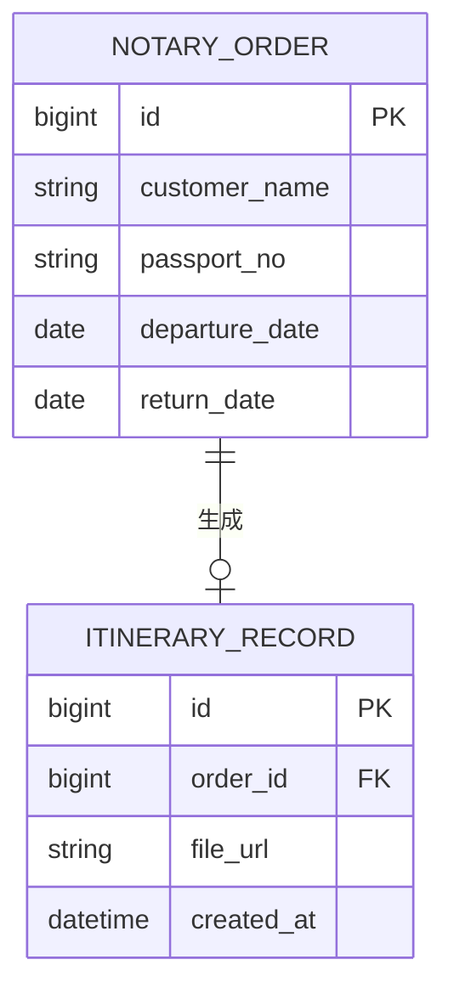
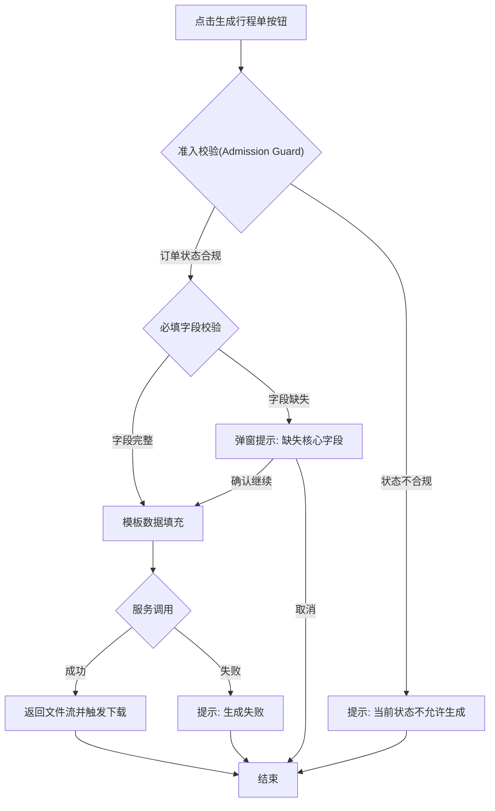

# 行程单

> **模块**: 公证订单行程单生成
> **版本**: v1.0
> **最后更新**: 2026-05-26
> **作者**: [产品经理]

---

## 更新日志

- **v1.0 (2026-05-26)**: 根据规则与标准模板重构初始版本

---

## 1. 背景与目标

### 1.1 业务背景

当前，运营人员在处理制作公证件的订单时，需要产出对应的行程单。目前的业务流程高度依赖人工操作，缺乏系统级的自动化支持。

### 1.2 问题陈述

由于系统目前不支持自动生成行程单，运营人员需要根据脚本手动填写对应的行程信息后，再手动点击生成行程单。这种方式增加了人工操作成本，且手工复制/填写信息容易出现信息错漏，影响后续公证件办理进度和客户体验。

---

## 2. 现状洞察（AS-IS）

| 痛点                     | 描述                                                                 |
| ------------------------ | -------------------------------------------------------------------- |
| **操作繁琐效率低** | 运营人员需手动查阅订单字段并在脚本中手动填写行程信息，耗费大量时间。 |
| **易错率高**       | 人工搬运数据极易产生拼写或日期错误，导致公证件行程单不符合要求。     |

---

## 3. 目标（TO-BE）与非目标

### 3.1 目标

| # | 目标                 | 描述                                                       |
| - | -------------------- | ---------------------------------------------------------- |
| 1 | **提升效率**   | 实现一键提取订单数据并填充至行程单模板，解放运营人员双手。 |
| 2 | **降低错误率** | 系统自动映射数据，避免人工输入导致的错误。                 |
| 3 | **可扩展性**   | 导出的 Word 文档必须支持完全编辑，以便满足个性化修改需求。 |

### 3.2 非目标（本期不做）

- **非目标1**: 不支持在系统前端页面直接富文本编辑行程单预览（本期仅支持直接下载 Word 本地编辑，降低研发成本）。
- **非目标2**: 不支持多国差异化复杂模板的自动匹配（本期仅预置一套标准化公用模板）。

### 3.3 User Stories

#### US-1: 一键生成并下载行程单

> **作为** 运营人员
> **我希望** 能够在公证订单列表或详情页点击一键生成行程单
> **以便于** 快速获取基于订单真实数据填充的 Word 版行程单，提高工作效率。

**验收标准**:

- 按钮仅对有权限的运营角色可见。
- 点击后能在 3 秒内完成下载。
- 下载的文件为 `.docx` 格式，且内容根据订单信息正确填充。

---

## 4. 术语表（Terminology）

| 术语                        | 英文            | 定义                                                                |
| --------------------------- | --------------- | ------------------------------------------------------------------- |
| 公证订单                    | Notary Order    | 客户在平台下单办理公证件的业务单据。                                |
| 行程单                      | Itinerary       | 辅助公证件办理的行程规划说明文件。                                  |
| 准入校验（Admission Guard） | Admission Guard | 动作执行前的前置校验/守卫条件，例如判断订单状态是否允许生成行程单。 |

---

## 5. 角色与权限

| 角色     | 权限范围                     | 说明                               |
| -------- | ---------------------------- | ---------------------------------- |
| 运营人员 | 公证订单模块的查看、操作权限 | 具备生成行程单按钮的可见和点击权限 |

**权限规则**:

- 仅拥有 `order:notary:itinerary_generate` 权限的用户可执行生成操作。

---

## 6. 数据模型（业务/交互视角）

### 6.1 实体关系图（ER Diagram）



### 6.2 Logical View（逻辑视图，UI 设计基准）

```typescript
interface ItineraryGenerateView {
  // 当前处理的订单视图
  orderContext: {
    orderId: string;
    // Mapped from order status (e.g. 0:待处理, 1:已完成)
    statusLabel: string;
  };

  // 交互权限逻辑
  currentUserPermission: {
    canGenerate: boolean; // Derived from RBAC
  };

  actions: {
    // 逻辑：点击生成按钮，发起后端请求获取文档流并触发浏览器下载
    onGenerateClick(orderId: string): void;
  };
}
```

---

## 7. 业务规则与验证

### 7.1 核心业务规则

| 规则编号 | 规则名称                    | 规则描述                                                               |
| -------- | --------------------------- | ---------------------------------------------------------------------- |
| BR-001   | 准入校验（Admission Guard） | 仅处于“进行中”或“已支付”状态的公证订单，才允许执行生成行程单操作。 |

### 7.2 数据验证规则

| 字段（含变更标识）   | 验证规则 | 错误提示                   |
| -------------------- | -------- | -------------------------- |
| [ADD] customer_name  | 必填     | 订单缺失客户姓名，无法生成 |
| [ADD] departure_date | 必填     | 订单缺失出发时间，无法生成 |

---

## 8. 功能需求

### 8.1 一键生成行程单功能

#### 8.1.1 功能描述

运营人员在公证订单列表页或详情页，点击“一键生成行程单”按钮，系统调取该订单的必要信息（姓名、护照号、航班、酒店、日期等），填充至系统预置的 Word 模板中，并返回给前端触发文件下载。

#### 8.1.2 按钮定义

**操作按钮**:

| 按钮名称         | 位置                              | 触发行为     |
| ---------------- | --------------------------------- | ------------ |
| [ADD] 生成行程单 | 订单列表操作列 / 订单详情页操作区 | 触发生成流程 |

#### 8.1.3 数据映射规则

**导出字段映射**:

| 目标模板字段   | 数据来源（订单表） | 说明                |
| -------------- | ------------------ | ------------------- |
| [ADD] 客户姓名 | `customer_name`  | 提取自客户档案      |
| [ADD] 护照号码 | `passport_no`    | 提取自证件信息      |
| [ADD] 出发日期 | `departure_date` | 格式化为 YYYY-MM-DD |
| [ADD] 航班信息 | `flight_info`    | 若无则为空          |

#### 8.1.4 业务流程



#### 8.1.5 边界场景处理

| 场景             | 处理方式                                                                       |
| ---------------- | ------------------------------------------------------------------------------ |
| 弱网或断网       | 点击按钮后前端 Loading 超时（如10s），提示“网络异常，请检查后重试”。         |
| 订单核心数据为空 | 弹出二次确认框：“该订单缺失[字段名]信息，导出的行程单将留空，是否继续导出？” |
| 无权限操作       | 若用户无生成权限，按钮置灰或隐藏，点击无效。                                   |

---

## 9. 非功能需求

### 9.1 性能要求

| 指标             | 要求       |
| ---------------- | ---------- |
| 文件生成响应时间 | < 3s (P95) |
| 文件下载成功率   | ≥ 99%     |

### 9.2 安全要求

- 敏感数据保护：导出的本地文档脱离系统后存在泄露风险，需在文档底部打上不可见的水印（如操作人ID）。

### 9.3 可用性要求

- 模板高可用：生成的 Word 必须兼容 Microsoft Office 2010+ 及 WPS。

---

## 10. 测试策略

### 10.1 测试范围

- 接口测试：字段映射与生成 Word 文件的正确性。
- E2E测试：页面点击按钮到下载完成的完整链路。
- 异常测试：核心字段缺失、网络超时。

### 10.2 测试用例（关键场景）

| 用例编号 | 测试场景       | 前置条件                 | 操作步骤               | 预期结果                                |
| -------- | -------------- | ------------------------ | ---------------------- | --------------------------------------- |
| TC-001   | 正常生成行程单 | 订单处于进行中且字段完整 | 点击“生成行程单”     | 成功下载 .docx 文件，打开后数据映射正确 |
| TC-002   | 必填字段缺失   | 订单缺少护照号           | 点击“生成行程单”     | 弹出二次确认框提示缺失信息              |
| TC-003   | 异常状态拦截   | 订单已取消               | 尝试点击“生成行程单” | 按钮置灰或提示状态不允许                |

---

## 11. 验收标准（Acceptance Criteria）

### 11.1 功能验收

**场景1: 成功生成并下载**

```gherkin
Given 运营人员处于公证订单列表页
And 目标订单状态符合准入校验且数据完整
When 点击“生成行程单”按钮
Then 系统在 3 秒内触发下载
And 下载的文件名为 "客户姓名_公证行程单_订单号.docx"
```

**场景2: 订单字段缺失二次确认**

```gherkin
Given 运营人员处于公证订单列表页
And 目标订单缺少出发日期
When 点击“生成行程单”按钮
Then 出现弹窗提示“该订单缺失出发日期信息，是否继续导出？”
```

### 11.2 数据契约验收

- [X] 字段来源（Mapped）已标注完整且与业务描述一致
- [X] 所有字段变更均已使用 `[ADD]` 标识

### 11.3 性能验收

- [X] API 响应时间满足 <3s 要求

---

## 12. 实施计划

### 12.1 依赖关系

- 依赖于公证订单基础数据表结构的完善。

### 12.2 风险与缓解措施

| 风险             | 影响 | 概率 | 缓解措施                                 |
| ---------------- | ---- | ---- | ---------------------------------------- |
| 导出组件内存溢出 | 高   | 低   | 限制并发生成数量，优化后端模板引擎性能。 |

---

## 13. 附录

### 13.1 字段文档术语对照表

（参见全局规范）

### 13.2 技术附录：Storage Schema

> *AI 注意：本节仅描述底层数据库结构，不直接作为页面或交互设计依据。*

在现有订单表 `notary_order` 基础上无需新增存储字段，仅需新增生成记录流水表。

#### 13.2.1 表名：`itinerary_generate_log`

| 字段名      | 类型     | 必填 | 默认值            | 说明       |
| ----------- | -------- | ---- | ----------------- | ---------- |
| id          | bigint   | 是   | 自增              | 主键       |
| order_id    | bigint   | 是   | 无                | 关联订单ID |
| operator_id | bigint   | 是   | 无                | 操作人ID   |
| created_at  | datetime | 是   | CURRENT_TIMESTAMP | 创建时间   |

### 13.3 Tracking Events（建议项）

| 事件名                         | 触发时机             | 关键属性                      |
| ------------------------------ | -------------------- | ----------------------------- |
| `itinerary_generate_click`   | 用户点击生成行程单   | `order_id`, `operator_id` |
| `itinerary_generate_success` | 行程单生成并下载成功 | `order_id`, `duration_ms` |

### 13.4 i18n 资源规范（建议项）

#### 13.4.1 Type 1-5 分类

| 类型   | 数据类型     | 处理策略   | 示例                 |
| ------ | ------------ | ---------- | -------------------- |
| Type 1 | 系统预设数据 | 资源表翻译 | 按钮文案、弹窗提示词 |
| Type 2 | 纯业务数据   | 不翻译     | 订单号、客户姓名     |

#### 13.4.2 资源键样例

| UI 文案                | resource_key                         |
| ---------------------- | ------------------------------------ |
| 生成行程单             | `notary.action.generate_itinerary` |
| 该订单缺失核心信息     | `notary.hint.missing_fields`       |
| 网络异常，请检查后重试 | `notary.error.network_timeout`     |
