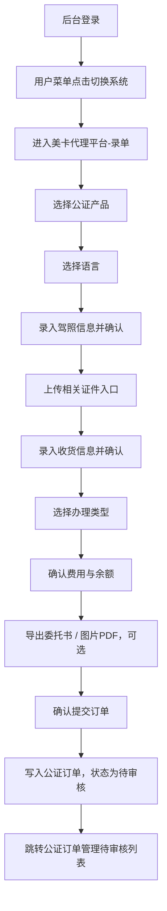

# 美卡代理平台-录单 PRD

> **模块**: 美卡代理平台-录单
> **版本**: v1.0
> **最后更新**: 2026-04-29
> **作者**: Codex

---

## 更新日志

- **v1.0 (2026-04-29)**: “美卡代理平台-录单”独立 PRD，代理端录单流程、字段口径、订单提交与订单中心联动。

---

## 1. 背景与目标

### 1.1 业务背景

美卡后台当前已提供运营侧订单管理、公证订单管理与公证处工作台。为了模拟代理商自助录入订单的前台体验，系统提供“切换系统”入口，进入“美卡认证代理平台-录单”页面，由代理端完成产品选择、驾照信息录入、收货信息确认、办理类型选择与订单提交。

该能力用于打通代理端下单到后台公证订单管理的演示链路，使运营人员可以验证“代理提交订单 -> 后台待审核 -> 公证订单后续流转”的完整闭环。

### 1.2 目标

| # | 目标                   | 描述                                                         |
| - | ---------------------- | ------------------------------------------------------------ |
| 1 | 建立代理端录单入口     | 用户进入代理平台录单页                                       |
| 2 | 固化录单五步流程       | 选择产品、确认驾照信息、确认收货信息、选择办理类型、提交订单 |
| 3 | 支撑公证订单创建       | 代理端提交后创建公证类订单，并进入后台公证订单管理待审核列表 |
| 4 | 提供代理端费用确认     | 展示产品费用、当前余额与支付后余额                           |
| 5 | 保留材料与文档动作入口 | 提供证件上传、委托书导出、图片转 PDF 等演示入口              |

### 1.3 非目标

- 不实现真实代理账号体系、代理等级切换与权限矩阵。
- 不实现真实账户扣款、在线支付、充值与账单结算。
- 不实现文件二进制上传、OCR 识别、真实委托书生成与真实 PDF 导出。
- 不实现外部代理门户后端 API 联调。

---

## 2. 范围

### 2.1 In Scope

- 录单页左侧步骤导航与锚点滚动。
- 公证类在售产品选择与语言选项联动。
- 驾照信息录入、证件材料上传入口展示。
- 收货信息录入、地址识别演示入口。
- 办理类型选择、费用与余额展示。
- 委托书导出、图片 PDF 导出演示入口。
- 确认提交订单后写入主订单数据，并跳转公证订单管理待审核。

### 2.2 Out of Scope

- 代理端订单列表、代理端订单详情。
- 代理端登录页与独立会话。
- 真实地址解析、收货地址库、常用联系人管理。
- 真实文件预览、文件删除持久化、上传进度。
- 真实支付风控、余额不足阻断与资金流水。

---

## 3. 用户角色

| 角色              | 使用场景                                   | 权限说明                                     |
| ----------------- | ------------------------------------------ | -------------------------------------------- |
| 后台管理员 / 运营 | 从后台切换到代理平台进行演示录单           | 复用当前后台登录态，可进入 `/agent-system` |
| 代理用户（演示）  | 录入客户驾照、公证产品与收货信息并提交订单 | v1.0 不做独立账号鉴权                        |
| 后台审核人员      | 在公证订单管理中审核代理端提交的订单       | 订单提交后进入待审核池                       |

---

## 4. 入口与信息架构

### 4.1 系统切换入口

- 入口位置：后台侧边栏用户菜单。
- 入口文案：`切换系统`。
- 跳转路由：`/agent-system`。
- 准入规则：沿用后台受保护路由，必须存在有效登录会话。
- 返回能力：代理平台顶部提供 `返回后台` 按钮，点击返回后台首页。

### 4.2 页面标题与导航

- 页面品牌：`美卡认证代理平台-录单`。
- 顶部导航：`首页`、`下单入口`、`订单中心`、`公证业务`、`产品列表`、`账户中心`。
- v1.0 激活导航：`下单入口`。
- 左侧步骤导航：
  - `选择产品`
  - `确认驾照信息`
  - `确认收货信息`
  - `选择办理类型`
  - `提交订单`

### 4.3 交互原则

- 页面为单页纵向录单流程。
- 点击左侧步骤导航时平滑滚动到对应区域。
- 页面滚动时左侧步骤自动高亮当前区域。
- 提交中状态下禁用重复提交。

---

## 5. 业务流程



---

## 6. 功能需求

### 6.1 FR-AOE-001 切换系统进入录单页

**描述**
后台用户可从用户菜单点击 `切换系统`，进入代理平台录单页。

**验收标准**

- 点击后路由变为 `/agent-system`。
- 页面顶部显示 `美卡认证代理平台-录单`。
- 页面存在 `返回后台` 按钮。
- 未登录用户直接访问时仍应被后台路由守卫拦截。

### 6.2 FR-AOE-002 选择产品

**描述**
代理用户选择在售公证类产品，并根据产品类型选择语言。

**规则**

- 产品来源：产品中心中 `category = notary` 且 `status = active` 的产品。
- 排序：按 `weight DESC`，权重相同时按产品标题升序。
- 产品为空时显示 `暂无在售公证产品`。
- 语言联动：
  - 产品标题包含 `公证双号` 或 `公证海牙双号`：语言为 `英语`、`意大利语`。
  - 其它公证产品：语言为 `英语`、`法语`、`西班牙语`、`意大利语`、`德语`。
- 切换产品后，默认选中该产品的第一个语言与第一个办理类型。

### 6.3 FR-AOE-003 确认驾照信息

**描述**
代理用户录入客户驾照与证件基础信息。

**字段**

| 字段         | 类型       | v1.0 行为                             |
| ------------ | ---------- | ------------------------------------- |
| 驾驶证号码   | 文本       | 可填；为空提交时使用系统生成兜底值    |
| 姓名         | 文本       | 可填；为空时优先使用收货人姓名        |
| 姓氏拼音     | 文本       | 可填                                  |
| 名字拼音     | 文本       | 可填                                  |
| 性别         | 单选       | 默认男，可选女                        |
| 国籍         | 文本       | 可填；为空时提交使用 `中国/CHN`     |
| 出生日期     | 日期选择器 | 可选                                  |
| 驾照地址详情 | 多行文本   | 可填；为空时可用收货地址兜底          |
| 准驾车型     | 文本       | 可填；为空时提交使用 `C1`           |
| 档案编号     | 文本       | UI 标识必填，v1.0 演示不阻断提交      |
| 条形码       | 文本       | UI 标识必填，v1.0 演示不阻断提交      |
| 初次领证日期 | 日期选择器 | 可选                                  |
| 有效起始日期 | 日期选择器 | 可选                                  |
| 有效期       | 选项       | `6年`、`10年`、`60年`、`长期` |
| 发证地区     | 省市联动   | UI 标识必填，选择省后展示城市         |
| 发证机构     | 下拉       | 可选                                  |

**交互**

- 点击 `确认驾照信息` 后展示 Toast：`驾照信息已确认`。
- 日期选择器支持月份与年份切换。
- 有效截止日期由“有效起始日期 + 有效期”计算；选择 `长期` 时不生成截止日期。

### 6.4 FR-AOE-004 上传相关证件

**描述**
页面展示证件材料上传入口，为后续真实上传能力预留交互位置。

**入口**

- 驾照正面照片
- 驾照反面照片
- 驾照副页正面照片
- 驾照副页反面照片
- 身份证正面
- 身份证反面
- 电子驾照
- 电子签名

**v1.0 行为**

- 点击任一上传卡片时展示对应 Toast：`{材料名称}上传入口已打开`。
- 不持久化文件，不生成真实文件对象。

### 6.5 FR-AOE-005 确认收货信息

**描述**
代理用户录入订单收货地址与收货人信息。

**字段**

| 字段       | 类型     | v1.0 行为                      |
| ---------- | -------- | ------------------------------ |
| 地址信息   | 下拉     | 示例省市区选项                 |
| 详细地址   | 多行文本 | 可填                           |
| 收货人姓名 | 文本     | 可填；为空时可由驾照姓名兜底   |
| 手机号码   | 文本     | 可填；为空时提交使用演示手机号 |

**交互**

- 点击 `确认收货信息` 后展示 Toast：`收货信息已确认`。

### 6.6 FR-AOE-006 地址识别

**描述**
提供地址识别演示输入区。

**规则**

- 地址识别输入为空时，阻断并提示：`请先输入完整地址信息`。
- 地址识别输入非空时，展示 Toast：`地址识别已提交`。
- v1.0 不进行真实地址解析，不自动拆分省市区、姓名、电话。

### 6.7 FR-AOE-007 选择办理类型

**描述**
根据所选产品展示可选办理类型卡片。

**规则**

- 办理类型来源：所选产品的 `processTypes`。
- 卡片展示：价格、办理类型名称、描述。
- 价格口径：优先读取 `self` 代理等级价格；缺失时使用该办理类型第一条价格。
- 产品未选择时显示：`请先选择驾照翻译认证产品`。
- 点击办理类型卡片后高亮选中。

### 6.8 FR-AOE-008 提交订单与费用确认

**描述**
代理用户在提交订单区确认费用，并可执行导出和提交动作。

**展示**

- `产品费用`：当前办理类型价格。
- `当前余额`：v1.0 演示固定余额 `¥28304`。
- `支付后余额`：当前余额 - 产品费用。

**动作**

| 动作             | v1.0 行为                          |
| ---------------- | ---------------------------------- |
| 导出外事办委托书 | 展示 Toast：`外事办委托书已导出` |
| 导出北部湾委托书 | 展示 Toast：`北部湾委托书已导出` |
| 导出张江委托书   | 展示 Toast：`张江委托书已导出`   |
| 导出图片为PDF    | 展示 Toast：`图片 PDF 已导出`    |
| 确认提交订单     | 创建订单并跳转公证订单管理         |

**提示**

- 提交区固定展示提醒：`提交前请确认所有信息无误，提交后将无法修改`。

### 6.9 FR-AOE-009 创建公证订单

**描述**
点击 `确认提交订单` 后，系统创建一条公证订单并进入后台待审核。

**创建规则**

| 字段                                | 写入规则                                                                          |
| ----------------------------------- | --------------------------------------------------------------------------------- |
| `productCategory`                 | 固定为 `notary`                                                                 |
| `productId`                       | 当前所选产品 ID                                                                   |
| `productName`                     | 根据产品标题归一为 `公证单号`、`公证双号`、`公证海牙单号`、`公证海牙双号` |
| `processType` / `processTypeId` | 当前所选办理类型                                                                  |
| `lockedPrice`                     | 当前办理类型价格                                                                  |
| `status`                          | 固定为 `pending_review`                                                         |
| `channel`                         | 固定为 `private`                                                                |
| `agentLevel`                      | 固定为 `self`                                                                   |
| `pushTimeliness`                  | 固定为 `instant`                                                                |
| `remark`                          | `代理端提交`                                                                    |
| `createdAt` / `updatedAt`       | 当前北京时间                                                                      |
| `logs`                            | 写入 `订单创建：代理端确认提交`                                                 |

**成功反馈**

- 展示 Toast：`订单 {orderId} 已进入公证订单管理`。
- 700ms 后跳转：`/order-management/notary-orders?status=pending_review`。

---

## 7. 数据模型

```typescript
interface AgentOrderEntryView {
  selectedProductId: string;
  selectedLanguage: string;
  selectedProcessTypeId: string;
  certificate: {
    licenseNo?: string;
    licenseName?: string;
    idpSurnameEn?: string;
    idpGivenNameEn?: string;
    gender: '男' | '女';
    licenseNationality?: string;
    licenseBirthDate?: string;
    licenseAddress?: string;
    licenseCategory?: string;
    archiveNumber?: string;
    barcodeNumber?: string;
    licenseFirstIssueDate?: string;
    licenseValidFromDate?: string;
    licenseValidUntilDate?: string;
    licenseValidYears: '6年' | '10年' | '60年' | '长期';
    licenseIssuingRegion?: string;
    licenseIssuingAuthority?: string;
  };
  delivery: {
    deliveryRegion?: string;
    deliveryAddress?: string;
    customerName?: string;
    customerPhone?: string;
  };
  checkout: {
    productFee: number;
    currentBalance: number;
    balanceAfterPayment: number;
  };
}

interface SubmittedAgentNotaryOrder {
  productCategory: 'notary';
  status: 'pending_review';
  channel: 'private';
  agentLevel: 'self';
  remark: '代理端提交';
  logs: Array<{
    time: string;
    operator: '代理端';
    action: '订单创建：代理端确认提交';
  }>;
}
```

---

## 8. 业务规则

| 编号       | 规则                                                      |
| ---------- | --------------------------------------------------------- |
| BR-AOE-001 | 代理录单页只读取在售公证产品，不展示翻译、IDP、Klook 产品 |
| BR-AOE-002 | 产品切换后，语言与办理类型需要重置到新产品可用范围内      |
| BR-AOE-003 | 办理类型价格在提交订单时锁定为 `lockedPrice`            |
| BR-AOE-004 | 订单提交后统一进入公证订单管理的待审核状态                |
| BR-AOE-005 | 重复点击提交按钮时不得创建重复订单                        |
| BR-AOE-006 | 地址识别为空时必须阻断识别动作                            |
| BR-AOE-007 | v1.0 上传与导出为演示动作，不产生真实文件副作用           |
| BR-AOE-008 | 有效期为 `长期` 时不计算有效截止日期                    |

---

## 9. 边界场景

| 场景                       | 处理方式                                              |
| -------------------------- | ----------------------------------------------------- |
| 无在售公证产品             | 产品下拉展示空态，提交时提示 `暂无可提交的公证产品` |
| 产品无办理类型             | 提交时提示 `请先配置办理类型`                       |
| 当前产品不支持已选语言     | 自动清空语言，等待用户重新选择                        |
| 当前产品不支持已选办理类型 | 自动清空办理类型，等待用户重新选择                    |
| 选择省份后城市不属于该省   | 自动清空城市                                          |
| 地址识别文本为空           | 显示错误 `请先输入完整地址信息`                     |
| 用户重复提交               | 提交中按钮禁用，避免重复写入                          |
| 余额不足                   | v1.0 不阻断，仅展示支付后余额；后续版本接入资金规则   |

---

## 10. 非功能需求

- 页面首次渲染在本地演示数据下应小于 2s。
- 锚点滚动与当前步骤高亮应无明显卡顿。
- 提交动作反馈必须可见，至少包含 Toast 与按钮禁用状态。
- 表单区域在桌面宽度下应保持清晰分组，移动端可纵向堆叠。
- 订单提交后必须保证后台公证订单管理能读取到新订单。

---

## 11. 验收用例

| 用例       | 场景           | 操作                        | 预期                                     |
| ---------- | -------------- | --------------------------- | ---------------------------------------- |
| TC-AOE-001 | 切换系统       | 后台点击 `切换系统`       | 进入 `/agent-system`，显示代理录单页   |
| TC-AOE-002 | 返回后台       | 代理录单页点击 `返回后台` | 返回后台首页                             |
| TC-AOE-003 | 产品语言联动   | 选择公证双号类产品          | 语言仅展示英语、意大利语                 |
| TC-AOE-004 | 单号语言联动   | 选择非双号公证产品          | 展示英语、法语、西班牙语、意大利语、德语 |
| TC-AOE-005 | 地址识别空输入 | 不填地址识别文本并点击识别  | 阻断并显示错误提示                       |
| TC-AOE-006 | 地址识别有输入 | 输入完整地址后点击识别      | 展示 `地址识别已提交`                  |
| TC-AOE-007 | 办理类型选择   | 点击任一办理类型卡片        | 卡片高亮，费用同步变化                   |
| TC-AOE-008 | 委托书导出     | 点击任一导出按钮            | 展示对应导出 Toast                       |
| TC-AOE-009 | 确认提交订单   | 完成基础选择后点击提交      | 创建 `pending_review` 公证订单         |
| TC-AOE-010 | 提交后跳转     | 订单创建成功                | 跳转公证订单管理待审核列表               |
| TC-AOE-011 | 无办理类型     | 产品无办理类型时提交        | 提示 `请先配置办理类型`                |
| TC-AOE-012 | 重复提交       | 提交中再次点击按钮          | 按钮禁用，不创建重复订单                 |

---

## 12. Tracking Events 与埋点建议

| 事件                            | 触发时机         | 关键参数                                    |
| ------------------------------- | ---------------- | ------------------------------------------- |
| `agent_system_switch`         | 后台点击切换系统 | `from`, `target`                        |
| `agent_order_entry_view`      | 进入录单页       | `userId`                                  |
| `agent_product_select`        | 切换产品         | `productId`, `productName`              |
| `agent_language_select`       | 切换语言         | `language`                                |
| `agent_process_type_select`   | 选择办理类型     | `processTypeId`, `price`                |
| `agent_material_upload_click` | 点击上传入口     | `materialType`                            |
| `agent_document_export_click` | 点击导出入口     | `documentType`                            |
| `agent_order_submit`          | 提交订单         | `orderId`, `productId`, `lockedPrice` |

---

## 13. 后续版本建议

- v1.1：补齐必填校验、余额不足阻断、手机号格式校验。
- v1.2：接入真实材料上传、文件预览与图片转 PDF。
- v1.3：接入真实委托书模板生成与下载。
- v1.4：增加代理端订单中心、订单草稿与继续编辑能力。
- v2.0：接入真实代理账号、余额、账单与支付流水。
