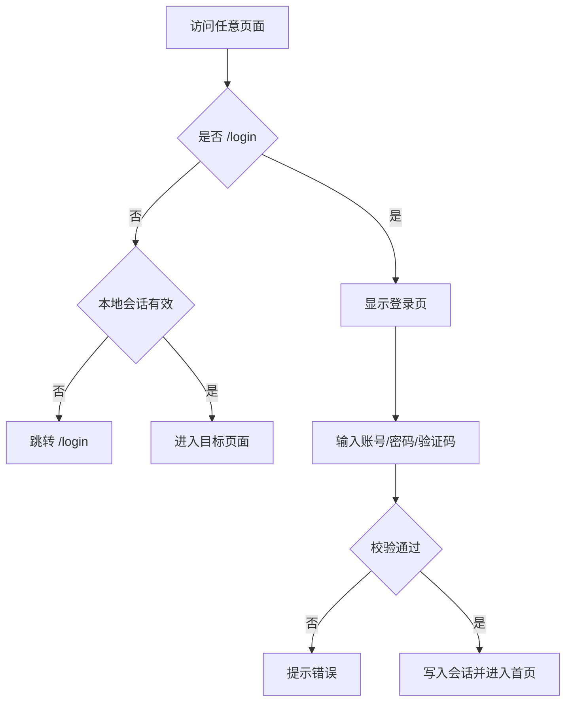

# 美卡基础平台能力 Specification

> **模块**: 基础平台能力（登录认证 / 受保护路由 / Dashboard / 全局导航）
> **版本**: v1.0
> **最后更新**: 2026-04-17
> **作者**: Codex

---

## 更新日志

- **v1.0 (2026-04-17)**: 从主文档 `specs/mei_ka_prd_spec.md` 拆分基础平台能力独立 PRD

---

## 1. 背景与目标

### 1.1 业务背景
美卡管理后台当前为演示级前端系统。为了保证后续模块扩展不破坏入口能力，需要将登录认证、受保护路由、导航结构、Dashboard 指标口径单独沉淀为基础平台 PRD。

### 1.2 目标

| # | 目标 | 描述 |
|---|---|---|
| 1 | 统一登录入口 | 明确演示账号、验证码、会话写入与登出语义 |
| 2 | 固化路由守卫 | 统一受保护路由准入校验（Admission Guard） |
| 3 | 固化导航结构 | 菜单入口、非菜单路由、高亮规则可追溯 |
| 4 | 稳定 Dashboard 口径 | 指标定义、计算范围、空态行为统一 |

### 1.3 非目标
- 不实现真实 IAM、组织、RBAC。
- 不实现后端会话服务与 Token 刷新。

---

## 2. 范围（Scope）

### 2.1 In Scope
- 登录页：账号/密码/验证码校验
- 受保护路由：非 `/login` 页面登录态校验
- 全局布局：侧边栏、菜单高亮、用户菜单
- Dashboard：经营概览、指标卡、近期订单、快捷入口

### 2.2 Out of Scope
- 第三方单点登录（SSO）
- 权限矩阵与按钮级鉴权
- 报表导出与通知中心

---

## 3. User Stories

#### US-1
> **作为** 运营人员  
> **我希望** 成功登录后直接进入后台首页  
> **以便于** 快速处理日常工作

验收标准：
- 正确账号密码验证码可登录
- 错误输入给出明确提示

#### US-2
> **作为** 任何后台用户  
> **我希望** 未登录时自动被拦截到登录页  
> **以便于** 保持基础访问安全

验收标准：
- 访问受保护路由时必须存在有效会话
- 登出后再次访问受保护页面必须重新登录

---

## 4. 角色与权限

| 角色 | 当前能力 | 说明 |
|---|---|---|
| 管理员（演示） | 全模块访问 | 固定演示账号 `admin / 123456` |
| 其它角色 | 不区分 | 当前无真实角色差异 |

权限规则：
- 仅 `/login` 为公开页面。
- 其余路由均要求本地会话存在且有效。

---

## 5. 交互与逻辑

### 5.1 登录流程



### 5.2 导航规则
- 菜单高亮按路径前缀匹配。
- 侧边栏折叠状态持久化至 `meika-sidebar-collapsed`。
- 非菜单路由（如详情页）可直达且受守卫保护。

### 5.3 Dashboard 指标口径
- 统计日期默认当天（北京时间）。
- 统计范围：创建时间小于等于所选日期。
- 成交总额不包含异常状态订单。
- 无数据时使用空态与 `0` 值，不抛异常。

---

## 6. 数据模型（Logical View）

```typescript
interface FoundationView {
  auth: {
    username: string; // Stored
    role: string; // Stored
    isAuthenticated: boolean; // Derived
  };
  navigation: {
    activeMenuKey: string; // Derived
    sidebarCollapsed: boolean; // Stored
  };
  dashboard: {
    selectedDate: string; // Stored
    totalAmount: number; // Derived
    pendingShipmentAmount: number; // Derived
    orderCount: number; // Derived
    abnormalOrderCount: number; // Derived
  };
}
```

---

## 7. 功能需求

### 7.1 登录认证
- 输入项：`username`、`password`、`captcha`
- 校验：
  - username = `admin`
  - password = `123456`
  - captcha 与当前验证码一致

### 7.2 受保护路由
- 准入校验（Admission Guard）：`isAuthenticated === true`
- 不通过时强制重定向 `/login`

### 7.3 Dashboard
- 卡片：成交总额、待发货金额
- 指标：订单总量、已发货、未审核、待发货、异常订单
- 近期订单：按创建时间倒序展示

---

## 8. 边界场景

| 场景 | 处理方式 |
|---|---|
| 验证码过期 | 阻断提交并提示错误 |
| 手动篡改本地会话 | 路由守卫失败后重定向登录 |
| 日期切换到无数据 | 正常渲染空态与 0 指标 |

---

## 9. 非功能要求

- 首屏加载 < 2s
- 主要交互需有 Toast 或显式反馈
- 侧边栏状态刷新后保持一致

---

## 10. 测试与验收

| 用例 | 场景 | 期望 |
|---|---|---|
| TC-FD-001 | 正常登录 | 成功进入首页并写入会话 |
| TC-FD-002 | 错误验证码 | 登录失败并提示错误 |
| TC-FD-003 | 未登录访问 `/orders` | 跳转 `/login` |
| TC-FD-004 | 切换 Dashboard 日期 | 指标按口径重算 |

---

## 11. Tracking Events 与 i18n

Tracking Events（建议）：
- `auth_login_submit`
- `auth_logout_submit`
- `dashboard_date_change`
- `dashboard_quick_entry_click`

i18n 资源键（建议）：
- `auth.login.title`
- `auth.login.error.invalid_credentials`
- `dashboard.card.total_amount`
- `dashboard.card.pending_shipment_amount`
