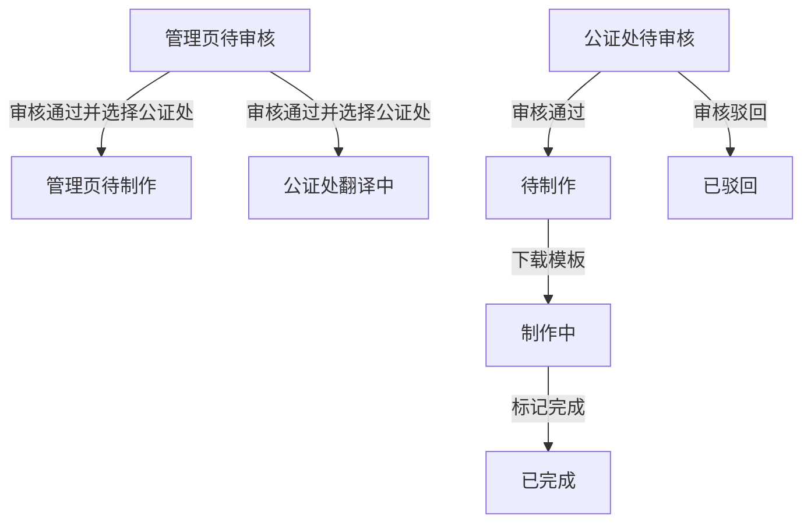

# 美卡公证处工作台 Specification

> **模块**: 公证处工作台
> **版本**: v1.1
> **最后更新**: 2026-04-21
> **作者**: Codex

---

## 更新日志

- **v1.1 (2026-04-21)**: 扩展为详细 PRD，补齐页面结构、字段定义、状态说明、列表与预览行为、存储口径、异常场景与验收标准，并明确当前实现边界
- **v1.0 (2026-04-17)**: 从主 PRD 拆分公证处工作台独立规格，覆盖批量制作与预览审核链路

---

## 1. 背景与目标

### 1.1 背景

公证处工作台是订单中心之外的履约工作区，面向公证专员。该模块承接公证订单在公证处侧的处理链路，用于完成以下核心动作：

- 接收来自公证订单管理页审核通过后推送的订单
- 在公证处侧查看翻译中、待审核、待制作、制作中、已完成、已驳回等状态
- 对待审核订单进入预览审核页执行通过/驳回
- 对待制作订单执行模板下载并推进到制作中
- 对制作中订单执行单条或批量完成

当前实现中，公证订单管理页与公证订单页已解耦：

- 管理页审核通过后，管理页订单进入 `pending_production`
- 公证订单页接收同订单并保存为 `translating`
- 公证订单页使用独立持久化数据源，承接公证处后续处理链路

### 1.2 目标

| # | 目标         | 描述                                                          |
| - | ------------ | ------------------------------------------------------------- |
| 1 | 提升履约效率 | 支持单条/批量下载模板、单条/批量标记完成                      |
| 2 | 固化状态推进 | 明确公证处侧各状态的显示口径、动作入口和流转结果              |
| 3 | 保持审核一致 | 预览审核页提供统一的文件预览、审核摘要、通过/驳回动作         |
| 4 | 降低操作风险 | 对批量动作、驳回原因、空数据、文件加载异常提供明确约束和反馈  |
| 5 | 明确实现边界 | 区分当前已实现能力与当前页面尚未提供的入口，避免 PRD 超前描述 |

### 1.3 非目标

- 不实现真实公证文书在线编辑
- 不实现真实外部电子签、法务系统或政府系统对接
- 不实现真实打印、物流履约和签收回传
- 不实现公证处侧角色细分 RBAC
- 不实现翻译中状态在公证处侧的人工推进入口；当前版本仅展示该状态

---

## 2. 范围（Scope）

### 2.1 In Scope

- 公证处订单列表页
- 公证处预览审核页
- 状态标签：全部 / 翻译中 / 待审核 / 待制作 / 制作中 / 已完成 / 已驳回
- 单条下载模板
- 待制作批量下载模板
- 制作中单条完成
- 制作中批量完成
- PDF / 图片 / DOCX 文件预览
- 驳回原因填写与驳回同步
- 公证处数据源初始化、持久化与去重逻辑

### 2.2 Out of Scope

- 管理页“选择推送公证处”弹窗本身
- 管理页物流填写与回显
- 公证订单管理页的列表检索、导出、已取消逻辑
- 公证处侧物流录入
- 公证处侧翻译中转待审核的人工按钮或自动任务入口

### 2.3 路由与入口

| 页面                         | 路由                               | 说明                       |
| ---------------------------- | ---------------------------------- | -------------------------- |
| 公证处订单列表页             | `/notary/orders`                 | 工作台主入口               |
| 公证处订单列表页（指定状态） | `/notary/orders?status=<status>` | 通过 query 初始化状态标签  |
| 公证处预览审核页             | `/notary/orders/:id/preview`     | 仅待审核订单可执行审核动作 |

当前 query 支持的状态口径：

- `translating`
- `pending_review`
- `pending_production`
- `in_production`
- `completed`
- `rejected`
- 若传入 `shipped`，会在页面初始化时映射为 `completed`

---

## 3. 用户与使用场景

### 3.1 角色定义

| 角色        | 使用场景                             | 当前能力                 |
| ----------- | ------------------------------------ | ------------------------ |
| 公证专员    | 在工作台查看订单、下载模板、完成制作 | 当前版本全部开放         |
| 审核人员    | 在预览审核页查看材料并通过/驳回      | 当前版本全部开放         |
| 管理员/运营 | 从管理页推动公证订单进入公证处侧链路 | 当前版本通过上游页面实现 |

### 3.2 User Stories

#### US-1

> **作为** 公证专员
> **我希望** 在待制作列表中单条或批量下载模板
> **以便于** 一次性推进制作任务

#### US-2

> **作为** 公证专员
> **我希望** 在制作中列表中单条或批量标记完成
> **以便于** 快速收口已制作订单

#### US-3

> **作为** 审核人员
> **我希望** 在预览审核页查看 PDF、图片、DOCX 并执行通过/驳回
> **以便于** 基于材料完整度进行审核判断

#### US-4

> **作为** 管理员
> **我希望** 在管理页审核通过并选择公证处后，订单自动出现在公证处工作台
> **以便于** 管理页与公证处侧形成前后衔接

#### US-5

> **作为** 维护人员
> **我希望** 文档能准确反映“翻译中仅展示、不提供当前页动作入口”的现状
> **以便于** 避免需求理解偏差

---

## 4. 页面结构与信息架构

### 4.1 列表页结构

公证处订单列表页由以下区域组成：

1. 顶部导航区
   - 面包屑：`后台管理 / 公证订单`
   - 页面标题：`公证订单`
2. 筛选区
   - 产品筛选
   - 姓名筛选
   - 搜索 / 重置按钮
   - 已启用筛选项数量、结果总数
3. 状态标签区
   - 全部、翻译中、待审核、待制作、制作中、已完成、已驳回
   - 每个标签显示对应状态数量
4. 批量操作区
   - 当状态为待制作时显示“已选择 X 条待制作订单 + 批量下载”
   - 当状态为制作中时显示“已选择 X 条制作中订单 + 批量完成”
5. 列表表格区
   - 序号
   - 产品
   - 证件信息
   - 收货信息
   - 驳回原因（仅已驳回状态显示）
   - 状态
   - 操作
   - 复选框列（仅待制作 / 制作中显示）
6. 分页区
   - 默认每页 20
   - 支持切换分页大小

### 4.2 预览审核页结构

公证处预览审核页由以下区域组成：

1. 顶部工具栏
   - 返回列表按钮
   - 面包屑：`公证处订单 / 预览审核`
   - 当前订单号
   - 当前状态标签
   - 驳回订单按钮
   - 审核通过按钮
2. 左侧文件导航区
   - 核心预览文件列表
   - 附件图片列表
3. 中央预览区
   - 当前文件标题
   - 当前文件序号
   - 下载当前文件按钮
   - PDF iframe 预览
   - 图片预览
   - DOCX iframe / HTML 预览
   - DOCX 回退态
4. 右侧审核摘要区
   - 主材料数量
   - 附件图片数量
   - 产品/语种元信息
   - 审核摘要完成度
   - 证件与收货摘要
   - 历史驳回原因
   - 审核检查清单
5. 驳回弹窗
   - 驳回原因输入框
   - 取消 / 确认驳回

---

## 5. 数据来源与持久化

### 5.1 数据源定义

公证处工作台使用独立数据源 `meika-notary-office-orders`，不直接复用公证订单管理页列表状态。

| 数据项         | 存储位置                                            | 说明                                   |
| -------------- | --------------------------------------------------- | -------------------------------------- |
| 公证处订单列表 | `localStorage.meika-notary-office-orders`         | 公证处侧订单数据源                     |
| 公证处数据版本 | `localStorage.meika-notary-office-orders-version` | 当前版本号 `v3-translating-flow`     |
| 主订单数据     | `mockDataService / meika-orders`                  | 管理页、公证订单管理页使用的主订单数据 |

### 5.2 默认初始化口径

公证处数据初始化由两部分组成：

1. 来自管理页已推送公证处的公证订单
   - 条件：`productCategory = notary` 且存在 `pushedNotaryOfficeId` / `pushedNotaryOfficeName` / 日志包含“推送至”
   - 若管理页订单状态为 `pending_production`，初始化到公证处侧时会被归一为 `translating`
2. 公证处独立待审核种子数据
   - 当前内置 10 条 `pending_review` mock 订单
   - 每条包含默认公证处信息：北部湾公证处或张江公证处

### 5.3 去重与清洗规则

- 以 `orderId` 为唯一键去重
- 明确移除的订单号：`MK2600057`、`MK2600061`
- 若历史缓存中存在“来自管理页推送”的订单且状态仍为 `pending_review`，加载时会自动规范为 `translating`

### 5.4 关键字段

```typescript
interface Order {
  orderId: string;
  productName: string;
  productCategory: 'notary';
  status:
    | 'translating'
    | 'pending_review'
    | 'pending_production'
    | 'in_production'
    | 'shipped'
    | 'completed'
    | 'cancelled'
    | 'rejected';
  customerName: string;
  customerPhone: string;
  deliveryAddress: string;
  language?: string;
  licenseName?: string;
  licenseNo?: string;
  licenseCategory?: string;
  rejectReason?: string;
  remark: string;
  pushedNotaryOfficeId?: string;
  pushedNotaryOfficeName?: string;
  logisticsCompany?: string;
  trackingNumber: string;
  shippedAt?: string;
  createdAt: string;
  updatedAt: string;
  logs: OrderLog[];
}
```

### 5.5 Logical View

```typescript
interface NotaryWorkbenchView {
  listPage: {
    filters: {
      productName: string;
      customerName: string;
      statusTab:
        | 'all'
        | 'translating'
        | 'pending_review'
        | 'pending_production'
        | 'in_production'
        | 'completed'
        | 'rejected';
    };
    statusCounts: Record<string, number>;
    selectedOrderIds: string[];
    list: NotaryOrderRowView[];
    pagination: {
      currentPage: number;
      pageSize: number;
      total: number;
    };
  };
  previewPage?: {
    orderId: string;
    selectedFileId: string;
    rejectReason: string;
    fileList: PreviewFileView[];
    checklist: AuditChecklistItem[];
    canAudit: boolean;
  };
}
```

---

## 6. 状态模型与口径定义

### 6.1 源状态与展示状态

当前公证处工作台接收的源状态集合为：

- `translating`
- `pending_review`
- `pending_production`
- `in_production`
- `shipped`
- `completed`
- `rejected`

当前公证处工作台的可见状态标签集合为：

- `translating`
- `pending_review`
- `pending_production`
- `in_production`
- `completed`
- `rejected`

其中：

- `shipped` 在界面层统一映射为 `completed`
- `cancelled` 不在公证处工作台展示

### 6.2 状态定义表

| 状态                   | 展示文案 | 来源                               | 当前页可执行动作   | 说明                                   |
| ---------------------- | -------- | ---------------------------------- | ------------------ | -------------------------------------- |
| `translating`        | 翻译中   | 管理页审核通过并推送后进入公证处侧 | 无                 | 当前版本仅展示，不提供当前页内推进入口 |
| `pending_review`     | 待审核   | 种子订单或后续进入审核阶段的订单   | 预览审核           | 可进入预览审核页执行通过/驳回          |
| `pending_production` | 待制作   | 公证处审核通过后进入               | 单条下载、批量下载 | 下载模板后进入制作中                   |
| `in_production`      | 制作中   | 下载模板后进入                     | 单条完成、批量完成 | 完成后进入已完成                       |
| `shipped`            | 已完成   | 历史兼容状态                       | 无                 | 在页面上折叠显示为已完成               |
| `completed`          | 已完成   | 制作完成                           | 无                 | 列表仅展示，无动作按钮                 |
| `rejected`           | 已驳回   | 公证处审核驳回                     | 无                 | 列表展示驳回原因                       |

### 6.3 状态推进规则

| 当前状态               | 触发动作                   | 下一个状态                                              | 发生位置         |
| ---------------------- | -------------------------- | ------------------------------------------------------- | ---------------- |
| 管理页待审核           | 管理页审核通过并选择公证处 | 管理页：`pending_production`；公证处：`translating` | 管理页与数据同步 |
| `pending_review`     | 预览页审核通过             | `pending_production`                                  | 公证处预览页     |
| `pending_review`     | 预览页审核驳回             | `rejected`                                            | 公证处预览页     |
| `pending_production` | 单条下载模板               | `in_production`                                       | 公证处列表页     |
| `pending_production` | 批量下载模板               | `in_production`                                       | 公证处列表页     |
| `in_production`      | 单条标记完成               | `completed`                                           | 公证处列表页     |
| `in_production`      | 批量标记完成               | `completed`                                           | 公证处列表页     |

### 6.4 状态机



### 6.5 当前实现边界说明

- `translating` 状态当前仅作为公证处侧入场状态展示，不存在当前页内“转待审核”按钮
- 预览审核页只有当订单状态为 `pending_review` 时才允许执行通过/驳回
- `completed` 和 `rejected` 状态在列表中仅展示，不提供继续操作

---

## 7. 核心业务规则

| 编号      | 规则                                                                                                       |
| --------- | ---------------------------------------------------------------------------------------------------------- |
| BR-NW-001 | 工作台仅展示 `productCategory = notary` 且状态属于公证处源状态集合的订单                                 |
| BR-NW-002 | 列表筛选条件之间为 AND 关系                                                                                |
| BR-NW-003 | 产品筛选当前固定支持：`公证单号 / 公证双号 / 公证海牙单号 / 公证海牙双号`                                |
| BR-NW-004 | 姓名搜索匹配 `licenseName + customerName` 的小写拼接字符串，大小写不敏感                                 |
| BR-NW-005 | 状态 query 参数会同步驱动当前状态标签；传入 `shipped` 会映射为 `completed`                             |
| BR-NW-006 | `completed` 排序优先使用 `shippedAt`；若没有，则回退物流日志时间；仍无则回退 `updatedAt`             |
| BR-NW-007 | 其他状态排序优先使用 `updatedAt`，缺失时回退 `createdAt`                                               |
| BR-NW-008 | 同时间戳排序冲突时，以 `orderId DESC` 作为兜底排序                                                       |
| BR-NW-009 | 批量勾选只在 `pending_production` 或 `in_production` 状态下显示                                        |
| BR-NW-010 | “全选”仅对当前页可操作订单生效，不跨页                                                                   |
| BR-NW-011 | 状态切换到非批量状态时，已选订单会被清空                                                                   |
| BR-NW-012 | 批量下载仅允许在“待制作”状态执行                                                                         |
| BR-NW-013 | 批量完成仅允许在“制作中”状态执行                                                                         |
| BR-NW-014 | 批量动作前必须至少勾选 1 条订单                                                                            |
| BR-NW-015 | 模板下载成功后，订单状态推进为 `in_production`，并追加日志                                               |
| BR-NW-016 | 完成动作执行后，订单状态推进为 `completed`，并追加日志                                                   |
| BR-NW-017 | 公证处预览页中，仅 `pending_review` 状态支持审核通过/驳回                                                |
| BR-NW-018 | 驳回时必须填写驳回原因，且确认按钮在原因为空时禁用                                                         |
| BR-NW-019 | 公证处审核驳回后，公证处订单更新为 `rejected`，并同步管理页同订单更新为 `cancelled`                    |
| BR-NW-020 | 压缩包模板下载采用双路径兜底：优先 `/Notary Office Template/...zip`，失败时尝试 `/Preview file/...zip` |
| BR-NW-021 | ZIP 下载文件名采用 `姓名+国家+语言+产品名称.zip` 规则生成                                                |
| BR-NW-022 | 国家文案根据语言映射：英语=美国、法语=法国、德语=德国、日语=日本，其他回退“国家未设置”                   |
| BR-NW-023 | 历史缓存中来自管理页推送的旧订单若仍为 `pending_review`，加载时自动规范为 `translating`                |

---

## 8. 功能需求

### 8.1 列表页筛选

#### 8.1.1 筛选字段定义

| 字段             | 类型        | 必填 | 默认值  | 取值来源         | 说明               |
| ---------------- | ----------- | ---- | ------- | ---------------- | ------------------ |
| `productName`  | Enum/String | 否   | 空      | 用户输入         | 按产品名称精确筛选 |
| `customerName` | String      | 否   | 空      | 用户输入         | 按姓名模糊筛选     |
| `statusTab`    | Enum        | 否   | `all` | query / 页面点击 | 按状态标签筛选     |

#### 8.1.2 筛选逻辑

- 产品：订单 `productName === filterProduct`
- 姓名：搜索 `licenseName` 或 `customerName`
- 状态：用展示状态口径判断，即 `shipped` 视作 `completed`

#### 8.1.3 重置逻辑

- 清空产品筛选
- 清空姓名筛选
- 当前页重置为第 1 页
- 不主动清空状态标签

### 8.2 状态标签与统计

#### 8.2.1 标签集合

- 全部
- 翻译中
- 待审核
- 待制作
- 制作中
- 已完成
- 已驳回

#### 8.2.2 数量统计规则

- `全部` = 所有公证处源状态订单数量
- 其他标签 = 使用展示状态口径过滤后的数量
- `completed` 统计同时包含 `shipped` 和 `completed`

### 8.3 列表字段定义

| 字段名   | 类型        | 来源                             | 展示说明                                     | 示例                  |
| -------- | ----------- | -------------------------------- | -------------------------------------------- | --------------------- |
| 序号     | Number      | 分页序号计算                     | `(currentPage - 1) * pageSize + index + 1` | `21`                |
| 产品     | String      | `order.productName`            | 主文案展示                                   | `公证单号`          |
| 语言按钮 | String      | `order.language`               | 只读胶囊展示                                 | `英语`              |
| 姓名     | String      | `order.licenseName               |                                              | order.customerName`   |
| 驾照号   | String      | `order.licenseNo`              | 证件信息区展示                               | `D30000001`         |
| 准驾车型 | String      | `order.licenseCategory`        | 证件信息区展示                               | `C1`                |
| 收货人   | String      | `order.customerName`           | 收货信息区展示                               | `林知夏`            |
| 手机号   | String      | `order.customerPhone`          | 收货信息区展示                               | `13800192011`       |
| 收货地址 | String      | `order.deliveryAddress`        | 收货信息区展示                               | `上海市浦东新区...` |
| 驳回原因 | String      | `rejectReason / remark / 日志` | 仅已驳回列表显示                             | `扫描件不清晰`      |
| 状态     | Enum        | 状态映射                         | 标签展示                                     | `待制作`            |
| 操作     | ActionGroup | 状态驱动                         | 预览 / 制作并下载 / 已完成                   | `预览`              |

### 8.4 列表排序与分页

#### 8.4.1 排序规则

- 默认按时间倒序
- `completed`：
  - 先取 `shippedAt`
  - 若无，则取最近物流日志时间（匹配“录入物流单号”或“填写物流”）
  - 若无，则取 `updatedAt`
- 其他状态：
  - 先取 `updatedAt`
  - 若无，则取 `createdAt`
- 若时间值相同，则按 `orderId DESC`

#### 8.4.2 分页规则

- 默认每页：20
- 当前页码变化只影响前端切片，不请求远程数据

### 8.5 待制作动作

#### 8.5.1 单条下载模板

入口：

- 列表页中 `pending_production` 行的“制作并下载”按钮

处理：

1. 获取订单
2. 依次尝试两个 ZIP 模板路径
3. 生成下载链接并触发浏览器下载
4. 更新订单状态为 `in_production`
5. 写入“下载模板并进入制作中”日志

失败提示：

- `压缩包模板下载失败，请稍后重试`

#### 8.5.2 批量下载模板

入口：

- 状态标签为待制作时的顶部批量操作区

处理：

1. 校验当前选中订单不为空
2. 下载同一个模板 Blob
3. 为每个选中订单触发下载
4. 将选中订单全部更新为 `in_production`
5. 写入“批量下载模板并进入制作中”日志
6. 清空选中状态

失败提示：

- 未选中：`请先选择待制作订单`
- 模板失败：`压缩包模板下载失败，请稍后重试`

### 8.6 制作中动作

#### 8.6.1 单条标记完成

入口：

- 列表页中 `in_production` 行的“已完成”按钮

处理：

1. 获取订单
2. 更新状态为 `completed`
3. 若原 `shippedAt` 为空，则补当前时间
4. 写入“订单已完成”日志

#### 8.6.2 批量标记完成

入口：

- 状态标签为制作中时的顶部批量操作区

处理：

1. 校验当前选中订单不为空
2. 批量更新状态为 `completed`
3. 为每条订单补完成时间和完成日志
4. 清空选中状态

失败提示：

- `请先选择制作中的订单`

### 8.7 预览审核页

#### 8.7.1 进入条件

- 从列表页点击待审核订单的“预览”按钮
- 当前订单必须存在
- 若订单不存在，显示 404 空态并提供返回列表按钮

#### 8.7.2 文件预览能力

当前预览支持三类文件：

| 文件类型 | 预览方式                   | 说明                                                |
| -------- | -------------------------- | --------------------------------------------------- |
| PDF      | `iframe`                 | 直接内嵌预览                                        |
| 图片     | `img`                    | 直接图片预览                                        |
| DOCX     | `iframe/srcDoc` 或回退图 | 优先解析生成 HTML；失败时回退图片；仍失败则提示下载 |

当前实现中：

- 主材料文件集使用固定演示资源
- 附件图片当前内置 8 张
- 文档下载按钮始终可用，点击后新窗口打开原始文件

#### 8.7.3 审核摘要区

侧边栏当前包含：

- 主材料数量
- 附件图片数量
- 产品/语种元信息
- 审核摘要完成度百分比
- 驾照信息摘要
- 收货信息摘要
- 历史驳回原因
- 检查清单

#### 8.7.4 审核通过

前置：

- 订单状态必须为 `pending_review`

处理：

1. 更新订单状态为 `pending_production`
2. 追加“审核通过”日志
3. 展示 toast：`审核通过，订单已进入待制作状态`
4. 延时返回待审核列表

#### 8.7.5 审核驳回

前置：

- 订单状态必须为 `pending_review`
- 驳回原因非空

处理：

1. 更新公证处订单为 `rejected`
2. 写入驳回原因、备注和驳回日志
3. 同步公证订单管理页对应订单为 `cancelled`
4. 管理页同步记录“某公证处审核驳回：原因”日志
5. 展示 toast：`订单已驳回，并返回列表`
6. 延时返回待审核列表

### 8.8 驳回弹窗

| 字段             | 类型     | 必填 | 默认值 | 说明     |
| ---------------- | -------- | ---- | ------ | -------- |
| `rejectReason` | Textarea | 是   | 空     | 驳回原因 |

交互规则：

- 原因为空时，“确认驳回”按钮禁用
- 关闭弹窗时清空已填写原因

---

## 9. 页面行为与交互细节

### 9.1 批量勾选行为

- 仅当前页、且状态命中可批量状态时，才允许勾选
- 顶部“全选”仅操作当前页可勾选订单
- 当切换状态标签导致当前状态不可批量时，选中列表自动清空
- 当订单状态变化后不再属于当前可批量状态，已选数据会在 effect 中被过滤掉

### 9.2 空态行为

- 列表无数据时展示统一空态
- 预览页订单不存在时展示 404 空态

### 9.3 Toast / Alert / 浏览器反馈

| 场景           | 反馈类型 | 文案                               |
| -------------- | -------- | ---------------------------------- |
| 审核通过       | Toast    | `审核通过，订单已进入待制作状态` |
| 审核驳回       | Toast    | `订单已驳回，并返回列表`         |
| 批量下载未选中 | Alert    | `请先选择待制作订单`             |
| 批量完成未选中 | Alert    | `请先选择制作中的订单`           |
| ZIP 下载失败   | Alert    | `压缩包模板下载失败，请稍后重试` |

---

## 10. 边界场景与异常处理

| 场景                                 | 当前处理方式                      |
| ------------------------------------ | --------------------------------- |
| 传入不存在的订单 ID                  | 预览页展示 404 空态并允许返回列表 |
| 列表无数据                           | 展示空态，不报错                  |
| 批量下载未勾选订单                   | 阻断并提示                        |
| 批量完成未勾选订单                   | 阻断并提示                        |
| 模板 ZIP 第一路径失败                | 自动尝试第二路径                  |
| 模板 ZIP 全部失败                    | 提示下载失败                      |
| DOCX 预览解析失败但存在回退图        | 展示回退图                        |
| DOCX 预览解析失败且无回退图          | 展示下载提示态                    |
| 非 `pending_review` 订单进入预览页 | 页面可查看，但通过/驳回按钮禁用   |
| 驳回原因为空                         | 确认按钮禁用                      |
| 已驳回订单被再次完成                 | 当前列表无动作入口，天然阻断      |
| `translating` 订单需要继续推进     | 当前版本仅展示，不提供推进入口    |

---

## 11. 非功能要求

- 列表筛选、排序、分页均为本地计算，交互响应应在可接受范围内
- 批量操作 100 条以内应可接受
- 文件预览失败不得导致页面崩溃
- 所有状态推进动作必须可追溯到 `logs`
- 本地缓存加载失败时应回退到默认种子数据
- 页面刷新后应保留公证处订单持久化结果

---

## 12. 测试与验收

### 12.1 功能测试用例

| 用例编号  | 场景                       | 前置条件                            | 操作                       | 预期                                               |
| --------- | -------------------------- | ----------------------------------- | -------------------------- | -------------------------------------------------- |
| TC-NW-000 | 管理页审核通过并推送公证处 | 管理页存在待审核公证订单            | 审核通过并选择公证处       | 管理页订单进入待制作，公证处订单页同订单进入翻译中 |
| TC-NW-001 | 待制作单条下载             | 列表存在待制作订单                  | 点击“制作并下载”         | 触发下载，状态改为制作中，日志写入                 |
| TC-NW-002 | 待制作批量下载             | 当前页存在多条待制作订单            | 勾选多条后点击“批量下载” | 全部订单进入制作中，选中状态清空                   |
| TC-NW-003 | 制作中单条完成             | 列表存在制作中订单                  | 点击“已完成”             | 状态变为已完成，补全完成时间                       |
| TC-NW-004 | 制作中批量完成             | 当前页存在多条制作中订单            | 勾选多条后点击“批量完成” | 全部订单进入已完成                                 |
| TC-NW-005 | 待审核进入预览             | 列表存在待审核订单                  | 点击“预览”               | 成功进入预览审核页                                 |
| TC-NW-006 | 预览页审核通过             | 订单状态为待审核                    | 点击“审核通过”           | 订单进入待制作，toast 提示后返回列表               |
| TC-NW-007 | 预览页驳回                 | 订单状态为待审核                    | 填写原因并点击“确认驳回” | 公证处订单变已驳回，管理页订单变已取消             |
| TC-NW-008 | 驳回原因为空               | 打开驳回弹窗                        | 不填写原因                 | “确认驳回”按钮禁用                               |
| TC-NW-009 | 已完成排序                 | 列表存在 completed/shipped 混合订单 | 打开已完成标签             | 按 `shippedAt/logistics/updateAt` 倒序展示       |
| TC-NW-010 | 翻译中展示                 | 存在管理页推送订单                  | 打开翻译中标签             | 可见订单，但无操作按钮                             |
| TC-NW-011 | 批量勾选跨页               | 当前页和下一页均有待制作订单        | 仅在当前页执行全选         | 仅当前页订单被选中                                 |
| TC-NW-012 | ZIP 模板失效               | 两个模板路径均失败                  | 点击下载                   | 提示下载失败，不更新状态                           |

### 12.2 Gherkin 验收

**场景1: 管理页审核通过后进入公证处侧**

```gherkin
Given 管理页存在一条待审核公证订单
When 审核人员点击通过并选择推送公证处
Then 管理页订单进入待制作
And 同订单在公证处工作台进入翻译中
```

**场景2: 公证处审核通过**

```gherkin
Given 公证处工作台存在一条待审核订单
When 审核人员进入预览页并点击审核通过
Then 订单状态更新为待制作
And 页面提示审核通过
And 页面返回待审核列表
```

**场景3: 公证处审核驳回并同步管理页**

```gherkin
Given 公证处工作台存在一条待审核订单
When 审核人员填写驳回原因并确认驳回
Then 公证处订单更新为已驳回
And 公证订单管理页对应订单更新为已取消
And 两侧均记录驳回日志
```

**场景4: 待制作批量下载**

```gherkin
Given 公证处工作台待制作列表中存在多条订单
When 公证专员勾选订单并点击批量下载
Then 浏览器触发 ZIP 下载
And 选中订单状态全部更新为制作中
```

**场景5: 制作中批量完成**

```gherkin
Given 公证处工作台制作中列表中存在多条订单
When 公证专员勾选订单并点击批量完成
Then 选中订单状态全部更新为已完成
And 每条订单写入完成日志
```

---

## 13. Tracking Events 与 i18n

### 13.1 Tracking Events（建议）

- `notary_workbench_view`
- `notary_workbench_filter_apply`
- `notary_workbench_tab_change`
- `notary_batch_download_submit`
- `notary_batch_complete_submit`
- `notary_preview_view`
- `notary_preview_action_submit`
- `notary_preview_file_download`

### 13.2 i18n 资源键（建议）

- `notary.workbench.title`
- `notary.workbench.filter.product`
- `notary.workbench.filter.customer_name`
- `notary.workbench.status.translating`
- `notary.workbench.status.pending_review`
- `notary.workbench.status.pending_production`
- `notary.workbench.status.in_production`
- `notary.workbench.status.completed`
- `notary.workbench.status.rejected`
- `notary.workbench.action.batch_download`
- `notary.workbench.action.batch_complete`
- `notary.preview.action.approve`
- `notary.preview.action.reject`
- `notary.preview.field.reject_reason`

---

## 14. 当前实现备注

为避免误解，以下内容在当前版本中需特别说明：

1. `translating` 状态已经在公证处工作台展示，但当前页面没有提供“推进到待审核”的入口。
2. 预览页审核动作只对 `pending_review` 生效；其他状态即使打开预览页，也只能查看，按钮为禁用态。
3. 驳回同步到管理页时，管理页状态写入的是 `cancelled`，不是 `rejected`。
4. 公证处工作台当前不展示“推送公证处”字段，但订单数据中保留 `pushedNotaryOfficeId` 与 `pushedNotaryOfficeName`，用于初始化与同步日志。

---

## 15. 参考文件

- `src/modules/notary-office/NotaryOrderList.tsx`
- `src/modules/notary-office/NotaryOrderPreview.tsx`
- `src/services/notaryOfficeOrderService.ts`
- `src/shared/types/index.ts`
