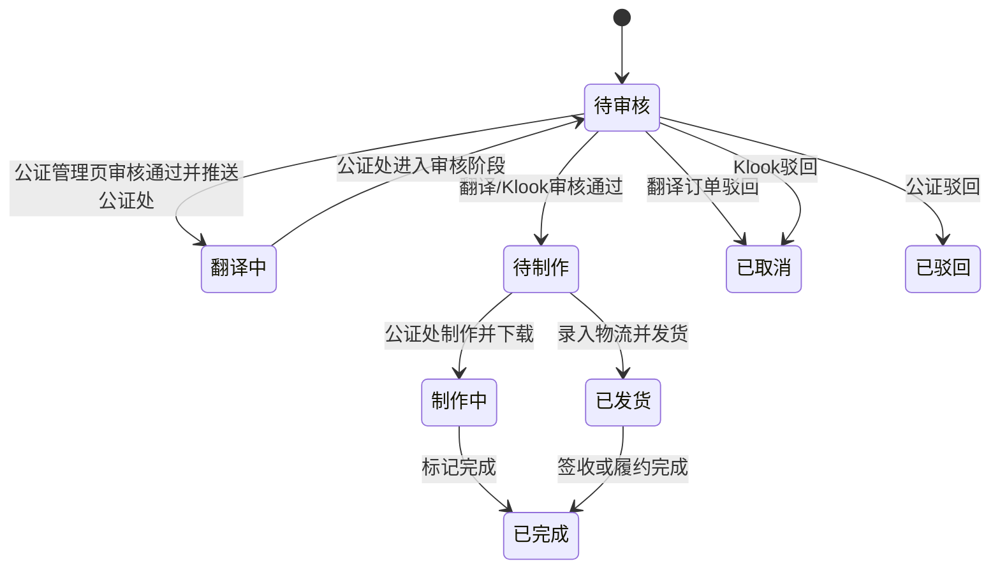
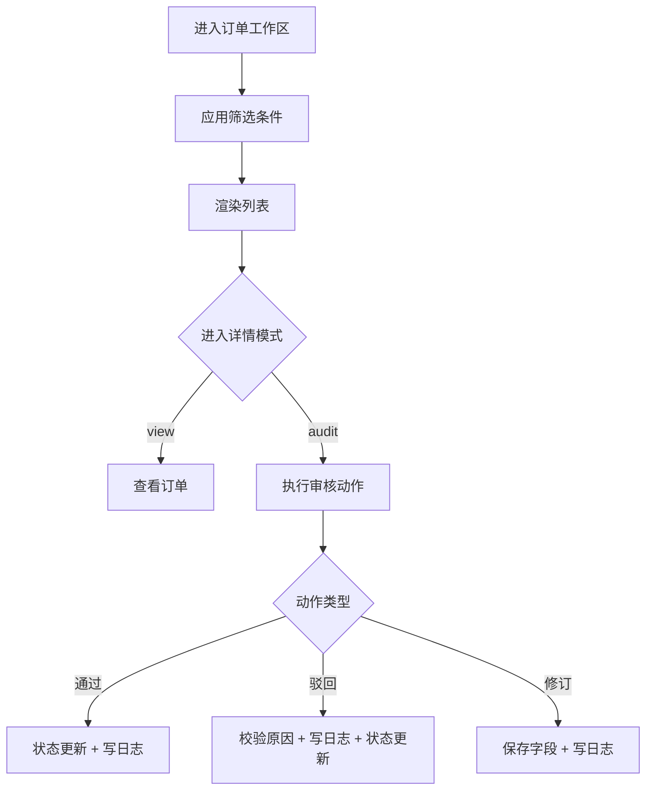

# 美卡订单中心 Specification

> **模块**: 订单中心（翻译 / 换国内驾照翻译件 / IDP / 公证 / Klook）
> **版本**: v1.2
> **最后更新**: 2026-05-13
> **作者**: Codex

---

## 更新日志

- **v1.2 (2026-05-13)**: 同步“换国内驾照翻译件”独立产品分类与驾照官生产端中文翻译件链路，更新公证处送审状态、物流发货、取消订单与状态聚合口径
- **v1.1 (2026-04-21)**: 同步公证订单管理与公证订单页解耦后的状态口径，补充审核通过后流转到公证订单页“翻译中”，并更新公证订单页倒序规则
- **v1.0 (2026-04-17)**: 从 `specs/mei_ka_prd_spec.md` 拆分订单中心独立 PRD，保留状态机、审核规则和数据口径

---

## 1. 背景与目标

### 1.1 背景
订单中心是美卡后台的核心业务入口，当前同时承载翻译、换国内驾照翻译件、IDP、公证、Klook 五条订单链路。由于链路差异明显，需要独立 PRD 固化筛选、状态聚合、审核行为和导出规则。

### 1.2 目标

| # | 目标 | 描述 |
|---|---|---|
| 1 | 统一入口 | 四类订单在统一信息架构下可管理 |
| 2 | 保证链路差异 | 每类订单保留独立状态口径和导出方式 |
| 3 | 审核可追溯 | 通过、驳回、资料修订动作留痕 |
| 4 | 支撑模板入口 | IDP 订单完成后可进入 IDD 模板预览 |

### 1.3 非目标
- 不实现真实订单后端联调。
- 不实现自动风控审核与机器审核。

---

## 2. 范围（Scope）

### 2.1 In Scope
- 翻译订单列表、详情、审核
- 换国内驾照翻译件订单列表、详情、审核与生产端可见规则
- IDP 订单列表、详情、审核、模板入口
- 公证订单列表、预览审核入口
- Klook 订单列表、详情、审核
- 订单日志留痕

### 2.2 Out of Scope
- 真实支付/退款/结算
- 真实物流回传
- 外部渠道实时回调处理

---

## 3. User Stories

#### US-1
> **作为** 运营人员  
> **我希望** 在不同订单工作区用统一筛选方式快速找到目标订单  
> **以便于** 提升处理效率

#### US-2
> **作为** 审核人员  
> **我希望** 对订单执行通过、驳回、资料修订并自动留痕  
> **以便于** 后续复盘与责任追踪

#### US-3
> **作为** IDP 业务人员  
> **我希望** 已完成订单可直接进入 IDD 模板页面  
> **以便于** 完成模板确认与导出

---

## 4. 角色与权限

| 角色 | 权限 | 说明 |
|---|---|---|
| 管理员/运营 | 列表查询、查看、审核 | 默认演示账号可访问 |
| 审核人员 | 审核通过、驳回、资料修改 | 当前通过页面模式控制 |

权限规则：
- `mode=view` 仅查看。
- `mode=audit` 才允许执行审核动作。

---

## 5. 数据模型与状态

### 5.1 Logical View

```typescript
interface OrderCenterView {
  workspaceType: 'translation' | 'domestic_license' | 'idp' | 'notary' | 'klook';
  filters: {
    agentName?: string;
    productName?: string;
    processType?: string;
    createdAtRange?: [string, string];
    keyword?: string;
    statusTab?: string;
  };
  list: OrderCardView[];
}

interface OrderCardView {
  orderId: string; // Stored
  status: string; // Stored
  statusLabel: string; // Mapped
  canAudit: boolean; // Derived
  canOpenTemplatePreview: boolean; // Derived
}
```

### 5.2 状态机



### 5.3 状态聚合规则

| 工作区 | 聚合规则 |
|---|---|
| 翻译 | `pending_production + in_production -> 待制作`，`shipped + completed -> 已发货` |
| 换国内驾照翻译件 | 管理端按翻译订单审核口径处理；生产端另映射为 `未翻译`、`未制作`、`未发货`、`已发货`、`已取消` |
| IDP | `pending_review -> 待审核`，其余状态 -> 已完成 |
| 公证订单管理 | `pending_review -> 待审核`，`pending_production + in_production -> 待制作`，公证处审核驳回或 `rejected -> 驳回`，`cancelled -> 已取消`，`shipped + completed -> 已发货/已完成`；已送审且未被驳回/取消的待制作订单隐藏“送审”按钮 |
| 公证订单页 | 使用独立状态口径：`pending_review -> 待审核`，`in_production -> 制作中`，`shipped + completed -> 已完成`，`rejected -> 已驳回`；历史 `translating`、`pending_production` 兼容映射 |
| Klook | 使用本链路原始状态标签，不复用主订单聚合 |

### 5.4 换国内驾照翻译件生产端状态

驾照官生产端只展示产品名为“换国内驾照翻译件”且已进入生产链路的订单。未审核、已驳回订单不进入生产端列表。

| 生产端状态 | 判定规则 | 可执行动作 |
|---|---|---|
| 未翻译 | 主订单 `status=pending_production` 且无生产端“已翻译”日志 | 查看订单、翻译订单、取消订单 |
| 未制作 | 已存在生产端“已翻译”日志，且未制作 | 查看订单、导出订单、取消订单 |
| 未发货 | 主订单 `status=in_production` 或存在生产端“已制作”日志 | 查看订单、打印京东/顺丰/极兔面单、发货、取消订单 |
| 已发货 | 主订单 `status=shipped/completed` | 查看订单，展示物流公司、物流单号、发货时间 |
| 已取消 | 主订单 `status=cancelled/rejected` 或生产端取消 | 查看订单 |

---

## 6. 核心业务规则

| 编号 | 规则 |
|---|---|
| BR-OC-001 | 驳回动作必须填写 `rejectReason` |
| BR-OC-002 | 审核通过、驳回、资料修改必须写入 `logs` |
| BR-OC-003 | Klook 订单数据源独立，使用 `meika-klook-orders` |
| BR-OC-004 | IDP 仅已完成类状态显示模板入口 |
| BR-OC-005 | 列表筛选条件之间为 AND 关系 |
| BR-OC-006 | 公证订单管理页审核通过并选择公证处后，管理页订单进入 `pending_production`，公证订单页收到同订单并保存为 `translating` |
| BR-OC-007 | 公证订单页与公证订单管理页数据解耦，公证订单页使用独立持久化数据源承接公证处处理链路 |
| BR-OC-008 | 仅公证处审核驳回的订单进入公证订单管理“驳回”列表；审核通过的订单仍进入待制作/制作中链路 |
| BR-OC-009 | 公证订单管理“驳回”列表支持订单修改、送审、取消订单；取消后主订单进入“已取消”列表，详情状态展示“已取消” |
| BR-OC-010 | 公证订单修改页姓名变更后，姓氏拼音和名字拼音必须基于当前姓名实时识别并在保存时同步写入订单字段 |
| BR-OC-011 | 换国内驾照翻译件使用 `productCategory=domestic_license` 与产品名“换国内驾照翻译件”识别，进入生产端后由生产日志驱动生产状态 |
| BR-OC-012 | 中文翻译件生产端“导出PDF”成功后写入“已制作”日志并将主订单状态更新为 `in_production` |
| BR-OC-013 | 中文翻译件生产端发货必须选择物流公司并填写物流单号，确认后主订单更新为 `shipped` |
| BR-OC-014 | 中文翻译件生产端取消订单仅允许在未翻译、未制作、未发货状态执行 |

---

## 7. 功能需求

### 7.1 列表页
- 支持筛选：代理商、产品、办理类型（按工作区）、创建时间、关键词、状态标签
- 默认排序：`createdAt DESC`
- 支持分页：10/20/50/100

说明：
- 公证订单页列表默认按时间倒序；`completed` 优先使用 `shippedAt`，其余状态优先使用 `updatedAt`，缺失时回退 `createdAt`

### 7.2 详情页（查看/审核）
- `mode=view`：只读
- `mode=audit`：可执行通过、驳回、修订
- 驳回时强制校验原因
- 公证订单从“驳回”列表进入“订单修改”时默认进入编辑态，订单状态展示“公证处已驳回”

### 7.3 字段修订能力
- 翻译/公证/Klook：证件与收货信息可修订
- 公证订单修改：可修订驾照信息、证件图片、收货人、联系电话、收货地址
- 公证订单姓名修改：系统自动拆分复姓/单姓和名字，生成大写全拼；例如 `殷肖雨` -> 姓氏拼音 `YIN`，名字拼音 `XIAOYU`
- IDP：姓名拼音、国籍、证件、地址、白底照、签名图可修订

### 7.4 导出能力（本模块内）
- 翻译：Excel
- 换国内驾照翻译件：列表 Excel；生产端 DOCX 模板预览、可编辑后导出 PDF
- IDP：Excel
- 公证订单管理：Excel
- Klook：CSV

### 7.5 业务流程



---

## 8. 边界场景

| 场景 | 处理方式 |
|---|---|
| 时间范围非法 | 阻断筛选并提示 |
| 驳回未填原因 | 阻断提交并提示 |
| 数据为空 | 渲染空态，不报错 |
| 订单状态不允许审核 | 隐藏或禁用审核操作 |

---

## 9. 非功能要求

- 列表筛选响应 < 300ms（本地数据场景）
- 审核动作反馈必须可见（Toast）
- 列表与详情路由切换稳定，无白屏

---

## 10. 测试与验收

| 用例 | 场景 | 预期 |
|---|---|---|
| TC-OC-001 | 翻译订单审核通过 | 进入待制作并写日志 |
| TC-OC-002 | Klook 驳回不填原因 | 提交失败并提示 |
| TC-OC-003 | IDP 已完成订单点击更多 | 可进入模板预览 |
| TC-OC-004 | 公证订单筛选状态标签 | 返回聚合口径正确 |
| TC-OC-005 | Klook 导出 | 生成 CSV 且编码可读 |
| TC-OC-006 | 公证管理页送审并选择公证处 | 管理页保持待制作聚合口径，公证处工作台同订单进入待审核 |
| TC-OC-007 | 中文翻译件确认翻译 | 写入生产端“已翻译”日志，生产端状态变为未制作 |
| TC-OC-008 | 中文翻译件导出 PDF | 写入“已制作”日志，主订单状态变为 `in_production`，生产端状态变为未发货 |
| TC-OC-009 | 中文翻译件确认发货 | 写入物流字段与“已发货”日志，生产端状态变为已发货 |

---

## 11. Tracking Events 与 i18n

Tracking Events（建议）：
- `order_workspace_view`
- `order_filter_apply`
- `order_detail_view`
- `order_audit_submit`
- `order_export_submit`

i18n 资源键（建议）：
- `order.workspace.translation.title`
- `order.workspace.idp.title`
- `order.workspace.notary.title`
- `order.audit.error.reject_reason_required`
- `order.export.action.submit`
