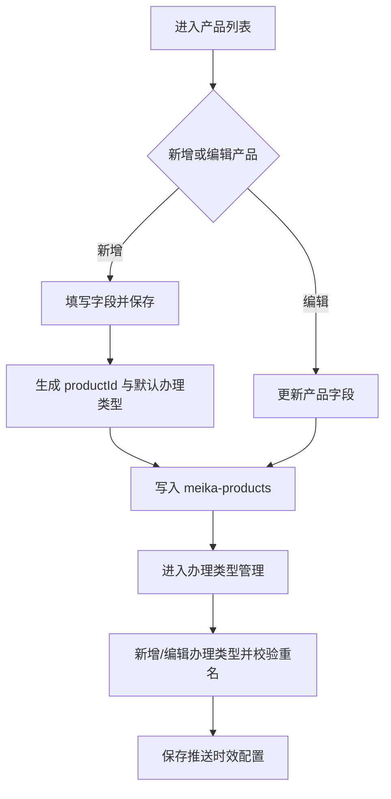

# 美卡产品中心与办理类型 Specification

> **模块**: 产品中心 + 办理类型管理 + 推送时效配置
> **版本**: v1.1
> **最后更新**: 2026-05-13
> **作者**: Codex

---

## 更新日志

- **v1.1 (2026-05-13)**: 同步 `domestic_license` 产品分类、换国内驾照翻译件默认产品、标准办理类型模板与产品元数据回写订单展示口径
- **v1.0 (2026-04-17)**: 从主 PRD 拆分产品侧独立规格，包含产品、办理类型、时效配置

---

## 1. 背景与目标

### 1.1 背景
产品中心是订单展示的元数据来源。产品标题、分类、默认价格、办理类型、推送时效会直接影响订单列表展示、详情文案和履约节奏。

### 1.2 目标

| # | 目标 | 描述 |
|---|---|---|
| 1 | 稳定产品主数据 | 统一维护产品新增、编辑、删除与状态 |
| 2 | 管理办理类型 | 支持按产品维度维护办理类型及重名校验 |
| 3 | 管理推送时效 | 按 `productId + processTypeId` 维度持久化时效 |
| 4 | 保障订单口径一致 | 产品更新后订单可读取最新元数据（锁价除外） |

---

## 2. 范围（Scope）

### 2.1 In Scope
- 产品列表与搜索
- 弹窗新增/编辑
- 价格详情与价格修改
- 办理类型 CRUD
- 推送时效配置（天/小时）

### 2.2 Out of Scope
- 产品营销策略
- 渠道级差异化商品编排
- 真实价格引擎联调

---

## 3. User Stories

#### US-1
> **作为** 产品管理员  
> **我希望** 快速新增产品并自动初始化基础配置  
> **以便于** 缩短产品上线时间

#### US-2
> **作为** 产品管理员  
> **我希望** 在一个页面内维护办理类型和推送时效  
> **以便于** 保持配置一致

---

## 4. 角色与权限

| 角色 | 权限 |
|---|---|
| 产品管理员 | 产品 CRUD、办理类型 CRUD、时效配置 |
| 运营人员 | 只读（当前 Demo 实际同账号） |

---

## 5. 数据模型（Logical View）

```typescript
interface ProductCenterView {
  products: ProductCardView[]; // Stored: meika-products
  currentProductId?: string;
  processTypes: ProcessTypeView[]; // Stored in product.processTypes
  pushTimeliness: PushTimelinessView[]; // Stored: meika-push-timeliness-config
}

interface ProductCardView {
  productId: string;
  title: string;
  category: 'translation' | 'notary' | 'idp' | 'domestic_license';
  defaultPrice: number;
  status: 'active' | 'inactive';
}
```

---

## 6. 核心业务规则

| 编号 | 规则 |
|---|---|
| BR-PC-001 | 产品标题、分类、默认价格、权重为核心必填字段 |
| BR-PC-002 | 新增产品自动生成 `productId` |
| BR-PC-003 | 新增产品自动初始化默认办理类型和价格矩阵 |
| BR-PC-004 | 同一产品下办理类型名称不可重复 |
| BR-PC-005 | 推送时效按 `productId + processTypeId` 粒度保存 |
| BR-PC-006 | 默认预计天数：`normal=15`，`priority=7`，`urgent=3` |
| BR-PC-007 | 订单金额使用锁价，产品改价不回写历史订单金额 |
| BR-PC-008 | 产品分类固定为 `translation` / `notary` / `idp` / `domestic_license`，其中 `domestic_license` 用于“换国内驾照翻译件” |
| BR-PC-009 | “换国内驾照翻译件”缺失时，系统初始化或迁移时需补齐默认上架产品和办理类型 |
| BR-PC-010 | 除“小白本”外的标准产品默认办理类型为 `normal` 与 `urgent`；“小白本”使用五档办理类型模板 |

---

## 7. 功能需求

### 7.1 产品列表
- 搜索：标题、产品 ID、状态文本
- 排序：已上架优先、权重高优先、创建时间新优先
- 操作：新增、编辑、删除、价格详情、办理类型入口

### 7.2 新增/编辑产品
字段：
- `title`（必填）
- `category`（必填，可选：翻译认证、换国内驾照翻译件、公证、IDP）
- `defaultPrice`（必填 > 0）
- `weight`（必填，非负整数）
- `coverImage`（选填）
- `description`（选填）

分类说明：

| 分类 | 使用场景 | 典型产品 |
|---|---|---|
| `translation` | 常规翻译认证订单 | 小白本、NAATI、NZTA、宣誓翻译 |
| `domestic_license` | 境外驾照换领国内驾照的中文翻译件 | 换国内驾照翻译件 |
| `notary` | 公证订单和公证处工作台 | 公证单号、双号、海牙单号、海牙双号 |
| `idp` | IDP/IDD 模板类订单 | IDP、IDD 国际驾照 |

### 7.3 办理类型管理
- 按当前产品维度维护
- 支持新增、编辑、删除
- 保存前做重名校验

### 7.4 推送时效配置
- 字段：`value`、`unit(day/hour)`
- 校验：正整数 + 单位必选

### 7.5 业务流程



---

## 8. 边界场景

| 场景 | 处理方式 |
|---|---|
| 默认价格 <= 0 | 阻断保存并提示 |
| 办理类型重名 | 阻断保存并提示 |
| 删除办理类型后遗留时效配置 | 同步清理对应配置 |
| 产品删除但有历史订单 | 订单展示依赖历史快照与锁价继续可读 |

---

## 9. 非功能要求

- 列表操作反馈明确（Toast）
- 产品配置刷新后可恢复（localStorage）
- 页面交互延迟低于 300ms（本地数据）

---

## 10. 测试与验收

| 用例 | 场景 | 预期 |
|---|---|---|
| TC-PC-001 | 新增产品 | 自动生成 productId 与默认办理类型 |
| TC-PC-002 | 办理类型重名 | 保存失败并提示 |
| TC-PC-003 | 保存推送时效 | 配置写入并刷新后保留 |
| TC-PC-004 | 修改默认价格 | 新单使用新价，历史订单金额不变 |
| TC-PC-005 | 初始化缺失的换国内驾照翻译件 | 产品列表自动补齐 `domestic_license` 分类产品 |
| TC-PC-006 | 编辑产品分类为换国内驾照翻译件 | 保存后订单展示与生产端筛选按 `domestic_license` 口径识别 |

---

## 11. Tracking Events 与 i18n

Tracking Events（建议）：
- `product_list_view`
- `product_save_submit`
- `process_type_save_submit`
- `push_timeliness_save_submit`

i18n 资源键（建议）：
- `product.list.title`
- `product.form.field.default_price`
- `product.process_type.field.name`
- `product.push_timeliness.field.unit`
