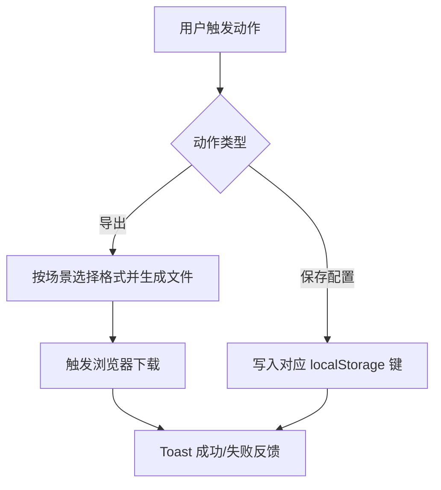

# 美卡共享能力 Specification

> **模块**: 共享能力（导出、持久化、通用反馈）
> **版本**: v1.0
> **最后更新**: 2026-04-17
> **作者**: Codex

---

## 更新日志

- **v1.0 (2026-04-17)**: 从主 PRD 拆分共享能力独立规格，统一导出口径与 localStorage 约束

---

## 1. 背景与目标

### 1.1 背景
美卡多个模块共用导出下载与本地持久化机制。若没有独立规范，模块重构时容易出现导出格式错配、键名冲突、反馈不一致等问题。

### 1.2 目标

| # | 目标 | 描述 |
|---|---|---|
| 1 | 统一导出能力 | 固定各场景导出格式与命名行为 |
| 2 | 统一持久化边界 | 固定 localStorage 键与语义 |
| 3 | 统一交互反馈 | 关键动作均有可见反馈 |
| 4 | 降低耦合风险 | 模块间不重复定义公共规则 |

---

## 2. 范围（Scope）

### 2.1 In Scope
- 订单列表导出（Excel/CSV）
- 预览与模板导出（DOCX/PDF/ZIP）
- 本地持久化键管理
- 通用反馈（Toast）

### 2.2 Out of Scope
- 云存储与服务端文件托管
- 审计平台与埋点平台接入

---

## 3. 导出能力矩阵

| 场景 | 格式 | 说明 |
|---|---|---|
| 翻译订单列表 | Excel | 基于模板导出 |
| IDP 订单列表 | Excel | 基于模板导出 |
| 公证订单管理列表 | Excel | 基于模板导出 |
| Klook 订单列表 | CSV | UTF-8 BOM |
| 公证预览 | DOCX / PDF | 浏览器端生成下载 |
| 公证处制作 | ZIP | 模板打包下载 |
| IDD 模板预览 | PDF | 单文件下载 |

---

## 4. 本地持久化规范

| Key | 用途 |
|---|---|
| `meika-auth-session` | 登录会话 |
| `meika-sidebar-collapsed` | 侧边栏折叠状态 |
| `meika-products` | 产品与办理类型数据 |
| `meika-orders` | 主订单数据（翻译/IDP/公证） |
| `meika-klook-orders` | Klook 订单数据 |
| `meika-push-timeliness-config` | 推送时效配置 |

约束：
1. 新增公共键需评审，禁止同义重复键。
2. 写入失败必须提示，不允许静默失败。
3. 会话键与业务数据键禁止混用。

---

## 5. 核心业务规则

| 编号 | 规则 |
|---|---|
| BR-SH-001 | 导出格式由场景决定，不允许页面自行改写 |
| BR-SH-002 | 文件名必须可下载（非法字符自动清洗） |
| BR-SH-003 | 批量导出前至少一条记录 |
| BR-SH-004 | 关键动作需有 Toast 反馈 |
| BR-SH-005 | 持久化键名必须使用统一白名单 |

---

## 6. 功能流程

---

## 7. 边界场景

| 场景 | 处理方式 |
|---|---|
| 浏览器下载失败 | 捕获异常并提示 |
| localStorage 满 | 阻断写入并提示 |
| 空数据导出 | 提示无可导出数据 |
| 文件名包含非法字符 | 自动清洗后下载 |

---

## 8. 非功能要求

- 导出 500 条以内记录，体验可接受（<5s）
- 公共工具函数可复用，不在页面重复实现
- 失败提示文案可定位具体场景

---

## 9. 测试与验收

| 用例 | 场景 | 预期 |
|---|---|---|
| TC-SH-001 | 翻译列表导出 | 生成 Excel 且可打开 |
| TC-SH-002 | Klook 列表导出 | 生成 UTF-8 BOM CSV |
| TC-SH-003 | 公证处下载模板 | 生成 ZIP 且命名正确 |
| TC-SH-004 | 写入侧边栏状态 | 刷新后状态保持 |
| TC-SH-005 | localStorage 异常 | 页面提示保存失败 |

---

## 10. Tracking Events 与 i18n

Tracking Events（建议）：
- `export_submit`
- `export_success`
- `export_failed`
- `storage_write_submit`
- `storage_write_failed`

i18n 资源键（建议）：
- `shared.export.error.no_data`
- `shared.export.error.failed`
- `shared.storage.error.write_failed`
- `shared.toast.action_success`
