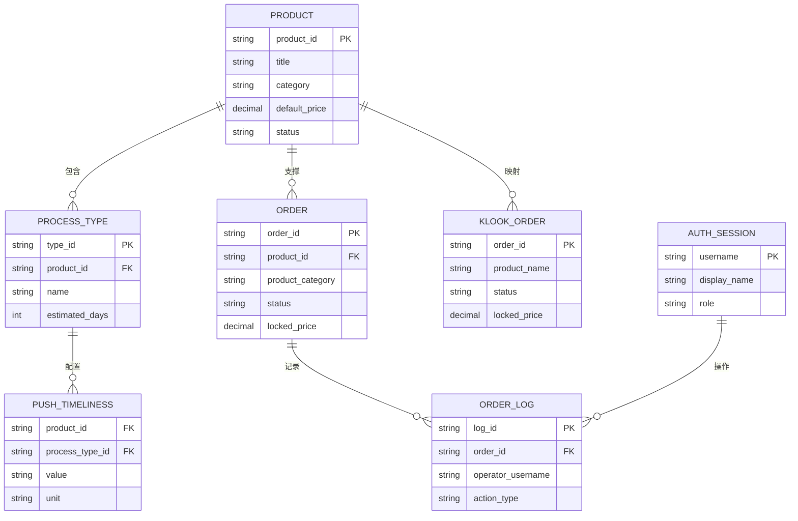
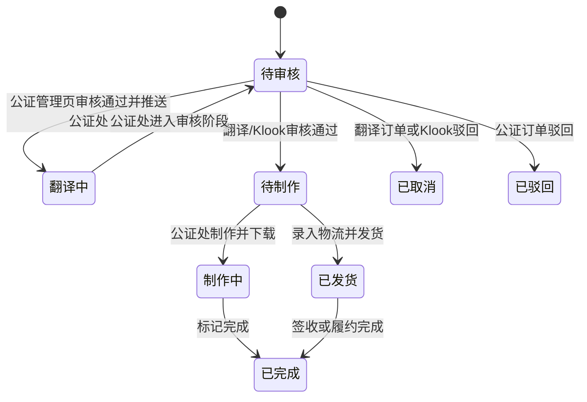
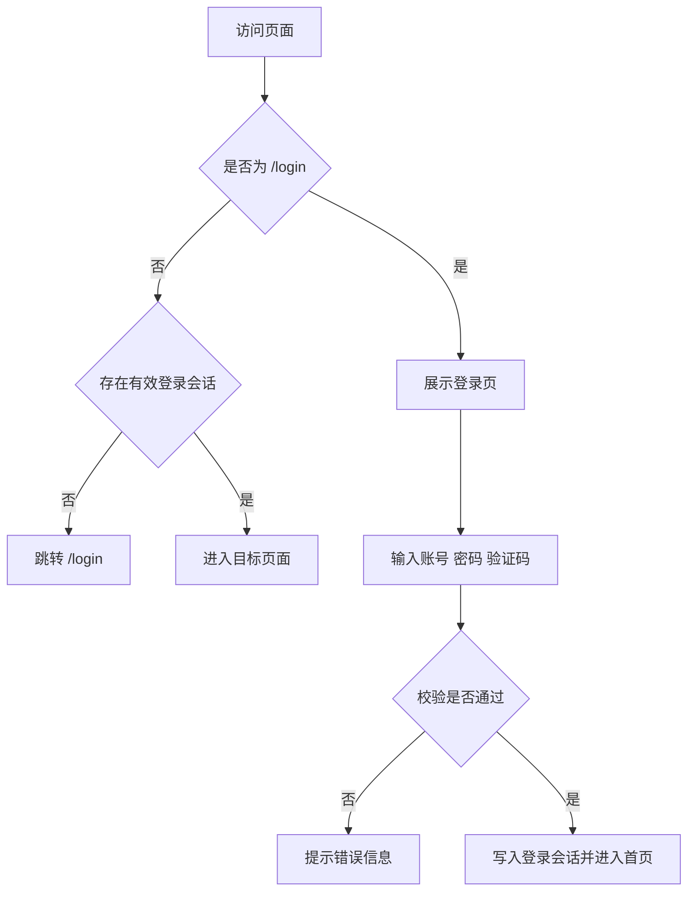
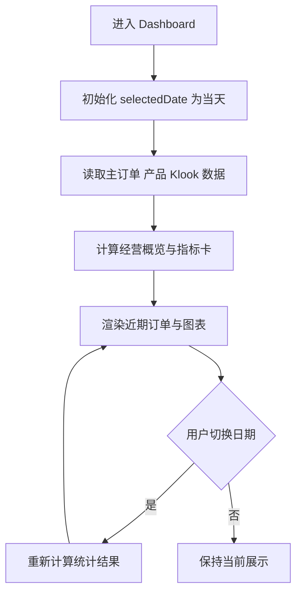
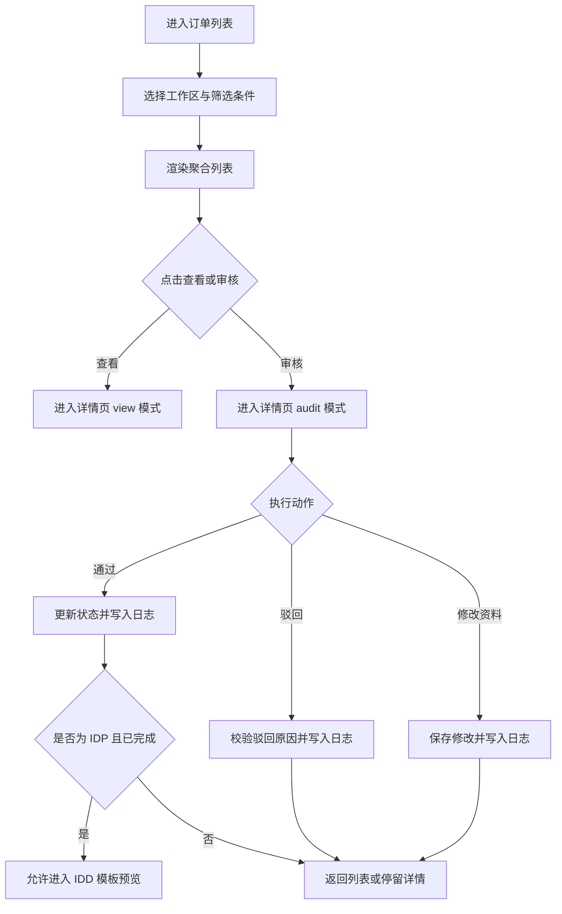
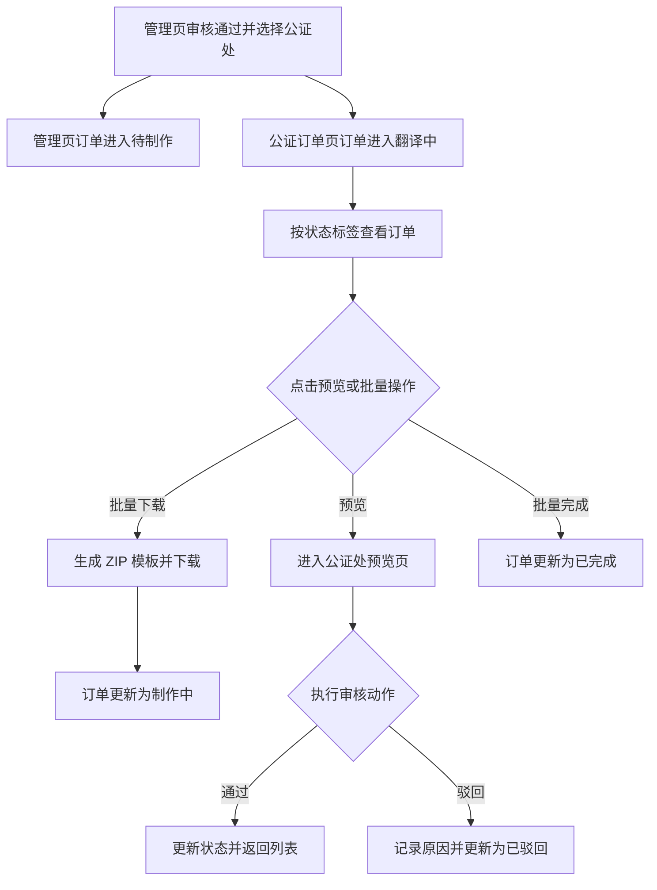
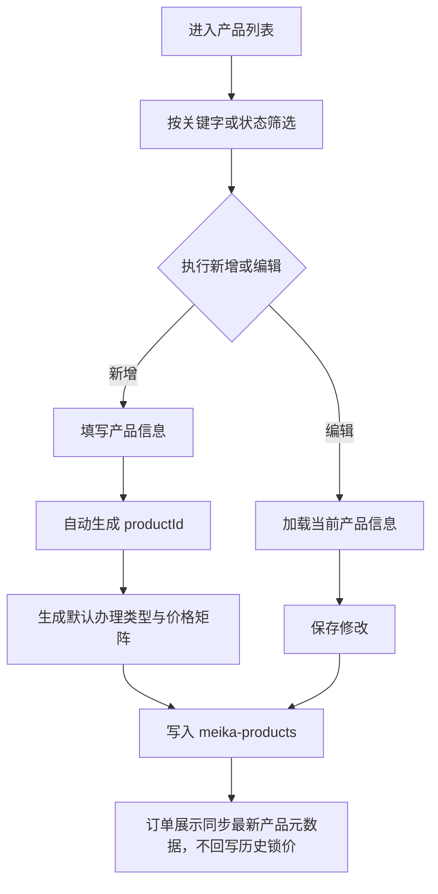
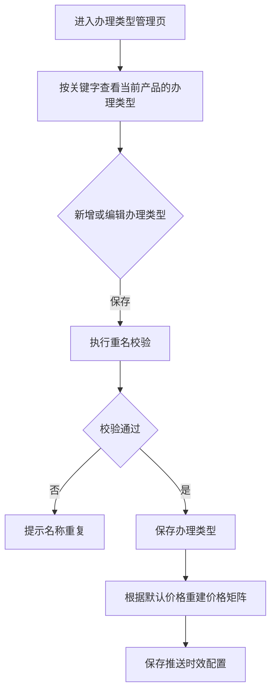
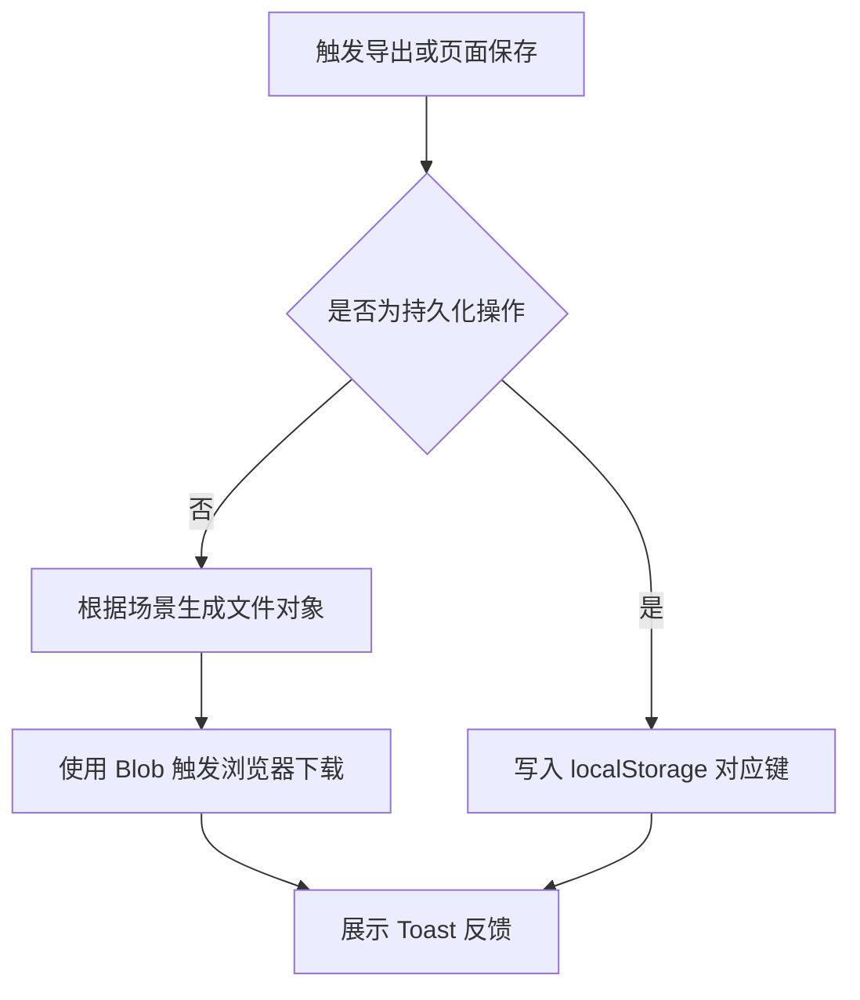

# 美卡管理后台 Specification

> **模块**: 美卡管理后台
> **版本**: v1.0
> **最后更新**: 2026-04-21
> **作者**: Codex

---

## 更新日志

- **v1.0 (2026-04-17)**:产出为标准 Specification 文档，补齐用户故事、逻辑视图、数据契约、Tracking Events 与 i18n 规范

---

## 1. 背景与目标

### 1.1 业务背景

美卡管理后台是面向内部运营、审核、公证专员的演示级业务系统，用于统一承载翻译认证订单、IDP 订单、公证订单、Klook API 订单，以及产品中心、办理类型、推送时效、模板预览与导出能力。

当前系统采用 `React 18 + TypeScript + Vite` 单页应用形态，业务数据主要由前端 Mock Service 初始化，并持久化到浏览器 `localStorage`。系统已经具备可运行 Demo，但原有文档以项目型 PRD 为主，缺少符合标准模板的功能规范文档，难以支持后续模块扩展、测试回归、页面重构和国际化治理。

### 1.2 问题陈述

当前存在以下核心问题：

1. 现有主 PRD 以“演示说明”方式组织，不符合团队统一的 Spec 模板结构，难以作为工程实现与评审基准。
2. 翻译、IDP、公证、Klook 四条订单链路共存，但状态聚合、导出方式、页面入口、持久化边界分散描述，存在理解偏差风险。
3. 订单详情、审核页、模板预览页、公证处制作页之间的交互职责没有通过统一逻辑视图表达，后续改造容易出现字段语义漂移。
4. 当前系统为 Demo 形态，无真实后端、无真实 RBAC、无真实文件上传，但这些“边界”尚未被标准化写清，易导致需求外溢。

---

## 2. 现状洞察（AS-IS）

当前系统已经覆盖登录认证、全局导航、Dashboard、订单中心、公证处工作台、产品中心、办理类型管理与浏览器端导出，但系统文档与实现之间仍有以下痛点：

| 痛点                           | 描述                                                                                                            |
| ------------------------------ | --------------------------------------------------------------------------------------------------------------- |
| **文档结构不统一**       | `specs/MEI_KA_PRD_XIN.md` 能描述现状，但未按标准模板拆解用户故事、数据契约、逻辑视图、验收标准。              |
| **多链路口径分散**       | 翻译、IDP、公证、Klook 订单共用部分组件，但各自的筛选项、状态聚合、导出方式和跳转入口分散描述。                 |
| **数据边界隐含在代码中** | `meika-orders`、`meika-klook-orders`、`meika-products` 等持久化键值在文档中说明不足，维护者需要反查代码。 |
| **权限模型为 Demo 级**   | 当前仅有固定演示账号与前端受保护路由，无真实 RBAC；如果不显式说明，容易被误判为已具备生产级权限体系。           |
| **导出能力差异化强**     | 不同模块分别输出 Excel、CSV、DOCX、PDF、ZIP，若没有统一规范，后续重构时容易破坏演示链路。                       |

---

## 3. 目标（TO-BE）与非目标

### 3.1 目标

| # | 目标                         | 描述                                                                                    |
| - | ---------------------------- | --------------------------------------------------------------------------------------- |
| 1 | **标准化现有能力**     | 将当前美卡管理后台的真实能力边界，重构为符合模板要求的标准 Specification。              |
| 2 | **统一多订单链路口径** | 对翻译、IDP、公证、Klook 订单的页面入口、状态流转、导出方式、审核规则形成统一文档基线。 |
| 3 | **沉淀交互与数据基准** | 通过 ER 图、Logical View、字段定义、数据契约明确页面与数据语义，降低后续重构成本。      |
| 4 | **明确 Demo 边界**     | 明确哪些能力已实现，哪些能力仍为占位或未来迭代，避免项目范围失控。                      |

### 3.2 非目标（本期不做）

- **真实后端接入**: 当前版本不接入真实订单服务、真实商品服务、真实 Klook API 或真实数据库。
- **真实权限体系**: 当前版本不实现组织、角色、权限矩阵和细粒度 RBAC。
- **真实支付与履约生态**: 当前版本不覆盖支付、退款、对账、结算、短信、邮件、真实物流。
- **真实文件生产链路**: 当前版本不覆盖文件上传、OCR、电子签、在线 DOCX 编辑和真实模板服务。
- **多租户经营后台**: 当前版本不扩展库存、门店、财务、结算报表等独立后台域能力。

### 3.3 User Stories

#### US-1: 运营人员统一处理订单

> **作为** 管理员 / 运营人员
> **我希望** 在统一后台中查看不同类型订单，并进入对应审核或查看页面
> **以便于** 减少系统切换成本，快速完成日常处理

**验收标准**:

- 可以通过左侧菜单进入翻译、IDP、公证、Klook 等不同订单工作区
- 每类订单列表均可按预定义条件筛选并进入详情页
- 订单详情页可区分查看模式与审核模式

#### US-2: 审核人员留痕处理订单

> **作为** 审核人员
> **我希望** 在审核页面中执行通过、驳回、资料修改等动作
> **以便于** 保持审核结果可追溯、可复盘

**验收标准**:

- 驳回动作必须填写原因
- 审核通过、驳回、资料修改均写入日志
- Klook、公证、翻译订单均具备审核留痕能力

#### US-3: 公证专员推进制作链路

> **作为** 公证专员
> **我希望** 在公证处工作台中批量下载模板、推进制作状态、标记完成
> **以便于** 提升公证订单的处理效率

**验收标准**:

- 待制作订单支持勾选与批量下载
- 下载模板后订单进入制作中状态
- 批量完成后订单进入已完成状态

#### US-4: 产品管理员维护商品与时效

> **作为** 产品管理员
> **我希望** 维护产品、办理类型、价格矩阵与推送时效
> **以便于** 支撑订单展示口径与运营配置的统一

**验收标准**:

- 产品支持新增、编辑、删除、查看价格详情
- 办理类型支持 CRUD 与重名校验
- 推送时效按 `productId + processTypeId` 粒度持久化

---

## 4. 术语表（Terminology）

| 术语         | 英文                    | 定义                                                                                   |
| ------------ | ----------------------- | -------------------------------------------------------------------------------------- |
| 美卡管理后台 | Mei Ka Admin Console    | 当前演示级运营后台系统，统一承载订单、产品、模板与导出能力。                           |
| 翻译订单     | Translation Order       | `productCategory = translation` 的订单，支持列表筛选、审核、Excel 导出。             |
| IDP 订单     | IDP Order               | `productCategory = idp` 的订单，支持资料编辑与 IDD 模板入口。                        |
| IDD 模板     | IDD Template            | IDP 订单对应的 PDF 模板预览与下载能力，含卡片、完整、信息页三种模板。                  |
| 公证订单     | Notary Order            | 需要经过审核、预览、委托书 / PDF 导出的订单。                                          |
| 公证处工作台 | Notary Office Workbench | 面向公证专员的制作工作区，支持翻译中、待审核、待制作、制作中、已完成、已驳回状态管理。 |
| Klook 订单   | Klook Order             | 独立持久化的 API 来源订单，仅当前匹配“小白本”产品场景。                              |
| 锁价         | Locked Price            | 订单创建时固化的价格快照，后续产品改价不影响历史订单金额。                             |
| 审核模式     | Audit Mode              | 详情页中的可编辑模式，允许通过、驳回或修订资料。                                       |
| 查看模式     | View Mode               | 详情页中的只读模式，仅查看订单、商品、收货与审核信息。                                 |
| 推送时效     | Push Timeliness         | 按 `productId + processTypeId` 维度配置的时效信息，支持天 / 小时。                   |
| 准入校验     | Admission Guard         | 动作执行前的前置判断，例如登录校验、驳回原因必填、导出前勾选校验。                     |

---

## 5. 角色与权限

| 角色              | 权限范围       | 说明                                                                   |
| ----------------- | -------------- | ---------------------------------------------------------------------- |
| 管理员 / 运营人员 | 全局模块访问   | 统一登录后进入后台，查看 Dashboard、订单中心、产品中心、公证处工作台。 |
| 审核人员          | 订单审核与预览 | 进入订单详情、预览页执行审核通过、驳回、资料修订。                     |
| 公证专员          | 公证制作工作区 | 在公证处工作台下载模板、推进制作中、标记完成。                         |

**权限规则**:

- 当前版本仅提供演示账号 `admin / 123456`，登录成功后创建默认会话 `username=admin`、`displayName=管理员`、`role=运营人员`，无真实 RBAC。
- 用户名校验前执行 `trim + lowercase` 归一化，因此 `ADMIN` 仍按演示账号处理。
- 首次无 `meika-auth-session` 存储时系统会自动写入默认演示会话；主动登出后改写为 `__logged_out__` 哨兵值，访问受保护路由时需重新登录。
- 除 `/login` 外，所有路由均运行在受保护布局下。
- 页面上的动作权限依赖当前页面模式控制，而非真实后端鉴权。
- 审核日志中的操作人默认取当前登录会话账号。

---

## 6. 数据模型（业务/交互视角）

### 6.1 实体关系图（ER Diagram）



### 6.2 Logical View（逻辑视图，UI 设计基准）

> [!IMPORTANT]
> **AI 执行约束**
>
> 1. 本章仅定义业务语义与页面交互模型，不直接等同于底层存储结构。
> 2. 如已按本节定义 `Logical View`，前端页面/组件必须基于 `Logical View` 设计。
> 3. 涉及聚合、计算、映射字段时，必须在 Spec 中明确字段来源与转换规则。
> 4. 底层存储结构如需补充，请写入附录 `13.2 技术附录（可选，工程维护）`。

#### 6.2.1 逻辑视图写法示例

```typescript
interface MeikaAdminConsoleView {
  auth: {
    session: AuthSessionView; // Stored: meika-auth-session
    isProtectedRoute: boolean; // Derived from current route
    canAccessModule: boolean; // Mapped from demo role
  };

  navigation: {
    activeMenuKey: string; // Derived from route path
    sidebarCollapsed: boolean; // Stored: meika-sidebar-collapsed
    routes: RouteEntryView[]; // Stored from menu configuration
  };

  dashboard: DashboardView; // Derived from orders, products, selectedDate

  orderCenter: {
    translation: OrderWorkspaceView; // Derived from meika-orders where productCategory=translation
    idp: OrderWorkspaceView; // Derived from meika-orders where productCategory=idp
    notary: OrderWorkspaceView; // Derived from meika-orders where productCategory=notary
    klook: KlookWorkspaceView; // Stored from meika-klook-orders
  };

  notaryOffice: NotaryWorkbenchView; // Derived from meika-orders where productCategory=notary

  productCenter: {
    products: ProductCardView[]; // Stored from meika-products
    processTypes: ProcessTypeView[]; // Stored from product.processTypes
    pushTimeliness: PushTimelinessView[]; // Stored from meika-push-timeliness-config
  };
}

interface OrderWorkspaceView {
  activeStatusTab: string; // Mapped from underlying order status
  selectedOrderIds: string[]; // Stored in page state
  filters: {
    agentName: string; // Stored: user input
    productName: string; // Stored: user input
    createdAtRange: [string, string] | null; // Stored: user input
    keyword: string; // Stored: user input
  };
  list: OrderCardView[]; // Derived from filtered data source
  exportCapability: {
    format: 'excel' | 'csv'; // Mapped by workspace type
    canExport: boolean; // Derived from selected rows or filtered result
  };
}

interface OrderCardView {
  orderId: string; // Stored
  orderTypeLabel: string; // Mapped from productCategory
  statusLabel: string; // Mapped from status enum
  canAudit: boolean; // Derived from current mode and order status
  canOpenTemplatePreview: boolean; // Derived: idp and completed-like status only
}

interface AuthSessionView {
  username: string; // Stored
  displayName: string; // Stored
  roleLabel: string; // Mapped from role
}
```

#### 6.2.2 计算字段与虚字段

| 数据库存储                | 逻辑视图字段               | Spec 写法                                                    | AI 行为                                                 |
| ------------------------- | -------------------------- | ------------------------------------------------------------ | ------------------------------------------------------- |
| `status`                | `statusLabel`            | `statusLabel: string` *(Mapped from status enum)*        | 自动统一翻译订单、IDP、公证、Klook 列表中的状态显示口径 |
| `productCategory`       | `orderTypeLabel`         | `orderTypeLabel: string` *(Mapped from productCategory)* | 自动渲染“翻译 / IDP / 公证 / Klook”可读文案           |
| `selectedDate + orders` | `dashboard.summaryCards` | `summaryCards: SummaryCardView[]` *(Derived)*            | 自动计算成交金额、待发货金额、异常订单量等指标          |
| `status + route + mode` | `canAudit`               | `canAudit: boolean` *(Derived)*                          | 自动控制详情页按钮与可编辑状态                          |

---

## 7. 业务规则与验证

### 7.1 核心业务规则

| 规则编号 | 规则名称             | 规则描述                                                                                                                                                                                                               |
| -------- | -------------------- | ---------------------------------------------------------------------------------------------------------------------------------------------------------------------------------------------------------------------- |
| BR-001   | 受保护路由           | `/login` 之外的页面需要存在登录会话才能进入。                                                                                                                                                                        |
| BR-002   | 演示会话预置         | 浏览器首次无会话存储时自动注入默认演示登录态；退出后写入 `__logged_out__` 哨兵值，需重新登录。                                                                                                                       |
| BR-003   | 登录凭证固定         | 演示账号固定为 `admin / 123456`；用户名按 `trim + lowercase` 校验，且需通过 4 位大写字母数字验证码校验。                                                                                                           |
| BR-004   | 锁价规则             | 订单创建后锁定 `lockedPrice`，后续产品改价不影响历史订单。                                                                                                                                                           |
| BR-005   | 产品元数据同步展示   | 产品与办理类型修改后，订单展示字段可同步为最新元数据，但不回写历史锁价。                                                                                                                                               |
| BR-006   | 翻译订单状态聚合     | `pending_production` 与 `in_production` 在列表聚合展示为“待制作”；`shipped` 与 `completed` 聚合为“已发货”。                                                                                                |
| BR-007   | IDP 订单状态聚合     | `pending_review` 之外的状态统一在 IDP 列表显示为“已完成”。                                                                                                                                                         |
| BR-008   | 公证订单状态聚合     | 公证订单管理列表中，`pending_review` 显示为“待审核”；`pending_production` 与 `in_production` 显示为“待制作”；`rejected` 与 `cancelled` 显示为“已取消”；`shipped` 与 `completed` 显示为“已完成”。 |
| BR-009   | 公证处状态口径       | 公证处工作台中使用独立状态口径：`translating` 显示为“翻译中”，`shipped` 与 `completed` 统一按“已完成”展示。                                                                                                  |
| BR-010   | 审核留痕             | 审核通过、驳回、资料修改、制作推进等动作必须写入 `logs`。                                                                                                                                                            |
| BR-011   | 驳回原因必填         | 翻译、公证、Klook 订单执行驳回时必须填写原因。                                                                                                                                                                         |
| BR-012   | 办理类型唯一         | 同一产品下不允许出现重名办理类型。                                                                                                                                                                                     |
| BR-013   | 推送时效粒度         | 推送时效按 `productId + processTypeId` 维度持久化，底层结构为 `productId -> processTypeId -> { value, unit }`。                                                                                                    |
| BR-014   | 持久化边界           | 主订单使用 `meika-orders`，Klook 使用 `meika-klook-orders`，产品使用 `meika-products`。                                                                                                                          |
| BR-015   | 导出方式固定         | 翻译 / IDP / 公证列表导出为 Excel，Klook 列表导出为 CSV，公证预览导出为 DOCX / PDF，公证处导出为 ZIP，IDD 模板导出为 PDF。                                                                                             |
| BR-016   | 默认办理类型模板     | 产品标题为 `驾照翻译国际认证件（小白本）` 时默认初始化 5 个办理/配送组合；其他产品默认初始化 `normal` 与 `urgent` 两类。                                                                                         |
| BR-017   | 推送时效精度         | 推送时效 `value` 底层以字符串存储，支持正数且最多保留 2 位小数，单位仅允许 `day` 或 `hour`。                                                                                                                     |
| BR-018   | Klook 状态边界       | Klook 订单仅允许 `pending_review`、`pending_production`、`shipped`、`cancelled` 四种状态；驳回结果映射为 `cancelled`。                                                                                       |
| BR-019   | 公证审核通过双向流转 | 公证订单管理页审核通过并选择公证处后，管理页订单进入 `pending_production`；公证订单页接收同订单并进入 `translating`。                                                                                              |
| BR-020   | 公证订单页默认排序   | 公证订单页列表按时间倒序展示，`completed` 优先使用 `shippedAt`，其余状态优先使用 `updatedAt`，缺失时回退 `createdAt`。                                                                                         |

### 7.2 数据验证规则

| 字段（含变更标识）         | 验证规则                                        | 错误提示             |
| -------------------------- | ----------------------------------------------- | -------------------- |
| [ADD] username             | 必填，`trim + lowercase` 后必须等于 `admin` | 请输入正确的账号     |
| [ADD] password             | 必填，必须等于 `123456`                       | 请输入正确的密码     |
| [ADD] captcha              | 必填，输入值转大写后必须与当前验证码一致        | 验证码不正确         |
| [ADD] rejectReason         | 驳回时必填，长度 `1-200`                      | 请填写驳回原因       |
| [ADD] product.title        | 新增 / 编辑产品时必填，长度 `1-100`           | 请填写产品标题       |
| [ADD] product.defaultPrice | 必填，数值必须大于 `0`                        | 默认价格必须大于 0   |
| [ADD] processType.name     | 同一产品下必填且不可重名                        | 办理类型名称已存在   |
| [ADD] timeliness.value     | 必填，必须为正数且最多 2 位小数                 | 请输入有效的推送时效 |
| [ADD] selectedOrderIds     | 批量下载 / 导出前至少选择一条数据               | 请至少选择一条订单   |

### 7.3 状态机（如适用）



**状态转换规则**:

| 当前状态 | 目标状态 | 触发条件                       | 操作权限          |
| -------- | -------- | ------------------------------ | ----------------- |
| 待审核   | 待制作   | 翻译或 Klook 审核通过          | 管理员 / 审核人员 |
| 待审核   | 翻译中   | 公证管理页审核通过并选择公证处 | 管理员 / 审核人员 |
| 待审核   | 已取消   | 翻译订单或 Klook 驳回          | 管理员 / 审核人员 |
| 待审核   | 已驳回   | 公证订单驳回                   | 管理员 / 审核人员 |
| 待制作   | 制作中   | 公证处下载制作模板             | 公证专员          |
| 制作中   | 已完成   | 公证处单条或批量完成           | 公证专员          |
| 待制作   | 已发货   | 完成制作并录入物流信息         | 管理员 / 运营人员 |

---

## 8. 功能需求

### 8.1 登录认证与受保护路由

#### 8.1.1 功能描述

系统提供演示账号登录、验证码校验、退出登录与受保护路由拦截能力。用户首次进入系统可自动生成演示登录态；退出登录后写入登出哨兵，再次访问受保护页面时必须重新登录。登录页默认预填演示账号与密码，验证码为随机 4 位大写字母数字组合；点击刷新或登录失败后会刷新验证码并清空已输入验证码。

#### 8.1.2 筛选条件

**筛选字段定义**:

| 筛选字段       | 类型     | 必填 | 默认值     | 取值来源 | 说明             |
| -------------- | -------- | ---- | ---------- | -------- | ---------------- |
| [ADD] username | String   | 是   | `admin`  | 用户输入 | 演示账号输入框   |
| [ADD] password | Password | 是   | `123456` | 用户输入 | 演示密码输入框   |
| [ADD] captcha  | String   | 是   | 系统生成   | 用户输入 | 4 位验证码输入框 |

**验证规则**:

| 字段（含变更标识） | 验证规则                                | 错误提示   |
| ------------------ | --------------------------------------- | ---------- |
| [ADD] username     | `trim + lowercase` 后必须匹配固定账号 | 账号错误   |
| [ADD] password     | 必须匹配固定密码                        | 密码错误   |
| [ADD] captcha      | 输入值转大写后必须与当前验证码一致      | 验证码错误 |

**筛选逻辑**:

- 三个输入项同时满足时才允许提交登录
- 验证码比较前统一转大写
- 刷新验证码后旧验证码立即失效
- 刷新验证码后同步清空当前验证码输入框

#### 8.1.3 列表字段定义

**列表展示字段**:

| 字段名（含变更标识）  | 类型    | 数据来源               | 说明                   | 示例        |
| --------------------- | ------- | ---------------------- | ---------------------- | ----------- |
| [ADD] routePath       | String  | `location.pathname`  | 当前访问路径           | `/orders` |
| [ADD] isAuthenticated | Boolean | `meika-auth-session` | 当前是否存在有效登录态 | `true`    |
| [ADD] redirectTarget  | String  | 路由守卫逻辑           | 被拦截后跳转目标       | `/login`  |

**排序规则**:

- 不适用

**分页规则**:

- 不适用

#### 8.1.4 表单字段定义

**字段行为矩阵 (Field Behavior Matrix)**:

| 字段（含变更标识）       | 创建模式     | 编辑模式      | 查看模式      | 依赖/逻辑说明                    |
| :----------------------- | :----------- | :------------ | :------------ | :------------------------------- |
| **[ADD] username** | Input (必填) | Hidden (隐藏) | Text (文本)   | 仅登录页输入                     |
| **[ADD] password** | Input (必填) | Hidden (隐藏) | Hidden (隐藏) | 仅登录页输入，查看模式不展示明文 |
| **[ADD] captcha**  | Input (必填) | Hidden (隐藏) | Hidden (隐藏) | 刷新验证码后需重新输入           |

#### 8.1.5 业务流程



**流程说明**:

1. 应用初始化时，如本地不存在 `meika-auth-session` 且未处于显式登出状态，系统会自动写入默认演示会话。
2. 用户访问任意页面时，系统首先判断是否命中受保护路由；若无有效登录态，则统一跳转至 `/login`。
3. 登录成功后写入 `meika-auth-session` 并进入首页。

#### 8.1.6 边界场景处理

| 场景                             | 处理方式                                      |
| -------------------------------- | --------------------------------------------- |
| 验证码刷新后用户仍提交旧值       | 阻断提交并提示“验证码不正确”                |
| 用户点击验证码区域主动刷新       | 重新生成 4 位验证码，并清空已输入验证码       |
| 用户手动修改本地存储中的登录对象 | 在受保护路由校验失败时强制跳转登录页          |
| 用户已登出但停留在旧页面         | 下一次路由跳转或刷新时统一重定向到 `/login` |

### 8.2 Dashboard

#### 8.2.1 功能描述

Dashboard 提供经营概览卡片、订单指标卡、近期订单、渠道分布、产品结构与快捷入口能力，默认按北京时间当天展示累计口径。

#### 8.2.2 筛选条件

**筛选字段定义**:

| 筛选字段           | 类型 | 必填 | 默认值 | 取值来源 | 说明                                 |
| ------------------ | ---- | ---- | ------ | -------- | ------------------------------------ |
| [ADD] selectedDate | Date | 是   | 当天   | 用户输入 | 经营数据统计日期                     |
| [ADD] quickEntry   | Enum | 否   | 无     | 系统预设 | 产品中心 / 公证处 / 翻译订单快捷入口 |

**枚举值定义**（如适用）:

| 值                     | 名称     | 说明             |
| ---------------------- | -------- | ---------------- |
| `products`           | 产品中心 | 跳转产品中心     |
| `notary_office`      | 公证处   | 跳转公证处工作台 |
| `translation_orders` | 翻译订单 | 跳转翻译订单列表 |

**筛选逻辑**:

- 统计口径为“创建时间小于等于所选日期”的累计数据
- 成交总额不包含异常状态订单

#### 8.2.3 列表字段定义

**列表展示字段**:

| 字段名（含变更标识）        | 类型     | 数据来源     | 说明         | 示例               |
| --------------------------- | -------- | ------------ | ------------ | ------------------ |
| [ADD] totalAmount           | Currency | 订单聚合计算 | 成交总额     | `¥12,580`       |
| [ADD] pendingShipmentAmount | Currency | 订单聚合计算 | 待发货金额   | `¥3,200`        |
| [ADD] orderCount            | Number   | 订单聚合计算 | 订单总量     | `128`            |
| [ADD] abnormalOrderCount    | Number   | 订单聚合计算 | 异常订单量   | `4`              |
| [ADD] recentOrders          | Array    | 订单集合     | 近期订单列表 | `#MK20260417001` |

**排序规则**:

- 近期订单默认按创建时间 DESC

**分页规则**:

- 近期订单卡片默认最多展示 10 条

#### 8.2.4 表单字段定义

**常规字段定义 (Legacy/Simple Forms)**:

| 字段名（含变更标识） | 类型 | 必填 | 默认值 | 取值来源 | 验证规则         | 说明                 |
| -------------------- | ---- | ---- | ------ | -------- | ---------------- | -------------------- |
| [ADD] selectedDate   | Date | 是   | 当天   | 用户选择 | 不能晚于当前日期 | Dashboard 日期筛选器 |

#### 8.2.5 业务流程



**流程说明**:

1. Dashboard 进入时读取订单与产品数据源。
2. 指标卡与近期订单根据所选日期动态重算。
3. 用户可通过快捷入口跳转到核心业务模块。

#### 8.2.6 边界场景处理

| 场景                 | 处理方式                               |
| -------------------- | -------------------------------------- |
| 当前日期下无数据     | 图表展示空态，卡片显示 `0`，不报错   |
| 某订单缺失产品元数据 | 统计中按“未知产品”归类，避免页面崩溃 |
| 用户频繁切换日期     | 采用本地计算重绘，不重复初始化数据源   |

### 8.3 订单中心（翻译 / IDP / 公证 / Klook）

#### 8.3.1 功能描述

订单中心统一承载四类订单工作区，在导航中对应 `订单中心 > 翻译订单管理 / 公证订单管理 / IDP订单管理 / API订单管理 > Klook订单管理`：

- 翻译订单：列表筛选、详情查看、审核、Excel 导出
- IDP 订单：列表筛选、详情审核、模板入口、Excel 导出
- 公证订单：列表筛选、预览审核、委托书 / PDF 导出、Excel 导出
- Klook 订单：列表筛选、详情审核、CSV 导出

订单中心的核心目标是统一列表入口、统一详情模式、统一审核留痕，并允许不同订单类型保持各自的状态聚合和导出差异。

#### 8.3.2 筛选条件

**筛选字段定义**:

| 筛选字段             | 类型      | 必填 | 默认值             | 取值来源 | 说明                         |
| -------------------- | --------- | ---- | ------------------ | -------- | ---------------------------- |
| [ADD] workspaceType  | Enum      | 是   | 当前路由对应工作区 | 系统预设 | 翻译 / IDP / 公证 / Klook    |
| [ADD] agentName      | String    | 否   | 无                 | 用户输入 | 按代理商筛选                 |
| [ADD] productName    | String    | 否   | 无                 | 用户输入 | 按产品名称筛选               |
| [ADD] processType    | String    | 否   | 无                 | 用户输入 | Klook / 公证支持办理类型筛选 |
| [ADD] createdAtRange | DateRange | 否   | 无                 | 用户输入 | 按创建时间筛选               |
| [ADD] keyword        | String    | 否   | 无                 | 用户输入 | 按订单号 / 客户名 / 电话搜索 |
| [ADD] statusTab      | Enum      | 否   | `all`            | 系统预设 | 按列表标签聚合筛选           |

**枚举值定义**（如适用）:

| 值              | 名称       | 说明                              |
| --------------- | ---------- | --------------------------------- |
| `translation` | 翻译订单   | `productCategory = translation` |
| `idp`         | IDP 订单   | `productCategory = idp`         |
| `notary`      | 公证订单   | `productCategory = notary`      |
| `klook`       | Klook 订单 | `meika-klook-orders` 数据源     |

**验证规则**（如适用）:

| 字段（含变更标识）   | 验证规则                         | 错误提示       |
| -------------------- | -------------------------------- | -------------- |
| [ADD] createdAtRange | 开始时间不能大于结束时间         | 时间范围不合法 |
| [ADD] statusTab      | 必须属于当前工作区支持的标签集合 | 状态标签无效   |

**筛选逻辑**:

- 多个筛选条件之间关系为 AND
- `workspaceType` 决定基础数据源与导出格式
- `statusTab` 使用显示层聚合口径，不直接等价于底层枚举

**业务约束**:

- IDP 列表仅区分“待审核 / 已完成”
- Klook 列表使用独立持久化数据源，不复用主订单数组
- Klook 工作区入口固定为 `API订单管理 > Klook订单管理`，访问 `/order-management/api-orders` 时自动重定向至 `/order-management/api-orders/klook`
- Klook 列表仅支持 `pending_review`、`pending_production`、`shipped`、`cancelled` 四种状态，不使用 `rejected` 或 `completed`
- 已完成的 IDP 订单才可进入 IDD 模板预览页

#### 8.3.3 列表字段定义

**列表展示字段**:

| 字段名（含变更标识）   | 类型       | 数据来源                               | 说明           | 示例                   |
| ---------------------- | ---------- | -------------------------------------- | -------------- | ---------------------- |
| [ADD] orderId          | String     | `order.orderId` 或 `klook.orderId` | 订单号         | `MK20260417001`      |
| [ADD] orderTypeLabel   | Enum       | `productCategory` 映射               | 订单类型文案   | `翻译订单`           |
| [ADD] customerName     | String     | 订单数据                               | 客户姓名       | `张三`               |
| [ADD] productName      | String     | 订单数据                               | 产品名称       | `IDP国际驾照`        |
| [ADD] processTypeLabel | String     | 订单数据                               | 办理类型       | `加急`               |
| [ADD] createdAt        | Datetime   | 订单数据                               | 创建时间       | `2026-04-17 09:30`   |
| [ADD] statusLabel      | Enum       | 状态聚合映射                           | 列表展示状态   | `待审核`             |
| [ADD] actionGroup      | Calculated | 路由 + 状态 + 工作区                   | 可执行动作集合 | `查看 / 审核 / 更多` |

**排序规则**:

- 默认排序：`createdAt DESC`
- 支持用户自定义排序的字段：创建时间、状态、产品名称

**分页规则**:

- 默认每页显示：20 条
- 支持的分页大小：10, 20, 50, 100

#### 8.3.4 表单字段定义

**字段行为矩阵 (Field Behavior Matrix)**:

| 字段（含变更标识）              | 创建模式      | 编辑模式            | 查看模式      | 依赖/逻辑说明                           |
| :------------------------------ | :------------ | :------------------ | :------------ | :-------------------------------------- |
| **[ADD] customerName**    | Hidden (隐藏) | Input (可编辑)      | Text (文本)   | 审核模式支持修改客户姓名                |
| **[ADD] deliveryAddress** | Hidden (隐藏) | Input (可编辑)      | Text (文本)   | 翻译 / Klook / IDP / 公证审核时可修订   |
| **[ADD] rejectReason**    | Hidden (隐藏) | Textarea (条件必填) | Text (文本)   | 仅在驳回动作触发时展示且必填            |
| **[ADD] licenseInfo**     | Hidden (隐藏) | Input / Textarea    | Text (文本)   | 翻译、Klook、公证场景下展示不同证件字段 |
| **[ADD] idpWhitePhoto**   | Hidden (隐藏) | Upload Placeholder  | Image Preview | 仅 IDP 审核模式展示                     |
| **[ADD] idpSignature**    | Hidden (隐藏) | Upload Placeholder  | Image Preview | 仅 IDP 审核模式展示                     |

**常规字段定义 (Legacy/Simple Forms)**:

| 字段名（含变更标识） | 类型   | 必填     | 默认值   | 取值来源 | 验证规则                                   | 说明             |
| -------------------- | ------ | -------- | -------- | -------- | ------------------------------------------ | ---------------- |
| [ADD] mode           | Enum   | 是       | `view` | 路由参数 | 必须为 `view` 或 `audit`               | 决定页面可编辑性 |
| [ADD] auditAction    | Enum   | 否       | 无       | 用户点击 | 必须为 `approve` / `reject` / `save` | 当前审核动作     |
| [ADD] rejectReason   | String | 条件必填 | 无       | 用户输入 | 驳回时长度 `1-200`                       | 驳回原因         |

#### 8.3.5 业务流程



**流程说明**:

1. 用户从订单列表进入不同订单工作区，并通过筛选条件定位目标订单。
2. 详情页通过 `mode` 区分查看模式与审核模式。
3. 审核通过、驳回、资料修改后均需写入 `logs`，并根据订单类型更新状态或入口。

#### 8.3.6 边界场景处理

| 场景                         | 处理方式                             |
| ---------------------------- | ------------------------------------ |
| 用户点击驳回但未填写原因     | 阻断提交并提示“请填写驳回原因”     |
| 导出时未选中任何订单         | 阻断导出并提示“请至少选择一条订单” |
| IDP 订单未达到可预览模板状态 | “更多 / 模板预览”入口隐藏或置灰    |

### 8.4 公证处工作台

#### 8.4.1 功能描述

公证处工作台面向公证专员，提供翻译中、待审核、待制作、制作中、已完成、已驳回状态管理，以及单条 / 批量下载模板、单条 / 批量完成制作、预览页审核摘要与导出能力。

#### 8.4.2 筛选条件

**筛选字段定义**:

| 筛选字段           | 类型   | 必填 | 默认值  | 取值来源 | 说明                                                       |
| ------------------ | ------ | ---- | ------- | -------- | ---------------------------------------------------------- |
| [ADD] productName  | String | 否   | 无      | 用户输入 | 按产品名称筛选                                             |
| [ADD] customerName | String | 否   | 无      | 用户输入 | 按客户姓名筛选                                             |
| [ADD] statusTab    | Enum   | 否   | `all` | 系统预设 | 全部 / 翻译中 / 待审核 / 待制作 / 制作中 / 已完成 / 已驳回 |

**枚举值定义**（如适用）:

| 值                     | 名称   | 说明                         |
| ---------------------- | ------ | ---------------------------- |
| `all`                | 全部   | 显示全部公证订单             |
| `translating`        | 翻译中 | 展示推送后进入公证链路的订单 |
| `pending_review`     | 待审核 | 进入预览审核                 |
| `pending_production` | 待制作 | 支持下载模板                 |
| `in_production`      | 制作中 | 支持批量完成                 |
| `completed`          | 已完成 | 展示已完成结果               |
| `rejected`           | 已驳回 | 展示已驳回订单               |

**筛选逻辑**:

- 多个筛选条件之间关系为 AND
- `statusTab` 使用公证处工作台专属聚合口径

#### 8.4.3 列表字段定义

**列表展示字段**:

| 字段名（含变更标识）  | 类型    | 数据来源        | 说明             | 示例                           |
| --------------------- | ------- | --------------- | ---------------- | ------------------------------ |
| [ADD] orderId         | String  | 公证订单数据    | 订单号           | `NT20260417011`              |
| [ADD] customerName    | String  | 公证订单数据    | 客户姓名         | `李四`                       |
| [ADD] productName     | String  | 公证订单数据    | 产品名称         | `驾照公证`                   |
| [ADD] statusLabel     | Enum    | 状态聚合映射    | 工作台状态       | `待制作`                     |
| [ADD] batchSelectable | Boolean | 状态 + 列表模式 | 是否允许批量勾选 | `true`                       |
| [ADD] previewEntry    | String  | 路由映射        | 预览页入口       | `/notary/orders/:id/preview` |

**排序规则**:

- 默认按时间倒序：`completed` 优先使用 `shippedAt DESC`，其余状态优先使用 `updatedAt DESC`，缺失时回退 `createdAt DESC`

**分页规则**:

- 默认每页显示：20 条
- 支持的分页大小：10, 20, 50, 100

#### 8.4.4 表单字段定义

**字段行为矩阵 (Field Behavior Matrix)**:

| 字段（含变更标识）               | 创建模式      | 编辑模式       | 查看模式    | 依赖/逻辑说明                 |
| :------------------------------- | :------------ | :------------- | :---------- | :---------------------------- |
| **[ADD] selectedOrderIds** | Hidden (隐藏) | Checkbox Group | Text (文本) | 仅待制作 / 制作中支持批量勾选 |
| **[ADD] exportAction**     | Hidden (隐藏) | Button Trigger | Text (文本) | 可触发 ZIP、DOCX、PDF 导出    |
| **[ADD] completionAction** | Hidden (隐藏) | Button Trigger | Text (文本) | 仅制作中支持标记完成          |

#### 8.4.5 业务流程



**流程说明**:

1. 公证专员从工作台按状态切换查看订单。
2. 公证订单管理页审核通过并选择公证处后，管理页订单进入待制作，公证订单页同步进入翻译中。
3. 待制作订单支持下载模板，下载后进入制作中。
4. 制作中订单支持单条或批量完成，完成后进入已完成。

#### 8.4.6 边界场景处理

| 场景                     | 处理方式                                         |
| ------------------------ | ------------------------------------------------ |
| 批量下载时未勾选订单     | 阻断操作并提示先选择订单                         |
| 某订单模板文件缺失       | 仅跳过异常订单并提示失败名单，不中断其他订单下载 |
| 已驳回订单被误操作为完成 | 阻断状态推进并提示当前状态不可执行该动作         |

### 8.5 产品中心

#### 8.5.1 功能描述

产品中心负责产品列表、弹窗新增 / 编辑、价格详情、价格修改、删除以及办理类型入口管理，是订单中心产品元数据的统一来源。在当前导航中，产品列表入口显示为 `产品中心 > 在售产品`。

#### 8.5.2 筛选条件

**筛选字段定义**:

| 筛选字段      | 类型   | 必填 | 默认值  | 取值来源 | 说明                      |
| ------------- | ------ | ---- | ------- | -------- | ------------------------- |
| [ADD] keyword | String | 否   | 无      | 用户输入 | 按标题、产品 ID、状态搜索 |
| [ADD] status  | Enum   | 否   | `all` | 用户选择 | 按上下架状态筛选          |

**枚举值定义**（如适用）:

| 值           | 名称   | 说明         |
| ------------ | ------ | ------------ |
| `all`      | 全部   | 显示全部产品 |
| `active`   | 已上架 | 上架产品     |
| `inactive` | 已下架 | 下架产品     |

**筛选逻辑**:

- 关键字命中标题、产品 ID 或状态文本均可返回结果

#### 8.5.3 列表字段定义

**列表展示字段**:

| 字段名（含变更标识） | 类型       | 数据来源                 | 说明           | 示例                       |
| -------------------- | ---------- | ------------------------ | -------------- | -------------------------- |
| [ADD] productId      | String     | `product.productId`    | 产品唯一标识   | `PROD_IDP_001`           |
| [ADD] title          | String     | `product.title`        | 产品标题       | `IDP国际驾照`            |
| [ADD] category       | Enum       | `product.category`     | 产品分类       | `idp`                    |
| [ADD] defaultPrice   | Currency   | `product.defaultPrice` | 默认价格       | `¥599`                  |
| [ADD] weight         | Number     | `product.weight`       | 排序权重       | `100`                    |
| [ADD] statusLabel    | Enum       | `product.status` 映射  | 上下架文案     | `已上架`                 |
| [ADD] actionGroup    | Calculated | 产品状态 + 权限          | 支持的操作按钮 | `编辑 / 删除 / 办理类型` |

**排序规则**:

- 默认排序：`status DESC, weight DESC, createdAt DESC`

**分页规则**:

- 默认每页显示：20 条
- 支持的分页大小：10, 20, 50, 100

#### 8.5.4 表单字段定义

**常规字段定义 (Legacy/Simple Forms)**:

| 字段名（含变更标识） | 类型    | 必填 | 默认值 | 取值来源 | 验证规则           | 说明         |
| -------------------- | ------- | ---- | ------ | -------- | ------------------ | ------------ |
| [ADD] title          | String  | 是   | 无     | 用户输入 | 长度 `1-100`     | 产品标题     |
| [ADD] category       | Enum    | 是   | 无     | 用户选择 | 必须为有效产品分类 | 产品分类     |
| [ADD] defaultPrice   | Decimal | 是   | 无     | 用户输入 | 必须大于 `0`     | 默认价格     |
| [ADD] weight         | Integer | 是   | `0`  | 用户输入 | 必须为非负整数     | 产品排序权重 |
| [ADD] coverImage     | String  | 否   | 无     | 用户上传 | 图片地址可为空     | 产品封面图   |
| [ADD] description    | String  | 否   | 无     | 用户输入 | 长度 `<= 500`    | 产品描述     |

#### 8.5.5 业务流程



**流程说明**:

1. 产品的新增与编辑主要通过弹窗完成。
2. 新增产品时自动生成 `productId`，并初始化默认办理类型与价格矩阵。
3. 保存后更新产品数据源，并同步刷新订单展示中的产品元数据口径，但不回写历史 `lockedPrice`。

#### 8.5.6 边界场景处理

| 场景                       | 处理方式                                                     |
| -------------------------- | ------------------------------------------------------------ |
| 产品标题为空               | 阻断保存并提示“请填写产品标题”                             |
| 默认价格小于等于 0         | 阻断保存并提示“默认价格必须大于 0”                         |
| 删除产品时存在历史订单引用 | 当前 Demo 允许删除产品，但历史订单继续依赖锁价与快照字段展示 |

### 8.6 办理类型管理与推送时效

#### 8.6.1 功能描述

办理类型管理页用于维护产品下的办理类型、预计天数、价格矩阵与推送时效配置，是产品中心的重要扩展页。新建产品时，办理类型初始化遵循产品标题规则：当产品标题为 `驾照翻译国际认证件（小白本）` 时，默认生成 5 个办理/配送组合模板；其他产品默认生成 `normal` 与 `urgent` 两类基础模板。

#### 8.6.2 筛选条件

**筛选字段定义**:

| 筛选字段        | 类型   | 必填 | 默认值          | 取值来源 | 说明               |
| --------------- | ------ | ---- | --------------- | -------- | ------------------ |
| [ADD] keyword   | String | 否   | 无              | 用户输入 | 按办理类型名称搜索 |
| [ADD] productId | String | 是   | 当前路由产品 ID | 路由参数 | 当前产品范围       |

**筛选逻辑**:

- 仅在当前 `productId` 范围内搜索办理类型

#### 8.6.3 列表字段定义

**列表展示字段**:

| 字段名（含变更标识） | 类型       | 数据来源                         | 说明         | 示例               |
| -------------------- | ---------- | -------------------------------- | ------------ | ------------------ |
| [ADD] typeId         | String     | `processType.typeId`           | 办理类型 ID  | `urgent`         |
| [ADD] name           | String     | `processType.name`             | 办理类型名称 | `加急`           |
| [ADD] estimatedDays  | Number     | `processType.estimatedDays`    | 预计时长     | `3`              |
| [ADD] pricingSummary | Calculated | `processType.pricing`          | 价格矩阵摘要 | `一级代理 ¥699` |
| [ADD] pushTimeliness | Calculated | `meika-push-timeliness-config` | 推送时效摘要 | `3 天`           |

**排序规则**:

- 默认排序：`weight DESC, name ASC`

**分页规则**:

- 默认每页显示：20 条

#### 8.6.4 表单字段定义

**常规字段定义 (Legacy/Simple Forms)**:

| 字段名（含变更标识）  | 类型    | 必填 | 默认值   | 取值来源 | 验证规则                  | 说明                             |
| --------------------- | ------- | ---- | -------- | -------- | ------------------------- | -------------------------------- |
| [ADD] name            | String  | 是   | 无       | 用户输入 | 同产品下不可重复          | 办理类型名称                     |
| [ADD] description     | String  | 否   | 无       | 用户输入 | 长度 `<= 200`           | 办理类型说明                     |
| [ADD] estimatedDays   | Integer | 是   | 系统默认 | 用户输入 | 必须大于 `0`            | 预计时长                         |
| [ADD] timelinessValue | Decimal | 是   | 无       | 用户输入 | 必须为正数且最多 2 位小数 | 推送时效值（底层以字符串持久化） |
| [ADD] timelinessUnit  | Enum    | 是   | `day`  | 用户选择 | `day` / `hour`        | 推送时效单位                     |

#### 8.6.5 业务流程



**流程说明**:

1. 办理类型在单个产品维度内管理。
2. 保存办理类型时必须完成重名校验。
3. 默认价格变化时需联动重建价格矩阵，并同步保存推送时效；推送时效按 `productId -> processTypeId -> { value, unit }` 结构持久化，并兼容旧版键名迁移。

#### 8.6.6 边界场景处理

| 场景                             | 处理方式                                        |
| -------------------------------- | ----------------------------------------------- |
| 同一产品下新增重名办理类型       | 阻断保存并提示“办理类型名称已存在”            |
| 推送时效未填写单位               | 阻断保存并提示“请选择时效单位”                |
| 删除办理类型后仍存在推送时效配置 | 同步清理对应 `productId + processTypeId` 配置 |

### 8.7 共享导出能力与持久化

#### 8.7.1 功能描述

系统提供统一分页、Toast 反馈、浏览器端 Blob 下载与本地持久化能力，支撑不同模块的导出与会话保持。

#### 8.7.2 筛选条件

**筛选字段定义**:

| 筛选字段               | 类型     | 必填     | 默认值 | 取值来源   | 说明                 |
| ---------------------- | -------- | -------- | ------ | ---------- | -------------------- |
| [ADD] exportScene      | Enum     | 是       | 无     | 页面上下文 | 当前导出场景         |
| [ADD] selectedOrderIds | String[] | 条件必填 | 无     | 页面状态   | 批量导出时的勾选结果 |

**枚举值定义**（如适用）:

| 值                    | 名称           | 说明                   |
| --------------------- | -------------- | ---------------------- |
| `translation_excel` | 翻译订单 Excel | 浏览器端 Excel 导出    |
| `idp_excel`         | IDP 订单 Excel | 浏览器端 Excel 导出    |
| `notary_excel`      | 公证订单 Excel | 浏览器端 Excel 导出    |
| `klook_csv`         | Klook CSV      | 浏览器端 UTF-8 BOM CSV |
| `notary_docx_pdf`   | 公证预览导出   | DOCX / PDF 导出        |
| `notary_zip`        | 公证处模板下载 | ZIP 模板               |
| `idd_pdf`           | IDD 模板 PDF   | 单文件下载             |

**筛选逻辑**:

- 导出场景由当前路由与工作区上下文决定
- 批量导出默认基于当前选中记录；未勾选时可回退为当前筛选结果

#### 8.7.3 列表字段定义

**列表展示字段**:

| 字段名（含变更标识） | 类型   | 数据来源     | 说明           | 示例             |
| -------------------- | ------ | ------------ | -------------- | ---------------- |
| [ADD] storageKey     | String | 系统预设     | 本地持久化键名 | `meika-orders` |
| [ADD] storageScope   | String | 系统预设     | 键名用途       | `主订单数据`   |
| [ADD] exportFormat   | Enum   | 导出场景映射 | 当前导出格式   | `excel`        |
| [ADD] feedbackType   | Enum   | 交互逻辑     | 导出反馈方式   | `toast`        |

**排序规则**:

- 不适用

**分页规则**:

- 不适用

#### 8.7.4 表单字段定义

**常规字段定义 (Legacy/Simple Forms)**:

| 字段名（含变更标识） | 类型   | 必填 | 默认值     | 取值来源 | 验证规则         | 说明         |
| -------------------- | ------ | ---- | ---------- | -------- | ---------------- | ------------ |
| [ADD] storageKey     | String | 是   | 系统预设   | 系统生成 | 必须属于允许列表 | 本地存储键名 |
| [ADD] fileName       | String | 是   | 场景默认值 | 系统生成 | 不得为空         | 下载文件名   |
| [ADD] fileFormat     | Enum   | 是   | 场景默认值 | 系统映射 | 必须属于支持格式 | 下载格式     |

#### 8.7.5 业务流程



**流程说明**:

1. 页面保存类动作优先写入本地持久化键。
2. 导出类动作根据当前场景生成不同格式文件。
3. 所有关键动作均应提供 Toast 或页面级反馈。

#### 8.7.6 边界场景处理

| 场景                     | 处理方式                       |
| ------------------------ | ------------------------------ |
| 浏览器不支持目标文件下载 | 提示下载失败并保留当前页面状态 |
| 本地存储满或写入失败     | 提示保存失败，不静默吞错       |
| 导出文件名包含非法字符   | 自动清洗文件名后再下载         |

---

## 9. 非功能需求

### 9.1 性能要求

| 指标             | 要求                             |
| ---------------- | -------------------------------- |
| 页面首屏加载时间 | < 2s                             |
| 列表筛选响应时间 | < 300ms（前端本地数据集场景）    |
| 导出触发时间     | < 5s（500 条以内记录）           |
| 并发用户数       | Demo 场景下支持 ≥ 50 个并发访问 |

### 9.2 安全要求

- 数据加密：仅演示环境，不涉及传输层实现，但正式化时需采用 TLS 1.2+
- 认证方式：当前为前端演示会话，后续可替换为 JWT Token
- 权限控制：当前仅受保护路由，不提供真实 RBAC
- 敏感数据脱敏：密码字段不回显；证件号码、手机号在查看模式建议部分脱敏

### 9.3 可用性要求

- 页面刷新后需保留登录态、侧边栏折叠状态、产品数据、主订单数据、Klook 订单数据、推送时效配置
- 核心操作必须有显式反馈，不能出现无响应点击
- 空状态、无数据状态、异常状态需提供明确占位文案

---

## 10. 测试策略

### 10.1 测试范围

- 单元测试：订单状态聚合、导出工具、推送时效配置、登录校验
- 集成测试：受保护路由、详情审核动作、产品与订单展示联动
- E2E 测试：登录、订单审核、模板预览、批量下载、产品新增
- 性能测试：本地大列表筛选与导出场景

### 10.2 测试用例（关键场景）

| 用例编号 | 测试场景                       | 前置条件                  | 操作步骤                         | 预期结果                                         |
| -------- | ------------------------------ | ------------------------- | -------------------------------- | ------------------------------------------------ |
| TC-001   | 登录成功                       | 位于 `/login`           | 输入正确账号、密码、验证码后提交 | 进入首页并生成登录会话                           |
| TC-002   | 翻译订单审核通过               | 存在待审核翻译订单        | 进入审核页点击通过               | 订单进入待制作并写入日志                         |
| TC-003   | Klook 订单驳回                 | 存在待审核 Klook 订单     | 不填原因直接点击驳回             | 阻断提交并提示原因必填                           |
| TC-004   | IDD 模板预览                   | 存在可预览的 IDP 完成订单 | 点击“更多”进入模板页并切换模板 | 三套模板均可预览与下载                           |
| TC-005   | 公证处批量下载                 | 存在待制作公证订单        | 勾选多条订单并执行批量下载       | ZIP 下载成功，订单转为制作中                     |
| TC-006   | 产品新增                       | 位于产品中心              | 新增产品并保存                   | 自动生成 `productId` 与默认办理类型            |
| TC-007   | 办理类型重名校验               | 当前产品下已存在“加急”  | 新增同名办理类型                 | 保存失败并提示名称重复                           |
| TC-008   | 公证管理页审核通过并选择公证处 | 存在待审核公证订单        | 在审核页点击通过并选择公证处     | 管理页订单进入待制作，公证订单页同订单进入翻译中 |

---

## 11. 验收标准（Acceptance Criteria）

### 11.1 功能验收

**场景1: 登录并进入后台**

```gherkin
Given 用户位于登录页
When 输入正确的账号 密码 和验证码并提交
Then 系统写入登录会话并跳转到首页
And 后续访问受保护路由时不再被重定向
```

**场景2: 订单审核留痕**

```gherkin
Given 审核人员进入订单详情 audit 模式
When 执行通过 驳回 或资料修改
Then 对应订单状态按规则更新
And 日志中记录操作人 动作类型 和时间
```

**场景3: IDP 模板预览**

```gherkin
Given 一条 IDP 订单处于已完成类状态
When 用户从订单列表进入模板预览页并切换模板
Then 系统展示对应 PDF 预览
And 支持下载当前模板文件
```

**场景4: 公证处批量制作**

```gherkin
Given 公证处工作台存在待制作订单
When 公证专员勾选多条订单并执行批量下载
Then 系统生成 ZIP 模板并触发浏览器下载
And 选中订单更新为制作中状态
```

**场景4-补充: 公证审核通过双向流转**

```gherkin
Given 管理员在公证订单管理页打开一条待审核订单
When 点击通过并选择推送公证处
Then 订单在公证订单管理页进入待制作
And 同订单在公证订单页进入翻译中
```

**场景5: 产品与办理类型联动**

```gherkin
Given 产品管理员进入办理类型管理页
When 新增一个合法的办理类型并保存推送时效
Then 办理类型列表出现新记录
And 推送时效按 productId 和 processTypeId 持久化
```

### 11.2 数据契约验收

- [ ] 字段来源（Stored / Derived / Mapped）已标注完整且与业务描述一致
- [ ] 聚合/计算/映射规则已定义清晰并可追溯到业务规则
- [ ] 所有字段变更均已使用 `[ADD]` / `[MOD]` / `[DEL]` 标识
- [ ] 所有 `[DEL]` 字段均已说明替代字段或废弃原因

### 11.3 性能验收

- [ ] 登录后页面加载时间满足要求
- [ ] 本地列表筛选响应时间满足要求
- [ ] 导出链路在目标数据量下可稳定完成

---

## 12. 实施计划

### 12.1 依赖关系

- 依赖1：当前代码实现与 `specs/MEI_KA_PRD_XIN.md` 一致，作为本 Spec 的事实来源
- 依赖2：订单、产品、推送时效等本地数据服务维持当前 `localStorage` 持久化策略
- 依赖3：导出模板、PDF、DOCX、ZIP 静态资源继续由当前前端工程提供

### 12.2 风险与缓解措施

| 风险                      | 影响 | 概率 | 缓解措施                                      |
| ------------------------- | ---- | ---- | --------------------------------------------- |
| 多订单链路状态口径被误改  | 高   | 中   | 使用状态聚合规则表与验收用例固化当前行为      |
| 导出链路在重构中失效      | 高   | 中   | 将不同导出格式写入统一规范并建立 E2E 回归用例 |
| 产品元数据与订单展示脱节  | 中   | 中   | 通过锁价规则与元数据同步展示规则双重约束      |
| Demo 边界被误解为生产能力 | 中   | 高   | 在非目标、权限、安全章节中明确演示级边界      |

---

## 13. 附录

### 13.1 字段文档术语对照表

| 中文         | 英文               | 说明                             |
| ------------ | ------------------ | -------------------------------- |
| 筛选字段     | Filter Field       | 用于筛选数据的字段               |
| 列表字段     | List Field         | 用于列表展示的字段               |
| 表单字段     | Form Field         | 用于创建、编辑或审核输入的字段   |
| 查看模式     | View Mode          | 只读查看详情的页面模式           |
| 审核模式     | Audit Mode         | 允许执行审核动作的页面模式       |
| 持久化键     | Storage Key        | 浏览器 `localStorage` 中的键名 |
| 状态聚合     | Status Aggregation | 底层状态映射到列表显示状态的过程 |
| 锁价         | Locked Price       | 下单时被固化的订单价格           |
| 推送时效     | Push Timeliness    | 按产品与办理类型维度配置的时效   |
| 新增字段标识 | `[ADD]`          | 标记本版本新增字段               |

### 13.2 技术附录：Storage Schema（可选，工程维护）

> *AI 注意：本节描述当前前端 Demo 的本地持久化结构，不直接作为页面交互设计依据。*

#### 13.2.1 存储对象：`meika-auth-session`

**表说明**: 当前登录会话对象，控制受保护路由访问。

**字段定义**:

| 字段名      | 类型   | 必填 | 默认值       | 说明     | 约束        |
| ----------- | ------ | ---- | ------------ | -------- | ----------- |
| username    | string | 是   | 无           | 登录账号 | DEMO 固定值 |
| displayName | string | 是   | `管理员`   | 展示名称 |             |
| role        | string | 是   | `运营人员` | 角色标识 | Demo 固定值 |

**业务约束**:

- 原始存储值可能为序列化会话对象，或显式登出哨兵值 `__logged_out__`
- 浏览器首次无存储时会自动写入默认演示会话；登出后会写入哨兵值并清理有效会话语义

#### 13.2.2 存储对象：`meika-orders`

**表说明**: 主订单数据源，承载翻译、IDP、公证订单。

**字段定义**:

| 字段名          | 类型   | 必填 | 默认值             | 说明           | 约束                                   |
| --------------- | ------ | ---- | ------------------ | -------------- | -------------------------------------- |
| orderId         | string | 是   | 无                 | 订单号         | 唯一                                   |
| productId       | string | 是   | 无                 | 产品 ID        | 关联产品                               |
| productCategory | string | 是   | 无                 | 订单分类       | `translation` / `idp` / `notary` |
| status          | string | 是   | `pending_review` | 底层状态       | 受状态机约束                           |
| lockedPrice     | number | 是   | `0`              | 锁定价格       | 不受后续产品改价影响                   |
| logs            | array  | 否   | `[]`             | 审核与操作日志 | 动作留痕                               |

**索引**:

- INDEX: `productCategory`
- INDEX: `status`

#### 13.2.3 存储对象：`meika-klook-orders`

**表说明**: Klook 订单独立数据源。

**字段定义**:

| 字段名       | 类型   | 必填 | 默认值             | 说明     | 约束                   |
| ------------ | ------ | ---- | ------------------ | -------- | ---------------------- |
| orderId      | string | 是   | 无                 | 订单号   | 唯一                   |
| productName  | string | 是   | 无                 | 产品名称 | 当前匹配小白本场景     |
| status       | string | 是   | `pending_review` | 订单状态 | 使用 Klook 工作区口径  |
| lockedPrice  | number | 否   | `289`            | 锁定价格 | 缺失时自动回填默认值   |
| rejectReason | string | 否   | 无                 | 驳回原因 | 驳回时必填             |
| logs         | array  | 否   | `[]`             | 操作日志 | 为空时自动生成默认日志 |

**业务约束**:

- Klook 状态仅允许 `pending_review`、`pending_production`、`shipped`、`cancelled`
- Klook 驳回结果写入 `cancelled`，并保留 `rejectReason`

#### 13.2.4 存储对象：`meika-products`

**表说明**: 产品与办理类型主数据。

**字段定义**:

| 字段名       | 类型   | 必填 | 默认值     | 说明         | 约束             |
| ------------ | ------ | ---- | ---------- | ------------ | ---------------- |
| productId    | string | 是   | 无         | 产品 ID      | 唯一             |
| title        | string | 是   | 无         | 产品标题     |                  |
| category     | string | 是   | 无         | 产品分类     |                  |
| defaultPrice | number | 是   | `0`      | 默认价格     | 大于 0           |
| status       | string | 是   | `active` | 上下架状态   |                  |
| processTypes | array  | 否   | `[]`     | 办理类型列表 | 子项名称不可重名 |

#### 13.2.5 存储对象：`meika-push-timeliness-config`

**表说明**: 按产品与办理类型维度保存推送时效。

**JSON 结构**:

```typescript
type PushTimelinessConfig = Record<string, Record<string, { value: string; unit: 'day' | 'hour' }>>;
```

**字段定义**:

| 字段路径      | 类型       | 必填 | 默认值  | 说明                 | 约束                                       |
| ------------- | ---------- | ---- | ------- | -------------------- | ------------------------------------------ |
| productId     | object key | 是   | 无      | 外层产品维度 key     | 必须对应已存在 `productId`               |
| processTypeId | object key | 是   | 无      | 内层办理类型维度 key | 必须对应当前产品下已存在 `processTypeId` |
| value         | string     | 是   | `''`  | 时效值               | 支持正数，最多 2 位小数；持久化为字符串    |
| unit          | string     | 是   | `day` | 时效单位             | `day` / `hour`                         |

**业务约束**:

- 标准持久化结构为 `productId -> processTypeId -> entry`
- 读取时兼容 `normal`、`priority`、`urgent` 及其旧版变体键名，并迁移到标准结构
- 仅保留当前产品与办理类型集合中仍有效的配置

### 13.3 Tracking Events（建议项）

> [!TIP]
> 本节为建议项，用于提升行为可观测性，不作为功能上线阻断条件。

| 事件名                       | 触发时机                   | 关键属性                                                       |
| ---------------------------- | -------------------------- | -------------------------------------------------------------- |
| `auth_login_submit`        | 用户提交登录表单           | `username`, `success`, `failure_reason`                  |
| `dashboard_page_view`      | 用户进入 Dashboard         | `selected_date`, `user_role`                               |
| `order_filter_apply`       | 用户应用订单筛选条件       | `workspace_type`, `filter_fields`, `result_count`        |
| `order_audit_submit`       | 用户提交审核动作           | `workspace_type`, `order_id`, `action_type`, `success` |
| `idd_template_download`    | 用户下载 IDD 模板          | `order_id`, `template_name`                                |
| `notary_batch_download`    | 公证处批量下载模板         | `order_count`, `success_count`                             |
| `product_save_submit`      | 用户保存产品               | `product_id`, `is_new`, `success`                        |
| `process_type_save_submit` | 用户保存办理类型或推送时效 | `product_id`, `process_type_id`, `success`               |

### 13.4 i18n 资源规范（建议项）

> [!TIP]
> 本节为建议项，用于保证国际化扩展一致性，不作为功能上线阻断条件。

当前代码仅内置 `zh-CN` 与 `en-US` 两套资源；`menu.idpOrderManagement`、`menu.apiOrderManagement`、`menu.klookOrderManagement` 通过 fallback translation 补齐。日语、德语等其他语种属于未来扩展，不纳入当前实现范围。

#### 13.4.1 Type 1-5 分类（建议）

| 类型   | 数据类型      | 处理策略           | 示例                             |
| ------ | ------------- | ------------------ | -------------------------------- |
| Type 1 | 系统预设数据  | 资源表翻译         | 状态标签、按钮文案、菜单标题     |
| Type 2 | 纯业务数据    | 不翻译             | 订单号、手机号、证件号、备注     |
| Type 3 | 核心双语字段  | 双字段存储         | 产品标题、模板名称（如未来需要） |
| Type 4 | 法律/条款文本 | 法务版本管理       | 委托书说明、政策声明             |
| Type 5 | 格式化数据    | 前端按 Locale 渲染 | 时间、货币、数字                 |

#### 13.4.2 `resource_key` 命名建议

- 命名格式：`{domain}.{module}.{scope}.{name}`
- 全部小写，使用 `.` 分层
- 同一语义保持单一 key，避免同义重复
- 错误文案与普通文案分域管理

#### 13.4.3 资源键样例

| UI 文案      | resource_key                                   |
| ------------ | ---------------------------------------------- |
| 登录         | `auth.login.action.submit`                   |
| 验证码错误   | `auth.login.error.captcha_invalid`           |
| 翻译订单管理 | `order.translation.nav.title`                |
| 审核通过     | `order.audit.action.approve`                 |
| 驳回原因     | `order.audit.field.reject_reason`            |
| 公证处工作台 | `notary.workbench.nav.title`                 |
| 添加产品     | `product.list.action.create`                 |
| 推送时效     | `product.process_type.field.push_timeliness` |

### 13.5 参考文档

- `docs/templates/prd_spec_template.md`
- `specs/MEI_KA_PRD_XIN.md`
- `src/App.tsx`
- `src/modules/auth/LoginPage.tsx`
- `src/services/mockDataService.ts`
- `src/modules/order-management/klookOrderService.ts`
- `src/shared/config/menuConfig.ts`
- `src/shared/utils/auth.ts`
- `src/shared/i18n/config.ts`
- `src/shared/utils/productProcessType.ts`
- `src/shared/utils/pushTimeliness.ts`

### 13.6 变更记录

| 日期       | 版本 | 变更内容                                          | 变更人 |
| ---------- | ---- | ------------------------------------------------- | ------ |
| 2026-04-21 | v1.0 | 基于现有美卡主 PRD 重构为标准模板版 Specification | Codex  |
