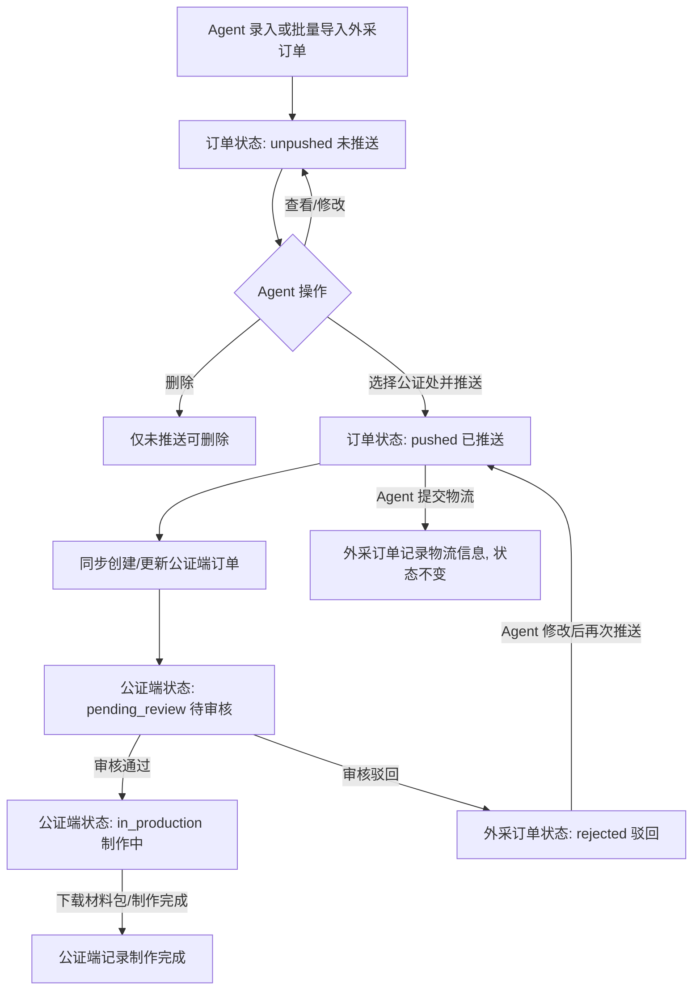

# 外采公证订单进 Agent 系统 PRD 稳定版

> **版本**: v1.2-requirements-aligned
> **最后更新**: 2026-07-17
> **维护人**: Codex
> **更新依据**: 外采订单管理与公证端材料下载需求拆解

---

## 更新日志

| 日期       | 版本                      | 变更内容                                                                                                                       | 维护人 |
| ---------- | ------------------------- | ------------------------------------------------------------------------------------------------------------------------------ | ------ |
| 2026-07-17 | v1.2-requirements-aligned | 补充代理商与驾照列表信息、录单必填项、附件要求、查看修改规则、模板导入导出、RED/石城公证处账号、公证端审核及材料包命名与内容。 | Codex  |
| 2026-07-14 | v1.1-code-aligned         | 按当前代码实现更新供应商范围、路由、字段、状态机、导入导出、公证端联动、物流提交和已知差异。                                   | Codex  |
| 2026-07-07 | v1.0-stable               | 基于《外采公证订单进Agent系统需求brd.docx》生成稳定版 PRD。                                                                    | Codex  |

---

## 1. 背景与范围

### 1.1 背景

在 Agent 系统“订单中心”新增“外采公证订单管理”，用于代理商/运营人员录入、批量导入、查询、修改和推送外采公证订单；公证处账号登录公证端后，对接收到的订单材料进行审核、驳回和材料包下载。

### 1.2 本期范围

| 范围                     | 说明                                                                                 |
| ------------------------ | ------------------------------------------------------------------------------------ |
| Agent 端外采公证订单管理 | 列表、筛选、状态页签、分页、录单、查看、编辑、推送、批量导入、批量导出。             |
| 推送对象                 | 支持将订单推送至配置的公证处；本期明确创建`RED`、`石城公证处`账号。              |
| 公证端承接               | 推送后按公证处账号隔离展示订单，由对应公证处审核材料。                               |
| 驳回同步                 | 公证端驳回后，外采订单状态同步为`rejected`，Agent 端可查看驳回原因并支持再次推送。 |
| 材料包下载               | 公证端审核通过后可下载 zip 材料包，材料包包含订单附件并按约定规则命名。              |

### 1.3 非目标

- 不改造原有普通公证订单管理入口。
- 不接入驾照官生产端独立制作流程；外采订单通过公证端订单能力承接。
- 当前不要求公证端回传公证书成品到外采订单。
- 导入模板是否支持附件需由模板方案明确；结构化字段必须按模板校验。

---

## 2. 信息架构与入口

### 2.1 菜单与路由

| 入口           | 配置                                             |
| -------------- | ------------------------------------------------ |
| 菜单分组       | 订单中心                                         |
| 菜单项         | 外采公证订单管理                                 |
| menu key       | `order-external-notary-order-management`       |
| labelKey       | `menu.externalNotaryOrderManagement`           |
| 列表路由       | `/order-management/external-notary-orders`     |
| 录单路由       | `/order-management/external-notary-orders/new` |
| 公证端订单列表 | `/notary/orders`                               |
| 公证端预览审核 | `/notary/orders/:id/preview`                   |

### 2.2 页面结构

Agent 端列表页面包含：

- 顶部面包屑：后台管理 / 外采公证订单管理
- 筛选区：产品、时间范围、搜索、重置
- 操作区：录入外采订单、批量导入、批量导出
- 状态页签：全部、未推送、已推送、驳回
- 表格：订单 ID、下单时间、产品、代理商、驾照信息、收货地址、状态、推送公证处、操作项
- 分页：统一分页组件

---

## 3. 角色与权限

| 角色              | 权限范围                                             | 当前实现口径                                           |
| ----------------- | ---------------------------------------------------- | ------------------------------------------------------ |
| Agent 运营/代理商 | 录单、导入、查看、编辑未推送或驳回订单、推送、导出   | 按账号记录订单所属代理商，代理商仅查看权限范围内订单。 |
| 公证处审核员      | 查看推送至本公证处的订单、审核通过、驳回、下载材料包 | 本期需创建`RED`、`石城公证处`账号。                |
| 系统              | 生成订单号、记录日志、同步公证端订单、同步驳回状态   | 当前为前端 localStorage/mock service 口径。            |

> 权限要求：生产环境必须在服务端按代理商和 `pushedNotaryOfficeId` 隔离订单，公证处账号只能查看推送至本公证处的数据。

---

## 4. 业务流程

### 4.1 主流程



### 4.2 状态机

| 状态值       | 展示文案 | 进入条件                       | 可执行动作                                 |
| ------------ | -------- | ------------------------------ | ------------------------------------------ |
| `unpushed` | 未推送   | 手工录单成功或批量导入成功     | 查看、修改、推送、删除、导出               |
| `pushed`   | 已推送   | Agent 选择公证处并确认推送     | 查看、提交物流、导出；不可修改核心订单信息 |
| `rejected` | 驳回     | 公证端审核驳回并同步到外采订单 | 查看、修改、再次推送、导出                 |

### 4.3 状态流转规则

| 流转                                | 触发方 | 规则                                                 |
| ----------------------------------- | ------ | ---------------------------------------------------- |
| 新建 ->`unpushed`                 | Agent  | 手工录单保存成功后生成订单。                         |
| 导入 ->`unpushed`                 | Agent  | 导入行必填字段完整时创建订单。                       |
| `unpushed/rejected` -> `pushed` | Agent  | 必须选择公证处，并校验结构化必填字段及必填附件完整。 |
| `pushed` -> `rejected`          | 公证端 | 驳回时填写原因，同步回外采订单。                     |
| `unpushed` -> 删除                | Agent  | 仅未推送订单可删除。                                 |
| `pushed` -> `pushed`            | Agent  | 提交物流信息只补充字段和日志，不改变状态。           |

---

## 5. 核心功能需求

### 5.1 Agent 端列表与筛选

**功能说明**

运营进入外采公证订单管理后，可按产品和下单日期范围筛选订单，并通过状态页签查看不同状态订单数量。

**筛选字段**

| 字段 | 控件                     | 规则                                                                          |
| ---- | ------------------------ | ----------------------------------------------------------------------------- |
| 产品 | Select                   | 来源于产品管理中`category === notary` 且 `status === active` 的产品标题。 |
| 时间 | DatePickerInput 起止日期 | 按`createdAt` 日期部分筛选，包含开始和结束日期。                            |
| 状态 | Tabs                     | 全部、未推送、已推送、驳回。                                                  |

**列表列定义**

| 列         | 字段来源                                                                | 展示规则                                                                 |
| ---------- | ----------------------------------------------------------------------- | ------------------------------------------------------------------------ |
| 订单 ID    | `orderId`                                                             | `A` + 6 位数字。                                                       |
| 下单时间   | `createdAt`                                                           | 录入订单提交成功的时间，格式`YYYY-MM-DD HH:mm:ss`。                    |
| 产品       | `productName`、`language`、`useCountry`、`serviceName`          | 展示产品类型、语言、使用国家和加急服务。                                 |
| 代理商     | `agentId`、`agentName`                                              | 展示订单所属代理商名称；手工录单默认取当前登录代理商/运营账号。          |
| 驾照信息   | `licenseNo`、`customerName`、`surnamePinyin`、`givenNamePinyin` | 展示驾驶证号码、姓名及姓名拼音。                                         |
| 收货地址   | `recipientName`、`recipientPhone`、`deliveryAddress`              | 收件人、手机号、收货地址三行展示。                                       |
| 状态       | `status`                                                              | 展示未推送、已推送、驳回。                                               |
| 推送公证处 | `pushedNotaryOfficeName`                                              | 未推送为空时展示`--`。                                                 |
| 操作项     | 派生                                                                    | 始终展示“查看订单”；未推送或驳回状态展示“推送”，推送成功后按钮消失。 |

**列表交互规则**

- 点击“查看订单”进入订单详情页。
- 点击“推送”时选择目标公证处并二次确认。
- 推送成功后订单状态更新为“已推送”，列表展示目标公证处，且“推送”按钮消失。
- 驳回订单修改并保存后，可再次执行推送。

### 5.2 手工录单

**入口**

点击“录入外采订单”进入 `/order-management/external-notary-orders/new`。

**表单分组**

| 分组     | 字段                                                    | 必填规则                                                              |
| -------- | ------------------------------------------------------- | --------------------------------------------------------------------- |
| 产品信息 | 产品类型、语言、使用国家、加急服务                      | 全部必填；加急服务枚举为“加急1工出”“加急3工出”。                  |
| 收货信息 | 收件人、联系电话、收货地址                              | 全部必填。原始需求中的“收件地址/收货地址”统一按“收货地址”落库。   |
| 驾照信息 | 驾驶证号码、姓名、姓氏拼音、名字拼音                    | 全部必填。                                                            |
| 备注     | 备注                                                    | 非必填。                                                              |
| 附件信息 | 驾照四页、身份证正反面、电子驾照截图、护照/港澳台通行证 | 前三类必填；护照/港澳台通行证仅港澳台及外籍人士必传，其他用户非必填。 |

**提交规则**

- 产品信息、收货信息、驾照信息中的字段均为必填。
- 驾照四页包含：驾照正面、驾照反面、驾照副页正面、驾照副页反面。
- 身份证正反面和电子驾照截图必填。
- 用户身份为港澳台或外籍人士时，护照/港澳台通行证调整为必填。
- 必填附件缺失时阻止提交，并提示 `请上传{附件标题}`。
- 附件仅接受 `image/*`。
- 保存成功后生成外采订单，状态为 `unpushed`。
- `agentName` 固定为 `手工录单`。
- 初始日志记录 `外采订单创建`。

### 5.3 查看与编辑订单

**查看**

所有状态订单均可查看详情，详情包含：

- 产品信息：产品类型、语言、使用国家、加急服务。
- 收货信息：收件人、联系电话、收货地址。
- 驾照信息：驾驶证号码、姓名、姓氏拼音、名字拼音。
- 备注。
- 附件信息：驾照四页、身份证正反面、电子驾照截图、护照/港澳台通行证。
- 驳回信息：仅驳回状态展示，至少包含驳回原因、驳回公证处、驳回时间。
- 推送信息与操作日志。

**编辑**

| 状态         | 是否可编辑 | 说明                       |
| ------------ | ---------- | -------------------------- |
| `unpushed` | 是         | 可修改核心订单信息和附件。 |
| `rejected` | 是         | 可修改后再次推送。         |
| `pushed`   | 否         | 核心订单信息只读。         |

未推送、驳回状态进入编辑时，应复用录单页全部必填校验；驳回订单保存修改后仍保持“驳回”状态，直至再次推送成功。

### 5.4 推送公证处

**可选公证处**

- 来源于公证处账号/组织配置中的启用数据。
- 本期至少配置 `RED`、`石城公证处`两个公证端账号及对应公证处信息。

**推送规则**

- 仅 `unpushed`、`rejected` 状态展示推送动作。
- 必须选择公证处，否则提示 `请选择公证处`。
- 推送前必须校验订单结构化必填字段和必填附件完整。
- 推送成功后：
  - 外采订单 `status` 更新为 `pushed`。
  - `pushedNotaryOfficeName` 更新为所选公证处。
  - `reviewRemark` 更新为 `资料已审核，推送至{公证处}`。
  - `rejectReason` 清空。
  - 新增日志 `订单推送至{公证处}`。
  - 同步创建或更新公证端订单。
  - 列表中的“推送”按钮消失。

### 5.5 批量导入

**入口**

点击“批量导入”打开弹窗，支持上传 `.xlsx`、`.csv`。

**模板字段**

| 字段       | 可识别表头                                | 是否必填                                                   |
| ---------- | ----------------------------------------- | ---------------------------------------------------------- |
| 代理商     | 代理商、agentName                         | 是；运营代录时填写所属代理商，代理商自行导入时取当前账号。 |
| 产品类型   | 产品类型、产品、productName               | 是                                                         |
| 加急服务   | 加急服务、服务选择、服务内容、serviceName | 是                                                         |
| 使用国家   | 使用国家、国家、useCountry                | 是                                                         |
| 语言       | 语言、language                            | 是                                                         |
| 驾驶证号码 | 驾驶证号码、licenseNo                     | 是                                                         |
| 姓名       | 姓名、客户姓名、customerName              | 是                                                         |
| 姓氏拼音   | 姓氏拼音、surnamePinyin                   | 是                                                         |
| 名字拼音   | 名字拼音、givenNamePinyin                 | 是                                                         |
| 收件人姓名 | 收件人姓名、recipientName                 | 是                                                         |
| 电话号码   | 电话号码、手机号、recipientPhone          | 是                                                         |
| 收货地址   | 收货地址、deliveryAddress                 | 是                                                         |
| 备注       | 备注、remark                              | 否                                                         |

**导入规则**

- 读取第一个 worksheet 或 CSV 第一行作为表头。
- 空行忽略。
- 任一必填字段缺失时，该行不导入。
- 导入前提供标准模板下载，导入文件字段顺序和枚举值应与模板一致。
- 导入完成后反馈成功条数、失败条数及失败行原因。
- 成功导入的订单状态为 `unpushed`。
- `agentName` 记录订单所属代理商，不得固定写为“批量导入”；导入方式通过独立来源字段或操作日志记录。
- 当前不做重复订单校验。
- 附件导入方式需在模板中明确；若模板仅支持结构化字段，导入后必须补齐必填附件才可推送。

### 5.6 批量导出

**交互规则**

- 点击“批量导出”后进入选择模式。
- 用户可勾选当前页订单，也可跨页逐个勾选。
- 点击“确认导出”导出已勾选订单。
- 未选择订单时提示 `请选择要导出的订单`。

**导出内容**

导出基于 `src/public/templates/external-notary-order-export-template.xlsx`，包含：

- 订单号、下单时间、产品类型、服务内容、使用国家、语言
- 代理商
- 驾驶证号码、姓名、姓氏拼音、名字拼音
- 收件人姓名、电话、收货地址
- 状态、推送公证处、驳回原因、备注
- 附件图片列：驾驶证正反面、副页正反面、身份证正反面、电子驾照、护照/港澳台通行证

### 5.7 现有扩展能力：物流信息

> 本节为当前系统已有扩展能力，不属于本次需求拆解的核心验收范围。

**展示与提交**

已推送订单详情中展示物流信息区。如果订单状态为 `pushed` 且尚未提交物流，可选择物流公司并填写物流单号。

**物流公司枚举**

- 顺丰速运
- 京东物流
- 邮政EMS
- 圆通速递
- 中通快递
- 申通快递

**规则**

- 物流公司和物流单号均必填。
- 提交后写入 `logisticsCompany`、`trackingNumber`。
- 新增日志 `提交物流信息：{物流公司} {物流单号}`。
- 外采订单状态保持 `pushed`。
- 当前不同步到公证端订单或普通公证订单管理。

---

## 6. 公证端联动

### 6.1 账号与数据权限

| 项目       | 要求                                         |
| ---------- | -------------------------------------------- |
| 公证端账号 | 创建`RED`、`石城公证处`账号。            |
| 登录入口   | 账号登录公证端后进入外采订单审核列表。       |
| 数据范围   | 仅展示推送至当前账号所属公证处的订单。       |
| 权限       | 查看订单与附件、审核通过、驳回、下载材料包。 |
| 审计       | 记录审核账号、审核时间、审核结果和驳回原因。 |

### 6.2 推送后的公证端订单

Agent 推送外采订单时调用 `pushExternalNotaryOrderToOffice`，同步创建或更新公证端订单。

**关键字段映射**

| 外采订单字段        | 公证端订单字段                                                                                                |
| ------------------- | ------------------------------------------------------------------------------------------------------------- |
| `orderId`         | `orderId`                                                                                                   |
| `recipientName      |                                                                                                               |
| `recipientPhone`  | `customerPhone`                                                                                             |
| `licenseNo          |                                                                                                               |
| `orderId`         | `customerEmail = external-notary-order-{lowercase orderId}@meika.local`                                     |
| `productName`     | `productName`                                                                                               |
| 固定值              | `productCategory = notary`                                                                                  |
| `serviceName`     | `processType`                                                                                               |
| 固定值              | `pushTimeliness = same_day`                                                                                 |
| 固定值              | `channel = offline`                                                                                         |
| 固定值              | `agentLevel = self`                                                                                         |
| 固定值              | `lockedPrice = 299`                                                                                         |
| 固定值              | `status = pending_review`                                                                                   |
| `deliveryAddress` | `deliveryAddress`                                                                                           |
| 所选公证处          | `pushedNotaryOfficeId/Name`、`auditSelectedNotaryOfficeId/Name`、`productionDisplayNotaryOfficeId/Name` |
| `licenseName        |                                                                                                               |
| `licenseNo`       | `licenseNo`                                                                                                 |
| `language`        | `language`                                                                                                  |
| `useCountry`      | `useCountry`                                                                                                |
| `surnamePinyin`   | `idpSurnameEn`                                                                                              |
| `givenNamePinyin` | `idpGivenNameEn`                                                                                            |
| `attachments`     | `notarySubmissionImages`                                                                                    |

**附件 key 映射**

| 外采附件 key              | 公证端图片 key      |
| ------------------------- | ------------------- |
| `licenseFrontFile`      | `license-front`   |
| `licenseBackFile`       | `license-back`    |
| `licenseExtraFrontFile` | `extra-front`     |
| `licenseExtraBackFile`  | `extra-back`      |
| `identityFrontFile`     | `identity-front`  |
| `identityBackFile`      | `identity-back`   |
| `digitalLicenseFile`    | `digital-license` |
| `passportFile`          | `passport-front`  |

### 6.3 公证端审核

公证端 `/notary/orders/:id/preview` 对外采来源订单展示外采订单字段和附件。

| 操作     | 结果                                                                                   |
| -------- | -------------------------------------------------------------------------------------- |
| 审核通过 | 材料审核通过，订单允许下载材料包；记录审核人和审核时间。                               |
| 驳回订单 | 驳回原因必填；外采订单同步为`rejected`，Agent 端展示驳回公证处、驳回原因和驳回时间。 |

### 6.4 材料包下载

对审核通过的外采来源订单，公证端可下载 zip 材料包。未审核或已驳回订单不可下载。

**zip 命名**

```text
{姓名}{姓名拼音}-{使用国家}-{语言}-{产品名称}-{服务类型}.zip
```

示例：

```text
谢振Xie Zhen-法国-法语-单号-公证海牙-加急服务.zip
```

**zip 内容**

1. 驾照正面照片。
2. 驾照反面图片。
3. 驾照副页正面图片。
4. 驾照副页反面图片。
5. 身份证正面。
6. 身份证反面。
7. 电子驾照截图。
8. 护照/港澳台通行证（订单已上传时包含）。

**下载规则**

- 必填材料缺失时阻止生成，并明确提示缺失的附件类型。
- 压缩包内文件按上述固定顺序和业务名称命名，保留原文件扩展名。
- 文件名中的 `/`、`\\`、`:`、`*`、`?`、`"`、`<`、`>`、`|` 等非法字符替换为安全字符。
- 同一订单重复下载应生成内容一致的材料包，并记录下载账号和下载时间。

---

## 7. 数据模型

### 7.1 ExternalNotaryOrder

| 字段                       | 类型   | 是否必填 | 说明                                                                                   |
| -------------------------- | ------ | -------- | -------------------------------------------------------------------------------------- |
| `orderId`                | string | 是       | 系统生成，格式`A` + 6 位数字，例如 `A260001`。                                     |
| `createdAt`              | string | 是       | 创建时间。                                                                             |
| `updatedAt`              | string | 是       | 更新时间。                                                                             |
| `productName`            | string | 是       | 产品类型。                                                                             |
| `serviceName`            | string | 是       | 服务选择；新建/编辑 UI 当前提供`加急1工出`、`加急3工出`。历史/导入数据可保留原值。 |
| `useCountry`             | string | 是       | 使用国家。                                                                             |
| `language`               | string | 是       | 语言。                                                                                 |
| `customerName`           | string | 是       | 姓名。                                                                                 |
| `agentId`                | string | 是       | 订单所属代理商 ID。                                                                    |
| `agentName`              | string | 是       | 订单所属代理商名称。                                                                   |
| `createSource`           | enum   | 是       | `manual` 手工录单或 `import` 批量导入。                                            |
| `licenseName`            | string | 是       | 驾照姓名，当前等于姓名。                                                               |
| `licenseNo`              | string | 是       | 驾驶证号码。                                                                           |
| `surnamePinyin`          | string | 是       | 姓氏拼音。                                                                             |
| `givenNamePinyin`        | string | 是       | 名字拼音。                                                                             |
| `remark`                 | string | 否       | 备注。                                                                                 |
| `recipientName`          | string | 是       | 收件人姓名。                                                                           |
| `recipientPhone`         | string | 是       | 电话号码。                                                                             |
| `deliveryAddress`        | string | 是       | 收货地址。                                                                             |
| `logisticsCompany`       | string | 否       | 物流公司。                                                                             |
| `trackingNumber`         | string | 否       | 物流单号。                                                                             |
| `status`                 | enum   | 是       | `unpushed`、`pushed`、`rejected`。                                               |
| `pushedNotaryOfficeName` | string | 否       | 已推送公证处名称。                                                                     |
| `reviewRemark`           | string | 否       | 推送说明或驳回原因。                                                                   |
| `rejectReason`           | string | 否       | 公证端驳回原因。                                                                       |
| `rejectedAt`             | string | 否       | 公证端驳回时间。                                                                       |
| `rejectedBy`             | string | 否       | 执行驳回的公证端账号。                                                                 |
| `logs`                   | array  | 是       | 操作日志。                                                                             |
| `attachments`            | array  | 是       | 附件列表。                                                                             |

### 7.2 ExternalNotaryOrderAttachment

| 字段      | 类型   | 说明                          |
| --------- | ------ | ----------------------------- |
| `key`   | string | 附件类型 key。                |
| `title` | string | 附件展示名称。                |
| `name`  | string | 原始文件名。                  |
| `src`   | string | 本地图片存储引用或 data URL。 |

### 7.3 附件类型

| key                       | 展示名称           | 手工录单是否必填               |
| ------------------------- | ------------------ | ------------------------------ |
| `licenseFrontFile`      | 驾驶证正面图片     | 是                             |
| `licenseBackFile`       | 驾驶证反面图片     | 是                             |
| `licenseExtraFrontFile` | 驾驶证副页正面图片 | 是                             |
| `licenseExtraBackFile`  | 驾驶证副页反面图片 | 是                             |
| `identityFrontFile`     | 身份证正面         | 是                             |
| `identityBackFile`      | 身份证反面         | 是                             |
| `digitalLicenseFile`    | 电子驾照           | 是                             |
| `passportFile`          | 护照/港澳台通行证  | 条件必填：港澳台及外籍人士必填 |

---

## 8. 业务规则

| 编号   | 规则           | 说明                                                                                |
| ------ | -------------- | ----------------------------------------------------------------------------------- |
| BR-001 | 订单号生成     | 新订单使用`A` + 6 位随机数字，并避开已有订单号。                                  |
| BR-002 | 初始状态       | 手工录单和批量导入成功后状态均为`unpushed`。                                      |
| BR-003 | 产品来源       | 产品筛选和录单产品来自启用的公证类产品；录单页在无产品时提供公证产品兜底选项。      |
| BR-004 | 服务选择       | 新建/编辑 UI 当前只提供`加急1工出`、`加急3工出`。                               |
| BR-005 | 录单附件校验   | 驾照四页、身份证正反面、电子驾照截图必填；港澳台及外籍人士的护照/港澳台通行证必填。 |
| BR-006 | 导入附件补齐   | 导入模板不包含附件时，订单保持未推送，补齐必填附件后方可推送。                      |
| BR-007 | 推送公证处     | 公证处来源于启用配置，本期至少配置`RED`、`石城公证处`账号。                     |
| BR-008 | 推送准入       | 必须选择公证处，并校验结构化必填字段及必填附件完整。                                |
| BR-009 | 推送后锁定     | 已推送订单不可编辑核心订单信息。                                                    |
| BR-010 | 驳回再推送     | 驳回订单可编辑并再次推送；当前驳回信息转存历史记录，本次展示字段可清空。            |
| BR-011 | 删除限制       | 仅未推送订单可删除。                                                                |
| BR-012 | 推送按钮       | 推送成功后列表“推送”按钮消失；驳回后重新展示。                                    |
| BR-013 | 公证端来源识别 | 通过`customerEmail` 或日志中的来源订单号识别外采来源订单。                        |
| BR-014 | 驳回同步       | 公证端驳回会同步外采订单为`rejected`。                                            |
| BR-015 | 材料包下载     | 仅审核通过的订单可下载；文件名和附件内容按本 PRD 约定生成。                         |

---

## 9. 验收标准

### 9.1 Agent 录单

```gherkin
Given 运营进入外采公证订单录单页
When 完整填写产品信息、收货信息、驾照信息并上传必填附件后提交
Then 系统生成 A 加 6 位数字的订单号
And 订单状态为 unpushed
And 返回外采公证订单管理列表
```

### 9.2 必填校验

```gherkin
Given 运营正在录入外采订单
When 产品信息、收货信息、驾照信息任一必填字段为空
Then 系统阻止提交
And 显示请完整填写产品信息、驾照信息和收货信息
```

```gherkin
Given 用户身份为港澳台或外籍人士
When 未上传护照或港澳台通行证
Then 系统阻止保存或推送
And 提示上传护照/港澳台通行证
```

### 9.3 推送公证处

```gherkin
Given 外采订单状态为 unpushed 或 rejected
When 运营选择已启用的目标公证处并确认推送
Then 外采订单状态更新为 pushed
And 外采订单记录推送公证处和推送日志
And 公证端生成待审核订单
And Agent 列表中的推送按钮消失
```

### 9.4 公证端驳回

```gherkin
Given 公证端正在审核外采来源订单
When 审核员填写驳回原因并确认驳回
Then 外采订单状态同步为 rejected
And Agent 端订单详情展示驳回公证处、驳回原因和驳回时间
And 订单可修改后再次推送
```

### 9.5 批量导入

```gherkin
Given 运营上传符合模板的 xlsx 或 csv
When 某一行必填字段完整
Then 系统创建一条 unpushed 外采订单
And agentName 为模板填写或当前账号对应的代理商
And createSource 为 import
```

### 9.6 批量导出

```gherkin
Given 运营点击批量导出进入选择模式
When 勾选订单并点击确认导出
Then 系统生成外采公证订单 xlsx
And 导出文件包含订单字段和可解析的附件图片
```

### 9.7 材料包下载

```gherkin
Given 公证端订单来自外采订单
When 审核通过后点击下载材料包
Then 系统生成 zip 文件
And zip 文件名符合 {姓名}{姓名拼音}-{使用国家}-{语言}-{产品名称}-{服务类型}.zip
And zip 内按约定包含驾照四页、身份证正反面、电子驾照截图及已上传的护照/港澳台通行证
```

### 9.8 公证端账号隔离

```gherkin
Given RED 或石城公证处账号登录公证端
When 进入外采订单审核列表
Then 仅展示推送至当前账号所属公证处的订单
And 不可查看或下载其他公证处的订单材料
```

---

## 10. 已知差异与风险

| 风险/差异                    | 当前表现                                                | 建议                                                          |
| ---------------------------- | ------------------------------------------------------- | ------------------------------------------------------------- |
| 推送附件校验未实现           | 当前实现可能允许无附件订单推送，与本版需求不一致。      | 推送接口和前端均增加结构化字段、必填附件及条件必填附件校验。  |
| 导入无重复校验               | 相同客户或驾照号可重复导入。                            | 增加`licenseNo + productName + useCountry` 等组合重复提醒。 |
| 服务字段未完全枚举化         | UI 枚举为两个加急选项，但历史 mock 数据存在`normal`。 | 统一产品流程类型或服务类型字典。                              |
| 公证端审核通过不回写外采状态 | 外采订单保持`pushed`，无法区分已审核/制作中/完成。    | 如 Agent 端需要追踪履约进度，新增外采状态或阶段字段。         |
| 物流不联动公证端             | 外采详情提交物流只写外采订单自身。                      | 需要端到端履约闭环时，同步到公证端/普通公证订单。             |
| 权限隔离未服务端化           | 当前为前端 mock/localStorage。                          | 生产实现必须后端鉴权并按公证处隔离数据。                      |
| 数据持久化为 localStorage    | 刷新可保留，但不具备多用户一致性。                      | 替换为真实 API 和数据库存储。                                 |
| 公证处账号待配置             | `RED`、`石城公证处`账号及组织映射尚需环境配置。     | 上线前完成账号创建、初始密码交付、角色授权和数据隔离验证。    |
| 收货字段原始表述重复         | 原始需求同时出现“收件地址”和“收货地址”。            | 本版统一为“收件人、联系电话、收货地址”，需业务最终确认。    |

---

## 11. 参考文件

- [外采公证订单进Agent系统需求brd.docx](./外采公证订单进Agent系统需求brd.docx)
- [ExternalNotaryOrderManagement.tsx](../../src/modules/order-management/ExternalNotaryOrderManagement.tsx)
- [ExternalNotaryOrderCreate.tsx](../../src/modules/order-management/ExternalNotaryOrderCreate.tsx)
- [externalNotaryOrderService.ts](../../src/services/externalNotaryOrderService.ts)
- [notaryOfficeOrderService.ts](../../src/services/notaryOfficeOrderService.ts)
- [NotaryOrderList.tsx](../../src/modules/notary-office/NotaryOrderList.tsx)
- [NotaryOrderPreview.tsx](../../src/modules/notary-office/NotaryOrderPreview.tsx)
