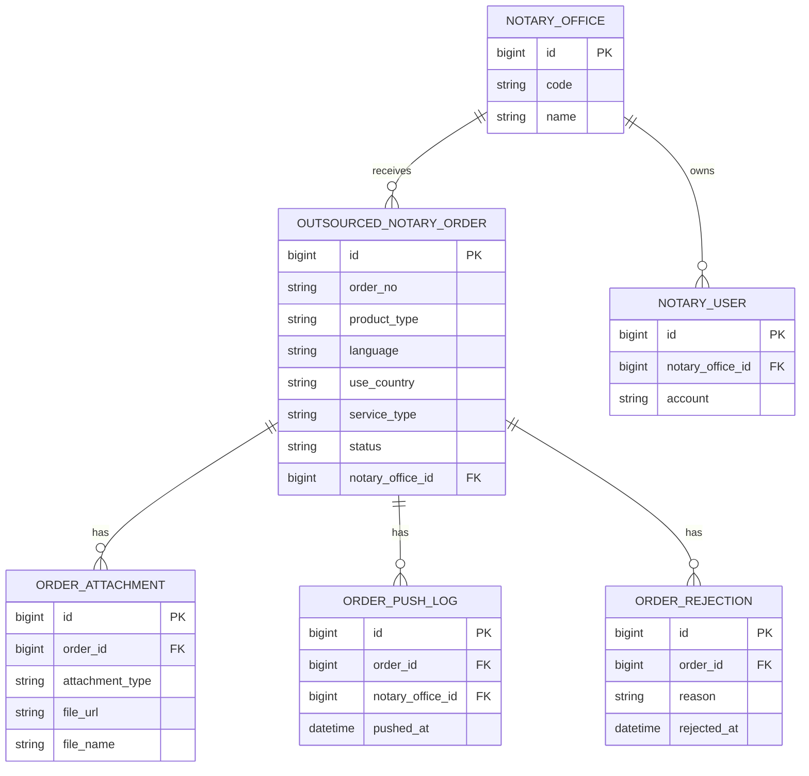
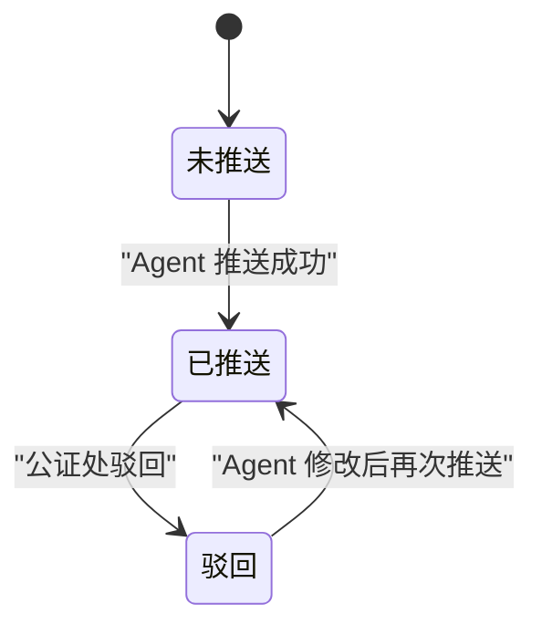
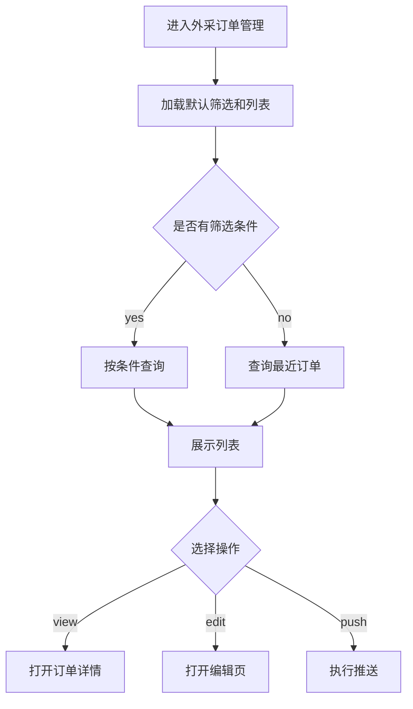
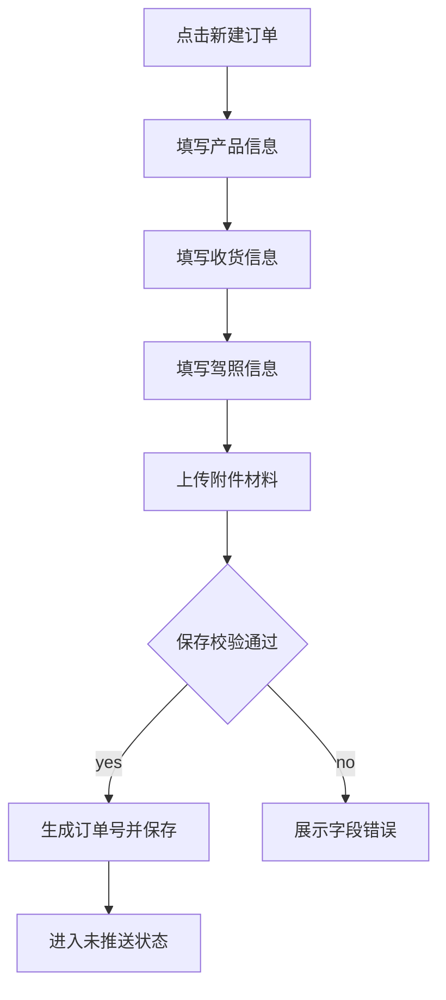
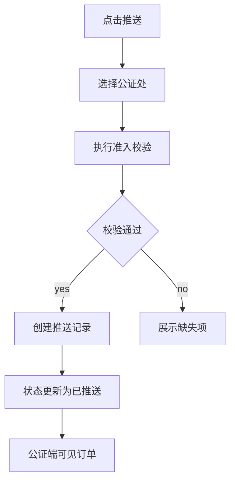
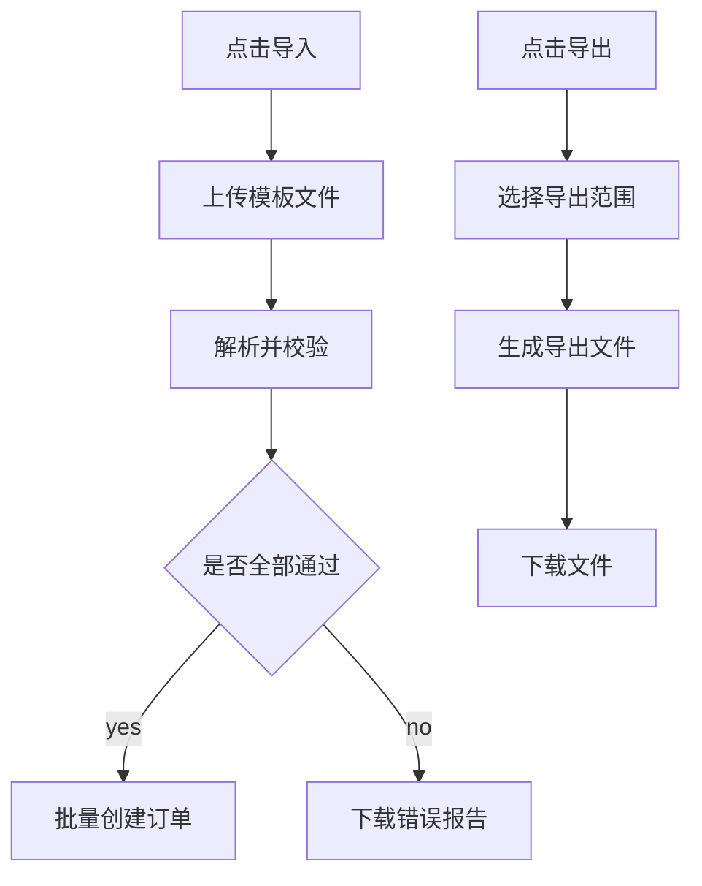
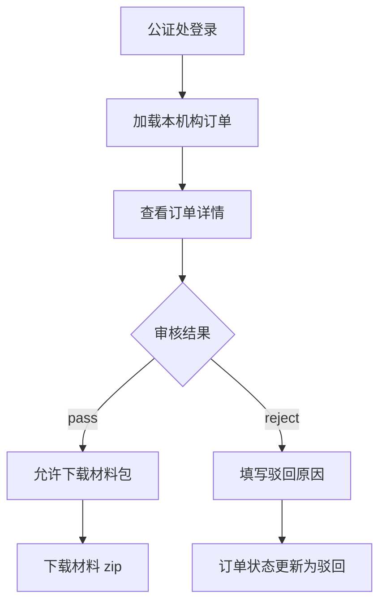

# 外采公证订单_PRD

> **版本**: v1.0-stable
> **最后更新**: 2026-07-07
> **作者**: Codex

---

## 更新日志

- **v1.0-stable (2026-07-07)**: 基于《外采公证订单进Agent系统需求brd.docx》生成稳定版 PRD，补齐业务规则、字段口径、状态机、验收标准、Tracking Events 与 i18n 资源规范。

---

## 1. 背景与目标

### 1.1 业务背景dev

当前公证订单已在 Agent 系统审核通过后接入驾照官系统，并在驾照官系统完成翻译、制作等流程。外采公证订单需要进入 Agent 系统统一录单、管理、推送和材料导出，但本期不接入驾照官系统制作流程。

本期面向 RED、石城公证处两个合作供应商，建设 Agent 端外采公证订单管理能力，并提供公证端账号用于审核材料和下载材料包。

### 1.2 问题陈述

外采订单当前缺少统一的订单管理、材料归集和供应商协作入口，导致录单信息、附件材料、推送状态、驳回信息和材料下载链路分散，无法形成可追踪的订单闭环。

---

## 2. 现状洞察（AS-IS）

| 痛点                                    | 描述                                                                               |
| --------------------------------------- | ---------------------------------------------------------------------------------- |
| **外采订单未进入 Agent 统一管理** | 外采订单无法在订单中心按统一字段查询、查看、修改和追踪状态。                       |
| **材料包依赖人工整理**            | 驾照、身份证、电子驾照、护照或通行证等材料需要人工汇总，存在遗漏和命名不一致风险。 |
| **供应商协作状态不透明**          | 推送至 RED 或石城后，Agent 端需要知道是否已推送、是否被驳回以及驳回原因。          |
| **本期制作链路边界不同**          | 外采订单不进入驾照官系统制作，需明确与现有公证订单链路隔离。                       |

---

## 3. 目标（TO-BE）与非目标

### 3.1 目标

| # | 目标                               | 描述                                                                                        |
| - | ---------------------------------- | ------------------------------------------------------------------------------------------- |
| 1 | **建立外采公证订单管理入口** | 在 Agent 系统订单中心新增“外采公证订单管理”，支持列表查询、查看、录入、编辑、推送和导出。 |
| 2 | **支持指定供应商推送**       | 订单可推送至 RED 或石城公证处，推送后 Agent 端状态同步为已推送。                            |
| 3 | **形成材料包下载闭环**       | 公证端可审核推送订单，并下载按规范命名的材料压缩包。                                        |
| 4 | **支持驳回与修改**           | 公证处驳回后，Agent 端展示驳回信息，并允许修改后再次推送。                                  |
| 5 | **支持批量导入导出**         | Agent 端按模板批量导入订单，按筛选结果或勾选结果批量导出订单数据。                          |

### 3.2 非目标（本期不做）

- **不接入驾照官制作流程**: 外采订单只在 Agent 与公证端完成录单、推送、审核和材料下载。
- **不实现公证书制作与回传**: 本期只要求供应商下载材料包，不要求回传公证书、翻译件或制作结果。
- **不改造原有公证订单流程**: 原有接入驾照官系统的公证订单保持不变。

### 3.3 User Stories

#### US-1: Agent 录入外采公证订单

> **作为** Agent 订单操作人员
> **我希望** 在订单中心录入外采公证订单及附件
> **以便于** 将订单和材料统一推送给指定公证处

**验收标准**:

- 可录入产品信息、收货信息、驾照信息、附件信息和备注。
- 必填字段缺失时阻断保存并展示字段级错误。
- 保存成功后生成订单号，初始状态为未推送。

#### US-2: Agent 推送订单至公证处

> **作为** Agent 订单操作人员
> **我希望** 选择 RED 或石城公证处并推送订单
> **以便于** 公证处登录后审核并下载材料

**验收标准**:

- 未推送或驳回状态订单可执行推送。
- 推送成功后状态变为已推送，推送按钮隐藏。
- 已推送订单不可修改核心录单信息。

#### US-3: 公证处审核并下载材料包

> **作为** RED 或石城公证处操作人员
> **我希望** 查看分配给本机构的订单并下载材料包
> **以便于** 线下完成外采公证处理

**验收标准**:

- 公证处账号只能看到推送至本机构的订单。
- 可查看订单详情、审核通过并下载材料 zip。
- 可驳回订单并填写驳回原因，Agent 端可见。

#### US-4: Agent 批量导入导出外采订单

> **作为** Agent 订单操作人员
> **我希望** 按模板批量导入和导出外采订单
> **以便于** 批量处理外采订单数据

**验收标准**:

- 支持下载导入模板。
- 导入时校验必填字段、枚举值、附件引用和重复订单。
- 支持导出当前筛选结果或当前勾选订单。

---

## 4. 术语表（Terminology）

| 术语                        | 英文                    | 定义                                                                 |
| --------------------------- | ----------------------- | -------------------------------------------------------------------- |
| 外采公证订单                | Outsourced Notary Order | 不接入驾照官系统制作，由外部公证处处理的公证订单。                   |
| Agent 系统                  | Agent System            | 内部订单录入、管理和推送系统。                                       |
| 公证端                      | Notary Portal           | 供 RED、石城公证处登录查看、审核和下载材料的系统端。                 |
| 推送公证处                  | Target Notary Office    | 订单指定推送的合作供应商，本期包含 RED、石城公证处。                 |
| 材料包                      | Material Package        | 按订单信息和附件生成的 zip 文件，用于公证处下载。                    |
| 准入校验（Admission Guard） | Admission Guard         | 动作执行前的前置校验条件，例如推送前校验订单必填字段和附件是否完整。 |

---

## 5. 角色与权限

| 角色               | 权限范围                                       | 说明                                     |
| ------------------ | ---------------------------------------------- | ---------------------------------------- |
| Agent 订单操作人员 | 新建、编辑、查看、推送、导入、导出外采订单     | 未推送、驳回状态可编辑；已推送状态只读。 |
| Agent 管理员       | Agent 订单操作人员全部权限，外加供应商账号管理 | 可创建 RED、石城公证处账号。             |
| RED 公证处账号     | 查看、审核、驳回、下载推送至 RED 的订单        | 不可查看石城订单。                       |
| 石城公证处账号     | 查看、审核、驳回、下载推送至石城的订单         | 不可查看 RED 订单。                      |

**权限规则**:

- 公证端账号必须按 `notaryOfficeId` 做数据隔离。
- Agent 端可查看全部外采公证订单。
- 已推送订单不可编辑产品信息、收货信息、驾照信息和附件信息。
- 驳回订单可编辑并再次推送，再次推送需保留历史驳回记录。
- 下载材料包需记录操作日志。

---

## 6. 数据模型（业务/交互视角）

### 6.1 实体关系图（ER Diagram）



### 6.2 Logical View（逻辑视图，UI 设计基准）

> [!IMPORTANT]
> **AI 执行约束**
>
> 1. 本章仅定义业务语义与页面交互模型，不直接等同于底层存储结构。
> 2. 前端页面与组件必须基于 `Logical View` 设计。
> 3. 涉及聚合、计算、映射字段时，必须明确字段来源与转换规则。
> 4. 底层存储结构如需补充，请写入附录 `13.2 技术附录：Storage Schema`。

```typescript
interface OutsourcedNotaryOrderListView {
  filters: {
    orderNo?: string; // Stored: outsourced_notary_order.order_no
    createdAtRange?: [string, string]; // Stored: outsourced_notary_order.created_at
    productType?: string; // Stored
    agentName?: string; // Stored or joined from agent profile
    notaryOfficeCode?: 'red' | 'shicheng'; // Mapped from notary_office.code
    status?: 'unpush' | 'pushed' | 'rejected'; // Stored
  };
  rows: OutsourcedNotaryOrderRow[];
  selection: {
    selectedIds: string[];
    canBatchExport: boolean; // Derived: selectedIds.length > 0 or filter result exists
  };
  pagination: {
    page: number;
    pageSize: 20 | 50 | 100;
    total: number;
  };
}

interface OutsourcedNotaryOrderRow {
  id: string; // Stored
  orderNo: string; // Stored, generated as A + 6 digits
  createdAt: string; // Stored
  productSummary: string; // Derived: productType + language + useCountry + serviceType
  agentName: string; // Stored or joined
  licenseSummary: string; // Derived: driverName + licenseNo
  receiverSummary: string; // Derived: receiverName + receiverPhone + address
  status: 'unpush' | 'pushed' | 'rejected'; // Stored
  statusLabel: string; // Mapped from status
  notaryOfficeName?: string; // Mapped from notary_office.name
  canView: boolean; // Derived from role permission
  canEdit: boolean; // Derived: status in ['unpush', 'rejected'] and Agent role
  canPush: boolean; // Derived: status in ['unpush', 'rejected'] and required fields complete
}

interface OutsourcedNotaryOrderDetailView {
  productInfo: {
    productType: string; // Stored
    language: string; // Stored
    useCountry: string; // Stored
    serviceType: 'standard' | 'urgent_1_workday' | 'urgent_3_workdays'; // Stored
  };
  receiverInfo: {
    address: string; // Stored
    receiverName: string; // Stored
    receiverPhone: string; // Stored
  };
  driverInfo: {
    licenseNo: string; // Stored
    nameCn: string; // Stored
    lastNamePinyin: string; // Stored
    firstNamePinyin: string; // Stored
    fullNamePinyin: string; // Derived: lastNamePinyin + firstNamePinyin
  };
  attachments: MaterialAttachmentView[];
  rejection?: {
    reason: string; // Stored
    rejectedAt: string; // Stored
    rejectedBy: string; // Stored
  };
  materialPackage: {
    fileName: string; // Derived by naming rule
    downloadUrl?: string; // Derived after package generation
  };
}

interface MaterialAttachmentView {
  type:
    | 'driver_license_front'
    | 'driver_license_back'
    | 'driver_license_copy_front'
    | 'driver_license_copy_back'
    | 'id_card_front'
    | 'id_card_back'
    | 'electronic_license'
    | 'passport_or_pass';
  required: boolean; // Mapped by attachment type and applicant identity
  fileName?: string; // Stored
  fileUrl?: string; // Stored
}
```

---

## 7. 业务规则与验证

### 7.1 核心业务规则

| 规则编号 | 规则名称     | 规则描述                                                                                                 |
| -------- | ------------ | -------------------------------------------------------------------------------------------------------- |
| BR-001   | 订单号生成   | 录入订单保存成功后生成订单号，格式为`A` + 6 位数字，例如 `A000001`。订单号全局唯一。                 |
| BR-002   | 供应商范围   | 本期推送公证处仅支持`RED`、`石城公证处`。                                                            |
| BR-003   | 初始状态     | 订单保存成功后的初始状态为未推送。                                                                       |
| BR-004   | 推送准入校验 | 推送前必须完成全部必填字段和必填附件校验。                                                               |
| BR-005   | 推送后锁定   | 订单推送成功后状态为已推送，Agent 端隐藏推送按钮，并锁定核心订单信息。                                   |
| BR-006   | 驳回后可修改 | 公证处驳回后，订单状态为驳回，Agent 端展示驳回原因，并允许修改后再次推送。                               |
| BR-007   | 公证端隔离   | 公证端账号只能查看推送给所属公证处的订单。                                                               |
| BR-008   | 材料包命名   | 材料包命名格式为`姓名 姓名拼音-使用国家-语言-单号-产品名称-服务类型.zip`。                             |
| BR-009   | 附件材料范围 | 材料包包含驾照四页、身份证正反面、电子驾照截图；港澳台外籍人士可额外上传护照或港澳台通行证。             |
| BR-010   | 原流程隔离   | 外采公证订单不进入驾照官系统制作流程。                                                                   |
| BR-011   | 加急服务选项 | 服务类型支持标准服务、加急1工出、加急3工出；选择加急时必须明确具体加急选项，不允许仅保存为“加急服务”。 |

### 7.2 数据验证规则

| 字段（含变更标识）        | 验证规则                                   | 错误提示               |
| ------------------------- | ------------------------------------------ | ---------------------- |
| [ADD] orderNo             | 系统生成，格式`^A\\d{6}$`，唯一          | 订单号生成失败，请重试 |
| [ADD] productType         | 必填，必须来自产品类型枚举                 | 请选择产品类型         |
| [ADD] language            | 必填，长度 1 到 50                         | 请输入语言             |
| [ADD] useCountry          | 必填，长度 1 到 80                         | 请输入使用国家         |
| [ADD] serviceType         | 必填，枚举为标准服务、加急1工出、加急3工出 | 请选择服务类型         |
| [ADD] receiverName        | 必填，长度 1 到 50                         | 请输入收件人姓名       |
| [ADD] receiverPhone       | 必填，手机号或国际电话格式                 | 请输入正确的收件人电话 |
| [ADD] receiverAddress     | 必填，长度 5 到 300                        | 请输入完整收件地址     |
| [ADD] licenseNo           | 必填，长度 3 到 50                         | 请输入驾驶证号码       |
| [ADD] nameCn              | 必填，长度 1 到 50                         | 请输入姓名             |
| [ADD] lastNamePinyin      | 必填，仅允许英文字母、空格、连字符         | 请输入姓氏拼音         |
| [ADD] firstNamePinyin     | 必填，仅允许英文字母、空格、连字符         | 请输入名字拼音         |
| [ADD] requiredAttachments | 推送前必须上传全部必填附件                 | 请上传完整材料后再推送 |
| [ADD] notaryOfficeCode    | 推送时必填，枚举为 RED、石城公证处         | 请选择推送公证处       |
| [ADD] rejectReason        | 驳回时必填，长度 1 到 500                  | 请填写驳回原因         |

### 7.3 状态机



**状态转换规则**:

| 当前状态 | 目标状态 | 触发条件                           | 操作权限                         |
| -------- | -------- | ---------------------------------- | -------------------------------- |
| 未推送   | 已推送   | Agent 选择公证处并通过推送准入校验 | Agent 订单操作人员、Agent 管理员 |
| 已推送   | 驳回     | 公证处审核不通过并填写驳回原因     | RED 公证处账号、石城公证处账号   |
| 驳回     | 已推送   | Agent 修改信息后再次推送并通过校验 | Agent 订单操作人员、Agent 管理员 |

---

## 8. 功能需求

### 8.1 外采订单管理列表

#### 8.1.1 功能描述

Agent 系统订单中心新增“外采公证订单管理”。列表用于查询和管理录入后的外采公证订单，页面遵循列表基线：筛选区、操作区、表格区、分页区。

#### 8.1.2 筛选条件

**筛选字段定义**:

| 筛选字段               | 类型      | 必填 | 默认值     | 取值来源 | 说明                         |
| ---------------------- | --------- | ---- | ---------- | -------- | ---------------------------- |
| [ADD] orderNo          | String    | 否   | 无         | 用户输入 | 订单号，支持精确或模糊查询。 |
| [ADD] createdAtRange   | DateRange | 否   | 最近 30 天 | 用户选择 | 下单时间范围。               |
| [ADD] productType      | Enum      | 否   | 全部       | 产品枚举 | 产品类型。                   |
| [ADD] agentName        | String    | 否   | 无         | 用户输入 | 代理商名称。                 |
| [ADD] notaryOfficeCode | Enum      | 否   | 全部       | 枚举值   | RED、石城公证处。            |
| [ADD] status           | Enum      | 否   | 全部       | 枚举值   | 未推送、已推送、驳回。       |

**枚举值定义**:

| 值           | 名称       | 说明                       |
| ------------ | ---------- | -------------------------- |
| `red`      | RED        | 合作公证供应商 RED。       |
| `shicheng` | 石城公证处 | 合作公证供应商石城公证处。 |
| `unpush`   | 未推送     | 订单已录入，尚未推送。     |
| `pushed`   | 已推送     | 订单已推送至指定公证处。   |
| `rejected` | 驳回       | 公证处审核不通过。         |

**筛选逻辑**:

- 多个筛选条件之间为 AND。
- 筛选条件变化后回到第 1 页，并清空表格勾选。

#### 8.1.3 列表字段定义

**列表展示字段**:

| 字段名（含变更标识）   | 类型     | 数据来源                               | 说明                                     | 示例                               |
| ---------------------- | -------- | -------------------------------------- | ---------------------------------------- | ---------------------------------- |
| [ADD] orderNo          | String   | `outsourced_notary_order.order_no`   | 订单 ID，格式 A+6 位数字。               | A000123                            |
| [ADD] createdAt        | DateTime | `outsourced_notary_order.created_at` | 下单时间。                               | 2026-07-07 10:30                   |
| [ADD] productSummary   | String   | Derived                                | 产品、语言、使用国家、服务类型组合展示。 | 公证海牙 / 法语 / 法国 / 加急1工出 |
| [ADD] agentName        | String   | `outsourced_notary_order.agent_name` | 代理商。                                 | 上海代理商                         |
| [ADD] licenseSummary   | String   | Derived                                | 驾照信息摘要。                           | 张三 / 3100000000                  |
| [ADD] receiverSummary  | String   | Derived                                | 收货地址摘要。                           | 张三 / 138****0000 / 上海市...     |
| [ADD] statusLabel      | Enum     | Mapped from`status`                  | 订单状态。                               | 未推送                             |
| [ADD] notaryOfficeName | Enum     | Mapped from`notary_office_id`        | 推送公证处。                             | RED                                |
| [ADD] actions          | Action[] | Derived                                | 查看订单、编辑、推送。                   | 查看订单                           |

**排序规则**:

- 默认排序：`createdAt DESC`。
- 支持排序字段：下单时间、状态。

**分页规则**:

- 默认每页显示：20 条。
- 支持分页大小：20、50、100。
- 无数据时仍展示分页框架，显示 1/1 且翻页禁用。

#### 8.1.4 表单字段定义

列表页无独立表单，字段行为由筛选条件与操作按钮定义。

#### 8.1.5 业务流程



**流程说明**:

1. 用户进入订单中心的外采公证订单管理。
2. 系统加载最近 30 天订单并展示分页。
3. 用户可筛选、查看、编辑、推送或导出。

#### 8.1.6 边界场景处理

| 场景         | 处理方式                                               |
| ------------ | ------------------------------------------------------ |
| 查询结果为空 | 展示空状态和“新建订单”入口。                         |
| 用户无权限   | 隐藏新建、编辑、推送、导入导出按钮，仅保留可访问内容。 |
| 列表接口失败 | 展示错误提示和重试按钮，保留当前筛选条件。             |
| 推送状态变化 | 刷新当前行状态，避免重复推送。                         |

### 8.2 录入、编辑与查看订单

#### 8.2.1 功能描述

Agent 端支持录入外采公证订单。表单包含产品信息、收货信息、驾照信息、附件信息和备注。未推送、驳回状态可编辑；已推送状态只读查看。

#### 8.2.2 筛选条件

本模块为表单页，不涉及筛选条件。

#### 8.2.3 列表字段定义

本模块为表单页，不涉及列表字段。

#### 8.2.4 表单字段定义

**字段行为矩阵 (Field Behavior Matrix)**:

| 字段（含变更标识）                     | 创建模式        | 编辑模式                      | 查看模式 | 依赖/逻辑说明                          |
| :------------------------------------- | :-------------- | :---------------------------- | :------- | :------------------------------------- |
| **[ADD] productType**            | Select (必填)   | Select (未推送、驳回可编辑)   | Text     | 产品类型。                             |
| **[ADD] language**               | Input (必填)    | Input (未推送、驳回可编辑)    | Text     | 语言。                                 |
| **[ADD] useCountry**             | Input (必填)    | Input (未推送、驳回可编辑)    | Text     | 使用国家。                             |
| **[ADD] serviceType**            | Radio (必填)    | Radio (未推送、驳回可编辑)    | Text     | 标准服务、加急1工出、加急3工出。       |
| **[ADD] receiverAddress**        | Textarea (必填) | Textarea (未推送、驳回可编辑) | Text     | 收件地址。                             |
| **[ADD] receiverName**           | Input (必填)    | Input (未推送、驳回可编辑)    | Text     | 收件人姓名。                           |
| **[ADD] receiverPhone**          | Input (必填)    | Input (未推送、驳回可编辑)    | Text     | 收件人电话。                           |
| **[ADD] remark**                 | Textarea (可选) | Textarea (未推送、驳回可编辑) | Text     | 备注。                                 |
| **[ADD] licenseNo**              | Input (必填)    | Input (未推送、驳回可编辑)    | Text     | 驾驶证号码。                           |
| **[ADD] nameCn**                 | Input (必填)    | Input (未推送、驳回可编辑)    | Text     | 姓名。                                 |
| **[ADD] lastNamePinyin**         | Input (必填)    | Input (未推送、驳回可编辑)    | Text     | 姓氏拼音。                             |
| **[ADD] firstNamePinyin**        | Input (必填)    | Input (未推送、驳回可编辑)    | Text     | 名字拼音。                             |
| **[ADD] driverLicenseFront**     | Upload (必填)   | Upload (未推送、驳回可编辑)   | Preview  | 驾照正页正面。                         |
| **[ADD] driverLicenseBack**      | Upload (必填)   | Upload (未推送、驳回可编辑)   | Preview  | 驾照正页反面。                         |
| **[ADD] driverLicenseCopyFront** | Upload (必填)   | Upload (未推送、驳回可编辑)   | Preview  | 驾照副页正面。                         |
| **[ADD] driverLicenseCopyBack**  | Upload (必填)   | Upload (未推送、驳回可编辑)   | Preview  | 驾照副页反面。                         |
| **[ADD] idCardFront**            | Upload (必填)   | Upload (未推送、驳回可编辑)   | Preview  | 身份证正面。                           |
| **[ADD] idCardBack**             | Upload (必填)   | Upload (未推送、驳回可编辑)   | Preview  | 身份证反面。                           |
| **[ADD] electronicLicense**      | Upload (必填)   | Upload (未推送、驳回可编辑)   | Preview  | 电子驾照截图。                         |
| **[ADD] passportOrPass**         | Upload (可选)   | Upload (未推送、驳回可编辑)   | Preview  | 港澳台外籍人士补充护照或港澳台通行证。 |
| **[ADD] rejectionInfo**          | Hidden          | Read-only (驳回时展示)        | Text     | 驳回状态展示驳回原因、时间和操作人。   |

**常规字段定义 (Legacy/Simple Forms)**:

| 字段名（含变更标识） | 类型   | 必填 | 默认值       | 取值来源 | 验证规则                       | 说明       |
| -------------------- | ------ | ---- | ------------ | -------- | ------------------------------ | ---------- |
| [ADD] productType    | Enum   | 是   | 无           | 产品枚举 | 必须为有效产品类型             | 产品类型。 |
| [ADD] language       | String | 是   | 无           | 用户输入 | 长度 1 到 50                   | 语言。     |
| [ADD] useCountry     | String | 是   | 无           | 用户输入 | 长度 1 到 80                   | 使用国家。 |
| [ADD] serviceType    | Enum   | 是   | `standard` | 枚举值   | 标准服务、加急1工出、加急3工出 | 服务类型。 |

**服务类型枚举值定义**:

| 值                    | 名称      | 说明                            |
| --------------------- | --------- | ------------------------------- |
| `standard`          | 标准服务  | 按常规时效处理。                |
| `urgent_1_workday`  | 加急1工出 | 加急服务，预计 1 个工作日出件。 |
| `urgent_3_workdays` | 加急3工出 | 加急服务，预计 3 个工作日出件。 |
| [ADD] receiverName    | String    | 是                              |
| [ADD] receiverPhone   | String    | 是                              |
| [ADD] receiverAddress | String    | 是                              |
| [ADD] remark          | String    | 否                              |
| [ADD] licenseNo       | String    | 是                              |
| [ADD] nameCn          | String    | 是                              |
| [ADD] lastNamePinyin  | String    | 是                              |
| [ADD] firstNamePinyin | String    | 是                              |

#### 8.2.5 业务流程



**流程说明**:

1. Agent 订单操作人员进入新建表单。
2. 系统按分区收集产品、收货、驾照、附件和备注信息。
3. 保存时校验基础字段；推送时再次校验必填附件完整性。

#### 8.2.6 边界场景处理

| 场景               | 处理方式                                 |
| ------------------ | ---------------------------------------- |
| 必填字段缺失       | 阻断保存或推送，并定位到对应字段。       |
| 附件上传失败       | 保留已上传附件，失败附件展示重试入口。   |
| 已推送订单尝试编辑 | 表单只读，并提示“已推送订单不可修改”。 |
| 驳回订单再次编辑   | 顶部展示驳回原因，保存后保留驳回历史。   |

### 8.3 推送订单至公证处

#### 8.3.1 功能描述

Agent 端可对未推送或驳回订单执行推送。推送时选择 RED 或石城公证处。推送成功后订单进入已推送状态，公证端可查看。

#### 8.3.2 筛选条件

本模块不涉及筛选条件。

#### 8.3.3 列表字段定义

本模块不涉及独立列表字段。

#### 8.3.4 表单字段定义

| 字段名（含变更标识）   | 类型   | 必填 | 默认值 | 取值来源        | 验证规则       | 说明             |
| ---------------------- | ------ | ---- | ------ | --------------- | -------------- | ---------------- |
| [ADD] notaryOfficeCode | Enum   | 是   | 无     | RED、石城公证处 | 必须为有效枚举 | 推送目标公证处。 |
| [ADD] pushRemark       | String | 否   | 无     | 用户输入        | 长度不超过 300 | 推送备注。       |

#### 8.3.5 业务流程



**流程说明**:

1. 用户在列表或详情页点击推送。
2. 系统校验订单字段、附件和目标公证处。
3. 推送成功后写入推送日志，更新订单状态。

#### 8.3.6 边界场景处理

| 场景             | 处理方式                               |
| ---------------- | -------------------------------------- |
| 订单缺少必填附件 | 阻断推送，列出缺失附件。               |
| 重复点击推送     | 按订单加操作锁，防止重复推送。         |
| 推送接口失败     | 状态保持原状，展示失败原因和重试入口。 |
| 订单已被他人推送 | 刷新状态并提示当前订单已推送。         |

### 8.4 批量导入与导出

#### 8.4.1 功能描述

Agent 端支持按模板导入外采订单，并支持导出订单数据。导入模板需覆盖产品信息、收货信息、驾照信息和备注；附件可通过压缩包或文件引用方式导入，具体实现按技术方案确认。

#### 8.4.2 筛选条件

导出复用列表筛选条件。

#### 8.4.3 列表字段定义

导出字段默认与列表展示字段一致，并补充完整收货地址、完整驾照信息、备注、驳回原因。

#### 8.4.4 表单字段定义

| 字段名（含变更标识） | 类型 | 必填 | 默认值       | 取值来源 | 验证规则               | 说明           |
| -------------------- | ---- | ---- | ------------ | -------- | ---------------------- | -------------- |
| [ADD] importFile     | File | 是   | 无           | 用户上传 | xlsx 或 csv            | 导入模板文件。 |
| [ADD] exportScope    | Enum | 是   | 当前筛选结果 | 用户选择 | 当前勾选、当前筛选结果 | 导出范围。     |

#### 8.4.5 业务流程



**流程说明**:

1. 导入时先解析文件，再执行字段和枚举校验。
2. 校验失败时不写入数据，提供错误报告。
3. 导出支持当前勾选或当前筛选结果。

#### 8.4.6 边界场景处理

| 场景                 | 处理方式                                             |
| -------------------- | ---------------------------------------------------- |
| 导入模板版本不匹配   | 阻断导入，提示下载最新模板。                         |
| 导入文件存在部分错误 | 默认整批失败并输出错误报告，避免半成功造成对账困难。 |
| 导出数据量过大       | 后台异步生成，完成后提供下载链接。                   |
| 未勾选点击导出勾选项 | 提示“请先勾选记录”。                               |

### 8.5 公证端审核与材料下载

#### 8.5.1 功能描述

为 RED、石城公证处创建账号。公证处登录后仅能查看推送给本机构的外采订单，可查看订单详情、审核通过、驳回订单和下载材料压缩包。

#### 8.5.2 筛选条件

| 筛选字段             | 类型      | 必填 | 默认值     | 取值来源 | 说明                     |
| -------------------- | --------- | ---- | ---------- | -------- | ------------------------ |
| [ADD] orderNo        | String    | 否   | 无         | 用户输入 | 订单号。                 |
| [ADD] createdAtRange | DateRange | 否   | 最近 30 天 | 用户选择 | 推送时间或下单时间范围。 |
| [ADD] status         | Enum      | 否   | 已推送     | 枚举值   | 已推送、驳回。           |

#### 8.5.3 列表字段定义

| 字段名（含变更标识） | 类型     | 数据来源                             | 说明                               | 示例                   |
| -------------------- | -------- | ------------------------------------ | ---------------------------------- | ---------------------- |
| [ADD] orderNo        | String   | `outsourced_notary_order.order_no` | 订单号。                           | A000123                |
| [ADD] pushedAt       | DateTime | `order_push_log.pushed_at`         | 推送时间。                         | 2026-07-07 10:30       |
| [ADD] applicantName  | String   | `outsourced_notary_order.name_cn`  | 申请人姓名。                       | 谢振                   |
| [ADD] productSummary | String   | Derived                              | 产品摘要。                         | 公证海牙 / 法国 / 法语 |
| [ADD] statusLabel    | Enum     | Mapped                               | 状态。                             | 已推送                 |
| [ADD] actions        | Action[] | Derived                              | 查看、审核通过、驳回、下载材料包。 | 下载材料包             |

#### 8.5.4 表单字段定义

| 字段名（含变更标识） | 类型     | 必填     | 默认值 | 取值来源 | 验证规则                  | 说明       |
| -------------------- | -------- | -------- | ------ | -------- | ------------------------- | ---------- |
| [ADD] reviewAction   | Enum     | 是       | 无     | 用户选择 | 通过、驳回                | 审核动作。 |
| [ADD] rejectReason   | Textarea | 条件必填 | 无     | 用户输入 | 驳回时必填，长度 1 到 500 | 驳回原因。 |

#### 8.5.5 业务流程



**流程说明**:

1. 公证处账号登录后按所属机构过滤订单。
2. 审核通过后可下载材料包。
3. 驳回后 Agent 端可见驳回原因，并可修改后再次推送。

#### 8.5.6 边界场景处理

| 场景                   | 处理方式                                                |
| ---------------------- | ------------------------------------------------------- |
| 公证处访问非本机构订单 | 返回无权限，不泄露订单详情。                            |
| 材料包生成失败         | 展示失败提示并允许重新生成。                            |
| 附件文件不存在或失效   | 下载前校验文件可访问性，失败时提示联系 Agent 补充材料。 |
| 驳回原因为空           | 阻断驳回提交。                                          |

### 8.6 材料包生成规则

#### 8.6.1 功能描述

系统按订单信息和附件生成可下载 zip。材料包用于公证处处理外采公证材料。

#### 8.6.2 材料包命名

格式：`姓名 姓名拼音-使用国家-语言-单号-产品名称-服务类型.zip`

示例：`谢振 Xie Zhen-法国-法语-A000123-公证海牙-加急1工出.zip`

#### 8.6.3 材料清单

| 文件（含变更标识）       | 必填 | 来源     | 说明                                       |
| ------------------------ | ---- | -------- | ------------------------------------------ |
| [ADD] 驾照正面照片       | 是   | 附件上传 | 驾驶证主页正面。                           |
| [ADD] 驾照反面图片       | 是   | 附件上传 | 驾驶证主页反面。                           |
| [ADD] 驾照副页正面图片   | 是   | 附件上传 | 驾驶证副页正面。                           |
| [ADD] 驾照副页反面图片   | 是   | 附件上传 | 驾驶证副页反面。                           |
| [ADD] 身份证正面         | 是   | 附件上传 | 身份证正面。                               |
| [ADD] 身份证反面         | 是   | 附件上传 | 身份证反面。                               |
| [ADD] 电子驾照           | 是   | 附件上传 | 电子驾照截图。                             |
| [ADD] 护照或港澳台通行证 | 否   | 附件上传 | 港澳台外籍人士补充材料。                   |
| [ADD] 订单信息 PDF       | 是   | 系统生成 | 包含客户资料、收件信息、产品信息和订单号。 |

#### 8.6.4 边界场景处理

| 场景               | 处理方式                         |
| ------------------ | -------------------------------- |
| 文件名包含非法字符 | 生成材料包时替换为安全字符。     |
| 同名附件重复       | zip 内使用材料类型前缀避免覆盖。 |
| 可选附件未上传     | 不阻断材料包生成。               |
| 必填附件缺失       | 阻断材料包生成并列出缺失项。     |

---

## 9. 非功能需求

### 9.1 性能要求

| 指标               | 要求                                        |
| ------------------ | ------------------------------------------- |
| 列表页面加载时间   | < 2s                                        |
| 常规 API 响应时间  | < 500ms (P95)                               |
| 附件上传单文件大小 | 默认不超过 20MB，具体以系统附件服务配置为准 |
| 材料包生成时间     | 单订单 < 10s (P95)                          |
| 批量导出           | 超过 1000 条走异步导出                      |

### 9.2 安全要求

- 数据加密：传输层 TLS 1.2+。
- 认证方式：沿用 Agent 系统和公证端现有登录认证。
- 权限控制：RBAC + 公证处数据隔离。
- 敏感数据脱敏：列表中手机号默认脱敏；详情页按权限展示完整值。
- 操作审计：推送、驳回、下载材料包、导入、导出需记录操作日志。

### 9.3 可用性要求

- 系统可用性：≥ 99.9%。
- 附件与材料包需支持失败重试。
- 关键操作成功或失败必须有 Toast 或弹窗反馈。

---

## 10. 测试策略

### 10.1 测试范围

- 单元测试：订单号生成、状态转换、材料包命名、推送准入校验。
- 集成测试：订单保存、附件上传、推送、公证端驳回、材料包下载。
- E2E 测试：Agent 录单到公证端下载材料包完整链路。
- 权限测试：Agent 与不同公证处账号的数据隔离。
- 批量测试：导入校验、错误报告、批量导出。

### 10.2 测试用例（关键场景）

| 用例编号 | 测试场景         | 前置条件                 | 操作步骤             | 预期结果                          |
| -------- | ---------------- | ------------------------ | -------------------- | --------------------------------- |
| TC-001   | 新建订单成功     | Agent 有新建权限         | 填写必填字段并保存   | 生成 A+6 位订单号，状态为未推送。 |
| TC-002   | 必填字段缺失     | Agent 有新建权限         | 不填语言保存         | 保存失败并提示“请输入语言”。    |
| TC-003   | 推送成功         | 订单状态未推送且材料完整 | 选择 RED 并推送      | 状态变为已推送，RED 公证端可见。  |
| TC-004   | 推送材料缺失     | 订单缺少身份证反面       | 点击推送             | 推送失败并提示缺失附件。          |
| TC-005   | 公证端驳回       | RED 账号可见订单         | 填写驳回原因并提交   | Agent 端状态变为驳回并展示原因。  |
| TC-006   | 驳回后再次推送   | 订单状态驳回             | Agent 修改后再次推送 | 状态变为已推送，保留驳回历史。    |
| TC-007   | 公证端材料包下载 | 订单已推送且审核通过     | 点击下载材料包       | 下载 zip，文件名符合规则。        |
| TC-008   | 数据隔离         | 订单推送给 RED           | 石城账号访问订单     | 系统返回无权限或不可见。          |
| TC-009   | 批量导入失败     | 导入文件缺少必填列       | 上传文件             | 导入失败并生成错误报告。          |
| TC-010   | 批量导出         | 列表存在筛选结果         | 选择当前筛选结果导出 | 成功下载导出文件或生成异步任务。  |

---

## 11. 验收标准（Acceptance Criteria）

### 11.1 功能验收

**场景1: Agent 新建外采公证订单**

```gherkin
Given Agent 订单操作人员进入外采公证订单管理
When 用户填写产品信息、收货信息、驾照信息和必填附件后保存
Then 系统生成格式为 A + 6 位数字的订单号
And 订单状态为未推送
```

**场景2: Agent 推送订单至 RED**

```gherkin
Given 订单状态为未推送且所有必填材料完整
When 用户选择 RED 并点击推送
Then 订单状态更新为已推送
And RED 公证处账号可在公证端看到该订单
And Agent 端推送按钮隐藏
```

**场景3: 公证处驳回订单**

```gherkin
Given 公证处账号正在审核已推送订单
When 用户选择驳回并填写驳回原因
Then 订单状态更新为驳回
And Agent 端详情页展示驳回信息
```

**场景4: 公证处下载材料包**

```gherkin
Given 订单已推送且材料完整
When 公证处账号点击下载材料包
Then 系统生成 zip 文件
And zip 文件名符合材料包命名规则
And zip 内包含必填材料和订单信息 PDF
```

### 11.2 数据契约验收

- [ ] 字段来源（Stored / Derived / Mapped）已标注完整且与业务描述一致。
- [ ] 聚合、计算、映射规则已定义清晰并可追溯到业务规则。
- [ ] 所有字段变更均已使用 `[ADD]` / `[MOD]` / `[DEL]` 标识。
- [ ] 所有状态流转均有触发条件和操作权限。
- [ ] 公证端数据隔离按 `notaryOfficeId` 验证通过。

### 11.3 性能验收

- [ ] 列表页面加载时间满足 < 2s。
- [ ] 常规 API 响应时间满足 < 500ms (P95)。
- [ ] 单订单材料包生成时间满足 < 10s (P95)。
- [ ] 批量导出超过阈值时走异步任务。

---

## 12. 实施计划

### 12.1 依赖关系

- 依赖订单中心菜单与路由配置，新增外采公证订单管理入口。
- 依赖附件上传与文件存储服务。
- 依赖账号与权限体系支持公证端 RED、石城账号。
- 依赖 PDF 生成与 zip 打包能力。
- 依赖导入导出模板定义。

### 12.2 风险与缓解措施

| 风险                                                       | 影响 | 概率 | 缓解措施                                                                                     |
| ---------------------------------------------------------- | ---- | ---- | -------------------------------------------------------------------------------------------- |
| BRD 中“收货地址”字段重复，电话字段未在录入拆解中显式列出 | 中   | 中   | 按背景描述补齐为收件地址、收件人姓名、收件人电话，并在评审中确认。                           |
| 附件导入方式未明确                                         | 中   | 中   | 首期批量导入先支持订单结构化数据，附件通过单订单上传；如需附件批量导入，补充压缩包命名规范。 |
| 材料包文件名含特殊字符                                     | 低   | 中   | 生成时统一做文件名安全化处理。                                                               |
| 公证端权限隔离遗漏                                         | 高   | 低   | 所有公证端列表、详情、下载接口均强制校验`notaryOfficeId`。                                 |
| 重复推送导致供应商重复处理                                 | 高   | 中   | 推送操作加幂等键和订单状态锁。                                                               |

---

## 13. 附录

### 13.1 字段文档术语对照表

| 中文         | 英文                   | 说明                                           |
| ------------ | ---------------------- | ---------------------------------------------- |
| 筛选字段     | Filter Field           | 用于筛选数据的字段。                           |
| 必填         | Required               | 字段必须提供值。                               |
| 可选         | Optional               | 字段可以不提供值。                             |
| 条件必填     | Conditionally Required | 根据条件决定是否必填。                         |
| 默认值       | Default Value          | 字段的默认值。                                 |
| 取值来源     | Value Source           | 字段值的来源类型。                             |
| 枚举值       | Enum                   | 固定的可选值列表。                             |
| 外键         | Foreign Key (FK)       | 引用其他表的主键。                             |
| 验证规则     | Validation Rule        | 字段值的验证逻辑。                             |
| 业务约束     | Business Constraint    | 业务规则和限制条件。                           |
| 新增字段标识 | `[ADD]`              | 标记本版本新增字段。                           |
| 修改字段标识 | `[MOD]`              | 标记本版本规则或语义发生变化的字段。           |
| 删除字段标识 | `[DEL]`              | 标记本版本下线字段，需说明替代方案或废弃原因。 |

### 13.2 技术附录：Storage Schema（可选，工程维护）

> *AI 注意：本节仅描述底层数据库结构，不直接作为页面或交互设计依据。*

#### 13.2.1 表名：`outsourced_notary_order`

**表说明**: 外采公证订单主表。

| 字段名            | 类型         | 必填 | 默认值            | 说明       | 约束                                                           |
| ----------------- | ------------ | ---- | ----------------- | ---------- | -------------------------------------------------------------- |
| id                | bigint       | 是   | 自增              | 主键       | PK                                                             |
| order_no          | varchar(16)  | 是   | 无                | 订单号     | UNIQUE                                                         |
| product_type      | varchar(64)  | 是   | 无                | 产品类型   |                                                                |
| language          | varchar(50)  | 是   | 无                | 语言       |                                                                |
| use_country       | varchar(80)  | 是   | 无                | 使用国家   |                                                                |
| service_type      | varchar(30)  | 是   | `standard`      | 服务类型   | enum:`standard`, `urgent_1_workday`, `urgent_3_workdays` |
| receiver_name     | varchar(50)  | 是   | 无                | 收件人姓名 |                                                                |
| receiver_phone    | varchar(30)  | 是   | 无                | 收件人电话 |                                                                |
| receiver_address  | varchar(300) | 是   | 无                | 收件地址   |                                                                |
| remark            | varchar(500) | 否   | 无                | 备注       |                                                                |
| license_no        | varchar(50)  | 是   | 无                | 驾驶证号码 |                                                                |
| name_cn           | varchar(50)  | 是   | 无                | 中文姓名   |                                                                |
| last_name_pinyin  | varchar(80)  | 是   | 无                | 姓氏拼音   |                                                                |
| first_name_pinyin | varchar(80)  | 是   | 无                | 名字拼音   |                                                                |
| status            | varchar(20)  | 是   | `unpush`        | 订单状态   | enum                                                           |
| notary_office_id  | bigint       | 否   | 无                | 推送公证处 | FK                                                             |
| agent_name        | varchar(100) | 否   | 无                | 代理商名称 |                                                                |
| created_at        | datetime     | 是   | CURRENT_TIMESTAMP | 创建时间   |                                                                |
| updated_at        | datetime     | 是   | CURRENT_TIMESTAMP | 更新时间   | ON UPDATE                                                      |

**索引**:

- PRIMARY KEY: `id`
- UNIQUE KEY: `uk_order_no` (`order_no`)
- INDEX: `idx_created_at` (`created_at`)
- INDEX: `idx_status` (`status`)
- INDEX: `idx_notary_office_status` (`notary_office_id`, `status`)

#### 13.2.2 表名：`outsourced_notary_order_attachment`

**表说明**: 外采公证订单附件表。

| 字段名          | 类型         | 必填 | 默认值            | 说明       | 约束 |
| --------------- | ------------ | ---- | ----------------- | ---------- | ---- |
| id              | bigint       | 是   | 自增              | 主键       | PK   |
| order_id        | bigint       | 是   | 无                | 订单 ID    | FK   |
| attachment_type | varchar(64)  | 是   | 无                | 附件类型   | enum |
| file_name       | varchar(255) | 是   | 无                | 原始文件名 |      |
| file_url        | varchar(500) | 是   | 无                | 文件地址   |      |
| file_size       | bigint       | 否   | 无                | 文件大小   |      |
| created_at      | datetime     | 是   | CURRENT_TIMESTAMP | 创建时间   |      |

**索引**:

- PRIMARY KEY: `id`
- INDEX: `idx_order_id` (`order_id`)
- UNIQUE KEY: `uk_order_attachment_type` (`order_id`, `attachment_type`)

#### 13.2.3 表名：`notary_office`

**表说明**: 合作公证处主数据。

| 字段名 | 类型         | 必填 | 默认值     | 说明       | 约束   |
| ------ | ------------ | ---- | ---------- | ---------- | ------ |
| id     | bigint       | 是   | 自增       | 主键       | PK     |
| code   | varchar(32)  | 是   | 无         | 公证处编码 | UNIQUE |
| name   | varchar(100) | 是   | 无         | 公证处名称 |        |
| status | varchar(20)  | 是   | `active` | 状态       | enum   |

#### 13.2.4 表名：`outsourced_notary_order_push_log`

**表说明**: 推送记录表。

| 字段名           | 类型         | 必填 | 默认值            | 说明      | 约束 |
| ---------------- | ------------ | ---- | ----------------- | --------- | ---- |
| id               | bigint       | 是   | 自增              | 主键      | PK   |
| order_id         | bigint       | 是   | 无                | 订单 ID   | FK   |
| notary_office_id | bigint       | 是   | 无                | 公证处 ID | FK   |
| pushed_by        | bigint       | 是   | 无                | 推送人    | FK   |
| pushed_at        | datetime     | 是   | CURRENT_TIMESTAMP | 推送时间  |      |
| push_remark      | varchar(300) | 否   | 无                | 推送备注  |      |

#### 13.2.5 表名：`outsourced_notary_order_rejection`

**表说明**: 驳回记录表。

| 字段名      | 类型         | 必填 | 默认值            | 说明     | 约束 |
| ----------- | ------------ | ---- | ----------------- | -------- | ---- |
| id          | bigint       | 是   | 自增              | 主键     | PK   |
| order_id    | bigint       | 是   | 无                | 订单 ID  | FK   |
| rejected_by | bigint       | 是   | 无                | 驳回人   | FK   |
| reason      | varchar(500) | 是   | 无                | 驳回原因 |      |
| rejected_at | datetime     | 是   | CURRENT_TIMESTAMP | 驳回时间 |      |

### 13.3 Tracking Events（建议项）

| 事件名                                    | 触发时机               | 关键属性                                                          |
| ----------------------------------------- | ---------------------- | ----------------------------------------------------------------- |
| `outsourced_notary_order_page_view`     | 用户进入外采订单管理页 | `user_role`, `tenant_id`                                      |
| `outsourced_notary_order_filter_apply`  | 用户应用筛选条件       | `filter_fields`, `result_count`, `duration_ms`              |
| `outsourced_notary_order_create_submit` | 用户提交新建订单       | `order_no`, `success`, `error_code`                         |
| `outsourced_notary_order_push_submit`   | 用户推送订单           | `order_no`, `notary_office_code`, `success`                 |
| `outsourced_notary_order_reject_submit` | 公证处驳回订单         | `order_no`, `notary_office_code`, `reason_length`           |
| `outsourced_notary_material_download`   | 公证处下载材料包       | `order_no`, `notary_office_code`, `file_count`, `success` |
| `outsourced_notary_order_import_submit` | 用户提交批量导入       | `row_count`, `success_count`, `fail_count`                  |
| `outsourced_notary_order_export_submit` | 用户提交导出           | `export_scope`, `row_count`, `async`                        |

### 13.4 i18n 资源规范（建议项）

#### 13.4.1 Type 1-5 分类

| 类型   | 数据类型      | 处理策略           | 本模块示例                       |
| ------ | ------------- | ------------------ | -------------------------------- |
| Type 1 | 系统预设数据  | 资源表翻译         | 状态、按钮、字段名、错误提示。   |
| Type 2 | 纯业务数据    | 不翻译             | 订单号、姓名、电话、地址、备注。 |
| Type 3 | 核心双语字段  | 双字段存储         | 产品名称如未来需要多语言展示。   |
| Type 4 | 法律/条款文本 | 法务版本管理       | 本期无。                         |
| Type 5 | 格式化数据    | 前端按 Locale 渲染 | 时间、文件大小、数量。           |

#### 13.4.2 `resource_key` 命名建议

- 命名格式：`notary.outsourced_order.{scope}.{name}`。
- 全部小写，使用 `.` 分层。
- 错误文案使用 `notary.outsourced_order.error.*`。

#### 13.4.3 资源键样例

| UI 文案                | resource_key                                               | zh_cn                  | en_us                                        | ja_jp                                    | de_DE                                           |
| ---------------------- | ---------------------------------------------------------- | ---------------------- | -------------------------------------------- | ---------------------------------------- | ----------------------------------------------- |
| 外采公证订单管理       | `notary.outsourced_order.page.title`                     | 外采公证订单管理       | Outsourced Notary Orders                     | 外部委託公証注文管理                     | Externe Notaraufträge                          |
| 新建订单               | `notary.outsourced_order.action.create`                  | 新建订单               | Create Order                                 | 注文を作成                               | Auftrag erstellen                               |
| 推送                   | `notary.outsourced_order.action.push`                    | 推送                   | Push                                         | 送信                                     | Senden                                          |
| 下载材料包             | `notary.outsourced_order.action.download_material`       | 下载材料包             | Download Materials                           | 資料パックをダウンロード                 | Materialpaket herunterladen                     |
| 未推送                 | `notary.outsourced_order.status.unpush`                  | 未推送                 | Not Pushed                                   | 未送信                                   | Nicht gesendet                                  |
| 已推送                 | `notary.outsourced_order.status.pushed`                  | 已推送                 | Pushed                                       | 送信済み                                 | Gesendet                                        |
| 驳回                   | `notary.outsourced_order.status.rejected`                | 驳回                   | Rejected                                     | 差し戻し                                 | Abgelehnt                                       |
| 标准服务               | `notary.outsourced_order.service_type.standard`          | 标准服务               | Standard Service                             | 標準サービス                             | Standardservice                                 |
| 加急1工出              | `notary.outsourced_order.service_type.urgent_1_workday`  | 加急1工出              | Urgent 1 Workday                             | 特急1営業日                              | Express 1 Werktag                               |
| 加急3工出              | `notary.outsourced_order.service_type.urgent_3_workdays` | 加急3工出              | Urgent 3 Workdays                            | 特急3営業日                              | Express 3 Werktage                              |
| 请选择推送公证处       | `notary.outsourced_order.error.notary_required`          | 请选择推送公证处       | Select a notary office                       | 公証機関を選択してください               | Bitte Notarstelle auswählen                    |
| 请上传完整材料后再推送 | `notary.outsourced_order.error.material_required`        | 请上传完整材料后再推送 | Upload all required materials before pushing | 必須資料をすべてアップロードしてください | Bitte alle erforderlichen Materialien hochladen |

### 13.5 参考文档

- [外采公证订单进Agent系统需求brd.docx](./外采公证订单进Agent系统需求brd.docx)
- [PRD 模板](../../templates/prd_spec_template.md)

### 13.6 变更记录

| 日期       | 版本        | 变更内容         | 变更人 |
| ---------- | ----------- | ---------------- | ------ |
| 2026-07-07 | v1.0-stable | 初始稳定版 PRD。 | Codex  |
