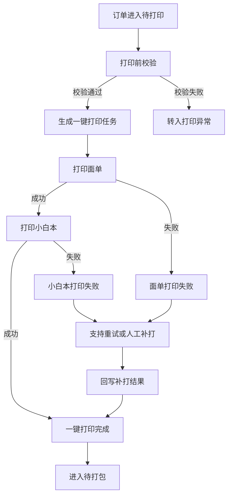

# 一键打印闭环实施计划

> **主题**：将面单打印与小白本打印绑定为单个任务，减少人工操作  
> **适用范围**：小白本生产打印环节  
> **版本**：v1.0  
> **日期**：2026-07-03  
> **关联文档**：  
> - [小白本自动化生产流程.md](./小白本自动化生产流程.md)  
> - [小白本自动化生产实施计划.md](./小白本自动化生产实施计划.md)

---

## 1. 背景与目标

### 1.1 背景

当前小白本生产链路中，面单打印与小白本打印通常被视为两个独立动作。生产人员需要在订单、文档打印、快递面单之间来回切换，人工判断打印顺序、核对订单、确认是否已打印完成。

这种方式在订单量上升后容易产生以下问题：

- 人工切换步骤多，单均操作耗时较高。
- 面单与小白本存在错配风险。
- 打印成功、失败、补打状态分散，难以追踪。
- 打印完成后仍需人工判断是否进入打包节点。

因此，本计划将“面单打印”和“小白本打印”绑定为一个统一的“一键打印任务”，由系统完成任务生成、顺序控制、状态回写和异常拦截，生产人员只需要触发一次操作即可完成同一订单下的两类打印。

### 1.2 总体目标

实现小白本生产环节的“一键打印闭环”：

```text
订单进入待打印
-> 系统校验订单、模板、收货信息
-> 生成一键打印任务
-> 自动打印面单
-> 自动打印小白本
-> 回写打印结果
-> 进入待打包
```

### 1.3 业务收益

| 收益项 | 说明 |
| --- | --- |
| 减少人工操作 | 从“分别打印面单和小白本”变为“一次触发、系统串行执行” |
| 降低错配风险 | 面单和小白本通过同一个生产任务绑定，避免拿错、打错 |
| 提升追踪能力 | 统一记录面单、小白本、补打、失败原因和执行人 |
| 支撑后续打包闭环 | 一键打印成功后自动进入待打包，形成稳定生产节奏 |

---

## 2. 范围与非范围

### 2.1 本期范围

- 新增“一键打印任务”概念。
- 将面单打印任务与小白本打印任务绑定到同一个生产任务下。
- 支持一次触发后按固定顺序执行两类打印。
- 支持打印前校验、打印中状态、打印成功回写、打印失败拦截。
- 支持面单、小白本分别补打，但仍保留同一任务关联。
- 支持批量选择订单后生成多个一键打印任务。

### 2.2 本期非范围

- 不做物流轨迹同步。
- 不做 NFC 自动写入或硬件识别。
- 不改造支付、财务、对账链路。
- 不覆盖所有非小白本产品。
- 不做大规模多仓、多设备复杂调度。

---

## 3. 现状问题

| 问题 | 当前表现 | 影响 |
| --- | --- | --- |
| 打印动作割裂 | 面单和小白本分别打印 | 人工步骤多，效率低 |
| 任务绑定弱 | 面单与小白本缺少统一执行对象 | 容易错配或漏打 |
| 状态不统一 | 面单、小白本各自有结果但缺少总状态 | 生产进度不清晰 |
| 异常处理靠经验 | 打印失败后人工判断补打内容 | 难以标准化追踪 |
| 打包前校验不足 | 是否打印齐全依赖人工确认 | 漏件、错件风险较高 |

---

## 4. 目标流程

### 4.1 一键打印主流程



### 4.2 推荐执行顺序

建议固定顺序为：

1. 先打印面单
2. 后打印小白本
3. 两者均成功后进入待打包

原因：

- 面单承载收件信息，是后续实物匹配和打包的关键标识。
- 先打印面单后，生产人员可以直接用面单作为同订单实物归集依据。
- 若面单失败，应阻断小白本继续打印，避免产生无法进入发货链路的孤立实物。

---

## 5. 核心设计

### 5.1 一键打印任务定义

一键打印任务是生产任务下的统一执行对象，用于绑定并驱动同一订单的面单打印和小白本打印。

| 对象 | 说明 |
| --- | --- |
| 生产任务 | 承接订单进入生产后的主任务 |
| 一键打印任务 | 本期新增，作为一次打印闭环的主执行对象 |
| 面单打印子任务 | 一键打印任务下的第一个子任务 |
| 小白本打印子任务 | 一键打印任务下的第二个子任务 |

### 5.2 建议字段

| 字段 | 说明 |
| --- | --- |
| `one_click_print_task_id` | 一键打印任务唯一标识 |
| `production_task_id` | 关联生产任务 |
| `order_id` | 关联订单 |
| `express_print_task_id` | 面单打印子任务 |
| `book_print_task_id` | 小白本打印子任务 |
| `print_sequence` | 打印顺序，默认 `express_first` |
| `task_status` | 一键打印任务总状态 |
| `express_status` | 面单打印状态 |
| `book_status` | 小白本打印状态 |
| `printer_id` | 打印设备或打印服务标识 |
| `trigger_source` | 触发来源：自动、人工、批量 |
| `operator_id` | 操作人 |
| `retry_count` | 重试次数 |
| `exception_reason` | 异常原因 |
| `created_at` | 创建时间 |
| `completed_at` | 完成时间 |

### 5.3 状态设计

#### 一键打印任务状态

| 状态 | 说明 |
| --- | --- |
| 待校验 | 已创建任务，等待打印前校验 |
| 待打印 | 校验通过，等待执行 |
| 打印中 | 面单或小白本正在打印 |
| 部分成功 | 一个子任务成功，另一个失败或待处理 |
| 打印成功 | 面单和小白本均打印成功 |
| 打印失败 | 任务执行失败，需要处理 |
| 已补打 | 失败后完成补打 |
| 已取消 | 人工取消任务 |

#### 子任务状态

| 状态 | 说明 |
| --- | --- |
| 待生成 | 子任务尚未生成 |
| 待打印 | 子任务已生成，等待打印 |
| 打印中 | 正在打印 |
| 打印成功 | 打印完成 |
| 打印失败 | 打印失败 |
| 已补打 | 补打完成 |

### 5.4 状态流转规则

| 当前状态 | 触发条件 | 目标状态 |
| --- | --- | --- |
| 待校验 | 订单、模板、收货信息校验通过 | 待打印 |
| 待校验 | 任一关键校验失败 | 打印失败 |
| 待打印 | 用户点击一键打印或系统自动触发 | 打印中 |
| 打印中 | 面单成功，小白本未完成 | 部分成功 |
| 打印中 | 面单和小白本均成功 | 打印成功 |
| 打印中 | 任一子任务失败 | 打印失败 |
| 打印失败 | 补打成功 | 已补打 |
| 已补打 | 面单和小白本最终均成功 | 打印成功 |
| 打印成功 | 系统回写生产任务 | 待打包 |

---

## 6. 打印前校验

一键打印任务执行前必须做统一校验，避免错误直接进入打印。

| 校验项 | 校验内容 | 失败处理 |
| --- | --- | --- |
| 订单状态 | 订单必须处于待打印或待生产可打印状态 | 阻断任务 |
| 生产任务 | 必须存在有效生产任务 | 阻断任务 |
| 收货信息 | 收件人、电话、地址必须完整 | 阻断面单打印 |
| 物流信息 | 快递公司或配送方式必须可识别 | 阻断面单打印 |
| 面单模板 | 面单模板或接口配置可用 | 阻断面单打印 |
| 小白本模板 | 小白本模板版本可用 | 阻断小白本打印 |
| 打印份数 | 份数必须与订单 `copy_count` 一致 | 阻断任务 |
| 打印设备 | 目标打印设备在线或打印服务可用 | 阻断任务或转人工 |

---

## 7. 功能建设计划

### 7.1 后台任务能力

| 模块 | 建设内容 | 说明 |
| --- | --- | --- |
| 任务生成 | 根据生产任务生成一键打印任务 | 保证一个订单一个主打印任务 |
| 子任务绑定 | 自动生成面单与小白本两个子任务 | 子任务共享同一订单与生产任务 |
| 顺序执行 | 按配置顺序串行打印 | 默认先面单、后小白本 |
| 状态回写 | 回写主任务与子任务状态 | 支撑生产看板展示 |
| 失败重试 | 支持单个子任务重试 | 避免整单重跑 |
| 补打记录 | 记录补打对象、原因、操作人和时间 | 支撑追踪 |

### 7.2 页面与操作能力

| 页面/入口 | 建设内容 |
| --- | --- |
| 订单列表 | 增加“一键打印”操作，支持单条和批量 |
| 生产任务详情 | 展示面单、小白本两个子任务状态 |
| 打印异常列表 | 汇总打印失败、部分成功、待补打任务 |
| 打包入口 | 仅允许打印成功的任务进入待打包 |

### 7.3 操作按钮建议

| 按钮 | 出现条件 | 动作 |
| --- | --- | --- |
| 一键打印 | 订单满足打印前校验 | 生成并执行一键打印任务 |
| 重试面单 | 面单打印失败 | 仅重试面单子任务 |
| 重试小白本 | 小白本打印失败 | 仅重试小白本子任务 |
| 补打面单 | 面单需要人工补打 | 记录补打并更新状态 |
| 补打小白本 | 小白本需要人工补打 | 记录补打并更新状态 |
| 转人工处理 | 自动打印无法继续 | 转入人工通道 |

---

## 8. 异常处理方案

### 8.1 异常分类

| 异常类型 | 示例 | 处理方式 |
| --- | --- | --- |
| 数据异常 | 收件地址缺失、电话为空 | 阻断打印，转人工补全 |
| 模板异常 | 小白本模板缺失、面单模板不可用 | 阻断打印，修复模板后重试 |
| 设备异常 | 打印机离线、卡纸、无响应 | 重试、切换设备或转人工 |
| 执行异常 | 面单成功但小白本失败 | 标记部分成功，允许单独补打 |
| 人工异常 | 操作人取消、误触发 | 记录取消原因，任务终止 |

### 8.2 失败后的处理原则

- 面单打印失败：不继续打印小白本，避免产生无法发货的实物。
- 小白本打印失败：保留已成功面单状态，允许仅补打小白本。
- 任一子任务失败：一键打印任务不得进入打印成功。
- 补打必须记录补打原因、操作人、时间和补打对象。
- 人工处理完成后必须回写系统状态，不能只在线下完成。

---

## 9. 上线节奏

### 9.1 阶段拆分

| 阶段 | 目标 | 建议周期 |
| --- | --- | --- |
| M1 | 明确字段、状态、打印顺序和校验规则 | 第 1 周 |
| M2 | 完成一键打印任务模型和子任务绑定 | 第 2 周 |
| M3 | 完成面单与小白本串行打印执行 | 第 3-4 周 |
| M4 | 完成异常处理、重试、补打和状态回写 | 第 5 周 |
| M5 | 完成页面入口、生产看板和异常列表 | 第 6 周 |
| M6 | 灰度上线并验证打印成功率、耗时和错配率 | 第 7 周 |

### 9.2 灰度策略

建议按以下顺序灰度：

1. 仅开放单一渠道订单。
2. 仅开放 `copy_count = 1` 的订单。
3. 仅开放固定模板版本。
4. 每日限定任务数量，稳定后逐步放量。
5. 打印成功率稳定后再开放批量一键打印。

### 9.3 回滚策略

上线初期必须保留以下降级能力：

- 一键打印降级为分别打印。
- 自动打印降级为人工打印。
- 批量打印降级为单单打印。
- 打印服务异常时允许人工补打并回写状态。

---

## 10. 验收标准

### 10.1 功能验收

| 编号 | 验收项 | 标准 |
| --- | --- | --- |
| AC-001 | 一键打印任务生成 | 待打印订单可生成唯一一键打印任务 |
| AC-002 | 子任务绑定 | 面单打印和小白本打印均绑定同一生产任务 |
| AC-003 | 顺序执行 | 系统按“先面单、后小白本”执行 |
| AC-004 | 打印前校验 | 缺少关键字段时阻断打印并提示原因 |
| AC-005 | 状态回写 | 面单、小白本、主任务状态均可回写 |
| AC-006 | 异常重试 | 面单或小白本失败后可单独重试 |
| AC-007 | 补打记录 | 补打原因、操作人、时间可追踪 |
| AC-008 | 打包联动 | 两类打印均成功后才允许进入待打包 |

### 10.2 效果验收

| 指标 | 目标 |
| --- | --- |
| 单均打印操作次数 | 降低 50% 以上 |
| 面单与小白本错配率 | 接近 0 |
| 打印状态可追踪率 | 100% |
| 打印失败可定位率 | 100% |
| 批量任务人工干预比例 | 灰度稳定后持续下降 |

---

## 11. 测试场景

| 用例编号 | 场景 | 前置条件 | 预期结果 |
| --- | --- | --- | --- |
| TC-001 | 单订单一键打印成功 | 订单字段、模板、设备均正常 | 面单和小白本均打印成功，订单进入待打包 |
| TC-002 | 收货信息缺失 | 订单缺少地址或电话 | 阻断打印，提示缺失字段 |
| TC-003 | 面单打印失败 | 面单打印设备异常 | 小白本不继续打印，任务进入打印失败 |
| TC-004 | 小白本打印失败 | 面单成功，小白本设备异常 | 任务部分成功，可单独补打小白本 |
| TC-005 | 面单补打 | 面单失败后人工补打 | 回写面单已补打，继续后续流程 |
| TC-006 | 批量一键打印 | 多个订单满足条件 | 每个订单生成独立一键打印任务 |
| TC-007 | 重复触发 | 同一订单已有未完成打印任务 | 阻止重复生成，提示已有任务 |
| TC-008 | 打包拦截 | 仅面单成功，小白本未成功 | 不允许进入待打包 |

---

## 12. 风险与应对

| 风险 | 影响 | 应对措施 |
| --- | --- | --- |
| 面单接口或模板不稳定 | 一键打印无法启动 | 保留人工面单处理和补录入口 |
| 打印设备不稳定 | 打印失败率高 | 支持重试、切换设备和人工补打 |
| 订单字段质量不足 | 校验失败任务增多 | 前置字段校验，异常订单提前进入人工处理 |
| 批量打印误触发 | 造成大量错误打印 | 灰度期限制批量数量，增加二次确认 |
| 状态回写不完整 | 打包节点无法判断 | 主任务与子任务状态必须同时回写 |
| 补打未记录 | 后续追踪困难 | 补打动作强制填写原因并记录操作人 |

---

## 13. 角色分工

| 角色 | 职责 |
| --- | --- |
| 产品 | 定义流程、状态、按钮、异常处理和验收标准 |
| 开发 | 建设任务模型、打印执行、状态回写和页面入口 |
| 测试 | 覆盖成功、失败、补打、批量、重复触发等场景 |
| 生产/运营 | 提供现场打印 SOP，参与灰度验证和异常反馈 |
| 渠道/物流 | 确认面单字段、快递公司、配送方式和异常口径 |

---

## 14. 结论

本期建议将“一键打印”作为小白本生产自动化的关键闭环能力优先建设。落地重点不是简单增加一个按钮，而是把面单打印和小白本打印绑定为同一个可追踪、可重试、可补打、可回写的生产任务。

当一键打印任务稳定后，小白本生产可以从“人工分别操作”升级为“系统统一驱动、人工处理异常”，后续再衔接打包确认、发货回写和 NFC 等自动识别能力，整体链路会更清晰、更可控。
